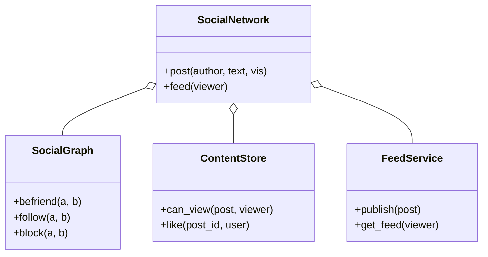

# 社交网络（Social Network，low priority）

## 题目

一个简化版的社交网络：用户加好友、关注别人、发动态、刷信息流；动态有隐私范围，不是谁都能看。用的人是普通用户，调用的是「发帖」「刷信息流」这类接口。

**面试官真正在看的是两个决定：好友和关注是不是同一件事；信息流是发帖时提前算好，还是刷的时候现算。** 这两件定不下来，隐私、拉黑、点赞都无处安放。

你会听到的原话：设计一个简化版社交网络。用户可以加好友、发帖，能刷到朋友们的最新动态；动态有隐私范围。

常见追问：
- 一个有 500 万粉丝的账号发帖，信息流怎么扛？
- 拉黑了一个人，他已经推到我收件箱里的动态怎么办？
- 点赞点两次呢？

## 先问这几个问题

- 好友和关注是同一个概念吗？**通常两者都要：好友是双向、要同意的信任圈，决定「仅好友可见」；关注是单向的内容订阅，决定信息流里刷到谁。** 要两套存储。
- 规模多大？**几百人现算就够；百万用户、粉丝极度不均时，要提前算好，并给大 V 留例外。**
- 隐私几档？公开 / 仅好友 / 自定义名单三档够用，更细是加分项。
- 拉黑是什么意思？**默认双向：互相看不见，已有的好友和关注一并清除。**
- 信息流要不要实时推送？不要，这里只是「打开 App 时看到什么」的拉取接口。范围外：持久化、推荐排序、搜索、富媒体。

## 核心对象

| 类 | 职责（一句话） | 守住的不变量 |
|---|---|---|
| `SocialGraph` | 好友、关注、拉黑三种关系 | 好友和拉黑对称；拉黑一定清掉好友和关注 |
| `Post` | 一条动态：发布者、正文、可见范围 | 可见范围创建后不变 |
| `ContentStore` | 动态、点赞、评论，以及 `can_view` | **可见性判定只写在这一处** |
| `FeedService` | 每个用户的收件箱，发帖时扩散，刷信息流时过滤 | 收件箱只存动态 id，最终展示前必过 `can_view` |
| `SocialNetwork` | 门面：对外的全部接口 | 不放业务规则，只转发 |



## 主流程

**发帖 `post`：**
1. `ContentStore` 创建动态，记发布者、可见范围、时间。
2. `FeedService.publish`：发布者是大 V（粉丝数达到阈值）就**只记入发布者自己的时间线，不扩散**。
3. 否则对每个关注者，若 `can_view` 通过，把动态 id 放进他的收件箱（有上限的双端队列）。

**刷信息流 `get_feed`：**
1. 取出收件箱里的动态 id，再把他关注的大 V 最近的几条现拉进来（这部分是读扩散）。
2. 对每条逐一再过 `can_view`；不过的丢掉。
3. 按时间倒序取前 `limit` 条。可能出错的地方：用户不存在。

## 关键决策

### 好友与关注：一套还是两套

- 只做关注：表达不了对称的「互相确认」，「仅好友可见」里的好友指什么说不清。
- 只做好友：表达不了「我想看公众人物，他不会反过来关注我」。
- **两套各司其职：好友是信任圈，关注是内容订阅。** 接受好友请求时顺带建立双向关注，避免成了好友却看不到动态。反过来 `unfriend` 不强制取关，`unfollow` 不影响好友。两条不对称各写一条测试，因为最容易被「顺手」连在一起。

### 信息流：写扩散还是读扩散

- 写扩散（fan-out on write）：发帖时推进每个关注者的收件箱，刷信息流 `O(1)`，发帖 `O(粉丝数)`。
- 读扩散（fan-out on read）：发帖 `O(1)`，刷信息流要合并所有关注人的时间线 `O(k)`。
- 读写比通常 100:1，**选写扩散：把贵的计算放在次数少的写路径上。** 代价是大 V：500 万粉丝发一条就是 500 万次写。**所以按账号分：大 V 跳过扩散，读者刷信息流时现拉，只有少数账号退化成读扩散。**

### 可见性判定：一处函数，拒绝责任链

- 方案 A，责任链或规则对象组合：四条规则变四个类加注册代码，读逻辑要跨四个文件。
- **选一个四分支的 `can_view`，顺序固定：先拉黑，再发布者本人，再按范围分三支。** 规则集合和顺序都不会在运行时变，责任链解决的是别的问题。要紧的是它只能存在一处：发帖筛选、刷信息流、查单帖三处都调同一个函数，加新规则时不会漏改。

### 拉黑：切断关系，还要在读时兜底

- 只加黑名单：已有的好友、关注还在。
- 遍历所有收件箱删动态：代价随收件箱总数增长，还容易漏。
- **拉黑时立刻清掉双向好友和关注，同时让 `can_view` 在每次读时重判。** 收件箱里那条 id 还在，但展示前被过滤。读时兜底让拉黑不依赖「清理已扩散的历史数据」。点赞同理用集合而不是计数器，重复点击幂等。

## Python 骨架

```python
from __future__ import annotations
import itertools
from collections import deque
from dataclasses import dataclass
from enum import Enum


class Visibility(Enum):
    PUBLIC = 1
    FRIENDS = 2


@dataclass(frozen=True)
class Post:
    id: int
    author: str
    text: str
    vis: Visibility
    ts: int


class SocialGraph:  # 三种关系；好友和拉黑对称，关注单向
    def __init__(self) -> None:
        self.friends: dict[str, set] = {}
        self.following: dict[str, set] = {}
        self.followers: dict[str, set] = {}
        self.blocked: dict[str, set] = {}
        self.pending: set[tuple[str, str]] = set()

    def request_friend(self, a: str, b: str) -> None:
        if (b, a) in self.pending:  # 对方也发过：直接成为好友，不悬着两条请求
            self.pending.discard((b, a))
            self.friends.setdefault(a, set()).add(b)
            self.friends.setdefault(b, set()).add(a)
            self.follow(a, b)  # 成为好友顺带互相关注
            self.follow(b, a)
        else:
            self.pending.add((a, b))

    def accept(self, b: str, a: str) -> None:  # b 接受 a 的请求
        self.pending.discard((a, b))
        self.pending.add((b, a))
        self.request_friend(a, b)

    def follow(self, a: str, b: str) -> None:
        if not self.is_blocked(a, b):
            self.following.setdefault(a, set()).add(b)
            self.followers.setdefault(b, set()).add(a)

    def is_blocked(self, a: str, b: str) -> bool:
        return b in self.blocked.get(a, ()) or a in self.blocked.get(b, ())

    def block(self, a: str, b: str) -> None:  # 对称拉黑，并立刻清掉已有关系
        self.blocked.setdefault(a, set()).add(b)
        for x, y in ((a, b), (b, a)):
            self.friends.get(x, set()).discard(y)
            self.following.get(x, set()).discard(y)
            self.followers.get(y, set()).discard(x)


class SocialNetwork:
    def __init__(self, celebrity_at: int = 10_000) -> None:
        self.graph, self.posts, self.celebrity_at = SocialGraph(), {}, celebrity_at
        self.inbox: dict[str, deque] = {}
        self.authored: dict[str, deque] = {}
        self.likes: dict[int, set] = {}
        self._ids, self._clock = itertools.count(1), itertools.count(1)

    def can_view(self, post: Post, viewer: str) -> bool:  # 全系统唯一的可见性判定
        if self.graph.is_blocked(post.author, viewer):
            return False
        if viewer == post.author or post.vis is Visibility.PUBLIC:
            return True
        return viewer in self.graph.friends.get(post.author, ())

    def post(self, author: str, text: str, vis: Visibility = Visibility.PUBLIC) -> Post:
        p = Post(next(self._ids), author, text, vis, next(self._clock))
        self.posts[p.id] = p
        self.authored.setdefault(author, deque(maxlen=50)).appendleft(p.id)
        if len(self.graph.followers.get(author, ())) >= self.celebrity_at:
            return p  # 大 V 不扩散：读者刷信息流时现拉
        for f in self.graph.followers.get(author, ()):
            if self.can_view(p, f):
                self.inbox.setdefault(f, deque(maxlen=500)).appendleft(p.id)
        return p

    def feed(self, viewer: str, limit: int = 20) -> list[Post]:
        ids = set(self.inbox.get(viewer, ()))
        for a in self.graph.following.get(viewer, ()):  # 大 V 现拉
            if len(self.graph.followers.get(a, ())) >= self.celebrity_at:
                ids.update(list(self.authored.get(a, ()))[:10])
        found = [self.posts[i] for i in ids]
        shown = [p for p in found if self.can_view(p, viewer)]  # 读时再判：拉黑不用回头清收件箱
        return sorted(shown, key=lambda p: -p.ts)[:limit]

    def like(self, post_id: int, user: str) -> bool:  # 集合：重复点赞幂等
        s = self.likes.setdefault(post_id, set())
        if user in s:
            return False
        s.add(user)
        return True


if __name__ == "__main__":
    n = SocialNetwork()
    g = n.graph
    g.request_friend("ann", "bob")
    g.accept("bob", "ann")
    g.follow("cat", "ann")  # cat 只是关注者，不是好友
    p1 = n.post("ann", "hello", Visibility.PUBLIC)
    p2 = n.post("ann", "secret", Visibility.FRIENDS)
    assert [p.id for p in n.feed("bob")] == [p2.id, p1.id]
    assert [p.id for p in n.feed("cat")] == [p1.id]  # 仅好友的动态 cat 看不到
    g.block("ann", "bob")  # 双向拉黑：收件箱里已有的动态读时被过滤
    assert n.feed("bob") == [] and not g.friends["ann"]
    assert n.like(p1.id, "cat") and not n.like(p1.id, "cat")
    print("ok")
```

## 面试官加需求时

| 新需求 | 改哪里 | 不用动哪里 |
|---|---|---|
| 自定义好友名单可见 | `Visibility` 加一档，`can_view` 加一支，图里加名单 | 信息流、扩散逻辑 |
| 静音某人 | `FeedService` 加一个静音集合，读时过滤 | 关系图 |
| 评论 | 独立的 `Comment` 实体，评论数从列表长度派生 | 点赞、信息流 |
| 按热度排序 | `get_feed` 末尾的排序键换成函数 | 收件箱结构 |
| 删帖 | `ContentStore` 删除，收件箱里的 id 读时发现不存在就跳过 | 扩散逻辑 |
| 单条动态对指定人可见 | `Post` 加 `audience` 集合，`can_view` 加一支 | 其余所有路径 |

## 并发与扩展

- 竞态：**发帖时扩散到一半，有人取关或被拉黑。** 读时必过 `can_view`，所以不会泄漏，最多收件箱里多一条会被过滤的 id。
- 好友请求互发：两个线程同时发，要在同一把锁里判断「对方是否已发过」，否则变成两条悬着的请求。
- 每个用户的收件箱各自加锁，扩散时一次只锁一个，不要持全局锁遍历百万粉丝。
- 规模变大：扩散走消息队列异步做；收件箱放缓存（Redis）；大 V 阈值按粉丝数动态判断；关系图落到图存储或分片的关系表。

## 常见错误

- 好友和关注混成一套：**两种语义回答不同的问题，分开建模。**
- 只在发帖时判可见性：**拉黑发生在扩散之后，读时必须再判一次。**
- 可见性判定复制到三个地方：**一个 `can_view`，加规则只改一处。**
- 点赞用整数计数器：**用用户集合，重复点击才幂等。**
- 大 V 也写扩散：**一次发帖写几百万份收件箱，按账号退化为读扩散。**

## 30 秒复述

- 对象：`SocialGraph` 管好友、关注、拉黑；`ContentStore` 管动态点赞和 `can_view`；`FeedService` 管收件箱。
- 好友是双向的信任圈，关注是单向的订阅；接受好友时顺带互相关注。
- **信息流选写扩散，因为读写比悬殊；大 V 按账号例外，读时现拉。**
- 可见性只有一个 `can_view`，发帖筛选、刷信息流、查单帖都调它；不用责任链。
- 拉黑立刻清掉双向关系，并且读时再判，所以不用去清历史收件箱。
- 点赞用集合，幂等。

## 来源

- [[solution-social-network]]
