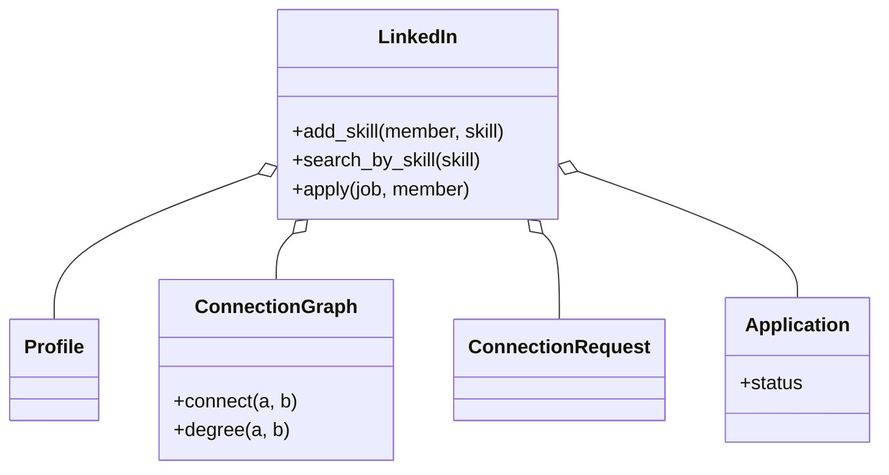

# 职业社交（LinkedIn，low priority）

## 题目

LinkedIn 的核心部分：用户有职业档案（工作经历、教育、技能），可以给别人发连接请求，能查两个人隔了几度；公司发布职位，用户申请，招聘方按技能搜候选人。调用方是用户和招聘方。

**面试官真正在看的是：「连接」和「关注」是不是同一种关系；度数查询会不会写成指数爆炸的单向搜索；按技能搜人是每次扫全表，还是有索引；申请状态能不能随便跳。**

你会听到的原话：设计 LinkedIn 的核心部分。用户有档案，能发连接请求，能查两人之间几度，有职位发布和申请，招聘方能按技能搜候选人。

常见追问：
- 我和一个陌生人隔了几度？只要 1 到 3 度。
- 申请「待审核」能直接变「已录用」吗？
- 要加「关注某个人但不是一度人脉」，怎么加？

## 先问这几个问题

- 连接是关注吗？**不是。关注可以单向，连接必须双方同时成立：一旦接受，互为一度人脉，不存在「我当你是人脉、你不知道」。** 这决定图结构是无向的。
- 档案字段要不要任意扩展？**不要。字段是产品给定的固定集合，用有类型的值对象，不用 `dict[str, Any]`。**
- 度数要多精确？**只要 1 / 2 / 3 度，超过就说「3 度以上」。** 搜索因此可以封顶，不必算真实最短路径。
- 技能搜索到什么程度？精确技能名匹配，不做同义词；但要能扛候选人规模增长，不能每次扫全部档案。
- 申请状态能随便跳吗？不能，要经过中间状态。范围外：信息流、私信、鉴权、语义搜索。

## 核心对象

| 类 | 职责（一句话） | 守住的不变量 |
|---|---|---|
| `Profile` | 一个人的档案：经历、教育、技能 | 字段有类型；技能只通过 `add_skill` 加 |
| `ConnectionGraph` | 无向图：已接受的连接 | 一条边只有一个写入口，两个方向同时更新 |
| `ConnectionRequest` | 一次请求：谁发给谁，状态 | 只有接收方能接受或忽略；发送方能撤回 |
| `Job` / `Application` | 职位和一次申请 | 申请状态只能按转移表走 |
| `LinkedIn` | 门面：持有以上一切和技能反向索引 | 索引和档案技能始终一致 |



## 主流程

**连接：**
1. `send_request(a, b)`：不能给自己发，不能重复发，已连接不能再发。
2. `accept(request_id, who)`：**只有接收方能接受**；调用 `graph.connect(a, b)` 一次，两个方向同时写入。
3. 忽略或撤回只改请求状态，图不动。

**度数 `degree(a, b)`：**
1. 从两端各放一个前沿，每轮**先展开较小的一侧**，累计深度。
2. 两侧距离表相遇就返回两边距离之和；深度到 3 还没相遇，返回 `None`（3 度以上）。

## 关键决策

### 档案：有类型的值对象，不是字典

- 方案 A，`sections: dict[str, list[dict]]`：灵活，但键拼错不会在写入时报错，只会在搜索时悄悄搜不到人；日期是不是可比较类型也无人保证。
- 方案 B，`frozen` 的 `ExperienceEntry`、`EducationEntry`，技能是明确的 `list[str]`。
- **选 B：字段类型由类型系统保证，技能才能当一等公民被索引安全引用。** 真要用户自定义栏位，显式加一个 `custom_fields`，把结构化和自由格式分开放。

### 连接不是关注：一个无向图，一个写入口

- 方案 A，两份「关注列表」，接受时各往对方列表加一个 id：效果对，但全靠「两次写入都发生」这个约定，一次失败就出现 A 认为连着、B 不认为。
- **选专门的无向图，`connect(a, b)` 一个入口同时写两个方向。** 要加「关注」，另建一个有向结构，不要给图加 `directed` 开关：一个类同时守两种不相容的不变量，等于把问题搬了家。「请求」是有向的过程对象，「连接」是无向的结果状态，两个类。

### 度数：有界双向 BFS

- 方案 A，从起点单向展开到终点：最坏 `O(b^d)`，`b` 常是几百，`d` 到 4 就不可算。
- **选双向：两端各展开到 `d/2` 层相遇，指数减半，每轮扩较小的一侧，并封顶 3 度。** 「只要 1 到 3 度」这句澄清直接变成一个循环条件。代价：只回答隔几度，不回答经过谁。

### 按技能搜人：反向索引

- 方案 A，遍历所有档案：代码最少，但搜索是高频操作，随人数线性增长。
- **选 `skill -> {member}` 反向索引，在 `add_skill` 这个低频写入点维护。** 一个人一生加技能个位数次，搜索每天成千上万次。代价是多守一条不变量，所以技能只能通过这一个入口加。

### 申请状态：一张转移表，不加模式

- 一串 `if 当前 == X and 目标 == Y` 散在方法里，要读完才能拼出状态图。
- **选一张 `dict[状态, 允许的下一状态]` 表，检查只是一次查表。** 加规则只改表。这不是状态模式，没有状态类。

## Python 骨架

```python
from __future__ import annotations
from dataclasses import dataclass, field
from enum import Enum


class LinkedInError(Exception):
    pass


class AppStatus(Enum):
    SUBMITTED = 1
    REVIEWING = 2
    OFFERED = 3
    REJECTED = 4


TRANSITIONS = {  # 状态图就是这张表：加规则只改表
    AppStatus.SUBMITTED: {AppStatus.REVIEWING, AppStatus.REJECTED},
    AppStatus.REVIEWING: {AppStatus.OFFERED, AppStatus.REJECTED},
    AppStatus.OFFERED: set(),
    AppStatus.REJECTED: set(),
}


@dataclass
class Profile:
    name: str
    skills: list[str] = field(default_factory=list)


class ConnectionGraph:  # 无向图：边只有 connect 一个写入口
    def __init__(self) -> None:
        self._edges: dict[str, set] = {}

    def connect(self, a: str, b: str) -> None:
        self._edges.setdefault(a, set()).add(b)
        self._edges.setdefault(b, set()).add(a)  # 两个方向同时写

    def connected(self, a: str, b: str) -> bool:
        return b in self._edges.get(a, ())

    def degree(self, a: str, b: str, limit: int = 3) -> int | None:
        if a == b:
            return 0
        fa, fb = {a}, {b}
        da, db = {a: 0}, {b: 0}
        depth = 0
        while depth < limit and fa and fb:
            if len(fa) > len(fb):  # 永远扩较小的一侧
                fa, fb, da, db = fb, fa, db, da
            depth += 1
            nxt = set()
            for m in fa:
                for n in self._edges.get(m, ()):
                    if n in db:
                        total = da[m] + 1 + db[n]
                        if total <= limit:
                            return total
                    elif n not in da:
                        da[n] = da[m] + 1
                        nxt.add(n)
            fa = nxt
        return None  # 3 度以上


@dataclass
class Request:
    sender: str
    receiver: str
    status: str = "PENDING"


class LinkedIn:
    def __init__(self) -> None:
        self.profiles: dict[str, Profile] = {}
        self.graph = ConnectionGraph()
        self.requests: dict[int, Request] = {}
        self.apps: dict[tuple[str, str], AppStatus] = {}
        self._skill_index: dict[str, set] = {}  # 技能 -> 成员，由 add_skill 唯一维护

    def add_member(self, mid: str, name: str) -> None:
        self.profiles[mid] = Profile(name)

    def add_skill(self, mid: str, skill: str) -> None:
        self.profiles[mid].skills.append(skill)
        self._skill_index.setdefault(skill, set()).add(mid)

    def search_by_skill(self, skill: str) -> list[str]:
        return sorted(self._skill_index.get(skill, ()))  # 查表，不扫全部档案

    def send_request(self, a: str, b: str) -> int:
        if a == b or self.graph.connected(a, b):
            raise LinkedInError("无效请求")
        rid = len(self.requests) + 1
        self.requests[rid] = Request(a, b)
        return rid

    def accept(self, rid: int, who: str) -> None:
        r = self.requests[rid]
        if who != r.receiver or r.status != "PENDING":  # 只有接收方能接受
            raise LinkedInError("不能接受")
        r.status = "ACCEPTED"
        self.graph.connect(r.sender, r.receiver)

    def apply(self, job: str, mid: str) -> None:
        self.apps[(job, mid)] = AppStatus.SUBMITTED

    def advance(self, job: str, mid: str, new: AppStatus) -> None:
        if new not in TRANSITIONS[self.apps[(job, mid)]]:  # 一次查表
            raise LinkedInError("非法转移")
        self.apps[(job, mid)] = new


if __name__ == "__main__":
    li = LinkedIn()
    for m in "abcd":
        li.add_member(m, m.upper())
    for x, y in (("a", "b"), ("b", "c"), ("c", "d")):
        li.accept(li.send_request(x, y), y)
    assert li.graph.degree("a", "b") == 1 and li.graph.degree("a", "c") == 2
    assert li.graph.degree("a", "d") == 3
    li.add_member("e", "E")
    assert li.graph.degree("a", "e") is None  # 不连通
    li.add_skill("c", "python")
    assert li.search_by_skill("python") == ["c"]
    rid = li.send_request("a", "e")
    try:
        li.accept(rid, "a")  # 发送方不能替对方接受
        raise SystemExit("应当拒绝")
    except LinkedInError:
        pass
    li.apply("j1", "a")
    try:
        li.advance("j1", "a", AppStatus.OFFERED)  # 不能跳过审核
        raise SystemExit("应当拒绝")
    except LinkedInError:
        pass
    li.advance("j1", "a", AppStatus.REVIEWING)
    print("ok")
```

## 面试官加需求时

| 新需求 | 改哪里 | 不用动哪里 |
|---|---|---|
| 关注（非连接） | 新增一个有向的 `FollowGraph` | `ConnectionGraph` |
| 共同联系人 | 取两个人邻居集合的交集 | 图的结构 |
| 度数路径（经过谁） | BFS 里多记前驱，相遇后回溯 | 请求与档案 |
| 公司页面 | 新增 `Company` 实体，`Job` 引用它 | 档案、连接 |
| 多技能 AND 搜索 | 对各技能的成员集合取交集 | 索引的维护点 |
| 撤回 offer | 转移表里加一条 `OFFERED -> REJECTED` | `advance` 的检查 |

## 并发与扩展

- 竞态 1：**两人同时互发请求。** 在同一把锁里判「对方是否已有待处理请求」，对方已发过就直接连接，别留两条互相矛盾的请求。
- 竞态 2：**同一个请求被接受两次。** 接受前后状态检查和 `connect` 要在同一个临界区。
- 索引更新和档案更新要一起，否则搜索会漏人或多人；统一从 `add_skill` 进。
- 规模变大：图分片存，度数查询只对热点用户缓存；技能索引放搜索引擎（倒排索引）；三度以外不实时算。

## 常见错误

- 把连接做成两份关注列表：**用无向图，一个入口同时写两边。**
- 度数查询单向 BFS 展开到底：**双向、封顶 3 度。**
- 档案用 `dict[str, Any]`：**有类型的值对象，类型错在写入时就暴露。**
- 技能搜索扫全表：**反向索引，写入点唯一。**
- 允许发送方自己接受请求：**接受权只在接收方。**

## 30 秒复述

- 对象：`Profile`、无向的 `ConnectionGraph`、有向的 `ConnectionRequest`、`Job` / `Application`，以及持有索引的 `LinkedIn`。
- **连接不是关注：连接是无向图，一个 `connect` 同时写两个方向；请求是有向的过程，连接是无向的结果。**
- 度数用双向 BFS，每轮扩较小一侧，封顶 3 度，指数减半。
- 技能搜索是反向索引，只在 `add_skill` 这个低频写入点维护。
- 申请状态是一张转移表，不加状态模式。
- 并发：接受请求和 `connect` 在同一个临界区，互发请求时直接连接。

## 来源

- [[solution-linkedin]]
