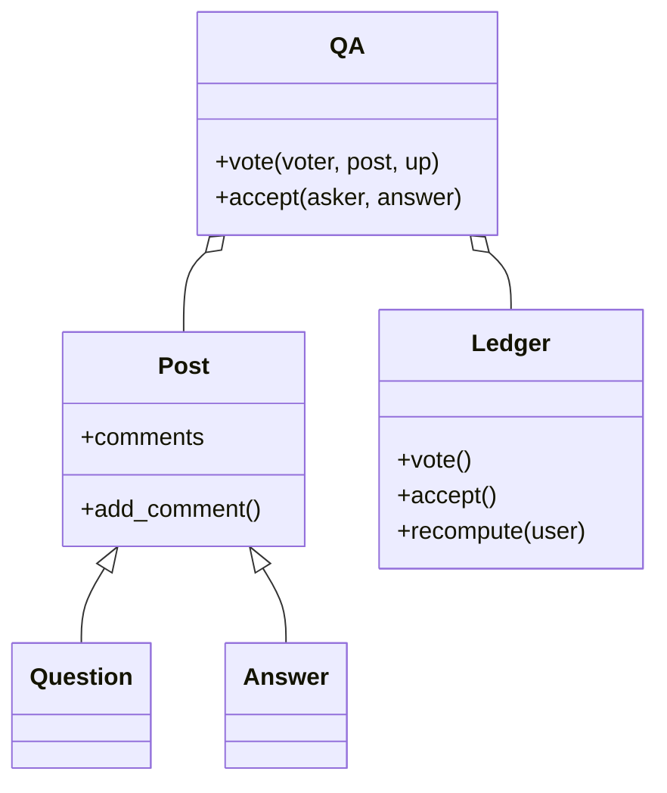

# 问答社区（Stack Overflow，low priority）

## 题目

用户提问、回答、评论；可以给问题和回答投票；声望随活跃度和内容质量涨跌；问题能打标签并按标签检索；提问者可以采纳一个回答。

**面试官真正在看的是：评论怎么同时挂在问题和回答上而不写 `parent_type` 字符串；改票、撤票、换采纳时声望会不会算漂；关闭和删除问题对下面的回答各做什么。** 声望是分水岭。

你会听到的原话：设计 Stack Overflow。用户能提问、回答、评论，能给问题和回答投票，声望按活动涨跌，问题可以打标签并被搜索。

常见追问：
- 一个人先踩后赞（改票），声望怎么变？
- 提问者把采纳从回答 A 换到回答 B，三个人的声望各怎么变？
- 新用户能不能上来就踩别人？

## 先问这几个问题

- 评论挂在问题还是回答上？**两者都可以，且以后可能再加文章。这决定评论要不要靠多态，而不是靠类型字符串。**
- 一票能改能撤吗？**能。改票、撤票只影响净差值：新效果减旧效果。**
- 降票、评论、编辑要声望门槛吗？**要，门槛是一张数据表（评论 50、降票 125、编辑 2000）。**
- 采纳能换吗？只有提问者能采纳，同时只有一个，可以换。换的时候旧答主扣回、新答主加上，**提问者自己的奖励不翻倍**。
- 关闭和删除各对回答做什么？**关闭：停止新回答，已有内容原样保留。删除：问题和它的回答一起标记删除。** 范围外：全文搜索、通知投递、持久化。

## 核心对象

| 类 | 职责（一句话） | 守住的不变量 |
|---|---|---|
| `Post` | 问题、回答共享的身份、正文、评论容器 | 评论只存在自己身上 |
| `Question` / `Answer` | 问题（标题、标签、状态、已采纳回答）/ 回答 | 已采纳回答要么为空，要么属于这个问题 |
| `Ledger` | 声望账本：只追加的事件日志加增量缓存 | **声望永远等于对日志的折叠**，不会漂移 |
| `THRESHOLD` | 权限到声望门槛的一张表（数据，不是类） | 加权限只加一行 |
| `QA` | 门面：提问、回答、投票、采纳、关闭、删除 | 每个业务动作对应账本里的一次操作 |



## 主流程

**投票 `vote`：**
1. 检查权限：降票需要声望 ≥ 125；不能给自己的内容投票。
2. 账本取这位投票人对这条内容的**当前票**（可能没有），算「旧效果」。
3. 算「新效果」，写一条事件，里面是**净差值**（新减旧），同时更新每个人的缓存总分。
4. 撤票是新效果为空的特例，和改票走同一条路。

**采纳 `accept`：**
1. 只有提问者能采纳，回答必须属于这个问题。
2. 账本**一次**接收「旧采纳是谁、新采纳是谁」，算清三笔账：旧答主扣、新答主加、提问者的净变化，只写一条事件。

## 关键决策

### 评论挂在谁身上：多态加组合，不是 `parent_type`

- 方案 A，`Comment(parent_type="question" | "answer", parent_id)`：每处用评论的代码先判字符串再去两张表找；传错类型编译期不报错；加文章要再加一个分支。
- **选 `Question`、`Answer` 共享一个 `Post` 基类，评论长在内容对象自己身上。** 调用方已经拿到具体对象，`post.add_comment()` 由多态路由，没有 `isinstance`。这里继承是正当的：问题和回答确实共享身份、正文、评论这一套行为。

### 声望：事件日志的折叠，不是一个整数字段

- 方案 A，`user.reputation += delta`：不知道这次是不是改票。从踩改成赞，只加了「赞」的分，踩造成的扣分永远没还回去，账从此对不上。
- **选只追加的事件日志。每条事件记「这次动作让声望净变化多少」，等于新效果减旧效果。** 增量缓存把查询做成 `O(1)`，但另有一条独立的 `recompute(user)` 只读日志从零加一遍；测试断言两者永远相等，这就是「不漂移」的证明。代价是多存一份历史。

### 权限门槛：一张表，不建策略类

- 方案 A，每种权限一个 `Policy` 接口加实现类：三个类的行为完全相同（一次比较），只差右边的数字。
- **选 `dict[权限, 门槛]` 加一个 `can(rep, perm)`。** 子类的正当理由是行为不同，不是参数不同。这是「不加模式」的一条。

### 换采纳：一次账本操作，不是取消再采纳

- 方案 A，先 `unaccept` 再 `accept`：中间有一个「没有采纳」的态；提问者的奖励被先扣再加；日志多两条不该有的事件。
- **选 `accept(question, old, new)` 一次调用，只写一条事件。** 一次业务动作对应一次账本操作，拆成两次才需要理由。

## Python 骨架

```python
from __future__ import annotations
from dataclasses import dataclass, field

UP, DOWN = 1, -1
# 声望表：(内容类型, 方向) -> (发布者得分, 投票人得分)
EFFECT = {("q", UP): (5, 0), ("q", DOWN): (-2, -1), ("a", UP): (10, 0), ("a", DOWN): (-2, -1)}
ACCEPT_ANSWER, ACCEPT_ASKER = 15, 2
THRESHOLD = {"comment": 50, "downvote": 125}  # 权限门槛：一张表


class QAError(Exception):
    pass


@dataclass
class Post:  # 问题和回答共享：评论长在自己身上，没有 parent_type
    id: int
    kind: str
    owner: str
    comments: list = field(default_factory=list)
    deleted: bool = False

    def add_comment(self, user: str, text: str) -> None:
        self.comments.append((user, text))


@dataclass
class Question(Post):
    tags: frozenset = frozenset()
    closed: bool = False
    accepted: int | None = None
    answers: list = field(default_factory=list)


class Ledger:
    def __init__(self) -> None:
        self.events: list[tuple[str, int]] = []  # 只追加的日志：(用户, 净差值)
        self.total: dict[str, int] = {}  # 增量缓存
        self.current: dict[tuple[str, int], int] = {}  # (投票人, 内容) -> 当前票

    def _record(self, user: str, delta: int) -> None:
        if delta:
            self.events.append((user, delta))
            self.total[user] = self.total.get(user, 0) + delta

    def vote(self, voter: str, post: Post, new: int | None) -> None:
        key = (voter, post.id)
        old = self.current.get(key)
        oa, ov = EFFECT[(post.kind, old)] if old else (0, 0)
        na, nv = EFFECT[(post.kind, new)] if new else (0, 0)
        self._record(post.owner, na - oa)  # 净差值 = 新效果 - 旧效果：改票和撤票走同一条路
        self._record(voter, nv - ov)
        if new:
            self.current[key] = new
        else:
            self.current.pop(key, None)

    def accept(self, asker: str, old: Post | None, new: Post | None) -> None:
        if old:
            self._record(old.owner, -ACCEPT_ANSWER)
        if new:
            self._record(new.owner, ACCEPT_ANSWER)
        self._record(asker, ACCEPT_ASKER * ((new is not None) - (old is not None)))  # 提问者只算净变化

    def recompute(self, user: str) -> int:  # 独立验证通道：只读日志，从零折叠
        return sum(d for u, d in self.events if u == user)


class QA:
    def __init__(self) -> None:
        self.ledger, self.posts, self.rep_floor = Ledger(), {}, 1
        self._next = 0

    def rep(self, user: str) -> int:
        return self.rep_floor + self.ledger.total.get(user, 0)

    def _new(self, cls, kind, owner, **kw):
        self._next += 1
        self.posts[self._next] = p = cls(self._next, kind, owner, **kw)
        return p

    def ask(self, user: str, tags=()) -> Question:
        return self._new(Question, "q", user, tags=frozenset(tags))

    def answer(self, user: str, q: Question) -> Post:
        if q.closed or q.deleted:
            raise QAError("问题已关闭")
        a = self._new(Post, "a", user)
        q.answers.append(a)
        return a

    def vote(self, voter: str, post: Post, direction: int | None) -> None:
        if voter == post.owner:
            raise QAError("不能给自己投票")
        if direction == DOWN and self.rep(voter) < THRESHOLD["downvote"]:
            raise QAError("声望不够，不能降票")
        self.ledger.vote(voter, post, direction)  # direction=None 即撤票

    def accept(self, asker: str, q: Question, a: Post) -> None:
        if asker != q.owner or a not in q.answers:
            raise QAError("无权采纳")
        old = next((x for x in q.answers if x.id == q.accepted), None)
        self.ledger.accept(asker, old, a)  # 一次操作，不是 unaccept 再 accept
        q.accepted = a.id

    def delete(self, q: Question) -> None:
        q.deleted = True
        for a in q.answers:  # 级联标记删除，已发生的声望不追溯
            a.deleted = True


if __name__ == "__main__":
    qa = QA()
    q = qa.ask("ann", tags=["python"])
    a1, a2 = qa.answer("bob", q), qa.answer("cat", q)
    qa.vote("dan", a1, UP)
    assert qa.ledger.total["bob"] == 10
    try:
        qa.vote("dan", a1, DOWN)
        raise SystemExit("应当拒绝")
    except QAError:
        pass
    qa.vote("dan", a1, None)  # 撤票
    assert qa.ledger.total["bob"] == 0
    qa.accept("ann", q, a1)
    qa.accept("ann", q, a2)  # 换采纳：提问者仍只有 +2
    assert qa.ledger.total["ann"] == 2 and qa.ledger.total["bob"] == 0 and qa.ledger.total["cat"] == 15
    assert all(qa.ledger.total.get(u, 0) == qa.ledger.recompute(u) for u in ("ann", "bob", "cat", "dan"))
    qa.delete(q)
    assert a1.deleted and a2.deleted
    print("ok")
```

## 面试官加需求时

| 新需求 | 改哪里 | 不用动哪里 |
|---|---|---|
| 文章（`Article`） | 新子类 `Post`，`EFFECT` 加一行 | 账本、投票、评论 |
| 悬赏（bounty） | 账本加一类事件，悬赏金额先冻结再发放 | 投票与采纳 |
| 新权限 | `THRESHOLD` 加一行 | `can` 的检查 |
| 低质量删除追溯扣分 | 账本在删除时对该内容的事件加反向事件 | 现有事件，仍然只追加 |
| 编辑历史 | `Post` 加一个只追加的版本列表 | 评论、投票 |
| 按标签检索 | 维护 `tag -> {question}` 倒排索引，提问时更新 | 其余流程 |

## 并发与扩展

- 竞态 1：**同一个人同时投两次票。** 「读当前票、写事件、改当前票」必须在同一把锁里，否则两条事件都按「没有旧票」算，分数翻倍。
- 竞态 2：**换采纳。** 在同一个临界区里完成，读者看不到「没有采纳」的中间态。
- 声望一致性：缓存和日志在同一个临界区里更新；上线后保留 `recompute` 做对账任务。
- 规模变大：事件日志按用户或内容分区，是一张只追加的事实表；缓存放键值存储；标签检索放倒排索引服务；声望异步汇总。

## 常见错误

- 声望做成 `+= delta` 的整数：**改票时旧效果没还，必然漂移。记净差值，留独立的重算通道。**
- 评论用 `parent_type` 字符串：**多态基类，评论长在内容对象上。**
- 换采纳实现成取消再采纳：**一次账本操作，提问者奖励不翻倍。**
- 每种权限一个策略类：**一张门槛表。**
- 删除问题留下孤儿回答：**级联标记删除；关闭不是删除，内容原样保留。**

## 30 秒复述

- 对象：`Post` 基类（问题、回答），`Ledger` 声望账本，`THRESHOLD` 门槛表，`QA` 门面。
- **评论靠多态长在内容对象上，不用 `parent_type`。**
- **声望是事件日志的折叠：每条事件记净差值，缓存加一条独立的 `recompute`，两者相等就证明不漂移。**
- 改票撤票共用同一个函数；换采纳是账本里的一次操作。
- 权限是数据表，不是策略类。
- 关闭停止新回答并保留内容；删除级联标记，已发生的声望不追溯。
- 并发：投票和采纳各自在一个临界区里完成。

## 来源

- [[solution-stack-overflow]]
