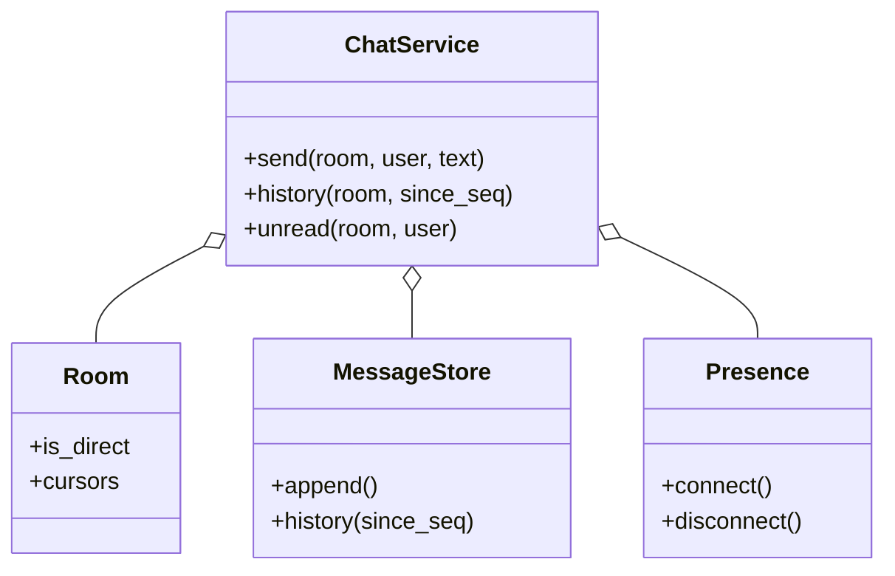

# 聊天室（Chat Room，low priority）

## 题目

一个聊天系统：用户可以一对一私聊，也可以建群聊；能看历史消息，能看到谁在线、谁正在输入；离线的人回来要能补上错过的消息。调用方是客户端，服务端按房间收发。

**面试官真正在看的是三件事：消息的顺序凭什么成立；私聊和群聊要不要两套代码；离线的人怎么补消息，要不要单独建一条待补发队列。** 在线状态和「正在输入」反而是最简单的部分。

你会听到的原话：设计一个聊天室系统，支持一对一私聊和群聊，用户能看到历史消息，也能看到谁在线。

常见追问：
- 两个人几乎同时发消息，谁先谁后？
- 我断线三小时，回来怎么补？
- 一个人断线了，别人那里还显示「正在输入」怎么办？

## 先问这几个问题

- 消息按什么顺序？**客户端时钟不可信（漂移、延迟、离线草稿），所以按服务端收到的顺序。** 这直接排除「客户端打时间戳再排序」。
- 私聊和群聊是一回事吗？**除了成员数，消息、历史、已读的机制没有区别：一个模型，加一个 `is_direct` 字段。**
- 要不要编辑、删除、撤回？常见的追加需求，历史要反映最新状态。
- 离线的人，服务端主动推，还是客户端自己问「我上次读到哪，给我之后的」？**默认客户端带游标来拉，服务端不维护待补发队列。**
- 在线状态和「正在输入」要持久化吗？**不要，它们描述「此刻」，进程重启就该作废。** 范围外：网络传输层、持久化、端到端加密。

## 核心对象

| 类 | 职责（一句话） | 守住的不变量 |
|---|---|---|
| `Room` | 一个房间：成员、`is_direct`、每个成员的已读游标 | 私聊对同一对人只有一个房间 |
| `MessageStore` | 追加和读取消息 | `seq` 在每个房间内单调递增，由服务端在收到时分配 |
| `Presence` | 在线连接和「正在输入」，纯内存 | 断开时必须清掉这个人留下的所有输入标记 |
| `ChatService` | 编排：发消息、读历史、未读数、连接 | 三个组件互不持有引用，协调只在这一层 |



## 主流程

**发消息 `send`：**
1. 拿锁；检查发送者在这个房间里，否则抛 `NotMemberError`。
2. `MessageStore.append`：在这里分配该房间的下一个 `seq`。**接口里没有客户端时间戳参数。**
3. 把发送者自己的已读游标推进到这条消息的 `seq`（自己发的不算自己的未读）。
4. 对房间里每个在线的其他成员，把消息交给他的连接（回调）；离线的什么都不做，消息已在历史里。

**重连补消息：**
1. 客户端带着自己上次的游标调 `history(room, since_seq)`，拿到之后的全部消息。
2. 没有单独的「补发」逻辑，`connect` 只登记一个连接。

## 关键决策

### 顺序：服务端到达顺序，不是客户端时间戳

- 方案 A，`Message.timestamp` 由客户端填，按它排序：B 的时钟快 5 秒，他后发的消息会排到 A 前面；离线草稿的「创建时间」和到达时间可以差很远。
- **选每个房间独立的 `seq`，在消息抵达服务端那一刻单调分配。** 排序字段在签名上就没有客户端时间戳可传。代价：几乎同时的两条，顺序是服务器的处理顺序，不一定等于某个人主观上的先后；但这是唯一所有人都能同意的顺序。`received_at` 只用来显示「几分钟前」，不参与排序。

### 单聊与群聊：一个字段，不是子类

- 方案 A，`PrivateChat` 和 `GroupChat` 继承 `Chat`：两者在消息、历史、已读、投递上没有任何一行不同。
- **选一个 `Room`，加 `is_direct: bool`，并用无序用户对做索引，让 `direct_room(a, b)` 总是返回同一个房间。** 继承买不到多态。同理不额外包一个 Mediator 类：协调的类只有三个，包一层只是给编排方法换个名字。

### 离线补消息：已读游标，不建待补发队列

- 方案 A，每个离线用户一条待推队列：要管上限和清理，永久离线的人占着内存；它和历史是同一份数据的两份拷贝，换设备就对不上。
- **选只存「读到第几条」的游标，用 `history(since_seq)` 补。** 离线期间消息照常追加；用户回来时欠账自然补齐。这不是新功能，是两个已有机制的组合。

### 未读数与在线状态

- 未读数不是单独维护的计数器：计数器和历史是两份状态，漏一次更新就永久对不上。**未读数是从游标现算的查询**：`seq` 大于游标且不是自己发的。
- **在线和「正在输入」是纯内存状态，断开时必须缩回去。** 要有反向索引 `用户 -> 正在输入的房间集合`，断开时按它清，而不是遍历所有房间；否则这个人在别人眼里永远「正在输入」。

## Python 骨架

```python
from __future__ import annotations
import itertools
import threading
from dataclasses import dataclass, field


class ChatError(Exception):
    pass


class NotMember(ChatError):
    pass


@dataclass(frozen=True)
class Message:
    seq: int  # 房间内、服务端分配的顺序，唯一的排序依据
    room: str
    sender: str
    text: str


@dataclass
class Room:
    id: str
    members: set
    is_direct: bool = False  # 私聊只是一个字段，不是子类
    cursors: dict = field(default_factory=dict)  # 用户 -> 已读到的 seq，未读数由它现算


class Presence:  # 纯内存，只描述「此刻」
    def __init__(self) -> None:
        self.conns: dict[str, object] = {}
        self.typing: dict[str, set] = {}  # 房间 -> 正在输入的人
        self.typing_rooms: dict[str, set] = {}  # 反向索引：用户 -> 房间

    def set_typing(self, user: str, room: str, on: bool) -> None:
        op = set.add if on else set.discard  # 两个方向的索引同时更新
        op(self.typing.setdefault(room, set()), user)
        op(self.typing_rooms.setdefault(user, set()), room)

    def disconnect(self, user: str) -> None:
        self.conns.pop(user, None)
        for room in self.typing_rooms.pop(user, ()):  # 只清这个人的，不扫全部房间
            self.typing.get(room, set()).discard(user)


class ChatService:
    def __init__(self) -> None:
        self.rooms: dict[str, Room] = {}
        self.log: dict[str, list[Message]] = {}
        self.presence = Presence()
        self._seq: dict[str, itertools.count] = {}
        self._dm: dict[frozenset, str] = {}
        self._lock = threading.Lock()

    def direct_room(self, a: str, b: str) -> Room:
        key = frozenset((a, b))  # 无序对：反复调用返回同一个房间
        if key not in self._dm:
            self._dm[key] = f"dm-{len(self._dm) + 1}"
            self.create_room(self._dm[key], {a, b}, True)
        return self.rooms[self._dm[key]]

    def create_room(self, rid: str, members, is_direct: bool = False) -> Room:
        self.rooms[rid] = Room(rid, set(members), is_direct)
        self.log[rid], self._seq[rid] = [], itertools.count(1)
        return self.rooms[rid]

    def connect(self, user: str, on_message) -> None:  # 很薄：只登记连接，补消息靠 history
        self.presence.conns[user] = on_message

    def send(self, rid: str, user: str, text: str) -> Message:
        with self._lock:  # 分配 seq 和追加必须原子
            room = self.rooms[rid]
            if user not in room.members:
                raise NotMember(user)
            msg = Message(next(self._seq[rid]), rid, user, text)
            self.log[rid].append(msg)
            room.cursors[user] = msg.seq  # 自己发的不算自己的未读
            targets = [self.presence.conns[m] for m in room.members
                       if m != user and m in self.presence.conns]
        for deliver in targets:  # 投递放锁外，离线的人什么都不做
            deliver(msg)
        return msg

    def history(self, rid: str, user: str, since_seq: int = 0) -> list[Message]:
        if user not in self.rooms[rid].members:
            raise NotMember(user)
        return [m for m in self.log[rid] if m.seq > since_seq]

    def mark_read(self, rid: str, user: str, seq: int) -> None:
        cur = self.rooms[rid].cursors
        cur[user] = max(cur.get(user, 0), seq)  # 游标只前进

    def unread(self, rid: str, user: str) -> int:  # 派生查询，不存计数器
        c = self.rooms[rid].cursors.get(user, 0)
        return sum(1 for m in self.log[rid] if m.seq > c and m.sender != user)


if __name__ == "__main__":
    svc = ChatService()
    got: list[Message] = []
    svc.connect("bob", got.append)
    dm = svc.direct_room("ann", "bob")
    assert svc.direct_room("bob", "ann") is dm  # 同一对人，同一个房间
    m1 = svc.send(dm.id, "ann", "hi")
    assert got == [m1] and m1.seq == 1
    svc.presence.disconnect("bob")  # bob 离线
    svc.send(dm.id, "ann", "还在吗")
    svc.send(dm.id, "ann", "回我")
    assert svc.unread(dm.id, "bob") == 3 and svc.unread(dm.id, "ann") == 0
    assert [m.seq for m in svc.history(dm.id, "bob", since_seq=1)] == [2, 3]  # 重连补消息
    svc.mark_read(dm.id, "bob", 3)
    assert svc.unread(dm.id, "bob") == 0
    svc.presence.set_typing("bob", dm.id, True)
    svc.presence.disconnect("bob")
    assert svc.presence.typing[dm.id] == set()  # 断开后不再显示正在输入
    try:
        svc.send(dm.id, "eve", "x")
        raise SystemExit("应当拒绝")
    except NotMember:
        pass
    print("ok")
```

## 面试官加需求时

| 新需求 | 改哪里 | 不用动哪里 |
|---|---|---|
| 编辑 / 撤回消息 | `Message` 加 `edited` / `deleted` 状态，`seq` 不变 | 排序、游标 |
| 群成员增减 | `Room.members` 增删；新成员的游标设为当前最大 `seq` | 消息存储 |
| @提及、通知 | 发送时扫文本，往被提及者连接投递一条额外事件 | 房间模型 |
| 消息送达 / 已读回执 | 回执就是别人的游标：`cursors` 已有 | 新增存储 |
| 分页历史 | `history` 加 `limit` 并按 `seq` 倒序分页 | `seq` 机制 |
| 多设备 | `conns` 从单个连接变成连接列表；游标仍按用户存 | 房间、消息 |

## 并发与扩展

- 竞态 1：**两个人同时发。** `seq` 的分配和追加必须在同一把锁里，否则两条消息拿到同一个 `seq` 或乱序入库。
- 竞态 2：**投递很慢。** 投递放锁外，否则一个慢连接拖住整个房间的发送；先在锁内算好目标列表再投。
- 竞态 3：游标只前进（`max`），迟到的旧「已读」不会把游标退回去。
- 规模变大：按房间分片，`seq` 由房间所属的分片分配；消息存追加型存储；投递走长连接网关加消息队列；在线状态放带过期时间的缓存（心跳续期）。

## 常见错误

- 用客户端时间戳排序：**用服务端分配的 `seq`，接口里不给客户端时间戳参数。**
- 私聊群聊两套继承：**一个 `Room` 加一个字段，私聊用无序对索引去重。**
- 给离线用户维护待补发队列：**游标加 `history(since_seq)`，历史是唯一真相。**
- 未读数用计数器：**从游标现算，不会和历史对不上。**
- 断线只摘连接，忘了清「正在输入」：**反向索引，断开时清这个人的全部标记。**

## 30 秒复述

- 对象：`Room`（成员、`is_direct`、已读游标），`MessageStore`，`Presence`，编排层 `ChatService`。
- **顺序用服务端分配的房间内 `seq`，不信客户端时钟。**
- **私聊是 `is_direct` 字段，不是子类；也不加 Mediator 类。**
- 离线补消息靠游标加 `history(since_seq)`，不建待补发队列；未读数从游标现算。
- 在线和正在输入是纯内存状态，断开时用反向索引清干净。
- 并发：分配 `seq` 和追加在同一把锁里，投递放锁外，游标只前进。

## 来源

- [[solution-chat-room]]
