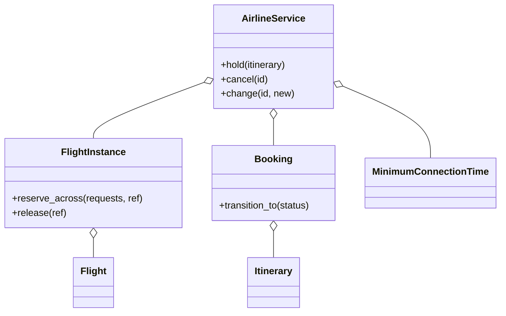

# 航班管理（Airline Management）（low priority）

## 题目

旅客搜某天从 A 到 B 的机票，可能要中转；选舱位下单，之后值机、登机，也可以取消或改签。用它的是旅客、客服和登机口。这是「一份有限资源不能卖两次」的变种，比订酒店多一层：**一次购买横跨两个独立的库存对象（两段航班），两段必须同生共死。**

**面试官真正在看的是：「航班」是不是拆成了排班规则和某一天的那一班；跨航段的订座有没有做到全成或全败而且不死锁；超售卖出去的票，代价在哪一步兑现；改签有没有「先占新的再放旧的」。**

你会听到的原话：设计一个航班管理系统，支持查询（可中转）、订票、值机、登机、取消和改签。

常见追问：
- 中转行程第二段没票了怎么办？两个人同时订同一条中转线呢？
- 超售了，登机口谁下飞机？
- 改签时新行程订不上，旅客的老票还在吗？

## 先问这几个问题

- 「航班」指排班表的一行，还是某一天飞的那一班？**两者都要建，且是两个类：库存、座位图、锁只能长在「某一天的那一班」上。**
- 一次购买能不能跨两段飞机？**能。这决定订座必须是跨对象的原子操作，而不是单个对象里的 `if`。**
- 中转要不要判定衔接时间？**要。这条规则挂在机场上，不挂在航班上。**
- 要不要超售？**要，做成按舱位注入的政策；同时必须回答「卖超了谁被拒载」。**
- 范围外：支付、行李、多币种、机组排班、候补名单（只在追问里讲）。

## 核心对象

| 类 | 职责（一句话） | 守住的不变量 |
|---|---|---|
| `Flight` | 排班表一行：航班号、起降机场、起飞钟点、座位数 | 不可变，没有日期，没有库存 |
| `FlightInstance` | 某一天的那一班：名单、座位图、一把锁 | 每个舱位的名单人数 ≤ 座位数 + 超售额度 |
| `Segment` / `Itinerary` | 某一班上的一个舱位；按时间排好的若干段 | 订座的原子单位是整条行程 |
| `MinimumConnectionTime` | 最短衔接时间表：按机场给基准，换承运人加一档 | 前段落地到后段起飞的间隔 ≥ 要求 |
| `Booking` | 订单：行程、票价、状态 | 状态只能沿转移表走 |
| `AirlineService` | 目录 + 订单表 + 生命周期，不存库存 | 持有自己的锁时绝不去拿某一班的锁 |



## 主流程

**占座 `hold`（整条行程）：**
1. 校验行程：非空、前后段机场接得上、衔接时间够。不合法就不碰库存。
2. `reserve_across`：把行程里所有 `FlightInstance` 按 `key` 排序，**依次拿齐所有锁**。
3. 持有全部锁时检查每段还有没有额度；任何一段没有就抛 `NoSeatsAvailableError`，一段都没写。
4. 全部够，才逐段把订单号记进各班的名单。释放所有锁。
5. 算票价，建订单，状态 `HELD`，带过期时间。

**登机口结算 `board`（超售的代价在这里兑现）：**
1. 逐舱处理：该舱已值机的订单数超过真实座位数，就有人被拒载。
2. 先拒载没拿到座位号的，同样没座位就拒载值机最晚的。
3. 被拒载的订单退回 `TICKETED`，释放这一班，票还在，等改签。

## 关键决策

### 航班要不要按日期拆成两个对象

- 方案 A，一个 `Flight` 带日期：每天的航班各抄一份规则，改一次起飞时间要改几百行。
- 方案 B，一个 `Flight` 同时存全部日期的库存：锁变成一把大锁，周一的旅客和周三的旅客互相等。
- **选两层：`Flight` 是不可变的排班规则，`FlightInstance`（航班号 + 日期）才持有库存和锁。** 同一天同一班的旅客才真正抢同一批座位，锁就该放在这里。

### 跨航段原子订座怎么不死锁

- 方案 A，每段各自订，第二段失败再回滚第一段：两次临界区之间别人能插进来，旅客可能拿到飞到中转站就断掉的票。
- 方案 B，一把全局锁：正确，但全国的订票互相等。
- **选「同时握住所有涉及的锁，先全检查再全写入」，加锁前先按 `key` 排序。** 全局固定的加锁顺序就是不死锁的全部理由。可重入锁（`RLock`）让同一班出现两次也不自锁。

### 超售的代价放在哪一步

- 方案 A，订座时就多卖多少记多少座位：座位图里出现没有椅子的人。
- **选「名单人数可以超过座位数，座位号在值机时分配，拿不到就是座位待定」；代价在登机口按公开规则拒载。** 订座和值机都不报错，因为超售本来就是政策。

### 改签是不是取消加重订

- 方案 A，先取消再订新的：新行程订不上，旅客连老票也没了；共用的那一段还白白丢掉已选的座位。
- **选先占新段，再放旧段中新行程没用到的部分。** `reserve_across` 看到某班舱位没变就什么也不做，所以共用航段的座位原样保留。
- 最短衔接时间属于机场，不属于航班：同一班落在浦东还是虹桥，需要的时间不同。挂在航班上就得给每条航线抄一份。这里没有模式，就是一个按机场查表的小对象。

## Python 骨架

```python
from __future__ import annotations
import itertools
import threading
from contextlib import ExitStack
from dataclasses import dataclass
from datetime import datetime, timedelta
from enum import Enum


class NoSeatsError(Exception): pass
class InvalidItineraryError(Exception): pass
class InvalidTransitionError(Exception): pass


class FlightInstance:  # 某一天的那一班：唯一持有库存和锁的对象
    def __init__(self, number, origin, dest, departs: datetime, hours: int, seats: int, overbook: int = 0):
        self.key = f"{number}@{departs.date()}"
        self.origin, self.dest = origin, dest
        self.departs, self.arrives = departs, departs + timedelta(hours=hours)
        self.seats, self.overbook = seats, overbook
        self.sold: set[str] = set()  # 订单号名单：退订天然幂等
        self.lock = threading.RLock()  # 可重入：同一班在行程里出现两次不自锁

    def free(self) -> int:
        return self.seats + self.overbook - len(self.sold)  # 调用方须持锁

    @staticmethod
    def reserve_across(legs: list[FlightInstance], ref: str) -> None:
        ordered = sorted(legs, key=lambda f: f.key)  # 全局固定顺序 = 不死锁
        with ExitStack() as stack:
            for f in ordered:
                stack.enter_context(f.lock)
            if any(ref not in f.sold and f.free() <= 0 for f in ordered):
                raise NoSeatsError(ref)  # 先全检查，一段都没写
            for f in ordered:
                f.sold.add(ref)

    def release(self, ref: str) -> None:
        with self.lock:
            self.sold.discard(ref)


@dataclass(frozen=True)
class MinimumConnectionTime:  # 属于机场，不属于航班
    default: timedelta
    by_airport: dict

    def connects(self, a: FlightInstance, b: FlightInstance) -> bool:
        need = self.by_airport.get(a.dest, self.default)
        return a.dest == b.origin and b.departs - a.arrives >= need


class Status(Enum):
    HELD = 1
    TICKETED = 2
    CHECKED_IN = 3
    CANCELLED = 4


ALLOWED = {Status.HELD: {Status.TICKETED, Status.CANCELLED},
           Status.TICKETED: {Status.CHECKED_IN, Status.CANCELLED},
           Status.CHECKED_IN: {Status.TICKETED, Status.CANCELLED},  # 退回 TICKETED = 被拒载
           Status.CANCELLED: set()}


@dataclass
class Booking:
    id: str
    legs: list
    held_until: datetime
    status: Status = Status.HELD

    def transition_to(self, target: Status) -> None:
        if target not in ALLOWED[self.status]:
            raise InvalidTransitionError(f"{self.status.name}->{target.name}")
        self.status = target


class AirlineService:  # 只管订单；库存一个字节都不存
    def __init__(self, clock, mct: MinimumConnectionTime, ttl=timedelta(minutes=20)):
        self.clock, self.mct, self.ttl = clock, mct, ttl
        self._bookings: dict[str, Booking] = {}
        self._lock = threading.Lock()  # 只护订单表；持有它时不拿任何 FlightInstance 的锁
        self._ids = (f"PNR{n}" for n in itertools.count(1))

    def hold(self, legs: list[FlightInstance]) -> Booking:
        if not legs or any(not self.mct.connects(a, b) for a, b in zip(legs, legs[1:])):
            raise InvalidItineraryError("行程不合法")  # 不合法就不碰库存
        with self._lock:
            ref = next(self._ids)
        FlightInstance.reserve_across(legs, ref)
        b = Booking(ref, legs, self.clock() + self.ttl)
        with self._lock:
            self._bookings[ref] = b
        return b

    def cancel(self, ref: str) -> None:
        with self._lock:  # 在锁内翻状态 = 认领：只有一个线程能成功
            b = self._bookings[ref]
            b.transition_to(Status.CANCELLED)
        for f in b.legs:
            f.release(ref)

    def change(self, ref: str, new_legs: list[FlightInstance]) -> Booking:
        b = self._bookings[ref]
        FlightInstance.reserve_across(new_legs, ref)  # 先占新的：失败则老票原封不动
        for f in b.legs:
            if f not in new_legs:  # 共用的航段不放，已选座位保留
                f.release(ref)
        b.legs = new_legs
        return b

    def board(self, flight: FlightInstance, checked_in: list[str]) -> list[str]:
        """已值机的人数超过真实座位数时，值机最晚的被拒载（checked_in 按值机先后排）。"""
        over = max(len(checked_in) - flight.seats, 0)
        denied = checked_in[len(checked_in) - over:]
        for ref in denied:
            self._bookings[ref].transition_to(Status.TICKETED)
            flight.release(ref)
        return denied


if __name__ == "__main__":
    t0 = datetime(2026, 7, 1, 8)
    a = FlightInstance("MU5100", "SHA", "PEK", t0, 2, seats=1)
    b = FlightInstance("MU2610", "PEK", "HRB", t0 + timedelta(hours=4), 2, seats=1)
    svc = AirlineService(lambda: t0 - timedelta(days=1), MinimumConnectionTime(timedelta(minutes=60), {}))
    p1 = svc.hold([a, b])
    assert a.free() == 0 and b.free() == 0
    try:
        svc.hold([a, b])  # 第二个人：整条行程失败
        raise SystemExit("应当售罄")
    except NoSeatsError:
        assert not a.sold - {p1.id}  # 没有半条行程残留
    c = FlightInstance("MU9", "PEK", "HRB", t0 + timedelta(hours=2, minutes=30), 2, seats=1)
    try:
        svc.hold([a, c])  # 衔接只有 30 分钟
        raise SystemExit("应当拒绝")
    except InvalidItineraryError:
        pass
    svc.cancel(p1.id)
    assert a.free() == 1 and b.free() == 1
    try:
        svc.cancel(p1.id)  # 取消两次
        raise SystemExit("应当拒绝")
    except InvalidTransitionError:
        pass
    print("ok")
```

## 面试官加需求时

| 新需求 | 改哪里 | 不用动哪里 |
|---|---|---|
| 代码共享（另一家航司的航班号） | 目录里登记别名，指向同一个 `FlightInstance` | 库存与锁（它只有一份库存） |
| 换机型 | `Flight` 的座位表 | 订座、改签流程 |
| 退票分档 | 注入一个 `refund(booking, now)` 函数 | 取消的认领逻辑 |
| 候补名单 | 一个按时间排队的列表，释放座位时从头补位 | `reserve_across` |
| 超售比例按舱位 | 注入 `overbooking(cabin, instance)` 函数 | 库存检查的位置 |
| 占座超时自动释放 | 清扫任务扫 `HELD` 且过期的订单 | 订座主流程 |

## 并发与扩展

- 竞态 1：**两个人同时订最后一张中转票。** 两段的锁同时握住，先全检查再全写入，只有一个成功，另一个什么都没留下。
- 竞态 2：**两个线程互相等对方的锁。** 加锁前按 `key` 排序，全局同一个顺序，等待链不可能成环。
- 竞态 3：**两次取消同一张订单会退两次款。** 在服务锁内翻状态就是认领，第二个线程拿到 `InvalidTransitionError`。
- 锁分两层：服务锁只护目录和订单表，持有它时不拿航班锁，两层永不交叉。
- 规模变大：库存落到数据库，一条行程就是一个跨行事务（按行键排序加锁）；已飞完的航班和订单要归档，否则目录无限增长。

## 常见错误

- 把航班和某一天的那一班做成一个类：**拆成排班规则和实例，库存和锁只在实例上。**
- 中转两段各订各的：**一张飞到中转站就断的票。要同时握锁，全成或全败。**
- 加锁顺序随行程顺序：**两条反向的行程互相死锁。按 `key` 排序。**
- 改签先放后占：**新行程订不上时旅客两头落空。先占新的。**
- 超售时订座阶段就报错：**超售是政策，代价在登机口兑现，不是订座失败。**

## 30 秒复述

- 对象：`Flight` 是不可变排班规则；`FlightInstance` 是某一天的那一班，持有名单、座位和锁；`Itinerary` 是订座的原子单位；`AirlineService` 只管订单。
- 核心决策：**跨航段订座同时握住所有涉及的锁，按 key 排序加锁，先全检查再全写入，所以全成或全败而且不死锁。**
- 超售：名单可超过座位数，座位号在值机分配，代价在登机口按规则拒载，被拒载的退回已出票等改签。
- 改签：先占新的再放旧的，共用的航段原样保留。
- 衔接时间是机场的属性，用一张表，不是模式。

## 来源

- [[solution-airline]]
