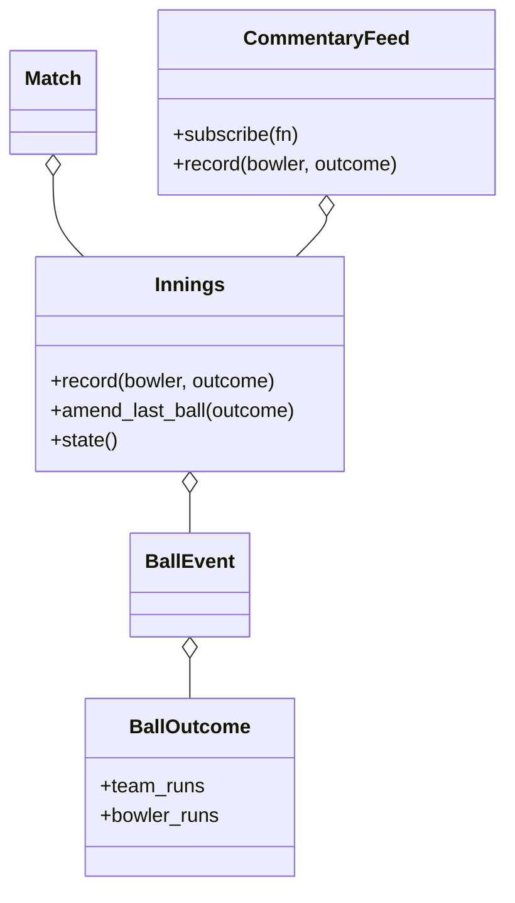

# 体育比分系统（Cricinfo）（low priority）

## 题目

一球一球地记录一场板球比赛，随时能查总分、每位击球手的个人成绩、每位投手的经济率；有人订阅就推送实时解说。用它的是记分员、观众和第三裁判。这题表面是「设计一个比分板」，**面试官真正在看的是事件溯源（event sourcing）：球是唯一的事件，总分、个人得分、经济率、谁在击球，没有一个是存下来的字段，全是对事件日志的一次重放。** 以及额外球（extras）的规则有没有被拆清楚、改判能不能几乎零代价。

你会听到的原话：设计一个类似 Cricinfo 的实时比分系统，记录每一球，查询总分、击球手和投手的统计。

常见追问：
- 第三裁判改判了一球，所有数字怎么跟着变？
- wide、no ball、bye 对击球手和投手的账分别怎么算？
- 怎么加直播订阅，而不改记分的代码？

## 先问这几个问题

- 一局怎么结束？**全部出局，或限定球数的赛制下用完 over 数，先到者为准。赛制只决定「每局限定几个 over」。**
- 额外球要不要精确区分？**要。wide、no ball 不是合法球要重投，bye、leg bye 是合法球；四种对击球手、面对球数、投手失分的影响两两不同，这是这里的难点。**
- 击球手轮转怎么算？**单数跑动换端，over 结束再换一次，是两条独立规则。**
- 要不要改判？**要。这决定了我们存事件而不是存总分。**
- 范围外：宣布（declare）、跟投、DRS 流程本身、no ball 叠加 bye 的双重额外球。

## 核心对象

| 类 | 职责（一句话） | 守住的不变量 |
|---|---|---|
| `BallOutcome` | 一次投球的结果：击球手跑动、额外球种类、额外跑动、出局 | 非法组合在构造时就报错 |
| `BallEvent` | 一条球事件：序号、投手、两端击球手、结果 | 不可变 |
| `Innings` | 一局：只持有一条追加的事件日志 | 只能追加，只能改最后一球 |
| `derive_state` | 纯函数：事件日志 → 局面快照 | 数字只在这里被算出来 |
| `Match` | 若干局，赛制决定每局球数 | 不改局内任何规则 |
| `CommentaryFeed` | 包住一局的直播订阅外壳 | 一行不碰 `Innings` |



## 主流程

**记一球 `record`：**
1. 拿锁，把已有日志重放一遍得到当前局面。
2. 局已结束就抛 `InningsCompleteError`。
3. 校验投手：over 中途不能换人，不能连续投两个 over，必须在投球方名单里。
4. 谁在击球由局面决定，调用方只给「谁投、结果是什么」。追加一条 `BallEvent`。

**改判 `amend_last_ball`：**
1. 拿锁，日志为空就抛错。
2. 用新的 `BallOutcome` 换掉最后一条事件；谁投谁打的事实不变。
3. 不需要重算任何东西：下一次读 `state()` 时重放自然给出新数字。

**额外球对账（`BallOutcome` 里的四个属性）：**
- 合法球：不是 wide、不是 no ball，才计入 over 的球数。
- 球队得分 = 击球手跑动 + 额外跑动 + 非法球自动判罚 1 分。
- 击球手面对球数：除 wide 外都算（no ball 他有机会打）。
- 投手失分：bye 和 leg bye 不算，其余都算球队得分。

## 关键决策

### 统计是维护出来的，还是重放出来的

- 方案 A，增量维护：每记一球更新总分、击球手、投手、轮转。改判要先「撤销」上一球的所有影响再应用新的，撤销逻辑和应用逻辑各写一遍，必然漂移。
- **选只追加事件、统计现算。** 改判只是换最后一条事件，所有数字自动跟上。代价是每次读都要重放，一局至多几百球，可以忽略；真要加速，缓存快照并在追加或改判时作废。

### 一次投球携带几个跑动数字

- 方案 A，一个 `runs` 字段，含义看 `extra` 的取值：调用方得记住「wide 时它是额外跑动，正常球时是击球手跑动」，写反了不报错。
- **选两个字段：`bat_runs` 只在正常球和 no ball 非零，`extra_runs` 只在 wide、bye、leg bye 非零，非法组合在构造时报错。** 把规则关进一个值对象里，错误输入立刻暴露，不会悄悄算出错的总分。

### 改判能改多早的球

- 方案 A，按序号改任意一球：它之后发生的一切（轮转、换人、出局）都可能不自洽。
- **选只能改最后一球。** 现实里第三裁判的裁决发生在下一球开始之前，限制和业务一致，也让「重放结果一定自洽」成立。

### 直播订阅放在哪

- **选一层外壳 `CommentaryFeed` 包住 `Innings`：先转给 `Innings`，成功后在锁外通知订阅者。** 这是普通的观察者（Observer），没有基类、没有注册表，因为订阅者就是一个函数。通知放在锁外，慢订阅者拖不住记分。

## Python 骨架

```python
from __future__ import annotations
import threading
from dataclasses import dataclass, replace
from enum import Enum


class CricketError(Exception): pass
class InningsCompleteError(CricketError): pass
class InvalidDeliveryError(CricketError): pass
class NoDeliveryToAmendError(CricketError): pass
class ConsecutiveOverError(CricketError): pass


class Extra(Enum):
    WIDE = 1
    NO_BALL = 2
    BYE = 3
    LEG_BYE = 4


@dataclass(frozen=True)
class BallOutcome:  # 四条额外球规则唯一的落点
    bat_runs: int = 0
    extra: Extra | None = None
    extra_runs: int = 0
    out: bool = False

    def __post_init__(self):  # 非法组合在构造时报错
        if self.bat_runs and self.extra not in (None, Extra.NO_BALL):
            raise InvalidDeliveryError("该球击球手不能得分")
        if self.extra_runs and self.extra in (None, Extra.NO_BALL):
            raise InvalidDeliveryError("该球不能有额外跑动")

    @property
    def legal(self) -> bool:  # wide、no ball 要重投
        return self.extra not in (Extra.WIDE, Extra.NO_BALL)

    @property
    def team_runs(self) -> int:
        return self.bat_runs + self.extra_runs + (0 if self.legal else 1)

    @property
    def bowler_runs(self) -> int:  # bye、leg bye 不是投手的责任
        return 0 if self.extra in (Extra.BYE, Extra.LEG_BYE) else self.team_runs

    @property
    def rotates(self) -> bool:  # 单数跑动换端；wide 不触发
        if self.extra is Extra.WIDE:
            return False
        byes = self.extra in (Extra.BYE, Extra.LEG_BYE)  # bye 看额外跑动，其余看击球手跑动
        return (self.extra_runs if byes else self.bat_runs) % 2 == 1


@dataclass(frozen=True)
class BallEvent:
    seq: int
    bowler: str
    striker: str
    outcome: BallOutcome


@dataclass(frozen=True)
class State:
    total: int
    wickets: int
    legal_balls: int
    striker: str | None
    over_bowler: str | None
    last_over_bowler: str | None
    batter_runs: dict
    bowler_runs: dict
    all_out: bool


def derive_state(events, order: list[str]) -> State:  # 全文唯一「算数」的地方
    striker, non, nxt = order[0], order[1], 2
    total = wk = legal = in_over = 0
    runs: dict[str, int] = {}
    conceded: dict[str, int] = {}
    over_b = last_b = None
    for e in events:
        o = e.outcome
        total += o.team_runs
        over_b = over_b or e.bowler
        conceded[e.bowler] = conceded.get(e.bowler, 0) + o.bowler_runs
        runs[striker] = runs.get(striker, 0) + o.bat_runs
        if o.legal:
            legal, in_over = legal + 1, in_over + 1
        if o.out:
            wk += 1
            striker, nxt = (order[nxt] if nxt < len(order) else None), nxt + 1
        elif o.rotates:
            striker, non = non, striker
        if o.legal and in_over == 6:  # over 结束：换端、换投手
            last_b, over_b, in_over = over_b, None, 0
            if striker:
                striker, non = non, striker
    return State(total, wk, legal, striker, over_b, last_b, runs, conceded, wk >= len(order) - 1)


class Innings:
    def __init__(self, order: list[str], overs: int | None = None) -> None:
        self.order, self.overs = order, overs
        self._events: list[BallEvent] = []
        self._lock = threading.Lock()

    def state(self) -> State:
        with self._lock:
            return derive_state(self._events, self.order)

    def record(self, bowler: str, outcome: BallOutcome) -> BallEvent:
        with self._lock:
            s = derive_state(self._events, self.order)
            if s.all_out or (self.overs and s.legal_balls >= self.overs * 6):
                raise InningsCompleteError()
            if s.over_bowler is None and bowler == s.last_over_bowler:
                raise ConsecutiveOverError(bowler)  # 不能连投两个 over
            e = BallEvent(len(self._events) + 1, bowler, s.striker, outcome)
            self._events.append(e)
            return e

    def amend_last_ball(self, outcome: BallOutcome) -> None:  # 只能改最后一球
        with self._lock:
            if not self._events:
                raise NoDeliveryToAmendError()
            last = self._events[-1]
            self._events[-1] = replace(last, outcome=outcome)


class CommentaryFeed:  # 订阅者就是一个函数；外壳不改 Innings 一行
    def __init__(self, innings: Innings) -> None:
        self.innings, self._subs = innings, []

    def subscribe(self, fn) -> None:
        self._subs.append(fn)

    def record(self, bowler: str, outcome: BallOutcome) -> BallEvent:
        e = self.innings.record(bowler, outcome)
        for fn in list(self._subs):  # 通知在 Innings 的锁外
            fn(e)
        return e


if __name__ == "__main__":
    inn = Innings(["A", "B", "C"], overs=1)
    feed, seen = CommentaryFeed(inn), []
    feed.subscribe(seen.append)
    feed.record("X", BallOutcome(bat_runs=1))  # A 跑 1，换端
    assert inn.state().striker == "B"
    feed.record("X", BallOutcome(extra=Extra.WIDE))  # wide：球队 +1，不是合法球
    s = inn.state()
    assert (s.total, s.legal_balls, s.batter_runs["A"]) == (2, 1, 1)
    feed.record("X", BallOutcome(bat_runs=4))
    inn.amend_last_ball(BallOutcome(bat_runs=6))  # 改判：只换最后一球
    assert inn.state().total == 8 and len(seen) == 3
    for _ in range(3):
        feed.record("X", BallOutcome())
    assert inn.state().legal_balls == 5
    try:
        BallOutcome(bat_runs=2, extra=Extra.BYE)  # bye 不能让击球手得分
        raise SystemExit("应当拒绝")
    except InvalidDeliveryError:
        pass
    print("ok")
```

## 面试官加需求时

| 新需求 | 改哪里 | 不用动哪里 |
|---|---|---|
| 新赛制（如 100 球制） | 赛制到每局球数的映射 | 局内记分规则 |
| 出局方式、谁出局（run out 的是非击球端） | `BallOutcome` 加字段，`derive_state` 里一个分支 | 事件日志、`Innings` |
| 新统计（打点率、空 over） | `derive_state` 多算一项 | 记球和改判 |
| 直播推送给多种渠道 | 订阅者里自己分发 | `Innings` |
| 回放某一球时的比分 | 对日志前 N 条重放 | 日志结构 |
| 宣布（declare） | 加一种结束局的事件 | 已有事件 |

## 并发与扩展

- 竞态 1：**两个记分员同时记一球。** `record` 在一把锁里完成「重放、校验、追加」，不能先读局面再追加。
- 竞态 2：**读局面时被写入打断。** `state()` 同样拿锁并现算，读到的永远是一个自洽的前缀。
- 通知放在锁外：订阅者慢或抛错不能拖住记分。
- 规模变大：事件日志落库，序号作主键；每 N 球存一个快照，读时从快照往后重放；推送走消息队列，订阅者按局分区。

## 常见错误

- 存总分、击球手得分这些字段：**改判时要手写撤销逻辑，必然漂移。存事件，数字现算。**
- 一个 `runs` 字段身兼数职：**拆成击球手跑动和额外跑动，非法组合构造时报错。**
- wide 也算击球手面对的球：**wide 不算，no ball 算。**
- bye 的分算进投手失分：**bye、leg bye 不是投手的责任。**
- 单数跑动和 over 结束写成一条规则：**两条各自独立，同一球触发两条时互相抵消。**

## 30 秒复述

- 对象：`BallOutcome` 是一次投球的结果（构造时校验非法组合），`BallEvent` 是事件，`Innings` 持有只追加的日志，`derive_state` 是把日志变成局面的纯函数。
- 核心决策：**球是唯一的事件，统计全部现算，所以改判只是换最后一条事件。**
- 额外球：wide 和 no ball 不是合法球；bye 和 leg bye 不记在投手账上；wide 不算击球手面对的球。
- 扩展：直播订阅是包住 `Innings` 的外壳，新赛制只改每局球数，新统计只在重放函数里加一项。
- 并发：记球在一把锁内「重放、校验、追加」，通知在锁外。

## 来源

- [[solution-cricinfo]]
