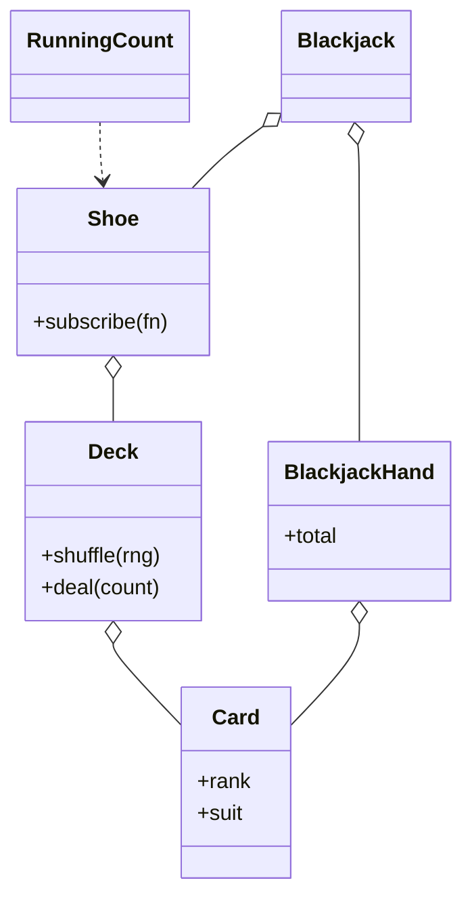

# 扑克牌（Deck of Cards）（low priority）

## 题目

设计一副扑克牌，然后在上面实现二十一点（Blackjack）。用它的是各种牌类游戏，21 点是第一个，面试官几乎一定会要第二个。这不是游戏题，是抽象题：**面试官真正在看的是分界线画在哪里：线这一侧是「扑克牌本身」（52 张牌、花色、点数、一摞牌、洗、发），线那一侧是「某个游戏怎么用它」（A 算几分、什么叫爆牌、庄家何时停牌）。** 最典型的失分是给 `Card` 加一个 `value` 属性，或写一个 `BlackjackCard(Card)` 子类。

你会听到的原话：设计一副扑克牌，然后在上面实现二十一点。

常见追问：
- 现在要加一个别的游戏（战争、斗地主），A 在里面最大，你的 `Card` 要改吗？
- 赌场用 6 到 8 副牌，还带小丑牌，怎么办？
- 要不要支持算牌？

## 先问这几个问题

- 一副 52 张，还是要小丑牌、要几副？**这决定「这副牌由哪些牌组成」必须是参数，不是写死的双重循环。**
- 除了 21 点还有别的游戏吗？**有就当场写第二个。一个抽象被用过两次才算被验证，只有一个用户的抽象和没有抽象没区别。**
- 牌要排序吗？按什么排？**同一张 A，不同游戏大小不同，所以「序」和「分值」不能是 `Card` 的属性。**
- 牌发完了怎么办？**抛有名字的异常，不返回 `None`；一次发多张时不够就一张都不发。**
- 洗牌要可复现吗？**要。随机源注入，否则游戏的测试只能写成「跑起来不报错」。**

## 核心对象

| 类 | 职责（一句话） | 守住的不变量 |
|---|---|---|
| `Card` | 不可变值对象：点数 + 花色 | 没有任何游戏规则；可哈希、可排序 |
| `Deck` | 一摞牌：洗、发、放回底部 | 牌只能经 `deal` 离开，不交出内部列表 |
| `Shoe` | 几副牌摞在一起，管切牌标记，向订阅者推事件 | 不知道有人在算牌 |
| `RunningCount` | 算牌器，纯观察者 | 只靠事件更新自己，不读牌鞋内部 |
| `BlackjackHand` | 一手牌：算点数 | A 的取值规则只在这里 |
| `Blackjack` | 一局：发牌、要牌、庄家策略、结算 | 游戏规则全在这一侧 |



## 主流程

**一局 21 点：**
1. 牌鞋发四张：玩家两张，庄家两张。
2. 双方都有黑杰克（Blackjack，首两张凑 21）是平局；只有一方有，该方直接赢。
3. 玩家逐张要牌；点数超过 21（爆牌，bust）庄家赢，一局结束。
4. 庄家固定策略：点数不到 17 就继续要，到 17 停（含软 17，即 A 当 11 时的 17，可配置）。
5. 比点数得出结局：玩家赢、庄家赢、平局。

**发牌 `Deck.deal(n)`：**
1. 牌不够就抛 `OutOfCardsError`，不发一张。
2. 从顶上取 n 张，从内部列表删除，按发牌顺序返回。

**A 算几分：** 先把所有 A 当 1 加起来；若手里有 A 且再加 10 不爆，就让其中**一张** A 当 11。不需要枚举所有组合，因为两张 A 都当 11 必定爆牌。

## 关键决策

### 游戏规则放在哪

- 方案 A，`Card.value`：战争里 A 最大，斗地主里 2 比 A 大，一个属性不可能同时对。
- 方案 B，`BlackjackCard(Card)` 子类：一副通用的牌变成只能打 21 点的牌，第二个游戏接不上。
- **选 `Card` 上一条规则都没有，取值是游戏自己的一张表（点数 → 分值），算点数的方法长在 `BlackjackHand` 上。** 表里没有的牌（小丑牌）当场抛 `UnsupportedCardError`，不悄悄按 0 分算。

### `Deck` 要不要交出它的牌

- 方案 A，`get_cards()` 或公开的 `cards` 列表：交出去等于交出洗牌、偷看、删牌的权力，`Deck` 变成带方法的 list。
- **选只暴露 `remaining`、`deal`、`shuffle`、`place_at_bottom`。** 牌只能通过这几个入口进出，不变量才守得住。

### 小丑牌与第五门花色：改枚举还是改参数

- 枚举是封闭集合，「这副牌由哪些牌组成」是开放的。
- **选造牌函数接收显式的点数清单、花色清单、副数和小丑数，不遍历 `for s in Suit`。** 加小丑牌或新花色，改的是调用参数，不是枚举也不是游戏。

### 算牌放在哪

- 方案 A，`Shoe` 里加一个 `running_count` 字段：牌鞋要知道算牌规则，去掉算牌器时还得改牌鞋。
- **选观察者：牌鞋发牌和洗牌时推 `ShoeEvent`，`RunningCount` 订阅并自己更新，洗牌事件把计数归零。** 订阅者就是一个函数，没有基类。事件自带「发了哪几张、还剩几副」，订阅者不用回头问牌鞋。

## Python 骨架

```python
from __future__ import annotations
import random
from dataclasses import dataclass
from enum import Enum


class OutOfCardsError(Exception): pass
class UnsupportedCardError(Exception): pass


class Suit(Enum):
    CLUBS, DIAMONDS, HEARTS, SPADES = range(4)


@dataclass(frozen=True, order=True)
class Card:  # 值对象：不知道自己在任何游戏里值几分
    rank: int  # 1=A, 2..10, 11=J, 12=Q, 13=K（牌面自然顺序）
    suit: Suit = Suit.CLUBS

    def __repr__(self) -> str:
        return f"{'A23456789TJQK'[self.rank - 1]}{self.suit.name[0]}"


def build_deck(copies: int = 1, ranks=range(1, 14), suits=tuple(Suit)) -> list[Card]:
    # 遍历显式传入的清单，不遍历枚举：牌的组成是开放的
    return [Card(r, s) for _ in range(copies) for s in suits for r in ranks]


class Deck:  # 顶在列表末尾；没有 cards 属性
    def __init__(self, cards=()) -> None:
        self._cards = list(cards)

    @property
    def remaining(self) -> int:
        return len(self._cards)

    def shuffle(self, rng: random.Random) -> None:  # 随机源注入
        rng.shuffle(self._cards)

    def deal(self, n: int = 1) -> tuple[Card, ...]:
        if n > len(self._cards):
            raise OutOfCardsError(f"只剩 {len(self._cards)} 张")  # 不少发
        dealt = tuple(reversed(self._cards[-n:]))
        del self._cards[-n:]
        return dealt


class Shoe:  # 牌鞋：只推事件，不知道有人在算牌
    def __init__(self, decks: int, rng: random.Random) -> None:
        self._decks, self._rng, self._listeners = decks, rng, []
        self.shuffle()

    def subscribe(self, fn) -> None:
        self._listeners.append(fn)

    def shuffle(self) -> None:
        self._deck = Deck(build_deck(self._decks))
        self._deck.shuffle(self._rng)
        self._emit("shuffled", ())

    def deal(self, n: int = 1) -> tuple[Card, ...]:
        cards = self._deck.deal(n)
        self._emit("dealt", cards)
        return cards

    def _emit(self, kind: str, cards: tuple) -> None:
        for fn in list(self._listeners):
            fn(kind, cards)


HI_LO = {**{r: 1 for r in range(2, 7)}, **{r: 0 for r in range(7, 10)}, **{r: -1 for r in (1, 10, 11, 12, 13)}}


class RunningCount:  # 纯观察者：只靠事件更新自己
    def __init__(self, shoe: Shoe) -> None:
        self.running = 0
        shoe.subscribe(self.on_event)

    def on_event(self, kind: str, cards: tuple) -> None:
        self.running = 0 if kind == "shuffled" else self.running + sum(HI_LO[c.rank] for c in cards)


def blackjack_value(card: Card) -> int:  # 游戏自己的取值表
    if not 1 <= card.rank <= 13:
        raise UnsupportedCardError(card)  # 小丑牌当场报错，不按 0 分算
    return min(card.rank, 10)


class BlackjackHand:  # "值几点"的规则在手牌上，不在 Card 上
    def __init__(self, cards=()) -> None:
        self.cards: list[Card] = []
        self.add(*cards)

    def add(self, *cards: Card) -> None:
        for c in cards:
            blackjack_value(c)
            self.cards.append(c)

    @property
    def total(self) -> int:
        hard = sum(blackjack_value(c) for c in self.cards)  # A 先全当 1
        has_ace = any(c.rank == 1 for c in self.cards)
        return hard + 10 if has_ace and hard + 10 <= 21 else hard  # 至多一张 A 当 11

    @property
    def is_blackjack(self) -> bool:
        return len(self.cards) == 2 and self.total == 21


def play(shoe: Shoe, player_stands_at: int = 17) -> str:
    p, d = BlackjackHand(shoe.deal(2)), BlackjackHand(shoe.deal(2))
    if p.is_blackjack or d.is_blackjack:
        return "push" if p.is_blackjack and d.is_blackjack else ("player" if p.is_blackjack else "dealer")
    while p.total < player_stands_at:  # 玩家策略：此处用固定阈值
        p.add(*shoe.deal())
    if p.total > 21:
        return "dealer"
    while d.total < 17:  # 庄家固定策略
        d.add(*shoe.deal())
    if d.total > 21 or p.total > d.total:
        return "player"
    return "push" if p.total == d.total else "dealer"


if __name__ == "__main__":
    assert BlackjackHand([Card(1), Card(13)]).total == 21  # A + K
    assert BlackjackHand([Card(1), Card(1), Card(9)]).total == 21  # 只有一张 A 当 11
    assert BlackjackHand([Card(1), Card(5), Card(10)]).total == 16  # A 当 11 会爆，就当 1
    shoe = Shoe(6, random.Random(7))
    counter = RunningCount(shoe)
    first = shoe.deal(5)
    assert counter.running == sum(HI_LO[c.rank] for c in first)
    shoe.shuffle()
    assert counter.running == 0  # 洗牌事件归零
    assert play(Shoe(6, random.Random(1))) in {"player", "dealer", "push"}
    try:
        Deck([Card(2)]).deal(2)
        raise SystemExit("应当报错")
    except OutOfCardsError:
        pass
    try:
        BlackjackHand([Card(0)])  # 小丑牌
        raise SystemExit("应当报错")
    except UnsupportedCardError:
        pass
    print("ok")
```

## 面试官加需求时

| 新需求 | 改哪里 | 不用动哪里 |
|---|---|---|
| 战争（War）：A 最大 | 新游戏自己的比较函数 | `Card`、`Deck` |
| 小丑牌、第五门花色 | 造牌函数的参数 | 枚举外的一切、`Deck` |
| 6 到 8 副牌 | `Shoe(decks=...)` | `Deck` |
| 算牌 | 订阅 `Shoe` 事件的观察者 | 牌鞋 |
| 加倍、分牌 | `Blackjack` 一侧加动作，分牌就是多手 `BlackjackHand` | 牌组一侧 |
| 下注与赔付 | 结局对象里带金额，下注模块读它 | 牌组一侧 |

## 并发与扩展

- 一局牌本来就是单线程的：同一副牌同时只在一个桌子上。**若多个桌子共用一个牌鞋，`deal` 要在一把锁里完成「检查够不够、取走」，否则两个线程各看到够，实际不够。**
- 洗牌要等一局打完：切牌标记到了只是 `needs_shuffle` 变真，不在局中自动洗。
- 观察者的通知同步执行，监听器慢会拖慢发牌；规模变大时改成队列。
- 多桌、多人：每个座位一手 `BlackjackHand`，同一个牌鞋顺序发牌，分牌就是同一座位多手。

## 常见错误

- `Card` 上加 `value`，或写 `BlackjackCard`：**取值是游戏的表，牌只是牌。**
- `Deck` 提供 `get_cards()`：**不交出内部列表，只给 `remaining` 和 `deal`。**
- 枚举所有 A 的 1/11 组合：**一次加法就够，至多一张 A 当 11。**
- 洗牌用全局 `random`：**随机源注入，测试才能复现。**
- 小丑牌在 21 点里悄悄记 0 分：**报 `UnsupportedCardError`。**

## 30 秒复述

- 对象：`Card` 是只有点数和花色的值对象；`Deck` 只暴露洗和发；`Shoe` 摞几副牌并推事件；`BlackjackHand` 算点数；`Blackjack` 管一局。
- 核心决策：**游戏规则一条都不放在 `Card` 上，取值表和 A 的算法在游戏一侧。** 战争里 A 最大，只是另一张表。
- 牌的组成是参数，不是枚举：小丑牌和新花色只改造牌函数的调用。
- 算牌是观察者：牌鞋只推事件，洗牌事件归零计数。
- 失败路径有名字：牌不够发抛 `OutOfCardsError`，不认识的牌抛 `UnsupportedCardError`。

## 来源

- [[solution-deck-of-cards]]
