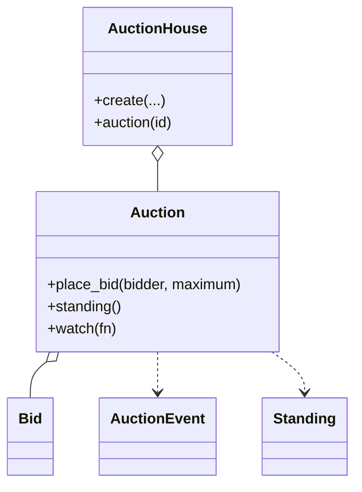

# 在线拍卖（Online Auction）（low priority）

## 题目

卖家上架一件东西，买家出价，到点价高者得，像 eBay。用它的是卖家、买家和关注拍卖的人。这题比撮合题简单（一个卖家、一件商品、一条时间线），但有两个地方几乎所有答案都会栽：**面试官真正在看的是代理出价（proxy bidding）算得对不对，以及「到点结束」这件事能不能做到恰好结算一次。**

你会听到的原话：设计一个在线拍卖系统，卖家上架拍品，买家出价，到时间价高者得。

常见追问：
- 出价者交的是价格还是上限？eBay 那样的话当前价怎么算？
- 最后一秒有人出价（狙击，sniping）怎么办？
- 服务器半夜重启，没人访问这场拍卖，它算结束了吗？

## 先问这几个问题

- 出价者交的是一个价，还是一个愿意付的最高额？**交上限。当前价就是算出来的量，不是被直接写入的量：系统替你出刚好压过对手的最小金额。**
- 起拍价和底价是一回事吗？**不是。起拍价是第一次出价的下限，公开；底价是低于它卖家宁可不卖，不公开。落在算法的不同位置。**
- 钱用什么类型？**整数分。代理出价要比较并列和加一档，`float` 会让并列变成掷骰子。**
- 时间从哪来？**注入的时钟，测试里不能 `sleep`。**
- 到点谁来结束它？**这决定要不要定时器。答案见下面的关键决策。**
- 范围外：支付、搜索、评价、纠纷；出价者的资金不预冻结。

## 核心对象

| 类 | 职责（一句话） | 守住的不变量 |
|---|---|---|
| `Auction` | 一场拍卖：状态、当前价、领先者、出价记录、一把锁 | 当前价只涨不跌；领先者的上限 ≥ 当前价；状态单向推进 |
| `Bid` | 一次出价：出价者、上限、时间 | 不可变；上限从不对外广播 |
| `AuctionEvent` | 推给关注者的事件：当前价、领先者、状态 | 事件里没有任何人的上限 |
| `Standing` | 一场拍卖此刻的不可变快照 | 读到的是一个自洽的瞬间 |
| `AuctionHouse` | 目录：按 id 找拍卖，清理已结束的 | 不转发 `place_bid` |



## 主流程

**出价 `place_bid(bidder, maximum)`：**
1. 拿这场拍卖的锁，先 `_tick(now)`：时间到了就开始或结束（见下面的决策）。
2. 校验：已开始、未结束，卖家不能出价。
3. 如果出价者就是领先者：只允许抬高自己的上限，价格不动。
4. 否则上限必须 ≥ 现价 + 一档（没人出过价时 ≥ 起拍价），再做代理出价（下面）。
5. 记录出价；若在最后几秒内，结束时间顺延（有次数上限）。
6. 出锁，再通知关注者。

**代理出价 `_proxy`：**
1. 没有领先者：出价者成为领先者，价格是起拍价。
2. 新上限**严格高于**在位者：换人，价格 = `min(新上限, 在位者上限 + 一档)`。
3. 新上限没超过在位者（含并列）：在位者留任，价格被顶到 `min(在位者上限, 新上限 + 一档)`。
4. 价格取 `max(旧价, 新价)`，永不回落；领先者的上限够到底价时，价格至少抬到底价。

**结算：** 任何一次读写都先 `_tick`，时间已到则在锁内把 `ACTIVE` 翻成 `SOLD` 或 `UNSOLD`（有领先者且价格 ≥ 底价才是 `SOLD`）。

## 关键决策

### 代理出价：系统替你出多少

- 方案 A，出价就是价：用户得一直盯屏幕，每次只能加一档。
- **选出价者交上限，系统出「刚好压过对手的最小金额」，当前价 = `min(最高上限, 次高上限 + 一档)`。** 并列时先到的上限赢，价格只涨不跌，这两条让结果与到达顺序无关。
- 示例：甲上限 1000，乙出 600，价格 = min(1000, 600 + 100) = 700，甲仍领先；丙出 1500，价格 = min(1500, 1000 + 100) = 1100，丙领先。

### 恰好结算一次：定时器、扫描线程，还是惰性推进

- 方案 A，每场拍卖一个定时器：服务重启后丢失，又要处理「定时器触发时正好有人出价」。
- 方案 B，扫描线程：可以有，但它和用户请求会同时到达同一场拍卖。
- **选惰性推进：任何读写都先 `_tick`，状态翻转发生在锁内，所以无论多少线程同时到达，只有一个翻成功，只有它发「已结束」事件。** 扫描线程只是多一个调用 `_tick` 的人，不改正确性。「恰好一次」不依赖任何定时器。

### 锁放在哪一层

- 方案 A，拍卖行一把全局锁：热门拍品拖死所有冷门拍品。
- **选一场拍卖一把锁。** 两场拍卖之间没有共享状态（不像撮合要跨账户搬钱）。通知放在锁外，慢的关注者不能卡住出价。

### 观察者要不要抽象基类

- **选关注者就是一个函数，`watch` 返回取消函数。** 没有基类，没有模式；拍卖一结束，关注者表整张清空，因为之后不会再有事件。
- 事件里只放当前价和领先者，**不放任何人的上限**：广播上限，别人出到上限加一档就能精准顶掉你，代理出价就没意义了。

## Python 骨架

```python
from __future__ import annotations
import threading
from dataclasses import dataclass
from datetime import datetime, timedelta


class AuctionError(Exception): pass
class AuctionClosedError(AuctionError): pass
class BidTooLowError(AuctionError): pass
class SellerCannotBidError(AuctionError): pass


@dataclass(frozen=True)
class Bid:
    bidder: str
    maximum: int  # 整数分；上限是私密的，不进事件
    at: datetime


class Auction:  # 一场一把锁
    def __init__(self, seller: str, start_price: int, ends_at: datetime, clock, reserve: int = 0,
                 increment: int = 100, soft_close: timedelta = timedelta(seconds=30), max_ext: int = 3) -> None:
        self.seller, self.start_price, self.reserve, self.inc = seller, start_price, reserve, increment
        self.ends_at, self.clock, self.soft_close, self.max_ext = ends_at, clock, soft_close, max_ext
        self.status, self.price = "ACTIVE", start_price
        self.leader: str | None = None
        self._max = 0  # 领先者的上限
        self._ext = 0
        self.bids: list[Bid] = []
        self._watchers: list = []
        self._lock = threading.Lock()

    def watch(self, fn) -> None:
        with self._lock:
            self._watchers.append(fn)

    def _tick(self, now: datetime) -> list:  # 惰性推进：第一个看它的人负责结束
        if self.status == "ACTIVE" and now >= self.ends_at:
            sold = self.leader is not None and self.price >= self.reserve
            self.status = "SOLD" if sold else "UNSOLD"
            return [("closed", self.price, self.leader)]
        return []

    def place_bid(self, bidder: str, maximum: int) -> None:
        now, events = self.clock(), []
        try:
            with self._lock:
                events += self._tick(now)
                if self.status != "ACTIVE":
                    raise AuctionClosedError(self.status)
                if bidder == self.seller:
                    raise SellerCannotBidError()
                if bidder == self.leader:  # 领先者只能抬高自己的上限，价格不动
                    if maximum <= self._max:
                        raise BidTooLowError(self._max)
                    self._max = maximum
                else:
                    minimum = self.start_price if self.leader is None else self.price + self.inc
                    if maximum < minimum:
                        raise BidTooLowError(minimum)
                    self._proxy(bidder, maximum)
                    events.append(("bid", self.price, self.leader))
                self.bids.append(Bid(bidder, maximum, now))
                if self.ends_at - now <= self.soft_close and self._ext < self.max_ext:
                    self.ends_at, self._ext = now + self.soft_close, self._ext + 1  # 反狙击，有次数上限
        finally:
            for ev in events:  # 通知在锁外
                for fn in list(self._watchers):
                    fn(ev)

    def _proxy(self, bidder: str, maximum: int) -> None:
        if self.leader is None:
            self.leader, self._max = bidder, maximum
        elif maximum > self._max:  # 严格更高才换人
            self.price = max(self.price, min(maximum, self._max + self.inc))
            self.leader, self._max = bidder, maximum
        else:  # 并列或更低：先到的赢
            self.price = max(self.price, min(self._max, maximum + self.inc))
        if self._max >= self.reserve:  # 够到底价时，价格至少抬到底价
            self.price = max(self.price, self.reserve)

    def close_if_due(self) -> bool:  # 扫描线程和用户请求走同一段代码
        with self._lock:
            events = self._tick(self.clock())
        for ev in events:
            for fn in list(self._watchers):
                fn(ev)
        return bool(events)


if __name__ == "__main__":
    now = [datetime(2026, 1, 1, 12)]
    a = Auction("seller", 500, datetime(2026, 1, 1, 13), lambda: now[0], reserve=600)
    log = []
    a.watch(log.append)
    a.place_bid("甲", 1000)
    assert a.price == 600  # 甲的上限够到底价：价格抬到底价
    a.place_bid("乙", 700)  # 乙上限低：甲留任，价格 = min(1000, 700+100)
    assert (a.leader, a.price) == ("甲", 800)
    a.place_bid("丙", 1500)  # 换人：价格 = min(1500, 1000+100)
    assert (a.leader, a.price) == ("丙", 1100)
    try:
        a.place_bid("丁", 1100)  # 至少要 现价 + 一档
        raise SystemExit("应当拒绝")
    except BidTooLowError:
        pass
    now[0] = datetime(2026, 1, 1, 13, 0, 1)
    assert a.close_if_due() is True and a.status == "SOLD"
    assert a.close_if_due() is False  # 恰好一次：第二个看到的人什么都不做
    try:
        a.place_bid("乙", 5000)
        raise SystemExit("应当关闭")
    except AuctionClosedError:
        pass
    assert [e[0] for e in log].count("closed") == 1
    print("ok")
```

## 面试官加需求时

| 新需求 | 改哪里 | 不用动哪里 |
|---|---|---|
| 一口价（buy it now） | 新方法直接写价与领先者，走同一条结束路径；现价追上一口价就失效 | 出价与代理出价 |
| 反狙击软关闭 | 出价后顺延结束时间，设次数上限 | 代理出价 |
| 加价档按价格分段 | 一个 `increment(price)` 函数 | 代理出价的结构 |
| 同时多场拍卖 | `AuctionHouse` 的目录 | `Auction` |
| 通知渠道（邮件、推送） | 关注者函数里自己分发 | 拍卖状态机 |
| 荷兰式（降价）拍卖 | 新的拍卖类型，共用事件和快照 | 已有拍卖类 |

## 并发与扩展

- 竞态 1：**两人同时出价。** 一场拍卖一把锁，校验、代理出价、记录在同一个临界区里完成。
- 竞态 2：**到点时正好有人出价。** 出价路径先 `_tick`，若已结束就按已结束处理，不会在结算后还收下出价。
- 竞态 3：**两个线程同时发现到点。** 状态翻转在锁内，只有一个翻成功，只有它发「已结束」事件，所以卖家不会收到两次通知。
- 通知放在锁外：慢的关注者不能卡住这场拍卖的所有出价。
- 规模变大：出价记录落库，拍卖按 id 分片；已结束的拍卖要从目录里摘掉，否则目录无限增长；扫描任务按结束时间的堆驱动。

## 常见错误

- 出价就是价格：**交上限，当前价由两个最高上限算出。**
- 当前价会回落（例如领先者降了上限）：**价格只涨不跌，加 `max` 保证。**
- 并列时后来的赢：**严格高于才换人，并列先到的赢。**
- 靠定时器结束，说不清重启后怎么办：**惰性推进，任何读写都先 `_tick`。**
- 把上限放进事件广播：**事件只含当前价和领先者。**

## 30 秒复述

- 对象：`Auction` 一场一把锁，持有状态、当前价、领先者、出价；`AuctionEvent` 和 `Standing` 是不含上限的快照；`AuctionHouse` 只管目录。
- 核心决策：**出价者交上限，当前价 = `min(最高上限, 次高上限 + 一档)`，严格更高才换人，价格只涨不跌。**
- 恰好结算一次：惰性推进，任何读写先 `_tick`，翻转在锁内，只有一个线程成功。
- 扩展：一口价、软关闭都是在同一条结束路径上加几行，不碰代理出价。
- 并发：一场一把锁，通知在锁外。

## 来源

- [[solution-online-auction]]
