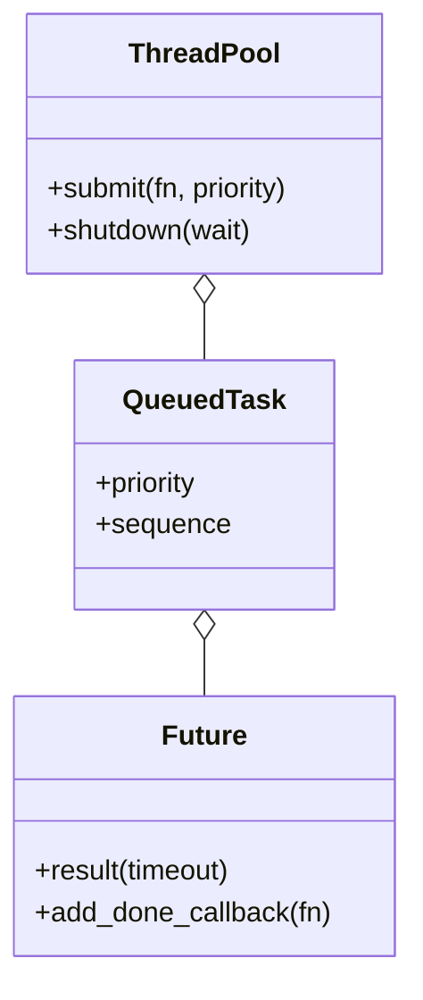

# 线程池（Thread Pool）（low priority）

## 题目

固定数量的工作线程，从一个共享队列里取任务执行；提交任务返回一个 `Future`，可以等结果；池子能优雅关闭。用它的是任何需要「并发跑一批任务但不想每个任务开一个线程」的调用方。它站在有界阻塞队列的肩膀上，工作线程取任务就是消费者取元素。**面试官真正在看的是三处：任务抛异常不能拖垮工作线程；关闭时「已经排队但还没跑」的任务怎么办；提交太快时背压挡住谁。**

你会听到的原话：实现一个线程池，固定数量的工作线程，提交任务拿到 `Future`，支持优雅关闭。

常见追问：
- 提交速度长期超过处理速度，会发生什么？
- `shutdown` 要区分「等剩下的干完」和「现在就撒手」吗？
- 要加优先级，worker 循环要改吗？

## 先问这几个问题

- 提交长期快于处理怎么办？**要背压：队列满了就挡住调用方，不悄悄丢弃，也不让内存无限涨。标准库的 `ThreadPoolExecutor` 是不做的。**
- `shutdown` 要两种吗？**要：等干完（`wait=True`）和立即返回（`wait=False`）。后者放弃的是还没开始的任务；已经在跑的任务不打断，Python 线程没有安全的外部打断办法。**
- 任务有优先级吗？**没有就先进先出；有的话优先级要从第一天就是队列条目的一部分。**
- 任务是 CPU 密集还是 I/O 密集？**I/O 密集线程池才有真并发（等待时释放 GIL）；CPU 密集该用进程池。这是个对不对的问题，不是实现细节。**
- 范围外：动态伸缩线程数、任务取消、线程亲和。

## 核心对象

| 类 | 职责（一句话） | 守住的不变量 |
|---|---|---|
| `Future` | 一次异步调用的句柄：结果或异常，可等待、可挂回调 | 只从「未完成」到「完成」一次；每个回调只调一次 |
| `_QueuedTask` | 队列里一条记录：优先级、提交序号、函数、`Future` | 排序只看优先级和序号，函数不参与比较 |
| `ThreadPool` | 固定数量工作线程 + 优先级队列 + 背压 + 关闭 | 同时运行数 ≤ 线程数；一个任务的异常不杀线程 |



## 主流程

**提交 `submit(fn, priority)`：**
1. 有容量上限时，先在信号量上 `acquire`：满了就阻塞调用方（背压）。
2. 拿锁；池已关闭就把刚取的名额还回去，抛 `PoolShutdown`。
3. 建 `Future` 和一条带「优先级、递增序号」的队列记录，放进队列，返回 `Future`。

**工作线程循环：**
1. 从队列取一条；是哨兵就退出。
2. 取走的同时归还一个背压名额。
3. 执行函数：**任何异常（包括 `BaseException`）都捕获后封进 `Future`，线程继续循环。**

**关闭 `shutdown(wait)`：**
1. 拿锁，标记已关闭（再次调用直接返回）。
2. `wait=False`：在同一把锁里清空队列，放弃的任务的 `Future` 收到 `PoolShutdown`。
3. 往队列里投 N 个哨兵（优先级是无穷大，排在所有真实任务之后）。
4. `wait=True`：逐个 `join` 工作线程。

## 关键决策

### 背压放在队列上，还是 `submit` 前面

- 方案 A，队列设容量，满了 `put` 阻塞：关闭时要往队列里投哨兵，队列满了哨兵投不进去，`shutdown` 卡死。
- **选队列本身无界，在 `submit` 前面包一个信号量。** 满了挡住的是调用方；关闭投哨兵永远不会被卡住。背压和关闭两件事互不干扰。

### `shutdown(wait=False)` 要不要打断正在跑的任务

- 方案 A，强行打断：Python 线程没有安全的外部终止手段，强杀会让持有的锁、打开的文件留在半途。
- **选只放弃还没被取走的任务，正在执行的任务跑完。** 被放弃的任务的 `Future` 收到 `PoolShutdown`，调用方等结果时不会永远挂着。

### 优先级要不要一个调度类

- 方案 A，另写一个优先级调度器，worker 循环要改。
- **选 `PriorityQueue` 加一个递增序号：队列条目按（优先级，序号）排序，同优先级先进先出。** 这里没有模式，优先级从第一天就是条目的字段，加优先级只是把它从内部默认值开放成 `submit` 的参数。函数本身不参与比较，否则同优先级时抛 `TypeError`。

### `Future` 要不要显式状态机

- **选两态加事件：未完成和完成，用 `threading.Event` 表示。** 没有取消需求就不需要 `PENDING / RUNNING / CANCELLED`。「判断是否完成」和「取走回调列表」必须在同一把锁里，否则 `add_done_callback` 可能插在中间被漏掉。

## Python 骨架

```python
from __future__ import annotations
import itertools
import math
import queue
import threading
from dataclasses import dataclass, field
from typing import Any, Callable


class PoolShutdown(Exception): pass


class Future:
    def __init__(self) -> None:
        self._done = threading.Event()
        self._lock = threading.Lock()
        self._result, self._exc, self._callbacks = None, None, []

    def result(self, timeout: float | None = None):
        if not self._done.wait(timeout):
            raise TimeoutError()
        if self._exc is not None:
            raise self._exc  # 任务里的异常在这里重新抛出
        return self._result

    def add_done_callback(self, cb) -> None:
        with self._lock:  # 判断完成与登记回调必须同一把锁，否则会漏
            if not self._done.is_set():
                self._callbacks.append(cb)
                return
        cb(self)

    def _finish(self, result=None, exc=None) -> None:
        self._result, self._exc = result, exc
        with self._lock:
            self._done.set()
            cbs, self._callbacks = self._callbacks, []
        for cb in cbs:
            cb(self)


@dataclass(order=True)
class _Task:  # 只按（优先级，序号）排序，函数不参与比较
    priority: float
    seq: int
    fn: Callable = field(compare=False)
    args: tuple = field(compare=False, default=())
    future: Future = field(compare=False, default=None)
    sentinel: bool = field(compare=False, default=False)


class ThreadPool:
    def __init__(self, workers: int, capacity: int | None = None) -> None:
        self._q: queue.PriorityQueue[_Task] = queue.PriorityQueue()  # 队列无界
        self._admit = threading.Semaphore(capacity) if capacity else None  # 背压在入口
        self._seq, self._lock, self._closed = itertools.count(), threading.Lock(), False
        self._threads = [threading.Thread(target=self._loop, daemon=True) for _ in range(workers)]
        for t in self._threads:
            t.start()

    def submit(self, fn: Callable, *args: Any, priority: float = 0) -> Future:
        if self._admit:
            self._admit.acquire()  # 满了挡住调用方
        with self._lock:
            if self._closed:
                if self._admit:
                    self._admit.release()
                raise PoolShutdown()
            fut = Future()
            self._q.put(_Task(priority, next(self._seq), fn, args, fut))
            return fut

    def shutdown(self, wait: bool = True) -> None:
        with self._lock:
            if self._closed:
                return
            self._closed = True
            dropped = [] if wait else self._drain()
        for t in dropped:
            t.future._finish(exc=PoolShutdown())  # 被放弃的任务也要通知
        for _ in self._threads:  # 哨兵优先级无穷大，排在所有真实任务之后
            self._q.put(_Task(math.inf, next(self._seq), None, sentinel=True))
        if wait:
            for t in self._threads:
                t.join()

    def _drain(self) -> list[_Task]:
        out = []
        while True:
            try:
                out.append(self._q.get_nowait())
            except queue.Empty:
                return out

    def _loop(self) -> None:
        while True:
            task = self._q.get()
            if task.sentinel:
                return
            if self._admit:
                self._admit.release()  # 一出队就归还名额
            try:
                task.future._finish(result=task.fn(*task.args))
            except BaseException as e:  # 任务抛什么都不许杀死工作线程
                task.future._finish(exc=e)


if __name__ == "__main__":
    pool = ThreadPool(2)
    assert [pool.submit(lambda x: x * x, i).result(2) for i in range(4)] == [0, 1, 4, 9]
    def boom():
        raise RuntimeError("任务自己的问题")
    try:
        pool.submit(boom).result(2)
        raise SystemExit("应当抛出")
    except RuntimeError:
        pass
    assert pool.submit(lambda: "活着").result(2) == "活着"  # 线程没死
    seen = []
    pool.submit(lambda: 1).add_done_callback(seen.append)
    pool.shutdown(wait=True)
    try:
        pool.submit(lambda: 1)  # 关闭后拒绝提交
        raise SystemExit("应当拒绝")
    except PoolShutdown:
        pass
    p2, started, gate = ThreadPool(1), threading.Event(), threading.Event()
    running = p2.submit(lambda: (started.set(), gate.wait(2)))
    started.wait(2)  # 确保第一个任务已在运行
    queued = p2.submit(lambda: "不该运行")
    p2.shutdown(wait=False)
    try:
        queued.result(2)
        raise SystemExit("应当被放弃")
    except PoolShutdown:
        pass
    gate.set()
    running.result(2)  # 正在跑的任务不被打断
    print("ok")
```

## 面试官加需求时

| 新需求 | 改哪里 | 不用动哪里 |
|---|---|---|
| 优先级 | `submit` 暴露 `priority` 参数 | worker 循环、队列结构 |
| 提交时不想阻塞，满了直接报错 | 信号量 `acquire(blocking=False)` | 队列和关闭 |
| 任务取消 | `Future` 加一个 `CANCELLED` 状态，worker 取出后先查 | 队列 |
| 完成回调 | 已有的 `add_done_callback` | 池 |
| 动态伸缩线程数 | 在 `submit` 里按排队数起新线程 | `Future`、关闭流程 |
| 定时任务 | 另起一层用堆存到期时间，到点调用 `submit` | 池本身 |

## 并发与扩展

- 竞态 1：**`shutdown` 与 `submit` 交错。** 标记已关闭和投递任务都在同一把锁里，关闭之后的提交一定被拒绝，不会有任务落进没人消费的队列。
- 竞态 2：**`add_done_callback` 与任务完成同时发生。** 判断完成与登记回调在同一把锁里，要么登记进列表被完成者调用，要么发现已完成当场调用，不会漏也不会调两次。
- 竞态 3：**哨兵被卡在满队列外。** 队列无界，背压在入口，所以投哨兵永远成功。
- 回调在完成者线程里执行：回调里抛异常或做慢事会拖住工作线程，生产实现要把回调包起来。
- 规模变大：CPU 密集换进程池；任务量大时按任务类型分池，防止慢任务占满线程。

## 常见错误

- 任务抛异常，工作线程退出：**捕获一切异常并封进 `Future`，线程继续循环。**
- 给队列设容量来做背压：**关闭时哨兵投不进去会卡死。背压放在 `submit` 前的信号量。**
- 同优先级时比较函数对象：**排序只看（优先级，序号），函数标记为不参与比较。**
- `shutdown(wait=False)` 不通知被放弃的任务：**它们的 `Future` 要收到 `PoolShutdown`，否则调用方永远等下去。**
- 关闭后仍接受提交：**关闭标记和投递在同一把锁里。**

## 30 秒复述

- 对象：`Future` 装结果或异常；`ThreadPool` 持有固定数量的工作线程、一个无界优先级队列、一个背压信号量。
- 核心决策：**背压在 `submit` 前的信号量，队列本身无界**，所以关闭时投哨兵永远不会被卡住。
- 失败隔离：任务异常封进 `Future`，工作线程不退出。
- 关闭：`wait=True` 等全部跑完；`wait=False` 放弃队列里没开始的并通知，正在跑的不打断。
- 优先级是（优先级，序号）排序，加它不碰 worker 循环。

## 来源

- [[solution-thread-pool]]
