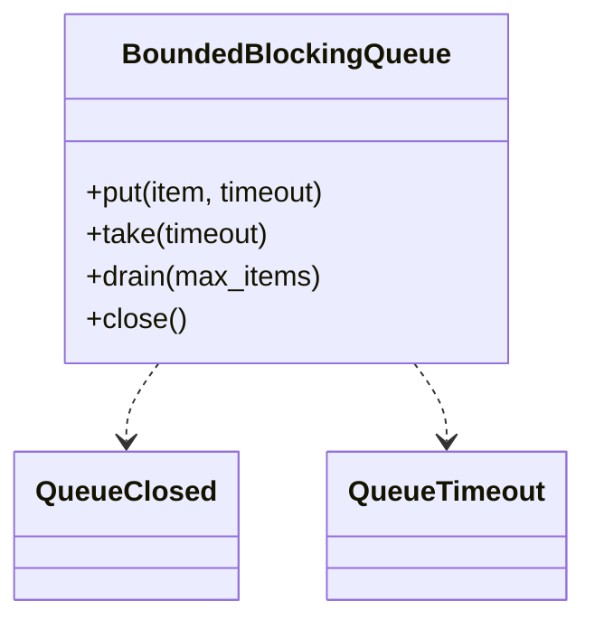

# 有界阻塞队列（Bounded Blocking Queue）（low priority）

## 题目

实现一个有界的阻塞队列：满了 `put` 阻塞，空了 `take` 阻塞，多个生产者和多个消费者同时使用。这是并发里最经典的条件变量（Condition Variable）练习，不考业务建模。标准库 `queue.Queue` 已经实现了它，所以**面试官真正在看的是：你写的版本，在任何调度顺序下都正确吗？也就是「锁 + 等待谓词」这套机制，是否准确到每一行。**

你会听到的原话：实现一个有界阻塞队列，`put` 满则阻塞，`take` 空则阻塞，多生产者多消费者。

常见追问：
- 为什么等待要写 `while` 不是 `if`？
- 加超时怎么加？总等待时间会不会被悄悄拉长？
- 进程要退出了，怎么优雅关闭，队列里剩下的怎么办？

## 先问这几个问题

- 多对多，还是一对一？**多对多。`notify()` 只唤醒一个等待者这件事才需要认真论证；默认按多对多设计。**
- 满或空时：永久阻塞、带超时，还是报错？**先给无超时版本，再加超时。超时统一用异常收场，交给调用方决定。**
- 要优雅关闭吗？**要。关闭后 `put` 立即失败，`take` 继续放行已有元素直到取空。**
- 消费者要一次取一批吗？**要的话加 `drain`，但不能引入第二套等待逻辑。**
- 范围外：跨进程、持久化、优先级、按 key 分区。

## 核心对象

| 类 | 职责（一句话） | 守住的不变量 |
|---|---|---|
| `BoundedBlockingQueue` | 容量固定的先进先出队列，一把锁、两个条件变量 | `0 ≤ size ≤ capacity` 任何时刻成立；元素不丢不重 |
| `QueueClosed` | 关闭后失败的异常 | `take` 只在关闭且取空后才抛 |
| `QueueTimeout` | 超时失败的异常 | 绝对截止时间，总等待不被拉长 |



## 主流程

**`put(item, timeout)`：**
1. 算出绝对截止时间，进入 `not_full` 条件变量的临界区（它和 `not_empty` 共用同一把锁）。
2. `while 队列已满 and 未关闭: wait`。
3. 醒来后若已关闭，抛 `QueueClosed`（哪怕此刻有空位）。
4. 追加元素，`not_empty.notify()` 唤醒**一个**消费者。

**`take(timeout)`：**
1. 进入 `not_empty` 的临界区。
2. `while 队列为空 and 未关闭: wait`。
3. 队列空（此时必然已关闭）才抛 `QueueClosed`；否则取队首。
4. `not_full.notify()` 唤醒**一个**生产者。

**`close()`：** 拿锁，置关闭标志，两个条件变量各 `notify_all`，让所有等待者重新检查谓词。

## 关键决策

### 一个条件变量配 `notify_all`，还是两个条件变量配精确 `notify`

- 方案 A，一个条件变量，每次状态变化 `notify_all`：正确，但每次放入都惊动所有人，包括同样在等「不满」的生产者，它们醒来发现还是满的又睡回去（惊群，thundering herd）。
- **选两个条件变量共用一把锁：`not_full` 等空位，`not_empty` 等元素，放入时只 `notify` 消费者，取出时只 `notify` 生产者。** 因为类型分开了，精确 `notify()` 一个就够，不会叫醒错误类型的线程。只有 `close()` 需要 `notify_all`。

### 满或空时阻塞、返回哨兵，还是抛异常

- 方案 A，返回 `None` 或 `False`：调用方可能忘了检查，丢数据没人发现；`None` 也可能就是合法元素。
- **选默认阻塞，带 `timeout` 时超时抛 `QueueTimeout`；`put_nowait` / `take_nowait` 是 `timeout=0` 的简写。** 失败有名字，调用方决定重试、丢弃还是升级。

### 超时怎么写才不会被拉长

- 方案 A，每次等待都用完整的 `timeout`：虚假唤醒或被别的线程抢先后再等一轮，总等待就超过了承诺。
- **选在入口算出绝对截止时间（`time.monotonic()`），每一轮用「截止时间 − 现在」作为剩余时间。** 用单调时钟，不被系统时间调整影响。

### `close()` 要不要单独一个 `Event`

- **选不要，一个布尔标志放在同一把锁下。** 等待者的谓词本来就在锁里检查「满、空、已关闭」，标志和队列状态在同一个临界区里读写才是一致的；再来一个 `Event` 只会多出一套要同步的状态。这里没有模式。
- `drain` 复用 `take` 的等待谓词：等到至少一个元素，醒来后能拿多少拿多少，不为凑够 `max_items` 再等第二轮。

## Python 骨架

```python
from __future__ import annotations
import threading
import time
from collections import deque


class QueueClosed(Exception): pass
class QueueTimeout(Exception): pass


class BoundedBlockingQueue:
    def __init__(self, capacity: int) -> None:
        if capacity <= 0:
            raise ValueError("capacity must be positive")
        self._cap, self._items, self._closed = capacity, deque(), False
        self._lock = threading.Lock()
        self._not_full = threading.Condition(self._lock)  # 两个条件变量共用同一把锁
        self._not_empty = threading.Condition(self._lock)

    def _wait(self, cond: threading.Condition, deadline: float | None) -> None:
        if deadline is None:
            cond.wait()
            return
        remaining = deadline - time.monotonic()  # 用剩余时间，不是完整 timeout
        if remaining <= 0 or not cond.wait(timeout=remaining):
            raise QueueTimeout()

    def put(self, item, timeout: float | None = None) -> None:
        deadline = None if timeout is None else time.monotonic() + timeout
        with self._not_full:
            while len(self._items) >= self._cap and not self._closed:  # while 不是 if
                self._wait(self._not_full, deadline)
            if self._closed:  # 关闭后一律拒绝，哪怕有空位
                raise QueueClosed()
            self._items.append(item)
            self._not_empty.notify()  # 只叫醒一个消费者

    def take(self, timeout: float | None = None):
        deadline = None if timeout is None else time.monotonic() + timeout
        with self._not_empty:
            while not self._items and not self._closed:
                self._wait(self._not_empty, deadline)
            if not self._items:  # 走到这里必然已关闭且取空
                raise QueueClosed()
            item = self._items.popleft()
            self._not_full.notify()  # 只叫醒一个生产者
            return item

    def drain(self, max_items: int | None = None) -> list:
        with self._not_empty:
            while not self._items and not self._closed:
                self._wait(self._not_empty, None)
            if not self._items:
                raise QueueClosed()
            n = len(self._items) if max_items is None else min(max_items, len(self._items))
            batch = [self._items.popleft() for _ in range(n)]
            self._not_full.notify(n)  # 腾出 n 个位置
            return batch

    def close(self) -> None:
        with self._lock:
            self._closed = True
            self._not_full.notify_all()  # 唯一需要 notify_all 的地方
            self._not_empty.notify_all()


if __name__ == "__main__":
    q = BoundedBlockingQueue(2)
    try:
        q.take(timeout=0.05)  # 空队列超时
        raise SystemExit("应当超时")
    except QueueTimeout:
        pass
    q.put(1)
    q.put(2)
    try:
        q.put(3, timeout=0.05)  # 满队列超时
        raise SystemExit("应当超时")
    except QueueTimeout:
        pass
    got = []
    def consumer():
        while True:
            try:
                got.append(q.take(timeout=2))
            except QueueClosed:
                return
    def producer():
        for i in range(10, 15):
            q.put(i, timeout=2)  # 容量 2：会阻塞，直到消费者腾出位置
        q.close()
    ts = [threading.Thread(target=consumer), threading.Thread(target=producer)]
    for t in ts:
        t.start()
    for t in ts:
        t.join()
    assert got == [1, 2, 10, 11, 12, 13, 14]  # 不丢不重，顺序一致
    try:
        q.put(99)  # 关闭后拒绝
        raise SystemExit("应当拒绝")
    except QueueClosed:
        pass
    print("ok")
```

## 面试官加需求时

| 新需求 | 改哪里 | 不用动哪里 |
|---|---|---|
| 超时 | 绝对截止时间 + 每轮用剩余时间 | 谓词与 `notify` |
| 优雅关闭 | 一个布尔标志，`close()` 里 `notify_all` | `put` / `take` 的主体 |
| 批量取 | `drain`，复用 `take` 的等待谓词 | 等待逻辑 |
| 非阻塞版本 | `put_nowait` / `take_nowait` = `timeout=0` | 队列 |
| 监控队列深度 | 加只读的 `size`、等待者计数 | 核心逻辑 |
| 优先级 | 把 `deque` 换成堆（这时已是另一道题） | 条件变量结构 |

## 并发与扩展

- 竞态 1：**醒来后条件已被别的线程改掉。** 两个消费者同时被叫醒，只有一个元素，后拿到锁的那个发现队列又空了。所以等待必须是 `while` 重新检查，不是 `if`。
- 竞态 2：**虚假唤醒。** 同样靠 `while` 解决。
- 竞态 3：**`close()` 时等待者永远醒不过来。** `close()` 对两个条件变量都 `notify_all`，等待者醒来后看到标志，生产者抛 `QueueClosed`，消费者先取完剩下的再抛。
- 锁只有一把，两个条件变量共享它：检查谓词、修改队列、`notify` 在同一次加锁里完成，不会漏掉通知。
- 规模变大：跨进程换 `multiprocessing.Queue`；要持久化就换消息队列；需要无锁时用分段环形缓冲，但那是另一个量级的问题。

## 常见错误

- 用 `if` 等待：**必须 `while`，醒来后重新检查谓词。**
- 用一个条件变量只 `notify()`：**可能唤醒同类线程，该醒的人没醒，造成死等。分开两个，或者 `notify_all`。**
- 超时每轮都用完整 `timeout`：**用绝对截止时间，每轮算剩余。**
- 关闭后 `take` 立刻失败：**先放行已有元素，取空才抛。**
- 关闭后 `put` 因为有空位就成功：**关闭意味着不再接受新工作，立即失败。**

## 30 秒复述

- 对象：一个 `deque`，一把锁，两个共用这把锁的条件变量（`not_full`、`not_empty`）。
- 核心决策：**等待写成 `while 谓词: wait`，放入只 `notify` 消费者、取出只 `notify` 生产者**；因为醒来时状态可能已被别人改掉。
- 超时：入口算绝对截止时间，每轮用剩余时间，失败抛 `QueueTimeout`。
- 关闭：布尔标志，`notify_all`；`put` 立即失败，`take` 放行到取空。
- `drain` 复用 `take` 的谓词，不引入第二套等待逻辑。

## 来源

- [[solution-bounded-blocking-queue]]
