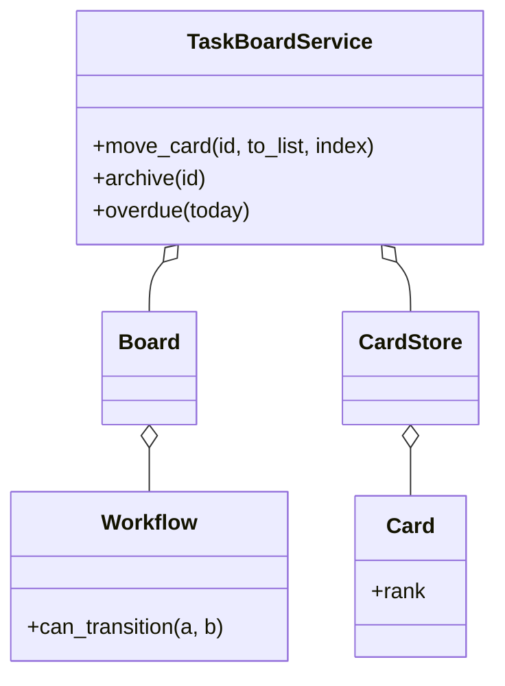

# 任务管理（看板）（low priority）

## 题目

几条列，卡片可以在列之间拖来拖去，每张卡能指派给人、打标签、设截止日期、记活动。用它的是团队成员和项目经理，像 Trello 或 Jira。这题的重心是结构而不是人际关系：一块看板长什么样，卡的「位置」到底是什么，「移动」这个动作能不能随便允许。**面试官真正在看的是三件事：列是不是工作流里的状态（移动要受转移表约束）；位置怎么存才不用每次重排后面所有卡；归档能不能让索引缩回去。**

你会听到的原话：设计一个任务看板，有若干列，卡片可以在列间移动，可以指派、打标签、设截止日期。

常见追问：
- 不允许把「待办」直接拖进「完成」，必须先经过「进行中」，怎么做？
- 在两张卡中间再插一张，要不要把后面所有卡的下标加一？
- 查询所有逾期的卡，怎么不扫全部卡？

## 先问这几个问题

- 列只是展示分区，还是工作流的状态？**是状态。移动卡片就是一次状态转移，受一张转移表约束；不要再给卡片另开一个和列脱节的 `status` 字段。**
- 每块看板的工作流都一样吗？**不一样。工作流是每块看板自己持有的一张有向图，边由创建者声明，允许「打回去」的反向边。**
- 位置存整数下标还是别的？**这决定移动是 O(n) 还是 O(1)，见下面的决策。**
- 卡能真正删除吗？**不能，只能归档。删除会让「这张卡去年在哪、谁动过」无法回答。**
- 范围外：成员权限（只把 `actor` 记进活动日志，不校验）、通知、评论。

## 核心对象

| 类 | 职责（一句话） | 守住的不变量 |
|---|---|---|
| `Workflow` | 一块看板的有向图：哪些列可以直接转到哪些列 | 只回答「这一步合不合法」，不知道卡片 |
| `Board` | 列的集合和先后顺序，持有自己的 `Workflow` | 不持有卡片 |
| `Card` | 一张卡：所在列、秩（rank）、指派人、标签、到期日、是否归档 | 归档后不可再改 |
| `CardStore` | 卡片存储和三类索引：按列排序、按指派人、未归档的到期日 | 归档时从三类索引里同时摘除 |
| `TaskBoardService` | 编排：校验工作流 → 改索引 → 记活动 | 唯一同时知道「合不合法」和「索引怎么变」的地方 |



## 主流程

**移动 `move_card(id, to_list, index)`：**
1. 取卡；已归档就抛 `CardArchivedError`。
2. 查这块看板的 `Workflow`：从当前列到目标列没有边就抛 `IllegalTransitionError`（同列内重排总是允许）。
3. 在 `CardStore` 的锁里：从旧列的顺序里摘掉，取目标位置前后两张卡的秩，算一个夹在中间的新秩，插入新列。
4. 记一条 `MOVED` 活动（谁、什么时候、从哪到哪）。

**归档 `archive(id)`：**
1. 标记卡为已归档。
2. 同一把锁里，从列顺序、指派人索引、到期日索引三处摘掉它。
3. 记一条 `ARCHIVED` 活动。

**逾期查询 `overdue(today)`：** 只扫「未归档且设了到期日」的小索引，不扫全部卡。

## 关键决策

### 位置：整数下标，还是浮点秩

- 方案 A，整数下标：每次在中间插入，后面所有卡的下标加一，一次移动 O(n)，而且要写很多行。
- **选每张卡一个可排序的浮点「秩」，插入时取前后两张卡的中点。** 移动只改这张卡自己的一个数字，O(1)。代价是浮点精度有限：反复在同一条缝里插入，终会无法再取中点，这时抛 `RankExhaustedError`，只对这一列做一次整列重排（O(列长)），只在那条缝真被塞满时才付出。
- 取中点公式：列首取下一张秩减一，列尾取上一张秩加一，中间取 `prev + (next - prev) / 2`。

### 工作流：转移表，还是每个状态一个类

- 方案 A，状态模式，每列一个类：三个状态之间唯一有实质差异的只是「允许转到哪些状态」，这是数据，不是行为。
- **选一张转移表：`dict[状态, set[允许转到的状态]]`。** 这里没有模式。不同团队的看板有不同的边，只是创建时声明不同的数据。
- 工作流不内建「终态」。一张卡挪进了看起来像「完成」的列，只要到期日在过去且没归档，依然算逾期；产品要求终态不算逾期时，给 `Workflow` 加一个终态集合，只改逾期查询的过滤。

### 逾期查询：索引，还是遍历

- 方案 A，每次遍历全部卡：卡越积越多，查询越来越慢。
- **选一个「未归档且设了到期日」的索引，归档时同步摘除。** 查询只扫真的可能逾期的那一小撮，且不随历史卡片数量无限增长。

### 归档：软删除标记，还是收缩索引

- 方案 A，只打一个 `archived` 标记：列顺序、指派人索引里依旧挂着它，所有读取都要过滤，索引随历史无限增长。
- **选归档时把它从三类索引里同时摘掉，卡对象本身保留用于审计。** 不再被任何活跃查询触达。

## Python 骨架

```python
from __future__ import annotations
import itertools
import threading
from datetime import date, datetime


class IllegalTransitionError(Exception): pass
class CardArchivedError(Exception): pass
class RankExhaustedError(Exception): pass


class Workflow:  # 一张转移表：纯数据，不知道卡片
    def __init__(self, states) -> None:
        self.edges = {s: set() for s in states}

    def allow(self, a: str, b: str) -> None:
        self.edges[a].add(b)

    def can_transition(self, a: str, b: str) -> bool:
        return a == b or b in self.edges.get(a, ())


def rank_between(prev: float | None, nxt: float | None) -> float:
    if prev is None and nxt is None:
        return 0.0
    if prev is None:
        return nxt - 1.0
    if nxt is None:
        return prev + 1.0
    mid = prev + (nxt - prev) / 2
    if not prev < mid < nxt:  # 精度耗尽：只重排这一列
        raise RankExhaustedError()
    return mid


class Card:
    def __init__(self, cid: str, board: str, list_id: str, title: str, rank: float) -> None:
        self.id, self.board, self.list_id, self.title, self.rank = cid, board, list_id, title, rank
        self.assignee: str | None = None
        self.due: date | None = None
        self.archived = False


class TaskBoardService:  # 唯一同时知道「合不合法」和「索引怎么变」的地方
    def __init__(self, clock=datetime.now) -> None:
        self.clock = clock
        self.workflows: dict[str, Workflow] = {}
        self.cards: dict[str, Card] = {}
        self._order: dict[str, list[str]] = {}  # 列 -> 按秩排序的卡 id
        self._by_assignee: dict[str, set] = {}
        self._due: dict[str, date] = {}  # 只含未归档且设了到期日的卡
        self.log: list[tuple] = []
        self._ids, self._lock = itertools.count(1), threading.Lock()

    def create_board(self, board: str, states: list[str]) -> Workflow:
        self.workflows[board] = Workflow(states)
        return self.workflows[board]

    def create_card(self, board: str, list_id: str, title: str, actor: str) -> Card:
        with self._lock:
            order = self._order.setdefault(list_id, [])
            rank = rank_between(self.cards[order[-1]].rank if order else None, None)
            card = Card(f"c{next(self._ids)}", board, list_id, title, rank)
            self.cards[card.id] = card
            order.append(card.id)
            self.log.append((self.clock(), actor, "created", card.id))
            return card

    def move_card(self, cid: str, to_list: str, actor: str, index: int | None = None) -> None:
        with self._lock:
            card = self.cards[cid]
            if card.archived:
                raise CardArchivedError(cid)
            if not self.workflows[card.board].can_transition(card.list_id, to_list):
                raise IllegalTransitionError(f"{card.list_id}->{to_list}")
            self._order[card.list_id].remove(cid)
            order = self._order.setdefault(to_list, [])
            i = len(order) if index is None else max(0, min(index, len(order)))
            try:
                rank = self._rank_at(order, i)
            except RankExhaustedError:  # 只重排这一列
                for n, other in enumerate(order):
                    self.cards[other].rank = float(n)
                rank = self._rank_at(order, i)
            self.log.append((self.clock(), actor, f"moved {card.list_id}->{to_list}", cid))
            card.list_id, card.rank = to_list, rank
            order.insert(i, cid)

    def _rank_at(self, order: list[str], i: int) -> float:
        prev = self.cards[order[i - 1]].rank if i > 0 else None
        nxt = self.cards[order[i]].rank if i < len(order) else None
        return rank_between(prev, nxt)

    def assign(self, cid: str, user: str) -> None:
        with self._lock:
            card = self.cards[cid]
            if card.archived:
                raise CardArchivedError(cid)
            if card.assignee:
                self._by_assignee[card.assignee].discard(cid)
            card.assignee = user
            self._by_assignee.setdefault(user, set()).add(cid)

    def set_due(self, cid: str, due: date) -> None:
        with self._lock:
            self.cards[cid].due = due
            self._due[cid] = due

    def archive(self, cid: str, actor: str) -> None:
        with self._lock:  # 三类索引同时摘除
            card = self.cards[cid]
            card.archived = True
            self._order[card.list_id].remove(cid)
            if card.assignee:
                self._by_assignee[card.assignee].discard(cid)
            self._due.pop(cid, None)
            self.log.append((self.clock(), actor, "archived", cid))

    def overdue(self, today: date) -> list[str]:  # 只扫小索引
        with self._lock:
            return sorted(c for c, d in self._due.items() if d < today)


if __name__ == "__main__":
    svc = TaskBoardService()
    wf = svc.create_board("b", ["todo", "doing", "done"])
    wf.allow("todo", "doing")
    wf.allow("doing", "done")
    wf.allow("doing", "todo")  # 允许打回去
    a, b, c = (svc.create_card("b", "todo", t, "chi") for t in "abc")
    try:
        svc.move_card(a.id, "done", "chi")  # 不能跳过「进行中」
        raise SystemExit("应当拒绝")
    except IllegalTransitionError:
        pass
    svc.move_card(a.id, "doing", "chi")
    svc.move_card(b.id, "doing", "chi")
    svc.move_card(c.id, "doing", "chi", index=1)  # 插到 a 和 b 中间：只改 c 自己的秩
    assert svc._order["doing"] == [a.id, c.id, b.id] and a.rank < c.rank < b.rank
    svc.set_due(a.id, date(2026, 1, 1))
    svc.assign(a.id, "li")
    assert svc.overdue(date(2026, 2, 1)) == [a.id]
    svc.archive(a.id, "chi")
    assert svc.overdue(date(2026, 2, 1)) == [] and a.id not in svc._order["doing"]
    try:
        svc.move_card(a.id, "done", "chi")
        raise SystemExit("应当拒绝")
    except CardArchivedError:
        pass
    print("ok")
```

## 面试官加需求时

| 新需求 | 改哪里 | 不用动哪里 |
|---|---|---|
| 终态列不算逾期 | `Workflow` 加终态集合，逾期查询多一次过滤 | 移动与索引 |
| 标签、检查清单 | `Card` 加字段；不参与任何索引 | `CardStore` 的索引逻辑 |
| 反向边（评审打回） | 声明一条边 | 移动逻辑 |
| 谁能移动卡片 | 服务入口加一次权限校验 | 工作流、存储 |
| 撤销上一次移动 | 活动日志里记旧列和旧秩，反向再移动一次 | 秩算法 |
| 看板间移动卡片 | 服务层校验目标看板工作流，改卡的 `board` 字段 | `Workflow` 本身 |

## 并发与扩展

- 竞态 1：**两个人同时拖同一张卡。** 移动整体（摘旧列、算秩、插新列）在一把锁里，不会出现卡同时在两个列的顺序里。
- 竞态 2：**归档与移动交错。** 归档先标记再摘索引，同一把锁；移动开头检查归档，已归档的不能再动。
- 竞态 3：**两个人同时在同一条缝里插入。** 同一把锁里取前后秩，两张新卡不会拿到相同的秩。
- 规模变大：按看板分片加锁；秩用字符串（分数索引）代替浮点，就不会精度耗尽；活动日志落库，按卡 id 分区；列顺序用有序存储而不是内存列表。

## 常见错误

- 给卡另开一个 `status` 字段：**列就是状态，只有一个事实来源，否则迟早出现「在完成列但状态是进行中」。**
- 用整数下标做位置：**每次插入都要重排后面所有卡。用浮点秩，耗尽时只重排一列。**
- 归档只打标记：**要同时从列顺序、指派人索引、到期日索引里摘掉，否则索引随历史无限增长。**
- 为每个状态写一个类：**差异只是「允许转到哪里」，是一张表。**
- 删除卡片：**只归档，保留审计。**

## 30 秒复述

- 对象：`Workflow` 是每块看板的转移表；`Board` 管列和顺序；`CardStore` 管卡和三类索引；`TaskBoardService` 编排「校验、改索引、记活动」。
- 核心决策：**列就是工作流状态，移动受转移表约束；位置用浮点秩，插入取前后中点，O(1)。**
- 秩耗尽时只重排这一列。
- 归档不是删除：卡保留，但从列顺序、指派人索引、到期日索引同时摘掉。
- 并发：移动在一把锁里完成，活动日志带谁、何时、从哪到哪。

## 来源

- [[solution-task-management]]
