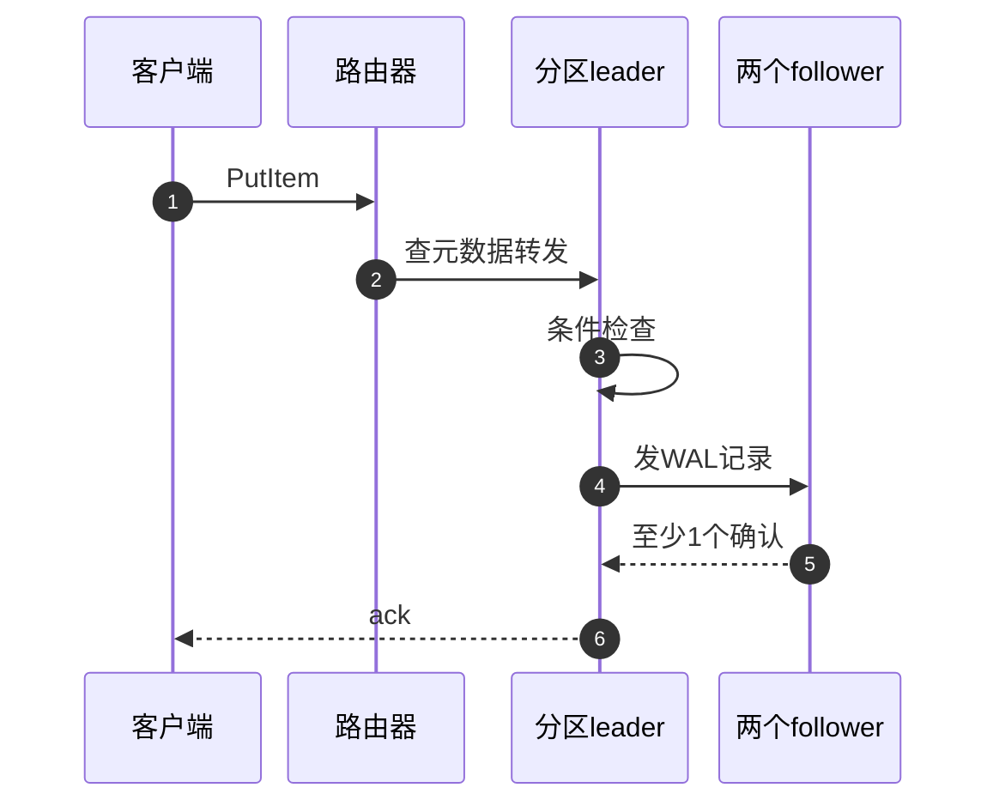

# DDIA 速成课：AWS 数据服务设计轮要用到的分布式数据基础

《DDIA》（Designing Data-Intensive Applications，Kleppmann）里的分布式数据基础，是 AWS 数据服务设计轮反复用到的零件：存储引擎、复制、分区、事务、共识、流处理、批处理、编码演进。
每个零件都按同一个顺序讲：**是什么 → 为什么需要 → 怎么工作 → 哪个 AWS 服务体现了它 → 取舍**，面试官追问时你能说到第二层。
本页只重建直觉；细节、数字和追问在延伸阅读里的卡片和题解。目标 bar 是 senior（SDE II/III）。
最后有自测题，答案折叠在 `<details>` 里。

---

## 1. 存储引擎：B-tree 与 LSM-tree

### 1.1 是什么
数据库最底层要回答一个问题：**"键值对在磁盘上怎么摆，才能让读和写都快？"** 有两大流派：

- **B-tree（原地更新）**：磁盘分成固定大小的**页（page，通常 4–16 KB）**，页组成一棵宽而矮的树。更新 = 找到那一页，原地改。
- **LSM-tree（Log-Structured Merge-tree，追加 + 合并）**：写入先进内存里的**有序表 memtable**，满了就整块顺序写成一个不可变的**有序文件 SSTable**；
  后台不断把小文件**合并（compaction）**成大文件。

### 1.2 为什么需要两种
磁盘（尤其机械盘，SSD 也类似）**顺序写远快于随机写**。B-tree 每次更新是随机写一页；LSM 把随机写变成顺序写，代价是读要查多个文件、后台要做合并。

### 1.3 怎么工作

```
B-tree                                   LSM-tree
                                         写: put(k,v)
        [ root: 30 | 60 ]                   │
         /       |       \                  ▼
   [10|20]    [40|50]   [70|80]         WAL(顺序追加, 崩溃恢复) + memtable(内存有序)
    /  |  \                                 │ 满了 flush(顺序写)
 leaf pages (4–16KB, 原地改)                ▼
 写: 找到叶子页 → 改 → 若满则 split        L0: [SST][SST]        ← 可能互相重叠
 崩溃保护: 先写 WAL 再改页                  L1: [  SST  ][  SST  ]  ← 合并后不重叠
 读: 从根到叶 O(log_B N) 次页读             L2: [ ... 更大 ... ]
                                         读: memtable → L0 逐个 → L1 二分 …
                                             每个 SST 先问 Bloom filter "可能有吗?"
```

**放大（amplification）三角**——任何存储引擎都在这三者之间做取舍：

| 放大 | 含义 | B-tree | LSM（leveled） | LSM（size-tiered） |
|---|---|---|---|---|
| 写放大（write amp） | 1 字节用户数据最终导致多少字节落盘 | 中（整页重写 + WAL 双写） | 高（同一数据被逐层重写多次） | 较低 |
| 读放大（read amp） | 一次读要碰几处磁盘 | 低（一条路径） | 中（每层最多一个文件，加 Bloom） | 高（同层多个文件） |
| 空间放大（space amp） | 磁盘占用 / 逻辑数据量 | 中（页内碎片） | 低 | 高（合并前旧版本并存） |

粗略的教科书量级（LSM 文献里的经验值，不是某个云服务公布的数字）：size ratio 为 10 时，leveled 压实下每个字节每下沉一层大约被重写 ~10 次，
所以几层加起来写放大可到 10–30 倍；size-tiered 约等于层数。

**删除**在 LSM 里不是真删，而是写一个**墓碑（tombstone）**，等合并到最底层才真正消失——"删得越多反而越慢"的来源。

**worked example**：每天写 1 TB 新数据、leveled 写放大 ~15 倍 → 磁盘实际承受 ~15 TB/天写入，一块 SSD 的耐久度（DWPD）会被先吃掉。
这就是为什么设计 LSM 系统时要把"写放大"当成容量规划的一等公民，而不只是看 QPS。

### 1.4 AWS 里谁体现了它
- **DynamoDB 存储节点 = B-tree + WAL**：一个复制组里的每个存储副本都同时保存预写日志（WAL）和存放键值数据的 B-tree。
  所以 DynamoDB 的"点查延迟稳定"来自 B-tree 的确定性路径。
- **S3 的 ShardStore = LSM 索引 + 追加写的数据区**。："ShardStore's key-value store comprises a log-structured merge tree (LSM tree) but with shard data stored outside the tree"
  （这是 Key-Value Separation，类似 WiscKey）；数据按 chunk 写进**只能顺序追加的 extent**，删除只能留"洞"，要靠**回收（reclamation）**把活的 chunk 搬走再 reset 写指针。
  这和 LSM 的 compaction 是同一个思想，只是搬运的对象是大块对象数据而不是 key。
- **Aurora**：把"页"这一层拆走——数据库只往存储层发 **redo log**，存储节点自己后台把日志"应用"成页。"The log is the database"。
  这是 B-tree 引擎（InnoDB）+ 把落盘职责下沉的组合，不是 LSM。


---

## 2. 复制（Replication）

### 2.1 是什么、为什么
**把同一份数据存多份**，目的有三：容错（一台坏了还有）、就近读（降延迟）、读扩展（分摊读流量）。难点只有一个：**多份副本怎么保持一致**。三种拓扑：

```
单主 (leader/follower)         多主 (multi-leader)              无主 (leaderless / quorum)
 写 ─▶ [Leader] ─▶ F1          写A ─▶ [L-US] ◀──▶ [L-EU] ◀─ 写B   写 ─▶ 同时发给 N 个副本
            └──▶ F2                  (跨区域互相同步)               等 W 个确认就算成功
 读 ◀─ 任意 F (可能旧)           冲突!同一 key 两边同时改            读 ─▶ 问 R 个，取最新版本
```

### 2.2 单主：同步 vs 异步
- **同步**：leader 等 follower 确认才回复客户端。不丢数据，但一个 follower 慢/挂，写就卡住。
- **异步**：leader 写完自己就回复。快，但 leader 挂时还没传出去的写丢了（**复制延迟 = RPO 风险**）。
- **折中（半同步 semi-sync / 法定人数）**：等**多数派**确认。DynamoDB 与 Aurora 都走这条路。

### 2.3 复制延迟带来的三个"异常"（异步 follower 读的时候）
用一个社交例子：Alice 发帖，写到 leader；她刷新页面，读被路由到了还没追上的 follower。

1. **读不到自己的写（read-your-writes 违反）**：Alice 看不到自己刚发的帖。修法：自己的数据读 leader，或带"我写到的位置"去读。
2. **单调读违反（monotonic reads）**：先读到新数据（连到快 follower），再刷新读到旧数据（连到慢 follower）——时间倒流。修法：同一用户固定读同一个副本。
3. **一致前缀读违反（consistent prefix）**：先看到"回答"后看到"问题"，因为两个分区复制速度不同。修法：因果相关的写放同一分区。

### 2.4 多主与冲突
多主（典型场景：多地域写）要面对**写写冲突**：A 地把 title 改成 X，B 地同时改成 Y。常见解法：
**LWW（last-write-wins，按时间戳取最后写）**——简单但会**静默丢数据**（时钟还不准）；
或保留冲突版本交给应用/CRDT 合并。

### 2.5 无主与 Quorum
N 个副本，写要 W 个确认，读问 R 个，**只要 W + R > N，读集合和写集合必有交集**，读到的集合里至少有一个最新值。

```
N=3, W=2, R=2:   写 → {A,B} 成功,C 没收到
                 读 → 问 {B,C} → B 有新值 v2, C 旧值 v1 → 比版本号 → 返回 v2,并 read-repair 把 v2 推给 C
W+R=4>3 ✓.        若 W=1,R=1: W+R=2<3 ✗ → 可能读到 C 的旧值
```
- **sloppy quorum + hinted handoff**：目标副本挂了，写先暂存到别的"临时"节点并带"提示"，等原节点回来再转交。
  好处：写永远能成功（高可用）；代价：**此时 W+R>N 的交集保证作废**，读可能看不到刚写的值。
- **anti-entropy**：后台用 **Merkle tree**（哈希树）比较两个副本，只传不一致的 key 范围——不用全量比对。
- quorum **不等于线性一致（linearizable）**：并发读写、sloppy quorum、部分失败的写都可能让它看到旧值。

### 2.6 AWS 里谁体现了它
- **Dynamo（2007）**：无主 + N/R/W + sloppy quorum + hinted handoff + vector clock + Merkle tree + gossip + 一致性哈希虚拟节点。
  SLA 写的是"99.9% 请求 300 ms 内完成"；`R + W > N` 得到"类 quorum"。
  购物车是选它的原因：**宁可合并出重复商品，也不能拒绝加购**。
- **DynamoDB（2012 至今，不是 Dynamo）**：**单主**！每个分区一个 Multi-Paxos 复制组，跨 AZ 3 个副本，**2/3 写 quorum**，只有 leader 服务写和强一致读，
  任意副本可服务最终一致读。别把"DynamoDB = Dynamo 论文"当成面试答案：两者只共享名字，架构几乎不同（Dynamo 是无主，DynamoDB 是每分区单主）。
  另外有 **log replica**：只存最近 WAL，不存 B-tree，坏了一个副本时 leader 几秒内加一个 log replica 补齐写 quorum，而重建完整存储副本要几分钟。
- **Aurora**：6 副本跨 3 AZ（每 AZ 2 个），**写 quorum 4/6，读 quorum 3/6**。两条规则：`Vr + Vw > V`（读看得到最新写）与 `Vw > V/2`（写之间不冲突）；
  能挂掉整个 AZ 外加一个节点仍不丢数据（AZ+1），挂一个 AZ 仍能写。
  为什么不用 2/3：AZ 整体宕机时，别的 AZ 里的后台随机故障会让 2/3 quorum 破掉。**日常读不需要 quorum**——数据库自己记录哪个 segment 已追上，直接读那一个。
- **DynamoDB Global Tables** 是多主跨区域复制。默认的多区域最终一致模式（MREC）异步复制（通常一秒内），同一 item 在多个区域同时修改时按"最新内部时间戳"取胜，即 last-writer-wins；另有较新的多区域强一致模式（MRSC，必须恰好 3 个区域，同步复制到至少另一个区域、RPO=0，冲突写直接报 `ReplicatedWriteConflictException` 而不是 LWW，且不支持事务/TTL/LSI）。


---

## 3. 分区（Partitioning / Sharding）

### 3.1 是什么、为什么
单机放不下或扛不住 → 把数据**切成多块（分区/shard）**，每块在不同机器。副本解决"容错"，分区解决"装不下 + 吞吐"。两者正交：每个分区再各自有若干副本。

### 3.2 哈希分区 vs 范围分区
```
范围分区 (range)                        哈希分区 (hash)
key: a────────m────────z                hash(key) mod / 一致性哈希环
[a–f][g–m][n–s][t–z]                    0 ───────────────────── 2^128
 ✓ 范围扫描高效(同前缀在一处)             ✓ 打散热点,负载均匀
 ✗ 顺序 key(时间戳)全砸最后一片           ✗ 范围扫描要问所有分区(scatter-gather)
```
- **热点（hot key/partition）**：哈希只能打散*不同* key，**同一个 key 太热**（明星账号、爆款商品）仍然压垮一片。办法：给热 key 加随机后缀拆成多份（写时随机选，读时全读再合并），代价是读放大。
- **再平衡（rebalancing）**：加机器时怎么搬数据？`hash mod N` 一加机器几乎全部要搬（灾难）；一致性哈希只搬 ~1/N；
  **固定分区数 + 分区搬家**（先切很多小分区，机器间挪）最常用；**动态分裂**（分区超过阈值就一分为二）最适合范围分区。
- **二级索引**：按 *非分区键* 查怎么办？(a) **本地索引（document-partitioned）**：每个分区只索引自己的数据，写快、读要 scatter-gather；
  (b) **全局索引（term-partitioned）**：索引本身再分区，读快、写要更新别的分区（常常异步 → 索引会陈旧）。

### 3.3 AWS 里谁体现了它
- **DynamoDB**：分区键经过内部哈希函数决定位置；**每个分区承载一段连续、不相交的 key 范围**，所以 sort key 范围查询能在分区内高效完成。
  Global Secondary Index 是全局索引、异步更新（异步更新、最终一致，正常情况下亚秒级传播，GSI 只支持最终一致读），Local Secondary Index 与基表同分区（每个 LSI 分区限定在同 partition key 的基表分区内，可选强一致读）。
- **DynamoDB 的"热分区"故事是最好的 senior 素材**：
  早期把表的预置吞吐**平均分给各分区**，两个问题：(1) *hot partition*——流量集中在少数 key；(2) *throughput dilution*——为存储大小分裂分区后，每个子分区拿到的吞吐被均摊变少。
  解法演进：burst（令牌桶，攒最多 300 秒的闲置容量）→ adaptive capacity（按表级吞吐动态加给热分区）→ **global admission control（GAC，请求路由器本地令牌桶 + 中心 GAC 服务每隔数秒补发令牌）** →
  **按消耗量分裂（split for consumption）**：按观察到的 key 分布挑分裂点，而不是从中间一刀切；并且**单个 item 极热或纯顺序访问的分区分裂也没用，系统会识别出来不分裂**。
- **S3**：按 key 前缀自动分区；每个前缀至少 3,500 写/5,500 读每秒，前缀数无上限；扩容是渐进的，期间可能返回 503 Slow Down。
- **Kinesis**：分片（shard）= 分区；每个 shard 写入至多 1 MB/s 或 1,000 条/s，读取至多 2 MB/s。按 partition key 哈希到 shard，同 key 有序。
- **Dynamo（2007）**：一致性哈希 + 虚拟节点——每台物理机负责多个环上位置，加减机器时负载均匀迁移。


---

## 4. 事务与隔离级别（Transactions & Isolation）

### 4.1 是什么、为什么
**事务**：把多个读写打包成一个"要么全做、要么全不做"的单元（ACID 里的 A 原子性）；**隔离（Isolation）** 决定并发事务互相能看到什么。
完美隔离（serializable，等价于一个接一个串行执行）很贵，所以数据库提供一个阶梯，每一级多挡住几种异常：

```
弱 ────────────────────────────────────────────────────────▶ 强
Read Committed   →   Snapshot Isolation(RR)   →   Serializable
挡: 脏读/脏写         再挡: 不可重复读(读到一半       再挡: 写偏斜(write skew)、
                          数据被别人改)                    幻读(phantom)
```

### 4.2 异常用小例子认识
- **脏读（dirty read）**：T1 改了 x 还没提交，T2 读到了；T1 回滚 → T2 读到了从未存在过的值。*Read Committed 挡住。*
- **不可重复读（non-repeatable read）**：T2 在一个事务内读 x 两次，中间 T1 提交了修改，两次结果不同。给一个对账报表读 A 账户、再读 B 账户，中间有转账 → 总额对不上。*Snapshot Isolation 挡住（MVCC：每个事务看一份冻结的快照）。*
- **丢失更新（lost update）**：x=0；T1、T2 各自"读 x → 加 1 → 写回"，最终 x=1 而不是 2。修法：原子 `x = x + 1`、`SELECT … FOR UPDATE`、或 **CAS / 条件写**（`UPDATE … WHERE version = ?`）。
- **写偏斜（write skew）**：规则"至少一个医生值班"。Alice、Bob 同时读到"两人都在值班"，各自把自己改成下班——**各写不同的行**，所以没有写写冲突，Snapshot Isolation 看不出问题，结果 0 人值班。
  只有 serializable（SSI 或 2PL 或串行执行）能挡。
- **幻读（phantom）**：事务按条件 `WHERE room=1 AND time=10:00` 查"没有预订"，然后插入一条；另一事务同时也插入——查询的结果集被"幻影行"改变。

### 4.3 三种实现 Serializable 的办法
1. **真·串行执行**：单线程跑完整事务（Redis、VoltDB），要求事务短、数据在内存。
2. **两阶段锁（2PL）**：读加共享锁、写加排他锁，持有到事务结束；写会阻塞读。能做但并发差、死锁要检测。
3. **SSI（Serializable Snapshot Isolation）**：在快照隔离之上**乐观**地检测"读到的数据被别人改了"，提交时发现冲突就 abort 重试。

### 4.4 分布式事务（跨分区/跨服务）
- **2PC（两阶段提交）**：协调者先问所有参与者"能提交吗（prepare）"，全部 yes 再发 commit。**坏处**：协调者在 prepare 之后挂了，参与者持锁等待（blocking）。
- 所以 senior 答案常常是**避免跨分区事务**：按业务键分区让一个事务只落在一个分区；跨服务用 **Saga**（每步有补偿）+ **Outbox**（本地事务里同时写业务表和"待发送事件"表，再由中继投递），而不是 2PC。

### 4.5 AWS 里谁体现了它
- **DynamoDB**：单 item 操作带条件表达式（`ConditionExpression`，等价 CAS）；还支持跨 item 的 ACID 事务。
  事务协议用**时间戳排序**（timestamp ordering）做串行化，**事务不加任何锁**（不是只"无读锁"）；写事务由 transaction coordinator 走**两阶段协议**（prepare / commit，但这不是两阶段锁），只读事务可在一轮内完成，同分区的写事务也可单轮完成。
- **Aurora**：单写者 + 最多 15 个只读副本共享同一份存储卷。**不需要 2PC**，因为复制是存储层的 quorum，而不是多个数据库各自提交。
  提交是异步的：事务记录自己的 commit LSN，等 VDL（Volume Durable LSN）追上才回复客户端；崩溃恢复一般 10 秒内。
- **S3**：现在对同 key 的 PUT/GET/LIST 提供强读后写一致性（2020-12 起 GET/PUT/LIST 均强一致）；条件写 `If-None-Match` / `If-Match` 可做 CAS，见 [[storage-s3-conditional-writes]]。


---

## 5. 共识、租约与 fencing token

### 5.1 是什么、为什么
多个节点要对"**谁是 leader / 下一条日志是什么 / 这把锁归谁**"达成**一致**，哪怕有节点挂、网络慢或分裂。这就是**共识（consensus）**。
没有它：脑裂（split brain）——两个节点都以为自己是 leader，各写各的，数据分叉。

### 5.2 Raft 用大白话（Multi-Paxos 在实践中是同一类东西）
```
角色: Follower ──超时没听到 leader──▶ Candidate ──拿到多数票──▶ Leader
任期 term: 单调递增的"选举轮次编号"(= epoch)。同一 term 至多一个 leader。

写流程:  client ─▶ Leader: 追加日志条目 (term=3, idx=17)
                 Leader ─▶ 并行发给 Followers
                 多数派(含自己)已持久化 ─▶ 该条目 "committed" ─▶ 回复 client
选举规则: 只有日志"至少跟多数派一样新"的节点才能当选 → 已 committed 的条目不会丢
```
三句话记住：(1) 一切写走 leader；(2) 多数派确认才算数（所以 2f+1 个节点容忍 f 个故障）；(3) 任期号让旧 leader 一露面就被识别并退位。
代价：每次写至少一次多数派往返；跨地域部署延迟高；多数派不可达时**拒绝服务**（选 C 不选 A，见 CAP/PACELC）。

### 5.3 租约（lease）与时钟的陷阱
**租约** = 带过期时间的授权："你在未来 10 秒内是 leader，要续约"。好处是 leader 不用每次读都找多数派，只要租约有效就能本地服务**强一致读**。
陷阱：**GC 暂停/进程挂起/时钟漂移**。旧 leader 暂停 20 秒，醒来时还以为自己持有租约，实际上新 leader 已经产生——它的写是"僵尸写"。

### 5.4 Fencing token：让资源端自己拒绝僵尸
每次授权发一个**单调递增的令牌**，受保护的资源（存储）记住见过的最大令牌，**拒绝携带更小令牌的写入**。
客户端自己没法"检查租约仍然有效再写"，因为暂停可以恰好发生在检查与写之间——所以必须在**资源端**执行检查。**没有 fencing 的锁只是建议性锁。**

```
Client1 拿到 lock, token=33 ──(GC 暂停 20s)────────────▶ 写 (token=33) ✗ 被存储拒绝
Client2 租约过期后拿到 lock, token=34 ─▶ 写 (token=34) ✓  存储记下 max=34
```

### 5.5 AWS 里谁体现了它
- **DynamoDB**：每个分区 Multi-Paxos 复制组；leader 靠**租约**维持，只有 leader 服务写和强一致读；**新 leader 必须等旧 leader 租约过期**才能服务（"only takes a couple of seconds"）；
  部署时 leader 主动让位，新 leader 不必等租约过期。
  失败检测的 senior 细节：follower 想发起选举前，先问其他副本"你们能连上 leader 吗？"，有人说能就放弃——**抑制灰色网络故障（gray failure）造成的误选举**。
- **Aurora**：存储层的恢复用**epoch 编号**给截断范围版本化，防止旧的恢复过程覆盖新的。
- **亚马逊内部的选主实践**：租约是最常用的选主机制；最稳妥的做法是用 DynamoDB 或 ZooKeeper 的租约锁客户端；Kinesis Client Library 用租约保证每个 shard 只有一个消费者 owner；实践要点——**在每次有副作用的操作之前检查剩余租约时间**，不要在后台线程里续租（线程可能在租约过期后还在跑）；慢网络、重试、GC 暂停都会让租约在你以为有效时已过期。


---

## 6. 流处理：日志、CDC、exactly-once、水位线

### 6.1 日志是核心抽象
**日志（log）** = 只追加、按序编号（offset）的记录序列。三种东西本质都是日志：数据库的 WAL、复制流、消息队列（Kafka/Kinesis）。
把"状态"看成"对日志 fold 的结果"，就得到：**重放日志可以重建任何派生状态**（缓存、搜索索引、数仓、物化视图）。

```
        ┌──────────────── 日志 (有序, 可重放) ─────────────────┐
写入 ─▶ │ e1  e2  e3  e4  e5  e6 …                               │
        └──┬───────────────┬──────────────────┬──────────────────┘
        消费者A(offset=4)  消费者B(offset=2)    新消费者(从 0 重放 → 重建索引)
```

### 6.2 CDC（Change Data Capture）
从源数据库的**事务日志**（MySQL binlog、Postgres WAL、Oracle redo）读取变更，转成事件流发给下游。比"双写"（应用同时写库和队列）强，因为后者在中途崩溃时两边不一致（**dual-write 问题**）。
CDC 要解决三件事：(1) **初始快照 + 增量切换**：先全量拷贝，再接增量，接缝处不丢不重（记下快照时的日志位置）；(2) **有序与幂等**：按主键分区保证同一行的变更有序，下游用主键 upsert 保证重放幂等；(3) **schema 变化**。

### 6.3 exactly-once 的真相
网络上的消息交付语义只有：最多一次（可能丢）、至少一次（可能重）。**"恰好一次"的效果 = 至少一次投递 + 幂等处理**（或把"处理结果 + offset 提交"放进同一个事务）。
```
at-least-once 重试 ─▶ 下游可能收到同一事件两次
        │
        ├─ 幂等 key (event_id / 主键 + 版本号) → 去重表或 upsert → 重复无副作用 ✓
        └─ 事务: 同一个原子操作里 {写结果, 提交 offset} → 崩溃重启要么都有要么都没有 ✓
```
"我的系统是 exactly-once"在面试里是危险话，要立刻补一句"**对哪个边界**、靠什么机制"。

### 6.4 事件时间、处理时间与水位线
- **处理时间（processing time）**：事件到达处理器的时间；**事件时间（event time）**：事件实际发生的时间。手机离线 10 分钟再上传，两者差 10 分钟。
- **窗口（window）**：把无界流切成有界块——滚动窗口（tumbling）、滑动窗口（sliding）、会话窗口（session）。
- **水位线（watermark）**：处理器对"事件时间 ≤ T 的事件大概都到齐了"的**启发式声明**。水位线越过窗口结束时间，窗口关闭输出。晚到的事件怎么办：丢弃、放进侧输出、
  或**更新结果并撤回旧结果（retraction）**。水位线是"延迟 vs 完整性"的旋钮。

### 6.5 AWS 里谁体现了它
- **Kinesis Data Streams**：分片日志，每 shard 写 1 MB/s 或 1,000 条/s、读 2 MB/s；同 partition key 进同 shard 保序；消费者自己管理检查点 → 至少一次，需要幂等消费。
  默认保留 24 小时，可延长到最长 8760 小时（365 天），超过 24 小时要额外收费。
- **AWS DMS**：用各引擎原生接口读事务日志做 CDC（Oracle LogMiner / binary reader，MySQL 要开 row 级 binlog）；文档明确写"**CDC does not provide real-time replication … There are no SLAs for CDC latency**"。
  面试里讲 DMS 类系统时，要把"没有延迟 SLA"当成需求边界而不是缺陷。
- **DynamoDB Streams**：按 item 的变更日志，24 小时保留；顺序保证是**按 item（同一主键）**的，**不是**整个分区/分片全局有序（同一 partition key 的 item collection 可能跨多个分区）；分片有父子谱系，必须先处理父分片再处理子分片。
- **DynamoDB 自己的 PITR**：定期快照 + 归档到 S3 的 WAL，恢复 = 找最近快照 + 重放日志到目标时间点——一个"日志 + 快照"的教科书实例。


---

## 7. 批处理 vs 流处理（以及数据湖/数仓）

### 7.1 是什么
- **批（batch）**：输入有界（"昨天的全部日志"），算完输出，延迟分钟到小时，吞吐高、容易重算和修 bug。
- **流（stream）**：输入无界，持续输出，延迟秒级，要面对乱序、状态、恢复。
- **Lambda 架构**：批 + 流两套代码并行（批保准确、流保时效），代价是写两遍逻辑。**Kappa**：只保留流，需要重算时从日志起点重放。

### 7.2 为什么数据服务岗位会反复问
AWS Data Services 的产品几乎都是这几块的托管版：**对象存储（S3）→ 目录（Glue Data Catalog）→ 批 ETL（Glue/EMR，Spark）→ 查询（Athena/Redshift）+ 流（Kinesis）+ CDC（DMS）**。
关键直觉：

```
行存 (OLTP): 一行的所有列相邻        列存 (OLAP): 一列的所有值相邻
 [id,name,age][id,name,age]…          [id,id,id…][name,name…][age,age,age…]
 读一整行快, 聚合某一列要读全部        只读需要的列, 同类型数据压缩比高, 向量化执行
```
- **列存省 I/O**：只读查询涉及的列；同列数据类型一致，压缩（字典、游程）效果好。
- **分区裁剪（partition pruning）**：目录按 `year=2026/month=10/day=15/` 布局，`WHERE` 命中分区键时只扫对应前缀。
- **小文件问题**：对象存储每个请求有固定开销，几百万个小文件会让查询被 `LIST` 和 `GET` 次数拖死。解法：合并（compaction）成 128 MB–1 GB 左右的文件（常见经验区间）。
- **表格式（Iceberg/Delta/Hudi）**：在对象存储上用元数据文件+快照实现 ACID、时间旅行、增量合并（见卡 [[analytics-table-formats]]）。

### 7.3 AWS 里谁体现了它
- **S3**：对象存储，11 个 9 的设计耐久度；高吞吐靠并行化前缀与多实例聚合。
- **Glue**：Data Catalog（元数据，**不含数据本身**）+ Crawler（自动识别 schema 并建表）+ Spark ETL Job + Trigger。
- **Redshift**：列存 MPP 数仓；排序键/分布键决定裁剪与 join 的数据搬运：排序键让每个 1 MB 块的 min/max 元数据可用来跳过大量磁盘块；分布键/分布方式决定 join 与聚合时需要重分布（redistribute）或广播多少数据。
- **Athena**：无服务器（serverless）SQL 查询 S3 上的数据，没有基础设施要管；"按扫描的字节数计费"是 SQL 查询的定价模型（另可选 Provisioned Capacity 按计算计费；按 $5/TB 举例：3 TB 全表扫描 = $15，转 Parquet+压缩后只扫 0.25 TB = $1.25，实际单价按区域而异，面试不报具体单价）。在这个模型下，列存格式+分区裁剪直接等于省钱。


---

## 8. 编码与 schema 演进（Encoding & Schema Evolution）

### 8.1 是什么、为什么
数据要在**进程之间、时间之间**流动：写进磁盘/消息队列的字节，会被**不同版本**的代码读到（滚动升级时新旧版本共存；日志里有三年前的数据）。
所以 schema 必须能演进：
- **向后兼容（backward）**：新代码能读旧数据。
- **向前兼容（forward）**：旧代码能读新数据（忽略不认识的字段）。

### 8.2 怎么做
| 格式 | 机制 | 要点 |
|---|---|---|
| JSON | 字段名随数据一起存 | 灵活但大；数字精度/类型模糊 |
| Protobuf / Thrift | 字段**编号（tag）** 而非名字 | 只能加可选字段、不能复用编号、不能随便改类型 |
| Avro | 写入 schema 与读取 schema **分开**，读时做 schema resolution | 新增字段必须有默认值；适合 Kafka + schema registry |

滚动发布规律：**expand → migrate → contract**（先加新字段/新读取能力，再迁移数据与写入，最后删旧的）。
任何"先部署只读新格式的代码，等全部节点都能读，再开始写新格式"的两阶段发布，都是在避免新旧版本不兼容。

### 8.3 AWS 里谁体现了它
- **DynamoDB 的 read-write deployment**：第一步先部署"能读新消息格式"的软件；全部节点都能读之后，第二步才部署"开始发送新消息"。回滚时两种格式仍可共存。
  这就是 forward compatibility 的运维版，也是 Builders' Library《Ensuring rollback safety during deployments》的核心。
- **Glue Schema Registry**（Avro/JSON Schema/Protobuf 的兼容性检查；注册新版本时按 NONE/DISABLED/BACKWARD/BACKWARD_ALL/FORWARD/FORWARD_ALL/FULL/FULL_ALL 共 8 种兼容模式校验，免费）。
- DMS/Kinesis/Glue 表之间传的都是"带 schema 的行"，列加减就是 schema 演进问题。


---

## 9. 把它们串起来：一次 `PutItem` 的旅程（DynamoDB）



1. 请求路由器查元数据（key → 分区 → leader），把请求转给分区 leader（Multi-Paxos 组长）。
2. leader 先做条件检查（`ConditionExpression`）。
3. leader 生成 WAL 记录，发给另外 2 个副本（跨 AZ）。
4. 收到至少 1 个 follower 的持久化确认（共 2/3）后应用到 B-tree，再 ack 给客户端。
5. 后台：WAL 定期归档到 S3（带 checksum 和 manifest），用于 PITR、备份和 scrub 校验。

把前面每一节对应上去：分区（§3，哈希+连续范围）、复制与 quorum（§2，2/3 写 quorum）、共识与租约（§5，leader lease）、
存储引擎（§1，B-tree+WAL）、日志/快照/PITR（§6）、协议演进（§8，read-write deployment）。
**面试里讲任何 AWS 数据服务，都可以用这条骨架把各个机制挂上去。**

---

## 10. 补充：面试官常追问的零件，与 Kafka ISR

面试不要求推导 Raft、2PC 或 vector clock 的证明，但会问"在这个具体系统里你怎么选这个零件"，senior 档会追到内部机制。
你嘴里说出的每个零件名，都可能被要求当场设计出来——所以只说你能讲到第二层的。

| 常被追问的零件 | 对应章节 | 你应该能说到的第二层 |
|---|---|---|
| LSM tree vs B-tree、Cassandra 内部 | §1 | 写放大/读放大、compaction、Bloom filter、墓碑；为什么写多选 LSM |
| 一致性哈希、分片 vs 复制、倾斜分区/名人问题 | §3 | 虚拟节点、再平衡搬多少数据、热 key 加盐的读代价 |
| 读自己的写（read-after-write） | §2.3 | 读 leader / 带位点读；quorum 为什么也不保证 |
| Kafka ISR、`acks=all` | 下文 | ISR 是什么、为什么 `acks=all` 要加 `min.insync.replicas` |
| 同步冲突解决（先说 last-write-wins，面试官追问） | §2.4 | LWW 为什么丢数据；版本向量 / 应用层合并 / CRDT |
| 主备 DB 故障检测、自动切换、副本同步 | §2、§5 | fencing、租约、灰色故障、RPO/RTO |
| DynamoDB 分区键选择 | §3 | 高基数、避免热分区、访问模式驱动键设计 |
| OpenSearch / 数仓 + CDC | §6 | CDC 快照衔接、幂等 upsert |
| 分布式限流的中心租约服务 | §5 | 租约、令牌批量预取、失败时退化策略 |
| OT vs CRDT | 未展开 | 见 [[distributed-crdt-convergence]]、[[design-google-docs]] |

### Kafka ISR（In-Sync Replicas）

- **是什么**：一个分区的副本集合里，"跟得上 leader 的那些副本"叫 ISR。落后超过 `replica.lag.time.max.ms` 的副本被移出 ISR。
- **为什么**：全同步等所有副本会被最慢的拖垮；全异步 leader 挂了会丢数据。ISR 是折中：**只等"跟得上的"副本**，落后太久的被踢出（不再等它）。
- **怎么工作**：
  - 生产者 `acks=all` 时，leader 等 **ISR 中所有副本**都写入才确认。
  - 再配 `min.insync.replicas=2`（仅在 `acks=all` 时生效）：ISR 少于 2 个时拒绝写入，宁可不可用也不丢数据。
  - leader 挂了从 ISR 里选新 leader，不会丢已确认数据。
  - ISR 为空且允许不干净选举（`unclean.leader.election.enable`，0.11.0.0 起默认关闭）时，可能选出落后的副本：**用丢数据换可用性**。
- **它回答的面试问题**：Kafka 怎么在不丢数据和保持可用之间取舍？`acks`、`min.insync.replicas`、副本数各自管什么？

### 复习顺序

分区/热点（§3）≥ 复制/一致性/冲突（§2）> 租约/故障切换（§5）> LSM vs B-tree（§1）> CDC（§6）> 事务（§4）。

---

## 11. 自测题（先自己答，再展开）

1. 写放大、读放大、空间放大各是什么？为什么 leveled compaction 读更快但写更贵？
<details><summary>答案</summary>写放大：1 字节用户数据导致的总落盘字节；读放大：一次读要访问的磁盘位置数；空间放大：磁盘占用/逻辑数据量。
Leveled 保证每层 key 范围不重叠，一次读每层至多查一个文件（读快、空间低），但为维持这种不重叠，数据在下沉每一层时都要与下层重叠文件合并重写（写贵）；size-tiered 反之。</details>

2. 为什么 LSM 的删除要写墓碑？墓碑什么时候才能真正清除？
<details><summary>答案</summary>旧版本散落在多个不可变文件中，没法原地删，只能写一条"此 key 已删除"的新记录盖住旧的。只有当合并到包含该 key 所有旧版本的最底层（并且超过保留/复制宽限期）时才能丢弃；否则旧值会"复活"。</details>

3. N=3、W=2、R=2 时为什么读一定能看到最新写？如果启用 sloppy quorum 呢？
<details><summary>答案</summary>W+R=4>3，任何写集合与读集合至少交一个节点，该节点有最新版本。sloppy quorum 下写可能落在"目标副本以外"的临时节点，读去问的是目标副本，交集保证失效，可能读到旧值（等 hinted handoff 补齐后才恢复）。</details>

4. Aurora 为什么选 V=6、Vw=4、Vr=3，而不是 3 副本 2/3？
<details><summary>答案</summary>要在"整个 AZ 故障 + 另一个节点随机故障（AZ+1）"下不丢数据，且"整个 AZ 故障"时仍能写。Vr+Vw=7>6 保证读看得到最新写，Vw=4>3 保证两个写必相交。2/3 在 AZ 故障叠加背景故障时会失去 quorum。</details>

5. DynamoDB 的写 quorum 是多少？一个副本无响应时 leader 怎么保持写可用？
<details><summary>答案</summary>3 副本跨 AZ，2/3 构成写 quorum；leader 立即加入一个 log replica（只复制最近 WAL，几秒钟），保证写 quorum 仍能满足，而重建完整存储副本需要几分钟。</details>

6. 描述"读不到自己的写"和"单调读违反"的区别，各给一个修法。
<details><summary>答案</summary>前者：用户写完后自己读不到（读了落后副本）——修：用户自己的数据读 leader，或带写入位置去读。后者：连续两次读，第二次反而更旧（两次连到不同落后程度的副本）——修：同一用户粘到同一副本。</details>

7. 热分区和吞吐稀释各是什么？DynamoDB 最终怎么解决？
<details><summary>答案</summary>热分区：流量集中在少数 item，所在分区被限流而整表吞吐有余。稀释：为存储分裂分区后，吞吐被均摊给子分区，每个子分区能用的变少。演进：burst → adaptive capacity → GAC（请求路由器本地令牌桶+中心补发）→ 按消耗分裂（按观察到的 key 分布选分裂点；单 item 极热或顺序访问则不分裂）。</details>

8. 写偏斜是什么？为什么 Snapshot Isolation 挡不住？举例并给一个修法。
<details><summary>答案</summary>两个事务读同一前提、各写不同的行，合起来破坏不变量（值班医生例子）。没有写写冲突，所以快照隔离不报错。修法：串行化隔离、对前提行加 `FOR UPDATE`、或把不变量物化成一行并加唯一约束/条件写（"物化冲突"）。</details>

9. 为什么 2PC 在实践中常被避免？senior 答案怎么绕开跨分区事务？
<details><summary>答案</summary>协调者在 prepare 后宕机，参与者持锁阻塞；延迟高、可用性取决于所有参与者。绕开：让一个事务只涉及单分区（按业务键分区）；跨服务用 Saga + 补偿 + Outbox；或在设计里允许最终一致并用对账兜底。</details>

10. Raft 里"任期号"解决什么问题？为什么只有日志足够新的节点才能当选？
<details><summary>答案</summary>任期号是逻辑时钟，旧 leader 看到更大任期就退位，防止脑裂时旧 leader 继续提交。只让日志不落后于多数派的节点当选，保证已 committed 的条目一定在新 leader 日志里，不会丢。</details>

11. 解释 fencing token，以及为什么客户端自己检查租约没用。
<details><summary>答案</summary>每次授权给单调递增令牌，资源端记住最大令牌并拒绝更小的。客户端"检查租约再写"不是原子的，GC 暂停可以恰好发生在检查与写之间，所以必须由资源端校验。</details>

12. 为什么说"exactly-once"其实是"至少一次 + 幂等（或事务）"？给出两种实现方式。
<details><summary>答案</summary>交付层面只能保证最多/至少一次。要让效果恰好一次：(1) 幂等：事件带唯一 id/主键+版本，下游去重或 upsert；(2) 事务：把"写结果"与"提交 offset"放进同一原子事务（如 Kafka 事务、数据库事务）。必须说清是在哪个边界。</details>

13. CDC 为什么比应用双写更可靠？初始快照与增量的接缝怎么处理？
<details><summary>答案</summary>双写在两次写之间崩溃会不一致；CDC 只以数据库事务日志为唯一事实来源。接缝：开始快照前先记录日志位置（LSN/binlog 位点），全量拷贝后从该位点开始应用增量，重复的变更靠主键 upsert 幂等吸收。</details>

14. 水位线是什么？水位线推进过快/过慢各有什么后果？
<details><summary>答案</summary>对"事件时间 ≤T 的事件已大致到齐"的启发式声明，用来决定何时关闭窗口。过快：晚到事件被丢或需要撤回修正；过慢：结果延迟高、状态占内存久。</details>

15. 为什么列存适合分析、行存适合 OLTP？分区裁剪和小文件问题分别是什么？
<details><summary>答案</summary>OLTP 一次读写整行，行存相邻；分析常只聚合少数列，列存只读需要的列且同类型易压缩。分区裁剪：按目录前缀布局分区，条件命中分区键就跳过无关前缀。小文件：每个对象请求有固定开销，海量小文件使 LIST/GET 次数与元数据成为瓶颈，需要合并。</details>

16. 滚动升级时新旧版本共存，为什么要"先读后写"两阶段发布？
<details><summary>答案</summary>新代码先上线"能读新格式"，等所有节点都能读后再让它"写新格式"。否则新节点写出旧节点读不懂的数据，回滚也会失败。DynamoDB 的 read-write deployment 就是这个模式。</details>

17. （senior 综合）用前面的机制，讲清 DynamoDB 写一条数据时为什么"单个副本宕机不影响写、一个 AZ 宕机也不丢"。
<details><summary>答案</summary>分区的 3 个副本分在不同 AZ，写只需 2/3 持久化 WAL；一个副本宕机 → leader 加 log replica 补足 quorum；整个 AZ 宕机 → 其余两个 AZ 仍有 2 个副本（若 leader 在故障 AZ，其它副本等旧租约过期后选新 leader）；WAL 还会归档到 S3 做第二道保险。</details>

---

## 延伸阅读

- 入口：[[sd-index]]
- §1 存储引擎：B-tree 与 LSM-tree：[[storage.internals.btree]]、[[storage.internals.lsm]]、[[storage.internals.tradeoffs]]、[[storage-btree-vs-lsm]]、[[storage-amplification-triangle]]、[[storage-lsm-write-path]]、[[storage-lsm-read-path]]、[[storage-compaction-strategies]]、[[storage-bloom-filter-properties]]、[[storage-tombstone-deletes]]、[[storage-btree-wal-recovery]]、[[lsm-vs-btree-stopford]]、[[postgres-btree-internals]]
- §2 复制（Replication）：[[distributed.replication.leader]]、[[distributed.replication.multi-leader]]、[[distributed.replication.leaderless]]、[[distributed-sync-vs-async-replication]]、[[distributed-lag-anomalies]]、[[distributed-read-your-writes]]、[[distributed-quorum-math]]、[[distributed-quorum-not-linearizable]]、[[distributed-sloppy-quorum-handoff]]、[[distributed-lww-danger]]、[[distributed-read-repair-anti-entropy]]、[[distributed-failover-mechanics]]、[[dynamo-paper]]、[[design-key-value-store]]、[[solution-key-value-store]]
- §3 分区（Partitioning / Sharding）：[[distributed.partitioning.schemes]]、[[distributed.partitioning.skew]]、[[distributed.partitioning.rebalancing]]、[[distributed.partitioning.indexes]]、[[distributed-hash-vs-range]]、[[distributed-consistent-hashing]]、[[distributed-vnode-count]]、[[distributed-hot-key]]、[[distributed-hot-key-detection]]、[[distributed-salting-read-cost]]、[[distributed-rebalancing-strategy-choice]]、[[distributed-secondary-index-partitioning]]、[[distributed-global-index-staleness]]、[[distributed-shard-key-one-way-door]]、[[distributed-scatter-gather-fanout-math]]
- §4 事务与隔离级别（Transactions & Isolation）：[[distributed.transactions.isolation]]、[[distributed.transactions.concurrency-control]]、[[distributed.transactions.distributed]]、[[distributed-read-committed-anomalies]]、[[distributed-isolation-anomalies]]、[[distributed-mvcc-visibility]]、[[distributed-lost-update-vs-write-skew]]、[[distributed-write-skew]]、[[distributed-phantoms-predicate-locks]]、[[distributed-2pl-vs-ssi]]、[[distributed-actual-serial-execution]]、[[distributed-2pc-mechanics]]、[[distributed-2pc-blocking-window]]、[[distributed-2pc-avoidance]]、[[correctness-saga-vs-2pc]]、[[correctness-outbox-mechanism]]、[[hermitage-isolation-levels]]、[[helland-life-beyond-distributed-transactions]]
- §5 共识、租约与 fencing token：[[distributed.consensus]]、[[distributed.time.failure]]、[[distributed.time.clocks]]、[[distributed-raft-guarantees]]、[[distributed-raft-linearizable-reads]]、[[distributed-epoch-numbers]]、[[distributed-fencing-tokens]]、[[distributed-consensus-in-practice]]、[[distributed-failure-detection]]、[[distributed-process-pause-causes]]、[[distributed-coordination-service-primitives]]、[[distributed-flp-and-escape]]、[[raft-paper]]、[[kleppmann-distributed-locking]]、[[aws-leader-election]]、[[design-lock-service]]
- §6 流处理：日志、CDC、exactly-once、水位线：[[async.log]]、[[async.streaming.cdc]]、[[async.streaming.processing]]、[[async.delivery.exactly-once]]、[[async-log-vs-queue]]、[[async-cdc-mechanism]]、[[async-cdc-initial-snapshot]]、[[correctness-dual-write-problem]]、[[async-exactly-once-myth]]、[[async-idempotent-producer]]、[[async-kafka-transactions-eos]]、[[async-eos-boundary-choice]]、[[async-event-time-watermarks]]、[[async-late-event-policy]]、[[async-window-types]]、[[correctness-idempotent-consumer-patterns]]、[[the-log-jay-kreps]]、[[confluent-exactly-once-kafka]]、[[treat-exactly-once-delivery]]、[[turning-the-database-inside-out]]、[[design-ad-click-aggregation]]、[[design-message-queue]]
- §7 批处理 vs 流处理（以及数据湖/数仓）：[[analytics.batch]]、[[analytics.olap]]、[[analytics.warehouse]]、[[analytics.derived]]、[[analytics-batch-vs-stream]]、[[analytics-lambda-vs-kappa]]、[[analytics-row-vs-column-layout]]、[[analytics-columnar-compression]]、[[analytics-lake-vs-warehouse-vs-lakehouse]]、[[analytics-table-formats]]、[[analytics-lakehouse-compaction]]、[[analytics-idempotent-reruns]]、[[analytics-shuffle-mechanics]]、[[analytics-skew-stragglers]]、[[iceberg-table-format]]、[[spark-rdd-paper]]、[[clickhouse-vldb-paper]]
- §8 编码与 schema 演进（Encoding & Schema Evolution）：[[storage.encoding]]、[[architecture.services]]、[[storage-encoding-compat-directions]]、[[storage-avro-schema-resolution]]、[[storage-avro-evolution-defaults]]、[[storage-protobuf-tag-rules]]、[[storage-rolling-upgrade-compat]]、[[infra-two-phase-format-rollout]]、[[infra-rollback-safety]]、[[architecture-expand-contract]]、[[kleppmann-schema-evolution]]、[[aws-rollback-safety]]
- 其余：[[aws-leader-election]]、[[kafka-docs]]、[[problems-message-queue-isr-quorum-f-plus-1-tradeoff]]、[[confluent-exactly-once-kafka]]、[[design-message-queue]]
