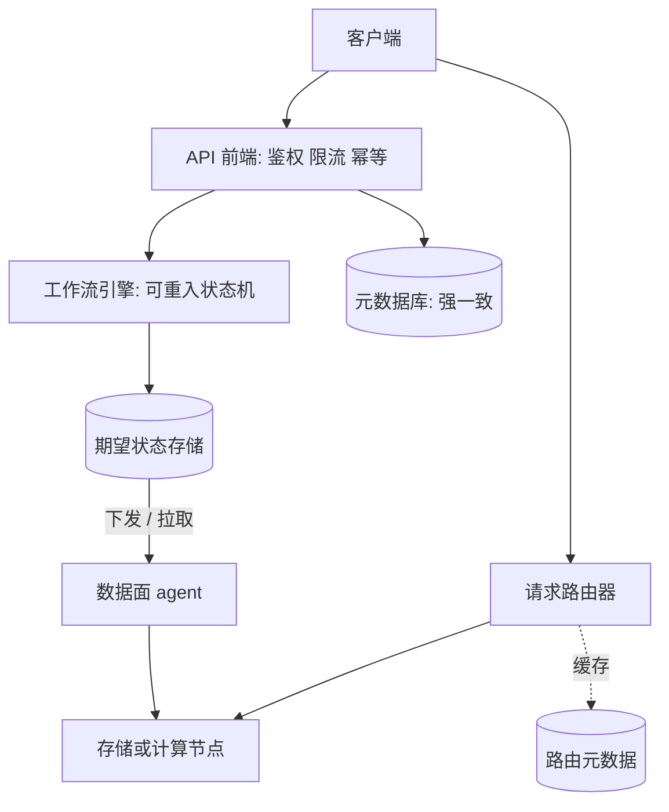

# 怎么跑一场 45–60 分钟的 senior 系统设计轮（AWS 数据服务口味）

系统设计轮的分数大部分来自两件事：你能不能自己控场，以及在深挖和故障环节讲出"机制 + 替代方案 + 代价"。
本页给出时间线、每个阶段要产出的东西、估算的方法和要背的数字、AWS 风格的架构画法、深挖与故障的清单，以及 Amazon 特有的运维实践（one-box、cell、shuffle sharding、bake time）。
目标 bar 永远是 senior（SDE II/III），即使岗位挂的是 SDE I。分布式概念见 [[00_ddia_refresh]]。

---
## 1. 总时间线（60 分钟版；45 分钟版把 §5/§6 各压缩一半）

```
 0 ───── 5 ───── 10 ───── 15 ──────── 25 ─────────────── 45 ──────── 55 ─ 60
 │ 需求   │ 估算   │ API+数据 │ 高层架构     │ 深挖 2–3 个点   │ 故障+运维 │ 收尾
 │ 澄清   │        │ 模型     │ (一张图)     │ (面试官选+你选)  │          │
```

| 阶段 | 分钟 | 你要产出什么 | senior 才有的动作 |
|---|---|---|---|
| 1 需求 | 0–5 | 功能清单（3–5 条）+ 非功能数字 + 明确的 **非目标** | 主动问：一致性要求？持久性（耐久度）要求？多租户？多区域？延迟 SLO 是 p50 还是 p99.9？ |
| 2 估算 | 5–10 | QPS、存储、带宽、节点数四个数 | 把数字**接回设计决策**（"所以单机装不下→要分片"），而不是算完就扔 |
| 3 API + 数据模型 | 10–15 | 3–6 个 API；主表结构；分区键与排序键 | 写操作带**幂等键（client token）**；列表 API 带分页；说出一致性语义 |
| 4 高层架构 | 15–25 | 一张图：**控制面（control plane）/ 数据面（data plane）** 分开 | 说明哪条是热路径、哪条是冷路径，哪些可以异步 |
| 5 深挖 | 25–45 | 2–3 个深度点，每个都讲 "为什么 + 替代方案 + 代价" | 面试官抛第一个，你自己抛第二个（挑你最强且与题最相关的）|
| 6 故障与瓶颈 | 45–55 | 逐层问"X 挂了怎么办"，找出第一个瓶颈 | 用 **爆炸半径（blast radius）** 讲话：一次故障影响多少租户/多少数据 |
| 7 运维 | 同上并入 | 指标、告警、发布、回滚、on-call | 引用 Amazon 实践：one-box、cell、shuffle sharding、bake time（§7） |
| 8 收尾 | 55–60 | 30 秒总结：取舍 + 下一步（如果再有一周要做什么）| 主动说出**你设计里最弱的一环**（Ownership / Dive Deep 的可见信号）|

**节奏原则**：阶段 1–4 控制在 25 分钟内，宁可高层简单，也要给深挖留 20 分钟——senior 轮的分数大部分在深挖和故障。

---

## 2. 阶段 1：需求澄清（数据服务口味的问题清单）

按顺序问，每问一个就**在白板写下数字**：

1. **谁是用户**？外部客户（多租户、按量计费）还是内部团队？（决定要不要 quota、租户隔离、计量）
2. **读写比与访问模式**：点查为主？范围扫描？全表分析？（决定存储引擎与分区方式）
3. **一致性**：写后读必须看到自己的写吗？跨区域呢？（决定是单主 quorum 还是最终一致）
4. **耐久度（durability）与可用性（availability）目标**：数字（"11 个 9 的耐久度"和"99.99% 可用性"是两回事）。
   参考：DynamoDB 区域表 99.99%，全球表 99.999%，可用性按每 5 分钟窗口内成功请求占比计算。
5. **延迟目标看哪个分位**：Amazon 习惯看 p99 / p99.9（Dynamo 的 SLA 就写成 "99.9% 请求 300 ms 内"），不看平均值。
6. **规模量级**：租户数？每租户峰值？最大单租户占比？（"最大租户"决定热点与隔离设计）
7. **数据新鲜度/延迟**：（流与 CDC 类题）"秒级"还是"分钟级"？AWS DMS 文档明确写 CDC 没有延迟 SLA，说明这类系统的延迟承诺要谨慎。
8. **运维约束**：是否需要零停机升级？是否需要多区域？合规（数据驻留）？

**写下非目标（non-goals）**：例如"不做跨表事务""不做实时 OLAP"。这一步在 senior 轮几乎必加分——它证明你知道自己在取舍。

---

## 3. 阶段 2：从零开始的估算（back-of-envelope）

### 3.1 先背四张表（背下来，别推）

**① 二进制与十进制量级**
```
2^10 = 1,024 ≈ 10^3 (KB)      2^20 ≈ 10^6 (MB)      2^30 ≈ 10^9 (GB)      2^40 ≈ 10^12 (TB)
1 天 = 86,400 秒 ≈ 10^5 秒     1 年 ≈ 3×10^7 秒        1 个月 ≈ 2.5×10^6 秒
```
**② 延迟数量级**（见 [[latency-numbers]]、[[foundations-latency-memory-ssd-disk]]）：内存访问 ~100 ns；同机房往返 ~0.5 ms；SSD 随机读 ~0.1 ms；机械盘寻道 ~10 ms；跨区域往返 ~50–150 ms。
**③ 单机吞吐量级**（经验值）：一台普通服务器每秒可处理 ~1 万–10 万次内存内简单请求；带落盘的 KV 约 ~1 万–5 万次写；SSD 顺序写 ~几百 MB/s；万兆网卡 ~1 GB/s。
**④ 公开的 AWS 数字**（拿来对照"我估的合理吗"）：
- S3：每个前缀至少 3,500 写 / 5,500 读每秒；前缀数无限；小对象首字节延迟约 100–200 ms。
- Kinesis：每 shard 写 1 MB/s 或 1,000 条/s，读 2 MB/s。
- DynamoDB：1 RCU = 一次 ≤4 KB 的强一致读/秒；1 WCU = 一次 ≤1 KB 的写/秒；2021 Prime Day 峰值 8920 万请求/秒。
- Aurora：存储卷单个 segment 10 GB，6 副本，卷最大 64 TB；10 GB segment 在 10 Gbps 链路上约 10 秒修复完毕。

### 3.2 五步法（每一步写在白板上）

```
步骤 1  用户/租户数 × 每人每天请求数            → 日请求量
步骤 2  日请求量 ÷ 86,400 = 平均 QPS ；× 2–3 = 峰值 QPS（有活动高峰再 × 更多）
步骤 3  峰值 QPS × 读写比 → 读 QPS、写 QPS ；× 平均请求大小 → 带宽
步骤 4  日写入量 × 单条大小 × 保留天数 × 副本数(3) → 存储总量；再 ×(1+索引/放大 30–100%)
步骤 5  峰值 QPS ÷ 单机可承受 QPS ×(1/目标利用率 0.5–0.7) → 节点数 ；并发数 = QPS × 延迟（Little 定律）
```

### 3.3 完整示例（全部数字由脚本算出）

**例 A：某数据服务 5,000 万日活，每人每天 20 次请求。**
- 日请求量 = 5×10^7 × 20 = 10^9。平均 QPS = 10^9 ÷ 86,400 ≈ **11,574**；峰值取 ×3 ≈ **34,700**。
- 若请求平均 5 KB、峰值 2 万 QPS：带宽 = 20,000 × 5 KB = **100 MB/s**，一块万兆网卡（~1 GB/s）绰绰有余，所以瓶颈不是带宽。
- **Little 定律**：并发 = QPS × 延迟 = 20,000 × 0.05 s = **1,000** 个在途请求。这是连接池/线程数要覆盖的量级。

**例 B：存储。** 每天 1 亿条新记录、每条 1 KB、保留 1 年：
- 原始 = 10^8 × 1 KB × 365 ≈ **36.5 TB**；3 副本 ≈ **110 TB**；再加索引与放大（+50%）≈ 165 TB。
- 结论接回设计：单机 SSD 几十 TB 上限 → 要分片；110 TB ÷ 每节点 8 TB ≈ 14 个节点，只是**存储下限**，QPS 往往才是约束（参考：[[problems-key-value-store-qps-bound-not-storage-bound]]）。

**例 C：指标摄取。** 100 万台主机 × 每台 100 个时间序列，每 10 秒上报一次：
- 数据点速率 = 10^6 × 100 ÷ 10 = **1,000 万点/秒**。
- 未压缩每点 16 字节（8B 时间戳 + 8B 浮点）→ **160 MB/s**，一天 ≈ **13.8 TB**。
- Gorilla（Facebook 的时序数据库）用 delta-of-delta 时间戳 + XOR 浮点压缩，平均**每点 1.37 字节**（12 倍压缩）→ 一天 ≈ **1.18 TB**。

### 3.4 估算的"收尾句"
每次估完都说一句**设计结论**：
"峰值写 3.5 万 QPS，3 副本后落盘 10 万+ IOPS，单分区上限约 1 万→至少 ~12 个分区，取 64 个留 5 倍余量，因为分区数是单向门（[[distributed-shard-key-one-way-door]]）。"
- 读 [[foundations-dau-to-qps]]、[[foundations-storage-estimate-method]]、[[foundations-littles-law]]、[[foundations-when-estimates-change-design]]。

---

## 4. 阶段 3：API 与数据模型（AWS 风格）

**API 规则（Amazon 内部几乎都这样做）：**
1. **每个有副作用的 API 都要幂等**：创建类 API 带 **client token（幂等令牌）**，同一令牌重试只生效一次。有副作用的 API 除非提供幂等，否则不能安全重试；典型例子是 EC2 `RunInstances` 的 client token。
2. **控制面 API 与数据面 API 分开**：控制面（创建/删除/修改资源）调用频率低、要强一致、要审计；数据面（读写数据）调用频率高、要低延迟、要弹性扩缩。
   两者的限流策略也不同：数据面按租户限速并弹性扩容，控制面靠批量 API 和配额压低调用量。
3. **分页**用不透明的 `NextToken`/cursor，不用 offset（[[networking-cursor-vs-offset-pagination]]）。
4. **每租户限流与配额**写进 API 契约（返回 429/`ThrottlingException`、`Retry-After`）。
5. **错误要可重试性分类**（[[reliability-retryable-errors]]）：4xx 一般不重试，5xx/节流可重试。
6. **版本与兼容**：新增字段只增不删（[[architecture-api-versioning-strategies]]）。

**数据模型三问：**
- 分区键是什么？最大的租户/热点 key 会不会压垮单分区？（[[distributed-data-skew-vs-access-skew]]）
- 哪些访问模式要二级索引？同步还是异步？（[[distributed-secondary-index-partitioning]]）
- 元数据（谁在哪个分区）存哪、怎么缓存、冷启动会不会引发缓存雪崩？
  DynamoDB 的教训：路由元数据缓存命中率 ~99.75%，但路由器冷启动时元数据服务流量会飙升 75%，因此造了 MemDS 内存分布式存储以消除"双峰行为"。

---

## 5. 阶段 4：高层架构的"AWS 画法"

AWS 的每个托管服务几乎都是同一个形状。**先画这张图，再往里填：**



- 控制面：低频、强一致、可以慢。数据面：高频、低延迟、弹性，并且要**静态稳定**（控制面挂了照样跑）。
- **静态稳定（static stability）**：数据面不依赖控制面才能继续服务。以 EC2 为例：控制面是"做变更的机器"，数据面是"每次请求用到的机器"，故障时让数据面继续用已有状态工作。
  DynamoDB 的例子：请求路由器缓存 IAM / KMS 的认证结果，异步刷新；这两个依赖挂了，缓存里的结果在一段时间内仍可用。
- **常量工作（constant work）**：控制面向数据面下发状态时，**不按变化量触发，而是每隔几秒推送固定大小的完整状态表**（Route 53 的做法），使工作量不随负载或故障规模变化（卡 [[reliability-constant-work]]；阅读 [[aws-constant-work]]）。
- **事件驱动 + 工作流**：长任务（创建数据库、备份、迁移）用持久化的状态机/工作流，每一步幂等、可重入、可补偿（Saga）。

**画图小抄**：先画一条"请求主路径"（粗线）→ 再补存储 → 再补异步旁路（流、索引、备份）→ 最后补横切关注点（认证、限流、监控）。

---

## 6. 阶段 5–6：深挖与故障——一份 senior 清单

### 6.1 深挖：从下面六个"轴"里挑 2–3 个

| 轴 | 典型问法 | 你的回答骨架 | 复习 |
|---|---|---|---|
| 数据分布 | 热 key / 倾斜怎么办？分区怎么扩？ | 检测 → 隔离 → 拆分（按消耗而非中点）→ 代价 | [[distributed-hot-key]] [[distributed-rebalancing-strategy-choice]] |
| 一致性与复制 | 副本如何同步？故障切换怎么做？ | 谁是 leader、quorum 多大、租约多久、切换时序 | [[distributed-failover-mechanics]] [[distributed-raft-guarantees]] |
| 正确性 | 重复/丢失/乱序？ | 幂等键 + 版本号 + 对账；说清 exactly-once 的边界 | [[correctness-idempotency-key-design]] [[correctness-reconciliation]] |
| 多租户公平 | 一个大租户拖垮大家？ | 配额 + 令牌桶 + shuffle sharding + 隔离池 | [[traffic-token-bucket-vs-sliding-window]] [[reliability-shuffle-sharding-mechanism]] |
| 数据生命周期 | 备份、保留、删除、合规？ | 快照 + 日志 + 校验 + 过期；删除也是写 | [[storage-tombstone-deletes]] |
| 成本与效率 | 怎么降成本？ | 冷热分层、压缩、列存、合并小文件；Amazon 的 Frugality | [[storage-s3-numbers]] |

### 6.2 故障：逐层追问的模板（"X 挂了怎么办"）

```
单个进程/节点  → 副本接管；多久发现(心跳/租约)？  灰色故障(gray failure)怎么办？
单个 AZ        → 静态稳定：提前在多 AZ 留好容量，不靠"故障后再扩容"
整个 Region    → RPO/RTO 是多少？是否有跨区域复制？切换演练过吗？
依赖服务       → 超时 + 带抖动的退避重试 + 熔断/降级；避免 fallback 路径（很少走的代码路径会出 bug）
坏发布         → one-box + 灰度 + 自动回滚；回滚安全（先读后写两阶段）
毒丸请求       → 隔离到单个 cell/shuffle shard，避免波及全体
热租户/突发    → 限流 + 负载脱落(load shedding) + 公平队列
数据损坏       → 校验和 + 持续校验(scrub) + 从日志重建 + 时间点恢复
```
这些在 AWS 公开文献里都有对应：
- **灰色故障**：DynamoDB follower 发起选举前先问其他副本能否连上 leader，避免误判。
- **持续校验**：DynamoDB 的 scrub 进程核对三副本一致，并与由归档 WAL 离线重建的副本对比；结论是：对静态数据做持续校验是最可靠的方法。
- **避免 fallback**：fallback 路径极少被执行，因此是最不可信的代码（[[aws-avoiding-fallback]]）。
- **队列积压**：见 §7.4 与 [[aws-queue-backlogs]]。
- **重试风暴**：[[aws-timeouts-retries-jitter]]；卡 [[reliability-retry-storm]]。

### 6.3 瓶颈：先找"第一个会坏的东西"
按顺序检查：单分区/单 key 热度 → 元数据服务 → 协调服务（锁/选主）→ 网络带宽（跨 AZ）→ 磁盘写放大 → 下游依赖限流。
然后说："10 倍规模时第一个断的是 X，我会用 Y 解决，代价是 Z。"（[[foundations-when-estimates-change-design]]）

---

## 7. 阶段 7：运维——Amazon 口味（senior 轮得分最集中的地方）

### 7.1 部署安全：自动化、免人工的发布
- 管线四阶段：source → build → test → prod。每次变更**必须**经过代码评审，评审人要检查"是否有足够测试、是否有足够监控、是否能安全回滚"。
- 预生产有 **alpha / beta / gamma**；gamma 与生产尽可能一致（同样的监控、同样的持续 canary 测试，且跨多个 Region）。
- **one-box（单盒）**：把新代码只部署到最小部署单位（一台 VM、一个容器，或一小部分 Lambda 调用）。生产的 one-box **至多承接 Region 或 AZ 请求量的 10%**；
  **one-box 还会按"仅这一台"的指标回滚**（例如只统计这台机器处理的请求的故障率），因为 10% 流量的问题可能不会触发全服务告警。
- **波次（waves）**：第一波选请求量低的 Region，每次只部署一个 AZ（或一个 cell）；第二波选高流量 Region；之后逐步并行更多 Region。
  "第一目标"：避免同时影响多个 Region 或同一 Region 内多个 AZ。
- **滚动部署**：每次替换的实例最多 **33%**（即始终保留 ≥66% 容量；所有服务都按"能承受丢一个 AZ"来扩容）；有些团队每次只换 5%，回滚时则一次换 33% 加快速度。
- **自动回滚**：部署系统监控团队的**高严重度聚合告警（aggregate alarm）**；任一服务进入告警，该团队在该 Region 的所有进行中部署全部自动回滚。
- **bake time（烘焙时间）**：每个生产阶段部署完成后继续观察，防止"慢性故障"在多个 Region 同时爆发；早期波次 bake 更久。典型管线 **4–5 个工作日**发到所有 Region。
- **配置、功能开关、基础设施**同样走管线（各自独立的管线），同样有自动回滚。

### 7.2 Cell-based architecture（把"爆炸半径"做成架构）
- 用**分区键**（客户 ID、资源 ID）把整个服务切成多个相互独立、**不共享状态**的完整实例，叫 **cell**；前面一层**极薄的 cell router**按分区键路由。
- 算术：10 个 cell 服务 100 个请求，一个 cell 故障，**90% 的请求不受影响**。坏发布、毒丸请求都被限制在一个 cell 内。
- 部署也是**逐 cell** 推进（与 §7.1 的"每次一个 AZ 或 cell"呼应）。
- 代价：cell 间无法共享容量（碎片化）；cell router 本身要极简、极稳；跨 cell 的操作（全局列表、迁移租户）要专门设计。

### 7.3 Shuffle sharding（比普通分片再小一个数量级的爆炸半径）
- 普通分片：8 个 worker 平均分给客户，一个坏客户拖垮自己那片 → 影响 1/8 的客户。
- Shuffle sharding：**每个客户分到 8 个 worker 中的 2 个**，8 选 2 共 **28** 种组合 → 一个坏客户的"影响面"约 1/28，比普通分片好 **7 倍**。
- Route 53：**2048 个虚拟名字服务器**，每个域名分配其中 **4 个** → 约 **7300 亿**种组合；甚至可以保证任何两个域名之间共享的虚拟服务器不超过 2 个。
- 前提：客户端要会**在自己的 shard 成员间重试**，否则隔离没价值。
- 适用：队列、负载均衡、多租户控制面、数据库连接池。卡：[[reliability-shuffle-sharding-mechanism]]、[[reliability-shuffle-sharding-blast-radius]]；阅读：[[aws-shuffle-sharding]]。

### 7.4 过载与公平：load shedding / quotas / backlog
- **负载脱落（load shedding）**：服务接近过载时**早早拒绝多余请求**，让已接受的请求保持低延迟；"系统因此更可用"。
- **多租户公平**：
  公平 = 让每个客户都得到单租户体验；**配额（quota）按租户/工作负载设置**，使突发的"计划外"那部分被拒绝，而不是拖垮别人；
  配额"既增加又降低可用性"——被限流的客户觉得不可用，但整体服务保住了；数据面 API 要设计成弹性扩容，控制面 API 则靠导出、批量 API、投影等手段降低调用量。
- **避免追不上的队列积压**：队列一旦积压，处理速度不够就永远追不上。手段：按客户限速（公平）、按客户分队列或 shuffle-sharding 到少数几个队列（Lambda 的做法）、把超额流量或陈旧消息"旁路"到另一个 spillover 队列、延迟队列、死信队列（DLQ）。
- **Timeouts, retries, backoff with jitter**：退避+**抖动（jitter）** 避免重试同步；只在幂等 API 上重试；多层重试会放大负载（重试放大 = 每层次数的乘积）。

### 7.5 DynamoDB 的运维实践（可直接引用的"AWS 自己怎么做"）
- 可用性按每 5 分钟窗口统计；有面向客户的告警（CFA）；用 **canary 应用**从每个 AZ、经每个公开端点打真实流量，捕捉灰色故障。
- 每次部署前做**升级与降级测试**，故意回滚后再跑功能测试；先在一小撮节点部署，指标超阈值自动回滚。
- 依赖的服务必须"比自己更可用"，否则要做到**依赖不可用时仍能运转**。
- **不要让缓存隐藏本该做的工作**：系统始终要按"没有缓存也扛得住"来配置容量，才能应对意外。

### 7.6 你要能说出口的"运维五件套"
1. **指标**：RED（请求率、错误率、耗时）+ USE（利用率、饱和度、错误）；看分位（p99/p99.9），不看平均（[[reliability-red-vs-use]]、[[reliability-percentiles-over-averages]]）。
2. **告警**：症状告警优先（客户看得到的），原因告警辅助（[[reliability-symptom-vs-cause-alerts]]）；与 SLO/burn rate 挂钩（[[reliability-burn-rate-alerting]]）。
3. **发布**：one-box → 波次 → bake → 自动回滚；回滚安全（[[infra-rollback-safety]]）。
4. **容量**：提前留 AZ 冗余（静态稳定），而不是故障后再扩容。
5. **on-call 与复盘**：值班手册（runbook）、一键回滚、事后复盘（COE：Correction of Error，Amazon 的复盘机制，重大事件后用来找根因并防止复发）。

---

## 8. 评分（senior 轮的 strong / ok / weak）

| 维度 | strong | ok | weak |
|---|---|---|---|
| 需求与取舍 | 写下非目标；数字化 SLO；主动问多租户/一致性/耐久度 | 问了功能和规模 | 直接开始画框图 |
| 估算 | 每个数字接回设计结论；用 Little 定律；对照公开数字 | 算对但不用 | 不算，或算错数量级 |
| 数据模型 | 分区键+排序键+热点预案；说明索引同步/异步 | 有表结构 | 只有"用某某数据库" |
| 架构 | 控制面/数据面分开；静态稳定；异步旁路清楚 | 有分层 | 单体一张框图，所有东西都过一个服务 |
| 深挖 | 讲清机制（为什么）+ 替代 + 代价 + 数字 | 讲机制 | 只说名词 |
| 故障 | 爆炸半径、灰色故障、依赖降级、回滚 | 副本接管 | "多加几台机器" |
| 运维 | one-box/cell/shuffle shard/bake/自动回滚 + 指标告警 | 提到监控和报警 | 没有 |
| 沟通 | 主动控场、点名自己最弱一环、听面试官的暗示调整 | 回答完整 | 被动，等提示 |

**常见失误清单**（遇到就立刻纠正）：
1. 把 DynamoDB 说成 Dynamo（无主）——DynamoDB 是每分区一个 Multi-Paxos leader。
2. 说"我们用 exactly-once"却不说边界。
3. 说"加缓存"却不讲失效与冷启动（DynamoDB 元数据缓存的双峰行为是现成反例）。
4. 只说"多 AZ"，不说故障时容量够不够（静态稳定）。
5. 重试没有退避、没有抖动、没有幂等。
6. 多租户设计里没有配额，也没有"最大租户"的数字。

---

## 9. 一页纸"开场脚本"（背下来）

> "我先确认 5 件事：用户是谁、规模、读写比、一致性与耐久度要求、延迟 SLO 看哪个分位。
> 然后用 5 分钟估算 QPS 和存储，并说明它们怎么影响设计。接着我会给出 API 和数据模型（带幂等令牌），
> 再画一张控制面/数据面分开的高层图。深挖我想先讲 A，再讲 B；最后我会讲故障模式和运维：
> 怎么发布（one-box、波次、自动回滚）、怎么限定爆炸半径（cell 或 shuffle sharding）、怎么监控。"

---

## 10. 面试官看重什么，与对应动作

| 考察点 | 你的动作 |
|---|---|
| 至少一道软件系统设计题，senior 按 SDE II/III 的标准评 | 无论岗位挂什么级别，都按 senior 备 |
| 把系统切成 5–7 个高层模块，用通用抽象（负载均衡、水平扩展的应用服务器、NoSQL、消息队列、限流器……），并为其中一个子系统给出数据模型、OO 设计或 API 契约 | 阶段 3–4 的产出；随时准备把某个子系统写成类 |
| "如果我们变得极度流行呢？两倍增长什么样？十倍呢？" | 每次估算后主动讲 2× / 10× 时第一个断的是什么 |
| 运维与韧性：关键业务与技术指标、瓶颈、故障点、冗余、便于排障的日志 | §7 的运维五件套是明确的得分点，不是加分项 |
| 有多个可行设计时，比较取舍、选一个并说明理由 | 每个深挖都要有"替代方案 + 为什么不选" |
| 广度加一个领域的深度；被问到不熟的主题，直接说并换成熟悉的 | 提前选好自己的"一个深处"：复制/故障切换，或流处理/CDC，准备 5 分钟无稿讲述（例如 Multi-AZ 故障切换） |
| 高层设计交付物：架构图 + 时序图；常见大错是忘了可用性、把所有东西放在单机内存；用 leader election 要知道它的局限 | 画关键路径的时序图；收尾补一句辅助系统：监控告警、计费计量、数据分析、报表 |
| 低层设计：详细到能交给一组初级工程师实现，给类图，必要时写关键代码，说出设计模式与权衡 | 见低层设计域的 amazon 分支 |
| 初级岗位深入单个组件的 OO 模型；高级岗位组件多，重在组件交互与可扩展性 | 两种都备，以 senior 的组件交互为主 |
| 考察偏通用工程判断而非论文细节 | 论文里的数字用来增加可信度，不要背诵炫技 |

**对应动作**：
1. 在 §9 开场脚本最后加一句："我也会讲辅助系统（计量计费、告警、数据导出）和 2× / 10× 增长时的第一个瓶颈。"
2. 选定自己的"一个深处"，练到能无稿讲 5 分钟。

---

## 11. 自测题（先自己答，再展开）

1. 60 分钟的轮次里，哪几个阶段必须压在 25 分钟内？为什么？
<details><summary>答案</summary>需求、估算、API+数据模型、高层架构合计 25 分钟内。senior 轮的分数大部分在深挖（约 20 分钟）和故障环节，所以高层宁可简单。</details>

2. 估完数字后要补哪句话？举一个例子。
<details><summary>答案</summary>补一句设计结论，把数字接回决策：例如"峰值写 3.5 万 QPS，3 副本后落盘 10 万+ IOPS，单分区上限约 1 万 → 至少 12 个分区，取 64 个留 5 倍余量，因为分区数是单向门"。</details>

3. 日活 5,000 万、每人每天 20 次请求，平均 QPS 和 Little 定律下的并发各是多少（峰值 2 万 QPS、延迟 50 ms）？
<details><summary>答案</summary>日请求 10^9，平均 QPS ≈ 11,574；峰值按 ×3 ≈ 34,700。并发 = 20,000 × 0.05 s = 1,000 个在途请求，这是连接池/线程数要覆盖的量级。</details>

4. 控制面与数据面各有什么特点？什么是静态稳定？
<details><summary>答案</summary>控制面低频、强一致、可慢；数据面高频、低延迟、弹性。静态稳定指数据面不依赖控制面就能继续服务，例如路由器缓存认证结果、异步刷新，依赖挂了缓存仍可用一段时间。</details>

5. One-box、波次、bake time、自动回滚各解决什么问题？
<details><summary>答案</summary>One-box：新代码先只上最小单位（至多 Region/AZ 请求量的 10%），并按这一台的指标回滚；波次：先低流量 Region、一次一个 AZ 或 cell，避免同时影响多个 Region/AZ；bake time：每阶段后继续观察，抓慢性故障；自动回滚：高严重度聚合告警触发该团队该 Region 所有进行中部署回滚。</details>

6. 普通分片与 shuffle sharding 的爆炸半径差多少？
<details><summary>答案</summary>8 个 worker 普通分片：坏客户影响 1/8；每客户分 2 个 worker 的 shuffle sharding：8 选 2 共 28 种组合，影响约 1/28，好 7 倍。Route 53 用 2048 个虚拟名字服务器、每域名 4 个，约 7300 亿种组合。前提是客户端会在自己的 shard 成员间重试。</details>

7. 为什么 fallback 路径被视为最不可信的代码？
<details><summary>答案</summary>它极少被执行，所以缺乏验证，也最可能在最糟糕的时刻（依赖故障时）才第一次运行。</details>

8. 队列积压追不上时有哪些手段？
<details><summary>答案</summary>按客户限速、按客户分队列或 shuffle-sharding 到少数队列、把超额或陈旧消息旁路到 spillover 队列、延迟队列、死信队列。</details>

9. 说出六个常见失误中的三个，并给出纠正。
<details><summary>答案</summary>把 DynamoDB 说成无主的 Dynamo（实际每分区一个 Multi-Paxos leader）；说 exactly-once 不说边界；说"加缓存"不讲失效与冷启动；只说多 AZ 不说故障时容量够不够；重试没有退避、抖动、幂等；多租户设计没有配额也没有最大租户的数字。</details>

10. 估算里的"第一个会坏的东西"按什么顺序检查？
<details><summary>答案</summary>单分区/单 key 热度 → 元数据服务 → 协调服务（锁/选主）→ 网络带宽（跨 AZ）→ 磁盘写放大 → 下游依赖限流。然后说："10 倍规模时第一个断的是 X，用 Y 解决，代价是 Z。"</details>

---

## 延伸阅读

- 入口：[[sd-index]]、[[00_ddia_refresh]]
- 方法论：[[foundations.method]]、[[foundations-driving-the-40-minutes]]、[[foundations-interview-opening-moves]]、[[foundations-clarifying-questions-worth-asking]]、[[hello-interview-in-a-hurry]]
- 估算：[[latency-numbers]]、[[foundations-dau-to-qps]]、[[foundations-storage-estimate-method]]、[[foundations-littles-law]]
- 运维文章（AWS Builders' Library 与 Well-Architected）：
  - Automating safe, hands-off deployments：https://aws.amazon.com/builders-library/automating-safe-hands-off-deployments/
  - Static stability using Availability Zones：https://aws.amazon.com/builders-library/static-stability-using-availability-zones/
  - Reliability, constant work, and a good cup of coffee：https://aws.amazon.com/builders-library/reliability-and-constant-work/
  - Workload isolation using shuffle sharding：https://aws.amazon.com/builders-library/workload-isolation-using-shuffle-sharding/
  - Using load shedding to avoid overload：https://aws.amazon.com/builders-library/using-load-shedding-to-avoid-overload/
  - Fairness in multi-tenant systems：https://aws.amazon.com/builders-library/fairness-in-multi-tenant-systems/
  - Avoiding insurmountable queue backlogs：https://aws.amazon.com/builders-library/avoiding-insurmountable-queue-backlogs/
  - Timeouts, retries and backoff with jitter：https://aws.amazon.com/builders-library/timeouts-retries-and-backoff-with-jitter/
  - Cell-based architecture：https://docs.aws.amazon.com/wellarchitected/latest/reducing-scope-of-impact-with-cell-based-architecture/what-is-a-cell-based-architecture.html
- 本地笔记：[[aws-shuffle-sharding]]、[[aws-constant-work]]、[[aws-avoiding-fallback]]、[[aws-queue-backlogs]]、[[aws-timeouts-retries-jitter]]
