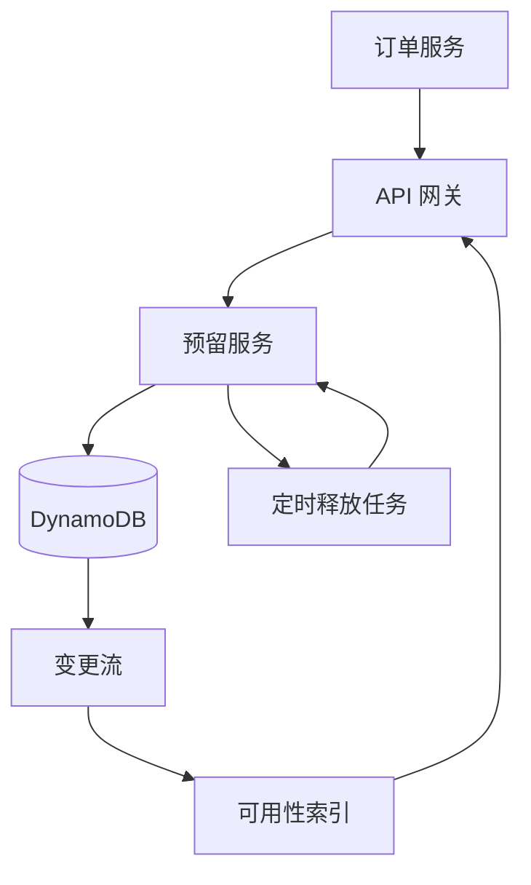
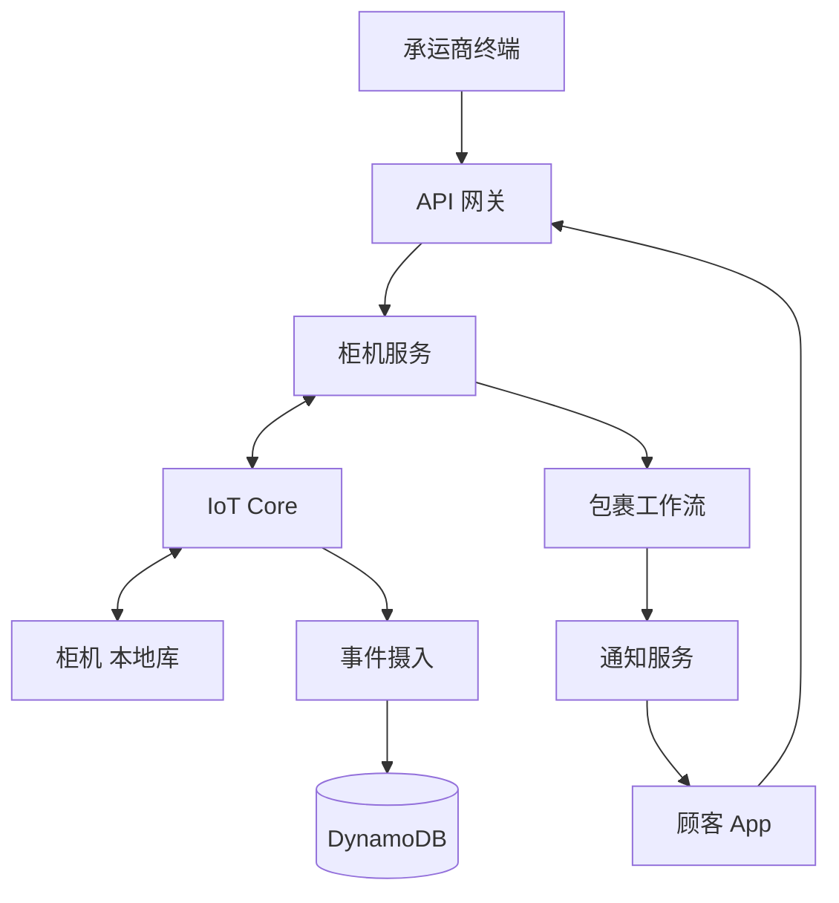
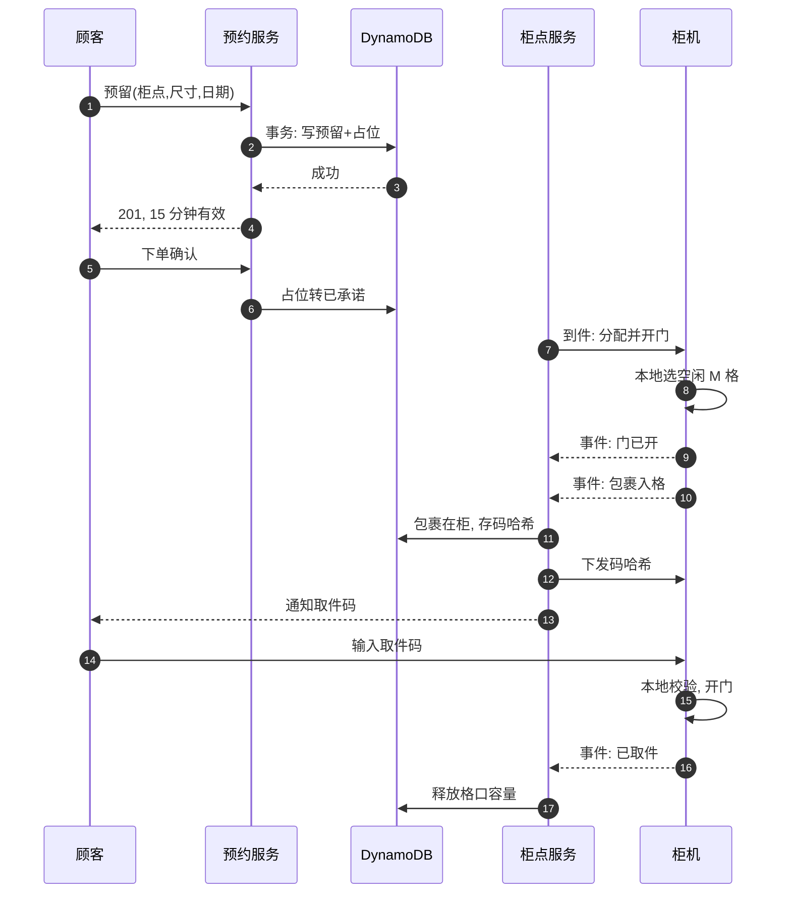
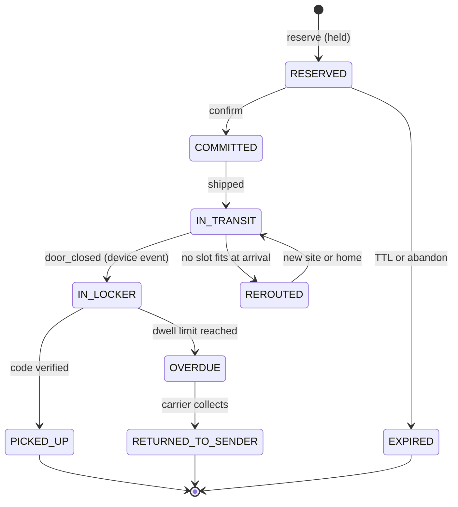

# SD02 Amazon Lockers 投递系统（Amazon Lockers Delivery）

## 题目

Amazon Locker 是放在便利店、地铁站、小区门口的智能快递柜。顾客在网上结账时选一个柜子作为收货地址，快递员把包裹放进柜子，系统给顾客发一个取件码，顾客随时去柜前输入取件码取走包裹；退货时方向相反。这个系统连接三类东西：电商的下单系统、承运商的快递员，以及分散在各地、靠移动网络联网的柜机。它的难点不在流量：全系统平均每秒只有几件包裹。难点在两件事上。第一，柜子的格口是有限的实物，两个订单不能被承诺到同一个最后的名额。第二，柜机会断网，而断网时顾客仍然站在柜前要取件。

面试官的提法大致是：设计一个包裹投递系统，它与电商平台集成，让顾客在结账时选择柜子的位置，之后用验证码安全取件；还要覆盖退货。你需要覆盖从下单到取件的完整链条，并在容量预留、柜机离线、取件码安全这几处讲出取舍。下面的流量数字和是否要求离线取件，都是练习用的假设，面试时以面试官当场给的为准。

## 澄清问题

1. **规模与形态：全球多少个网点、每个网点多少格、日投递量？** 这决定瓶颈是吞吐还是正确性。下面假设 2 万个网点、共 120 万个格口、每天约 48 万件投递。算下来全系统平均只有每秒 5.6 件，所以难点不在吞吐。
2. **在哪个时刻锁定格口：结账时、发货时还是到站时？** 这是全题最关键的问题，它决定库存模型（见深挖一）。
3. **预留的粒度：具体某个格口，还是「某网点某尺寸的一个名额」？** 前者最简单但最僵硬，后者允许到站时再绑定具体格口。
4. **柜机离线时还要能取件、能投件吗？** 现实里柜机靠移动网络，断网是常态。要求离线可用，设计就必须让边缘侧（柜机）持有一部分权威状态。
5. **取件码的形态：数字码、二维码、还是两者？由谁生成？** 这决定安全边界和暴力枚举的防护（见深挖三）。
6. **退货要不要包含：顾客把退货放进柜子、快递员取走？** 一般要。退货复用同一套预留、格口、码的机制，只是方向相反。
7. **包裹放不下或柜满时怎么办：重新选址、送上门、还是退回？** 这决定到站失败的路径和客户通知。
8. **一个订单多个包裹、一个顾客多个包裹同柜吗？** 这决定「一个码开一个格口」还是「一个订单一个码」。

## 需求

**功能需求（按优先级）**

1. 结账时顾客选择一个网点，系统为这笔订单**预留**容量（尺寸合适的名额），预留有时限。
2. 快递员到站投件：系统分配具体格口、柜机开门，投件完成后给顾客发取件码（凭码取件，持有即凭证）。
3. 顾客凭码取件：校验、开门、释放格口，订单完成。
4. 逾期未取：到期回收，包裹退回；到期前提醒。
5. 退货：顾客预约退货投件、柜机收件、快递员取走。

**非功能需求**

| 维度 | 目标 | 说明 |
|---|---|---|
| 预留正确性 | 同一网点同一尺寸的名额**绝不超卖**，即使并发 | 超卖的后果是快递员站在柜前无处可放 |
| 结账路径延迟 | 查询可选网点 p99 小于 300 ms；预留 p99 小于 500 ms | 发生在结账页内，不能拖慢转化 |
| 取件延迟 | 顾客输入码到柜门打开 p99 小于 2 秒（在线），离线也能开 | 顾客正站在柜前 |
| 可用性 | 预留与查询 99.95%；取件 99.99%（含离线降级） | 取件失败是最差的体验 |
| 持久性 | 一旦确认投件或取件，事件不能丢，且设备与云端最终一致 | 账务和客服依赖它 |
| 取件码安全 | 24 小时内对单个网点猜中的概率低于 1e-6 | 见容量估算与深挖三 |

**明确不做**：柜门电机和硬件握手细节、承运商路线规划、定价、地图渲染。

## 容量估算

假设来自「容量利用」，而不是拍脑袋：

- 格口总数 120 万，网点 2 万个，平均每站 **1.2M ÷ 20,000 = 60 格**。
- 目标利用率 60%，平均停留 1.5 天。按利特尔法则（Little's law：吞吐 = 占用 ÷ 停留），日投递量 = 1.2M × 0.6 ÷ 1.5 = **48 万件/天 = 5.56 件/s 平均**；节假日按 3 倍取 **16.7 件/s**。
- 结账查询：每笔成交对应约 20 次「查看附近网点」，即 48 万 × 20 = 960 万次/天，平均 **111/s**，按 10 倍峰值 **约 1,111/s**。
- 预留：假设一半的预留最终放弃或过期，预留请求 = 48 万 × 2 = 96 万/天 = **11.1/s**。
- 并发持有的预留：每个预留持有 15 分钟（900 秒），平均并发 11.1 × 900 = **约 1 万**；峰值（10 倍）**约 10 万**，占 120 万格口的 **8.3%**。结论：放弃的预留如果不主动释放，高峰时会白白占住 8% 的容量，所以时限要短，而且「顾客离开结账页」要显式释放。
- 取件峰值：晚间两小时集中 20% 的取件，48 万 × 0.2 ÷ 7,200 = **13.3 次/s**；折到单站，每站每天平均 24 次取件，高峰小时约 2.4 次。
- 生命周期事件：每件约 10 个（预留、确认、到站、开门、关门、发码、取件开门、取件完成、过期等），48 万 × 10 = 480 万/天 = **55.6 事件/s**；每站每天 240 个事件。
- 设备心跳：2 万站每 30 秒一次 = **667/s**。
- 活跃取件码：120 万 × 0.6 = 72 万个，平均每站 **36 个**。

**驱动设计的数字**：全系统峰值也只有几十 QPS，单个网点每小时只有个位数的取件，所以这是一道**正确性与边缘**的题，不是吞吐题。关键约束有两个。一是预留不能超卖。二是每个站每天约 24 次取件，一次断网 4 小时就会让大约 4 位顾客站在柜前，所以离线能力是产品要求，不是优化项。

取件码猜中概率（它决定码的长度）：每站平均 36 个活跃码，6 位数字（空间 1,000,000）下单次猜中概率 36 ÷ 1e6 = 3.6e-5。若每站每天允许 480 次尝试（每 15 分钟最多 5 次），一天累计 **1.71%**（精确值 1 − (1 − 3.6e-5)^480），对 2 万个站做规模化枚举是不可接受的。改用 8 位、31 个无歧义字符（31^8 = 8.53e11）后，单次猜中概率 4.2e-11，每天 480 次尝试累计 **2.0e-8**，满足目标。

## 核心实体与 API

| 实体 | 键 | 主要属性 |
|---|---|---|
| Site（网点） | `site_id` | 位置（geohash）、时区、状态、各尺寸格口数、`device_id` |
| Compartment | `site_id` + `slot_id` | 尺寸、物理状态（free / occupied / out_of_service）、`parcel_id`、`version` |
| CapacityBucket | `site_id#size`，排序键 `day` | `capacity`、`held`、`committed`，预留的计数器 |
| Reservation | `reservation_id` | `order_id`、`site_id`、`size`、`day`、`status`、`expires_at` |
| Parcel | `parcel_id` | `order_id`、`site_id`、`compartment`、`state`、各时间戳、`direction`（deliver / return） |
| PickupGrant | `grant_id` | `parcel_id`、`code_hash`、`purpose`（pickup / carrier-collect / return-drop）、`expires_at`、`used_at` |
| DeviceEvent | `device_id` + `seq` | 事件类型、设备时间、`payload`，设备单调序号 |

**API（云端）**

```
GET  /v1/sites?lat=&lng=&size=&day=            # 结账时选网点，返回有名额的网点
POST /v1/reservations                           # 预留
     Headers: Idempotency-Key: <order_id>:<attempt>
     Body: { "order_id", "site_id", "size", "day" }
     201 -> { "reservation_id", "expires_at" }   409 -> 该尺寸已满
POST /v1/reservations/{id}/confirm              # 下单成功后确认，延长为承诺
DELETE /v1/reservations/{id}                    # 放弃，立即释放

POST /v1/sites/{site}/arrivals                  # 承运商到站扫描，返回 open 命令（也经设备通道下发）
POST /v1/returns                                # 退货预约，返回投件码
GET  /v1/parcels/{id}                           # 状态查询
```

写请求带幂等键（idempotency key：同一个请求做一次和做十次，结果一样），是因为结账服务遇到超时会重试，重试不能多占一个名额。

**设备通道（MQTT，AWS IoT Core）**：MQTT 是为不稳定网络设计的轻量发布订阅协议。主题 `device/{id}/events`（设备上报，带 `seq`）、`device/{id}/commands`（云端下发，带命令 ID）；设备影子（device shadow）保存期望状态与上报状态。事件以 `(device_id, seq)` 为幂等键。

## 高层架构

系统分成两段：云端的结账与预留，以及到站之后的投件与取件。前一段是纯云端的计数问题；后一段要和柜机这个边缘设备打交道。

**结账与预留**



结账页调用 `GET /sites`，拿到附近有名额的网点。这些数据来自可用性索引，它是一个由 DynamoDB Streams（表的变更流）更新的缓存，允许几秒陈旧；陈旧没有关系，因为真正的判定在下一步的条件更新里。顾客选定后调用预留服务，它对 `CapacityBucket` 做条件更新（见深挖一）。成功则写入 Reservation 行，同时向 EventBridge Scheduler 注册一个 15 分钟后的一次性释放任务。下单成功后调用 confirm，把预留改为承诺，并把时限延长到承诺投递日。

**投件与取件**



承运商到站扫描包裹，柜机服务在预留里找到该包裹的名额，向设备下发「分配并开门」命令。设备在本地选出尺寸合适的空格口（设备是物理状态的权威），开门，承运商放入，关门，设备上报事件。云端据此写 Parcel、生成取件码（只存哈希），经通知服务告知顾客，并把哈希推送到设备，使设备可以离线校验。顾客在柜机输入码，设备在本地校验并开门，上报取件事件，云端释放计数并完成订单。



图中编号对应的每一步：

1. 顾客在结账页选好柜点、尺寸和日期，预约服务收到「预留」请求。
2. 预约服务用一次 DynamoDB 事务同时做两件事：写一条预留记录，把（柜点, 尺寸, 日期）这个桶的「已占」加一；条件是「已占 + 已承诺 < 容量」。两件事放进同一个事务，是为了在两个顾客同时抢最后一格时只让一个人成功，不会超卖。
3. 条件满足，事务成功。
4. 返回 201，并告诉顾客这个预留 15 分钟内有效：顾客离开结账页不下单，名额会自动回到池子里，不会白白占着柜格。
5. 顾客下单。
6. 预留从「已占」转为「已承诺」：从这一刻起它不再过期，一直保留到包裹送达。
7. 快递员到柜点扫码，柜点服务让柜机分配一个 M 号格并开门。
8. 具体哪一格由柜机在本地决定，因为只有柜机知道此刻哪扇门真的空着、哪扇门卡住了。
9. 柜机上报「门已开」。
10. 柜机上报「包裹已入格」。每个事件都带递增的序号：断网重连后可以按顺序补发，服务端按序号去重。
11. 柜点服务把包裹标成「在柜」，只存取件码的哈希值，不存明文：数据库即使泄露，也拿不到能开门的码。
12. 把取件码的哈希下发给柜机，柜机断网时也能在本地校验。
13. 通知顾客取件码。
14. 顾客在柜机上输入取件码。
15. 柜机在本地算哈希比对并开门，整个过程不需要网络。
16. 柜机上报「已取件」。
17. 柜点服务释放这一格的容量，下一位顾客就能预留它。

## 深挖

### 一、在哪里、以什么粒度预留容量

问题：顾客在结账时就要选网点，但包裹要 1 到 3 天后才到站。格口是稀缺资源，两个订单不能被承诺到同一个最后的名额；同时也不能让放弃结账的人长期占着名额。

选项：

| 方案 | 做法 | 代价 |
|---|---|---|
| A. 结账时绑定具体格口 | 直接选 `slot_id` 并占位 | 简单，但格口被占 1 到 3 天，利用率差；格口故障要重新分配 |
| B. 结账时预留（网点、尺寸、日期）的名额，到站时才绑定具体格口（晚绑定） | 计数器加预留行 | 需要时间维度的计数器，容量模型更难；换来高利用率与对故障的弹性 |
| C. 不预留，到站时才分配 | 无结账约束 | 到站时满了只能改派，顾客已被承诺的网点落空，体验差 |

**选择 B**。把容量按 `(site, size, day)` 分桶：`capacity` 是该日该尺寸**预期可用**的格口数（物理格口数减去仍会占用到那天的在库包裹的预测，预测宁可保守），`held` 是未确认的预留，`committed` 是已确认的承诺。预留用一次 `TransactWriteItems`：写入 Reservation 行（`attribute_not_exists`），并对桶做 `ADD held 1`，条件是 `held + committed < capacity`。这是一次条件更新而不是读后写：两个并发请求争最后一个名额时，DynamoDB 对同一个桶项串行化，只有一个满足条件，另一个收到条件失败。

预留要带时限、过期自动释放，这样才不会长时间占着名额（这也是订票类系统保护座位的通用做法）。但座位是离散且个体化的，而这里的名额是**可互换的**，所以可以用计数器，而不必对每个格口加锁。热点从「每个座位一把锁」变成「每个桶一个计数项」。单个网点的预留速率只有每秒个位数（全局 11.1/s），而一个计数项的单项写吞吐上限量级为每秒 1,000 次，绰绰有余。

时限释放：DynamoDB 的 TTL 删除可能延迟到数十小时，不能用来释放名额。改用 EventBridge Scheduler 为每个预留注册一次性任务，到点执行「若状态仍为 held 则 `held - 1` 并置 expired」。这是条件更新，重复执行没有副作用（幂等）。再加每小时一次的对账任务，用 Reservation 行重算每个桶的 `held` 和 `committed`，修正漂移。放弃结账时显式调用 DELETE，立即释放，把峰值 8.3% 的无效占用压下去。

故障模式：（a）计数器漂移：对账任务兜底，并对「重算值与计数值之差」设告警；（b）到站时没有合适格口：晚绑定意味着到站时可能真的没有合适格口（格口故障、预测偏差），此时走改派路径（深挖四），并把「到站无格口率」作为核心指标；（c）确认超时：订单服务在预留过期前未调用 confirm，名额被释放而订单已成立，因此 confirm 失败时订单服务要立即重新预留或转为送上门，不能静默继续。

### 二、柜机是边缘客户端：离线、权威划分与事件同步

问题：柜机靠蜂窝网络，断网几十分钟到几小时都可能发生。断网期间顾客仍要取件，承运商仍要投件。如果所有动作都等云端授权，断网就等于停业。

设计原则是**按事实归属划分权威**：

- **设备权威**：物理事实，即哪个格口开着、里面有没有包裹、门是否关好。这些只有设备知道，云端只能得到它的上报。
- **云端权威**：承诺与意图，即哪个订单预留了哪个网点、取件码应当是什么、哪些码已被撤销。

于是离线时的行为是：

1. **投件**：承运商用手持终端登录，终端出示由云端签发的短时承运商令牌（带网点、有效期、签名，设备持有公钥，可以离线验证）。设备在本地从空格口里选尺寸合适的一个（预留已经保证了名额，设备只做具体绑定），开门投件，记录事件并按 `seq` 排入本地队列。
2. **发码**：在线时由云端生成码、推送哈希。离线时已经推送过的码仍有效，但**新投件**的码在设备恢复联网前无法由云端产生。于是离线时投件的包裹有两条路：由设备本地生成一次性码，联网后上报给云端（码的哈希与格口一起上传，云端用它通知顾客）；或者暂不通知顾客，直到联网。选前者，因为顾客等不起：设备持有每站独立的随机源，生成 8 位码，本地存哈希，恢复联网后上报。
3. **取件**：设备维护本地允许表（码哈希到格口，附过期时间）。输入的码在本地哈希后比对，命中则开门、标记已用、排队上报。已用标记是**本地的**，所以同一个码在离线期间不能被用两次。

与云端的同步：设备给每个事件分配单调递增的 `seq`，上报时云端按 `(device_id, seq)` 幂等处理，并检测序号空洞；恢复联网后设备先上报积压事件，再接收云端命令。云端状态是**事件的函数**，而不是命令的结果，所以乱序、重复、延迟到达的事件都不会破坏状态：对同一包裹，状态机只接受合法的前进转移，非法转移记入异常队列。

时钟：设备时间可能漂移，用于过期判断的时间戳采用「云端下发的绝对到期时间加设备单调时钟」，不依赖设备墙钟；联网时用 NTP 校正，上报同时带设备时间与单调偏移。

故障模式：（a）设备磁盘损坏或被重置，本地允许表丢失：设备启动后向云端请求全量同步（该站活跃码的哈希，平均 36 个，约 1.1 KB，微不足道），并上报 `boot` 事件让云端核对物理状态；（b）云端撤销了一个码（顾客申请改派）而设备离线：撤销只在联网后生效，这是显式接受的窗口，所以高风险撤销（疑似盗用）要发送短信通知，并在设备恢复后立即同步；（c）格口卡死（门锁故障）：设备上报 `out_of_service`，云端把桶容量减一，并为该格口里的包裹创建人工处理单。

包裹在整个过程中的状态变化如下：



### 三、取件码：持有即凭证，如何不被枚举

取件码是**持有凭证**（bearer token）：谁拿到谁就能开那一个格口，不绑定账号。因此安全完全取决于码的熵（可能取值的多少）和尝试次数的限制。

选项：

- **6 位数字**：好记、好输入，但前面算过，一天累计猜中概率 1.71%，无法接受。
- **8 位无歧义字母数字（31 个字符，去掉 0/O/1/I/L 等容易看混的字符）**：8.53e11 的空间，一天累计猜中概率 2.0e-8，在柜机小键盘上输入负担可以接受。
- **二维码内含签名令牌**：熵最高，设备在本地用公钥验签，撤销靠本地已用集合；但需要手机，没有手机的顾客需要备用的数字码。

**选择**：数字码（8 位）与二维码并存，两者是同一个令牌的两种编码。云端只存码的哈希，不存明文；设备只存校验值。码熵不低，所以不需要慢哈希（慢哈希是用来对付低熵密码的离线爆破的）；但要用带密钥的 HMAC 而不是裸哈希，原因见下面的数据库泄漏一条。

尝试限制在设备上做：每 15 分钟最多 5 次错误，超过则该柜机冷却。并且**只有「码不存在」才计为可疑尝试**，「码已过期」「码是别的格口的」不计，否则正常顾客输错就会触发锁定。冷却是对整个柜机的，所以攻击者可以让某站暂停服务，代价是拒绝服务。缓解办法：错误尝试只锁「输入界面」一段时间，已登录 App 的开门请求另走通道。

码的签发与撤销：投件完成才生成码（预留阶段不发码，避免码在格口还没有包裹时流通）。重发通知不改码；改派或疑似泄露则作废旧码并签发新码；每个码单次有效，取件事件到达即置 `used_at`。日志里不记录明文码，只记哈希前 6 位用于排障。

退货方向使用同一套机制：`purpose=return-drop` 的码允许顾客开一个**空格口**投件，投件后设备生成给承运商的 `carrier-collect` 码。

故障模式：（a）通知通道失败（短信延迟），顾客拿不到码：App 内可随时查看；（b）顾客把码转发给别人：这是持有凭证设计的固有取舍，价值高的订单可以要求取件时再出示证件或在 App 内二次确认；（c）云端数据库泄漏：直接暴露的是 36 个码的哈希，但 8.53e11 的空间对裸哈希并不安全。以一块 GPU 每秒 1e10 次 SHA-256 估算，遍历整个空间只要 8.53e11 ÷ 1e10 ≈ 85 秒。所以云端存的不是裸哈希，而是以存放在 KMS 的服务端密钥计算的 HMAC（再加每站独立的盐），泄漏的数据库本身不足以反推。设备端只需保存该站自己的码的校验值，设备被物理拆解的影响限于一个站。

### 四、投件与退货的长事务：为什么用工作流，以及到站失败怎么办

一个包裹从结账到取走是**以天计的多步骤流程**，中间夹着外部事件（承运商到站、顾客取件）和超时（逾期）。

选项：

| 方案 | 特点 | 代价 |
|---|---|---|
| 编排（choreography）：各服务发事件，彼此订阅 | 松耦合，没有中心 | 流程隐含在各处，超时和补偿难追踪，排障要拼日志 |
| 工作流引擎（Step Functions Standard，带 `waitForTaskToken`） | 流程一眼可见，超时和补偿声明式，可审计 | 每次状态转移计费（每件约 10 个转移，48 万件即 480 万次/天），单次执行的历史事件有上限（约 25,000 条，足够，因为每件只有个位数步骤） |
| 自己在 DynamoDB 里写状态机加调度 | 成本最低 | 重新发明重试、超时和可视化 |

**选择**：每个包裹一个 Step Functions 标准工作流。预留确认后启动，依次等待「到站」「放入」「取件或逾期」三个外部事件，每个等待都有超时分支。外部事件到达时调用 `SendTaskSuccess`，携带的任务令牌存在 Parcel 行里。简单场景用编排、复杂场景用工作流引擎是通行的取舍；这里同时有超时、补偿、人工介入三样，所以直接选引擎。要注意的是，**设备事件才是工作流推进的信号**，工作流自身不能假设命令一定执行成功。

**到站无格口**（预留成功但到站时放不下）的处理，是这个题里区分 senior 的地方：

1. 设备返回 `no_fit`（或超时无响应），承运商终端提示换一个尺寸更大的格口（小包裹可以放大格，用利用率换成功率）；
2. 仍然失败则触发改派：在 5 公里内查有名额的网点，通知顾客并给出「改到新网点或送上门」两个选择，期间原预留释放；
3. 都不可行则按「送上门」兜底，并把这次失败计入网点的「到站失败率」，这个指标反过来说明 `capacity` 的预测是否过于乐观。

补偿的幂等：每个补偿动作（释放名额、作废码）都是条件更新，工作流重放不会重复扣减。

逾期：到达承诺日加停留期限后，工作流进入 OVERDUE，向承运商下发 `carrier-collect` 码，承运商取走后包裹进入退回流程，格口释放。过期前一天通过 SNS 提醒顾客。

通知：投递通知分「发码」「到期提醒」「改派通知」三类。通用的做法是先持久化再发送、按优先级分队列、发送前检查幂等记录。这里通知量很小（约 56 事件/s），不需要独立的优先级池，但保留两条：通知任务先写入 DynamoDB（outbox，发件箱）再发送，这样发送失败可以重试而不丢；发码通知的优先级高于营销类提醒。

## Staff 视角：权衡、故障与演进

**十倍流量时第一个坏的是什么**：不是数据库，而是下面三项。（a）单个网点的热点：节假日某个商圈网点的预留集中在几个桶上。单项写的上限量级是每秒 1,000 次，远高于实际，但**容量本身**是先耗尽的资源，此时产品行为（页面显示已满、引导别处）比技术扩容重要。（b）设备通道：2 万设备的 MQTT 长连接和 667/s 心跳是线性的，不是问题，但**积压重放风暴**是问题：区域性断网恢复后，几千台设备同时上传积压事件，摄入层要有限速和按设备排队。（c）人工处理：卡格口、丢件、改派都是人在做，运营量按「站数」线性增长，这才是真正的成本。

**各组件故障的爆炸半径**

| 组件 | 影响 | 缓解 |
|---|---|---|
| 单台柜机 | 一个网点（平均 60 格）；断网时仍可离线取件、投件 | 离线允许表、本地生成码 |
| 蜂窝运营商区域故障 | 一批网点失联，事件积压 | 事件幂等、`seq` 空洞检测、恢复后限速重放 |
| IoT Core / 摄入层 | 所有设备的上行延迟，云端状态变旧 | 设备本地队列，云端状态降级为「最后已知」 |
| 预留服务 / DynamoDB | 无法新建预留，结账页隐藏锁柜选项 | 结账降级为送上门，不阻塞下单 |
| 工作流引擎 | 流程推进暂停，事件仍落库 | 事件先落 DynamoDB，工作流恢复后按状态补推 |
| 可用性索引 | 页面显示的名额略陈旧 | 以预留时的条件更新为准，索引只是提示 |

**多区域**：按**网点所属区域**分区（单元化，cell-based：每个区域自成一个完整的小系统）。一个网点的所有数据和设备连接都在一个区域，结账服务按网点查路由表；跨区域只有订单和账号数据。好处是爆炸半径限于一个区域的网点，而且预留的计数器不需要跨区域一致，因为一个桶永远只有一个归属区域在写。代价是顾客跨国出差选站时多一次跨区域读。区域整体故障时，该区域网点的在线预留不可用，但设备仍可离线取件，已发的码继续有效。

**成本驱动**：（1）人工与物流，远大于云成本；（2）蜂窝连接与 IoT 消息，按设备和消息数计费，所以事件做批量上报而不是逐条上报；（3）Step Functions 状态转移，每件约 10 个，48 万件/天即 480 万次/天，如果成本成为问题，可以把简单的「到站到取件」段改成 DynamoDB 状态加 Scheduler；（4）可用性索引的缓存，规模很小。

**发布与迁移**：设备固件按批次灰度（先一个网点，再一个城市），固件与云端协议向后兼容至少两个版本，因为设备可能数周不联网，云端收到旧版本事件要能解析。新增尺寸或新型号格口不改分配逻辑，只改桶的配置与设备的格口表。

**可观测性**：指标有预留成功率与满额率、到站无格口率、预留过期率、桶对账差异、取件码错误尝试率（按站）、设备离线时长与积压事件数、`seq` 空洞数、从放入到通知顾客的延迟、逾期率。告警有对账差异超过阈值、某站错误尝试率突增（疑似枚举）、设备离线超过 30 分钟、到站无格口率高于基线。运行手册有设备失联、格口卡死、计数器漂移、疑似枚举攻击、区域恢复后的积压重放。

## 面试官追问

1. **为什么不在结账时直接选定格口？** 格口会被占住 1 到 3 天，且格口故障时承诺落空；预留名额、到站再绑定，利用率更高，也能在故障时换一个同尺寸的格口。代价是容量模型要有时间维度和预测，并且需要处理到站无格口。
2. **预留的最后一个名额，两个顾客同时点怎么办？** 对桶做条件更新 `held + committed < capacity`，DynamoDB 对同一项串行化，只有一个成功，另一个得到 409，页面刷新后显示已满。不需要分布式锁。
3. **预留过期为什么不用 DynamoDB TTL？** TTL 的删除可能延迟数十小时，名额会被无谓占住。改用 EventBridge Scheduler 的一次性任务做精确释放，再用定时对账修正漂移。
4. **柜机离线时顾客输入一个刚发的码，怎么办？** 如果码是在断网前推送的，设备本地已有哈希，可以开；如果是断网期间新投的包裹，设备在本地生成码并自己持有哈希，所以也能开，只是顾客要等到联网后才收到通知，或由承运商当场告知。
5. **怎么防止有人暴力猜码？** 8 位 31 字符，空间 8.53e11，每站每天最多 480 次尝试，累计猜中概率 2.0e-8；设备端限速和冷却；告警上看错误尝试率突增。
6. **云端和设备状态不一致时以谁为准？** 物理事实以设备为准，承诺与意图以云端为准。不一致时，云端以设备事件修正物理状态；设备上报了云端没有承诺的投件，则创建异常单交人工处理，并保留格口占用。
7. **退货怎么做？** 复用同一套机制，方向相反：顾客预约退货，预留一个「投件名额」，生成 `return-drop` 码，开空格口，投件后设备生成给承运商的取件码，承运商取走后释放。预留、格口、码、工作流都不变，只是 `direction` 与码的 `purpose` 不同。
8. **一个订单有三个包裹怎么办？** 每个包裹独立预留与独立码；若要求同站，预留请求带包裹列表，在同一事务内对多个桶（不同尺寸）扣减，任一失败整体失败。
9. **如何测试这个系统？** 设备端用模拟器注入断网、乱序、重复事件；云端对桶做并发压力测试，断言 `held + committed` 永不超过容量；每日跑对账任务并把差异作为 SLO 指标。

## 60 分钟怎么分配

| 分钟 | 做什么 | 时间不够时 |
|---|---|---|
| 0–5 | 澄清：规模、何时锁容量、离线、退货；写下非功能数字 | 只问「何时锁容量」「离线」两项 |
| 5–10 | 估算：48 万件/天、5.56/s、预留 11.1/s、持有 8.3%、每站 36 个活跃码；说出「正确性题，不是吞吐题」 | 只给日投递量与利用率的推导 |
| 10–15 | 实体与 API：桶、预留、包裹、码、设备事件；幂等键 | 口述四个实体 |
| 15–25 | 高层图：结账、预留服务、桶、设备通道、工作流；走一遍结账到取件 | 图必须画，这是底线 |
| 25–45 | 深挖：预留粒度（必讲）、柜机边缘与离线（必讲）、取件码安全，再按兴趣讲工作流与到站失败 | 只做前两个 |
| 45–55 | 故障与爆炸半径、多区域（按网点单元化）、成本与指标 | 只讲「柜机断网」「预留服务宕机」两个 |
| 55–60 | 追问与总结，主动说出最弱一环（容量预测的偏差） | 一句话收束 |

**45 分钟版（先花 10–15 分钟答 LP）**：5 分钟澄清加估算；10 分钟画图并走流程；15 分钟只深挖预留与柜机离线两点；5 分钟故障与取件码的一句话回答；剩余留给追问。如果面试官转去问单机的类设计，就立刻讲格口分配与到期回收，并说明云端的桶就是单机版里「选柜再占柜」的分布式对应物。

## 自测

1. 为什么预留的是 `(site, size, day)` 的名额，而不是具体格口？
2. 为什么预留的过期不能依赖 DynamoDB TTL？
3. 柜机离线时，哪些事实以设备为准，哪些以云端为准？
4. 6 位数字码为什么不够？8 位 31 字符码给出的数字是多少？
5. 预留服务整体宕机时，结账应当怎么降级？

<details>
<summary>答案</summary>

1. 名额是可互换的，不需要对个体加锁，只需对计数器做条件更新；到站时再绑定具体格口，可以在格口故障或预测偏差时换一个同尺寸的，并且不会让格口被占住 1 到 3 天。代价是需要时间维度的容量模型和「到站无格口」的改派路径。
2. TTL 是后台异步删除，可能延迟数十小时，名额会被无谓占住。应用 EventBridge Scheduler 的一次性任务做精确释放，加每小时对账修正漂移。
3. 物理事实（格口是否开着、里面有没有包裹）以设备为准；承诺与意图（订单预留了哪个网点、码是否被撤销）以云端为准。设备事件带单调 `seq`，云端按 `(device_id, seq)` 幂等处理，状态是事件的函数。
4. 每站平均 36 个活跃码，6 位数字单次猜中概率 3.6e-5，每天 480 次尝试累计约 1.71%；8 位 31 字符（31^8 = 8.53e11）单次约 4.2e-11，累计约 2.0e-8。
5. 结账页隐藏锁柜选项，退化为送上门，不阻塞下单；已确认的预留与已发的取件码不受影响，因为设备可离线校验。

</details>

## 延伸阅读

- 相邻题解：[[solution-amazon-locker]]（单机类设计：格口分配、易混字符、到期回收、逆向投件）、[[solution-ticket-booking]]（带时限的预订）、[[solution-flash-sale]]（最后一件库存的争用）、[[solution-notification-system]]（取件码通知）。
- 同批题单：[[sd-index]]、[[sd01-url-shortener]]。
- 教程：[票务预订拆解](https://www.hellointerview.com/learn/system-design/problem-breakdowns/ticketmaster)、[通知系统拆解](https://www.hellointerview.com/learn/system-design/problem-breakdowns/notification-system)、[多步流程模式](https://www.hellointerview.com/learn/system-design/patterns/multi-step-processes)、[并发争用模式](https://www.hellointerview.com/learn/system-design/patterns/dealing-with-contention)
