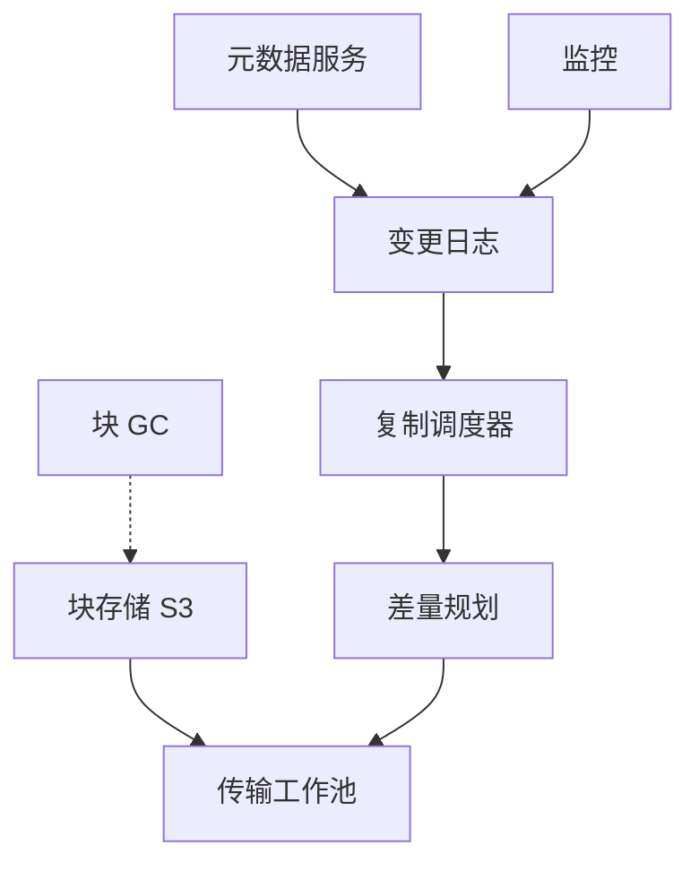
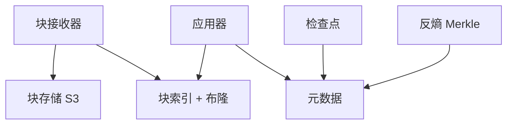
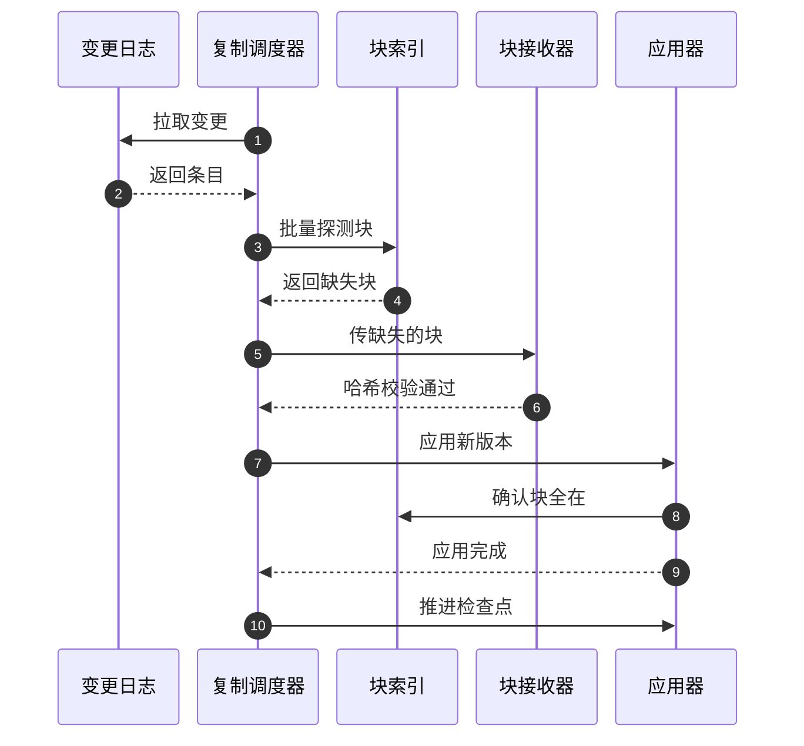
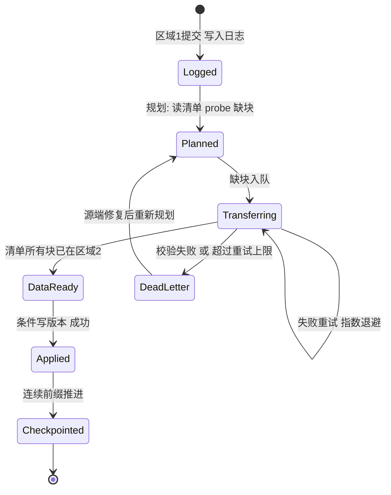

# SD04 文件系统跨区域数据复制（File System Replication）

## 题目

一个大型文件系统把数据放在区域 1，为了防备整个区域出故障，要在区域 2 保留一份可读的副本。使用者是两类：平时往区域 1 读写文件的业务，以及区域 1 出事时接手的运维和读流量。复制的两端都是服务端，没有客户端参与：源头是区域 1 已经提交的变更日志，目标是区域 2 里一份内容一致、随时能读的文件树。难点在五处：只传对方没有的块，省下跨区域链路的带宽；按正确的顺序让副本可见，不能暴露指向未到达数据的文件；链路和对端慢了、挂了以后能追上；复制落后时知道落后多少；副本悄悄坏了能发现并修好。

题目：只设计复制部分，不设计上传。数据怎样高效地从区域 1 传到区域 2？

这题和普通的文件同步（File Sync）最大的区别是没有客户端。上传路径由别的系统负责，你要回答的是：以什么为复制的源头（变更日志）、传什么（只传对方没有的块）、按什么顺序让对方可见、跨区域链路带宽怎么分配、复制落后了怎么办、副本悄悄坏了怎么发现。

「文件系统」具体是面向用户的网盘、内部分布式文件系统还是对象存储，题面没有说；规模和一致性要求也没有给。下文的假设：20 亿个文件、10 PB、每天 2% 的文件被改动。面试时先和面试官确认范围（只做复制）和重点（区域 1 到区域 2 的传输效率），再以他给的数字为准。

## 澄清问题

开场用五分钟问下面八个问题，每一个都会改变设计。

1. **复制方向与角色：主备（active-passive）还是双向（active-active）？** 决定是否需要冲突处理。默认单向、每个命名空间有一个归属区域（home region）；若要双向，冲突策略是另一半设计。
2. **一致性与 RPO：可以落后多久？** 假设 99% 的变更 60 秒内在区域 2 可见，99.99% 在 15 分钟内。RPO（恢复点目标，Recovery Point Objective：灾难时最多允许丢多久的数据）决定要不要在提交路径上同步等待；这里选异步，因为同步会让区域 1 的每次写都背上跨区域的延迟，区域 2 一抖区域 1 就跟着不可写。
3. **副本是只读的灾备，还是要提供读流量？** 提供读流量就需要「单调读」与「按命名空间的一致快照」，否则读到的是东拼西凑的目录树。
4. **规模：文件数、总量、日变更量、跨区域链路带宽？** 决定链路是不是瓶颈，要不要差量传输和限速。假设 20 亿个文件、10 PB、每天 2% 的文件被改动。
5. **文件是不可变的还是可原地修改的？** 对象式不可变（整体替换）与数据库文件式原地写，决定差量怎么取：块哈希比对，还是源端记录的脏区间。
6. **元数据操作（改名、移动、权限、删除）是否也要复制？** 改名不应该传数据。需要明确删除的语义：立即删，还是保留墓碑（tombstone，标记「已删除」的记录）一段时间。
7. **是否需要首次全量同步（backfill）与周期性校验？** 一定需要。区别只是优先级与限速。
8. **链路是否与线上业务共用？** 共用则复制必须让路，要有限速与优先级；专线则另算预算。

## 需求

**功能需求（按优先级）**

1. **增量复制**：区域 1 中已提交的创建、修改、改名、删除，最终在区域 2 生效。
2. **高效传输**：只传区域 2 没有的数据，尽量压缩，充分利用带宽。
3. **有序可见**：区域 2 不得暴露指向未到达数据的文件；同一文件的版本只前进不后退。
4. **自愈**：副本漂移（丢块、坏块、漏事件）能被检测并修复。
5. **首次全量与追赶**：新建副本、区域故障恢复后能追上进度而不拖垮线上。

**非功能需求（带数字）**

| 维度 | 目标 |
|---|---|
| 复制滞后（p99） | 60 秒；p99.99 15 分钟 |
| 数据完整性 | 区域 2 的每个块经内容哈希校验，端到端校验失败不得上线 |
| 耐久性 | 源端块在确认复制前不得被垃圾回收 |
| 一致性 | 同一文件版本单调；命名空间提供一致检查点（crash-consistent） |
| 可用性 | 复制管道可暂停可恢复，区域 2 故障不影响区域 1 的写入 |
| 带宽 | 复制总流量不得挤占线上，可配置占链路上限（例如 60%） |

**明确不做**：上传路径（客户端到区域 1）、客户端同步协议、跨区域强一致读、文件内容搜索与权限模型的设计（权限只作为元数据一并复制）。

## 容量估算

假设：2 × 10⁹ 个文件，合计 10 PB（平均 5 MB，重尾分布）；每天 2% 的文件有变更；每天变更涉及的字节 50 TB；区域间专线 10 Gbps；块平均 4 MB。

| 量 | 公式 | 结果 |
|---|---|---|
| 每日变更文件数 | 2 × 10⁹ × 2% | 4,000 万/天 |
| 平均变更率 | 4 × 10⁷ / 86,400 | 约 463 次/秒 |
| 峰值变更率（5 倍） | 463 × 5 | 约 2,315 次/秒 |
| 平均复制字节速率（不优化） | 50 TB / 86,400 | 约 579 MB/s，约 4.63 Gbps |
| 峰值（3 倍） | 4.63 × 3 | 约 13.9 Gbps（超过 10 Gbps 专线） |
| 差量加去重后传输量 | 50 × 0.4 × 0.8 | 16 TB/天，约 1.48 Gbps |
| 再加 1.5 倍压缩 | 16 / 1.5 | 约 10.7 TB/天，约 0.99 Gbps |
| 跨区域流量费（按 0.02 美元/GB 假设） | 50,000 GB × 0.02；10,667 GB × 0.02 | 约 1,000 美元/天；约 213 美元/天 |
| 首次全量（10 PB，10 Gbps 满速） | 10¹⁶ B × 8 / 10¹⁰ bps / 86,400 | 约 92.6 天 |
| 首次全量（只给复制 60% 带宽） | 10¹⁶ B × 8 / 6 × 10⁹ / 86,400 | 约 154 天 |
| 块总数 | 10¹⁶ / 4 × 10⁶ | 2.5 × 10⁹ 个块 |
| 块索引（每项哈希 32 B 加位置 40 B） | 2.5 × 10⁹ × 72 B | 约 180 GB |
| 布隆过滤器（每项 10 位） | 2.5 × 10⁹ × 10 / 8 | 约 3.1 GB |
| 区域 2 停机 6 小时的积压（不优化） | 50 TB × 6 / 24 | 12.5 TB |
| 追赶用时（不优化） | 12.5 TB / (1.25 GB/s - 0.579 GB/s) | 约 5.2 小时 |
| 追赶用时（差量加压缩后） | 积压 12.5 × 0.32 / 1.5 ≈ 2.67 TB；余量约 1.13 GB/s | 约 0.66 小时 |

**驱动设计的数字：链路带宽，不是存储，也不是日志吞吐。** 不优化时峰值需求 13.9 Gbps 已超过 10 Gbps 专线，而首次全量需要 90 多天。这两个事实推出三个决定：

1. 必须只传差异，把稳态流量压到约 1 Gbps，给追赶留出 10 倍余量。
2. 首次全量不能走在线复制通道，应该走离线批量搬运（例如 AWS Snowball，或预先在目标区域用更大的批量管道）并行跑，在线复制只负责追增量。
3. 变更日志本身只有每秒几千条，日志不是瓶颈，可以放心地用单分片有序的日志，不必用吞吐去换顺序。

另一个要预先算的数：日志保留期。每天 4,000 万条变更，每条约 500 字节，7 天约 4 × 10⁷ × 7 × 500 B = 140 GB，很小。所以日志保留 7 天以上没有成本顾虑，保留期应当**大于最长可想象的区域 2 故障时长**；超过保留期，就退化为 Merkle 树比对加补齐，而不是回放日志。

## 核心实体与 API

**实体与键**

| 实体 | 键 | 主要字段 |
|---|---|---|
| `FileVersion`（区域 1 元数据，权威） | `namespace_id`、`file_id`、`version` | `manifest`（有序块哈希列表）、`size`、`mtime`、`state`（ACTIVE / DELETED）、`path` |
| `ChangeLogEntry`（变更日志） | `namespace_id`、`log_seq`（命名空间内单调） | `file_id`、`version`、`op`（PUT / RENAME / DELETE / ACL）、`manifest_digest`、`commit_ts` |
| `Chunk`（内容寻址存储） | `chunk_hash`（SHA-256） | `len`、`location`、`refcount`、`replicated_to`（区域集合） |
| `ReplCheckpoint`（区域 2 进度） | `namespace_id`、`source_region` | `applied_log_seq`、`updated_at`、`epoch` |
| `Epoch`（归属区域任期） | `namespace_id` | `home_region`、`epoch`（单调递增，故障转移时加一） |

内容寻址（content-addressed）的意思是：块的名字就是它内容的哈希，同样的内容只会有同一个名字，所以「对方有没有这个块」可以只凭名字回答。

**内部 API**

```
GET  /v1/changes?namespace={ns}&after={log_seq}&limit=1000       # 区域 1：按序拉取变更（长轮询）
POST /v1/chunks:probe                                             # 区域 2：body {hashes[]} → {missing[]}
PUT  /v1/chunks/{hash}                                            # 区域 2：幂等写入块，服务端重算哈希，不一致拒绝
POST /v1/apply   Idempotency-Key: {namespace}:{file_id}:{version} # 区域 2：应用清单 + 元数据，条件 version 更大才生效
  body: { file_id, version, manifest, op, epoch, log_seq }
POST /v1/checkpoint                                               # 区域 2：推进 applied_log_seq，仅当所有更早的变更已应用
GET  /v1/merkle?namespace={ns}&range={prefix}                     # 两侧：返回子树哈希，用于反熵
```

幂等（同一个请求做一次和做十次结果一样）：`apply` 以 `(namespace, file_id, version)` 为幂等键，条件是目标版本小于传入版本，所以重复投递没有副作用。`PUT chunk` 本身天然幂等，因为内容寻址，同一个哈希写多少次都是同一份内容。`epoch` 作为围栏令牌（fencing token，一个只增不减的编号，用来拒绝过期持有者的写入），区域 2 拒绝来自旧归属区域的写入。

## 高层架构

系统分两半：区域 1 负责「决定传什么、把它送出去」，区域 2 负责「验收、按序可见、检查点」。

区域 1（发送侧）：



区域 2（接收侧）：



两半之间：传输工作池经专线（或公网加 TLS）把块送到块接收器；差量规划向区域 2 的块索引批量探测（probe）哪些块缺；块 GC 读取区域 2 的检查点，决定哪些源端块可以回收；反熵同时比较两边的元数据。

**流程一：稳态增量复制。** 区域 1 里每次文件提交（新版本、改名、删除）在元数据事务里同时写一条变更日志记录，用 outbox 保证「提交了就一定有日志」。选事务内写 outbox，而不是外挂 CDC（change data capture，从数据库日志里反推变更）去推导业务意图，是因为日志里的业务意图（这是改名还是改内容）只有写入方最清楚，反推容易错。复制调度器按命名空间有序读取日志，把一批变更交给差量规划：读出新版本的块清单，向区域 2 的块索引做批量探测，得到缺失块列表。传输工作池只发送缺失的块，压缩后经多条并行流送出，区域 2 的接收器重算哈希，对不上就拒绝。块全部落地后，应用器才在区域 2 的元数据里写入新版本，最后推进检查点。

**流程二：读与一致性。** 区域 2 的读只会看到「清单里的块全部已在本区域」的文件版本，因为应用器把数据先于指针（data before pointer）作为铁律：先让数据到位，再让指向数据的元数据可见。检查点记录的是已应用的最长连续日志前缀，读者想要一致的目录树，就按检查点之前的状态读。



1. 调度器发 `GET changes after=9000 limit=1000`。
2. 日志返回条目 9001 到 9040，每条含块清单（manifest）。
3. 调度器把各清单的块哈希批量发给块索引做 probe。
4. 索引回答缺 7 个块。
5. 调度器把 7 个块压缩、并行、限速地 `PUT` 给接收器。
6. 接收器重算哈希，通过后返回 ok。
7. 调度器发 `apply(file_id, version, manifest, epoch, log_seq)`。
8. 应用器向块索引确认清单里的块全部存在。
9. 应用器做条件写，只有目标 version 更小才生效，然后返回 applied。
10. 调度器发 `checkpoint(applied_log_seq = 9040)`。

7 个缺块的传输按优先级排队：小文件交互类高于批量变更。

## 深挖

### 一、怎样只传对方没有的东西：差量的三种来源

**问题。** 每天变更 50 TB，但其中大部分字节在对方已经有了：文件只改了一小段、同一份内容被多个文件引用、之前复制过一半又失败重试。直接整文件传，稳态就要 4.63 Gbps，峰值超过专线。

**方案。**

- **A. 块清单比对（内容寻址）。** 文件由 4 MB 左右的块组成，清单是块哈希的有序列表。新版本到来时，用 probe 问区域 2「这些哈希你有没有」，只传缺的。优点：同时拿到同文件内的差量、跨文件的去重和失败重试的续传；缺点：块边界要对得上。定长块遇到头部插入，后面所有块的哈希都会变；内容定义分块（content-defined chunking，用滚动哈希按内容特征切分）对插入稳定，代价是切分时的 CPU。
- **B. rsync 式滚动校验。** 区域 2 发来旧版本的块签名，区域 1 用滚动哈希找出可复用的部分。对原地小改的大文件很精确，但需要往返一次拿签名，并且要求目标还保留着上一版本。
- **C. 源端脏区间（dirty extents）。** 如果文件系统在写路径上本来就知道哪些区间被写了（例如数据库文件、虚拟机镜像），直接把这些区间作为差量，不需要重新哈希。零计算成本，但只对原地覆盖写有意义，并且要求写路径提供记录。

**选择。** 默认 A，块用内容定义分块，平均 4 MB：既让清单不至于太长，又让局部修改只影响一两个块。大文件原地改写场景（数据库、镜像）用 C 作为加速，因为 50 GB 的文件有 12,500 个块，每次重新哈希整个文件不划算。B 只在目标版本不可得、A 无法命中时作为后备。这个思路和客户端网盘里的分块与指纹是同一个：把它搬到服务端到服务端，去掉客户端上传的部分。

**探测的成本。** 2.5 × 10⁹ 个块的索引约 180 GB，不能每次都查后端存储。前置一个布隆过滤器（Bloom filter，一种用很小空间回答「肯定没有 / 可能有」的结构，约 3.1 GB，放在复制调度器内存里）：过滤器说「肯定没有」就不必查索引，直接排队传；说「可能有」再查索引确认。假阳性意味着认为有但其实没有，会导致漏传，所以布隆只能用来**跳过查询**，不能用来**跳过传输**：「可能有」必须去索引确认。

**失败模式。** (1) 哈希碰撞：SHA-256 可以认为不会，但接收端仍重算哈希，一方面防传输损坏，另一方面防止上游写错。(2) 去重过度引出的跨租户信息泄露：A 能通过探测知道别人是否持有某个块。这里复制的是同一租户同一系统内部，影响有限，但若多租户共享块存储，探测应按租户命名空间隔离。(3) 压缩放大 CPU：对已压缩的格式（图片、视频）自动跳过压缩。

### 二、顺序与可见性：数据先于指针，以及同一文件版本的因果

**问题。** 区域 2 的读者不能看到「清单有了、块还没到」的文件，否则读取直接 404 或读到残缺内容。文件之间还有依赖：先建目录再建文件，先改名再改内容。

**方案。**

- **A. 严格按日志逐条串行应用。** 简单，顺序天然正确，但块的传输被串行化，吞吐被最慢的一个大文件卡死。
- **B. 数据并行，元数据按序。** 块传输乱序并行进行；元数据的应用步骤（写入版本）按日志顺序，只有该条之前的所有条目已应用，才推进检查点。每条应用都先确认清单里的块全部在区域 2。
- **C. 完全乱序，靠版本号收敛。** 每个文件独立复制，只用「版本大者胜」收敛。吞吐最高，但目录结构变更（改名、移动）有相互依赖，乱序会出现临时的孤儿。

**选择。** B，并且**按文件而不是按命名空间粒度并行**：同一文件的版本严格按序应用；不同文件互不等待；目录类操作（改名、移动、删除）带上依赖，按路径前缀串行。检查点记录的是「最长连续已应用前缀」，因此可以乱序完成但有序提交，类似流水线里的提交顺序缓冲（reorder buffer）。区域 2 提供的一致快照读，就是检查点之前的视图。

**失败模式。** (1) 一个超大文件长时间不完成会拖住检查点，进而拖住一致快照：为此设置每文件超时，超时的文件转入慢队列并标记为跳过项，检查点越过它，同时在监控里单独报警，一致快照把跳过项排除。(2) 毒丸文件（块在源端已损坏）：校验失败后进入死信队列，不阻塞其他文件，同时通知源区域做修复。原则是**宁可少一个文件，也不要整条管道停摆**。(3) 重复投递：应用器的条件写保证幂等。



### 三、单一归属区域 vs 多主：冲突处理与故障转移

**问题。** 如果两个区域都接受同一文件的写入，复制就要处理冲突；如果只有一个区域接受写入，区域故障时要有明确的转移步骤，并避免两个区域都以为自己是主。

**方案。**

- **A. 命名空间级单一归属区域（single-writer per namespace）。** 每个命名空间在任何时刻只有一个区域接受写入，复制是单向的，没有冲突。故障转移要提升区域 2：把 `Epoch` 加一，区域 2 只接受带新纪元的写，旧区域恢复后的写入因纪元过期被拒（围栏）。代价：写入延迟取决于归属区域的位置。
- **B. 多主加最后写入者胜（LWW）。** 两边都能写，按时间戳较大者覆盖。简单，但静默丢失数据，时钟偏差下很危险。
- **C. 多主加向量时钟与冲突副本。** 检测到并发写入就保留两个版本，让用户或应用合并，是 Dropbox 一类产品的做法，这里不展开，冲突检测的细节见 [[solution-file-sync]]。

**选择。** A。题目只要求设计区域 1 到区域 2 的复制，单向最贴合；多区域写入需求再通过「按命名空间分配归属区域」达到整体上的双活，而不是文件级多主。转移流程：检测归属区域不可用（人工确认或自动加仲裁），提升区域 2 的纪元，区域 2 开始接受写入。此时区域 2 的数据相对区域 1 最后写入可能落后（滞后窗口，P99 为 60 秒内的变更），这部分变更的命运必须在运行手册里明确：区域 1 恢复后，把未复制的日志尾部导出成「冲突审阅」队列，而不是自动合并，因为自动合并等于替用户决定谁的修改算数。

**失败模式。** (1) 双主（脑裂）：纪元围栏令牌挡住，应用器与元数据服务按纪元拒写。(2) 转移后旧区域积压的未复制变更：按审阅队列处理。(3) 反向复制：转移后，原区域 1 变成目标，复制方向翻转，由 `Epoch` 驱动调度器的角色，而不是靠人工重新搭一条管道。

### 四、反熵（Anti-entropy）：如何发现并修复悄悄的漂移

**问题。** 日志漏条、块在区域 2 静默损坏、人工误删、软件缺陷，都会让副本偏离，而日志驱动的复制发现不了这些，因为日志本身没有说谎。

**方案。**

- **A. 全量扫描比对。** 逐个文件比清单。10 PB 和 20 亿个文件，扫一遍要数小时到数天，而且打压元数据存储。
- **B. Merkle 树分层比对。** 把命名空间按路径哈希前缀分桶，每个桶的哈希是其下所有文件 `(file_id, version, manifest_digest)` 的聚合。两边比较根，不同就下钻到子桶，直到定位到具体文件。通信量与差异数成正比，不与总量成正比。
- **C. 滚动校验和加抽样。** 每个桶维护一个可增量更新的校验和（异或或求和），日志应用时同步更新，周期性只比桶级校验和，不一致的桶再用 B 下钻。

**选择。** C 加 B：桶级校验和随复制增量维护（几乎无成本），每小时比一次；校验和不一致的桶才用 Merkle 下钻定位；另外每周对块做一次抽样校验（scrub，随机读取并重算哈希）。反熵的修复动作是：缺块则重传，版本落后则重新规划，区域 2 多出的文件则按墓碑规则处理。**修复本身走和增量复制同一条数据通道，同样受限速约束**，否则修复会变成新的带宽事故。

**失败模式。** (1) 反熵本身压垮元数据：限速并在低峰运行。(2) 反熵与实时复制竞态（桶在比较时有新写入）：比较基于检查点快照，只比较 `log_seq` 不超过检查点的部分。(3) 超过日志保留期的故障：直接以 Merkle 比对代替日志回放进行追赶，代价是更重的扫描。

## Staff 视角：权衡、故障与演进

**10 倍规模先坏什么。** 先坏的是专线预算。差量后稳态约 0.99 Gbps，10 倍变成约 10 Gbps，刚好吃满，没有追赶余量。对策有三：提高差量命中率（更好的分块与跨文件去重）、对热数据与冷数据分级复制（冷数据放宽 RPO 到小时级，走批量低优先级通道）、增加链路或多路径。其次坏的是块索引（2.5 × 10⁹ 项约 180 GB，10 倍就是 1.8 TB），要分片，并按哈希前缀路由。再次是变更日志的单命名空间顺序性：一个巨型共享命名空间的写入率会成为单分片上限，需要把命名空间按子树切成更小的复制单元。

**各组件失败的爆炸半径。**

| 组件 | 失败时 | 影响 | 缓解 |
|---|---|---|---|
| 区域 2 整体 | 复制停摆，区域 1 不受影响 | RPO 变大 | 日志保留 7 天，恢复后追赶；追赶限速防止恢复时压垮 |
| 专线 | 带宽下降或中断 | 滞后增大 | 回落公网加限速；保留一部分预算给高优先级 |
| 复制调度器 | 崩溃 | 暂停推进 | 状态在检查点，无状态重启；多实例按命名空间分片 |
| 块索引 | 不可用 | 无法探测，传输量暴增 | 失败时退化为「全部发送」，但限速，不允许无限放大；索引副本 |
| 应用器 | 逻辑缺陷写出坏元数据 | 副本数据不可信 | 反熵发现；元数据写入带版本，可回放日志重新生成 |
| 源端块 GC | 在块被复制前回收 | 数据丢失 | 引用计数含「已复制到哪些区域」，未全部复制的块不可回收 |

最后一行是最容易被漏掉的：**GC 必须读取复制水位**。区域 1 删除或覆盖文件时，旧块的引用计数归零，但如果该块所属的变更还没复制出去，回收它会让区域 2 永远拿不到这个版本的数据。因此块的回收条件是「引用计数为零，且所有目标区域的检查点都已越过引用它的最后一条日志」。

**与 S3 跨区域复制（CRR）的比较。** 若数据本来就在 S3，托管方案是 S3 跨区域复制：按前缀或标签配置规则，复制新写入的对象，已有对象要用批量复制（Batch Replication），异步，对象级而不是目录树级；可开启复制时间控制（Replication Time Control，RTC），按 AWS 文档承诺绝大多数对象 15 分钟内完成并有指标可看。它不保证跨对象的顺序，也不提供命名空间级一致快照。自建的理由只有三个：需要文件系统语义（目录树、改名只传元数据、一致检查点）、需要块级差量（S3 复制是整对象）、需要对带宽和优先级的精细控制。没有这三个理由，答案应当是「用 CRR」，说出这一点本身就是 staff 判断。

**多区域演进。** 从一对区域扩到 N 个区域，不要做 N×N 全互联：全互联的链路数和流量费随 N 的平方增长。用「星形加级联」，由归属区域复制到若干区域，再由这些区域向下游转发，用同一份块和同一份日志，链路费用也更可控。

**成本驱动。** 跨区域流量费（前面估算：不优化约 1,000 美元/天，优化后约 213 美元/天）、区域 2 的存储（等于区域 1 的副本）、块索引与日志的元数据存储、传输工作池的 CPU（分块、哈希、压缩）。其中最容易被低估的是区域 2 的存储与元数据读写，而不是流量。

**迁移与发布。** 新建副本：先在目标区域用离线批量搬运铺底（10 PB 在线需要 90 多天，不可行），记下搬运开始时的日志位置，铺底完成后从该位置开始回放日志，最后用 Merkle 比对确认。发布复制代码的新版本时，按命名空间灰度，先放小租户，因为复制出问题的代价是副本不可信，影响面要先小后大。

**可观测与运行手册。** 指标：端到端滞后（日志提交时间到应用完成时间的分位）、检查点落后条数、积压字节、探测命中率、重传率、死信队列长度、链路利用率、反熵不一致桶数。用金丝雀：每个命名空间每分钟写一个心跳文件，测它在区域 2 出现的时间，作为滞后的黑盒指标，避免日志位置本身出问题时指标也一起失明。告警：滞后超过 SLO 的两倍、死信非空、检查点十分钟未推进。运行手册：暂停与恢复复制、重新规划某个文件、提升区域 2、导出审阅队列、触发命名空间级反熵。

## 面试官追问

1. **大文件怎么复制？** 用 4 MB 左右的块并行传输，50 GB 文件约 12,500 个块；块独立可重试，崩溃后只重传缺的块，因为探测会告诉复制器区域 2 已有哪些。清单在所有块到齐后才应用。
2. **复制到一半源文件又变了怎么办？** 版本是不可变的。复制的是某个版本的清单及其块，新版本会产生新的日志条目，并按序排在后面。应用器的版本条件保证旧版本不会覆盖新版本；同一文件若中间版本被后来的版本取代，可以跳过中间版本直接应用最新（合并去抖），因为目标只关心最终状态。
3. **怎么知道复制落后了多少？** 两个视角：日志视角（提交时间到应用完成时间）和黑盒视角（每个命名空间的心跳文件）。两者都要有，前者精确，后者在管道本身故障时仍然有效。
4. **专线被占满了怎么办？** 复制流量有优先级：交互类小文件和元数据最高，批量变更中等，反熵与首次全量最低；总量受令牌桶限速；占满线上业务时让路（拥塞回退）。积压增长到阈值时触发降级策略而不是无限堆积。
5. **删除怎么复制？** 删除作为墓碑版本进入日志，应用后区域 2 把文件标记为删除，物理删除延迟一段时间（例如 7 天）以便回滚和审阅；块在引用计数归零且复制水位越过后才回收。防止「误删迅速扩散到副本」的办法，就是这个延迟，副本同时也是误删的最后一道保险。
6. **区域 2 的读为什么不会读到残缺文件？** 数据先于指针：应用器在写入版本之前确认清单里的每个块都已在本区域并通过哈希校验；读者看不到处于传输中的版本。
7. **双向复制需要改什么？** 需要冲突检测（版本向量）和冲突副本，或者回到按命名空间指定归属区域，让每个命名空间单向。多数需求用后者即可，避免了用户可见的冲突。
8. **日志丢了一段怎么办？** 反熵会发现桶级校验和不一致，下钻到具体文件并修复。预防手段是在源端把日志写入与元数据事务绑在一起（outbox），日志条目有连续序号，应用器遇到序号空洞就停下报警，而不是跳过。
9. **和 S3 CRR 比，什么时候不该自建？** 数据已在 S3、只需要对象级的异步复制、对顺序与目录语义无要求时，直接用 CRR，必要时加 RTC。自建只在需要块级差量、文件系统语义或精细带宽控制时合理。
10. **如何测试这个系统？** 注入故障：截断专线、杀死调度器、损坏区域 2 一个块、制造日志空洞；用确定性的写入负载加最终比对（Merkle 根一致）验证。这类系统的单测不够，需要常态化的演练和反熵作业的持续比对。

## 60 分钟怎么分配

| 分钟 | 做什么 | 时间不够时 |
|---|---|---|
| 0–5 | 确认范围：只做复制；问澄清问题 1、2、4、5 | 只问方向、RPO、规模 |
| 5–10 | 功能与非功能：滞后 SLO、完整性、数据先于指针 | 压成三句 |
| 10–15 | 容量估算：带宽是驱动数，首次全量天数 | 只算稳态带宽和首次全量 |
| 15–20 | 实体、日志、探测与应用 API | 只列实体与三个 API |
| 20–30 | 高层图与稳态流程、序列图 | 不能砍 |
| 30–40 | 深挖一（差量）与深挖二（顺序与可见性） | 深挖二简述 |
| 40–50 | 深挖三（归属区域与转移）、深挖四（反熵）的结论 | 反熵放进追问 |
| 50–60 | Staff 视角：CRR 比较、GC 水位、监控；追问 | 只讲 GC 水位和 CRR |

**45 分钟版本：** 澄清与需求 7 分钟，估算 4 分钟，API 与实体 3 分钟，高层图和序列图 10 分钟，深挖一和二各 7 分钟，Staff 视角（GC 水位、CRR、监控）5 分钟，留约 2 分钟给追问。若前 10 到 15 分钟被行为面试占用，优先保证：为什么只传差异（带宽数字）、数据先于指针、GC 读复制水位这三点。

## 自测

1. 为什么说链路带宽是这个设计的驱动数？它推出哪两个设计决定？
<details>
<summary>答案</summary>
不优化时峰值约 13.9 Gbps，超过 10 Gbps 专线，首次全量需要约 92.6 天。推出：稳态必须只传差异（压到约 1 Gbps，给追赶留余量）；首次全量走离线批量铺底，在线复制只负责追增量。
</details>

2. 布隆过滤器在探测块是否存在时，能用来跳过什么，不能用来跳过什么？
<details>
<summary>答案</summary>
可以用来跳过「查询」：判断为肯定不存在则不必查索引，直接排队传输。不能用来跳过「传输」：判断为可能存在有假阳性，必须去索引确认，否则会漏传。
</details>

3. 为什么区域 2 应用器要「数据先于指针」？检查点为什么是连续前缀？
<details>
<summary>答案</summary>
元数据一旦指向尚未到达的块，读者会读到残缺文件或 404，所以必须先确认清单里所有块都已落地并校验通过再写版本。检查点记录最长连续已应用前缀，才能让「检查点之前的所有变更都已可见」成立，从而给出一致快照读，乱序完成也不会破坏它。
</details>

4. 源端垃圾回收为什么必须读取复制水位？
<details>
<summary>答案</summary>
区域 1 里文件被覆盖或删除后，旧块引用计数会归零；如果引用它的那条变更还没复制出去，回收它会让区域 2 永远拿不到该版本的数据。所以回收条件需要加上「所有目标区域的检查点已越过引用该块的最后一条日志」。
</details>

5. 什么时候应该直接用 S3 跨区域复制，而不是自建？
<details>
<summary>答案</summary>
数据本来就在 S3，只需要对象级异步复制，不要求跨对象顺序、目录语义、块级差量和精细带宽控制时，用 CRR（需要时加 RTC 获得 15 分钟内复制的承诺和指标）。自建只在需要文件系统语义、块级差量或精细带宽与优先级控制时才值得。
</details>

## 来源与延伸阅读

> 来源：Hello Interview 社区题目页 https://www.hellointerview.com/community/questions?company=Amazon （条目 `file-system-replication`，2026-10-01，mid-level）。对照页面：https://www.hellointerview.com/learn/system-design/problem-breakdowns/dropbox 、https://www.hellointerview.com/learn/system-design/patterns/large-blobs 、https://www.hellointerview.com/learn/system-design/deep-dives/change-data-capture 。

- 被报告的题面（2026-10-01，mid，置信度中）：「1. Interviewer didn't care about how the data is uploaded. 2. Design only the replication part. How does data transfer from region 1 to region 2 efficiently?」
- **（重建）**：除这两句，题目背景看不到。「文件系统」是什么（面向用户的网盘、内部分布式文件系统、还是对象存储）、规模、一致性要求，都是为了练习而做的假设。

**Hello Interview 怎么做。** 这个题目没有同名的专题拆解页，但相邻的三页覆盖了大部分底层内容。《Dropbox》先讲客户端分块、指纹（fingerprint）、可续传上传和同步，其强项是把大文件拆成块、用块指纹判断「是否已存在」、用预签名链接让数据绕开应用服务器。《Handling Large Blobs》总结了大文件传输的通用模式：直传、分块、断点续传、完成通知。《Change Data Capture》讲怎样从数据库日志得到下游可消费的变更流，以及用事务性 outbox 把业务意图变成显式事件。

**一致的地方。** 内容哈希识别块、块级去重、续传靠记录已完成的块、用 outbox 而不是用副作用推导事件。

**不同的地方。**

1. 它们的重点在客户端到服务端的上传路径；面试官明确说不关心上传，所以正文把重点放在服务端到服务端的传输：差量规划、探测、限速、检查点。
2. 它们没有讨论「数据先于指针」与按文件并行、按前缀提交这类跨区域副本的可见性问题。
3. 它们假设一个区域；正文把链路带宽当作约束，用数字（13.9 Gbps 峰值对 10 Gbps 专线；首次全量 92.6 天）推导出「只传差异」和「离线铺底」的必要性。
4. 反熵与 GC 的复制水位是它们没有展开的部分，也是副本可信度的关键。

**本库的通用部分。** 客户端同步、分块策略、冲突检测和游标式变更日志见 [[solution-file-sync]]；块存储的数据放置、副本与纠删码、垃圾回收见 [[solution-object-storage]]。正文只写跨区域复制的增量，不重复它们。
