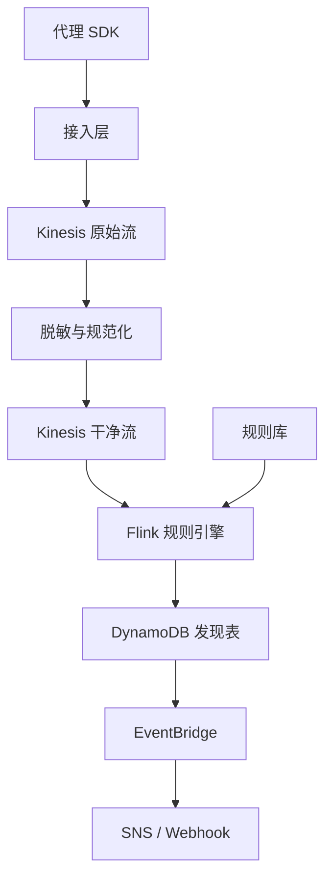
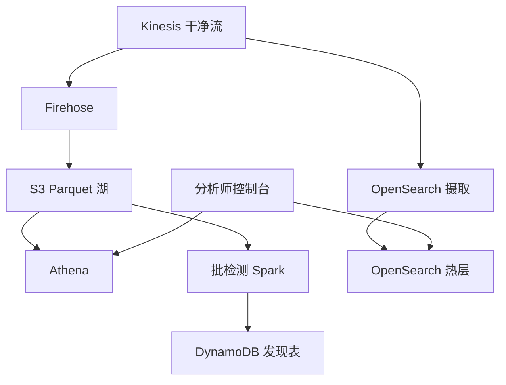
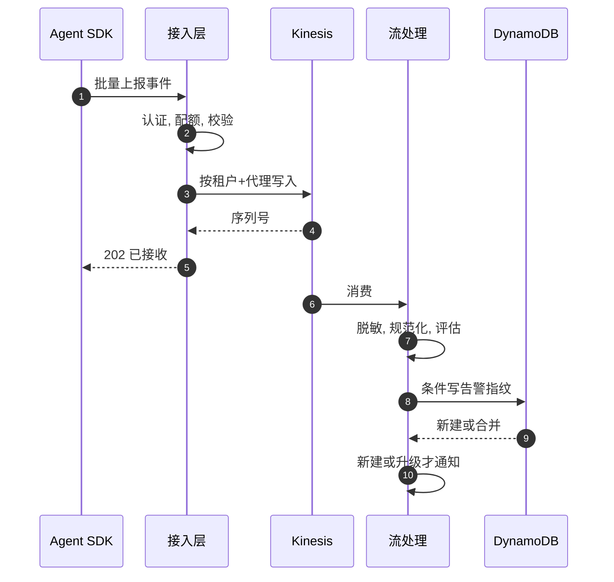
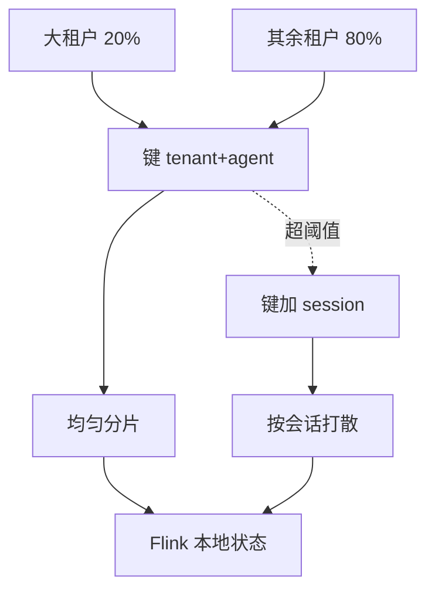
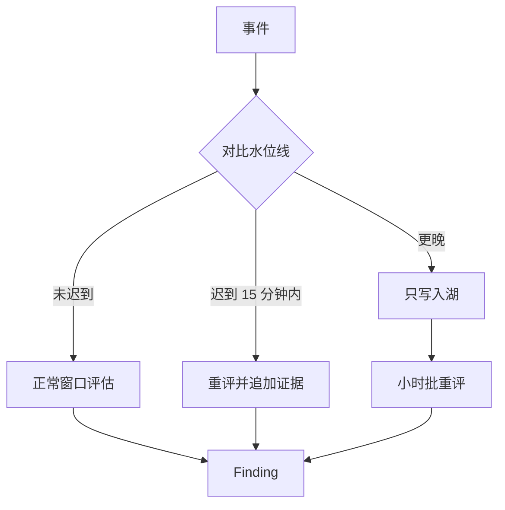

# SD06 Agentic AI 安全事件平台，1 TB/天（AI Agent Security Telemetry）

## 题目

AI 代理（agent）是会自己调用工具、读写数据、访问外部服务的程序。企业让它们替自己干活之后，需要一个安全平台盯着：代理有没有被提示词注入诱导、有没有调用不该调的工具、有没有把敏感数据发到外面。这个平台的使用者是客户的安全分析师；它的数据源是成千上万个代理持续上报的行为事件。难点不在总量（一天 1 TB 听起来很大，换算成每秒其实平庸），而在三件事：租户之间流量极不均匀，检测规则要按代理保序，提示词里藏着敏感数据必须先脱敏再落盘。

题目：设计一个 AI 代理安全遥测平台，每天接收约 1 TB 的代理行为事件（提示词、工具调用、模型响应、访问的资源、身份），在分钟级检测策略违规，去重后告警，并允许分析师回溯调查。

事件大小、租户数、是否要同步阻断，题面都没给；下文的假设是：事件平均 2 KB，数千个租户，最大租户占 20% 流量，以异步检测为主，同步阻断作为扩展单独讲。面试时以面试官给的数字为准。

## 澄清问题

1. **1 TB/天是压缩前还是压缩后，是平均还是峰值？** 决定流的容量。按「压缩前的原始事件，日均」算，峰值取 5 倍；如果是压缩后，原始量要乘 5 到 8。
2. **一个事件多大，里面有什么？** 带完整提示词与模型响应的事件可能 10 KB 以上，只带元数据的 500 字节。取平均 2 KB（元数据加截断后的内容）；决定了 events/s 和是否要把大负载拆到对象存储。
3. **检测的延迟要求：秒级、分钟级还是小时级？** 这是热路径与冷路径的分界线。假设：确定性规则 p99 小于 60 秒告警，行为基线类检测按小时。
4. **平台是只观测，还是要在代理调用工具之前同步阻断？** 同步阻断是完全不同的系统（延迟预算几十毫秒，在客户请求路径上，可用性要求更高）。做**异步检测为主**，同步决策点作为扩展单独讲。
5. **多租户到什么程度：几个租户，最大租户占多少？** 决定分区策略与隔离。假设数千个租户，最大的一个租户占 20% 流量。
6. **提示词里有敏感数据怎么办？** 客户的提示词里可能有 PII 和密钥。决定在哪里脱敏（代理端 SDK、接入层、还是存储前），以及能不能存原文。
7. **规则从哪里来：我们内置、客户自定义，还是模型打分？** 影响规则引擎设计：客户自定义规则需要沙箱、版本化、回放。
8. **数据保留与合规：保留多久、能否删除、数据能不能出区域？** 决定冷存储的分层、按租户的加密密钥和数据驻留。

## 需求

**功能需求（按优先级）**

1. 接收来自客户代理的遥测事件（动作、工具调用、提示词元数据），可靠、不丢。
2. 近实时检测策略违规：确定性规则（禁用工具、越权资源、速率异常、敏感数据外发序列）。
3. 告警：去重、聚合、分级，推送到客户的通知渠道，并有告警详情页。
4. 调查：按代理、会话、时间范围检索事件，回溯一条告警前后的行为链。
5. 批量/历史检测：新规则可以对过去 30 天数据回溯运行（retro-hunt），行为基线定时计算。

**非功能需求**

| 维度 | 目标 | 说明 |
|---|---|---|
| 接入可用性 | 99.99% | 接入失败等于客户的安全盲区；SDK 要本地缓冲重试 |
| 检测延迟 | 确定性规则 p99 小于 60 秒；基线类小于 1 小时 | 从事件发生到告警可见 |
| 投递语义 | 至少一次接入，告警侧去重后效果上等于一次 | 事件带唯一 ID |
| 持久性 | 已确认接收的事件零丢失 | 安全证据，丢了无法复盘 |
| 调查查询 | 最近 7 天 p95 小于 3 秒，更久的可到分钟级 | 热层搜索，冷层批查 |
| 租户隔离 | 一个租户的突发或毒数据不拖慢他人；数据严格隔离 | 单租户密钥、配额、舱壁 |
| 隐私 | 敏感内容落盘前脱敏；可按租户删除 | 提示词是高敏感数据 |

**明确不做**：代理本身的运行时（沙箱/执行）、模型层面的越狱防护研究、客户侧 SIEM 集成的所有格式（只讲一种出口）、计费。

## 容量估算

**1 TB/天换算成速率。** 这是全题第一个要做的算术，而且要写出公式。

- 日均字节速率 = 1 TB ÷ 86,400 秒 = 10¹² ÷ 86,400 = **11,574,074 B/s，约 11.6 MB/s**。
- 日均事件速率 = 11,574,074 B/s ÷ 事件大小。取平均 2 KB（按 2,000 字节算）：**5,787 events/s**。敏感度：事件 1 KB 时 11,574 events/s，4 KB 时 2,894 events/s。事件越小，事件数越多，对计算和分区的压力越大；事件越大，对字节吞吐和存储的压力越大。
- 每天事件数 = 5,787 × 86,400 = **5 亿**。
- 峰值取日均的 5 倍（工作日白天集中，加突发）：**28,935 events/s，57.9 MB/s**。
- Kinesis Data Streams 每个分片写入上限 1 MB/s 或 1,000 条/s。按字节需要 ⌈57.9⌉ = **58 个分片**，按条数需要 ⌈28.9⌉ = **29 个分片**，取大者 58；留 30% 余量后（按 70% 利用率）= **83 个分片**。结论：字节是约束，不是条数；用 Kinesis 就是 80 多个分片，用 MSK 则是几个 broker，两者都是常规规模，**不需要特别的架构**，难点在其他地方。
- 存储：原始 1 TB/天；Parquet 加 Zstd 压缩，按 6:1 估计，约 **167 GB/天**；保留 90 天 = **15 TB**，一年 = **60.8 TB**。热层（OpenSearch）只放最近 7 天、且只放「值得检索」的 2% 事件（告警相关、高风险工具调用）：5,787 × 2% × 2,000 B × 86,400 = **20 GB/天**，7 天 140 GB，可以放进一个小集群。
- 同步决策点（扩展题）：假设 5% 的事件是工具调用、需要同步放行判断，则日均 5,787 × 5% = **289 次/秒**，峰值约 1,447 次/秒；这个量对一个有缓存的策略服务来说很小，难的是延迟和可用性，而不是吞吐。
- 告警量：如果违规率是 10⁻⁵，每天原始命中 5,787 × 10⁻⁵ × 86,400 = **5,000 条**，去重聚合后应该降到几百条。**告警疲劳（alert fatigue）才是用户体验的真实约束**，不是吞吐。
- 最大租户：占 20%，日均 5,787 × 20% = **1,157 events/s**，峰值 5,787 events/s、11.6 MB/s，已经超过 11 个分片的写入上限。**一个租户就可能把任何以租户为键的分区压垮**，这是分区键选择的关键数字。

**驱动设计的那个数字**：不是 1 TB/天本身（它只是 11.6 MB/s，一台机器的网卡就能吃下），而是 **「最大租户可达 5,787 events/s」加「检测需要按代理保序的状态」**。流量总量平庸，倾斜和有状态才是难点。

## 核心实体与 API

**实体**

| 实体 | 关键字段 | 说明 |
|---|---|---|
| Tenant | **tenant_id**、数据驻留区域、KMS 密钥 ID、配额 | 隔离与计费单位 |
| Agent | **(tenant_id, agent_id)**、框架、版本、所属应用 | 一个运行的代理实例或逻辑代理 |
| Event | **event_id (ULID)**、tenant_id、agent_id、session_id、event_time、类型、工具名、资源、动作、负载引用 | 不可变事实 |
| Policy / Rule | **(tenant_id, rule_id, version)**、规则 DSL、严重度、状态 | 内置规则 tenant_id 为空 |
| Finding | **finding_id**、fingerprint、规则、涉及事件 ID 列表、首次/末次时间、计数 | 一次违规的证据 |
| Alert | **alert_id**、finding 列表、状态（开启/确认/关闭）、受理人 | 发给人的对象 |

**API**

```
POST /v1/events:batch           Authorization: SigV4 / 租户令牌
     {events:[{event_id, agent_id, session_id, event_time, type, tool, resource, action, payload_ref?}]}
     -> 202 {accepted, rejected:[{event_id, reason}]}    # 以 event_id 幂等，重复投递无副作用
PUT  /v1/policies/{rule_id}     {dsl, severity}          -> 201 {version}   # 版本化，可 dry-run
POST /v1/policies/{rule_id}:backtest {from, to}          -> 202 {job_id}    # 回溯运行
GET  /v1/alerts?status=open&since=                       -> [{alert_id, severity, summary}]
GET  /v1/alerts/{id}                                     -> {findings, timeline_url}
GET  /v1/events?agent_id=&session_id=&from=&to=          -> 分页，热层，≤7 天
POST /v1/investigations     {query, from, to}            -> 202 {job_id}    # Athena 冷层
```

接入端要点：批量写入（一次最多几百条）；`accepted` 只在数据写入 Kinesis 并拿到序列号之后才返回，这是「确认即持久」的边界；SDK 在本地用磁盘缓冲，失败时指数退避重试，所以服务端必然会看到重复，`event_id` 是去重的依据。大负载（长提示词、模型响应全文）由 SDK 先直传 S3（预签名 URL，租户前缀），事件里只带 `payload_ref`，这样流里的事件保持小而均匀。

## 高层架构

接入与热路径：



存储与调查路径：



**流 1：热路径检测。** 事件从 SDK 进入接入层，经认证、配额检查和格式校验后写入 `raw-events` 流（接入层返回 202 的边界）；脱敏与规范化阶段把提示词里的邮箱、密钥、卡号等替换成类型化占位符，补全租户元数据，写入 `clean-events`；Managed Flink 作业按代理保序地处理，维护每个代理的滑动窗口状态，评估规则，命中则写入 DynamoDB 的 Finding 表（用指纹做条件写入去重），并通过 EventBridge 触发通知。同一条 `clean-events` 经 Firehose 落到 S3 的 Parquet 分区。

**流 2：调查与回溯。** 分析师打开一条告警，控制台从 DynamoDB 取 Finding，再用其中的事件 ID 和时间范围去 OpenSearch（7 天内）取上下文；更久的数据走 Athena 对 Parquet 分区做查询。新规则发布时，批处理作业对过去 30 天数据用同一份规则定义回溯运行，生成的 Finding 带 `source=backfill`。



图中编号对应的每一步：

1. Agent 的 SDK 把一批事件一次上报，每条事件带唯一的 event_id。批量上报是为了减少请求次数，event_id 是为了重发时能去重。
2. 接入层先认证、检查租户配额、校验格式：一个租户的流量突然暴增，不能挤占其他租户的写入能力。
3. 以「租户 + 代理」作为分区键写入 Kinesis。同一个代理的事件进同一个分区，先后顺序就能保住，「先读密钥、再向外网发请求」这类看顺序的规则才判断得出来。
4. Kinesis 返回序列号，表示数据已经持久化。
5. 这时才回 202。SDK 收到 202 才能丢掉本地副本；没收到就重发，靠 event_id 去重，事件不会丢也不会重复计数。
6. 流处理任务（Flink）按分区消费。
7. 先脱敏（把提示词里的密钥、个人信息遮掉），再统一字段格式，然后按代理维度的时间窗口评估检测规则。脱敏放在最前面，是为了后面任何存储和日志都见不到敏感原文。
8. 规则命中时，用「告警指纹」（规则 + 代理 + 时间窗）做一次条件写入：同一件事反复命中，只产生一条告警。
9. 返回这是一条新告警，还是合并进了已有的告警。
10. 只有新告警或严重度升级时才通知值班的人，避免告警风暴把真正重要的信号淹没。

## 深挖

### 分区键：租户太倾斜，代理要保序，两者怎么兼顾

问题：流的分区键同时决定三件事：写入分散度、消费并行度、以及哪些事件能保序（同一分区内有序）。检测规则里有「先读密钥再向外网发请求」这类序列规则，要求同一代理的事件按事件顺序被同一个处理器看到。但容量估算已经显示，最大租户可达 5,787 events/s，以租户为键会让它一个租户占满十几个分片的写入上限。

选项：

1. **以租户 ID 为键**：租户内有序、状态简单，但最大租户把单个分片压垮，且租户间不均。
2. **以随机数为键**：写入完全均匀，但同一代理的事件散在所有分片上，序列规则无法在单个处理器内评估，需要一次额外的重分区（shuffle），代价是延迟和成本都翻倍。
3. **以 `hash(tenant_id, agent_id)` 为键**：同一代理保序，写入均匀程度取决于代理数量，通常远多于分片数，很均匀。代价是单个超级代理（一个代理以每秒上千事件的速度循环调用工具）仍会形成热分片。

选择第 3 种。热分片的缓解：监控每个分区键的字节速率，对超过阈值的代理，在键后面追加会话标识（`tenant#agent#session`），使同一代理的不同会话落在不同分片；因为序列规则几乎总是限定在一个会话内（工具调用链属于一次会话），保序要求仍然被满足。对仍然超限的单会话，接入层按 `event_id` 的哈希做二级拆分，规则引擎接受「该会话的序列规则降级为近似」并在 Finding 中标记 `degraded`。Kinesis 的做法是分片拆分（UpdateShardCount 或按需模式），拆分后键的重新哈希会让同一键的新旧事件短暂分处两个分片，所以窗口规则要容忍分片拆分瞬间的乱序，靠事件时间和水位线兜底（见后）。

对比 MSK（托管 Kafka）：分区数可以更多、保留更长、消费者生态更丰富，但需要自己管理分区数与再均衡；Kinesis 按需模式省心但有每秒扩容的速度上限，突发前要预热。1 TB/天的量两者都能撑，选择由团队熟悉度和成本决定，面试时要说清楚这是等价选择，不要神化。



失败模式：代理 ID 由客户的 SDK 配置决定，客户把所有实例配成同一个 `agent_id`，就退化成按租户为键。对策是接入层对 `agent_id` 的基数做监控，发现单个键占比过高时在服务端重写键（加会话），而不是信任客户。

### 热路径与冷路径：确定性规则在流里，基线与回溯在批里

问题：安全检测有三类东西，对延迟与状态的要求完全不同。（a）无状态规则，例如调用了被禁用的工具、访问了未授权的资源，一条事件就能判定。（b）有状态窗口规则，例如 5 分钟内同一代理读取了超过 100 个不同文件、或「读密钥后 60 秒内出站」。（c）基线类，例如「该代理本周的工具调用模式与过去 30 天相比偏离」，需要大量历史。

选项：

1. **全部流式（Kappa 架构）**：一套引擎、一份规则，但基线需要在流里维护大状态，回溯新规则需要重放数据，状态很大时昂贵。
2. **流 + 批两套（Lambda 架构）**：流负责低延迟的 (a)(b)，批负责 (c) 和回溯；缺点是两套实现会漂移，同一条规则在流里和批里结果不一致，分析师无法解释。
3. **一份规则定义，编译成两种执行**：规则用声明式 DSL 或 SQL 表达，流里由 Flink SQL 执行，批里由 Athena 或 Spark SQL 执行；规则版本号是唯一事实，两边共享同一份定义和同一批测试用例。

选择第 3 种。(a)(b) 在 Flink 里执行；(c) 在 EMR Serverless 或 Athena 上按小时批跑，把偏离结果写入同一张 Finding 表；新规则发布时先在最近一小时做干跑（dry-run），统计命中数，命中异常多则拒绝发布；通过后，在批层对 30 天数据回溯。流里的状态大小要受控：每个代理的窗口状态有 TTL，并只保留规则需要的字段（计数器、去重集合的哈希而不是原文）。

与广告点击聚合相比：那里的批层是对账，用来纠正流层的偏差；这里批层多了一个职责，就是承载流层做不起的东西（基线、回溯）。两者共同的原则是原始事件落湖才是事实来源，流层的结论可以被批层覆盖。

失败模式：Flink 作业崩溃重启后从检查点（checkpoint）恢复，输入从 Kinesis 重放，会产生重复的 Finding 写入。对策是 Finding 的写入是幂等的（指纹加事件 ID 集合），重复写入只会让计数相同的更新变成空操作。检查点间隔取 1 分钟，窗口较长的规则（小时级）把状态放在 RocksDB 并增量检查点到 S3。小窗口聚合（一分钟级）可以不做检查点、直接从流重放；但这里的有状态序列规则的窗口较长且状态与顺序相关，重放整段窗口代价高，所以要检查点。

### 迟到、乱序与水位线：事件时间才是真相

问题：代理可能离线缓冲、移动网络重传、SDK 批量重试，事件到达服务端的顺序与发生顺序不同，晚几秒到几小时都有。如果用接入时间（处理时间）做窗口，一次离线重传就会让「5 分钟内 100 次读文件」的计数错误，既漏报也误报。

选项：

1. **处理时间窗口**：实现最简单，结果依赖到达顺序，不可复现，回溯和实时结果不一致。
2. **事件时间窗口 + 固定水位线延迟**：水位线（watermark）= 已见最大事件时间 − 延迟容忍（比如 2 分钟）；窗口在水位线越过结束点后关闭并评估。迟于水位线的事件进入侧输出。
3. **事件时间 + 允许迟到（allowed lateness）+ 修正**：窗口关闭后再保留一段时间（15 分钟），迟到事件到达时重新评估并发出更新；更晚的（超过 15 分钟）只写入湖，由小时级批作业重新评估。

选择第 3 种。水位线延迟与告警延迟是一对直接的取舍：延迟 2 分钟，意味着窗口规则的告警最早在窗口结束后 2 分钟才出，仍在 60 秒 SLO 的预算上被占用，所以把 SLO 的定义改为「从窗口结束起算」或按规则类别区分；无状态规则不受水位线影响，是即时的。迟到数据导致的修正，告警语义是「至少一次、可更新」：告警一旦发出就不撤回（撤回会让分析师困惑），但可以在 Finding 里追加证据并升级严重度，这是安全产品里「宁可多报一次、不要漏报」的惯例。



失败模式：某个租户的 SDK 时钟偏差很大（未来时间），会把水位线推到未来，使所有正常事件被判为迟到。对策是接入层校验 `event_time` 与接入时间的偏差（拒绝或修正超过一天的未来时间），并为水位线做每键（每租户）的独立推进，避免一个坏租户拖垮全局；这是多租户下容易漏掉的细节。

### 多租户隔离与提示词脱敏

问题：提示词与模型响应是高度敏感的内容，里面可能有客户的客户的个人信息、API 密钥、内部文档。同时，一个租户的突发流量、毒数据（超大事件、畸形 JSON）或错误规则不能影响其他租户。

选项（隔离）：

1. **每租户一套栈（silo）**：隔离最强，运维成本随租户数线性增长，数千个租户不可行。
2. **完全共享（pool）**：成本最低，靠配额与应用层逻辑隔离，一次越权漏洞就是跨租户泄露。
3. **分层（bridge/cell）**：共享计算平面，数据平面按租户分离（S3 前缀与 KMS 密钥、DynamoDB 以租户 ID 为分区键），并把租户分配到若干个「单元（cell）」，每个单元有独立的流和作业；超大租户独占一个单元。

选择第 3 种。每租户一个 KMS 密钥（客户托管密钥可选），S3 数据按 `tenant_id` 前缀存放，用 Lake Formation 或 IAM 条件键限制 Athena 查询只能读自己的前缀；接入层有每租户的令牌桶配额，超限返回 429 并让 SDK 退避，而不是让流积压；毒数据在脱敏阶段隔离到死信队列（SQS DLQ），带上租户标识，不阻塞主流水线。

脱敏的位置：**越早越好，但不能只靠一层**。第一层在 SDK 里（客户侧，规则可配置，最敏感的字段永不出客户网络）；第二层在接入后的脱敏阶段（正则加实体识别，如 Amazon Comprehend 的 PII 检测，对密钥用高熵字符串与已知前缀规则）；第三层是存储策略（热层只保存脱敏后的内容，原文若客户要求保留则以客户托管密钥加密放在独立的桶，访问需要审批）。要点是脱敏要在不破坏检测的前提下进行：把 PII 替换为类型化占位符（`<EMAIL#a1b2>`，哈希后截断），同一个值在同一租户内得到同一个占位符，规则仍能做「同一个邮箱被外发」这类关联，但看不到原值。

失败模式：脱敏漏掉了一种新格式的密钥，它被写进了热层与湖。对策是定期扫描存储（Macie 类服务）并支持按租户批量重写（delete and reprocess）；保留期设置得尽可能短；这些都是「一旦发生如何收敛」的运行手册内容，要在回答里提到。

### 告警去重与聚合：用指纹，不要让分析师被淹没

问题：一个被攻陷的代理每秒产生数百条违规事件，如果每条都发一个告警，一小时内就是几万条。告警疲劳会让真正的告警被忽略，这是安全产品的失败，不是体验问题。

做法：Finding 的指纹 = `hash(tenant_id, rule_id, agent_id, 时间桶)`，时间桶取 10 分钟；DynamoDB 条件写入：不存在则创建（返回 `created`，触发通知），已存在则 `ADD count 1`、更新末次时间、追加有限数量的证据事件 ID（最多 50 个，其余指向湖里的查询）；只有 `created` 和严重度升级才通知。进一步，多个 Finding 如果涉及同一会话或同一资源，由一个关联作业合并成一个 Alert，让分析师看到的是一个事件链，而不是 100 个孤立的点。通知本身也要限流（每租户每分钟上限），超限转为摘要邮件。

失败模式：时间桶边界上的重复告警（同一次攻击跨两个桶产生两条）。可接受，也可用「相邻桶内同指纹合并」缓解；不要试图做到完美，因为分析师更能忍受偶尔重复，不能忍受漏报。

## Staff 视角：权衡、故障与演进

**10 倍规模（10 TB/天）先坏什么。** 吞吐本身还好：Kinesis 或 MSK 线性扩展，约 580 个分片的量级仍是常规。先坏的是（1）有状态作业的状态大小：每个代理一份窗口状态，代理数量增加 10 倍，RocksDB 状态到 TB 级，检查点时间变长，需要增量检查点与更细的并行度；（2）OpenSearch 热层的写入和分片数；（3）成本，特别是脱敏阶段对每个事件调用实体识别服务的按次计费，这是 10 倍规模下最先让账单不合理的部分，应当改为本地正则加抽样的 ML 检测；（4）告警量，违规率不变则告警线性增长，去重策略需要更强。

**每个组件挂了的影响面。**
- 接入层挂：SDK 本地缓冲（磁盘，上限比如 1 GB 或 1 小时），恢复后重放；缓冲满后丢弃低优先级事件并上报丢弃计数，不是静默丢。
- Kinesis 区域故障：接入返回 5xx，SDK 缓冲；多区域方案见下。
- Flink 作业挂：流里的数据留在 Kinesis（保留 24 小时到 7 天），恢复后追赶；追赶期间检测延迟变大，需要对「消费延迟」（iterator age）告警。
- 脱敏阶段挂：不能绕过它直接落湖，否则敏感数据外泄；宁可堆积，因为堆积只是延迟，绕过是事故。
- DynamoDB Findings 挂：热路径无法产出告警；Flink 把 Finding 暂存到本地并重试，同时批层作为后备会在小时级补出。
- OpenSearch 挂：调查退化为 Athena 查询，慢但可用。

**多区域。** 客户的数据驻留要求决定了「区域即边界」：一个租户的数据固定在它选定的区域，其流、湖、热层都在该区域内；平台控制面（规则库、租户目录）是全局的、少量的、可以用 DynamoDB 全局表复制。区域内高可用靠多可用区（Kinesis 与 DynamoDB 天然跨 AZ）；区域级灾备是接入层的主备切换加 SDK 的第二端点，切换时在途数据可能重复但不会丢（至少一次加 `event_id` 去重）。

**成本驱动。** 按量级排：（1）S3 存储：167 GB/天 × 90 天 = 15 TB，S3 标准约每月 345 美元，不是问题，生命周期把超过 30 天的转为低频访问；（2）计算：Flink 的 KPU 和 Kinesis 的分片小时是持续成本；（3）脱敏与实体识别的按次调用，最容易失控；（4）Athena 扫描：按扫描量计费，Parquet 分区（tenant/date/hour）和列裁剪是关键，不加分区的全表扫描一次几十 TB，直接是事故；（5）OpenSearch 热层，用 2% 采样与 7 天保留控制。

**迁移与发布。** 规则版本化与干跑；新规则先以「仅观测（shadow）」模式运行一周，统计命中，再切换为告警；Flink 作业升级用保存点（savepoint）停机再启，或蓝绿作业并行跑一段对比输出；Schema 演进用 Glue Schema Registry，事件字段只增不删。

**可观测性。** 平台自己的指标：接入成功率与 429 率（按租户）、Kinesis iterator age、Flink 检查点时长与反压、水位线延迟（按租户）、脱敏阶段死信数、Finding 去重比（原始命中 ÷ 告警数）、端到端检测延迟（事件时间到告警可见）。其中端到端检测延迟要有**合成金丝雀**：每分钟注入一个已知违规的合成事件，量它多久变成告警；金丝雀失败的告警优先级最高，因为它能发现「管道静默损坏」这种最危险的故障。

## 面试官追问

1. **如果要在代理调用工具之前同步阻断呢？** 需要另一条同步路径：一个策略决策点（policy decision point），本地缓存规则，p99 在几十毫秒内，部署在客户请求路径旁（sidecar 或区域内服务），故障时的策略是 fail-open 还是 fail-closed 由客户选择；异步检测管道仍然保留，用于发现同步规则没覆盖的行为。
2. **怎么保证不丢事件？** 接入层只在 Kinesis 返回序列号之后回 202；SDK 本地缓冲重试；流保留期足够长以便追赶；Firehose 到 S3 失败时重试并有死信桶；周期性对账：SDK 上报的发送计数与服务端的接收计数比较。
3. **重复事件怎么处理？** `event_id` 全局唯一（ULID）；Flink 用键控状态加 TTL 去重；Finding 写入幂等；湖里允许重复，查询时按 `event_id` 去重。
4. **新规则怎么上线，怎么知道不会淹没客户？** 先干跑最近一小时统计命中数，超过阈值拒绝发布；然后 shadow 模式一周；再放量到告警；规则带每租户每天的告警上限。
5. **为什么不用一个大的 Flink 作业做所有事？** 不同租户的故障域要分开；超大租户独占单元；规则编译失败（客户自定义规则有 bug）不能拖垮所有人，所以租户规则在沙箱里评估，有 CPU 和时间配额。
6. **你怎么做数据驻留（data residency）？** 租户绑定区域，区域内全栈；控制面只存元数据；跨区域的调查需求通过联邦查询而不是复制数据。
7. **提示词原文要不要存？** 默认不存原文，只存脱敏后的内容和哈希；客户可选择开启原文保留，使用客户托管密钥和更短的保留期，并有访问审批和审计。
8. **热点租户把共享流打满怎么办？** 每租户配额在接入层限制；超大租户迁移到独占单元；对突发使用 429 加 SDK 退避，而不是让整个流积压影响别人。
9. **怎么发现管道静默坏掉？** 合成金丝雀端到端测，以及对每个阶段的吞吐做同比告警（接入量正常但下游为零说明阶段静默故障）。

## 60 分钟怎么分配

| 分钟 | 做什么 | 白板内容 | 时间不够时 |
|---|---|---|---|
| 0–5 | 澄清问题 | 压缩前/后、事件大小、同步还是异步、延迟要求 | 只问事件大小和延迟 |
| 5–10 | 容量估算 | 11.6 MB/s、5,787 events/s、58 分片、最大租户 5,787 events/s | 只写前三个，加最大租户 |
| 10–15 | 实体与 API | Event、Finding、批量接入的 202 边界与 `event_id` | 只写批量接入 API |
| 15–25 | 高层架构、两条流 | 流程图、热路径序列图 | 不能砍 |
| 25–38 | 深挖一：分区键；深挖二：热/冷路径 | 键的三个选项、规则 DSL 编译成两种执行 | 必讲分区键 |
| 38–46 | 深挖三：水位线与迟到；深挖四：隔离与脱敏 | 迟到流程图、三层脱敏 | 各讲 3 分钟 |
| 46–52 | 告警去重 | 指纹、条件写入 | 一句话带过 |
| 52–60 | Staff 视角与追问 | 故障影响表、金丝雀、多区域 | 只讲静默故障与金丝雀 |

**45 分钟版**（先有 10–15 分钟的行为面试）：澄清 3 分钟，容量 3 分钟（给出 11.6 MB/s 与 5,787 events/s，指出它平庸、倾斜才是难点），架构 7 分钟，深挖两个（分区键、热冷路径）各 8 分钟，水位线 4 分钟，隔离与脱敏用 3 分钟口述，Staff 视角 5 分钟，余下追问。电话面没有白板时，要把序列图口述为编号步骤。

## 自测

1. 1 TB/天按 2 KB 事件换算成多少字节/秒、事件/秒？Kinesis 峰值要多少分片？

<details><summary>答案</summary>

10¹² ÷ 86,400 ≈ 11.6 MB/s；÷ 2,000 B ≈ 5,787 events/s。峰值取 5 倍：约 57.9 MB/s、28,935 events/s。每分片 1 MB/s、1,000 条/s，所以按字节需要 58 个，按条数需要 29 个，取 58；按 70% 利用率留余量约 83 个。字节是约束。

</details>

2. 为什么分区键不用租户 ID，也不用随机数？

<details><summary>答案</summary>

最大租户占 20% 流量，峰值约 5,787 events/s，会压垮以租户为键的单个分片。随机数让同一代理的事件散在各分片，序列规则无法在单个处理器内评估。折中是 `hash(tenant, agent)`，超级代理再追加会话，因为序列规则通常限定在一个会话内。

</details>

3. 为什么确定性规则放流里，基线类放批里？规则定义怎么避免两边漂移？

<details><summary>答案</summary>

确定性规则要求分钟级延迟，状态小；基线需要大量历史，流里维护成本高，且小时级延迟可接受。避免漂移的办法是一份声明式规则定义，编译成 Flink SQL 和 Athena/Spark SQL 两种执行，规则版本号是唯一事实，共享同一批测试用例。

</details>

4. 迟到事件如何处理，为什么告警只升级不撤回？

<details><summary>答案</summary>

用事件时间窗口加水位线，窗口关闭后再保留 15 分钟允许迟到并重新评估；更晚的只写入湖，由小时级批作业重评估。安全场景重召回，撤回告警会让分析师困惑且可能错过真实攻击，所以只追加证据和升级严重度。

</details>

5. 提示词脱敏为什么要三层，脱敏后怎样仍然能检测？

<details><summary>答案</summary>

SDK 层让最敏感字段不出客户网络，接入后脱敏阶段兜底新格式，存储策略（短保留、客户托管密钥）限制泄露后的损害。检测靠类型化占位符：同一租户内同一个值映射到同一个占位符，规则仍能做关联（同一个邮箱被外发），但看不到原值。

</details>

## 延伸阅读

- 相邻题解：[[solution-ad-click-aggregation]]（事件时间、水位线、迟到数据、精确一次写入）、[[solution-metrics-monitoring]]（时序存储、基数、告警评估）。
- 同批题单：[[sd-index]]。
- 教程：[广告点击聚合拆解](https://www.hellointerview.com/learn/system-design/problem-breakdowns/ad-click-aggregator)、[指标监控拆解](https://www.hellointerview.com/learn/system-design/problem-breakdowns/metrics-monitoring)、[扩展写入模式](https://www.hellointerview.com/learn/system-design/patterns/scaling-writes)
