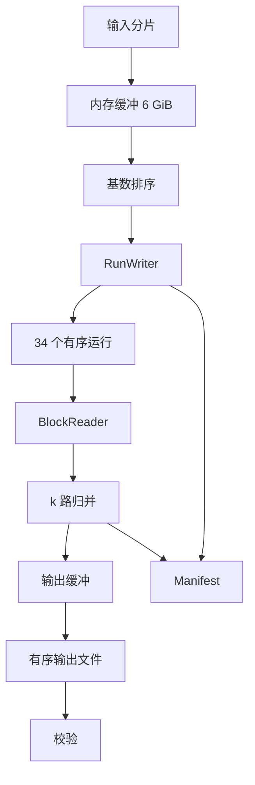
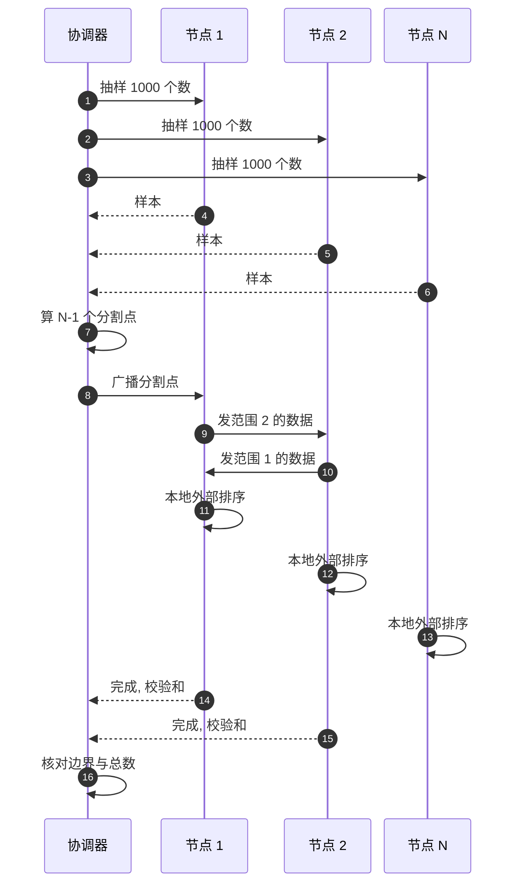
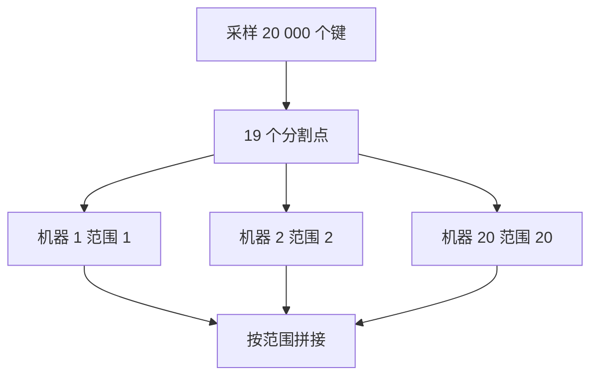

# SD07 大文件外部排序，200 GB / 8 GB 内存（External Sort）

## 题目

外部排序（external sort）要解决的是：数据比内存大得多，没法一次装进内存排序，怎么办。磁盘上顺序读写很快、随机访问很慢，所以办法是把数据切成内存放得下的块，每块在内存里排好序写回磁盘，再把这些有序块像拉链一样合并成一个整体。这个算法是数据库排序、LSM 树压实（compaction）和 MapReduce 的 shuffle 的共同原型。难点在于把内存、磁盘和时间的账算清楚：能切成几块，一次能同时合并几块，磁盘够不够放，进程中途挂了怎么办。

题目：有若干个总共超过 200 GB、里面只有数字的文件，可能分散在多台机器上。你的服务器磁盘总共 500 GB，内存 8 GB。怎么把所有数字排好序？不能调用内置的 sort()。

题面没有说数字的类型、值域、是否有重复、输出放哪里。下文的假设是：64 位有符号整数、小端二进制、可以有重复、输出一个有序文件；面试时第一件事就是问清楚这几项。

## 澄清问题

1. **数字是二进制还是文本？** 文本（每行一个十进制数）每个数约 11 字节、要解析；二进制 int64 每个数 8 字节。按二进制 8 字节：200 GiB 等于 268.4 亿个数。如果是文本，数量约 195 亿个（每个 11 字节），而且解析会成为 CPU 瓶颈。
2. **值域有界吗？** 决定能不能用计数排序或基数排序（radix sort）绕开比较排序。比如值在 [0, 10⁹)，计数数组只要 3.7 GiB，一次顺序扫描就够。
3. **有大量重复吗？** 重复多时，输出可以用「值加计数」压缩，分布式划分时还会碰到一个值占满一个分区的倾斜。
4. **「files can be present on multiple computers」是什么意思？** 是输入已经分散在若干台机器上、要在原地处理，还是要先汇聚到这台有 500 GB 磁盘的服务器？这决定本地磁盘要不要放下输入，以及是单机算法还是分布式算法。
5. **输出要求是什么？** 一个全局有序的单文件，还是按范围分片的多个有序文件？后者便宜得多。
6. **能不能删除输入？** 磁盘预算（500 GB）里放不下输入加运行文件加输出，是否可以边处理边释放输入，直接影响方案。
7. **「不能用 sort()」具体指什么？** 内置排序函数不能用，是否允许用堆（heap）、自己写快排？做法是手写二叉堆和基数排序，不调用任何库排序。
8. **磁盘类型和机器配置？** 机械盘（HDD）上随机寻道每次约 10 ms，决定块要多大；SSD 则寻道可忽略，瓶颈变成 CPU。
9. **是一次性任务，还是反复运行？** 一次性可以接受较长时间；经常运行要考虑中断后能恢复、能增量。

## 需求

**功能需求（按优先级）**

1. 对分散在一台或多台机器上的总共 200 GiB 以上的 64 位整数排序，输出全局有序结果。
2. 任何时刻使用的内存不超过 8 GiB，本地磁盘占用不超过 500 GB。
3. 运行中断（进程被杀、机器重启）后可以从检查点恢复，不需要从头开始。
4. 结果可校验：输出有序、数量与输入一致、校验和（checksum，对输入与输出分别取与顺序无关的和）一致。
5. 可扩展到更大的输入或多台机器（分布式版本）。

**非功能需求**

| 维度 | 目标 | 说明 |
|---|---|---|
| 内存 | 峰值小于 8 GiB | 实际可用于缓冲约 6 GiB，其余留给运行时和页缓存 |
| 磁盘 | 峰值小于 500 GB | 见容量估算的磁盘预算 |
| 吞吐 | 接近磁盘顺序读写速度 | 排序是 I/O 密集，目标是少遍历数据、多顺序访问 |
| 正确性 | 输出有序且是输入的排列 | 用校验和证明，不靠肉眼 |
| 可恢复 | 中断后损失不超过一个检查点间隔（约 1 GiB 的输出） | 运行文件不可变 |

**明确不做**：流式数据的在线排序、更新已排序数据集的增量维护、在 GPU 上排序、浮点 NaN 的排序语义。

## 容量估算

**数据量。** 200 GiB = 200 × 2³⁰ B；每个数 8 B，共 200 × 2³⁰ ÷ 8 = **268.4 亿个**。（如果题面说的是 200 GB 而不是 GiB，差 7%，不改变结论。）

**运行文件个数（run generation，先排后写）。** 内存 8 GiB，留 2 GiB 给运行时、栈和操作系统，用 6 GiB 作为排序缓冲。每个运行文件 6 GiB，运行个数 = ⌈200 ÷ 6⌉ = **34 个**。如果用替换选择（replacement selection），平均运行长度约为缓冲的 2 倍，即 12 GiB，运行个数 = ⌈200 ÷ 12⌉ = **17 个**。

**归并的扇入（fan-in）与遍数。** 归并阶段每个运行占一个输入缓冲，另有一个输出缓冲。块大小 B，扇入 k = 6 GiB ÷ B：

| 块大小 B | 扇入 k = 6 GiB ÷ B | 34 个运行需要的归并遍数 ⌈log_k 34⌉ |
|---|---|---|
| 64 KiB | 98,304 | 1 |
| 1 MiB | 6,144 | 1 |
| 4 MiB | 1,536 | 1 |
| 16 MiB | 384 | 1 |

扇入远大于运行个数（34），所以**归并只需要 1 遍**，总共读写数据 2 遍（生成运行一遍、归并一遍）。这是八成面试者没算出来的结论：与其把时间花在多路归并的层数上，不如把块开大。块大小的上界：给每个运行双缓冲（一个正在被消费、一个在预读），则每块最大约 6 GiB ÷ (34 × 2) = **约 90 MiB**。在机械盘上，一次寻道约 10 ms，4 MiB 块的传输时间约 28 ms（150 MB/s），寻道占约 26%；16 MiB 时降到约 7%。所以选 64 MiB 的块是合理的：扇入 96 仍然大于 34。

**扇入不够时。** 如果缓冲只有 0.75 GiB（内存 1 GiB），运行个数 267、k = 192，仍是 2 遍归并；内存 0.125 GiB 时运行 2,134、k = 24，要 3 遍。数据放大到 20 TiB（运行 3,414 个，k = 1,536）也只需 2 遍。**遍数随数据量的增长极慢，是对数的对数**。

**磁盘预算（500 GB）。**
- 输入若在本地：200 GiB。
- 运行文件：200 GiB（排序后大小等于输入）。
- 最终输出：200 GiB。
- 三者同时存在 = 600 GiB，**超过 500 GB**。只有输入加运行 = 400 GiB 在预算内。所以必须做以下之一：（a）生成运行时边读边释放输入，让输入和运行不同时全量存在；（b）输入在远端，流式读入，本地只存运行，本地峰值 200 GiB 加输出 200 GiB = 400 GiB；（c）归并时边读运行边释放，同时写输出，峰值约 200 GiB 加一个小窗口。详见深挖三。

**时间。** 数据总 I/O：运行生成读 200 + 写 200，归并读 200 + 写 200，共 800 GiB。单遍（读加写）400 GiB 的耗时：机械盘 200 MB/s → 约 36 分钟；SATA SSD 500 MB/s → 约 14 分钟；NVMe 2 GB/s → 约 3.6 分钟。两遍合计：约 72 分钟、29 分钟、7.2 分钟。

**CPU 才是 SSD 上的瓶颈。** 归并阶段每个输出元素要做一次堆的弹出和插入，约 log₂34 ≈ 5 次比较，按每个元素 150 ns（堆实现，缓存不友好）估算：268.4 亿 × 150 ns ≈ **4,027 秒，约 67 分钟**，单线程。这比 NVMe 的 I/O 时间高一个数量级。改进：败者树（loser tree）把每元素降到约 30 ns，约 13 分钟；或按键范围把归并切成多个互不重叠的子任务并行（见深挖二）。运行生成阶段，在内存里对 6 GiB（约 8.05 亿个数）排序，用基数排序每个数据块约 10 秒量级，34 个块总共几分钟，不是瓶颈。

**驱动设计的那个数字**：扇入 1,536（或 96）远大于运行个数 34，所以只需要 2 遍。设计的主要矛盾转移到了两处：磁盘预算（600 > 500）和单线程归并的 CPU。

## 核心实体与 API

**实体**

| 实体 | 关键字段 | 说明 |
|---|---|---|
| InputShard | **(machine, path)**、字节数、校验和 | 一个输入文件及其所在机器 |
| Run | **run_id**、路径、元素个数、最小值、最大值、校验和 | 不可变；生成后只读 |
| MergeTask | **task_id**、键范围 [lo, hi)、各运行的起止偏移 | 分布式或并行归并的单位 |
| Manifest | **job_id**、阶段、已完成的运行列表、各运行已消费偏移、输出偏移 | 检查点，原子替换写入 |
| Splitter | 排序后的采样键 | 分布式版划分范围用 |

**接口**（单机命令行与分布式协调器）

```
extsort run   --in <paths|s3://> --out <path> --mem 6GiB --block 64MiB --tmp /data/tmp --resume <manifest>
extsort verify --in <paths> --out <path>          # 有序性 + 数量 + 与顺序无关的校验和

# 分布式（协调器 gRPC）
Sample(shard, n)        -> [keys]            # 从分片随机取 n 个键
Assign(range, worker)   -> ok                 # 分配键范围
Push(range, stream)     -> ack                # 节点之间的 shuffle
Done(task_id, checksum) -> ok
```

程序内部的类（面试官若偏 LLD 就在这里展开）：`RunWriter`（把排好序的缓冲按块写入）、`BlockReader`（带预读的块读取器，迭代器接口）、`MinHeap` 或 `LoserTree`（输入 (key, run_id)）、`Merger`（驱动归并并产生有序块流）、`Checkpoint`（周期性原子写 Manifest）。每个类只做一件事，归并器不知道文件在哪里，只依赖迭代器接口，所以单机与分布式可以复用。

## 高层架构



**阶段一：生成运行。** 顺序读入输入，填满 6 GiB 缓冲，在内存里排序，作为一个运行写出，写完即在 Manifest 里登记；每个运行文件一旦登记就不再修改。这一阶段读写都是顺序的，进度可以以运行为单位恢复。

**阶段二：归并。** 为每个运行打开一个块读取器，每个运行的第一块预读进内存；用堆保存每个运行当前的最小元素，反复弹出堆顶写入输出缓冲，并从同一运行取下一个元素补入堆；某个运行的块用完时，从磁盘取下一块（预读保证不等待）。输出缓冲满了就顺序写出，每写出约 1 GiB 就把各运行的消费偏移和输出偏移原子写进 Manifest。

**分布式版本。** 若数据分散在 N 台机器上：先采样确定 N−1 个分割点，把键空间划成 N 个范围；每台机器把本地数据按范围分发给目标机器（shuffle）；每台机器收到自己的范围后，用上面的单机算法排序；各范围按顺序拼接就是全局有序结果。



图中编号对应的每一步：

1–6. 协调器让每个节点从自己的数据里随机抽 1000 个数送回来。要抽样的原因：接下来要把所有数按大小切成 N 段、每台机器负责一段，切点必须让每段的数据量差不多；事先不知道数据怎么分布，抽样是最便宜的估计办法。
7. 协调器把所有样本排序，取 N−1 个等分位置上的数作为分割点。
8. 把分割点广播给所有节点（图里只画了节点 1）。
9–10. 每个节点把不属于自己那一段的数发给负责那一段的节点，这一步叫洗牌（shuffle）。
11–13. 每个节点对自己那一段做单机外部排序：先分段在内存里排好写到磁盘，再多路归并成一个有序文件。
14–15. 节点报告完成，附上这一段的个数和校验和。
16. 协调器核对两件事：相邻两段的边界有序（第 i 段的最大值不大于第 i+1 段的最小值），各段个数之和等于输入总数。都通过，按段号依次拼起来就是全局有序的结果。

## 深挖

### 运行生成：先排后写、替换选择，还是基数排序

问题：第一阶段要把 200 GiB 切成若干个已排序的运行。运行越少、越长，归并时越省事。限制是内存 8 GiB 和「不能调用库排序」。

选项：

1. **先排后写（load-sort-write）**：读满缓冲，在内存里排序，一次写出。运行个数 34。实现最简单，内存排序可以用手写的快速排序，也可以用基数排序。缺点是在读入和排序、写出期间磁盘和 CPU 轮流空闲，除非双缓冲重叠。
2. **替换选择（replacement selection）**：用一个大小为缓冲的最小堆；每次弹出最小值写入当前运行，再读入一个新值：如果它不小于刚弹出的值，就放回堆里继续参与当前运行；否则标记为「冻结」，留到下一个运行。对随机输入，平均运行长度约为缓冲的 2 倍（12 GiB，17 个运行）；对已部分有序的输入更长（完全有序的输入只产生一个运行）；对逆序输入退化为等于缓冲（最坏）。边读边写，流水线天然重叠。缺点：每个元素都要堆操作（约 100 ns 级），CPU 比基数排序慢得多，且堆里是 8 字节的元素加指针时内存放大。
3. **基数排序（LSD radix sort）**：对 int64 按 8 位一轮共 8 轮（符号位要翻转处理），每轮是线性的计数加散布，不是比较排序，完全没有 `sort()`，并且对缓存友好。需要一个同样大小的辅助缓冲，所以有效缓冲只有一半，即 3 GiB，运行个数变成 ⌈200 ÷ 3⌉ = 67；或者就地的 MSD 基数排序（美式旗帜排序，American flag sort）。

选择：**先排后写，内存排序用基数排序，双缓冲重叠读和排序**。理由是算过的数字：扇入 96 到 1,536，远大于 67 个运行，一遍归并都够，替换选择把 34 变成 17 并没有省下任何一遍归并，只省下一点寻道，却要付出每元素一次堆操作的 CPU 代价。替换选择只在扇入受限时才值得：比如内存只有 128 MiB、运行 2,134 个、扇入 24，替换选择能把遍数从 3 降到 2。面试里要主动说出这个判断和它的前提，这就是 senior 与背书的差别。

如果面试官要求「不能用任何排序库」，手写 LSD 基数排序约 20 行，或手写堆排序约 20 行；下面的可运行草图用手写二叉堆做运行生成和归并。

失败模式：输入里混着 NaN 或脏数据（文本版）。对策是读入时校验，坏记录写入隔离文件并计数，不让它进入运行，否则一个坏值会破坏一整个运行的有序性。

### k 路归并：缓冲区怎么分，堆是不是瓶颈

问题：归并阶段内存要同时放下 34 个输入缓冲和输出缓冲。块太小，机械盘上寻道占比高；块太大，扇入变小，可能需要多遍。归并本身的 CPU 也可能成为瓶颈。

选项（缓冲分配）：

1. **每个运行一个小块（比如 64 KiB），扇入 98,304**：扇入极大，但机械盘上每次读 64 KiB 要一次寻道（10 ms）对约 0.4 ms 的传输，磁盘利用率不到 4%，归并会慢一个数量级。
2. **块尽量大（约 90 MiB 上限，双缓冲）**：扇入 34 的情形下块可以很大，寻道占比小于 1%，吞吐接近顺序速度。
3. **自适应**：已知运行个数 r，块大小取 `B = 缓冲 ÷ (2r)` 再向下取到 4 MiB 的整数倍，下限 4 MiB；若 r 超过缓冲 ÷ (2 × 4 MiB)，才引入多遍归并。

选择第 3 种。计算：r = 34，缓冲 6 GiB，`B = 6 GiB ÷ 68 ≈ 90 MiB`，取 64 MiB。输出缓冲单独占 256 MiB，用后台线程异步写，让归并线程不等待 I/O。

选项（比较结构）：

1. **二叉堆（binary heap）**：每个元素一次弹出加一次插入，约 2 log₂k 次比较，缓存局部性差。
2. **败者树（loser tree）**：每个元素只沿一条路径比较 log₂k 次，路径固定，分支预测友好，常数小 3 到 5 倍。
3. **按键范围切分并行归并**：先从各运行中采样，取分位点，把键空间切成 P 个互不重叠的区间；每个线程负责一个区间，对每个运行用二分查找定位区间起止偏移，独立做 k 路归并并写到输出文件的对应偏移（区间大小可由各运行的偏移之和事先算出，所以输出偏移已知，可以并行写入同一个文件）。这是真正解决 CPU 瓶颈的做法：8 个线程把约 67 分钟的堆归并降到约 8 分钟，已接近 SATA SSD 的 I/O 时间（约 14 分钟）。

选择：先实现败者树加异步 I/O；需要时再加按范围并行。分区归并的前提是运行已经排序，所以二分是正确的；难点是区间内的重复键要整体落在同一个区间，用 (值, 运行号, 偏移) 作为二分的全序键解决。

下面是单机版的可运行草图（手写堆，不调用库排序；对一份小的随机输入运行过，验证了有序性与元素个数，同时验证了运行个数约为朴素分块的一半，符合替换选择的预期）。真实实现把 `read_ints` 换成带预读的块读取器，把二叉堆换成败者树。

```python
import os, random, struct, tempfile

class MinHeap:
    """手写二叉堆，元素是 (key, run_id)；不调用 sort()。"""
    def __init__(self): self.a = []
    def __len__(self): return len(self.a)
    def push(self, x):
        a = self.a; a.append(x); i = len(a) - 1
        while i and a[(i - 1) // 2] > a[i]:
            a[(i - 1) // 2], a[i] = a[i], a[(i - 1) // 2]; i = (i - 1) // 2
    def pop(self):
        a = self.a; top = a[0]; last = a.pop()
        if a:
            a[0] = last; i = 0; n = len(a)
            while True:
                l, r, m = 2 * i + 1, 2 * i + 2, i
                if l < n and a[l] < a[m]: m = l
                if r < n and a[r] < a[m]: m = r
                if m == i: break
                a[i], a[m] = a[m], a[i]; i = m
        return top

def read_ints(f, block_items):
    """按块顺序读 int64，一次一个块（缓冲区大小 = block_items * 8 字节）。"""
    while True:
        buf = f.read(block_items * 8)
        if not buf: return
        yield from struct.unpack(f"<{len(buf) // 8}q", buf)

def make_runs(src, mem_items, tmpdir):
    """replacement selection：堆 + 冻结区，平均 run 长度约 2 * mem_items。"""
    runs, heap, frozen = [], MinHeap(), []
    it = read_ints(src, 1 << 16)
    for _ in range(mem_items):
        v = next(it, None)
        if v is None: break
        heap.push(v)
    def new_run():
        p = os.path.join(tmpdir, f"run{len(runs)}.bin"); runs.append(p); return open(p, "wb")
    out = new_run() if len(heap) else None
    while len(heap):
        v = heap.pop(); out.write(struct.pack("<q", v))
        nxt = next(it, None)
        if nxt is not None:
            (heap.push if nxt >= v else frozen.append)(nxt)
        if not len(heap) and frozen:           # 当前 run 结束，冻结区变成下一个 run
            out.close(); out = new_run()
            for x in frozen: heap.push(x)
            frozen = []
    if out: out.close()
    return runs

def kway_merge(run_paths, dst_path, block_items):
    files = [open(p, "rb") for p in run_paths]
    gens = [read_ints(f, block_items) for f in files]
    heap = MinHeap()
    for i, g in enumerate(gens):
        v = next(g, None)
        if v is not None: heap.push((v, i))
    with open(dst_path, "wb") as out:
        obuf = []
        while len(heap):
            v, i = heap.pop(); obuf.append(v)
            if len(obuf) >= block_items:
                out.write(struct.pack(f"<{len(obuf)}q", *obuf)); obuf = []
            nxt = next(gens[i], None)
            if nxt is not None: heap.push((nxt, i))
        if obuf: out.write(struct.pack(f"<{len(obuf)}q", *obuf))
    for f in files: f.close()

if __name__ == "__main__":
    random.seed(7)
    data = [random.randint(-10**9, 10**9) for _ in range(50_000)]
    with tempfile.TemporaryDirectory() as d:
        src = os.path.join(d, "in.bin")
        with open(src, "wb") as f: f.write(struct.pack(f"<{len(data)}q", *data))
        with open(src, "rb") as f: runs = make_runs(f, 2_000, d)   # 2000 条 "内存"
        dst = os.path.join(d, "out.bin")
        kway_merge(runs, dst, 256)
        with open(dst, "rb") as f: got = list(read_ints(f, 1024))
        print("runs:", len(runs), "(顺序读入的朴素分块应为", -(-len(data)//2000), ")")
        print("sorted ok:", got == sorted(data), "n =", len(got))
```

失败模式：某个运行的最后一个块读到一半进程被杀，Manifest 里的消费偏移不能超前于已经写入输出文件的数据；检查点的顺序必须是先 `fsync` 输出，再原子替换 Manifest，否则恢复时会丢数据或重复数据。

### 磁盘预算：500 GB 放不下输入、运行和输出三份

问题：容量估算已经显示 200 + 200 + 200 = 600 GiB 超出 500 GB。方案必须让三者不同时全量存在。

选项：

1. **输入在远端流式读取**：「文件分布在多台机器上」正好允许这个做法。运行生成阶段通过网络读输入，本地只存运行（200 GiB）；归并阶段写输出（200 GiB），峰值 400 GiB。优点是不用删任何东西，输入保持完整，失败后可以重来。缺点是网络成为瓶颈：10 Gbps 约 1.25 GB/s，读 200 GiB 约 2.9 分钟（理想值），实际受对端磁盘限制。
2. **边处理边释放输入**：若输入是许多较小文件，处理完一个就删一个；若是一个 200 GiB 的大文件，POSIX 不能删除文件前缀，但 Linux 上可以用 `fallocate(FALLOC_FL_PUNCH_HOLE)` 在读完某个区间后打洞释放磁盘块。优点是不需要网络；缺点是破坏了输入，失败时无法重来，所以只有在输入有另一份副本（或明确可再次获取）时才能这么做。
3. **输出写到另一个地方**：直接把有序输出流式写到另一台机器或 S3（分块上传），本地只放运行；归并边读运行边打洞释放。本地峰值约 200 GiB，加一个小窗口。

选择：**第 1 种为主；输入已经本地时用第 2 种（前提是有副本）；最终输出能去远端时用第 3 种**。关键是在面试里把 600 > 500 这个冲突算出来并指出，而不是等面试官问。输出分块上传（对象存储的分块上传同理），每块带校验和，失败只重传失败的块，这与 Manifest 恢复同构。

压缩是另一个杠杆：运行文件内部是有序的，相邻元素差值小，用差分加变长编码（delta encoding + varint）通常能压到原来的 40% 到 60%，一方面省磁盘，另一方面减少 I/O 字节，在 I/O 瓶颈时反而更快；代价是 CPU 解码。对随机 64 位整数收益很小，要问清楚数据分布再承诺。

失败模式：磁盘写满发生在归并的最后阶段，已经花了大半时间。对策是在启动时做预检（运行总字节加输出预估字节加余量小于可用空间），不满足就拒绝启动并说明所需的空间；归并阶段一旦发现可用空间低于阈值，先暂停并告警，而不是崩溃。

### 分布式版本：按范围划分，而不是先排后归并

问题：数据分散在 N 台机器，每台数据量超过本机能舒适处理的量。有两条路：各自排完再归并（merge-based），或先按范围划分再各自排（partition-based）。

选项：

1. **各机本地排序，再由一台机器做 N 路归并**：每台机器的本地排序是并行的；最后一步所有数据（200 GiB）都要流经一台机器，那台机器的网卡（10 Gbps 约 2.9 分钟理想值）、CPU（单线程归并约 67 分钟）和磁盘（输出 200 GiB）成为单点瓶颈，且最终输出是一个大文件在一台机器上。
2. **范围划分 + 各机本地排序（TeraSort，MapReduce 的 shuffle）**：先从各机采样，选出 N−1 个分割点，使每个范围的数据量大致相等；每台机器把本地每个数按范围发给负责的机器（所有机器同时发送，网络是全双工的全交换）；每台机器对收到的数据（约 200 ÷ N GiB）做本地外部排序；各范围的输出文件按范围顺序就是全局有序，**不需要最后的归并**，结果天然是 N 个分片文件。
3. **直接用托管服务**：EMR 上跑 Spark 的 `sortBy`，或 MapReduce 的 TeraSort，S3 作输入输出。在真实工作里这是正确答案，但面试考的是机制，要说明它内部就是第 2 种。

选择第 2 种。计算（假设 20 台机器，每台 8 GiB 内存）：每台分到约 200 ÷ 20 = 10 GiB，比 6 GiB 缓冲大，所以每台仍然是外部排序，2 个运行加一次 2 路归并，很快。shuffle 时每台发出其数据的 19/20：约 9.5 GiB；在 10 Gbps 且全交换的网络里约 8 秒（理想值，实际取决于对端磁盘和交换机超售）。分割点的采样：每台取 1,000 个，共 20,000 个样本，取 19 个分位点；按 3σ 估计，分区大小相对理想值的偏差约 ±9.5%，意味着每台数据量 10 GiB 上下约 1 GiB，仍然在可接受范围，需要时可以提高采样数。

倾斜（skew）是必须主动提到的失败模式：若一个值（比如 0）占了 30% 的数据，按值划分会让一个范围超过一台机器的容量。处理：把分割点定义在 (值, 全局序号) 的组合键上，使相同值也能跨机器拆分；或检测到重得离谱的值（采样中出现在多个分位点上），单独为它分配一个范围，这个范围内所有数相等，不需要排序，只需要计数；在输出时用「值加计数」表示或者原样重复写出。

与第 1 种比较：第 1 种实现简单、单点瓶颈明显；第 2 种实现略复杂（要采样、广播分割点、做 shuffle），但是扩展性是线性的，没有单点，并且和 MapReduce/Spark 的 shuffle 是同一个模型，面试官一旦听到「采样加范围划分」就知道你懂分布式排序。



失败模式：某台节点在 shuffle 中途挂掉。对策是 shuffle 的每个分块有序号和校验和，接收方按（源机器, 分块号）幂等接收；协调器重新调度挂掉机器负责的范围，源端保留已发送数据直到该范围的 Done 确认；因为输入文件不被修改，任何阶段都可以重跑。

### 整数的特殊性：计数排序与基数排序可以少读几遍

问题：题目说的是「只包含数字」的文件，数字不是不透明的对象，可以利用它的值域和分布。

选项：

1. **值域有界且较小**（比如 [0, 10⁹)）：计数排序，一个 uint32 数组 3.7 GiB 就放得进 8 GiB 内存，顺序扫描一遍输入，累加计数，再顺序输出每个值重复其计数次。读 200 GiB 一遍，写 200 GiB 一遍，没有比较，也没有运行文件，磁盘预算问题自然消失（不需要运行）。如果重复很多，输出可以直接是「值加计数」，体积小得多。
2. **值域中等**（32 位，[0, 2³²)）：计数数组需要 2³² × 4 B = 16 GiB，放不进内存。做两级：第一遍按高 16 位分桶（65,536 个桶，写桶文件，需要控制同时打开的文件数，可以先按高 8 位分 256 个桶再细分），第二遍对每个桶用 65,536 大小的计数数组。总共读写数据两遍，与通用方法相当，但 CPU 常数小很多。
3. **完整 64 位无界**：外部基数排序（LSD 需要 8 遍或 4 遍 16 位，每遍读写一次全部数据，8 遍 = 1,600 GiB I/O，不划算）；MSD 基数相当于范围划分，第一遍按最高字节分 256 个桶，之后每个桶若小于内存就内存排序。MSD 外部基数排序与上面的采样范围划分殊途同归，但不需要采样，只对分布大致均匀的数据有效。

选择：先问值域；有界就用计数排序，面试官通常对「你先问了值域」本身给分。无界则回到通用的运行加归并，并说明为什么不选外部 LSD 基数（遍数多）。

失败模式：声称值域有界、实际出现越界值（脏数据）。对策是读入时检查，越界值写入溢出文件，主流程完成后单独处理，不静默丢弃。

### 失败与重启：长任务的检查点

问题：这个任务在机械盘上要一个多小时，进程被杀不能从头开始。

做法：运行是不可变文件，只要在 Manifest 里登记完成就永远有效。阶段一的恢复粒度是一个运行：重启后跳过已登记的运行，从第一个未登记的输入偏移继续读（输入偏移也写在 Manifest 里）。阶段二的恢复粒度是一个检查点间隔：Manifest 保存每个运行的已消费偏移和输出文件的已写偏移；恢复时重新打开每个运行并定位到各自偏移，各读一个元素还原堆，输出文件截断到记录的偏移后继续追加。检查点间隔取每写出 1 GiB 一次（200 GiB 共 200 个检查点），每次写 Manifest 的代价微不足道；间隔越短，重做的工作越少，但 `fsync` 越频繁。校验：每个运行记录元素个数和校验和，恢复时可抽查；最终用输入校验和与输出校验和（对元素求和，与顺序无关）比较，再检查输出严格非递减。

## Staff 视角：权衡、故障与演进

**10 倍数据（2 TiB）会先坏什么。** 运行个数 342，扇入 1,536，仍是一遍归并，所以算法不变；先坏的是（1）单线程归并的 CPU：约 11 小时的堆归并，必须上败者树和并行范围归并；（2）磁盘预算：2 TiB 的输入加运行不可能放进单机的 500 GB，必须流式输入或分布式；（3）单机上的时间，转向分布式范围划分。再放大到 20 TiB，运行 3,414 个超过扇入，才第一次需要两遍归并。

**故障的影响面。**
- 进程崩溃：Manifest 恢复，损失不超过一个检查点间隔。
- 磁盘坏块或静默损坏：运行文件带块级校验和，读到坏块则只重做该运行（输入仍在），不重做全部。
- 机器掉线（分布式）：该机的范围重新调度到其他机器；若输入只在掉线机器上，则无法恢复，所以输入必须有副本，这是调度前提而不是算法问题。
- 网络分区在 shuffle 中：接收方幂等，发送方重试，超时后协调器重新分配。

**成本与云上的做法。** 如果在 AWS 上做：输入输出放 S3，用 EMR Serverless 或 Glue 跑 Spark 的全局排序，按秒计费，不要自己管集群；S3 的按请求成本需要注意：块越大，请求数越少，64 MiB 的块读取 200 GiB 约 3,200 次 GET，成本可忽略。EC2 上自己做则选带本地 NVMe 的实例（i4i 系列）做运行文件，因为运行文件是临时的、需要高顺序吞吐，EBS 的吞吐上限会限制归并。

**调试与可观测性。** 指标：各阶段吞吐（MB/s）、归并线程 CPU 占用（接近 100% 说明 CPU 受限，低于 50% 说明 I/O 受限）、预读命中率（归并线程等待 I/O 的时间占比）、磁盘队列深度、检查点延迟、运行个数与大小分布。运行手册：中断后如何 `--resume`、如何验证输出、磁盘不足时怎么办。

**演进。** 数据持续增长、需要定期重排时，不要重新排全量：新数据排成新运行，与已有有序文件做一次两路归并（LSM 树的思路），代价与新增数据量成比例而不是与总量成比例；若查询是按范围取数，保持输出为按范围分片的多个有序文件并附上索引（每个分片的最小值和最大值），比一个巨大的单文件好用得多。

## 面试官追问

1. **如果内存只有 1 GiB 呢？** 缓冲约 0.75 GiB，运行 267 个，块 4 MiB 时扇入 192，需要 ⌈log₁₉₂ 267⌉ = 2 遍归并；这时替换选择有价值：运行变成约 134 个，仍然是 2 遍（134 小于 192 其实一遍就够），所以要重新算而不是凭印象。
2. **为什么不直接用 mmap？** mmap 把文件映射到地址空间，由内核换页，随机访问时会造成换页风暴；外部排序的优势恰恰来自顺序的、可预测的大块 I/O，自己管理缓冲才能控制预读和内存上限。
3. **输入是文本而不是二进制怎么办？** 解析成为主要 CPU 开销：200 GiB 文本约 195 亿个数；运行文件仍写成二进制（8 字节）以节省后续阶段的解析，最终输出再转回文本。
4. **怎么证明排序结果是对的？** 三个检查：个数相等、与顺序无关的校验和相等（对元素求和或异或哈希）、输出严格非递减（顺序扫描一遍，相邻比较）。分布式时再检查相邻分片的边界（上一个分片的最大值不大于下一个分片的最小值）。
5. **有很多重复值怎么办？** 单机版没有问题；分布式版需要处理倾斜：用 (值, 序号) 作为划分键，或为重得离谱的值单独分配一个范围；输出可以用「值加计数」压缩。
6. **为什么堆里放 (key, run_id)，而不是只放 key？** 弹出最小值后必须知道它来自哪个运行，才能从该运行补充下一个元素；如果有相等的键，(key, run_id) 的元组比较还能保证归并的稳定性（相同键按运行号顺序输出）。
7. **多遍归并的最优遍数和扇入怎么选？** 在每一遍都要付出读写全量数据代价的前提下，应当尽量大的扇入，使遍数最少；但块大小下限（保证顺序传输占主导）限制了扇入。总体规则：块取 4 MiB 以上、扇入取内存除以块大小，遍数取 ⌈log_k r⌉。
8. **机械盘和 SSD 的设计差别？** 机械盘上块要大（几十 MiB）以摊薄寻道，并发读多个运行会让磁头乱跳，所以预读要按顺序批量；SSD 上寻道可忽略，块可以小到 1 MiB，瓶颈变成 CPU，所以要上败者树和并行范围归并。
9. **能不能完全不写运行文件？** 若值域有界可以用计数排序，只需一遍读取；若无界，不写中间结果就需要至少 200 GiB 的内存，不可能；所以下界是读一遍写一遍输出加一遍中间结果，也就是两遍。

## 60 分钟怎么分配

| 分钟 | 做什么 | 白板内容 | 时间不够时 |
|---|---|---|---|
| 0–5 | 澄清问题 | 二进制还是文本、值域、重复、输入是否可删、输出形式 | 只问值域和输出形式 |
| 5–12 | 容量估算 | 268.4 亿个数、34 个运行、扇入 1,536、2 遍、磁盘 600 > 500 | 必须给出 34、2 遍、600 > 500 |
| 12–15 | 接口与类 | 命令行、RunWriter/BlockReader/Merger | 一句话带过 |
| 15–22 | 高层架构 | 两阶段流程图 | 不能砍 |
| 22–35 | 深挖一：运行生成；深挖二：k 路归并与草图 | 手写堆、缓冲分配、败者树；写出 k 路归并核心代码 | 必写归并核心 |
| 35–42 | 深挖三：磁盘预算 | 三种方案 | 只讲 600 > 500 的冲突与一种解 |
| 42–50 | 深挖四：分布式范围划分 | 采样、分割点、shuffle、倾斜 | 必讲，是面试官几乎必问的下一步 |
| 50–55 | 整数特殊性、检查点 | 计数排序、Manifest | 各一句 |
| 55–60 | Staff 视角与追问 | CPU 瓶颈、云上做法 | 只讲 CPU 瓶颈 |

**45 分钟版**（前面有行为面试）：澄清 3 分钟，容量 6 分钟，架构 5 分钟，运行生成和归并共 14 分钟（含代码），分布式 8 分钟，其余各用一句话带过。若面试官按 LLD 风格追问，把「磁盘预算」和「整数特殊性」压成口述，把时间留给代码和边界情况（空文件、单个运行、重复值、运行长度不一致）。

## 自测

1. 8 GiB 内存、200 GiB 的 int64 数据，生成多少个运行，需要几遍归并，为什么？

<details><summary>答案</summary>

留 2 GiB 给运行时，缓冲 6 GiB，运行数 ⌈200 ÷ 6⌉ = 34。块 4 MiB 时扇入 1,536，块 64 MiB 时扇入 96，都大于 34，所以归并一遍即可；总共读写数据两遍。遍数是 ⌈log_k 运行数⌉，k 远大于运行数时恒为 1。

</details>

2. 磁盘 500 GB 为什么放不下，怎么办？

<details><summary>答案</summary>

输入 200 + 运行 200 + 输出 200 = 600 GiB，超过 500。办法：输入在远端就流式读入，本地只存运行加输出（400）；输入在本地且有副本就边读边释放（删小文件，或打洞释放大文件前缀）；输出能写到远端就流式分块上传。启动前先预检空间。

</details>

3. 为什么替换选择在这个场景里不一定值得？它在什么条件下值得？

<details><summary>答案</summary>

它把平均运行长度翻倍（17 个对 34 个），但归并扇入已经远大于运行数，遍数不变，却让每个元素付出一次堆操作的 CPU。它在扇入受限时值得，例如内存 128 MiB、运行 2,134 个、扇入 24，能把遍数从 3 降到 2；对基本有序的输入也很划算。

</details>

4. 分布式版本为什么用范围划分而不是各机排完再归并？倾斜怎么处理？

<details><summary>答案</summary>

各机排完再归并，所有数据要流过一台机器，网卡、CPU 单线程归并和磁盘都是单点。范围划分先采样取分位点，shuffle 后各机独立排序，输出分片按范围天然有序，不需要最后的归并，且线性扩展。倾斜用 (值, 序号) 作划分键，或给高频值单独分配一个范围，其中只计数不排序。

</details>

5. 归并中途进程被杀，如何恢复，检查点的写入顺序为什么重要？

<details><summary>答案</summary>

运行文件不可变；Manifest 记录每个运行的已消费偏移和输出的已写偏移。恢复时重新定位到各偏移，各读一个元素还原堆，输出截断到记录的偏移后追加。必须先 fsync 输出，再原子替换 Manifest；顺序反了，Manifest 会指向尚未落盘的输出，恢复后丢数据或重复数据。

</details>

## 来源与延伸阅读

> 来源：Hello Interview 社区题库 Amazon 条目，2026-09-10，mid：https://www.hellointerview.com/community/questions?company=Amazon ；正文用到的相关模式页（没有针对该问题的专页）：《Handling Large Blobs》https://www.hellointerview.com/learn/system-design/patterns/large-blobs 与《Scaling Writes》https://www.hellointerview.com/learn/system-design/patterns/scaling-writes

- 报告原文（节选）：「you have files over 200gb which just contain numbers. these files can be present on multiple computers. Your server has a total disc memory = 500gb, and you have 8gb ram. How will you sort all the numbers? (you cant do any .sort() function …)」，2026-09-10，mid，置信度 **中**。候选人自己形容这轮是「LLD ish」：它名义上是系统设计，实际更像算法加存储层的设计，要求写得出可运行的核心逻辑。
- Hello Interview 没有针对该问题的专页，所以没有现成骨架可以对照；正文按需求、容量、实体与接口、架构、深挖的顺序自己搭，并借用《Handling Large Blobs》里的分块与可恢复传输的思路。
- **（重建）**：数字的类型（整数还是浮点、二进制还是文本）、值域、是否有重复、输出放在哪里、多台机器之间的网络带宽，原帖都没有说。下面按「64 位有符号整数、小端二进制、可有重复、输出一个有序文件」重建；面试时第一件事就是问清楚这几项。


**Hello Interview 没有针对该问题的专页**，所以不存在需要对照的骨架。可以借用的模式有两个：

- 《Handling Large Blobs》讲的是不要让应用服务器当数据的搬运工，用预签名链接让客户端直接和对象存储交互，大文件分块上传、带校验和、断点续传。正文借用的是**分块加校验和加断点续传**这套思路：运行文件的块、输出的分块上传、Manifest 的恢复，机制是同构的；不同之处在于外部排序里数据是我们自己的计算流水线中的产物，而不是用户上传的内容，因此不涉及预签名链接。
- 《Scaling Writes》讲的是用批处理、缓冲、分片来承接高写入量。外部排序的第一阶段（大块顺序写运行）和第二阶段（异步写输出缓冲）就是缓冲加批处理；分布式版的范围划分就是按键分片。

**本库**：没有对应的通用题解，最接近的是 [[solution-object-storage]] 里关于分块与完整性校验的部分和 [[solution-file-sync]] 里的分块传输，但它们讲的是对象的存取而不是计算。这篇的内容在本库里是独立的，主要的参考是 DDIA 第 3 章（LSM 树里的归并与压实）和第 10 章（批处理里的排序归并 shuffle）；它与 LSM 树的压实（compaction）、与 MapReduce 的 shuffle 阶段是同一个算法的不同场景，面试里点出这两个联系很加分。

排序偏算法，不需要 AWS 服务也能答好；但在数据服务岗位的面试里，最后常会问「如果这个任务要每天跑，在 AWS 上怎么做」，所以要备好 EMR/Spark 的回答，见上面的成本一节。
