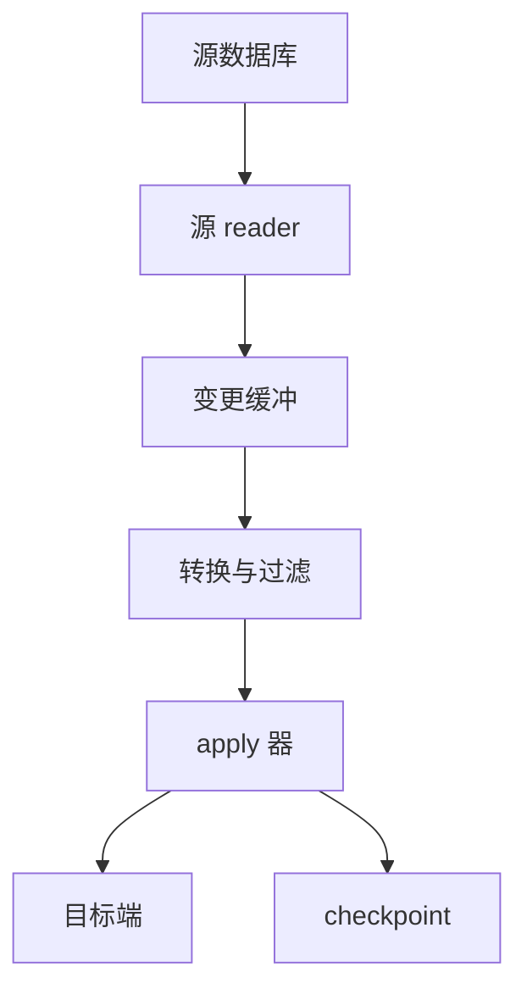
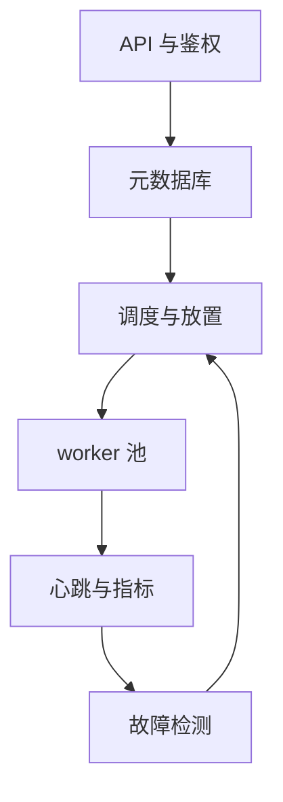
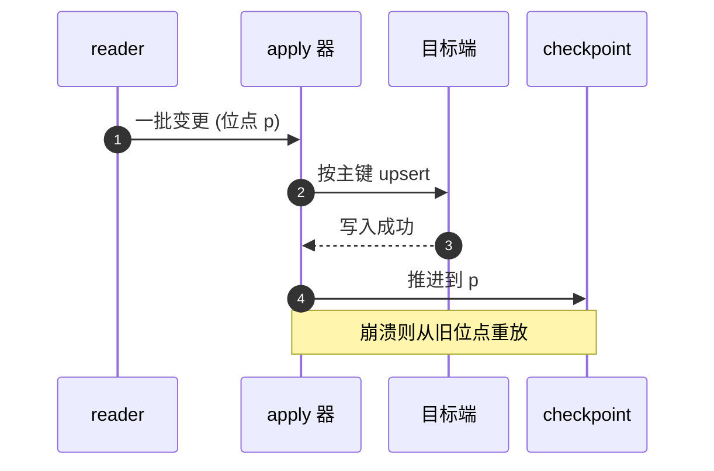
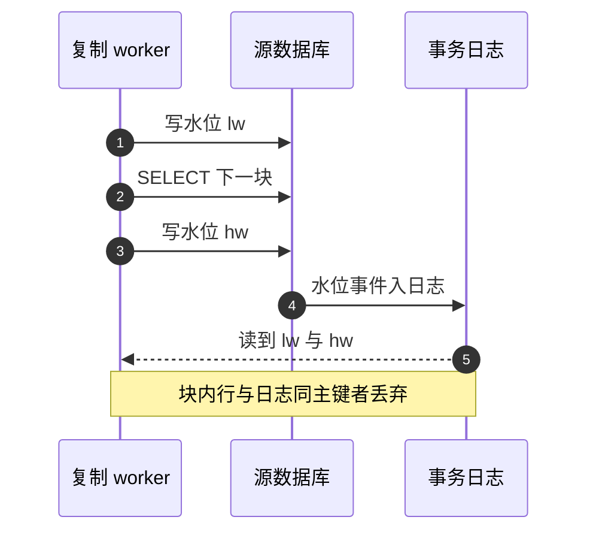

# SD08 托管 CDC 复制管道（Managed CDC Replication Pipeline）

## 题目

托管复制服务替客户把一个源数据库里的数据搬到另一个地方，并且持续同步之后发生的每一次修改。「变更数据捕获」（CDC，Change Data Capture）指的是读取数据库自己的事务日志，把每一行的新增、修改、删除还原成事件，而不是反复全表查询。使用者是想做数据库迁移、把业务库同步进数据湖或数据仓库、或者把变更推给消息流的客户；运行这套服务的是你的团队，要同时托管成千上万个客户的复制任务。难点有三个：全量拷贝期间源库一直在写，全量和增量怎么衔接才不丢不重；崩溃、重放、切主之后目标端怎么保持正确；任务数量多而且倾斜，一个客户的大事务不能拖垮别人。

题目：设计一个托管的数据库复制服务（AWS DMS 风格）。客户指定一个源数据库（MySQL、PostgreSQL、Oracle）和一个目标（另一个数据库、S3、Kinesis/Kafka、数据仓库）。服务先做一次全量迁移，然后持续把源库的变更应用到目标，直到客户停止。服务同时托管成千上万个客户的任务。

CDC 本身没有硬性的延迟承诺：AWS DMS 的文档明确写到它不是实时复制，也没有 CDC 延迟的 SLA，延迟可能升到数分钟甚至更久。所以你要承诺的是正确性和可观测的延迟，而不是某个固定的延迟数字。这一点要在开场就说出来。

## 澄清问题

开场用两三分钟问下面八个问题，每个答案都会改变设计，写在白板角落。

1. **源和目标分别是什么引擎？** 位点的形式和读日志的方式完全不同：MySQL 是 binlog 文件加偏移或 GTID，PostgreSQL 是 LSN 加复制槽，Oracle 是 SCN。目标是数据库、对象存储还是流，决定幂等写的办法。
2. **客户能在源端做什么配置？** 读日志有前置条件：MySQL 要打开行级 binlog，Oracle 要开补充日志（supplemental logging），PostgreSQL 要开逻辑解码。这是产品的能力边界，必须在接入检查里验证。
3. **要不要全量迁移，源库能不能锁？** 决定全量与增量的衔接办法：有一致性快照就用「先记位点再快照再回放」，不允许长事务或不想占用快照时用水位线分块。
4. **变更的语义要保留到什么程度？** 目标只关心最终状态，可以把同一主键的多次修改合并；目标是审计用途，就必须保留每一条中间变更。
5. **一致性要求：行级顺序够不够，要不要跨表事务边界？** 行级顺序可以按主键哈希并行，跨表事务边界要按事务串行，吞吐差一个数量级。
6. **延迟目标和日志保留期各是多少？** 延迟必须小于源库日志保留期，否则位点被轮转掉，只能重新全量。
7. **表结构变化怎么处理？** 透传、忽略还是暂停任务，由客户策略决定，服务只提供机制。
8. **规模：多少任务，最重的任务多大，最大事务多大？** 假设 5 万个任务，平均每任务 100 事件/秒；面试时以面试官给的数字为准。

## 需求

**功能需求（按优先级）**

1. 创建、启动、暂停、恢复、停止复制任务。任务由源端点、目标端点和表选择与转换规则组成。
2. 三种任务类型：仅全量（full load）、全量加 CDC、仅 CDC（从指定位点开始）。
3. 三类目标：数据库（按主键 upsert）、对象存储（追加变更文件，带操作类型列）、流（每行变更一个事件）。
4. 表结构变化策略（透传、忽略、暂停）、列过滤与重命名、数据校验（validation）。
5. 可观测：源端延迟、目标端延迟、已应用事务数、错误表。

**非功能需求**

| 维度 | 目标 | 说明 |
|---|---|---|
| 正确性 | 不丢；重放幂等 | 到目标端是至少一次（at-least-once），重复应用不改变结果 |
| 顺序 | 同一行按源端提交顺序生效 | 跨行、跨表顺序视目标而定 |
| 对源库的影响 | 不加锁，不增加显著 CPU/IO | 每个源只读一份日志 |
| 延迟 | 无硬 SLA，但可观测、可告警 | 延迟必须小于源日志保留期 |
| 可用性 | 任务故障自动恢复 | 控制面故障时已运行任务继续复制 |
| 多租户 | 一个客户的大事务和高流量不影响别人 | 配额、分池、shuffle sharding |

**明确不做**：双向冲突解决（作为追问）、跨目标的分布式事务、替客户做源库的结构迁移。

## 容量估算

先列假设：5 万个活跃任务，每个平均 100 事件/秒，平均事件 500 字节（行前后镜像加元数据）；一个 worker 稳定处理 2 万事件/秒，目标利用率 50%。

- 总事件速率 = 50,000 × 100 = **500 万事件/秒**；总吞吐 = 5,000,000 × 500 B = **2.5 GB/s**。
- 重任务：单任务 5 万事件/秒 × 500 B = **25 MB/s**，一个任务就能吃满一个小 worker。
- worker 数 = 5,000,000 ÷ (20,000 × 50%) = **500 个**；利用率 100% 的下限是 250 个。
- 全量迁移：1 TB 表，8 路并行，每路 50 MB/s，合计 400 MB/s，1,000,000 MB ÷ 400 MB/s = 2,500 秒，约 **42 分钟**。
- 源端日志保留：一个 5,000 事件/秒、每条 1 KB 的任务产生 5 MB/s，即 **18 GB/小时**；保留 7 天约 **3 TB**。
- checkpoint 写入：每任务每 5 秒一次，50,000 ÷ 5 = **1 万次/秒**。

**驱动设计的数字**有三个：

1. 总吞吐不大，但任务数多且倾斜。所以以「任务」为调度单位，worker 池多租户混部，重任务单独隔离。
2. 日志保留是硬约束。复制延迟一旦超过保留期，位点就不存在了，只能重新全量；延迟告警必须早于保留期。
3. checkpoint 每秒一万次。不能每次都同步写强一致的慢存储，要批量、异步，并接受崩溃后重放一小段，这要求目标端幂等。

## 核心实体与 API

**实体**（粗体为主键）

| 实体 | 关键字段 | 说明 |
|---|---|---|
| Task | **task_id**、account_id、源端点、目标端点、模式、表规则、状态、version、owner_worker、lease_expiry、fencing_token | 状态机用 version 做乐观并发控制 |
| Checkpoint | **task_id**、位点、已应用事务数、更新时间、token | 高频写，按 task_id 哈希分区 |
| TableState | **(task_id, table)**、阶段（pending、full_load、cdc、error）、last_pk、已装载行数 | 全量的断点续传靠 last_pk |

分区键用 `task_id`（分布均匀）；`account_id` 上建二级索引，用来列出某客户的任务，异步更新、最终一致即可。

**API**（写请求都带幂等键）

```
POST /v1/tasks            client_token: <uuid>
     {src, dst, mode, table_rules}              -> 201 {task_id}
POST /v1/tasks/{id}:start | :pause | :resume | :stop
POST /v1/tasks/{id}:reload  {tables[]}          -> 202   -- 重新全量某几张表
GET  /v1/tasks/{id}/metrics                     -> {source_latency, target_latency, apply_tps, buffer_bytes}
GET  /v1/tasks/{id}/errors?cursor=              -> 错误表分页
```

同一个 `client_token` 加相同参数返回同一个任务；相同 token 加不同参数报错。状态转换用 `UPDATE ... WHERE version = ?`，并发的两个控制操作只有一个成功。

## 高层架构

整体分成控制面和数据面。控制面低频、强一致，负责任务元数据、放置、租约和自愈；数据面高频、水平扩展，一个任务由一个 worker 独占。

数据面（一个任务）：



控制面与调度：



**流 1：启动任务。** API 校验后在元数据库里写 Task（带 `client_token` 去重），调度器选一个 worker 并写入租约和递增的 fencing token。worker 起来后，先用引擎原生接口连源库（Oracle 的 LogMiner 或 binary reader、MySQL 的行级 binlog、PostgreSQL 的逻辑解码），再按任务模式做全量和增量的衔接（见深挖一）。reader 与 apply 器之间是有界队列，内存为主，超限溢写本地盘；背压向上传导，但 reader 不能停读日志太久，否则源端日志堆积甚至被轮转。

**流 2：稳态复制。** reader 把日志还原成变更事件，转换器按列映射与表规则处理，apply 器批量写目标，写成功后推进 checkpoint。控制面只通过心跳和指标观察，不在数据路径上。

下面是稳态批次的关键路径，也是「至少一次加幂等」落在哪个边界上的答案：



图中编号对应的每一步：

1. reader 从源日志读出一批已提交事务的变更，批尾的位点是 p。
2. apply 器把这批变更按主键 upsert 或 delete 写进目标。目标端写入用「只接受更新位点」的条件，旧事件不会覆盖新状态。
3. 目标确认写入成功。
4. apply 器把 checkpoint 推进到 p。checkpoint 只在事务边界推进。
5. 如果崩溃发生在第 3 步之后、第 4 步之前，重启从旧 checkpoint 重读，整批会再应用一遍；目标端幂等，所以结果不变。

## 深挖

### 全量与 CDC 的衔接：不丢、不重、不锁

问题：全量期间源表一直在写。先全量后 CDC，全量期间的变更会丢；先 CDC 后全量，全量读到的行可能比日志里的事件更新，随后被旧事件覆盖。要保证的不变量是：任何一行的最终取值，等于它最后一条日志事件；没有日志事件的行，等于快照值。

选项：

1. **先记位点，再快照，再回放。** 在源端记下当前日志位点 P0，并保证日志从 P0 起不被清理（PostgreSQL 靠复制槽，MySQL 靠保留 binlog）；用一致性快照读做全量（MySQL 的可重复读事务加事务开始时的位点，PostgreSQL 导出快照）；全量完成后从 P0 开始应用日志。早于快照的事件会重复应用，靠主键 upsert 的幂等吸收。代价：需要一个能长时间持有的一致性快照，大表上是长事务，会让源库的 undo 或 vacuum 积压。
2. **水位线分块（DBLog 风格，Netflix 的论文方案）。** 把表按主键分块，每块都夹在日志流里完成，不依赖长事务快照，可以暂停和恢复，不加锁。
3. **停写再拷贝。** 最简单，但要客户停业务，对托管服务不可接受。

选择：源库能给一致性快照且表不大时用第 1 种；大表、不想占长事务、需要随时暂停恢复或重新同步几行时用第 2 种。第 2 种的步骤是：先要求有主键、支持主键范围扫描；源库里有一张专用命名空间下的单行水位表。对每一块：

1. 短暂暂停日志事件处理，生成两个 UUID 作为低水位 lw 和高水位 hw。
2. 更新水位表为 lw，这次更新会作为一个事件出现在日志里。
3. 普通 SELECT 取下一块（主键大于上一块的最后主键，升序，不加锁），结果放内存。源库需要支持非陈旧读（读已提交下的单条 SELECT 即可）。
4. 更新水位表为 hw，日志里随后出现 HW 事件。
5. 恢复日志处理，事件照常往下游送；读到 LW 事件之后，凡是主键与日志事件相同的行，从内存块里删掉（日志更新，以日志为准）。
6. 读到 HW 事件后，把块里剩下的行追加到输出缓冲，夹在日志事件流的中间，再继续顺序处理日志。已完成块的最后主键保存下来，用于暂停恢复。

下面是一块的时间线：



1. worker 先暂停日志处理，把水位表更新为 lw。
2. 用普通查询取一块行，放内存，不加锁。
3. 把水位表更新为 hw。
4. 两次水位更新都变成了日志里的事件，位置恰好圈出「这次 SELECT 可能与哪些日志事件并发」的区间。
5. worker 读日志，读到 lw 到 hw 之间的事件时，凡主键与内存块相同的行以日志为准；块里剩余的行在 hw 处插入输出流。
6. 因为只有 lw 与 hw 之间的事件能和这次查询重叠，所以不需要锁，也不需要长事务。

要补的细节：

- **无主键的表：** 用全部列作逻辑键（性能差），或者降级为只支持追加，或者拒绝接入。
- **大表全量要分块并行加断点续传**（`TableState.last_pk`），否则 42 分钟的任务中途失败就得重来。
- **全量与 CDC 写同一张目标表时共享幂等规则：** 用源端提交位点作为版本号，目标端 `WHERE incoming_pos > current_pos` 才覆盖，后到的旧事件不会盖掉新状态。
- **代价：** 水位线方案需要在源库有一张可写的水位表（要写权限），表必须有主键。

失败模式：全量期间日志位点被轮转，需要在开始全量时就确认保留期大于预估全量时间，并在全量过程中持续监控距保留期还有多久。

### 恰好一次的真实含义：至少一次加幂等应用

问题：崩溃点有两个。写目标之前崩溃，重启从旧 checkpoint 重读，没有重复；写目标之后、写 checkpoint 之前崩溃，重启会重放这一批，目标必须承受。所以传输层只能是至少一次，「恰好一次」只能指目标端状态。

选项（按目标类型）：

1. **数据库目标。** 按主键 upsert 与 delete。更强的做法是把位点与数据放进同一个目标库事务，位点写在目标库的一张控制表里，崩溃后以目标库里的位点为准。DMS 会在目标库建控制表（凡任务都建 `awsdms_apply_exceptions`，全量加 CDC 或仅 CDC 任务还可建 `awsdms_status`、`awsdms_suspended_tables`、`awsdms_history`），但这些是任务状态和统计表，并不是把位点与数据放进同一事务的保证；文档还明确说任务恢复时可能重放 CDC，Redshift 目标会出现重复行。所以位点与数据同事务是你自己设计里的标准模式，主键幂等或去重必须保留。
2. **对象存储目标。** 写不可变文件，文件名含任务 id 与起止位点，命名是确定的。重放写出同名同内容的文件，覆盖没有副作用；下游按位点去重。
3. **流目标（Kinesis、Kafka）。** 天然至少一次；事件带 `(source_id, position)` 作为幂等键，消费者去重。这种目标不能说成 exactly-once。

另外有一个批内优化：把同一批里同一主键的多次变更合并成最后一条（INSERT 加 UPDATE 变成 INSERT，INSERT 加 DELETE 变成什么都不写），吞吐高，但丢失中间状态，审计型目标不能用。

选择：数据库目标用主键 upsert 加位点版本，能同事务就同事务；对象存储用确定性文件名；流目标用幂等键加消费者去重；净变更合并作为客户可选项，默认关闭。

失败模式：声称 exactly-once 却把 checkpoint 和数据分开写。崩溃后要么丢要么重，面试时要明确说出边界。

### 顺序、并行与大事务

问题：源端日志是全序的，但串行应用吞吐受限；并行应用要保住行级顺序。

选项：

1. **按事务串行应用：** 最安全，吞吐受单线程限制。
2. **按主键哈希并行：** 同一行永远进同一个通道，保证行级顺序，吞吐可扩展。跨表外键和跨行约束可能被临时违反，需要目标端延后校验约束，或按表依赖分层应用。
3. **完全并行：** 不保证顺序，只在目标有版本比较时才可用。

选择第 2 种。大事务：一个事务可能含一亿行变更，不能全放内存，reader 把它缓冲到溢写盘，提交位点之前不向 apply 器释放，apply 时按主键分批并行，checkpoint 只在事务边界推进，所以崩溃后会重放整个事务（幂等）。要限制单事务最大缓冲，超限让任务进入 error 状态，让客户拆分事务或调大资源。常见引擎按提交顺序输出已提交事务；PostgreSQL 较新版本可以选择流式输出进行中的大事务，此时下游必须能处理回滚。

DDL 处理：把 DDL 在日志中的位置当作屏障，先排空之前所有变更，再应用 DDL，再继续。原则是先让下游能读新格式，再让上游写新格式。

热行问题：同一行高频更新时，哈希并行让这一行串行，成为单通道瓶颈。缓解：批内只应用最终状态，目标用版本号允许跳过中间版本；代价是丢失中间历史，审计场景不可用。

### 故障与自愈：租约、fencing 与日志轮转

问题：一个任务同一时刻只能有一个 worker 在应用，否则两个 worker 会各自推进 checkpoint 并写目标。worker 会崩溃，也会因为垃圾回收暂停或网络分区而「假死后复活」。

选项与选择：用租约加 fencing token。调度器给任务分配 worker 时写入租约过期时间和单调递增的 token；apply 器写 checkpoint 和目标时带上 token，旧 worker 复活后的写入会被拒绝。

| 故障 | 检测 | 处理 |
|---|---|---|
| worker 进程崩溃 | 租约过期（例如 30 秒） | 重新分配，token 加 1，从 checkpoint 恢复 |
| worker 灰色故障（能心跳但 apply 很慢） | apply 位点落后 | 主动迁移任务，不能只靠心跳判活 |
| 目标不可用 | apply 重试失败 | 指数退避加抖动；reader 继续读到缓冲上限再暂停，并告警日志保留倒计时 |
| 源日志被轮转 | 位点不存在 | 无法恢复，任务标记需要重新全量 |
| 源库切主 | 连接失败或位点不连续 | 有 GTID 或等价物才能接续，否则重新全量 |
| 控制面故障 | 控制面不可达 | 静态稳定：运行中的 worker 靠缓存的任务配置和本地租约续期继续工作，只是不能创建或变更任务 |

灰色故障的判定要看 apply 位点落后程度，而不是心跳；这与 DynamoDB 论文里让副本互相询问来判断 leader 是否真的失联的思路一致。

失败模式：延迟已经超过保留期。预防办法见追问；PostgreSQL 的复制槽会无限保留日志、撑爆源库磁盘，必须设上限和告警。

## Staff 视角：权衡、故障与演进

**10 倍规模会先坏什么。** 任务数涨 10 倍到 50 万、事件速率到 5,000 万/秒（25 GB/s）时，先坏的不是 worker 数量，而是三处：（1）checkpoint 写入涨到 10 万次/秒，需要把 checkpoint 的间隔从 5 秒放宽到 30 秒，写入降到约 1.7 万次/秒，代价是崩溃后多重放 25 秒的数据，因此目标端幂等就从「好习惯」变成硬依赖；（2）心跳、指标与元数据库的写入，要分片并把指标聚合在 worker 本地；（3）对同一个源库的连接数，大量任务指向同一个客户库时，要限制每个源端点的并发连接与读取速率。

**每个组件挂了的影响面。**
- worker 挂：只影响它名下的任务，租约过期后重新放置，延迟临时增大。
- 调度与元数据库挂：不能创建、变更、重放置任务，已运行任务不受影响（静态稳定）。这条要定期演练：断开控制面，确认已有任务的延迟指标不恶化。
- 目标端挂：任务积压，延迟上升；最大风险是源日志保留倒计时。
- 源库挂或切主：任务暂停；能否续传取决于位点是否连续。

**多区域。** 复制任务绑定在源库所在区域附近运行，减少跨区域读日志的延迟与流量；控制面按区域独立部署，每个区域是独立的 cell，区域之间不共享状态。跨区域目标（例如目标在另一个区域）会把延迟和带宽成本放在数据面链路上，要在任务指标里单独体现。

**多租户与隔离。**
- worker 池按「重任务」与「普通任务」分池，任务按 `account_id` 做 shuffle sharding，每个账号只落在池中的 k 个 worker 上。
- 配额：每账号任务数、总吞吐、源端连接数；API 层令牌桶。
- 对源库的保护：每个源端点限制并发连接，全量读取限速，由客户指定最大读取速率。
- 资源上限：cgroup 级的 CPU、内存、磁盘限额；溢写盘与缓冲大小设硬上限；反复崩溃循环的任务指数退避，最终自动暂停。

**成本驱动。** worker 常驻计算是主要成本，其次是跨 AZ 或跨区域流量、溢写盘的存储、目标端的写入（例如 S3 的 PUT 次数）。杠杆：任务混部提高利用率、批量写、低流量任务共享 worker、空闲任务降级到小规格。

**发布与迁移。** worker 软件先 one-box，再按 cell（账号分片）灰度，等待观察期，自动回滚。协议演进用「先读后写」两阶段：checkpoint 格式、控制表格式的升级都要向后兼容，旧版本能读新数据之后，才让新版本写新格式。

**可观测性。** 每任务指标：`SourceLatency`（读到的最新事件时间与现在的差）、`TargetLatency`（已应用位点对应的源端时间与现在的差）、`ApplyThroughput`、`BufferBytes`、`ErrorTableRows`。注入心跳：在源库定期写一行带时间戳的心跳，目标端看到它就得到端到端延迟，解决「源端没有写入时延迟看起来永远是 0 或无穷大」的问题。告警：目标延迟超过日志保留期的 25% 到 50%、buffer 持续增长、错误表增长。数据校验（validation）按主键范围分块比较行数与校验和，异步运行，不在热路径。

## 面试官追问

1. **你说「恰好一次」，具体是哪个边界？** 边界是目标端状态。传输层是至少一次，主键 upsert 加位点版本保证重放没有副作用；对数据库目标把位点与数据放在同一目标事务里，恢复时以目标库里的位点为准；流目标只是至少一次加消费者幂等，不能叫 exactly-once。
2. **全量期间源表一直在写，怎么保证最终一致？** 先记位点再快照再回放，重复由幂等 upsert 吸收；或者用水位线分块，对块内主键以日志为准。不变量是任一行的最终取值等于它的最后一条日志事件，没有日志事件则等于快照值。
3. **复制延迟已经 3 小时，源端 binlog 只保留 2 小时。** 位点已经不存在，无法恢复，只能重新全量。预防：延迟告警阈值设为保留期的 25% 到 50%；任务暂停时让源端保留日志，PostgreSQL 的复制槽要设上限和告警；把日志保留期作为接入检查项。
4. **一个事务改了一亿行怎么办？** reader 把事务缓冲到溢写盘，提交位点之前不向 apply 释放，apply 时按主键分批并行，checkpoint 只在事务边界推进，崩溃后重放整个事务。限制单事务最大缓冲，超限让任务进入 error。
5. **源表发生加列、改类型、重命名怎么办？** DDL 是日志屏障。加列透传，目标先加列再应用后续变更；改类型看兼容性，拓宽安全、收窄要暂停；重命名在按位置而不是按名字编码的日志格式里有歧义，通常暂停并要求人工确认。
6. **同一行高频更新（热行）按主键哈希并行会怎样？** 同一行永远进同一个通道，串行成为瓶颈。批内合并只应用最终状态，目标用版本号跳过中间版本，代价是丢失中间历史。
7. **怎么防止一个客户的任务拖垮共享 worker？** cgroup 限额、任务按吞吐分级、重任务独占池、账号 shuffle sharding、缓冲与溢写盘设硬上限、崩溃循环的任务指数退避后自动暂停。
8. **控制面故障时怎么让已有任务继续跑？** 数据面只依赖本地租约和缓存的任务配置，checkpoint 写入目标侧或独立 KV，控制面只负责创建、变更和放置。要主动演练：断开控制面，看延迟指标是否恶化。
9. **目标是 S3，客户想要当前状态快照而不是变更流？** CDC 文件是带操作类型和提交位点的变更日志；当前状态等于按主键取最后一条并去掉删除。做法是下游定期合并（Iceberg 或 Hudi 的 merge-on-read），或者直接写支持 upsert 的表格式。
10. **你怎么知道复制是对的？** 三层：行数加分块校验和的 validation；端到端心跳延迟；抽样回读比对。长期运行的 CDC 任务必然有漂移，需要定期对账。

## 60 分钟怎么分配

| 分钟 | 做什么 | 白板内容 | 时间不够时 |
|---|---|---|---|
| 0–5 | 澄清问题，点出「CDC 无延迟 SLA」 | 角落写源与目标引擎、保留期、规模 | 只问引擎、保留期、规模三个 |
| 5–10 | 需求与容量估算 | 500 万事件/秒、500 个 worker、42 分钟全量、18 GB/小时日志 | 只写日志保留这一个驱动数字 |
| 10–15 | 实体与 API | Task、Checkpoint、client_token | 压缩为 API 四行 |
| 15–25 | 高层架构 | 控制面与数据面两张图，稳态批次的序列图 | 保留，不能砍 |
| 25–40 | 深挖一：全量与 CDC 衔接；深挖二：至少一次加幂等 | 位点回放、水位线时间线、两个崩溃点 | 必讲这两个 |
| 40–50 | 深挖三：顺序与并行、大事务；深挖四：租约与 fencing | 主键哈希并行、故障表 | 只讲故障表 |
| 50–55 | Staff 视角：多租户、静态稳定、发布 | shuffle sharding、控制面断开演练 | 只讲静态稳定 |
| 55–60 | 追问与总结 | 再说一次「正确性与可观测延迟，不是固定延迟」 | 总结一句 |

**45 分钟版**（前面有 10 到 15 分钟行为面试）：澄清 3 分钟，容量 3 分钟，API 2 分钟，架构 7 分钟，深挖两个（全量与增量衔接、幂等应用）各 8 分钟，故障与多租户 6 分钟，剩下留给追问。顺序与并行用一句话带过：「同一行进同一通道，大事务溢写盘，提交后才释放」。

## 自测

1. 为什么说 CDC 复制不能承诺固定的延迟，应该承诺什么？

<details><summary>答案</summary>

延迟取决于源库的写入量、大事务、目标端写入速度和网络，都不在服务掌控之内，DMS 的文档也明确没有 CDC 延迟 SLA。应该承诺的是：变更不丢、同一行按提交顺序生效、重放幂等，以及延迟可观测、超过日志保留期之前能告警。

</details>

2. 先全量后 CDC 和先 CDC 后全量各自会出什么错？怎样同时避免？

<details><summary>答案</summary>

先全量后 CDC 会丢全量期间的变更；先 CDC 后全量则全量读到的新行可能被旧日志事件覆盖。办法是先记下日志位点 P0 再做一致性快照，之后从 P0 回放，重复靠主键 upsert 吸收；或用水位线分块，在日志里圈出查询并发的区间，块内同主键的行以日志为准。

</details>

3. 崩溃发生在「写目标之后、写 checkpoint 之前」会怎样，为什么目标端必须幂等？

<details><summary>答案</summary>

重启从旧 checkpoint 重读，这一批会再应用一遍。目标端按主键 upsert，并只接受位点更新的版本，重复应用结果不变；如果目标是流，则靠事件里的 `(source_id, position)` 让消费者去重。

</details>

4. 复制延迟超过源库日志保留期，为什么无法恢复？如何预防？

<details><summary>答案</summary>

checkpoint 对应的位点已经被源库轮转删除，无法从那里继续读，只能重新全量。预防办法：延迟告警阈值设为保留期的 25% 到 50%；任务暂停时让源端保留日志，PostgreSQL 复制槽设上限；接入检查里验证日志保留期。

</details>

5. 租约和 fencing token 分别解决什么问题？

<details><summary>答案</summary>

租约保证一个任务同一时刻只有一个 worker 持有所有权，worker 失联后租约过期才能换人。fencing token 防止假死后复活的旧 worker 继续写：写 checkpoint 和目标时带 token，旧 token 的写入被拒绝。两者缺一不可，只有租约时，旧 worker 还没发现租约已过期的那段时间里仍会写入。

</details>

## 延伸阅读

- 相邻题解：[[solution-message-queue]]（分区日志、消费者位点）、[[solution-ad-click-aggregation]]（幂等 upsert、对账）、[[solution-file-sync]]。
- 同批题单：[[sd-index]]；基础回顾：[[00_ddia_refresh]]、[[turning-the-database-inside-out]]。
- 文档：[AWS DMS CDC 任务](https://docs.aws.amazon.com/dms/latest/userguide/CHAP_Task.CDC.html)、[DMS 控制表](https://docs.aws.amazon.com/dms/latest/userguide/CHAP_Tasks.CustomizingTasks.TaskSettings.ControlTable.html)、[DBLog 论文](https://arxiv.org/abs/2010.12597)
