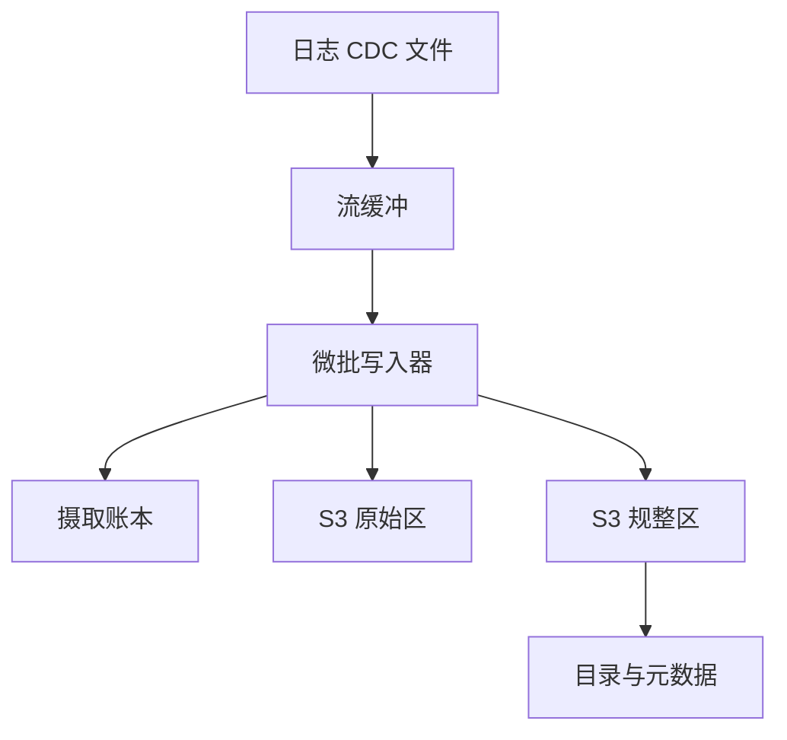
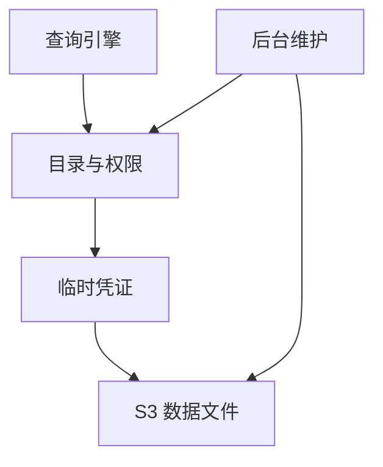
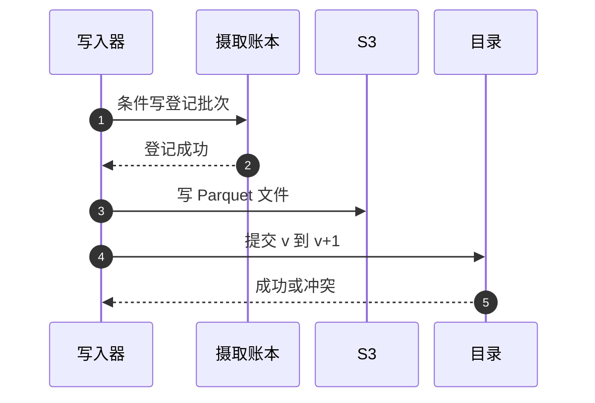

# SD09 数据湖摄取与数据目录（Data Lake Ingestion & Catalog）

## 题目

数据湖把各种来源的数据（应用日志、数据库变更、批量上传的文件、消息流）先原样放进对象存储，再整理成能查询的表。「数据目录」（catalog）是一个中心化的登记处，记着有哪些库、哪些表、每张表有哪些分区、结构是什么、谁有权限看，让 Athena、EMR、Redshift Spectrum 这些查询引擎都能找到并读取同一批表。使用者有三类：往里写数据的生产者、查询数据的分析师和引擎、管理权限与合规的数据管理员。难点有三个：摄取要在重试和失败下做到「重复摄取不产生重复行、失败的摄取不让读者看到半成品」；小文件和分区数会随时间爆炸，拖垮目录和查询规划；权限要细到列和行，但数据又放在谁都能直接读的对象存储里。

题目：设计一个托管数据湖服务（Glue、Lake Formation 风格）。客户把应用日志、数据库 CDC、批量文件上传、流（Kinesis/Kafka）的数据持续写进对象存储。服务负责把原始数据变成可查询的、有结构的、有权限控制的表，并提供一个中心化目录，让各种查询引擎都能发现这些表。

## 澄清问题

开场用两三分钟问下面八个问题，每个答案都会改变设计。

1. **数据怎么进来，流和批各占多少？** 决定摄取层是微批写入器、批文件工作流，还是两者都要。
2. **数据可见的延迟目标是多少？** 假设流 1 到 5 分钟、批文件 1 分钟以内。延迟越短，小文件越多，要在延迟和文件大小之间取舍。
3. **用什么表格式，要不要行级更新和删除？** 有合规删除（按用户删除）和 CDC 的 upsert 就必须选支持事务的表格式。
4. **有多少张表、多少分区，增长多快？** 决定目录能不能用一张表存分区，还是必须把文件清单下沉到表格式的元数据里。
5. **权限粒度到哪里？** 库、表、列、行还是单元格；是否跨账号共享。决定要不要凭证发放和可信执行环境。
6. **重复摄取和迟到数据怎么处理？** 同一个文件被重复投递很常见；事件时间和到达时间不同，决定分区方式。
7. **查询引擎有几种，要不要强一致读目录？** 引擎规划查询时必须看到刚提交的分区，目录读必须强一致。
8. **合规与保留：删除要在多久内彻底生效，备份怎么办？** 影响保留期、物理删除和备份策略。

## 需求

**功能需求（按优先级）**

1. **摄取：** 流式微批和批文件两种入口，落到 S3 的原始区（raw，也叫 bronze），再整理成规整区（curated，也叫 silver）的列存表（Parquet）。
2. **目录：** 库、表、分区、结构版本；支持结构发现（爬取文件识别结构，Glue crawler 的角色）与显式注册。
3. **事务性表：** 并发写入与读取互不影响；失败的摄取不让读者看到半成品；支持 upsert 与 delete（合规删除）。
4. **治理：** 库、表、列、行级权限；跨账号共享；审计日志。Lake Formation 的权限在 Athena、Redshift Spectrum、EMR、Glue 等引擎上以列、行、单元格的粒度强制。
5. **维护：** 小文件合并、过期快照清理、孤儿文件回收、统计信息。

**非功能需求**

| 维度 | 目标 | 说明 |
|---|---|---|
| 摄取语义 | 至少一次摄取，对外表现为恰好一次 | 重复摄取同一文件不产生重复行 |
| 数据可见延迟 | 流 1 到 5 分钟，批文件小于 1 分钟 | 面试时与面试官确认 |
| 目录读一致性 | 强一致读 | 引擎规划查询时要看到刚提交的分区 |
| 目录读写比 | 读多写少 | 读 QPS 高，写 QPS 低 |
| 规模 | 数千张表、每天数 PB、多账号多租户 | |

**明确不做**：毫秒级的实时 OLAP（那是 ClickHouse、Druid 一类）、数据血缘的完整产品化、跨区域复制（作为追问）。

## 容量估算

假设每天摄取 200 TB，目标文件大小 256 MB（Parquet 行组通常在 128 MB 量级，文件大小一般取 128 MB 到 1 GB），5,000 张低流量表每分钟 flush 一次，2,000 张表每小时一个分区，保留 3 年。

- 总摄取量 = 200 TB ÷ 86,400 秒 = **2.3 GB/s**。
- 目标文件数 = 200 TB ÷ 256 MB = **约 78 万个文件/天**。
- **小文件问题：** 5,000 张表 × 每天 1,440 次 flush = **720 万个小文件/天**，一年 **26 亿**个。
- 分区数 = 2,000 张表 × 24 小时 × 365 天 × 3 年 = **5,256 万个分区**；再按 10 个 region 分区，就是 **5.26 亿**。
- 查询规划：没有分区索引时，Glue 会加载表的全部分区，再在客户端按表达式过滤，分区数一涨就越来越慢。
- S3 请求速率：每个前缀每秒 3,500 次写、5,500 次读，目录布局与读并行度要与前缀对应。

**驱动设计的数字**有三个：

1. 720 万个小文件/天：小文件必然出现，必须有自动合并，并有触发条件。
2. 5.26 亿个分区：目录要有分区索引，或者把文件清单下沉到表格式的元数据文件里，让目录负载和分区数脱钩。
3. 每前缀的 S3 请求上限：摄取和合并的并行度要对应前缀分散。

## 核心实体与 API

**实体**（粗体为主键）

| 实体 | 关键字段 | 说明 |
|---|---|---|
| Database | **(account_id, db_name)** | 目录的最上层 |
| Table | **(db_id, table_name)**、current_metadata_pointer、owner、参数 | 指针指向表格式的当前元数据文件 |
| Partition | **(table_id, partition_values[])**、location、stats、schema_version | 传统分区表才需要；表格式下清单在 manifest 里 |
| SchemaVersion | **(table_id, version)**、columns[] | 结构版本，提交前过兼容性检查 |
| PermissionGrant | **(principal, resource)**、privileges[] | resource 可以是库、表、列、行过滤器 |
| IngestLedger | **(source_id, file_key)**、etag 或 offset 区间、状态 | 摄取账本，条件写抢占 |

**API**（写请求都带幂等键）

```
POST /v1/ingest/batches     Idempotency-Key: <uuid>
     {table, source_id, files[] | offset_range}   -> 202 {batch_id}
GET  /v1/tables/{t}/partitions?expr=year=2026 AND month=10&limit=  -> [{values, location}]
POST /v1/tables/{t}/commit  {base_version, added_files[], removed_files[]}
                                                  -> 200 {version} | 409 conflict
POST /v1/tables/{t}/schema  {columns[]}           -> 201 {version} | 422 incompatible
POST /v1/grants             {principal, resource, privileges[]}
POST /v1/credentials        {principal, table}    -> {temp_creds, expires_at, row_filter, col_mask}
```

`commit` 的 `base_version` 是乐观并发控制：基于哪个版本提交，如果当前已经不是这个版本，返回冲突，由调用方读最新版本后重试。

## 高层架构

整体分成摄取、存储、目录与治理、查询四块。数据留在 S3，目录只存元数据，授权在目录，数据面不依赖目录的写路径。

写路径（摄取与提交）：



读路径与维护：



**流 1：摄取。** 来源先进流缓冲或批文件清单；写入器按「N 分钟或 M 字节，先到者」触发一个批次，先到摄取账本里用条件写登记这个批次，已登记的直接跳过；再把 Parquet 文件写到 S3 的确定性路径（路径含批次 id），此时读者还看不到它们；最后向目录提交，把表的当前元数据指针从 v 原子地改成 v+1，读者才看到这批数据。

**流 2：查询。** 引擎向目录请求读某张表，目录校验主体对表、列、行的权限，返回限定到该表前缀的限时凭证，以及行列过滤规则；引擎用凭证读 S3，并按规则过滤。

下面是提交的关键路径：



图中编号对应的每一步：

1. 写入器拿批次标识（源文件 key 加 etag，或流的 offset 区间）去账本里用 `attribute_not_exists` 条件写抢占。
2. 登记成功才继续；已经登记过的批次说明别的写入器处理过或正在处理，直接跳过。
3. 把数据文件写到 S3 的确定性路径。读者只通过元数据找文件，所以此刻还看不到它们。
4. 向目录提交：把表的元数据指针从 v 改成 v+1，是一次条件更新。
5. 成功则数据对读者可见；冲突则重新读最新元数据，检查自己的文件是否与新提交冲突，无冲突就基于新版本重试提交。

## 深挖

### 摄取：幂等加原子提交

问题：同一个批次被执行两次，表里只能出现一份数据；失败的批次对读者不可见；多个写入器同时提交不能互相覆盖。

选项：

1. **直接写进目标目录。** 简单，但失败会留下半成品，重试会产生重复，读者能看到中间状态。
2. **写临时目录，成功后重命名。** S3 没有原子的目录重命名，重命名是逐对象的复制加删除，既慢又非原子。
3. **先写数据文件，后原子提交元数据。** 数据文件放在读者看不到的确定性路径，提交就是切换一个元数据指针。

选择第 3 种，具体四步：

1. **文件级账本：** 每个源文件（或流的 offset 区间）摄取前登记 `(source_id, file_key, etag/offset_range)`，用条件写抢占，已登记的批次直接跳过。
2. **确定性路径：** 数据文件路径含批次 id，重试写同名文件，覆盖无副作用。
3. **提交即切换指针（CAS）：** 做法一，目录里存「表当前元数据文件的位置」，提交是目录里的一次条件更新；做法二，纯 S3，用 S3 条件写（`If-None-Match` 创建 `v+1.metadata.json`，已存在则失败）实现 CAS。冲突时重读最新元数据，检查自己写的文件与新提交是否冲突：对同一分区的覆盖才冲突，追加互不冲突；无冲突就基于 v+1 重试。
4. **孤儿回收：** 失败的批次留下已写入但没提交的文件，后台扫描前缀下「不被任何快照引用且超过 N 天」的文件并删除。N 必须大于最长摄取任务时间，否则会误删进行中的批次。

迟到数据与分区：按事件时间分区，迟到事件会落到旧分区，改变旧分区，每次提交触发重写分区或追加小文件。折中是写入按到达时间追加，由合并任务按事件时间重新聚簇。

失败模式：账本登记成功但写入器在提交前崩溃，批次卡在已登记状态。账本的登记要带租约（过期时间）和状态，超时的批次可以被重新抢占；因为数据文件路径是确定的，重做是安全的。

### 表格式与目录：把分区清单从目录里拿出来

问题：没有表格式，S3 上的「目录加 Parquet 文件」有三个问题：列出目录慢；一次摄取写多个文件不是原子的；改结构、改分区要重写数据。同时，分区数涨到亿级，目录这张表就成了瓶颈。

选项：

1. **目录里存每个分区（传统方式）：** 简单，引擎调用 `GetPartitions(expression)`。没有分区索引时，Glue 加载全部分区再过滤。可以加分区索引（每个索引是一组有序键），代价是写放大，每个分区每个索引多一条记录。
2. **加盐分片：** 对超大表按 `(table_id, hash(partition_prefix) mod K)` 分片，避免单张大表成为热分区（DynamoDB 里热分区与吞吐稀释的教训）。
3. **表格式（Iceberg、Delta 风格）：** 目录只存一个元数据指针，分区与文件清单下沉到对象存储里的 manifest。

表格式的结构：

```
目录指针 → metadata.json（表 schema、分区规格、快照列表）
              └→ snapshot N → manifest list → manifest 文件（每个列出若干数据文件 + 每文件的列统计）
                                                    └→ data 文件（Parquet）
```

选择第 3 种为主，传统分区加分区索引作为兼容。它带来：

- **查询规划不再列目录。** 读 manifest（几十 MB 的元数据），用文件级的 min、max、空值数统计直接跳过不相关文件，比分区裁剪更细。
- **快照即时间旅行加快照隔离。** 读者固定读一个快照，写入器并发提交新快照，互不影响。
- **隐藏分区。** 分区规格是元数据，查询写 `WHERE ts > ...` 就能裁剪，不必知道目录结构；改分区规格不需要重写旧数据。
- **行级删除。** 合规删除写删除文件（位置删除或相等删除），读时合并（merge-on-read），之后合并任务再物化（copy-on-write）。
- **列用 ID 而不是名字定位。** 重命名列不需要重写数据。

目录自身的设计：存储用强一致 KV（DynamoDB 风格），分区键 `table_id`，排序键是分区值的有序编码，这样「按前缀裁剪」（例如 `year=2026/month=10`）就是一次范围查询。引擎侧缓存表元数据，用元数据指针的版本号做条件读校验。目录是所有查询的前置依赖，所以目录读路径多 AZ 部署，客户端缓存加带抖动的重试；目录宕机时，已缓存元数据的引擎继续工作（静态稳定）。

结构发现与演进：爬取文件识别结构，要增量爬取（只爬新增前缀，记录已见分区），识别结果可能把偶发的脏数据当成结构，所以新版本要经过兼容性检查或人工确认才发布。兼容性规则：加可空列向后兼容；删列、改类型是破坏性变更。Parquet 文件尾部的 footer 含结构与每个列块的统计，查询先读 footer 再按需读列块。

失败模式：提交冲突风暴，大量写入器同时提交同一张热表。对策是写入器本地合并多个批次再提交、提交冲突时带抖动退避、热表按分区拆开提交。

### 治理：授权在目录，数据留在 S3

问题：数据放在 S3，谁都可能拿着 IAM 权限直接读；但客户要列、行、单元格级别的权限，还要跨账号共享。

选项：

1. **只用 S3 桶策略和 IAM：** 粒度到前缀，做不到列和行。
2. **在每个引擎里各自实现权限：** 引擎之间不一致，用户代码可以绕过。
3. **目录统一授权加凭证发放（credential vending）：** 引擎请求读表，目录校验后返回限定到该表前缀的限时凭证，加上行列过滤规则。

选择第 3 种：

```
引擎 → 目录：请求读表（principal, table）
目录：校验对 table / column / row 的权限
目录 → 引擎：临时凭证（只能读该表前缀）+ 行/列过滤规则
引擎：用凭证读 S3，按规则过滤
```

要点：

- 引擎永远拿不到全桶权限，只拿限定前缀、限时的凭证。
- 行列过滤必须由受信任的执行环境强制，否则引擎里的用户代码可以直接读 S3 绕过，这也是 Lake Formation 说自己是在 IAM 之上增强的原因。
- 跨账号共享：授权记录指向 owner 账号的资源；审计日志记录每次凭证发放（谁、何时、哪张表）。
- 合规删除（GDPR）：按用户 id 删除，走表格式的 delete file 加异步重写；备份和快照也要有保留期，保证被删数据在 N 天内彻底消失。

失败模式：权限撤销的生效延迟。凭证是限时发放的，撤销的生效延迟不超过凭证有效期（例如 15 分钟）加引擎缓存；要更快就缩短有效期（代价是目录请求量上升），严重事件提供立刻吊销的通道（撤销令牌表，引擎每次规划时检查）。

### 后台维护：决定长期成本

| 任务 | 做什么 | 触发 | 风险与对策 |
|---|---|---|---|
| 合并小文件 | 把同分区的小文件重写成 256 MB 左右，按常用过滤列排序或聚簇 | 小文件数或占比超过阈值 | 与摄取并发，用同样的乐观提交；冲突就放弃重试，摄取优先 |
| 快照过期 | 删除超过保留期的旧快照元数据 | 定时 | 保留期要大于最长查询时间；时间旅行需求决定下限 |
| 孤儿文件回收 | 删除不被任何快照引用的数据文件 | 定时 | 必须有年龄保护，避免误删进行中的写 |
| 统计信息 | 更新文件、列、分区统计 | 提交后异步 | 过期统计只影响计划质量，不影响正确性 |

维护任务做成「常量工作」：按固定节奏、固定预算运行，而不是数据多了就多干，防止它在摄取高峰时和摄取抢资源。查询执行到一半时另一个任务合并了小文件并删除旧文件，查询不会失败，前提是物理删除晚于快照过期：合并只产生新快照，旧文件仍被旧快照引用。

## Staff 视角：权衡、故障与演进

**10 倍规模会先坏什么。** 摄取量涨到每天 2 PB（23 GB/s）时，先坏的是三处：（1）元数据：manifest 与快照数量暴涨，快照过期和 manifest 重写要持续运行，否则查询规划变慢；（2）S3 请求速率：写入和合并的并行度受每前缀速率限制，要按 `(表, 分区, 哈希)` 分散前缀；（3）目录写：每次提交都是一次目录条件更新，热表的提交冲突率上升，需要写入器本地批量合并提交。

**每个组件挂了的影响面。**
- 目录读路径挂：新查询无法规划；已缓存元数据的引擎继续工作（静态稳定）。
- 目录写路径或账本挂：摄取暂停，数据积压在流缓冲里，不丢；恢复后按账本去重继续。
- 写入器挂：批次未提交，账本过期后被重新抢占，孤儿文件由回收清理。
- 维护任务挂：小文件和旧快照堆积，成本和查询延迟缓慢上升，不影响正确性。
- 凭证服务挂：新的访问请求被拒；已发放的凭证在有效期内继续可用。

**多租户与爆炸半径。** 目录按 `account_id` 分 cell，由 router 按账号路由，一个 cell 的坏发布只影响该 cell 的账号。摄取与维护 worker 池按账号做 shuffle sharding。配额：每账号并发作业数、每秒目录写、每表分区数上限。限流区分目录读（数据面，弹性）与写和 DDL（控制面，严格配额）。

**多区域。** 目录元数据小，可以跨区域异步复制作为灾备；数据本身用 S3 跨区域复制。要注意复制的是不同对象，元数据指针与数据文件之间不是原子的，所以复制顺序必须是先数据文件、后元数据指针，否则读者在目标区域会看到指向不存在文件的元数据。

**成本驱动。** S3 存储（分层到冷存储、生命周期）、请求数（小文件、列目录）、查询扫描量（列存加分区加聚簇）、爬取与维护计算。杠杆最高的三项：列存加压缩、合并小文件、按常用过滤列聚簇。

**迁移与发布。** 元数据格式升级用先读后写两阶段：先让所有读者能读新格式，再让写入器写新格式。目录按 cell 灰度。表从传统分区迁移到表格式，可以先用迁移工具为现有文件生成 manifest 而不移动数据，之后写入走新路径。

**可观测性。** 摄取延迟（数据到达到可见）、账本中卡住的批次数、提交冲突率、小文件占比、每表分区数、孤儿文件数、凭证发放速率与拒绝率、目录读写延迟。数据质量：解析失败或违反约束的记录写到 `quarantine/` 并计数，达到阈值则暂停提交；质量规则（非空、范围、唯一性）作为提交前检查，结果入表级指标。

## 面试官追问

1. **两个写入器同时往同一张表提交会怎样？** 各自写完数据文件后争着把元数据指针从 v 改成 v+1，只有一个条件更新成功。输家读取新元数据，检查自己的文件与 v+1 的变更是否冲突：追加到不同文件不冲突，直接基于 v+1 重新提交；两者都覆盖同一分区则冲突，输家失败并重试整个批次（批次幂等，所以安全）。
2. **查询执行到一半，另一个任务合并了小文件并删除旧文件，查询会失败吗？** 不会，只要物理删除晚于快照过期。合并只产生新快照，旧文件仍被旧快照引用；快照过期后且没有活跃查询使用时，孤儿回收才会删除。保留期必须大于最长查询时长。
3. **分区数涨到 5 亿，目录扛不住怎么办？** 先加分区索引，把全量加载再过滤变成范围查询；对超大表加盐分片避免热分区；根本办法是用表格式，把分区文件清单放进 manifest，目录只存指针；再限制分区粒度，用隐藏分区加聚簇代替超细分区。
4. **流式摄取一分钟 flush 一次，会不会制造海量小文件？** 会，720 万个/天。办法：低流量表拉长 flush 间隔，或按字节数或时间先到者触发；摄取层按 `(表, 分区)` 先聚合再写；接受小文件，由后台合并器在分区冷却后合并；查询侧依赖文件级统计跳过。
5. **怎么保证 5 分钟内可查，同时不制造小文件？** 这是延迟和文件大小的权衡。用两层：热层是最近 5 分钟的小文件（元数据里打标签，查询时与大文件一起读），冷层是合并后的大文件，合并后原子替换。代价是读放大和维护复杂度。
6. **目录里一张表被误删怎么办？** 目录元数据变更也要有日志：每次变更写不可变的审计日志（谁、何时、旧值、新值），软删除保留 N 天，定期快照目录并归档到 S3；恢复就是取消软删除或回放日志。数据文件没有删除，删表只删元数据，除非 purge。
7. **权限变更（撤销某用户的访问）多久生效？** 不超过凭证有效期（如 15 分钟）加引擎缓存。更快就缩短有效期，代价是目录请求量上升；严重事件提供立刻吊销通道，撤销令牌表由引擎每次规划时检查。
8. **怎么做数据质量？** 摄取管线里设隔离区：解析失败或违反约束的记录写到 `quarantine/` 并计数，达到阈值暂停提交；不要让坏数据悄悄进入规整表。质量规则作为提交前检查。
9. **成本从哪来，怎么降？** S3 存储、请求数、查询扫描量、爬取与维护计算。最高杠杆的三项：列存加压缩、合并小文件、按常用过滤列聚簇。

## 60 分钟怎么分配

| 分钟 | 做什么 | 白板内容 | 时间不够时 |
|---|---|---|---|
| 0–5 | 澄清问题，定假设 | 角落写流批比例、延迟、表数 | 只问延迟、表数、权限粒度三个 |
| 5–10 | 需求与容量估算 | 2.3 GB/s、720 万小文件/天、5.26 亿分区 | 只写 720 万与 5.26 亿两个数 |
| 10–15 | 实体与 API | Table、IngestLedger、commit 的 base_version | 压缩为 API 四行 |
| 15–25 | 高层架构 | 写路径与读路径两张图，提交序列图 | 保留，不能砍 |
| 25–40 | 深挖一：摄取幂等加原子提交；深挖二：表格式与目录 | 账本、确定性路径、CAS、manifest 树 | 必讲这两个 |
| 40–50 | 深挖三：治理与凭证发放；深挖四：后台维护 | 凭证流程、维护表 | 只讲治理，维护口述 |
| 50–55 | Staff 视角：故障、多租户、成本 | 影响面、cell、成本杠杆 | 只讲影响面与 cell |
| 55–60 | 追问与总结 | 一句话：数据先写、元数据后切、授权在目录 | 总结一句 |

**45 分钟版**（前面有 10 到 15 分钟行为面试）：澄清 3 分钟，容量 3 分钟，API 2 分钟，架构 7 分钟，深挖两个（摄取、表格式与目录）各 9 分钟，治理 4 分钟，故障与成本 4 分钟，剩下留给追问。后台维护用一句话带过：「小文件合并、快照过期、孤儿回收，都与摄取用同样的乐观提交」。

## 自测

1. 为什么摄取要「先写数据文件、后提交元数据」，而不是写完直接可见？

<details><summary>答案</summary>

读者只通过元数据找文件，所以数据文件写在确定性路径时读者看不到它们；提交是原子地切换元数据指针，要么整批可见要么整批不可见。失败的批次只留下孤儿文件，由后台回收，不会让读者看到半成品。直接写目标目录则失败会留下半成品，重试会产生重复。

</details>

2. 两个写入器提交冲突时，怎么判断可以重试而不是失败？

<details><summary>答案</summary>

输家重新读最新元数据，检查自己新增的文件与新提交的变更是否冲突。追加到不同文件互不冲突，直接基于新版本重新提交；两者都覆盖同一分区才是冲突，要失败并重试整个批次。批次靠账本和确定性路径保证幂等，所以重试安全。

</details>

3. 分区数到亿级时，为什么说表格式是更根本的办法？

<details><summary>答案</summary>

目录里存分区时，分区数增长直接变成目录的存储和查询压力，没有索引时每次规划都要加载全部分区。表格式把分区和文件清单放进对象存储里的 manifest，带文件级统计，按需读取，目录只存一个元数据指针，目录负载与分区数脱钩。

</details>

4. 为什么行列过滤必须由受信任的执行环境强制？

<details><summary>答案</summary>

如果过滤只靠引擎里的用户代码，用户代码可以直接用凭证读 S3 绕过过滤。所以目录只发限定到该表前缀的限时凭证，并把行列过滤规则交给受信任的环境执行；引擎永远拿不到全桶权限。

</details>

5. 孤儿文件回收的年龄阈值 N 该怎么定，定错了会怎样？

<details><summary>答案</summary>

N 必须大于最长摄取任务的时间。数据文件在提交前就已经写入但还没被任何快照引用，看起来和孤儿一样；N 太小会把进行中的批次的文件误删，提交后指向不存在的文件，造成数据丢失。

</details>

## 延伸阅读

- 相邻题解：[[solution-object-storage]]（元数据分片）、[[solution-file-sync]]（内容寻址与去重）、[[solution-ad-click-aggregation]]（对账与迟到数据）。
- 同批题单：[[sd-index]]；基础回顾：[[00_ddia_refresh]]、[[iceberg-table-format]]。
- 文档：[Glue 概念](https://docs.aws.amazon.com/glue/latest/dg/components-key-concepts.html)、[Glue 分区索引](https://docs.aws.amazon.com/glue/latest/dg/partition-indexes.html)、[Lake Formation](https://docs.aws.amazon.com/lake-formation/latest/dg/what-is-lake-formation.html)、[Athena 分区](https://docs.aws.amazon.com/athena/latest/ug/partitions.html)、[S3 性能优化](https://docs.aws.amazon.com/AmazonS3/latest/userguide/optimizing-performance.html)
