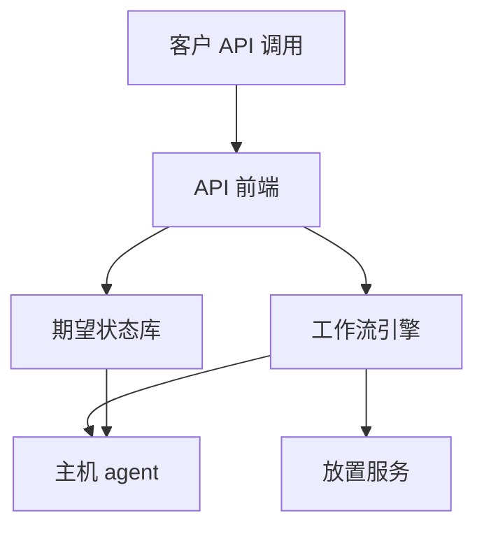
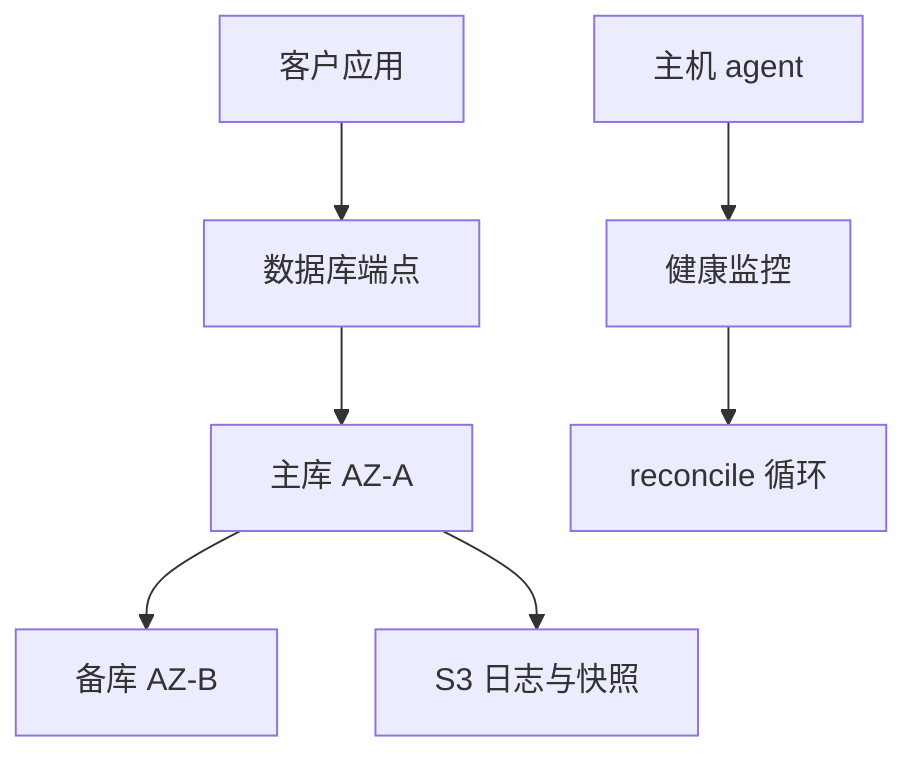
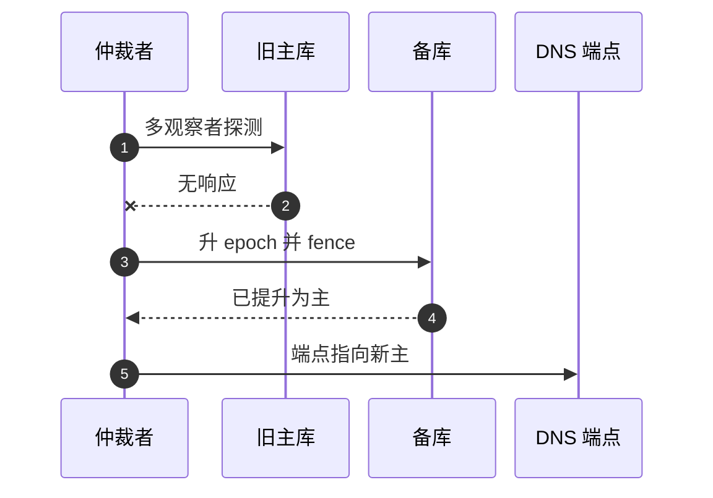

# SD10 托管数据库的多租户控制面（Managed Database Control Plane）

## 题目

托管关系型数据库服务（RDS、Aurora 风格）替客户运行数据库实例：客户只调 API 说「我要一个什么规格的数据库」，服务负责找机器、装引擎、配网络、做备份、故障时自动切换。这套 API 与背后的调度、状态管理、监控叫控制面（control plane）；真正运行数据库引擎、响应客户查询的主机叫数据面（data plane）。使用者是通过 API 管理实例的客户，以及运维这套服务的 on-call 工程师。难点有三个：要同时管理百万级实例，开通和变更的任何一步都可能失败，必须可重入、可对账；备份必须能还原到任意时间点，且备份本身不能影响线上；一个可用区故障时，几十万实例要同时切换，而此时最拥挤的恰恰是中心控制面。

题目：设计一个托管关系型数据库服务的控制面。客户通过 API 创建数据库实例、修改规格、开启自动备份和多可用区高可用、从备份还原到某个时间点。服务同时管理百万级数据库实例，跨多个区域。重点说明：开通（provisioning）、备份与还原、故障切换（failover），以及如何在多租户下保证可靠、安全、可运维。

## 澄清问题

开场用两三分钟问下面八个问题，每个答案都会改变设计。

1. **规模：多少实例，多少区域和可用区？** 假设 100 万个实例，平均 100 GB，每个区域三个可用区。决定要不要 cell 化。
2. **可用性与恢复目标是多少？** 99.99% 的年度预算约 52.6 分钟；Multi-AZ 切换的典型时长是 60 到 120 秒，RPO 接近 0（同步复制）。目标不同，故障切换的架构不同。
3. **高可用的形态：同步备库（standby）、共享存储，还是只读副本？** 决定提升谁、数据会不会丢。
4. **备份的保证是什么？** 保留期多长、能不能还原到任意时间点、还原到新实例还是覆盖原实例、要不要跨区域备份。
5. **控制面能碰客户数据吗？** 不能。控制面只管资源和元数据，不读客户数据；密钥怎么管、怎么加密要先问清。
6. **故障切换由谁触发，必须自治吗？** 如果整个可用区挂了，切换不能依赖当时拥堵的中心控制面。
7. **多租户公平：一个客户的 API 风暴或坏实例怎么限制影响？** 决定配额、cell 和 shuffle sharding。
8. **维护窗口和补丁怎么做？** 引擎补丁是客户最常感知的事件，想做到接近零停机就要用 Multi-AZ 切换。

## 需求

**功能需求（按优先级）**

1. 控制面 API：`CreateDBInstance`、`ModifyDBInstance`、`DeleteDBInstance`、`RestoreDBInstanceToPointInTime`、`CreateSnapshot`、`RebootDBInstance`（可强制故障切换）、`DescribeDBInstances`（分页）。
2. 开通：从请求到实例可用，可重入、可对账、可观测。
3. 备份与还原：自动备份加事务日志持续上传，点时间恢复（PITR）。
4. 高可用：Multi-AZ，同步备库，自动故障切换。
5. 运维：补丁、规格变更、删除与最终快照。

**非功能需求**

| 维度 | 目标 | 说明 |
|---|---|---|
| 控制面 API | 低频、强一致、需审计 | 每个操作可审计、可重入 |
| 开通 | 创建几分钟内可用 | p99 受容量和依赖影响 |
| 故障切换（Multi-AZ） | 典型 60 到 120 秒 | 大事务或长时间崩溃恢复会延长；RPO 接近 0 |
| 备份 | 事务日志每 5 分钟上传到 S3 | PITR 是最近快照加重放日志；备份不能影响线上 |
| 隔离 | 爆炸半径可量化 | 一个客户的 API 风暴、坏实例、坏发布不影响其他客户 |
| 安全 | 每实例独立加密密钥（KMS）、网络隔离（VPC）、最小权限 | 控制面不能读客户数据 |
| 可运维 | on-call 一键定位卡在哪一步 | 所有操作可审计、可重入、可观测 |

**明确不做**：数据库引擎内部实现、查询优化、跨引擎迁移。

## 容量估算

假设 100 万个数据库实例，平均 100 GB。

- 心跳与健康上报：每实例每 10 秒一次，1,000,000 ÷ 10 = **10 万次/秒**（控制面和监控的写入）。
- 总存储：10^6 × 100 GB = **100 PB**。
- 每日变更量 5%：5 PB/天 ÷ 86,400 秒 = **约 58 GB/s** 的日志和增量备份上传。
- 日志对象数：每实例每 5 分钟 1 个，即每天 288 个，1,000,000 × 288 = **2.88 亿个对象/天**。
- 创建和修改：每天 2% 的实例有创建或重要变更，20,000 ÷ 86,400 = **0.23 次/秒**，控制面的写很少，高频的是心跳和读。
- 一个可用区故障：三分之一实例要切换，即 **33.3 万个实例**；要在 2 分钟（120 秒）内完成，需要 333,333 ÷ 120 = **约 2,800 次切换决策/秒**。
- 99.99% 可用性：一年 525,600 分钟 × 0.0001 = **52.6 分钟**的不可用预算；一次 60 到 120 秒的切换吃掉其中约 **1.9% 到 3.8%**。

**驱动设计的数字**有三个：

1. 控制面写很少，心跳和读极多：状态机和元数据走强一致的小库，心跳走独立的、可丢的、聚合型的路径。
2. 可用区故障时，切换决策瞬间从偶发放大到每秒 2,800 次，放大三个数量级：切换逻辑必须在数据面本地自治，不能依赖那时最拥挤的中心控制面（静态稳定）。
3. 每天 2.88 亿个日志对象：必须按实例哈希分散 S3 前缀，并把小日志批量合并后上传。

## 核心实体与 API

**实体**（粗体为主键）

| 实体 | 关键字段 | 说明 |
|---|---|---|
| DBInstance | **instance_id**、account_id、desired（引擎、规格、存储、multi_az、备份保留期）、desired_version、observed（状态、host_id、az、endpoint、last_heartbeat）、workflow_id、owner_lease、fencing_token | 期望状态加实际状态 |
| Placement | **host_id**、az、free_capacity（cpu、mem、iops、槽位）、state（active、draining、retired） | 主机池的容量视图 |
| Backup | **(instance_id, backup_id)**、type（snapshot、log）、start_lsn、end_lsn、s3_uri、checksum、retained_until | 日志带起止 LSN 和校验和 |
| Workflow | **workflow_id**、instance_id、type、step、status、attempt、last_error | 每步幂等，可从 step 继续 |

存储用强一致 KV（DynamoDB 风格，条件写和事务），分区键 `account_id` 或 `instance_id`（见 cell 化）。`desired_version` 做乐观并发控制：`ModifyDBInstance` 用 `UPDATE ... WHERE desired_version = ?`，并发修改的第二个调用得到冲突错误，而不是静默覆盖。

**API**（写请求都带幂等键）

```
POST   /v1/instances       client_token: <uuid>
       {engine, class, storage, multi_az, backup_retention}  -> 202 {instance_id}
PATCH  /v1/instances/{id}  {desired_version, changes}        -> 202 | 409 version_conflict
DELETE /v1/instances/{id}  {final_snapshot: true}            -> 202
POST   /v1/instances/{id}:restore   {restore_time | snapshot_id, target_name}  -> 202 {new_instance_id}
POST   /v1/instances/{id}:reboot    {force_failover}         -> 202
GET    /v1/instances?cursor=&limit=                          -> 分页列表
```

`client_token` 使 `CreateDBInstance` 重试幂等：同一个 token 加相同参数返回同一个实例；相同 token 不同参数报错（对参数做哈希比较）。

## 高层架构

边界是整道题的题眼。控制面是做变更的机器，数据面是每次请求都用的机器。**铁律：数据面在控制面完全不可用时仍然继续服务**，控制面可以降级成「不能创建、修改」，但不能让已有实例不可用。

控制面（写路径）：



数据面与观测（读路径与反馈）：



**流 1：创建实例。** API 前端鉴权、查配额，在期望状态库里写 DBInstance（状态为 creating）并创建工作流（一次条件写，用 `client_token` 去重）。工作流引擎按步骤执行：放置、建卷和密钥、启动引擎、配网络、健康检查，最终状态为 available（见深挖一）。主机 agent 拉取期望状态并在本地缓存，上报实际状态和心跳。

**流 2：观测与对账。** 观察者持续对比期望状态和实际状态，不一致就触发修复，这是 Kubernetes 风格的 reconcile 循环。心跳走独立的聚合路径，丢几个不影响。

故障切换的关键路径（由数据面本地仲裁者执行，不经中心控制面）：



图中编号对应的每一步：

1. 部署在不同可用区的多个独立观察者一起探测旧主，单个观察者的网络问题不会触发切换。
2. 旧主不响应；还要结合深度健康检查（真实读写探针、客户视角的失败率），防止灰色故障被当成正常。
3. 仲裁者给复制组加一个更大的 epoch（fencing token），存储层从此拒绝携带旧 epoch 的写，旧主就算还活着也无法再提交。
4. 备库完成崩溃恢复（重放未应用的日志）后被提升为主，同步复制保证数据不落后，RPO 接近 0。
5. 端点（DNS 名）指向新主，客户端重连；随后后台新建备库，控制面事后对账更新元数据。

## 深挖

### 开通：用 Saga 把「创建」拆成可重入的步骤

问题：创建一个实例要经过放置、建卷、建密钥、启动引擎、配网络、健康检查，涉及多个外部系统，任何一步都可能失败、超时、重复。同步调用链失败会留下半成品。

选项：

1. **同步调用链：** 实现最简单，失败留下孤儿卷和孤儿主机，无法恢复。
2. **队列加无状态 worker：** 能重试，但没有显式的步骤状态，崩溃后不知道做到哪一步。
3. **Saga 式工作流：** 每一步记录「已完成加产物 id」，每步幂等，失败时逐步补偿。

选择第 3 种：

```
CreateDBInstance 请求
  1. 校验加配额检查（账号实例数、总存储）   失败立刻返回 4xx，不进入工作流
  2. 写 DBInstance（creating）加 Workflow   一个条件写，client_token 去重
  3. 放置：选 AZ 与主机                    预留容量，带 TTL，避免泄漏
  4. 创建存储卷、分配加密密钥（KMS）        每步记录产物 id
  5. 在主机上启动引擎（agent 拉取期望状态）
  6. 配置网络：ENI、安全组、DNS 端点
  7. 健康检查通过则 available；multi_az 时同时创建 standby 并等待同步完成
  失败：逐步补偿（释放预留、删卷、删密钥），状态 failed 加原因；补偿也必须幂等、可重试
```

要点：

- **每一步幂等，崩溃后从 `Workflow.step` 继续。** 外部副作用用确定性 id，例如 `CreateVolume(client_token = instance_id + step)`，重放不产生第二个卷。
- **泄漏防护：** 预留带 TTL；定期对账云资源清单与数据库记录，「有资源但数据库无记录」的孤儿由回收任务清理。
- **超时与预算：** 整个创建有总超时；每步重试带抖动退避，有最大尝试次数，超过就失败并告警，避免无限卡死。
- **进度可观测：** `DescribeDBInstances` 返回 `status` 与当前 `step`，on-call 看工作流表就知道卡在哪。
- **并发控制：** 每个实例同一时间只允许一个改变资源形态的工作流（用租约加 `workflow_id` 抢占），第二个请求排队或返回 `InvalidDBInstanceState`，语义可预期，而不是静默合并。

放置（placement）：容量是多维的（CPU、内存、IOPS、网络、存储槽位），所以是装箱问题；同一客户的主和备必须放在不同可用区，同一主机不过度超配以减少噪声邻居。放置服务是热点依赖，创建风暴时所有请求争抢同一份空闲容量视图，所以做成分片加乐观预留：按 AZ 和主机池分片，预留用条件写（CAS），冲突就换下一个候选，避免全局锁。存储节点自己监控吞吐和容量，超过阈值向中心上报「建议迁走的副本」，由数据面上报、控制面决策。

失败模式：补偿本身失败。补偿也是幂等的工作流步骤，失败就重试；最终仍失败的资源记入孤儿清单，由对账任务回收。

### 备份与还原：日志归档、快照、PITR 三层保护

问题：备份只有快照，意味着只能还原到快照时刻，最多丢一天；从主库做重 I/O 的备份会拖慢线上；没验证过的备份等于没有备份。

选项：

1. **只做每日快照：** 简单，RPO 为一天。
2. **快照加持续日志归档：** 还原到任意时间点，RPO 为日志上传间隔（5 分钟）。
3. **共享存储层连续备份（Aurora 风格）：** 备份是存储层的连续、增量行为，不占主库 I/O。

选择第 2 种（兼容 RDS 引擎），第 3 种作为 Aurora 的形态。三层如下：

1. **持续日志归档：** 引擎的 WAL 或 binlog 持续上传到 S3，每 5 分钟一次；每个文件带 manifest（实例、起止 LSN）和校验和；归档前验证序号无空洞、校验和正确、属于正确分区，才上传。
2. **周期快照：** 增量快照（块级变更）。周期不只按时间，也可以由累积日志量触发。
3. **还原：** 最近快照加重放日志到目标时间点。恢复到新实例，不覆盖原实例，避免误操作二次伤害。

关键性质：

- **备份不影响线上：** 从备库或存储层快照取，不在主库做重 I/O；同步备库还能降低备份期间的延迟毛刺。
- **最新可还原时间（LatestRestorableTime）** 是对客户可见、可观测的承诺。日志上传停滞时它会停止前进，必须告警。
- **验证：** 定期自动把抽样实例还原到隔离环境，校验引擎能启动、校验和一致，并记录还原耗时作为 RTO 指标。
- **保留与删除：** 保留期过后删除；客户删除实例时可选保留最终快照；合规删除要考虑备份中的残留。
- **加密与访问：** 备份用实例密钥加密；控制面工作流只拿到还原权限，不接触明文数据；跨区域复制备份是灾备能力，RPO 取决于复制延迟。
- **规模：** 58 GB/s 的上传要按 `(instance_hash, 日期)` 分散 S3 前缀，并把多个小日志合并为一个对象上传，降低 2.88 亿个对象/天的请求量。

失败模式：日志序号出现空洞，说明某一段日志丢失，后续日志无法保证 PITR。检测到空洞时立刻触发新的全量快照并告警，而不是静默继续归档。

### 故障切换：判定、fencing、提升、端点、自治

问题：主库挂了要尽快切到备库，但误判会造成不必要的停机，脑裂会造成数据损坏，大面积故障时切换风暴会压垮控制面。

**1. 判定主库挂了（避免误切）。**

- 单个观察者会因自己的网络问题误判，所以用多个独立观察者投票：不同可用区的监控节点、主机 agent 自报、存储层信号，多数同意才切。DynamoDB 的经验是：follower 发起选举前先问其他副本能否连上 leader，有人说能就放弃，大幅减少误选举。
- 灰色故障：主库进程在、心跳正常，但查询极慢或磁盘卡死。需要深度健康检查（真实的读写探针、慢查询比例），切换条件要包含客户视角的失败率。
- 抖动保护：设置冷却时间和最大切换频率，避免来回切换。

**2. 防脑裂：旧主必须被 fencing（最重要）。** 旧主可能只是网络不通，仍在接收部分客户写入，必须保证它不再接受写：

- 存储层 fencing：给卷发 fencing token（epoch），存储拒绝携带旧 epoch 的写。Aurora 用 epoch 编号给恢复过程的截断范围加版本。
- 同步复制本身的限制：旧主提交需要备库确认，备库已提升并拒绝旧主，旧主的新提交无法完成。
- 租约：主库持有「我是主库」的租约，租约到期且未续期则自行降级为只读；新主必须等旧主租约过期后才对外服务（部署时 leader 主动让位可以省去等待）。
- 兜底：强制关闭旧主所在的主机或实例（STONITH）。

**3. 提升备库。** 同步复制下备库数据不落后，RPO 接近 0；异步（跨区域只读副本）时选日志位置最新的副本，并告知客户可能丢失的窗口。引擎要做崩溃恢复（重放未应用的日志），这就是大事务或长恢复会延长切换时间的原因。

**4. 切换端点。** 客户通过端点（DNS 名）连接，切换后端点指向新主。DNS 切换受 TTL 和客户端缓存影响（长连接池、JVM 的 DNS 缓存）。缓解：低 TTL、驱动重新解析、或用代理层把客户连接与实际主机解耦（代价是多一跳延迟和一个新的故障点）。切换期间客户会看到连接断开，应用需要重试加幂等。

**5. 谁来执行切换：静态稳定的关键。** 不能让切换依赖控制面 API 或工作流引擎在可用区故障的拥堵时刻可用。分两级：

- 数据面本地自治：每个复制组有本地的仲裁者（跨 AZ 部署，持有租约和缓存的元数据），控制面不可达时也能依规则完成切换。
- 控制面事后对账：观察到端点和角色变化后更新元数据、补建新备库。
- 整个可用区故障时的切换风暴：限速、优先级（SLA 高者优先）、分批，防止新主机的容量、存储 API 被冲垮。提前留好容量，新主就是存活 AZ 里已存在的备库，不需要现场开通。

**6. 切换后。** 在新 AZ 重建备库可能要几十分钟到几小时的数据拷贝，期间实例处于无冗余状态，需要告警和指标并优先修复。记录切换事件（原因、耗时、数据丢失窗口）供客户和内部复盘。

**7. 演练。** 未经演练的故障切换等于没有。定期对随机实例做强制故障切换（`RebootDBInstance` 加 `force_failover`），把结果当作 SLO 指标。切换分段计时（检测、fencing、提升、引擎恢复、端点更新），各段都有指标；每个 cell 持续用金丝雀实例强制切换，压测时注入「大事务正在进行」。承诺值用分位（p99），而不是平均。

失败模式：检测阶段误判导致不必要切换，或 fencing 失败导致脑裂。前者靠多观察者和冷却时间，后者靠存储层 epoch 加租约加 STONITH 多层兜底，核心不变量是任一时刻只有一个主库可以提交写。

### 多租户、cell 与发布安全

**API 层公平。** 控制面 API 和数据面 API 分别限流；控制面按账号配额（令牌桶），超限返回 `ThrottlingException` 加 `Retry-After`。昂贵的 API（`DescribeDBInstances` 全量列表）有分页、缓存，以及批量导出作为替代，避免轮询风暴。

**Cell 化。** 按 `account_id` 把控制面切成 cell：每个 cell 拥有自己的元数据库、工作流引擎、放置服务和主机池，不共享状态；前面一层极薄的 cell router 按账号路由。10 个 cell 的情况下，一个 cell 故障时 90% 的请求不受影响。坏发布、毒丸请求（某账号的畸形参数让工作流死循环）被限制在一个 cell。代价：容量碎片化；跨 cell 操作（例如跨账号共享快照）要专门设计；cell 路由表本身必须极稳。

**cell 内的 shuffle sharding。** 工作流 worker、放置服务实例对账号做 shuffle sharding，坏账号只影响与它共享全部 worker 的极少数账号：8 个 worker 里每个账号分 2 个，有 C(8,2) = 28 种组合；Route 53 用 2048 选 4，约 7,300 亿种组合。

**发布安全。** 控制面和 agent 软件先 one-box（不超过 10% 流量），再逐 cell、逐 AZ 分波次，等待观察期，监控告警触发自动回滚；整体用 4 到 5 个工作日铺到所有区域。agent 与控制面之间的协议演进用先读后写，回滚安全。引擎补丁和维护窗口是客户最常感知的事件：用 Multi-AZ 切换实现接近零停机补丁（先给备库打补丁，切换，再给旧主打补丁），并安排在客户设定的维护窗口里。

失败模式：cell 路由表出错会让整个服务路由失败。路由表要小、静态、多副本，发布路径与业务路径隔离，并保留最后已知良好版本。

## Staff 视角：权衡、故障与演进

**10 倍规模会先坏什么。** 实例涨到 1,000 万时：（1）心跳涨到 100 万次/秒，必须在主机或 AZ 级先聚合再上报，中心只收汇总和变化；（2）日志对象 28.8 亿个/天，批量合并更激进，前缀分散更细；（3）可用区故障的切换决策到 2.8 万次/秒，本地自治加限速分批更是硬要求；（4）单个 cell 的元数据库容量，需要更多更小的 cell，而不是更大的 cell。

**每个组件挂了的影响面。**
- 工作流引擎或元数据库挂：不能创建、变更实例；已运行实例继续服务（静态稳定）。
- 放置服务挂：新建和扩容受阻，已有实例不受影响。
- 健康监控挂：失去自动切换能力，所以监控本身要多 AZ，并有备用的本地判定。
- KMS 不可用：已运行实例继续运行（缓存解密后的数据密钥），新建实例失败。
- 整个 AZ 挂：本地仲裁者批量切换，限速分批，后台重建备库。

**多区域。** 每个区域独立部署控制面，区域之间不共享状态，避免区域级故障扩散。跨区域备份是灾备能力，跨区域只读副本是异步复制，提升时要告知客户可能丢失的窗口。全局的账号和配额元数据用跨区域复制，但对实例状态的写只发生在实例所在区域。

**成本驱动。** 主机利用率是最大的杠杆：基于真实使用率的超配（over-subscription）、预测共存性、主机级隔离（cgroup 或微虚拟机）、压力超阈值自动迁移。风险是噪声邻居，所以必须有公平机制和迁移能力。其次是备份存储（增量快照、生命周期分层）、S3 请求数（批量合并日志）、跨 AZ 同步复制流量。

**迁移与发布。** 控制面元数据结构变更走 expand/contract（先加后用再删）；每次发布前跑升级和降级测试；控制面按 cell 灰度；agent 协议先读后写。

**可观测性。** 控制面指标：API 成功率和分位延迟、工作流各步耗时、卡住的工作流数、孤儿资源数、放置冲突率。数据面指标：每实例健康、复制延迟、`LatestRestorableTime`、切换次数和耗时。金丝雀：每个 cell、每个 AZ 持续创建和删除一个金丝雀数据库，端到端验证开通、备份、还原、切换。告警以客户感知的失败率为准。

**安全。** 控制面通过跨账号 assume role 使用临时凭证操作客户账号内的资源，最小权限，所有操作写不可变审计日志。数据库管理员凭证由客户持有，控制面不存明文。每实例的数据密钥用 KMS 主密钥做信封加密。

## 面试官追问

1. **工作流引擎在建卷之后崩溃，重启会创建第二个卷吗？** 不会。`CreateVolume` 带 `client_token = instance_id + step`，卷服务按 token 去重；工作流在每步结束时记录产物 id，重启后读取 `Workflow.step` 继续，并先查询该 token 是否已有产物；对账任务回收孤儿。
2. **如何避免故障切换时的脑裂？** 多观察者判定、存储层 epoch fencing、租约、同步复制提交需要备库确认、兜底 STONITH。核心不变量是任一时刻只有一个主库可以提交写；提升备库之前先让旧主不能写，或证明其租约已过期。
3. **整个 AZ 挂了，33 万个实例同时切换会怎样？** 切换风暴会冲击放置服务、存储 API、DNS 更新和新备库的重建。对策：切换由数据面本地仲裁者执行，不经过中心控制面；提前留好容量，备库已存在于存活 AZ；重建新备库限速排队，按优先级；DNS 更新批量加退避。
4. **怎么知道备份真的能用？** 自动还原演练：每天抽样还原到隔离环境，校验引擎能启动、行数和校验和一致，记录还原耗时作为 RTO 指标；监控 `LatestRestorableTime` 的滞后；归档前校验日志序号无空洞。
5. **客户把数据库删了，30 秒后后悔了。** 删除默认软删除或保留最终快照（可配置）。工作流把状态置为 deleting，保留元数据和最后快照 N 天，真正的资源回收由延迟任务执行。客户选择不保留时，只有备份保留期内的自动备份能救，这个语义要明确告知。
6. **同一账号并发两次 `ModifyDBInstance`（一次改规格，一次改存储）怎么办？** 每个实例同一时间只允许一个改变资源形态的工作流，用租约加 `workflow_id` 抢占；第二次请求排队或返回 `InvalidDBInstanceState`；`desired_version` 的 CAS 防止覆盖。要的是可预期的语义，而不是静默合并。
7. **控制面本身怎么升级而不影响已有数据库？** 数据面不依赖控制面进程；控制面按 cell 灰度；agent 协议先读后写；元数据 schema 变更走 expand/contract；每次发布前跑升级和降级测试。
8. **怎么证明故障切换在 120 秒内？** 切换分段计时（检测、fencing、提升、引擎恢复、端点更新），各段有指标；每个 cell 持续用金丝雀强制切换；压测里注入大事务；承诺值用 p99 而不是平均。
9. **成本压力下怎样把更多实例塞进同一台主机？** 基于真实使用率的超配、预测共存性、主机级隔离、压力超阈值自动迁移。风险是噪声邻居，必须有公平机制和迁移能力。
10. **为什么不用一个全局的大控制面？** 爆炸半径是 100%；规模上限由单个元数据库决定；发布风险无法分段。cell 化把任何故障限制在 1/N，也方便灰度和回滚。代价是复杂度和碎片化，但对所有客户都依赖的服务，这是必须付出的。

## 60 分钟怎么分配

| 分钟 | 做什么 | 白板内容 | 时间不够时 |
|---|---|---|---|
| 0–5 | 澄清问题，定假设 | 角落写实例数、可用性目标、Multi-AZ 形态 | 只问规模、可用性、控制面能否碰数据三个 |
| 5–10 | 需求与容量估算 | 心跳 10 万次/秒、58 GB/s、2,800 次切换/秒 | 只写 2,800 次/秒这一个驱动数字 |
| 10–15 | 实体与 API | DBInstance、desired_version、client_token | 压缩为 API 四行 |
| 15–25 | 控制面/数据面边界与高层架构 | 两张图加故障切换序列图 | 保留，不能砍 |
| 25–40 | 深挖一：开通 Saga；深挖二：备份与还原 | 步骤表、三层保护、LatestRestorableTime | 必讲开通，备份口述 |
| 40–50 | 深挖三：故障切换 | 判定、fencing、本地自治 | 必讲 fencing 与自治 |
| 50–55 | Staff 视角：cell、发布、故障影响面 | cell 路由、one-box、静态稳定 | 只讲 cell 与静态稳定 |
| 55–60 | 追问与总结 | 一句话：数据面不依赖控制面 | 总结一句 |

**45 分钟版**（前面有 10 到 15 分钟行为面试）：澄清 3 分钟，容量 3 分钟，API 2 分钟，架构 7 分钟，深挖两个（开通、故障切换）各 9 分钟，备份与 cell 化合计 6 分钟，剩下留给追问。备份用一句话带过：「快照加日志归档，还原到新实例，定期演练还原」。

## 自测

1. 为什么故障切换不能依赖中心控制面？

<details><summary>答案</summary>

可用区故障时，三分之一实例（约 33 万个）要在两分钟内切换，决策速率从偶发放大到约每秒 2,800 次，而此时控制面正好最拥挤。切换放在控制面的路径上，故障越大切换越慢。所以每个复制组有本地的跨 AZ 仲裁者，持有租约和缓存的元数据，控制面不可达时也能依规则切换，控制面事后对账。

</details>

2. fencing token（epoch）解决什么问题？

<details><summary>答案</summary>

防止旧主在被取代后继续提交写。旧主可能只是网络不通，仍在接收部分客户写入。仲裁者提升备库时给复制组加更大的 epoch，存储层拒绝携带旧 epoch 的写，旧主即使还活着也无法提交，保证任一时刻只有一个主库能提交写，避免脑裂。

</details>

3. 为什么备份要同时有日志归档和快照，只有快照行不行？

<details><summary>答案</summary>

只有快照时只能还原到快照时刻，RPO 最长是快照间隔。日志持续归档（每 5 分钟）加最近快照，能重放日志还原到任意时间点。归档时验证序号无空洞和校验和，并定期把抽样实例还原到隔离环境，才能证明备份真的可用。

</details>

4. 开通工作流崩溃后重启，怎么保证不创建第二个卷？

<details><summary>答案</summary>

外部副作用用确定性幂等 token（`instance_id` 加步骤），卷服务按 token 去重；工作流在每步结束时记录产物 id，重启从 `Workflow.step` 继续，并先检查该 token 是否已有产物；孤儿资源由对账任务回收。

</details>

5. cell 化的收益和代价各是什么？

<details><summary>答案</summary>

收益：每个 cell 拥有独立的元数据库、工作流引擎、放置服务和主机池，不共享状态，故障、坏发布、毒丸请求只影响一个 cell；10 个 cell 时一个 cell 故障，90% 的请求不受影响；也方便灰度和回滚。代价：容量碎片化；跨 cell 操作要专门设计；cell 路由表本身要极稳。

</details>

## 延伸阅读

- 相邻题解：[[solution-job-scheduler]]（工作流与租约）、[[solution-lock-service]]（fencing）、[[solution-key-value-store]]（副本）、[[solution-object-storage]]（备份落地）、[[solution-metrics-monitoring]]（健康信号）。
- 同批题单：[[sd-index]]；基础回顾：[[00_ddia_refresh]]、[[00_how_to_run_the_round]]。
- 阅读：[[aws-static-stability]]、[[aws-shuffle-sharding]]、[[aws-leader-election]]、[[postgres-high-availability]]
- 文档：[RDS Multi-AZ](https://docs.aws.amazon.com/AmazonRDS/latest/UserGuide/Concepts.MultiAZSingleStandby.html)、[RDS 故障切换](https://docs.aws.amazon.com/AmazonRDS/latest/UserGuide/Concepts.MultiAZ.Failover.html)、[RDS 时间点恢复](https://docs.aws.amazon.com/AmazonRDS/latest/UserGuide/USER_PIT.html)
