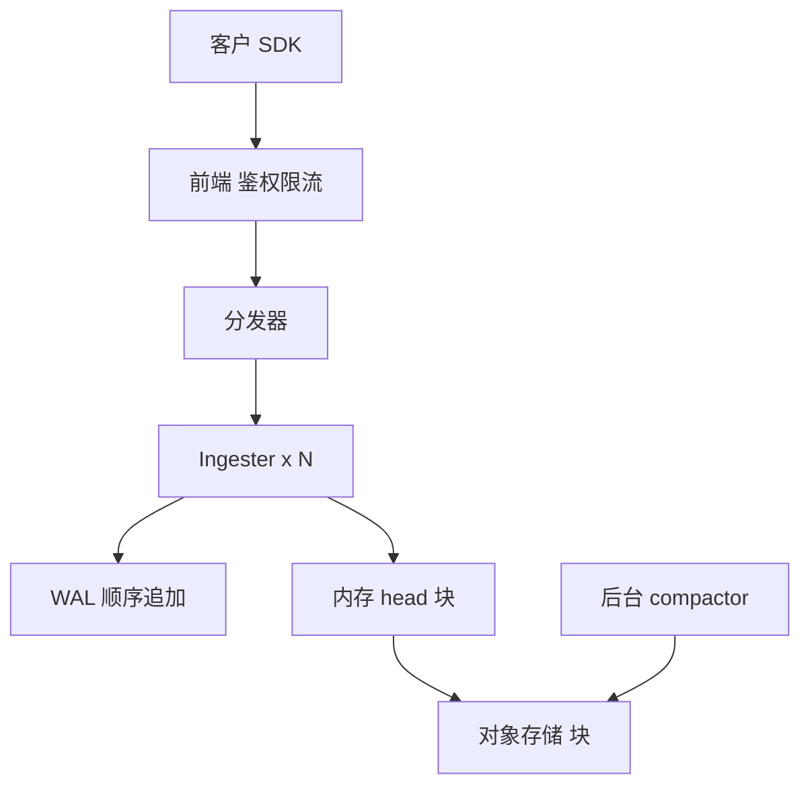
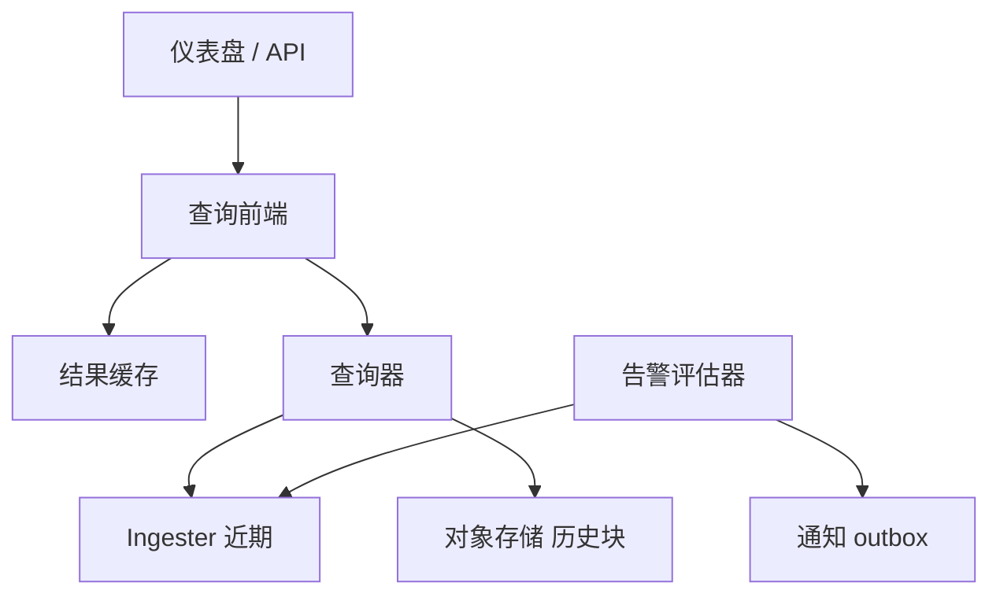
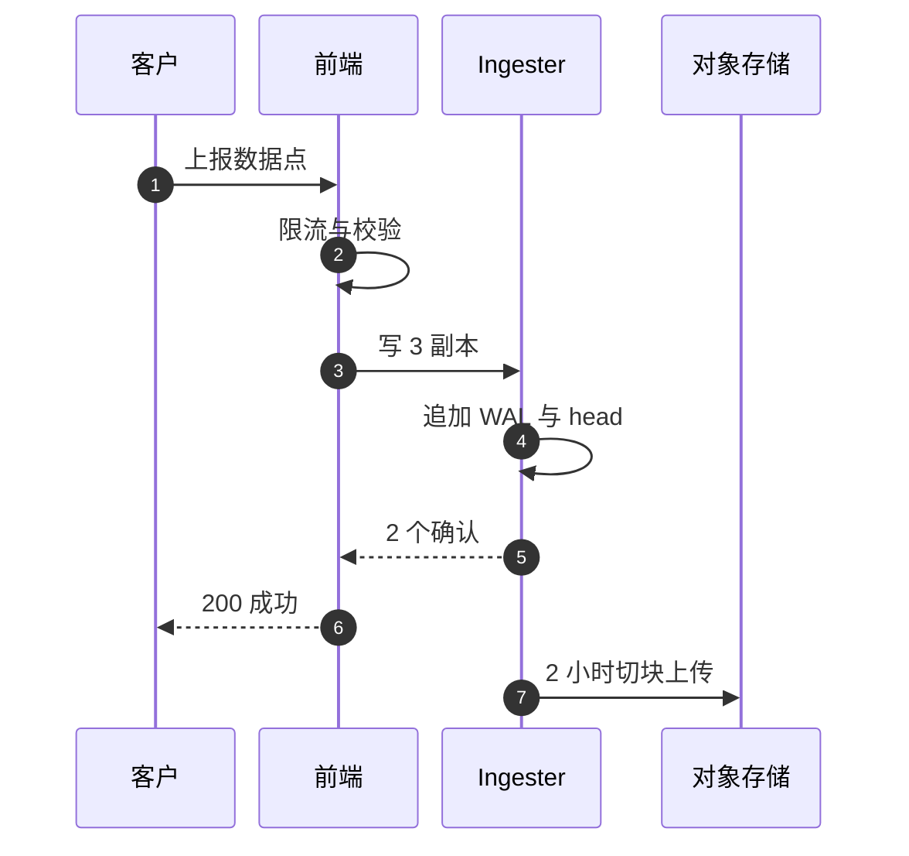

# SD11 托管时序 / 指标存储与降采样（Managed Metrics Time-Series Store）

## 题目

托管指标服务（CloudWatch Metrics 一类）替成千上万个客户账号保存带维度的时间序列：服务器的 CPU、队列的深度、接口的延迟。客户通过 API 上报数据点，按时间范围和统计量（平均、最大、求和、百分位）查询，数据变老后服务自动降低分辨率，并在指标越线时发告警。使用者有三类：写入指标的应用、看仪表盘的工程师、依赖告警叫醒自己的值班人员。

难点有四个。第一，指标的「身份」包含全部维度，每出现一个新的维度取值组合就是一条新序列，序列数（基数，cardinality）才是真正的成本和稳定性约束，而不是数据点数。第二，旧数据要降低分辨率，但降采样之后平均、最大和百分位还要保持正确，百分位尤其不能由别的统计量推出。第三，这是多租户服务，一个账号的基数爆炸或查询风暴不能拖垮别人。第四，告警比仪表盘更重要，出事时大家狂刷仪表盘，告警评估不能因此变慢。

题目：设计一个托管的指标服务。客户（成千上万个账号）通过 API 上报带维度的时间序列数据点；服务保存它们，按时间范围和统计量（平均、最大、求和、百分位）查询，并在数据变老时自动降低分辨率；还要支持基于指标的告警。

它和自建监控系统（采集、告警、仪表盘，见 [[solution-metrics-monitoring]]）的区别是：这里是云厂商视角的多租户托管服务，重点是保留分层与降采样、统计量的可聚合性、基数治理、租户隔离。

## 澄清问题

开场用两三分钟问下面八个问题，答案写在白板角落，每个都会改变设计。

1. **多少租户、总写入多少点/秒、活跃序列多少？** 决定 ingester 的数量，以及内存里的活跃序列数是否是第一约束。下文假设 10 万租户、2,000 万点/秒、5 亿活跃序列。
2. **保留期和分辨率的分层是产品定死的还是租户可配？** 定死则降采样流水线是固定的几层；可配则每个租户都有自己的 compactor 计划，复杂得多。下文采用固定四层。
3. **要不要百分位，要到多长的历史？** 百分位不能由 avg/min/max 推出，要不要百分位决定降采样时存什么（草图还是只存四个统计量）。
4. **迟到和乱序的数据允许多晚？** 决定写入端的乱序缓冲窗口，以及降采样后是否允许重写窗口。
5. **告警要多快？缺数据时怎么判？** 决定告警评估器是否要走独立的短路径，以及要不要支持「缺数据按越线处理」。
6. **维度最多几个、取值是否受控？** 维度是身份的一部分，上限（例如 30 个）和对新序列的限速决定基数治理的力度。
7. **读多还是写多，长跨度查询占多大比例？** 决定查询前端要不要做时间拆分和结果缓存，以及长跨度查询的上限。
8. **是否要跨区域聚合？** 默认区域内闭环，跨区域聚合是另一层，要不要做影响故障隔离的设计。

## 需求

**功能需求（按优先级）**

1. 上报：`PutMetricData(namespace, metric_name, dimensions{k:v}, timestamp, value | statistic_set | (values, counts))`。
2. 查询：`GetMetricData(queries, start, end, period, stat)`，按维度过滤、按 `period` 聚合，支持百分位（p50 / p99 / p99.9）。
3. 保留分层与自动降采样，真实产品的做法如下：周期小于 60 秒的数据点保留 3 小时；60 秒周期保留 15 天；300 秒保留 63 天；3600 秒保留 455 天（15 个月）。初始以较短周期上报的数据会被聚合用于长期存储：15 天后 1 分钟数据只能以 5 分钟分辨率取回，63 天后只能以 1 小时分辨率取回。
4. 告警：对一个指标的统计量在窗口上设阈值，状态机为 OK / ALARM / INSUFFICIENT_DATA。
5. 列表：`ListMetrics`，按命名空间、维度前缀。

**非功能需求**

| 维度 | 目标 | 说明 |
|---|---|---|
| 写延迟 | p99 低，尾部可控 | 允许极少量丢弃，但丢弃必须有可观测的计数，不能悄悄丢 |
| 读延迟 | 最近数据 p99 小于数百毫秒 | 长跨度（几个月）可以慢，但要有上限 |
| 多租户 | 一个账号的基数爆炸或查询风暴不拖垮别人 | 每租户配额、shuffle sharding、公平队列 |
| 可用性 | 写路径高于读路径 | 告警评估路径独立于查询路径 |
| 持久性 | 已确认写入的点不丢 | 至少 3 副本，跨可用区 |

**明确不做**：日志与 trace 存储；任意 SQL；毫秒级实时流处理。

## 容量估算

假设（面试时以对方给的数字为准）：10 万租户，总计 2,000 万点/秒，5 亿活跃序列（活跃指近期有写入）。

| 量 | 计算 | 结果 |
|---|---|---|
| 写入点速率 | 假设 | 2,000 万点/s |
| 副本写入 | 复制因子 RF=3，3 × 2×10^7 | 6,000 万点写/s 的内部流量 |
| ingester 数 | 每台处理 20 万点/s（假设），2×10^7 ÷ 2×10^5 | 100 台，利用率余量再 ×2 |
| 未压缩原始量 | 2×10^7 × 16 B × 86,400 s | 27.6 TB/天 |
| Gorilla 压缩后 | 2×10^7 × 1.37 B × 86,400 s（论文：平均每点 1.37 字节，约 12 倍压缩） | 2.4 TB/天 |
| 活跃序列的内存 | 5×10^8 × 1.5–3 KB/序列（Prometheus 类时序库的经验值） | 750–1,500 GB |
| 分层后每序列点数 | 1 分钟 × 15 天 + 5 分钟 × 63 天 + 1 小时 × 455 天 = 21,600 + 18,144 + 10,920 | 50,664 点 |
| 全程 1 分钟保留 | 1,440 × 455 | 655,200 点，是分层的 12.9 倍 |
| PutMetricData 限制 | 单请求不超过 1 MB（可 gzip）、1,000 个不同指标；每个指标的 Values/Counts 不超过 150 个值 | 客户端必须批量 |

分层点数这一行按「每一层各自保留一份、保留期互相重叠」计算，所以是三项之和。如果各层首尾相接（15 天内 1 分钟，其后到 63 天用 5 分钟，再往后用 1 小时），总数是 21,600 + 48 × 288 + 392 × 24 = 44,832，节省更多；面试里说清楚你用的是哪种口径即可。

这些数字改变的设计有三点：

1. 压缩之后存储不是瓶颈，内存里的活跃序列数才是：750 GB 以上的 head 必须分片，基数治理就是成本治理。
2. 分层降采样省约 13 倍，并且降采样之后每序列的点数不再随时间线性增长。
3. 写路径内部放大到 6,000 万点/s，要求批量化、顺序写，不能一点一条记录。

## 核心实体与 API

**实体**（粗体为主键）

| 实体 | 关键字段 | 说明 |
|---|---|---|
| Series | **series_id** = hash(tenant, namespace, metric_name, 排序后的维度) | 维度是身份的一部分，最多 30 个 |
| DataPoint | (series_id, **timestamp**, value 或 statistic set) | 同一 `(series, timestamp)` 天然是幂等键 |
| StatisticSet | count、sum、min、max | 可结合、可向上再聚合 |
| Block | **(tenant, 层级, 时间窗)**、索引、每序列压缩 chunk | 不可变，对象存储里的单位 |
| PostingList | **(tenant, label_name, label_value)** → series_id 列表 | 倒排索引，过滤维度时求交集 |
| Alarm | **alarm_id**、指标查询、统计量、窗口、阈值、状态 | 状态机 OK / ALARM / INSUFFICIENT_DATA |
| TenantQuota | **tenant_id**、点/s、新序列/s、活跃序列上限、并发查询数 | 前端与查询层共同执行 |

**API**

```
PutMetricData  {namespace, data:[{name, dimensions, timestamp,
                 value | statistic_set{count,sum,min,max} | values[], counts[]}]}
               -> 200 | 400 invalid_timestamp | 429 quota {Retry-After, exploding_dimension}
GetMetricData  {queries:[{id, namespace, name, dimensions, period, stat}], start, end, next_token}
               -> {results:[{id, timestamps[], values[], actual_period}], next_token}
ListMetrics    {namespace, dimension_prefix, next_token} -> [{name, dimensions}]
PutAlarm       {alarm_id, query, stat, period, threshold, missing_data_policy} -> 200
```

上报重试同一个点是安全的：`(series, timestamp)` 是天然的幂等键，同值覆盖没有副作用。返回里带 `actual_period`，让调用方知道拿到的是哪一层分辨率；单次返回的点数有上限，超过用 `next_token` 翻页。

## 高层架构

写路径：



读路径：



**流 1：上报。** 前端认证租户，校验时间戳，按租户限流；分发器按 `series_id` 的一致性哈希把点送给该租户 shuffle shard 里的 ingester，写入 3 个副本，2 个确认即成功。ingester 在内存里追加到该序列的 head，同时顺序追加 WAL（预写日志）；约每 2 小时把 head 切成不可变的块，压缩后写入对象存储。后台 compactor 再把块合并并生成更粗分辨率的降采样块，到保留期就整块删除。

**流 2：查询。** 查询前端把长时间范围按时间拆成多段并行查，每段结果缓存；最近的数据问持有该租户序列的 ingester，历史数据读对象存储里的块。告警评估器走另一条短路径，直接读 ingester 的最近数据，不经过查询前端。



图中编号对应的每一步：

1. 客户端把一批数据点打包上报，单请求不超过 1 MB。
2. 前端检查租户的点/s 与新序列/s 令牌桶，检查时间戳不能太旧或太远的未来，并核对维度个数。
3. 分发器按 `series_id` 哈希，把点发给该租户 shuffle shard 里的 3 台 ingester。
4. 每台 ingester 先追加 WAL（组提交摊薄 fsync），再追加到内存 head；崩溃后按 WAL 重放恢复。
5. 两台确认就返回，不等第三台，慢副本不拖尾延迟。
6. 客户收到成功响应，此后这个点承诺不丢。
7. 后台把 head 切成不可变的块上传，上传可以慢，但不在写的关键路径上。

## 深挖

### 降采样：既省存储，又让统计量保持正确

问题：旧数据要降低分辨率以节省存储和查询成本，但降采样不能让平均变错、让峰值消失，百分位还不能算错。

选项与取舍：

1. **只存平均**：最省，但 `avg(avg(x))` 在各窗口样本数不同时是错的，`max` 被抹平，峰值事故看不见。不可取。
2. **每个窗口存 `count, sum, min, max`**：这正是 CloudWatch 的 statistic set（Min、Max、Sum、SampleCount）。平均 = sum / count，并且可以继续向上一层聚合：

```
rollup(窗口集合 W) = { count: Σcount, sum: Σsum, min: min(min), max: max(max) }
```

这个运算满足结合律，所以可以分层、可以并行、可以重算。

3. **百分位**：百分位不能由 avg / min / max 推出，也不能把各窗口的 p99 再平均。有三条路：
   - 每窗口存可合并的分布草图（t-digest、DDSketch 或直方图桶）：合并后再查百分位，误差有界。DDSketch 的卖点是相对误差保证，面试前核对它的精确表述；
   - 保留客户端预聚合的 `Values/Counts` 数组（每指标最多 150 个值）：相当于客户端自带的直方图，也能取百分位；
   - 只在高分辨率层保留百分位，长期层只提供 count / sum / min / max：这是产品取舍，必须明确告诉客户。

选择：四个统计量是必选；百分位用可合并草图，长期层是否保留草图取决于成本，没有草图的层就明确不提供百分位。

流水线（后台 compactor）：

```
原始 1s/10s 块 -(3 小时)-> 1 分钟块 -(15 天)-> 5 分钟块 -(63 天)-> 1 小时块 -(455 天)-> 删除
每一层: 读上一层块 -> 按窗口对齐聚合 -> 写新块(确定性命名) -> 校验计数 -> 原子替换元数据 -> 删旧块
```

- 幂等重跑：输出块名由 `(tenant, 层级, 起止时间)` 确定，compactor 崩溃后重做得到同名同内容的块，覆盖无副作用。
- 窗口对齐：按 UTC 对齐，保证不同序列、不同 compactor 实例得到相同的窗口边界。
- 迟到数据：窗口已降采样后到达的点，要么丢弃并计数，要么重写该窗口（昂贵）。产品选择是「最大迟到时间 = 本层级窗口长度」，之后拒绝。
- 查询选择分辨率：`GetMetricData(period=P)` 选能覆盖请求范围的、最粗但不超过 P 的层；请求的 period 比该时间点可用的最细分辨率更小，就返回该层分辨率并标注，不凭空插值。

失败模式：compactor 的 bug 把窗口算错，而且错误在 15 天后才被发现。对策是持续校验：抽样租户，对同一窗口比较原始层即时聚合与降采样层的 count / sum / min / max，差异入告警；原始层要比理论最短保留多留一段回滚窗口，才能重算。

### 写路径：分片、复制与乱序

问题：6,000 万点/s 的内部写入，要低尾延迟、不悄悄丢数据，同时一个坏租户不能拖垮别人。

选项：

1. **一致性哈希到全体 ingester**：均衡，但任何租户的基数爆炸都会撑爆所有节点的内存。
2. **每租户固定一组 ingester**：隔离好，但小租户浪费、大租户放不下。
3. **租户 shuffle sharding**：每个租户只使用 ingester 集合中的 k 台（由租户 ID 哈希选出），序列再在这 k 台内按 `series_id` 哈希。坏租户只影响与它共享全部 k 台的极少数租户。

选择第 3 种。复制采用 RF=3、W=2 的无主设计：写 3 台，两台确认即成功，跨可用区。这是为写可用性优先，代价是副本之间可能不同，读时合并去重。ingester 内用内存 head 加 WAL 顺序追加，压缩用时间戳 delta-of-delta 加浮点 XOR（Gorilla 式）。

乱序与迟到：接受一个窗口（例如 1 小时内的迟到点写入 head 的乱序缓冲），更晚的丢弃并计数 `rejected_too_old`。同一 `(series, timestamp)` 重复上报不同值时的语义：同值幂等，异值后写覆盖并记录冲突计数；多副本下后写覆盖需要版本（服务端时间戳或序号）才可确定，否则副本会分歧。

失败模式：一台 ingester 挂，其序列的 1/3 副本丢失，按 WAL 重放，新节点从对等节点拉取最近数据；一个可用区挂，每序列失一个副本，仍能 W=2 写入，前提是事先留足容量（静态稳定），而不是事后扩容。

### 基数治理：成本与稳定性的第一杠杆

问题：维度是身份的一部分，一个把请求 ID 当维度的租户，5 分钟内就能创建上亿条新序列，直接撑爆内存和倒排索引。索引大小随基数线性增长，基数爆炸既是稳定性事故，也是成本事故。

选项：

1. **租户总写入限速**：简单，但爆炸的租户会把自己所有正常指标一起拒掉，误伤自己的告警数据。
2. **只限制新序列创建，已有序列照常写入**：爆炸的是「新」，正常指标是「旧」，把两者分开处理。
3. **事后清理**：发现了再删，内存已经爆了。

选择第 2 种，配合两级阈值：每租户活跃序列数的软限制（告警）与硬限制（拒绝新序列，继续接受已有序列的点）；前端维护每租户的新序列速率（滑动窗口），超速时返回明确错误码并指出哪个维度在爆炸（top 维度）。ingester 的内存按租户核算，超限时驱逐最久未写入的序列。关键是告警评估和查询不能因为某个租户的基数爆炸而变慢，所以给每租户单独的预算。

失败模式：限制把一次合法的发布推广（比如突然新增大量主机）也拒了。对策是限制可以提前申请上调，错误响应里写清楚当前用量与上限，事后给租户一份基数报告。

### 读路径、多租户隔离与告警评估

问题：事故时查询量暴增，一个大查询可能堵住所有小查询，而告警恰恰在此时最不能慢。

读路径：

- 查询前端把长范围按时间拆成多段并行查，每段结果可缓存：块不可变，缓存命中率高，只有最近一段不可缓存或只能短 TTL。
- 最近数据扇出到持有该租户序列的 ingester（只有 k 台，不是全体，扇出受 shuffle shard 约束），RF=3 的副本结果合并去重。
- 历史数据先读块的索引头，再读命中序列的 chunk，热块缓存在本地 SSD。
- 查询保护：每租户并发查询数、最大返回点数、最大扫描序列数；超限快速失败（load shedding），不排队，排队只会让所有人一起变慢。昂贵查询走独立队列加公平调度。

多租户隔离按层：

| 层 | 机制 |
|---|---|
| 写入 | 前端每租户令牌桶（点/s、新序列/s）；ingester shuffle shard；超限返回 429 加 `Retry-After` |
| 存储 | 块按租户前缀；每租户序列数与保留期配额 |
| 读取 | 每租户并发与扫描预算；公平队列 |
| 发布 | 按 cell（账号映射到 cell）灰度，先 one-box，再逐个 cell，bake 期间自动回滚 |

告警评估器是独立的服务，原则是常量工作：按固定节奏（每 10 / 30 / 60 秒）对每条告警读取最近窗口的数据，无论发生什么事故，工作量不变。评估器直接读 ingester 的最近数据，不经查询前端。缺数据的语义要显式：`INSUFFICIENT_DATA`、按越线处理、忽略，由客户选择。评估器多副本，每条告警只由一个主评估器负责（租约加 fencing），主挂了换人；状态转换去抖，连续 N 个窗口才变态。通知走 outbox 加至少一次投递，重复通知靠告警状态机幂等。

失败模式：评估器和查询共用路径，事故时一起变慢，告警晚发。对策就是上面的独立路径与固定预算。

## Staff 视角：权衡、故障与演进

**10 倍规模先坏什么。** 先坏的是内存里的活跃序列数，不是存储：5 亿涨到 50 亿序列，head 要 7.5–15 TB，ingester 要重新分片，shuffle shard 的 k 要调大。其次是倒排索引的大小与 compactor 的追赶速度，compactor 落后会推高存储成本并拖慢查询。写路径的内部流量从 6,000 万涨到 6 亿点/s，要靠更大的批量与更长的 WAL 组提交摊薄。

**每个组件挂了的影响面。**

| 故障 | 影响 | 处理 |
|---|---|---|
| 1 台 ingester 挂 | 其序列的 1/3 副本丢失 | RF=3、W=2；WAL 重放；新节点从对等节点拉取最近数据 |
| 1 个可用区挂 | 每序列失 1 个副本 | 仍能 W=2 写入；静态稳定，事先留足容量 |
| 对象存储抖动 | 历史查询慢、块上传延迟 | ingester 本地磁盘缓冲更久；查询降级为只返回近期并标注不完整 |
| compactor 落后 | 存储成本上升、查询变慢 | 告警；优先级低于 ingestion，但有最低保障预算 |
| 基数爆炸 | 内存撑爆 | 拒绝新序列、按租户核算内存、驱逐冷序列 |
| 坏发布 | 数据点被错误解析 | one-box 加回放对比：新旧版本并行解析同一流，比对结果 |

**多区域。** 指标默认区域内闭环：写入、存储、查询、告警都在本区域，这样区域间故障隔离。跨区域查询由聚合层调用多个区域的 API，某个区域故障时返回部分结果并标注。跨区域复制只给关键指标，作为灾备。

**成本驱动。** 内存里的 head（750–1,500 GB 起）与倒排索引是最贵的部分，所以基数治理等于成本治理；其次是 RF=3 的内部流量和跨可用区传输；对象存储因为 12 倍压缩加分层降采样而很便宜。长跨度查询的扫描成本要靠缓存不可变块与查询上限控制。

**迁移与发布。** 按 cell 灰度，新版本先在 one-box 上并行解析同一数据流，与旧版本结果对比；compactor 的新逻辑先在影子租户上跑，用校验作业比对降采样结果。

**可观测性。** 指标要覆盖：`points_rejected`（按原因：太旧、限流、新序列）、每租户活跃序列数、WAL 延迟、副本落后量、compactor 滞后、降采样校验差异、告警评估延迟（必须有硬告警）。运行手册写清：哪个开关可以关闭新序列创建，谁有权按。

## 面试官追问

1. **为什么降采样要存 count / sum / min / max，而不是只存平均？百分位怎么办？** 平均不可再聚合（要加权），还会抹平峰值；百分位无法由其它统计量推导，也不能平均百分位，必须存可合并的分布草图或直方图，或在长期层明确不提供百分位。
2. **如何让降采样可重算（比如修了 bug 要重做）？** 降采样是原始（或上一层）数据的纯函数，输出块名确定，只要保留上一层数据到下一层校验通过，就能重跑。代价是原始数据要比理论最短保留多留一段回滚窗口。
3. **客户重复发送同一时间戳、不同值的点怎么办？** 先定义语义：同一 `(series, timestamp)` 后写覆盖，或拒绝并计数；统计型数据（statistic set）也可以改为合并。同值幂等，异值取最后写入并记录冲突计数；多副本下后写覆盖需要服务端版本才可确定。
4. **一个租户 5 分钟内创建了 1 亿个新序列（比如把请求 ID 当维度）。** 前端的新序列速率限制先触发，拒绝新序列而已有序列照常，返回明确错误并指出爆炸的维度名；ingester 的内存按租户核算，超限时驱逐最久未写入的序列；该租户 shuffle shard 之外的租户不受影响；事后给租户一份基数报告。
5. **查询过去 1 年、5 分钟粒度，但数据在 1 小时层怎么办？** 该范围的老部分只有 1 小时分辨率，API 返回 1 小时粒度并在响应里标注实际分辨率，永远不凭空插值。客户需要更细，只能提前配置更长的高分辨率保留，成本更高。
6. **如何让写入 p99 低又不丢？** 写路径只做内存 append 加 WAL 顺序追加，两个副本确认就返回；压缩和落盘异步、批量。WAL 用组提交摊薄 fsync；尾延迟靠对冲请求（hedged request）和快速剔除慢副本，W=2 不等第三个。
7. **为什么不把数据点直接放进 DynamoDB 之类的通用 KV？** 每点一条记录的写放大和索引成本太高（5 亿序列持续写入）；时序的访问模式是按序列按时间范围，适合按块批量写、批量压缩；通用 KV 做不到 12 倍压缩；过期数据要逐条删除、留下墓碑。结论是热数据用专用的块格式，冷数据放对象存储。
8. **多区域怎么做？** 指标默认区域内闭环，故障隔离；跨区域查询由聚合层调用多个区域的 API，故障时返回部分结果并标注；跨区域复制只给关键指标，作为灾备。
9. **怎么证明降采样是对的？** 持续校验：抽样租户，对同一窗口比较原始层即时聚合与降采样层的 count / sum / min / max，差异告警。思路和存储系统的 scrub 一致：用归档日志离线重建，再与线上副本比对。
10. **告警为什么不能用查询接口来评估？** 事故时仪表盘查询暴增，共用路径会让告警一起变慢，正好在最需要的时候晚发。评估器是常量工作的独立服务，直接读 ingester 的最近数据，并有独立的预算。

## 60 分钟怎么分配

| 分钟 | 做什么 | 白板内容 | 时间不够时 |
|---|---|---|---|
| 0–5 | 澄清问题，定假设 | 租户数、点/s、活跃序列、保留分层 | 只问规模与保留分层 |
| 5–10 | 需求与容量估算 | 27.6 TB/天、2.4 TB/天、750–1,500 GB 内存、12.9 倍节省 | 只写「基数是第一约束」这一个数字 |
| 10–15 | 实体与 API | series_id = hash(维度)、PutMetricData、GetMetricData | 压缩为三行 API |
| 15–25 | 高层架构与两条流 | 写路径图、读路径图、写入序列图 | 保留，不能砍 |
| 25–40 | 深挖：降采样；基数治理 | 四个统计量、草图、流水线、拒新序列 | 必讲这两个 |
| 40–50 | 深挖：写路径分片；读路径与告警独立 | shuffle shard、RF/W、评估器的常量工作 | 只讲告警独立 |
| 50–55 | Staff 视角：故障、多区域、成本 | 故障表、区域内闭环 | 只讲故障表 |
| 55–60 | 追问与总结 | 一句话：基数与可聚合性是核心 | 总结一句 |

**45 分钟版**（前面有 10–15 分钟行为面试）：澄清 3 分钟，容量 3 分钟，API 2 分钟，架构 7 分钟，降采样 10 分钟，基数治理 8 分钟，告警与降级 5 分钟，其余留给追问。写路径分片的细节用「shuffle shard 加 RF=3 / W=2」一句话带过。

## 自测

1. 为什么容量估算里「活跃序列数」比「点数」更能决定设计？

<details><summary>答案</summary>

压缩后每点约 1.37 字节，一天只有 2.4 TB，存储不难；但每条活跃序列要在内存里保留 head 和索引，约 1.5–3 KB，5 亿序列就是 750–1,500 GB，必须分片，并且序列数由维度组合决定。所以基数治理就是成本和稳定性的治理。

</details>

2. 降采样窗口至少要存哪几个值，百分位为什么不能由它们推出？

<details><summary>答案</summary>

至少存 count、sum、min、max，平均 = sum / count，并且可结合地向上聚合。百分位取决于整个分布，四个统计量丢掉了分布信息，各窗口的 p99 再平均也是错的，所以要存可合并的草图或直方图，或在长期层不提供百分位。

</details>

3. 租户一夜之间把请求 ID 当成维度，应该拒绝所有写入还是只拒绝新序列？为什么？

<details><summary>答案</summary>

只拒绝新序列，已有序列照常接受。爆炸的是「新」序列，正常的指标和告警数据是「旧」序列；拒绝所有写入会让租户自己的告警失去数据，误伤正常指标。同时返回错误码并指出爆炸的维度。

</details>

4. 100 天前的数据，请求 5 分钟粒度，服务应该怎么回答？

<details><summary>答案</summary>

100 天超过了 63 天，5 分钟层已过期；455 天内老于 63 天的数据只有 1 小时分辨率，服务返回 1 小时粒度并在响应里标注实际分辨率，不插值、不假装是 5 分钟。

</details>

5. 告警评估器为什么必须独立于查询路径，并且是「常量工作」？

<details><summary>答案</summary>

事故时仪表盘查询暴增，共用路径会让告警一起变慢，晚发正是最不能接受的。评估器按固定节奏读每条告警的最近窗口，工作量与事故无关，并有独立预算、直接读 ingester 的最近数据，状态转换去抖，通知走 outbox 加至少一次投递。

</details>

## 延伸阅读

- 相邻题解：[[solution-metrics-monitoring]]（自建监控系统：采集、告警、仪表盘）。
- 同批题单：[[sd-index]]。
- CloudWatch 概念与保留：https://docs.aws.amazon.com/AmazonCloudWatch/latest/monitoring/cloudwatch_concepts.html
- PutMetricData API：https://docs.aws.amazon.com/AmazonCloudWatch/latest/APIReference/API_PutMetricData.html
- Gorilla 内存时序库论文（VLDB 2015）：https://www.vldb.org/pvldb/vol8/p1816-teller.pdf
