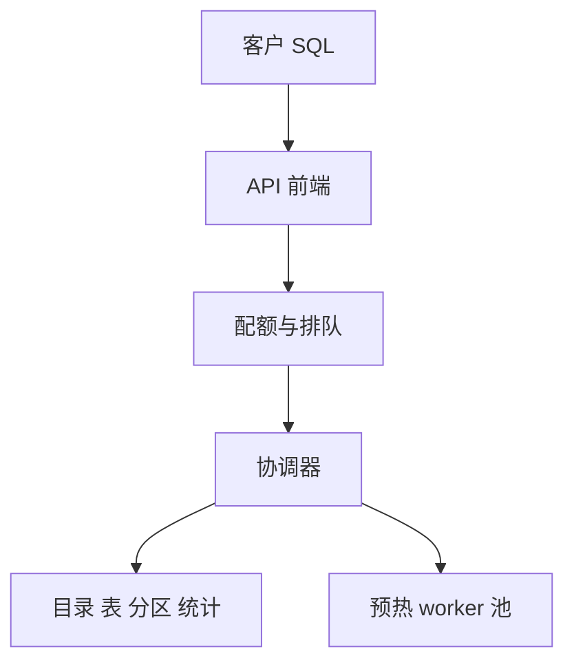
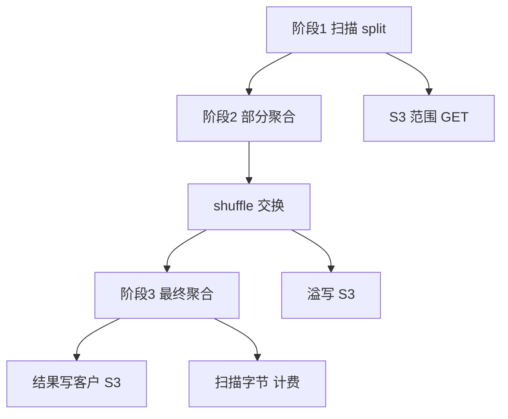
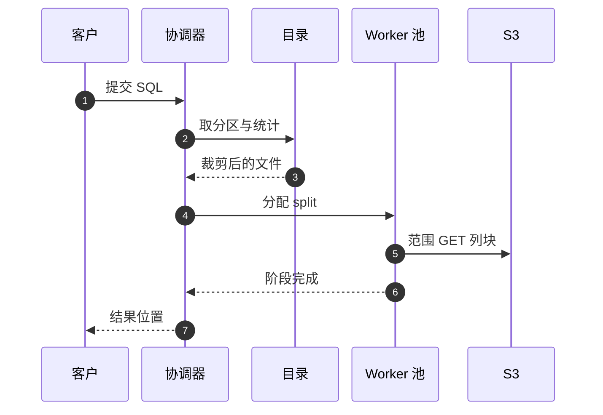

# SD12 S3 之上的无服务器 SQL 查询（Serverless Query over S3）

## 题目

无服务器查询服务（Athena 一类）让用户把数据放在 S3 上（Parquet、ORC、CSV、JSON），在目录（catalog）里登记表，然后直接提交 SQL。用户不需要创建或管理任何集群，按扫描的数据量付费，没有查询时成本为零。使用者有三类：写 SQL 的分析师、把查询嵌进流水线的工程师、关心账单的账号管理员。

难点有四个。第一，瓶颈是 S3 的读吞吐和 GET 请求速率，不是 CPU，所以「少读」比「加机器」更划算，规划阶段必须在读到第一个字节前把绝大部分数据排除。第二，一个查询要在一两秒内凭空拿到上千个并行 worker，不可能冷启动，必须有预热的共享 worker 池。第三，成千上万个租户共用这个池，要隔离、要公平。第四，计费按扫描字节，引擎必须精确统计扫描量，并给用户降低扫描量的手段。

题目：设计一个无服务器交互式查询服务：用户把数据放在 S3 上，在目录里登记表，直接提交 SQL。没有集群需要用户创建或管理，按扫描的数据量付费。目标：扫描 1 TB 的查询在几十秒内返回，同时服务成千上万个并发的用户。

## 澄清问题

开场用两三分钟问下面八个问题，答案写在白板角落。

1. **查询的典型规模和延迟目标？** 交互式是秒到几十秒，批量是分钟到小时；决定是否需要推测执行、shuffle 要不要落 S3。下文假设：扫描 10 TB 的查询在 60 秒内完成。
2. **数据格式和表格式？** 列存（Parquet / ORC）还是文本（CSV / JSON）；Hive 风格的目录分区还是 Iceberg 一类的表格式。决定能不能做行组统计剪枝、能不能保证快照一致。
3. **分区数量级？** 数百万个分区时，分区查找本身成为瓶颈，要不要分区索引或分区投影。
4. **并发用户数与多租户边界？** 决定 worker 池的大小、配额和公平调度。
5. **一致性：查询中途数据被覆盖怎么办？** 有快照的表格式可以固定读版本；Hive 风格没有这个保证，要在产品上说清楚。
6. **失败与取消的计费规则？** 按扫描字节计费时，失败的查询收不收费，取消的查询收多少。
7. **结果怎么交付？** 结果落地到客户的 S3 前缀并分页读取，还是小结果内联返回。
8. **要不要支持写？** 只做 CTAS（Create Table As Select）与 INSERT，不做事务，还是要完整的写事务。

## 需求

**功能需求（按优先级）**

1. 提交 SQL（SELECT、聚合、JOIN、窗口函数），查看状态、取消、取结果；结果写到 S3 并可分页读取。
2. 读取目录中的表和分区。
3. `CREATE TABLE AS SELECT`：把数据转成列存，让后续查询更便宜。
4. 查询前预估扫描量，账号级预算上限。

**非功能需求**

| 维度 | 目标 | 说明 |
|---|---|---|
| 延迟 | 交互式秒到几十秒，支持分钟到小时的长查询 | p50 与 p99 的比值要可控，尾部由 straggler 和 S3 抖动决定 |
| 弹性 | 零查询时成本为零 | 一个用户的 1 万 vCPU 瞬时突发不应要求其预置 |
| 多租户 | 一个用户的重查询不饿死别人 | 每账号并发上限与配额 |
| 正确性 | 读到一致的快照 | 表格式提交原子，没有「一半新一半旧」 |
| 计费 | 按扫描字节，可预测 | 引擎精确统计扫描量，并提供降低扫描量的手段 |

**明确不做**：低于 100 ms 的点查；写入事务（除 CTAS / INSERT）；跨查询的常驻缓存集群（可作为优化）。

## 容量估算

场景：一个扫描 10 TB 原始数据的查询，目标 60 秒内完成。

| 量 | 计算 | 结果 |
|---|---|---|
| 所需聚合读吞吐 | 10 TB ÷ 60 s | 约 167 GB/s |
| worker 数 | 每个 worker 从 S3 的有效读速率保守假设 125 MB/s（含解码）：167 GB/s ÷ 125 MB/s | 约 1,334 个并行 worker |
| S3 GET 数 | 每次 8 MB 范围读：10 TB ÷ 8 MB | 125 万次 GET，约 2.1 万 GET/s |
| 需要的前缀数 | S3 每前缀至少 5,500 读/s：20,833 ÷ 5,500 | 至少 4 个前缀，否则出现 503 Slow Down |
| 剪枝后 | 分区裁剪、列裁剪、行组统计砍掉 99% | 只扫 100 GB，同样 1,334 个 worker 约 0.6 秒读完 |
| 列裁剪收益 | 表 100 列、查 3 列、Parquet 压缩约 4 倍（经验值）：3 ÷ 100 ÷ 4 | 读取量约原始的 0.75% |
| `SELECT *` 的代价 | 100% ÷ 0.75% | 约 133 倍 |

这些数字改变的设计有三点：

1. 瓶颈是 S3 吞吐与 GET 请求速率，不是 CPU。数据布局、分区直接决定能不能打满吞吐。
2. 查询时间正比于扫描量除以并行度，所以剪枝（少读）比加机器更划算。
3. 1,300 个 worker 要在一两秒内凭空出现，需要预热的共享 worker 池，而不是每个查询冷启动一堆容器。

## 核心实体与 API

**实体**（粗体为主键）

| 实体 | 关键字段 | 说明 |
|---|---|---|
| Table | **(database, table)**、schema、格式、位置、统计 | 登记在目录里 |
| Partition | **(table, 分区值)**、S3 位置、行数 | 数百万个时需要索引或投影 |
| Query | **query_id**、账号、SQL、状态、扫描字节、计划 | 计费与审计的依据 |
| Stage / Task | **(query, stage, task, attempt)**、split、状态 | 输出按这个名字落盘，成功的 attempt 才被采用 |
| Split | 文件 + 字节范围（对齐行组，64–128 MB） | 调度单位 |
| ResultSet | **query_id** 下的 manifest、结果文件、分页 token | 落在客户的 S3 前缀 |
| AccountQuota | **account_id**、并发查询数、每查询最大 worker 数、预算 | 排队与拒绝的依据 |

**API**

```
POST   /v1/queries            Idempotency-Key: <uuid>
       {sql, workgroup, result_location}   -> 202 {query_id}
GET    /v1/queries/{id}                    -> {state, scanned_bytes, error?}
DELETE /v1/queries/{id}                    -> 202（取消）
GET    /v1/queries/{id}/results?token=     -> {rows[], next_token}
POST   /v1/queries/estimate  {sql}         -> {estimated_scan_bytes}
```

提交带幂等键：网络超时后重试同一个请求不会提交两次，也不会收两次费。

## 高层架构

控制面（规划与调度）：



数据面（执行）：



**流 1：提交与规划。** API 前端认证并检查账号配额，超限则有上限地排队；协调器（每个查询一个）解析、绑定、优化 SQL，向目录取表和分区信息，做分区裁剪和文件级裁剪，生成分布式执行计划：若干阶段，每阶段若干任务。

**流 2：执行。** 协调器从共享 worker 池申请 worker，把 split 拉取式地分配下去。扫描任务对每个 split 并发发 `Range GET` 读取需要的列块，解码成列批，应用谓词；先做部分聚合再按 key 哈希交换，最终聚合的结果写到客户的 S3 前缀，同时记下精确的扫描字节作为计费依据。



图中编号对应的每一步：

1. 客户提交 SQL，带幂等键。
2. 协调器向目录取表的分区和统计信息，在规划阶段做分区裁剪。
3. 目录返回裁剪后的文件清单，还有 Parquet footer 的行组统计可以继续跳过行组。
4. 协调器把 split 拉取式地分给 worker，做完一个再要下一个。
5. worker 对每个 split 并发发范围 GET，只读被引用的列块；多个相邻列块合并成一次较大的读。
6. worker 汇报阶段完成，shuffle 数据先放内存和本地盘，不足时溢写到 S3。
7. 协调器把结果位置和分页 token 返回给客户。

## 深挖

### 规划：在读到第一个字节之前排除 99% 的数据

问题：10 TB 的查询若全扫要 167 GB/s；规划阶段能排除的数据越多，执行越快越便宜。但目录里可能有数百万个分区，分区查找本身也会成为瓶颈。

选项与做法：

1. **分区裁剪（partition pruning）**：WHERE 命中分区键，只列出匹配分区，只扫这些分区的数据。分区数巨大时：
   - 目录分区索引：没有索引时要加载全部分区再过滤；
   - 分区投影（partition projection）：分区信息不存目录，而存成规则（日期范围、整数范围），规划时在内存里计算要读的分区，不去查目录。代价：稀疏表会对空前缀产生大量 S3 `LIST`；缺少某个分区键的谓词会使用整个取值范围（100 万个取值就是 100 万次 LIST）。
2. **分区粒度的取舍**：为最常见的查询优化，不为罕见查询优化。天级查询不要按小时分区；按时间戳排序的列存文件对短时间窗几乎和小时分区一样高效；分区键太多会碎成小文件。
3. **文件级、行组级裁剪**：Parquet 文件由若干行组组成，每个行组里每列一个列块；footer 里存 schema 与每个列块的 min / max 统计。执行时读 footer（对象末尾的一次小范围 GET），用谓词跳过整个行组，即谓词下推（predicate pushdown）。Iceberg 一类的表格式更进一步：manifest 里就有文件级统计，规划阶段不必打开文件就能跳过。
4. **列裁剪（projection）**：只读被引用的列块，这是列存最大的收益（0.75%）。
5. **统计信息与基数估计**：行数、不同值个数（NDV）、min / max 决定 join 顺序与策略（广播或分区哈希）。统计过期会让计划变差，但不影响正确性。
6. **小文件与 `LIST` 成本**：规划要列文件，百万个小文件会让规划本身花几十秒。服务端要有文件清单缓存，并鼓励（或自动）合并小文件。

选择：分区索引或投影处理分区爆炸，表格式的 manifest 承担文件级剪枝，列存加行组统计处理其余。

失败模式：统计过期导致选错 join 策略，查询变慢。对策是运行时自适应：一侧过滤后变小就改为广播。

### 执行：split、task、stage 与 shuffle

问题：把计划变成上千个并行任务，数据要在阶段之间交换，还要抵抗 straggler 和倾斜。

做法：

- **split**：一个 split 是一个文件的一段，通常对齐到 Parquet 行组或 64–128 MB。协调器拉取式调度：worker 做完再要下一个，天然负载均衡。
- **扫描任务**：对每个 split 并发发 `Range GET` 读需要的列块，几个相邻列块合并成一次较大的读以减少请求数；解码为列批（vectorized batch）；应用谓词，输出到下一阶段。
- **聚合**：每个扫描任务先做部分聚合（partial aggregation），再按 group key 哈希重分区到最终聚合，减少 shuffle 的数据量。
- **JOIN**：小表广播（broadcast）到所有 probe worker；两个大表则双方按 join key 哈希分区（shuffle hash join）。选择依据是统计信息。
- **倾斜**：热门 key 让某个任务远慢于其他任务，对热 key 单独拆分、加盐，或自适应重分区。
- **shuffle 的存储**：先放内存和本地盘，容量不足时溢写到 S3，慢但可容错。把 shuffle 数据放在 S3 还有一个好处：它是持久的中间结果，下游任务失败只需重做下游（阶段级重试），不必从头执行。

选项的取舍：范围读粒度 8 MB 比 1 MB 少 8 倍 GET 请求（请求费与速率限制都受益），但裁剪粒度变粗；取舍点由 S3 请求成本与行组大小共同决定。

失败模式：两个 5 TB 的大表 join，哈希分区数太少导致单分区超内存。对策是分区数取大一些，先各自过滤和列裁剪再 shuffle，倾斜 key 拆分。

### 容错与长尾

问题：上千个任务里总有慢的、死的，S3 也会抖动；一个任务拖住整个查询的尾延迟。

| 问题 | 机制 |
|---|---|
| worker 崩溃或被回收 | 任务幂等：输入 split 不可变（对象不可变或快照固定），重新调度到另一台 worker 即可；输出以 `(query, stage, task, attempt)` 命名，只有成功 attempt 的输出被采用 |
| straggler（慢任务） | 推测执行：任务耗时超过同阶段中位数的 k 倍时，在另一台 worker 启动副本，先完成者胜，败者取消；代价是多 5–10% 计算 |
| S3 503 Slow Down 或抖动 | 带抖动的指数退避重试 GET；限制每个查询的 GET 并发；跨多个前缀分散；对热点对象做请求合并 |
| 协调器崩溃 | 查询状态（计划、已完成阶段）定期写入持久存储，新协调器可接管；否则查询失败重提，对交互式短查询可接受 |
| 内存不足 | 溢写到本地盘或 S3；超限则只失败该查询（爆炸半径是一个查询），而不是整台 worker |
| 数据在查询中途被覆盖 | 表格式固定读的快照；无事务的 Hive 风格目录有读到混合数据的已知风险，要在产品文档中写明 |

还要排查 straggler 的根因：热分区（倾斜）、慢 S3 对象（重试或换前缀）、慢 worker（灰色故障，摘除）。

### 无服务器与多租户的资源模型

问题：无服务器意味着用户不预置资源，但 1,300 个 worker 不可能在 1 秒内冷启动。

选项：

1. **每个查询冷启动一批容器**：隔离最好，但启动要几十秒，交互式查询无法接受。
2. **预热共享池**：持续保持一池热 worker，多租户共用。
3. **每账号专属集群**：隔离最强，但违背「零查询零成本」。

选择第 2 种，并补隔离：

- 预热池使用微虚拟机（隔离性强、启动快），池大小按历史需求预测加余量自动扩缩，目标利用率 50–70%，余量留给突发（利用率—排队延迟曲线有拐点）。
- 配额与公平：每账号并发查询数、每查询最大 worker 数、每账号每秒 DML / DDL 上限；超限排队（队列有上限）或拒绝；队列按账号加权轮询，避免大账号独占。
- 隔离：worker 内部按查询沙箱隔离；每个查询的 S3 凭证是限定到其有权前缀的临时凭证，绝不让 worker 持有全桶权限。
- 容量预留（可选产品）：愿意付费的客户获得专属 worker 配额，隔离吵闹邻居。
- 爆炸半径：协调器与 worker 池按 cell（账号哈希）划分；发布走 one-box → 逐个 cell → bake。

### 计费：按扫描字节意味着什么

按扫描量计费的含义：计费字节等于实际从 S3 读取的字节，即压缩后的列块字节，而不是解压后。所以列存、压缩、列裁剪、分区裁剪、行组跳过直接降低客户的账单，这也是产品的核心卖点。示例（单价 $5/TB，实际按区域不同，面试里不要报具体单价）：3 TB 未压缩文本 = $15；GZIP 后 1 TB = $5；Parquet 加压缩、只读一列的 0.25 TB = $1.25。

- 引擎必须精确且可审计地统计每个查询的扫描量；失败的查询不收费，取消的查询按已扫描字节收费，这类规则要事先写明。
- 服务端成本是 worker 计算、S3 请求数和数据传输。
- 防滥用：`SELECT *` 对 100 列的表是 0.75% 到 100% 的差别（约 133 倍），所以提供预估扫描量和账号级预算上限。

结果与交互：结果写入客户的 S3 前缀（分段并发写，最后合并成 manifest），API 返回结果位置与分页 token；小结果可直接内联返回。结果复用缓存：相同 SQL、相同表快照版本、相同参数就返回缓存结果（快照不可变，所以安全），失效键是表元数据版本，命中即零扫描。取消查询时协调器通知所有任务终止，已发出的 S3 请求无法收回，但结果丢弃。

## Staff 视角：权衡、故障与演进

**10 倍规模先坏什么。** 首先是 S3 的请求速率与前缀布局：GET 峰值从 2.1 万涨到 21 万次/s，需要至少 40 个前缀，S3 的自动扩容是渐进的，期间会出现 503，所以要预热、分散前缀并限制查询级并发。其次是目录：分区数和并发规划请求一起涨，分区索引与投影、元数据缓存成为热点。再次是 worker 池的预测：突发超出池容量时先有上限地排队，超过排队上限就限流并返回明确错误（load shedding），而不是让所有查询一起变慢。

**每个组件挂了的影响面。**

- 协调器：影响一个查询，状态持久化后新协调器接管；交互式短查询直接重提。
- worker：任务幂等，重新调度；败者副本取消。
- 目录：规划不可用，已缓存的元数据可以让热门表继续；这是最大的单点，必须多副本。
- S3：抖动时退避、降并发；区域级故障则整个服务该区域不可用。
- 整个 worker 池：按 cell 划分，爆炸半径限于一个 cell。

**多区域。** 查询在数据所在区域内执行：S3 的跨区域读又慢又贵。控制面区域内闭环；跨区域只做目录元数据的复制与跨区域查询的路由，由用户显式选择。

**成本驱动。** 服务端成本是 worker 计算、S3 请求数和数据传输。预热池的余量是固定成本，利用率目标 50–70% 是余量与成本的取舍；推测执行多 5–10% 计算；请求粒度越大 GET 越少，但裁剪越粗。

**迁移与发布。** 引擎新版本走 one-box，再逐 cell，bake 期间自动回滚；用黄金查询集（对固定快照的查询，结果哈希固定）加新旧版本并行的影子执行比对，防止新版本悄悄读错数据；shuffle 加校验和。

**可观测性。** 指标：规划耗时（分区查找、LIST 次数）、每阶段耗时的 p50 / p99、推测执行比例、S3 503 比例、排队时长、每账号扫描字节、池利用率。告警：规划耗时突变、503 比例上升、扫描字节计费与实际 S3 读取的差异。

## 面试官追问

1. **表有 500 万个分区，规划就要 30 秒，怎么办？** 用目录分区索引；用分区投影，以规则计算分区而不查目录（注意稀疏表会产生大量空 LIST）；换表格式让 manifest 承担裁剪；降低分区粒度（天级而非小时级）并按时间戳排序；合并小分区。
2. **查询只用 3 列，为什么 Parquet 的 `SELECT *` 仍然很慢？** `SELECT *` 要读全部 100 个列块，扫描量是列裁剪后的约 133 倍。列存只在只取需要的列时才有优势；这也是计费上的直接损失。
3. **一个 join 的两侧都是 5 TB，怎么执行？** shuffle hash join：双方按 join key 哈希到 N 个分区，每个分区在一个任务内建较小一侧的哈希表并探测。要点：先各自过滤和列裁剪，减少 shuffle 量；N 取大一些，避免单分区超内存；倾斜 key 拆分；若一侧过滤后变小，则在运行时切换为广播（自适应执行）。
4. **怎么解决 straggler？** 拉取式小 split、推测执行、阶段末尾拆小任务。再排查根因：热分区（倾斜）、慢 S3 对象（重试或换前缀）、慢 worker（灰色故障，摘除）。
5. **S3 的 503 Slow Down 怎么避免？** 数据布局分散到多个前缀；范围读粒度足够大（8 MB 而不是 64 KB）；退避重试；查询级并发限速；对重复读取的热对象在 worker 池本地缓存。S3 的自动扩容是渐进的，期间会出现 503。
6. **如何保证用户读到一致的数据？** 对表格式的表，查询开始时固定一个快照 id，整个查询只读该快照引用的文件。Hive 风格目录没有这个保证，文件可能在查询途中被替换；产品上用「先写临时前缀、再原子改目录指针」的惯例并告知用户。
7. **并发 1 万个查询，worker 池怎么扩缩？** 协调器按需向调度器申请槽位，调度器把需求（排队长度 × 每查询所需并行度）作为扩容信号；缩容保守以避免抖动；容量预测用历史加日历特征；突发超出池容量时先排队（有上限），超过排队上限就限流并返回明确错误，而不是让所有查询一起变慢。
8. **为什么交互式查询不直接用 DynamoDB 或 OLTP 数据库？** 访问模式是大范围扫描加聚合，OLTP 的行存、B-tree 会读取全部列、随机 I/O，也无法按扫描量弹性扩展；S3 加列存加无状态计算把存储与计算分离，各自独立扩缩。
9. **怎样支持「最近 5 分钟的新数据也能查到」？** 依赖摄取层把新文件原子提交进表元数据，查询规划时读取最新快照。小文件多会读放大，所以最新的数据是小文件，旧数据已合并。不要让查询引擎自己维护写路径。
10. **如何证明引擎没有读错数据？** 黄金查询集（对固定快照的查询，结果哈希固定）、新旧版本并行的影子执行比对、对 shuffle 数据的校验和。

## 60 分钟怎么分配

| 分钟 | 做什么 | 白板内容 | 时间不够时 |
|---|---|---|---|
| 0–5 | 澄清问题，定假设 | 数据格式、分区数、并发、目标延迟 | 只问规模与延迟 |
| 5–10 | 需求与容量估算 | 167 GB/s、1,334 worker、2.1 万 GET/s、0.75% | 只写「瓶颈是 S3，少读优先」 |
| 10–15 | 实体与 API | 提交、状态、结果、estimate | 压缩为三行 API |
| 15–25 | 高层架构与两条流 | 控制面图、数据面图、序列图 | 保留，不能砍 |
| 25–40 | 深挖：规划裁剪；执行与 shuffle | 分区裁剪、行组统计、partial agg、broadcast vs shuffle | 必讲这两个 |
| 40–50 | 深挖：容错与长尾；无服务器资源模型 | 幂等任务、推测执行、预热池、配额 | 只讲预热池与 straggler |
| 50–55 | Staff 视角：规模、故障、成本 | 10 倍后先坏 S3 前缀与目录 | 只讲 10 倍与故障 |
| 55–60 | 追问与总结 | 一句话：少读优先于加机器 | 总结一句 |

**45 分钟版**（前面有 10–15 分钟行为面试）：澄清 3 分钟，容量 3 分钟，API 2 分钟，架构 7 分钟，规划裁剪 9 分钟，执行加容错 9 分钟，预热池与多租户 6 分钟，其余留给追问。计费细节用「按压缩后实际读取的字节计，列存和裁剪直接降账单」一句话带过。

## 自测

1. 10 TB、60 秒的查询为什么说瓶颈在 S3 而不在 CPU，这改变了什么设计？

<details><summary>答案</summary>

需要 167 GB/s 的聚合读吞吐，约 1,334 个 worker，每次 8 MB 范围读就是 125 万次 GET、约 2.1 万 GET/s，至少 4 个 S3 前缀。查询时间正比于扫描量除以并行度，所以设计上剪枝（分区、列、行组）优先于加机器，数据布局要分散前缀。

</details>

2. 为什么不能每个查询冷启动一批容器，预热池怎么定大小？

<details><summary>答案</summary>

1,300 个 worker 要在一两秒内出现，冷启动要几十秒。用微虚拟机的预热共享池，大小按历史需求预测加余量，目标利用率 50–70%：余量留给突发，再高排队延迟会陡增。

</details>

3. Parquet 的 footer 有什么用，对规划和计费有什么影响？

<details><summary>答案</summary>

footer 存 schema 和每个列块的 min / max 统计。读一次小范围 GET 就能用谓词跳过整个行组，减少扫描字节，直接降低延迟和账单；Iceberg 一类表格式把文件级统计放进 manifest，规划阶段甚至不用打开文件。

</details>

4. 一个任务比同阶段中位数慢很多时怎么处理，代价是什么？

<details><summary>答案</summary>

推测执行：在另一台 worker 启动副本，先完成者胜，败者取消。任务幂等（输入 split 不可变，输出以 attempt 命名，只采用成功的）所以安全；代价是多 5–10% 计算。还要查根因：倾斜、慢 S3 对象、灰色故障 worker。

</details>

5. 为什么按扫描字节计费会改变引擎的设计？

<details><summary>答案</summary>

计费字节是实际从 S3 读取的压缩列块字节，所以引擎必须精确且可审计地统计扫描量，并提供降低扫描量的手段：列存、分区裁剪、行组跳过、预估扫描量、预算上限。失败与取消的计费规则要事先写明，`SELECT *` 比只取三列贵约 133 倍。

</details>

## 延伸阅读

- 相邻题解：[[solution-object-storage]]（S3 如何分区与扩展）、[[solution-top-k]]（近似聚合）、[[solution-ad-click-aggregation]]（批流结合）。
- 同批题单：[[sd-index]]。
- Athena 列存格式：https://docs.aws.amazon.com/athena/latest/ug/columnar-storage.html
- Athena 数据优化（分区、投影、小文件）：https://docs.aws.amazon.com/athena/latest/ug/performance-tuning-data-optimization-techniques.html
- Athena 分区：https://docs.aws.amazon.com/athena/latest/ug/partitions.html
- Parquet 文件格式：https://parquet.apache.org/docs/file-format/
- S3 请求速率与性能优化：https://docs.aws.amazon.com/AmazonS3/latest/userguide/optimizing-performance.html
