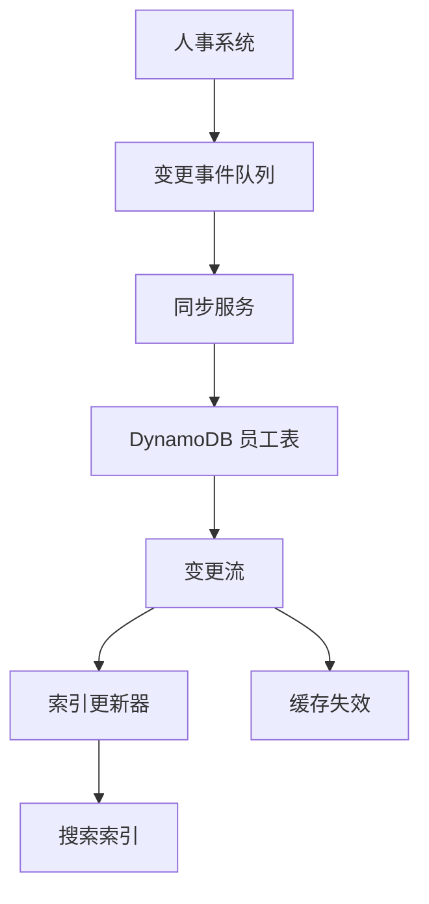
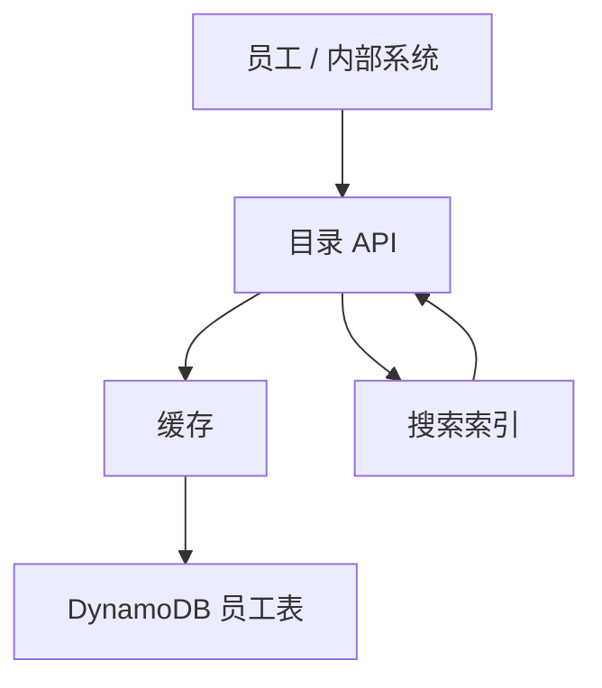
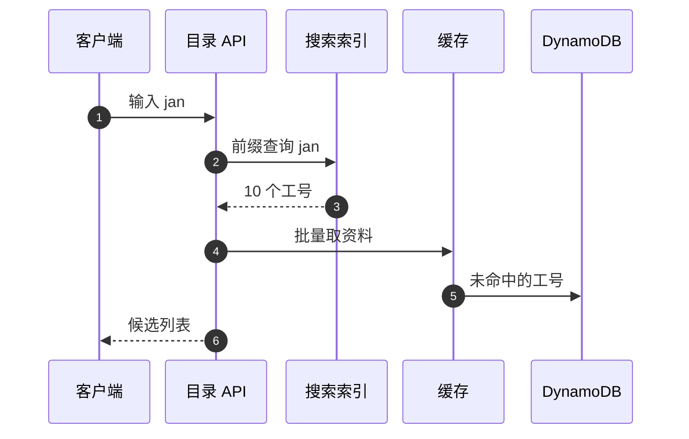
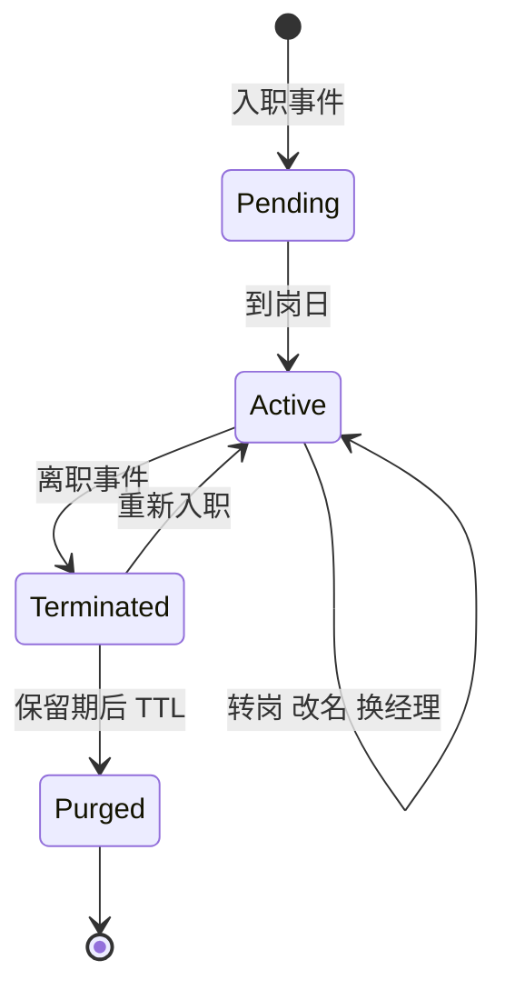

# SD13 员工目录与 DynamoDB 分区键（Employee Directory）

## 题目

员工目录是公司内部的「通讯录」：输入姓名、邮箱别名或工号，找到这个人，看到职位、所在团队、汇报线和联系方式；也能从一个人出发，向上看他的管理链，向下看他的直接下属和整个组织。使用者是全体员工（查人、找同事）、经理（看团队）、以及依赖目录做权限和审批流的内部系统。数据来源是人事系统（HR），目录自己不是真相来源。

难点不在规模：100 万员工、两三 GB 的数据，一台内存大一点的机器都放得下。难点在访问模式：按工号精确查、按邮箱精确查、按姓名前缀模糊查、查直接下属、查整棵组织树，这些查询需要不同的索引，而 DynamoDB 只能按分区键和排序键查。分区键怎么选、哪些查询交给搜索服务、改名或换团队后数据怎样保持一致，才是要回答的核心。

题目：为公司设计一个员工目录。可以按姓名、邮箱、工号搜索，约 100 万员工，读多写少。先给出 API，再设计 DynamoDB 的表结构和分区键；然后说明一个人改名、换团队、离职，以及查某人的全部下属时怎么处理。

## 澄清问题

开场用两三分钟问下面八个问题，答案写在白板角落，每个都会改变设计。

1. **规模和读写比例？** 员工数、日活、每人每天查几次，决定要不要缓存、数据能不能整个放内存。下文假设 100 万员工，每人每天 10 次查询。
2. **搜索要多聪明？** 只做工号和邮箱的精确匹配，还是姓名前缀、拼写容错、昵称、中文拼音？决定要不要引入搜索引擎，还是 DynamoDB 加一个简单的前缀索引就够。
3. **真相来源是谁，更新有多快？** 人事系统推事件还是目录定期拉取全量；入职、转岗、改名多久内要在目录里生效？决定同步管道和缓存 TTL。
4. **组织树要查多深？** 只要「直接下属」和「向上到 CEO 的管理链」，还是要「某人名下所有人」？后者决定要不要物化路径。
5. **谁能看什么？** 办公电话、手机、工作地点是否对所有人可见？决定字段分级和授权检查放在哪里。
6. **离职和改名后旧数据怎么处理？** 旧邮箱还要不要能查到？离职的人要不要消失、保留多久？决定别名表和软删除。
7. **是否多区域？** 员工遍布全球，读要不要就近？决定全局表和缓存的放置。
8. **是否有下游系统依赖？** 审批流、权限系统、邮件系统是否直接调用目录，对延迟和可用性有什么要求？决定它的 SLA 是否高于普通查人。

## 需求

**功能需求（按优先级）**

1. 按工号精确查询，返回完整资料。
2. 按邮箱（含别名）精确查询。
3. 按姓名搜索：前缀匹配、不区分大小写，输入时给出候选（typeahead）。
4. 组织关系：某人的直接下属、管理链（向上）、整个组织（向下，分页）。
5. 资料更新：入职、转岗、改名、换经理、离职，来自人事系统，目录自动同步。

**非功能需求**

| 维度 | 目标 | 说明 |
|---|---|---|
| 读延迟 | 按 ID / 邮箱 p99 小于 50 ms；姓名候选 p99 小于 150 ms | 缓存命中即可达标 |
| 可用性 | 99.95% | 目录挂了，审批和权限系统会受影响 |
| 一致性：人事更新到目录 | 最终一致，分钟级 | 允许短暂看到旧职位；不允许丢更新 |
| 一致性：读自己刚改的资料 | 读己之写 | 个人资料页走强一致读 |
| 持久性 | 零丢失 | 数据可以从人事系统重建，但不应依赖重建 |
| 隐私 | 字段分级，访问可审计 | 防止整库被爬取 |

**明确不做**：人事系统本身（薪资、绩效）、日历与会议室、权限判定（只提供身份与汇报线）、外部通讯录。

## 容量估算

先定一个会驱动设计的数字：**数据极小，访问模式极多**。

假设：100 万员工，每人每天 10 次查询，高峰是平均的 10 倍，姓名候选每敲一个键盘字符触发一次查询，平均放大 5 倍。

- 平均读 = 1,000,000 × 10 ÷ 86,400 = **约 116 次/秒**。
- 高峰读 = 116 × 10 = **约 1,157 次/秒**。
- 姓名候选高峰 = 1,157 × 5 = **约 5,787 次/秒**，这是最大的读流量，但可以由搜索索引或内存索引承接。
- 数据量：每人一条记录约 2 KB，1,000,000 × 2 KB = **约 2.0 GB**。三个全局二级索引（GSI）各投影约 0.5 KB，1,000,000 × 0.5 KB × 3 = **约 1.5 GB**；合计 **约 3.6 GB**。
- 写入：假设每年约 30 万次资料变更（入职、转岗、改名、换经理），平均 **约 822 次/天**，几乎可以忽略；真正的写压力是**重组织（reorg）**：一次调整 5 万人，每条记录写一次基表加三个 GSI，共 50,000 × 4 = **200,000 个写单位**；按 4,000 写单位/秒的预置速率，要 50 秒，所以重组织必须走批量、限速的异步通道，而不是同步更新。

**驱动设计的那个数字**：3.6 GB 的数据放得进一台机器的内存，1,157 次/秒的读一个缓存节点就扛得住。所以瓶颈不是容量，而是**访问模式要和索引一一对应**，以及改名、换团队这类更新如何保持各个索引一致。

## 核心实体与 API

**实体**（粗体为主键）

| 实体 | 关键字段 | 说明 |
|---|---|---|
| Employee | **employee_id**（不可变）、legal_name、display_name、login_alias、email、manager_id、org_path、title、location、status、version、updated_at | 基表主键是不可变的工号 |
| EmailAlias | **alias_email** → employee_id、失效时间 | 旧邮箱、别名；与 Employee 在同一张表里按类型区分 |
| NameToken | **(token 前两个字符, token#employee_id)** | 姓名前缀的可选 DynamoDB 内索引，见深挖 |
| Tombstone | employee_id、离职时间、保留到期 | 离职人员的软删除记录 |

**API**

```
GET  /v1/employees/{employee_id}                -> {profile}      (?consistent=true 读己之写)
GET  /v1/employees?email=jane@corp.com          -> {profile}      (含别名解析)
GET  /v1/employees/search?q=jan&limit=10        -> [{id, name, title, team}]
GET  /v1/employees/{id}/reports?cursor=&limit=  -> {reports[], next_cursor}
GET  /v1/employees/{id}/chain                   -> [{id, name, title}]   从本人到 CEO
GET  /v1/employees/{id}/org?depth=3&cursor=     -> {nodes[], next_cursor}
PUT  /internal/employees/{id}   (人事事件)  If-Version: <v>  -> 200 | 409 stale
```

读接口都是只读幂等的；写入口只给人事同步管道，带 `version`，条件写保证乱序和重放不会让旧数据覆盖新数据。主键用不可变的 `employee_id` 而不是邮箱或姓名，原因在深挖第一节。

## 高层架构

写路径（人事同步到目录）：



读路径：



**流 1：同步。** 人事系统在入职、转岗、改名、离职时发出变更事件；同步服务消费事件，对 DynamoDB 做带版本号的条件写；DynamoDB Streams 把变更推给两个下游：索引更新器（更新姓名搜索索引）和缓存失效器（删除或刷新受影响的缓存项）。每晚再用人事系统的全量导出（S3）做一次对账，补上丢失的事件。

**流 2：查询。** 按工号或邮箱查，先查缓存，未命中再读 DynamoDB；按姓名搜索，先去搜索索引拿候选工号，再批量从缓存或 DynamoDB 取展示字段。管理链和直接下属走 GSI 加缓存。



图中编号对应的每一步：

1. 用户在搜索框里每敲一个字符就发一次请求（前端要防抖，约 150 ms 内合并）。
2. API 先做授权和限流，再去搜索索引做前缀查询；搜索索引只存姓名相关的字段和工号，不存完整资料。
3. 搜索索引返回按相关度排好的前 10 个工号。
4. API 用工号批量读缓存，拿到展示用的职位和团队。
5. 缓存未命中的工号从 DynamoDB 用 `BatchGetItem` 一次取回，并回填缓存。
6. API 把候选列表返回给客户端；候选只包含展示字段，完整资料等用户点进去再取。

## 深挖

### 访问模式驱动的表设计与分区键

问题：先列出所有查询，再设计表。查询有四种：按工号精确取；按邮箱精确取；按姓名前缀搜；按经理取直接下属。DynamoDB 只能按主键（分区键加可选排序键）或二级索引的键查询，所以每种查询都要有一个对应的键。

选项（基表的分区键）：

1. **用邮箱做分区键**：邮箱是最常见的输入，查询直接命中。但邮箱会变：改名、合并域名都会换，主键不能原地修改，只能删了重建，所有引用它的地方（经理的下属列表、其他系统）都要跟着改。
2. **用姓名做分区键**：重名很多（Smith、王伟），热分区，而且姓名最容易变。不可取。
3. **用不可变的 `employee_id` 做分区键**：工号一旦分配就不变，均匀分布，写入天然打散。邮箱、姓名、经理都是普通属性，变了只是更新属性。

选择第 3 种，并为其余查询建 GSI：

| 索引 | 分区键 / 排序键 | 投影 | 解决 |
|---|---|---|---|
| 基表 | `employee_id` | 全部 | 按工号取，读己之写可用强一致读 |
| GSI1 `by-email` | `email_lower` | 展示字段 | 按邮箱取，旧邮箱走 EmailAlias |
| GSI2 `by-manager` | `manager_id` / `display_name_sort` | 展示字段 | 直接下属，按姓名排序分页 |
| GSI3 `by-org` | `org_bucket` / `org_path` | 键加展示字段 | 某人名下所有人，见组织树一节 |

热键检查：基表按工号均匀分布，没有热键。GSI2 的分区键是 `manager_id`，一个经理的直接下属通常几十人，最多几千人，没问题。GSI3 的分区键必须避开「国家」「部门」这类取值很少的属性，否则大部门的所有查询打到同一个分区；DynamoDB 单个分区键的吞吐上限约每秒 1,000 次写入或 3,000 次读取，是需要避开的硬约束。GSI 的投影只放展示字段，因为 GSI 写入也消耗写单位，投影越多越贵。

最关键的一点是**稀疏索引（sparse index）**：只有在职员工才写 GSI 的键属性（`email_lower`、`manager_id` 等），离职时把这些属性删掉，该条记录就自动从索引中消失，查询不会返回离职的人，也不用逐条过滤。

失败模式：热门人物（CEO、高管）被反复查，同一条记录被打爆。对策是缓存（见下文），而不是给基表加复杂的分片键。

### 姓名搜索：DynamoDB 做不了前缀模糊

问题：用户输入「jan」要看到 Jane、Janet、Jankowski；输入「wang」要看到「王」姓。DynamoDB 的 `begins_with` 只能作用于排序键，且必须先指定完整的分区键，所以无法对任意姓名词首做跨全表的前缀搜索，更没有拼写容错。

选项：

1. **GSI 以小写姓氏为排序键**：`begins_with(last_name_lower, "jan")` 能用，但分区键要选什么？选一个常量，则整张索引压在一个分区上（热键，且 1,000 写/秒上限）；选姓氏首字母，则「S」「W」这类字母极不均匀，而且只覆盖姓氏，不覆盖名字和别名。
2. **NameToken 项**：为每个姓名词元（名、姓、别名）写一条记录，分区键为词元前两个字符，排序键为 `词元#employee_id`，查询 `begins_with`。词元约 300 万条、每条约 100 字节，共约 300 MB。优点是全在 DynamoDB 里，没有新组件；缺点是前缀至少要两个字符，「sm」这类分区仍然大且热，没有容错和相关度排序。
3. **搜索引擎（OpenSearch）**：用 edge n-gram 分词器做前缀、同音和编辑距离容错，按相关度排序。由 DynamoDB Streams 异步灌入，只存姓名字段和工号，约几百 MB，三个节点绰绰有余。
4. **每个 API 实例内存里放一份前缀索引**：100 万个姓名的有序数组约几十 MB，启动时从 S3 快照加载，再追 Streams 的增量；二分查找就是前缀搜索。成本最低、延迟最低，但容错和相关度要自己写。

选择第 3 种，因为要做拼写容错和昵称；如果面试官限定「不加新组件」，退到第 2 种，并说明前缀至少两个字符的限制；成本极敏感时第 4 种是合理的。无论选哪种，搜索索引只返回工号，展示字段从缓存和基表取，这样索引里不存会变的字段（职位、团队），只存姓名，需要重建的频率最低。

失败模式：搜索索引落后，新员工搜不到。对策是索引更新器按版本号幂等更新（外部版本号，旧事件不能覆盖新事件）；搜索索引不可用时，API 降级为 GSI1（只支持精确邮箱）并在界面上提示，不让整个目录不可用；索引可以随时从基表全量重建，重建期间用别名切换，不影响线上。

### 组织树：管理链、直接下属与整棵子树

问题：查某人的所有下属（可能是上万人）、查某人的管理链、以及在重组织时保持一致。

选项（表示组织树）：

1. **只存 `manager_id`（邻接表）**：真相只有一份，改经理只改一条记录。直接下属走 GSI2，一次 Query。管理链向上需要逐级读，约 10–12 级，每级一次 `GetItem`；整棵子树要逐层展开，每层一批 Query。
2. **物化路径（materialized path）**：每条记录存 `org_path`，例如 `/100/2045/8812/`（祖先工号依次连接）。子树查询变成 `begins_with(org_path, "/100/2045/")`，一次 Query 取回整个组织。代价是更换经理时要重写他整个子树的 `org_path`。
3. **闭包表（closure table）**：每个人与每个祖先一行，约 1,000,000 × 10 = 1,000 万行。子树和管理链都是单次 Query，但每次转岗要增删上千行。

选择第 1 种作为真相，第 2 种作为派生字段：`manager_id` 是唯一真相；`org_path` 由异步任务根据 `manager_id` 派生，更新时按子树批量改写并限速（50,000 人要写 20 万个写单位，见容量估算）。GSI3 的分区键 `org_bucket` 取路径前三级的祖先工号（几百个桶），排序键是 `org_path`，这样一个桶内的子树查询是单次范围 Query；跨越桶的上层组织（比如 CEO 之下全部）要对多个桶并行扇出，并且对这种查询强制分页和深度限制，不允许一次返回 100 万人。

管理链：不要每次逐级读。每个人的管理链是几十字节，直接缓存「某人到 CEO 的工号列表」，经理变更时失效该经理子树里的缓存；缓存未命中时逐级 `BatchGetItem`，12 级也只需要约 12 次顺序读，小于 100 ms。

离职的经理：他的下属的 `manager_id` 仍指向他。人事系统会发出重新指派事件；在此之前，读路径把离职的经理解析为最近的在职祖先，界面显示「经理空缺」，而不是返回空链或报错。

失败模式：重组织半途失败，一部分人的 `org_path` 是新的，一部分是旧的。因为 `manager_id` 是真相，`org_path` 只是派生：任务带批次版本，幂等重跑；GSI3 查询的结果允许分钟级不一致；每晚对账作业按 `manager_id` 重新计算路径并修复差异。

### 改名、换团队、离职：一致性与新鲜度

问题：一个人改名、换邮箱、换团队、离职，这些变更要同时反映在基表、GSI、搜索索引、缓存和别名中，而更新会乱序、重复。

做法：

- **工号不变**：改名只改 `display_name`、`email`、`login_alias`，主键不动。GSI1 的键（`email_lower`）随属性更新自动重新索引。
- **旧邮箱继续可查**：改名时写一条 EmailAlias 项（`alias_email` → `employee_id`），保留期内（比如 180 天）查到旧邮箱仍返回新资料，并提示已改名；保留期后过期。
- **搜索索引**：索引更新器按文档 ID 更新，使用 `version` 作为外部版本号，旧事件被拒；改名等于同一文档的字段变化，旧的词元自然被替换。
- **条件写**：同步服务的写入带 `attribute_not_exists(version) OR version < :v`，重复和乱序的事件是无害的；返回 409 的写入被丢弃并计数。
- **离职**：状态改为 `TERMINATED`，删除 GSI 的键属性（稀疏索引使其自动消失），写 Tombstone，保留期（比如 90 天）后用 DynamoDB TTL 删除。TTL 删除是惰性的，可能延迟到两天，所以不能依赖 TTL 来隐藏人：读路径检查状态，而不是靠记录消失。
- **缓存**：Streams 触发失效，TTL 作为兜底（比如 5 分钟）；个人资料页走强一致读，保证「我刚改的资料马上看到」。
- **对账**：每晚拿人事系统的全量导出与基表逐条比对版本号，差异进入修复队列，并以「差异数」作为告警指标。



失败模式：同步服务停了一小时，目录落后人事系统。对策是事件队列保留事件（至少 14 天），恢复后重放；因为写入是带版本的条件写，重放是安全的；对账作业兜住队列丢事件的情况。

### 缓存与热键

问题：读是 1,157 次/秒的高峰，不算高，但高管、新入职的人、全公司都在搜的人会形成热键，而且内部系统的审批流会成批地按工号查同一批人。

选项：

1. **DAX**（DynamoDB 的读穿透缓存）：对应用透明，缓存的是单项和查询结果；但不理解我们的失效逻辑，只能靠 TTL。
2. **ElastiCache（Redis）**：应用自己管理，Streams 触发精确失效；整个数据集 3.6 GB 全放得下，命中率接近 100%。
3. **进程内缓存加 Redis 两级**：最热的几千个工号放进程内，过期时间很短（30 秒）。

选择第 2 种，数据全量预热，Streams 失效；热门键再加一层 30 秒的进程内缓存。不存在的工号也缓存（负缓存，短 TTL），防止被扫描和穿透。

失败模式：缓存整体失效后冷启动，请求全部落到 DynamoDB。1,157 次/秒的高峰对按需模式的 DynamoDB 完全可以承受，真正要防的是批量 `BatchGetItem` 的并发；对策是重启时预热、请求合并（同一个键同时只发一个回源请求），以及限流。

## Staff 视角：权衡、故障与演进

**10 倍规模先坏什么。** 员工从 100 万涨到 1,000 万（或加上外部合作方）时，数据 36 GB 仍然放得下，Redis 还是够用。先坏的是：（1）重组织的写放大，一次调整 50 万人要写 200 万个写单位；（2）GSI3 的桶不均匀，要把 `org_bucket` 的层级加深；（3）搜索索引的重建时间。读流量涨到 1.2 万次/秒，靠缓存仍然平稳。

**每个组件挂了的影响面。**

- 缓存挂：读直接落到 DynamoDB，延迟变高但仍可用；同时限制回源并发。
- 搜索索引挂：姓名搜索降级为邮箱和工号精确查询，目录其余部分不受影响。
- 同步服务或事件队列挂：目录数据变旧，但可读；队列保留事件，恢复后重放；用「最近一次成功同步的时间」告警。
- DynamoDB 区域故障：目录不可用，只读副本放在第二个区域（全局表）；见下。
- 人事系统挂：目录继续服务旧数据，没有影响。这是把目录做成「带缓存的只读副本」的好处：它的可用性不依赖人事系统。

**多区域。** 员工遍布全球，读要就近。DynamoDB 全局表可以把基表复制到多个区域，目录基本是只读的，写入只来自人事同步，所以应该让同步服务只写一个主区域，其他区域只读，避免多主写冲突（全局表是最后写入者胜）。每个区域有自己的缓存和搜索索引，由本区域的 Streams 驱动。区域故障时把读流量切到其他区域，接受秒级的复制延迟。

**成本驱动。** 数据很小，所以成本主要是：GSI 的写放大（每次更新写四份）、搜索索引的三个节点、Redis 的副本。每个 GSI 的投影都要问「展示是否真的需要」。DynamoDB 用按需模式足够，读写低且有尖峰；重组织时的批量写限速到预置速率。

**迁移与发布。** 新的索引或字段先双写、回填、再切读；搜索索引用别名切换，旧索引保留一天以便回滚；对账作业是发布后的第一道验证。

**可观测性。** 指标：同步延迟（人事事件到目录可见）、对账差异数、搜索索引落后量、缓存命中率、各接口 p99、`409 stale` 比例、被拒绝的限流请求数。告警：同步延迟超过 10 分钟、对账差异非零且持续、命中率突然下降。还要审计：谁在批量枚举目录（防止整库被爬取），每调用方限流并记录。

## 面试官追问

1. **分区键为什么不用邮箱或姓名？** 邮箱和姓名会变（改名、合并域名），而 DynamoDB 的主键不能原地修改，只能删除重建，所有引用都要跟着改。工号不可变、分布均匀，邮箱和姓名当普通属性，再用 GSI 提供按邮箱的查询。
2. **一个人改名了，旧邮箱还能查到吗？怎么做？** 能。改名时写一条 EmailAlias 项指向工号，保留期内旧邮箱仍解析到同一个人，并提示已改名；保留期后过期。搜索索引按文档 ID 更新，旧的姓名词元被自然替换。
3. **一个人换了团队，会影响什么？** 他自己的 `manager_id` 和 `org_path` 更新，缓存失效；他的所有下属的 `org_path` 前缀也要改，作为异步批量任务限速执行。他在 GSI2 里的位置自动变到新经理名下，直接下属列表在秒级反映。
4. **离职的人怎么处理？** 状态改为 `TERMINATED`，删除 GSI 的键属性，所以稀疏索引里自动消失，搜索索引同步删除；写 Tombstone 保留一段时间用于审计，之后用 TTL 清除。他的下属指向最近的在职祖先，直到人事系统重新指派。
5. **查某个 VP 名下的全部下属，上万人，怎么办？** 用物化路径加 GSI3：在桶内按路径前缀单次范围 Query，分页返回；如果跨桶则并行扇出；强制分页、限制深度，不允许一次返回全部。需要实时精确时，退回逐层展开 `manager_id`。
6. **怎么保证搜索不会搜到已经改名或离职的人？** 搜索索引只存姓名和工号，由 Streams 驱动、按版本号更新，延迟一般是秒级；返回的工号再去缓存和基表取最终资料，离职状态在这里被过滤。极端情况下索引落后，用户最多看到一个短暂的旧候选，点进去才发现已改名，对账作业保证最终收敛。
7. **如果面试官说「不允许加搜索引擎」？** 用 NameToken 项：分区键为词元前两个字符，排序键为 `词元#工号`，`begins_with` 查询；限制是前缀至少两个字符，常见前缀的分区偏大，没有拼写容错，相关度只能靠简单排序。对 100 万人，每个 API 实例内存里放一份有序前缀索引也是合理选择。
8. **如何防止有人爬取整个目录？** 每调用方限流、分页上限、搜索返回条数上限、枚举式访问的审计和告警；敏感字段（手机、位置）按调用方身份分级返回，普通员工看不到。
9. **目录是怎么保持和人事系统一致的？** 事件驱动加每晚全量对账：事件走带版本的条件写，重放和乱序无害；对账作业比对版本号，差异进入修复队列并以数量告警。目录不是真相来源，丢了可以重建。
10. **读己之写怎么做？** 用户自己更新资料后，个人资料页读基表用强一致读，绕过缓存；其他人看到则最终一致。DynamoDB 的 GSI 只支持最终一致读，所以涉及 GSI 的查询没有读己之写。

## 60 分钟怎么分配

| 分钟 | 做什么 | 白板内容 | 时间不够时 |
|---|---|---|---|
| 0–5 | 澄清问题，定假设 | 100 万员工、读多写少、搜索多聪明 | 只问规模、搜索类型、真相来源 |
| 5–10 | 需求与容量估算 | 1,157 次/秒、3.6 GB、reorg 20 万写单位 | 只写「数据小，访问模式多」 |
| 10–15 | 实体与 API | Employee、四个查询、API 列表 | 压缩为四行 API |
| 15–25 | 高层架构与两条流 | 写路径图、读路径图、搜索序列图 | 保留，不能砍 |
| 25–40 | 深挖：访问模式与分区键；姓名搜索 | 表加三个 GSI 的表、稀疏索引、搜索选项 | 必讲这两个 |
| 40–50 | 深挖：组织树；改名换团队离职 | 邻接表加物化路径、版本号条件写 | 只讲邻接表加路径 |
| 50–55 | Staff 视角：故障、多区域、成本 | 降级表、全局表单写 | 只讲降级 |
| 55–60 | 追问与总结 | 一句话：工号不变，其余是派生 | 总结一句 |

**45 分钟版**（前面有 10–15 分钟行为面试）：澄清 3 分钟，容量 2 分钟，API 3 分钟，架构 6 分钟，分区键与 GSI 10 分钟，姓名搜索 8 分钟，组织树与改名各 5 分钟，余下留给追问。电话面试通常只有 45 分钟，务必先把「访问模式列表」和「分区键用工号」说出来，再展开。

## 自测

1. 为什么基表的分区键用工号而不是邮箱？

<details><summary>答案</summary>

邮箱和姓名会变，而 DynamoDB 的主键不能原地修改，只能删了重建，所有引用都得跟着改。工号不可变，分布均匀，没有热分区。邮箱当普通属性，用 GSI1 提供按邮箱的查询。

</details>

2. DynamoDB 为什么不适合做姓名的前缀模糊搜索，有哪几种补救？

<details><summary>答案</summary>

`begins_with` 只能用在排序键上，且必须给出完整的分区键，所以无法对任意词首做全表前缀查询，也没有容错。补救：NameToken 项（前缀至少两个字符）、OpenSearch（n-gram 加容错）、进程内有序前缀索引。无论哪种，搜索只返回工号，展示字段另取。

</details>

3. 稀疏索引是什么，离职人员怎么靠它自动消失？

<details><summary>答案</summary>

只有带索引键属性的项才会出现在 GSI 里。在职员工才写 `email_lower`、`manager_id` 等属性，离职时删掉这些属性，记录就自动从索引消失，查询不会返回离职的人，也不需要逐条过滤。

</details>

4. 组织树为什么以 `manager_id` 为唯一真相，`org_path` 只是派生？

<details><summary>答案</summary>

换经理时只需要改一条记录，不会出现多份真相不一致。`org_path` 让整棵子树成为一次范围 Query，但换经理要重写整个子树，所以由异步任务批量、限速、幂等地更新，允许短暂不一致，每晚对账修复。

</details>

5. 同步服务重放了一小时前的事件，为什么不会让数据回退？

<details><summary>答案</summary>

写入是带版本的条件写：`attribute_not_exists(version) OR version < :v`。旧事件的版本不比现有版本大，条件失败返回 409，被丢弃并计数。搜索索引同样使用外部版本号，所以重放和乱序都是无害的。

</details>

## 延伸阅读

- 相邻题解：[[solution-key-value-store]]（分区、复制、一致性）、[[solution-typeahead]]（前缀搜索与候选）、[[solution-search-engine]]（倒排索引与相关度）、[[solution-distributed-cache]]（缓存、失效与热键）。
- 同批题单：[[sd-index]]。
- DynamoDB 数据建模与稀疏索引：https://docs.aws.amazon.com/amazondynamodb/latest/developerguide/bp-general-nosql-design.html
- DynamoDB 全局二级索引：https://docs.aws.amazon.com/amazondynamodb/latest/developerguide/GSI.html
- DynamoDB 条件写：https://docs.aws.amazon.com/amazondynamodb/latest/developerguide/Expressions.ConditionExpressions.html
