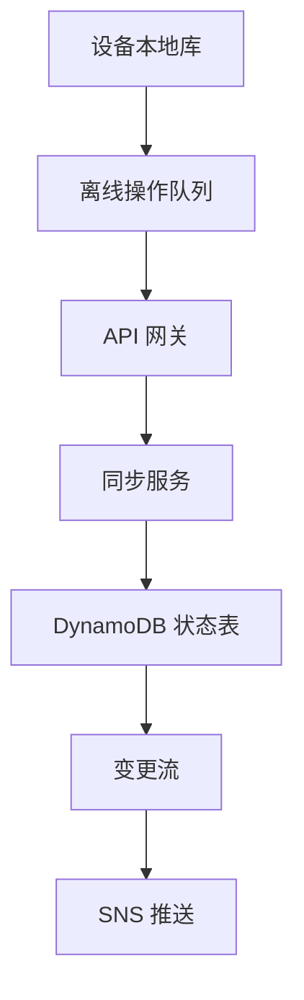
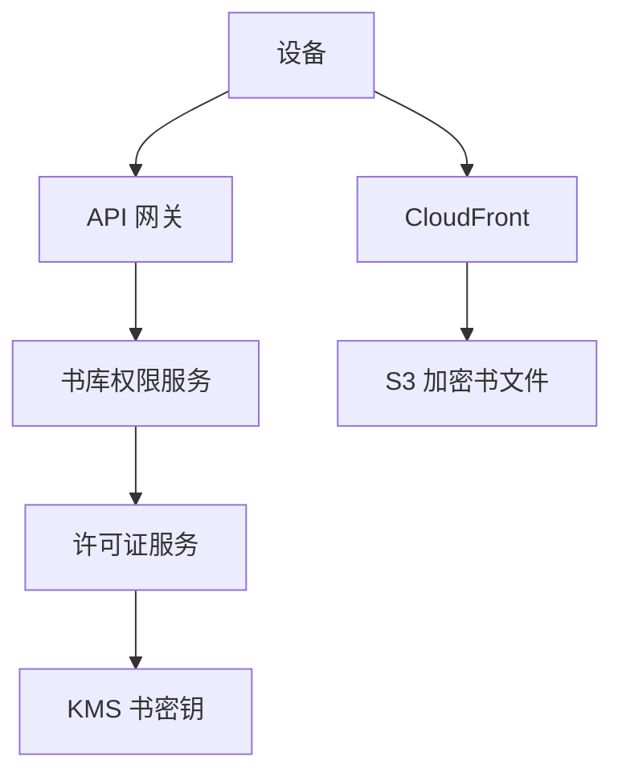
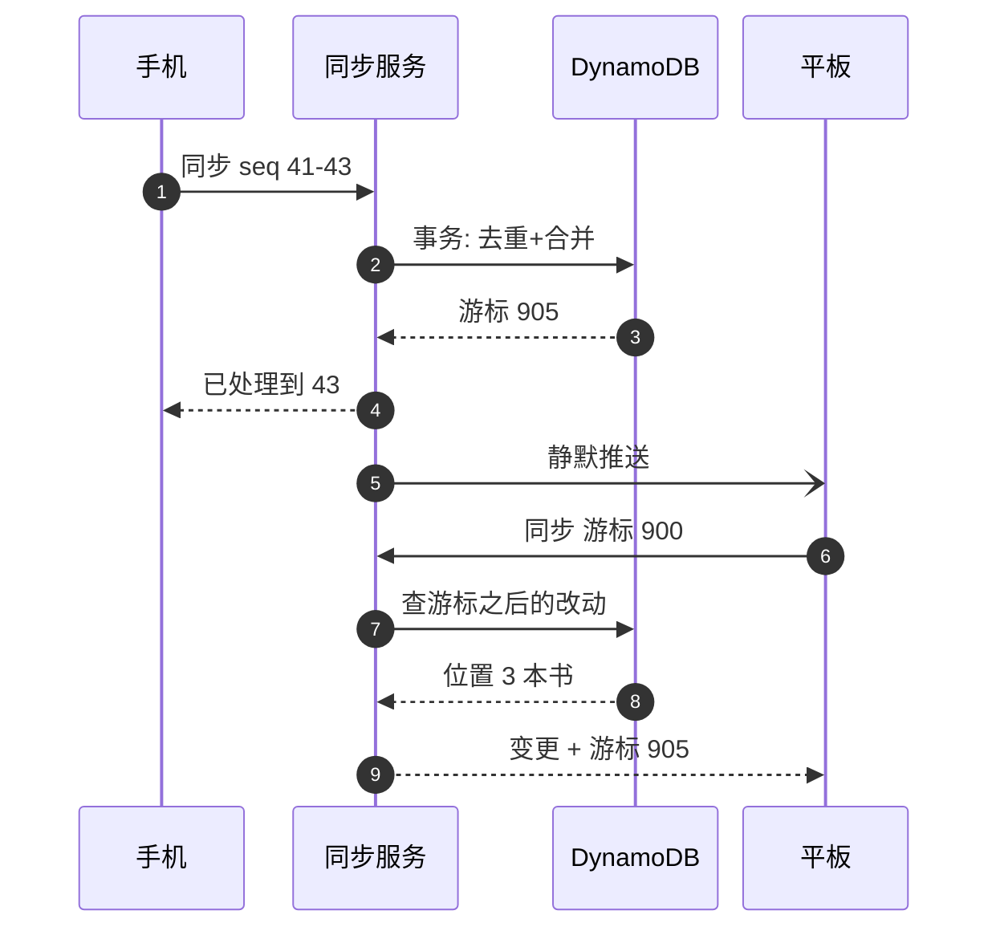
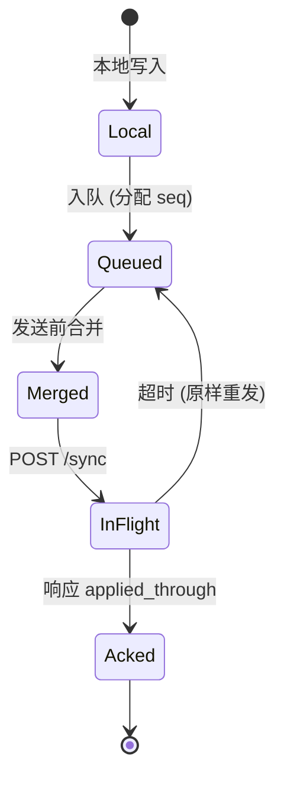

# SD14 Kindle 阅读进度同步（Kindle Sync）（low priority）

## 题目

Kindle 是一个电子书阅读服务：用户在手机、平板、电子墨水屏阅读器上读同一本书，并且希望「我在地铁里读到哪，回家换设备就从哪继续」。使用者是读书的人，设备经常离线（飞行模式、地铁、没有信号的山区），一个人名下有几台设备。难点有三个：多台设备各自离线修改同一份状态（阅读位置、高亮、笔记），上线后要合并而不丢数据也不互相覆盖；同步请求在弱网下会重试、重放、乱序，写接口必须幂等；电子书文件本身很大、要下载到设备上离线读，同时要防止文件被随意拷贝。

题目：设计 Kindle 阅读器的后端：支持离线、多设备的阅读进度同步，写接口幂等，处理冲突；用户可以把电子书下载到设备。

这类题和聊天、网盘同步都沾边，但数据的形状不同：每个用户每本书只有一个「进度」，写入极其频繁但每次只有最后一个值有意义；而高亮和笔记是一个个独立的对象，要合并。题面没有给规模，下文假设：1 亿注册用户，30% 日活，每个用户平均在 20 本书里有过进度；面试时以面试官给的数字为准。

## 澄清问题

开场用两三分钟问完下面八个问题，答案写在白板角落。

1. **规模：多少用户、每人几台设备、每天同步几次？** 决定同步接口的 QPS 和是否需要对写入做合并。假设 1 亿用户，平均 1.5 台设备，日活用户每天发起 10 次同步。
2. **「进度」到底是什么？** 页码、百分比，还是文本中的位置？页码会因为字号、屏幕尺寸变化而不同，所以位置必须是与排版无关的定位（locator），否则两台设备对不上。
3. **两台设备同时有不同进度时，期望的行为是什么？** 是「最后读的那台胜出」，还是「读得最远的胜出」，还是提示用户选择？这是产品语义，决定冲突规则；亚马逊的做法是默认提示跳转到最远进度。
4. **离线能离线多久、离线时能做什么？** 离线读书、翻页、高亮、写笔记都要可用。离线时长决定客户端队列要存多久，以及服务端能保留多久的删除记录（墓碑，tombstone）。
5. **高亮和笔记要不要多设备合并？** 要。一台设备上写的笔记，另一台设备必须看得到，并且两台设备都在编辑同一条笔记时不能静默丢一边。
6. **同步要多实时？** 秒级还是分钟级？阅读不是聊天，翻页后几十秒才出现在另一台设备上是可以接受的；这让我们可以用批量上传和「打开书时拉取」，而不必维持长连接。
7. **下载与版权保护的要求？** 书文件要加密，设备要凭授权才能打开；允许离线读多久、最多几台设备同时授权，会改变许可证（license）的设计。
8. **书的内容会更新吗？** 出版方会修订电子书（改错字、改排版），位置定位在新版本里要仍然有意义。这是一个容易被漏掉的问题，它会改变定位的数据结构。

## 需求

**功能需求（按优先级）**

1. 记录并同步每本书的阅读位置：当前位置、最远读到的位置，打开书时能看到「其他设备读到更远」的提示。
2. 离线可用：断网时继续读、高亮、写笔记，联网后自动同步，重试和重放不产生重复。
3. 高亮、书签、笔记的多设备合并，冲突不丢数据。
4. 把已购买的书下载到设备，支持断点续传，离线可读。
5. 新设备登录后，能从服务端还原整个资料库的进度与批注（全量同步）。

**非功能需求**

| 维度 | 目标 | 说明 |
|---|---|---|
| 同步写延迟 | p99 小于 300 ms | 弱网下更长，客户端不阻塞阅读 |
| 打开书时拉取 | p99 小于 200 ms | 单键读取，必须快 |
| 可用性 | 同步 99.95%，下载 99.99% | 同步挂了不影响读书，设备继续本地队列 |
| 持久性 | 高亮与笔记零丢失 | 笔记是用户的创作，比位置重要得多 |
| 一致性：位置 | 最终一致，收敛到确定的值 | 不要求强一致，要求所有设备最终看到同一个答案 |
| 一致性：购买权限 | 强一致 | 买了就能下，退款后不能再下新副本 |
| 幂等 | 所有写接口可安全重放 | 客户端可能重发同一批操作任意次 |

**明确不做**：书籍内容的搜索与推荐、购买与支付流程、有声书、社交功能（公开高亮的排行）、出版方的内容摄取流水线。

## 容量估算

驱动设计的数字是**同步写的数量远大于任何其他操作，但每次写都很小，而且大部分可以合并**。

假设（来自澄清问题）：1 亿用户，30% 日活，日活用户每天 10 次同步写，每个用户在 20 本书里有过进度；每个位置记录约 200 字节；每个用户在每本书里平均有 0.1 × 8 = 0.8 条高亮或笔记，每条约 300 字节；每天有 10% 的日活用户下载一本 5 MB 的书；下载高峰是均值的 10 倍，同步高峰是均值的 5 倍。

```
python3 -c "U=100e6; dau=.3*U; print(dau)"                       # 30,000,000
python3 -c "dau=30e6; s=dau*10; print(s, s/86400, s/86400*5)"     # 3e8 次/天, 3,472/s, 17,361/s
python3 -c "U=100e6; r=U*20; print(r, r*200/1e9)"                 # 2e9 行, 400 GB
python3 -c "U=100e6; r=U*20*.1*8; print(r, r*300/1e9)"            # 1.6e9 条, 480 GB
python3 -c "d=30e6*.1; q=d/86400*10; print(d, d/86400, q, q*5e6/1e9, d*5e6/1e12)"
```

- 日活用户 = 1 亿 × 30% = **3,000 万**。
- 同步写 = 3,000 万 × 10 = **3 亿次/天**，均值 3 亿 ÷ 86,400 = **约 3,472 次/秒**，高峰 ×5 = **约 17,361 次/秒**。每次是一个 200 字节的小对象，写入单元（WCU）大约 1 个，所以高峰约 1.7 万 WCU，对 DynamoDB 是很普通的负载，不需要为它做特殊设计。
- 位置存储 = 1 亿 × 20 本 = **20 亿行**，× 200 字节 = **400 GB**。
- 批注存储 = 1 亿 × 20 本 × 0.8 条 = **16 亿条**，× 300 字节 = **480 GB**。两者合计不到 1 TB，一个小数据集；数据量不是难点，**正确合并才是**。
- 下载：每天 3,000 万 × 10% = **300 万次**，均值 300 万 ÷ 86,400 = **约 35 次/秒**，高峰 ×10 = **约 347 次/秒**，每次 5 MB，峰值带宽 = 347 × 5 MB = **约 1.74 GB/秒 = 约 13.9 Gbps**；每天出口流量 300 万 × 5 MB = **15 TB**。这部分全由 CDN 承担，源站（S3）只看到缓存未命中的少量回源。
- 重连风暴：一次区域性网络故障后，假设 2% 的设备（1 亿 × 1.5 台 × 2% = **300 万台**）在 10 分钟内重新联网，每台补发一次同步：300 万 ÷ 600 秒 = **5,000 次/秒**，已经接近日常高峰的三分之一，叠加在高峰上就是 2.2 万次/秒。所以重连必须带抖动的退避（jitter），队列要在客户端先合并（见深挖）。

**驱动设计的那个数字**：一个人离线一周、每天翻页 10 次同步，队列里有 70 条位置写，但只有每本书的最后一条有意义。合并之后，同步请求的数量取决于读了几本书，而不是翻了几次页，这就是为什么**位置用「寄存器」语义（只保留最新值），不用日志语义**；而高亮和笔记每一条都要保留，需要真正的合并。

## 核心实体与 API

**实体**（粗体为主键）

| 实体 | 关键字段 | 说明 |
|---|---|---|
| Device | **(user_id, device_id)**、型号、授权状态、`last_seq` | `last_seq` 是该设备已被服务端处理的最大操作序号，用于去重 |
| Position | **(user_id, book_id)**、`furthest`、`epoch`、`cells` | `cells` 是每台设备一个槽位：当前位置、混合逻辑时钟（HLC） |
| Annotation | **(user_id, book_id, ann_id)**、类型、锚点、文本、`hlc`、`deleted` | 高亮、书签、笔记；`ann_id` 由设备生成 |
| SyncCursor | **user_id**、`seq` | 每个用户一个单调递增的变更序号，用来回答「某个游标之后改了什么」 |
| Entitlement | **(user_id, book_id)**、购买时间、状态 | 书库权限，强一致 |
| BookRevision | **(book_id, revision)**、内容哈希、大小、加密密钥标识 | 不可变，新版本追加 |
| License | **(device_id, book_id)**、包装后的书密钥、过期时间 | 每台设备一份，离线读靠它 |

位置的形状是关键：`furthest` 是一个只增不减的数（在同一个 `epoch` 内取最大值），`cells[device_id]` 是该设备自己写的槽位（当前位置加 HLC）。每台设备只写自己的槽位，所以**没有写冲突**，只有读的时候取并集。定位用 `locator = (revision, location, anchor_hash)`：`location` 是与字号无关的位置序号，`anchor_hash` 是附近一小段文本的哈希，书被修订后用它重新找回位置。

**API**（写请求都带幂等信息）

```
POST /v1/sync        Authorization: device token
     {device_id, cursor, ops: [{seq, type, book_id, payload}, ...]}
     -> 200 {applied_through: <seq>, cursor: <new>, changes: [...], has_more}
        | 410 cursor_expired (客户端做全量同步)
GET  /v1/books/{book_id}/position      -> {furthest, cells, epoch}
POST /v1/library/snapshot              -> 分页返回全部书的位置与批注（新设备首次登录）
GET  /v1/books/{book_id}/download?revision=
     -> 302 签名 CDN 地址 + 响应头 X-Book-Size
POST /v1/books/{book_id}/license  {device_id}   -> {wrapped_key, expires_at}
```

同步用**一个**批量接口而不是每种数据一个接口，理由是弱网下每次握手都很贵，一次请求既上传本地积压、又取回别人的改动。`seq` 是设备本地单调递增的操作序号，服务端据此去重：`seq <= last_seq` 的操作直接跳过并返回成功，所以客户端可以放心重发整个批次。

## 高层架构

写路径（设备到存储）：



读路径与下载路径：



**流 1：同步。** 设备把本地操作先写进本地数据库，再放进一个有序队列；联网后（或打开书、合上书、应用进入后台、每 5 分钟）把队列里的操作连同上次拿到的游标一起发给同步服务。同步服务在一个 DynamoDB 事务里应用这批操作（带去重条件），把用户的 `SyncCursor` 加一，并返回游标之后其他设备产生的变化。变更流再向用户的其他设备发一条静默推送，提示「有新的进度」，设备收到后做一次拉取；推送是优化而不是正确性的一部分，丢了没有关系，下次打开书会补。

**流 2：下载。** 设备请求下载，书库权限服务强一致地检查购买记录，返回一个短期有效的 CloudFront 签名地址；设备从 CDN 分块下载加密后的书文件，成功后向许可证服务请求本设备的许可证，用它解开书密钥。所有设备下载到的是**同一份密文**，所以 CDN 缓存命中率极高。



图中编号对应的每一步：

1. 手机离线读了一阵，积压了 3 条操作（序号 41 到 43），联网后一次性发给同步服务。
2. 同步服务用一个事务处理这批操作：先检查设备已处理的最大序号，丢弃重复的；再按各自的合并规则（位置取最大、批注按时钟）更新状态；再把用户的游标加一。
3. 事务成功，用户的游标现在是 905。
4. 服务端告诉手机「已处理到 43」，手机据此清掉队列里 43 及以前的操作。如果这个响应丢了，手机会重发 41 到 43，服务端按序号跳过，结果不变。
5. 变更流触发静默推送，提示平板有新进度。推送丢失也没关系。
6. 平板带着自己上次的游标 900 发起同步，没有本地积压也可以只拉取。
7. 服务端查询游标 900 之后发生的改动。
8. 查到手机刚写入的位置和批注。
9. 响应带上变更和新游标 905，平板合并到本地库，并在用户打开那本书时弹出「跳转到最远进度？」。

## 深挖

### 阅读位置：每设备一格加最远值，不用单个最后写入者胜

问题：手机和平板离线时各读了一段，上线后服务端看到两个位置。如果只存一个位置，并用最后写入者胜（last-writer-wins，LWW），会发生两件坏事：一是设备时钟不准（用户手动调了时间、电子墨水屏断电后时钟归零），时钟靠后的设备「永远赢」；二是手机上随手翻回前面看一眼，覆盖掉了在平板上读到的最远进度，用户下次打开平板发现「进度丢了」。

选项：

1. **单个位置 + LWW 时间戳**：实现最简单，但上面两个问题都会发生，用户感知上就是「它又把我的进度弄丢了」。
2. **单个位置 + 取最大值**：不依赖时钟，也满足「进度只增」，但用户有时就是想往回看，重读一章；取最大值让「回退」永远无法表达，书重读一遍后进度永远停在 100%。
3. **每设备一格（当前位置 + 混合逻辑时钟 HLC）加一个只增的最远值**：每台设备只写自己的格，没有写冲突；读的时候取两个量：`furthest = max(所有格, 已有 furthest)`，`current = HLC 最大的格`。

选择第 3 种，并把语义写成产品行为：打开书时，如果本设备的位置落后于 `furthest`，弹出「其他设备读到了更远的位置，是否跳转？」，用户可选；不弹窗的默认行为是回到「最近读的设备的当前位置」。两个量解决两种意图：`current` 表达「我上次停在哪」，`furthest` 表达「我读到最远哪」。

时钟：不能直接用设备的墙钟。HLC 的做法是 `hlc = max(本地墙钟, 上次见到的最大 hlc) + 逻辑计数`，同步时服务端把客户端的 HLC 限制在「服务端当前时间加 5 分钟」以内，防止时钟拨快的设备写入一个未来的时间戳、从此压住所有人。比较顺序是 `(hlc, device_id)`，设备 ID 作为平局裁决，保证所有副本得到相同的结果。

重读与重置：用户想「重新开始读这本书」时，客户端发一个 `reset` 操作，服务端把 `epoch` 加一并把 `furthest` 清零。合并规则是「epoch 大的胜，同 epoch 内取最大值」，所以离线设备上旧 epoch 的进度不会把重置覆盖掉。

失败模式：`furthest` 被一次误操作拉高（比如点了目录里最后一章再退回），之后所有设备都提示跳转。对策是只有「停留超过 30 秒」的位置才计入 `furthest`，这是客户端上传规则，不是服务端规则，服务端保持简单。

### 离线队列与幂等同步：设备序号、游标、合并后再发

问题：弱网下请求会超时重发、会乱序、会在响应丢失后重放；设备可能离线一周才联网；同时一次只能处理一台设备，因为用户可能在手机上同步的同时平板也在同步。要保证：同一批操作重放任意次，结果与只应用一次相同；一个用户的多台设备并发同步，状态仍收敛。

选项：

1. **每个操作带全局唯一 ID（UUID），服务端存所有见过的 ID**：简单、正确，但要为每个操作永久存一行，一个重度用户一年产生数十万个 ID，去重表比数据本身还大。
2. **每设备的单调序号，服务端只存 `last_seq`**：设备按序号严格有序发送，服务端只需记一个整数；重放的批次整批 `seq <= last_seq` 被跳过。代价是要求同一台设备的批次按序处理，且序号的空洞要被拒绝（`seq > last_seq + 1` 返回 409，让客户端从缺失处重发）。
3. **服务端只收状态不收操作**（客户端上传整本书的状态）：幂等是天然的，但笔记很大时每次传整份状态太浪费，且无法合并。

选择第 2 种。去重和应用必须在**同一个事务**里：DynamoDB `TransactWriteItems` 对设备行做条件更新（`last_seq = :expected`），同时对 Position 或 Annotation 行做合并更新，并把用户游标加一。条件失败说明这批操作被重放或被另一个请求抢先处理，服务端重新读取后返回当前的 `applied_through`，客户端据此删除已处理的队列项。

客户端在发送前**先合并队列**：同一本书的多条位置写只保留最后一条；对同一条批注的多次编辑只保留最终内容；「新建后又删除」的批注整个丢弃。这样 70 条积压的位置写（7 天 × 每天 10 次）在读了 2 本书时压成 2 条，请求体变小，重连风暴也被压平。合并只发生在尚未发送的操作上，已经发出但未确认的批次不动，以保证序号连续。

游标：每个用户有一个由服务端维护的 `seq` 计数器，每次变更事务把它加一，并把新值写进被改动的行（GSI 的排序键）。「游标之后改了什么」就是一次按用户分区、按序号范围的 Query。因为一个用户只有几台设备，这个计数器的写入争用很低，不会成为热点；这个设计不适合「每个用户有成千上万个并发写者」的场景，那种场景要改用每设备独立游标的向量。游标过老（超过墓碑保留期 90 天）时返回 410，客户端放弃增量，改为全量快照后再与本地积压合并。

失败模式：设备被重置、`device_id` 重新生成，`last_seq` 归零，老的序号会被当作新操作应用。对策是设备 ID 绑定到设备令牌，重置后注册为新设备，旧 ID 的 `last_seq` 保留，永不复用。



### 批注合并：每条一个对象，墓碑加字段级 LWW

问题：高亮、书签、笔记是用户的创作，丢失的代价远高于位置。两台设备可能同时：在同一段文字上加了高亮；一台编辑笔记正文、另一台删除这条笔记；一台新增笔记、另一台在离线期间把整本书的批注清空。

选项：

1. **整本书的批注作为一个文档，LWW 覆盖**：一台设备的整份文档覆盖另一台，必然丢笔记。
2. **每条批注一个对象，对象内字段做 LWW，集合用「添加优先」的集合（OR-Set）加墓碑**：批注的新增互不冲突（`ann_id` 由设备生成，包含设备 ID 加序号，全局唯一）；编辑按字段比较 HLC；删除写成带 HLC 的墓碑。
3. **操作变换（OT）或文本 CRDT 合并笔记正文**：能做到两个人同时编辑同一条笔记的逐字合并，但实现和存储成本高，而 Kindle 的笔记是几十字的短文本，通常单设备编辑。

选择第 2 种，并对笔记正文的真冲突（两台设备在同一 HLC 窗口里都改了正文）保留两份：HLC 较大者成为正文，另一份作为「冲突副本」追加在笔记末尾并标记，由用户自己整理，而不是静默丢弃。这是「宁可多一份，不丢一份」。

删除与编辑的冲突：规则是**删除胜出，除非编辑的 HLC 晚于墓碑的 HLC**。理由：用户主动删除是明确意图；但如果删除之后在另一台设备上（没看到删除）又改了正文，说明他仍在用这条笔记，应让编辑复活它。复活的批注带上一个新的 HLC，其他设备按相同规则收敛。

重复高亮：两台设备在同一段文字上各自新建了高亮，`ann_id` 不同但锚点相同。服务端按 `(book_id, 归一化起点, 归一化终点, 类型)` 做逻辑去重，保留较早的 `ann_id`，把另一个记为别名。去重发生在读合并时，不改写已存数据，避免去重本身成为一次冲突。

墓碑的保留期：墓碑必须保留到「所有离线设备都已见过它」为止，否则离线很久的设备带着旧批注回来，会把已删除的批注复活。折中是保留 90 天，超过 90 天未同步的设备被强制做一次全量快照合并（这就是 410 的来源），合并时旧设备上的批注只要不在墓碑集合内且在服务端不存在，就视为新增，可能造成「复活」，所以全量合并时给用户一个「恢复已删除批注？」的确认。

失败模式：墓碑越积越多。对策是用 DynamoDB TTL 清理超过 90 天的墓碑，但 TTL 删除是惰性的（可能延迟数小时到两天），所以正确性不能依赖 TTL 的时机；游标过期判断使用墓碑的 `deleted_at` 而不是行是否存在。

### 书籍下载：同一份密文、每设备一份许可证、从 CDN 出

问题：一本 5 MB 的书，每天 300 万次下载，高峰约 347 次/秒，出口带宽约 13.9 Gbps。如果每台设备下载到的文件都是用设备专属密钥加密的，CDN 就没法缓存，源站要扛住全部流量。同时，书是付费内容，不能让任何拿到链接的人下载。

选项：

1. **源站按设备实时加密后返回**：保护最强，但无法缓存，源站带宽和计算都按峰值配置，成本最高。
2. **文件不加密，只靠签名 URL 控制访问**：CDN 缓存最友好，但文件一旦下载到设备就是明文，可以被随意拷贝。
3. **书文件只加密一次（每本书每个版本一把内容密钥），所有设备下载同一份密文；解密密钥通过「许可证」按设备包装下发**：CDN 缓存命中率接近 100%；设备拥有密文也读不了，必须向许可证服务换取包装后的书密钥（用该设备的公钥加密），并且许可证有过期时间。

选择第 3 种，这是「轻量 DRM」：不追求防住有决心的破解，目标是让普通的拷贝和分享无法直接用。流程：书库权限服务强一致地检查购买；返回有效期 15 分钟的 CloudFront 签名 URL；设备用 HTTP Range 分块下载，断点续传，下载完后校验内容哈希；设备再向许可证服务申请许可证，服务端检查该账号的授权设备数不超过上限（假设 6 台），用 KMS 解出书密钥再用设备公钥重新包装。许可证带有效期（例如 30 天），到期前设备联网时自动续期；过期后书仍在设备上但无法打开，直到联网续期。这个设计让**离线可读的时长**成为一个明确的、可配置的产品参数。

书籍修订：出版方更新书，产生新的 `revision`，旧版本的密文保留。已下载的设备在下次联网时看到「有新版本」，用户同意后下载新版本。阅读位置的 `locator` 里带着 `revision` 和 `anchor_hash`：位置在新版本里先按 `location` 近似落点，再在附近用 `anchor_hash` 对齐到同一段文字；对不上时退回到章节开头，宁可靠前也不要跳到错误的地方。批注的锚点同理，对齐失败的批注显示在「无法定位」列表里而不是被删除。

失败模式：签名 URL 泄露后被转发。对策是 URL 短期有效、绑定书和版本；泄露的只是密文，没有许可证打不开。另一个失败模式是许可证服务不可用，设备续期失败，已下载的书突然打不开。对策是许可证有宽限期（过期后再允许 7 天），并在续期失败时按指数退避重试，不在设备上提示错误直到宽限期结束。

## Staff 视角：权衡、故障与演进

**10 倍规模会先坏什么。** 同步高峰从约 1.7 万次/秒涨到约 17 万次/秒，先坏的不是 DynamoDB（用户 ID 做分区键，分布均匀），而是三件事：（1）用户游标计数器，单个用户虽然低争用，但大量用户在同一时刻（比如整点跨时区的推送）同时同步，要确认热点分区不是同一批用户；（2）变更流到推送的管道，静默推送给 SNS 或移动推送服务有速率上限，需要对推送做合并（同一用户 30 秒内只推一次）；（3）全量快照接口，重连风暴时大量设备同时拉全量，要限流并且对大资料库分页。

**每个组件挂了的影响面。**
- 同步服务或 DynamoDB 区域不可用：设备继续本地读书、高亮、写笔记，队列堆积，联网恢复后按抖动退避补发。影响是「换设备时看不到最新进度」，不是「读不了书」。这是离线优先设计的核心收益，要明确说。
- 推送服务挂：设备改为打开书、回到前台时拉取，延迟变长但不丢数据。
- CDN 挂：下载走源站 S3 的备用域名，带宽和成本上升；已下载的书不受影响。
- 许可证服务挂：已有许可证的设备不受影响，新下载的书在许可证服务恢复前打不开（下载本身可以完成并在后台等待）。
- 书库权限服务挂：新下载被拒绝；这里宁可拒绝也不放行，因为放行会产生未购买的下载。

**多区域。** 用户按归属区域选定主区域（用户注册时的区域），位置和批注在主区域写入，通过 DynamoDB 全局表复制到第二区域做灾备。全局表是多主、最后写入者胜，对位置和批注的合并规则是个隐患：它的 LWW 会覆盖我们在应用层做的字段级合并。因此**合并必须在应用层、在单个区域内完成**，全局表只在故障切换时才承担写入，并且用户同时在两个区域同步的时间窗口要被限制得很短（切换后短暂冻结合并写入，对账后放开）。下载走全球 CDN，源站 S3 可以做跨区域复制。

**成本驱动。** 数据集小（位置加批注约 880 GB），存储不是成本。成本在三处：下载的出口流量（每天 15 TB，是最大一项，靠 CDN 的缓存命中率和更小的书文件格式压缩控制）；DynamoDB 的写容量（峰值 1.7 万 WCU，通过客户端的合并、只在翻页停顿后上传来降低）；推送的调用数（合并推送）。

**迁移与发布。** 合并规则一旦上线就很难改，因为设备上有旧版本的客户端。同步协议带 `protocol_version`，服务端对旧版本客户端保持旧的合并行为；新规则先在服务端以影子模式运行（计算但不写入，比较与旧规则的差异），差异率低于阈值后再切换。客户端发版是缓慢的（用户不更新应用），所以任何协议字段都只增不删。

**可观测性。** 业务指标：`sync_conflict_rate`（同一本书出现并发位置写的比例）、`stale_prompt_rate`（弹出「跳转到最远进度」的比例）、`dedup_skipped_ops`（被序号去重跳过的操作数，突增意味着重放风暴）、`cursor_expired_total`（410 的次数）、`license_renew_failure_rate`。告警：`dedup_skipped_ops` 突增 5 倍、同步 p99 超过 1 秒、下载 CDN 命中率低于 90%。运行手册：如何临时关闭推送、如何对重连风暴开启服务端限流并返回 `Retry-After`。

## 面试官追问

1. **两台设备同时离线读，联网后进度怎么定？** 每台设备只写自己的格，`furthest` 取最大，`current` 取 HLC 最大者。打开书时如果本机落后于 `furthest`，提示用户是否跳转；不跳转就留在本机位置，并不会把最远进度覆盖掉。
2. **客户端时钟不准怎么办？** 用混合逻辑时钟，不直接用墙钟；服务端把客户端时间限制在服务端当前时间加 5 分钟以内，防止拨快时钟的设备压住所有人；平局用设备 ID 裁决，保证各副本收敛到同一个结果。
3. **同步请求重发了三次，怎么保证只生效一次？** 每个操作有设备本地单调序号，服务端存 `last_seq`；去重条件和应用操作在同一个 DynamoDB 事务里；序号不连续时返回 409 让客户端从缺失处重发。比存每个操作 ID 省得多。
4. **为什么用序号而不是 UUID 去重？** UUID 要永久存储每个已见 ID，重度用户一年数十万条，去重表比数据还大。序号只需每设备一个整数，代价是同一设备的批次必须有序。
5. **离线一个月再联网会怎样？** 游标没过期就增量同步；过了墓碑保留期（90 天）才会收到 410 并做全量快照合并。离线期间的位置写在客户端已合并成每本书一条，批注按字段 HLC 合并。
6. **删除的笔记会不会因为旧设备上线而复活？** 墓碑保留 90 天，期间旧设备带着旧批注回来会被墓碑压住；超过期限的设备走全量合并，并给用户一个确认。删除与编辑冲突时，只有编辑的 HLC 晚于墓碑才复活。
7. **书被出版方修订了，旧位置还对吗？** 位置定位里带版本和锚点哈希：先按序号近似落点，再用附近文本的哈希对齐；对不上就退回章节开头。批注对不上的放进「无法定位」列表，不删除。
8. **怎么防止书被随便拷贝？** 书只加密一次、所有设备下载同一份密文；解密密钥通过按设备包装的许可证下发，有设备数上限和过期时间。目标是挡住普通分享，不是挡住有决心的破解。
9. **为什么不用 WebSocket 实时同步？** 阅读不需要秒级一致，长连接对移动设备耗电且难扩展；批量同步加静默推送加「打开书时拉取」已经满足体验，且离线时本来就用不了长连接。
10. **怎么测试合并逻辑？** 属性测试：随机生成多设备操作序列，任意顺序、任意重复地应用到副本上，断言所有副本最终相同；注入时钟偏移；重放同一批次 N 次断言状态不变。合并函数写成纯函数，是这一点能被充分测试的前提。

## 60 分钟怎么分配

| 分钟 | 做什么 | 白板内容 | 时间不够时 |
|---|---|---|---|
| 0–5 | 澄清问题，定假设 | 规模、位置语义、离线时长 | 只问规模、冲突语义、离线时长三个 |
| 5–10 | 需求与容量估算 | 3,472 次/秒、17,361 次/秒、13.9 Gbps | 只写同步写高峰和下载带宽 |
| 10–15 | 实体与 API | Position 的每设备一格加 `furthest`、`/v1/sync` | 压缩为实体表加一个同步接口 |
| 15–25 | 高层架构与同步序列图 | 两张流程图、同步序列图 | 保留，不能砍 |
| 25–40 | 深挖一：位置的合并；深挖二：离线队列与幂等 | HLC、`last_seq`、事务 | 必讲这两个 |
| 40–50 | 深挖三：批注合并；深挖四：下载与许可证 | 墓碑规则、同一份密文加许可证 | 批注讲墓碑，下载口述 |
| 50–55 | Staff 视角：故障、多区域、成本 | 降级表、全局表与应用层合并的冲突 | 只讲降级与多区域 |
| 55–60 | 追问与总结 | 离线优先：服务端挂了也能读书 | 总结一句 |

**45 分钟版**（前面有 10–15 分钟行为面试）：澄清 3 分钟，容量 3 分钟，API 与实体 4 分钟，架构 7 分钟，深挖两个（位置合并、离线幂等）各 8 分钟，批注与下载各用两三句话带过，Staff 视角 5 分钟，留 5 分钟追问。

## 自测

1. 为什么阅读位置不能只存一个值再用最后写入者胜？

<details><summary>答案</summary>

一是设备时钟不可信，时钟靠后的设备会永远赢；二是随手往回翻的设备会覆盖掉另一台设备上读到的最远进度。所以每台设备写自己的格，另存一个只增的 `furthest`，当前位置取混合逻辑时钟最大的格；打开书时落后于 `furthest` 就提示跳转。

</details>

2. 为什么用「每设备单调序号加 `last_seq`」做幂等，而不是为每个操作存 UUID？

<details><summary>答案</summary>

UUID 要永久保存所有见过的 ID，重度用户一年数十万条，去重表比数据本身还大。序号只需每设备一个整数，重放的批次整批 `seq <= last_seq` 被跳过。去重条件必须与应用操作放在同一个事务里，否则重放与首次请求并发时仍会双重应用。

</details>

3. 离线 7 天、每天同步 10 次的设备，重连后为什么请求数远小于 70？

<details><summary>答案</summary>

位置是寄存器语义，只有最后一个值有意义，客户端在发送前把同一本书的位置写合并成一条；同一条批注的多次编辑合并为最终内容，新建后又删除的整个丢弃。读了 2 本书就是 2 条位置写，而不是 70 条。这也压平了重连风暴。

</details>

4. 批注的删除和编辑并发时，怎么裁决？为什么墓碑不能立刻清理？

<details><summary>答案</summary>

删除胜出，除非编辑的 HLC 晚于墓碑的 HLC，晚于说明用户在没看到删除的设备上仍在使用这条批注，应复活。墓碑必须保留到所有离线设备都见过为止（假设 90 天），否则离线很久的设备回来会把已删除的批注复活；超过期限的设备走全量快照合并。

</details>

5. 为什么所有设备下载同一份密文，再给每台设备单独发许可证？

<details><summary>答案</summary>

按设备加密的文件无法被 CDN 缓存，高峰约 13.9 Gbps 的出口全部压向源站。书只加密一次，CDN 命中率接近 100%；解密靠按设备包装的书密钥，由许可证服务下发，带设备数上限和过期时间，既保护内容又让离线可读时长可配置。

</details>

## 延伸阅读

- 相邻题解：[[solution-file-sync]]（分块、增量同步、冲突处理）、[[solution-object-storage]]（对象存储与持久性）、[[solution-cdn]]（缓存命中率与签名地址）、[[solution-notification-system]]（推送与合并）。
- 同批题单：[[sd-index]]。
- 文档：[DynamoDB 事务](https://docs.aws.amazon.com/amazondynamodb/latest/developerguide/transactions.html)、[CloudFront 签名 URL](https://docs.aws.amazon.com/AmazonCloudFront/latest/DeveloperGuide/private-content-signed-urls.html)
