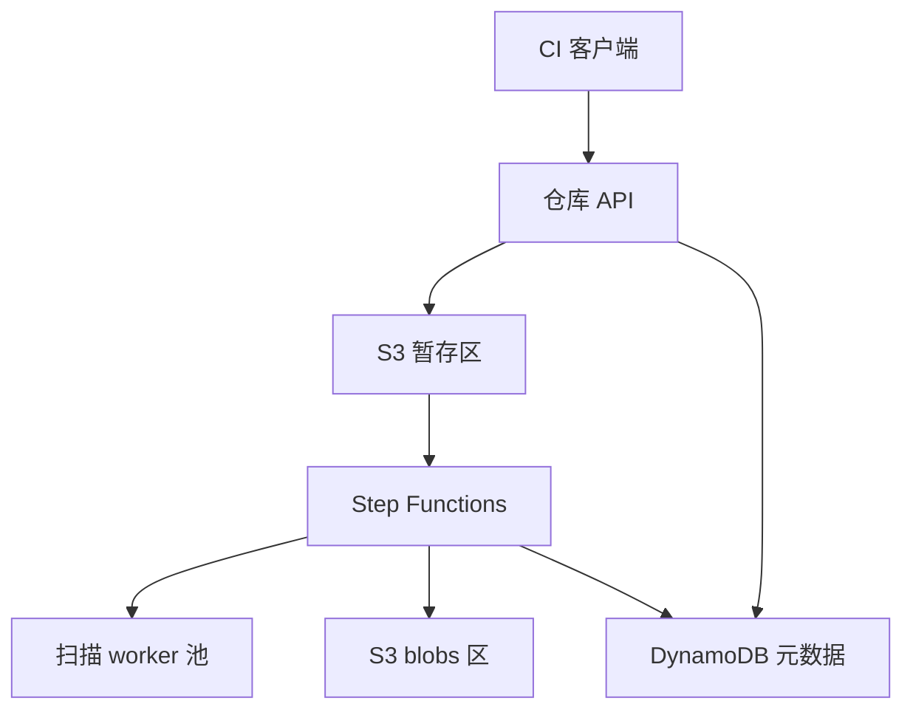
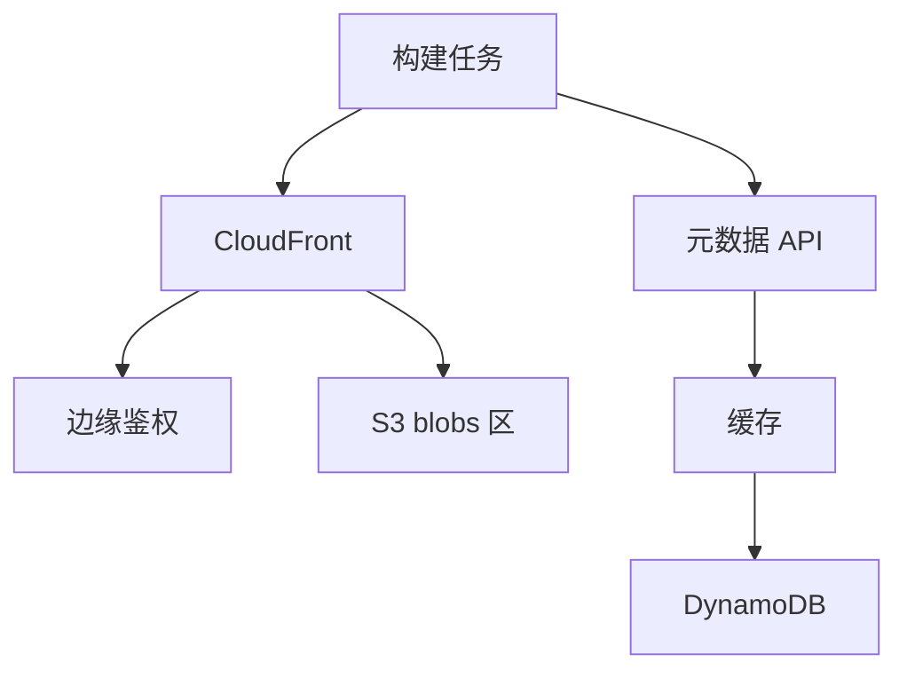
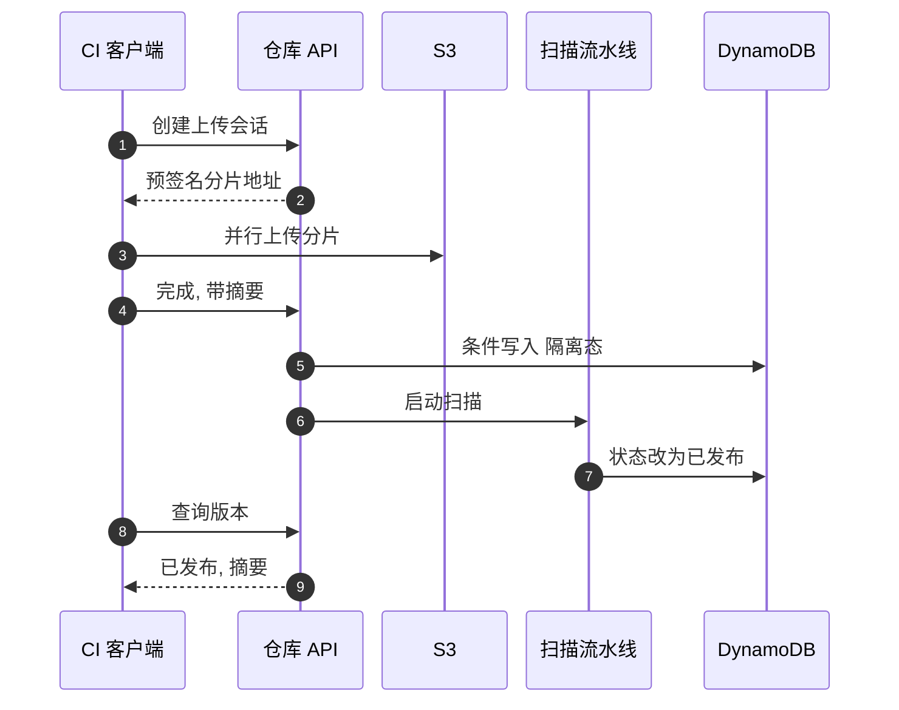
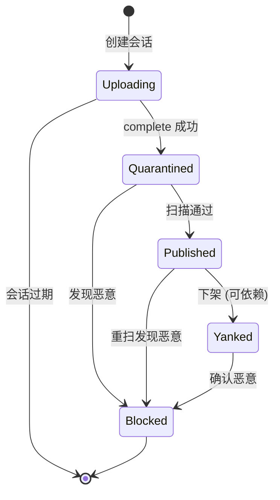

# SD15 制品仓库（Artifact Repository）（low priority）

## 题目

制品仓库是存放构建产物的服务：编译好的 jar 包、npm 包、Python wheel、容器镜像的每一层，都由持续集成（CI）流水线上传进来，再由别的流水线和开发者的机器按名字和版本下载。JFrog Artifactory、Nexus、AWS CodeArtifact 都是这一类。使用者有三类：发布者（CI 机器人和人）、消费者（成千上万的构建任务）、管理员（配额、权限、安全策略）。难点有三个：读远多于写，而且一次构建会并发拉取几十个依赖，读路径必须靠缓存扛住；一个版本一旦发布就不可变，别人的构建依赖它，改一个字节都会造成「同一版本两种内容」的供应链事故；上传的东西可能带恶意代码，发布前后都要有安全检查，而扫描很慢，不能挡在上传的同步路径上。

题目：设计一个类似 JFrog 的制品仓库，支持添加制品（上传）和获取制品（下载），并讨论可扩展性、监控、可靠性，以及如何处理恶意制品。

题面没有给规模，下文的假设是：5 万名开发者的公司或一个公共托管服务，每天 100 万次构建；面试时以面试官给的数字为准。

## 澄清问题

开场用两三分钟问完下面八个问题，答案写在白板角落。

1. **规模：每天多少次构建、每次拉多少依赖、发布多少次？** 决定读写比和是否需要 CDN。假设每天 100 万次构建，每次构建平均拉 20 个制品，其中 30% 的构建会发布一个新版本。
2. **支持哪些格式？** 只做一种（比如 Maven），还是 Maven、npm、PyPI、Docker 都要？多格式意味着要把「协议适配」和「存储核心」分开，这是可扩展性的主要考点。
3. **制品多大？** 几 MB 的 jar，还是几 GB 的镜像层？大对象必须走分片上传（multipart）并绕开应用服务器，直接传到对象存储。假设平均 50 MB，上限 5 GB。
4. **版本可以覆盖吗？** 默认不可以：同一个「名称加版本」只能发布一次，且内容永远不变。允许覆盖会破坏可复现构建；如果需要可变标签（比如 `latest`），要与不可变的版本分开建模。
5. **公共还是私有？权限粒度是什么？** 私有仓库要对每次下载做鉴权，下载还要走 CDN 的话，鉴权必须能在边缘完成。
6. **扫描要多严格？发布前阻断还是发布后告警？** 阻断的话，新版本在扫描完成前不可见；告警的话，恶意包可能已被拉取。我们按「阻断」设计，并允许对内部仓库设为「先发布后扫」。
7. **要保留多久？有配额和清理策略吗？** 决定是否需要引用计数或标记清除的垃圾回收，以及按组织的存储配额。
8. **要不要做代理或镜像（缓存公共仓库）？** 可选的扩展：把公共仓库拉过来缓存，同时挡住依赖混淆攻击（dependency confusion）。

## 需求

**功能需求（按优先级）**

1. 上传制品：认证、分片上传、校验内容摘要，发布成不可变的版本。
2. 下载制品：按名称和版本，或按内容摘要获取；支持断点续传和大文件。
3. 发布前后的安全扫描：恶意代码、已知漏洞、敏感信息泄露；有问题的版本能被隔离或下架。
4. 查询元数据：列出版本、依赖、校验和、扫描结果。
5. 按组织配额与权限管理。

**非功能需求**

| 维度 | 目标 | 说明 |
|---|---|---|
| 下载延迟 | 缓存命中 p99 小于 200 ms，首字节 | 构建任务等不起 |
| 上传 | 5 GB 在 10 分钟内完成（网络允许） | 分片并行，直传对象存储 |
| 可用性 | 下载 99.99%，上传 99.9% | 下载挂了全公司构建停摆；上传挂了可以重试 |
| 持久性 | 已发布制品不丢（11 个 9） | 靠 S3；元数据也要有备份 |
| 一致性：发布 | 强一致：同一版本只能发布一次 | 条件写入 |
| 一致性：元数据列表 | 发布后秒级可见 | 允许短暂的最终一致 |
| 安全 | 隔离未通过扫描的版本；下载可审计 | 隔离态不可下载 |

**明确不做**：构建系统本身、依赖解析器的实现、许可证法律审查的细节、漏洞数据库的维护（只讲如何接入）。

## 容量估算

驱动设计的数字是**下载的次数是上传的 66 倍以上，且每次构建同时并发拉几十个文件**，读路径的设计决定一切。

假设：每天 100 万次构建；30% 的构建发布一个新版本，平均 50 MB；每次构建拉 20 个制品，平均 30 MB（很多是小的 jar 和 npm 包）；上传高峰是均值的 10 倍，下载高峰是均值的 5 倍；已发布的制品里平均 40% 的字节是之前没有出现过的（其余是重复的层或相同的依赖，内容寻址天然去重）；每个版本平均包含 10 个文件，元数据每个文件约 400 字节。

```
python3 -c "b=1e6; up=b*.3; print(up, up/86400, up/86400*10)"           # 30万/天, 3.47/s, 34.7/s
python3 -c "up=3e5; print(up*50e6/1e12, up*50e6*.4/1e12, up*50e6*.4*365/1e15)"   # 15 TB, 6 TB, 2.19 PB
python3 -c "b=1e6; d=b*20; print(d, d/86400, d/86400*5)"                 # 2000万/天, 231/s, 1,157/s
python3 -c "q=1157.4; g=q*30e6; print(g/1e9, g*8/1e9, g*.05*8/1e9)"        # 34.7 GB/s, 278 Gbps, 13.9 Gbps
python3 -c "up=3e5; r=up*10; print(r, r*365*400/1e9)"                     # 300万行/天, 438 GB/年
python3 -c "print(3.47*20, 34.72*20, 34.72*20*2)"                          # 扫描并发
```

- 上传 = 100 万 × 30% = **30 万次/天**，均值 30 万 ÷ 86,400 = **约 3.5 次/秒**，高峰 ×10 = **约 34.7 次/秒**。
- 上传的字节：30 万 × 50 MB = **15 TB/天**（逻辑量）；内容寻址去重后真正新增的是 40%，即 **6 TB/天**，一年 **约 2.19 PB**。存储增长是这个系统的长期成本，必须有清理和分层。
- 下载 = 100 万 × 20 = **2,000 万次/天**，均值 **约 231 次/秒**，高峰 ×5 = **约 1,157 次/秒**，是上传高峰的 33 倍；按次数的读写比 2,000 万 ÷ 30 万 = **约 67 : 1**。
- 下载带宽：1,157 次/秒 × 30 MB = **约 34.7 GB/秒 = 约 278 Gbps**（毛流量）。假设 CDN 与区域缓存的命中率 95%，回到源站 S3 的只有 5%，即 **约 13.9 Gbps**。没有缓存，这个系统根本不可行；有了缓存，源站只是个普通规模。
- 元数据：30 万个版本 × 10 个文件 = **300 万行/天**，一年 **约 438 GB**，对 DynamoDB 是小数据；元数据的读（解析依赖、列版本）才是 QPS 的大头，必须可缓存。
- 扫描并发：高峰上传 34.7 次/秒，假设每次扫描（解包、病毒引擎、漏洞匹配）平均 20 秒，同时在扫描的有 34.7 × 20 = **约 694 个**，按每个 2 个 vCPU 算约 **1,389 个 vCPU**。这是一个独立可扩缩的 worker 池，不能和上传服务绑在一起。
- 分片：一个 2 GB 的层用 64 MB 的分片是 2,000 ÷ 64 = 31.25，向上取整 **32 片**，远低于 S3 的 10,000 片上限；客户端计算 2 GB 的 SHA-256 在每秒 500 MB 的速度下约 4 秒，不是瓶颈。

**驱动设计的那个数字**：67 : 1 的读写比，加上 95% 的缓存命中率才把源站压到约 13.9 Gbps。因此制品必须按**内容摘要**寻址、永远不变，这样 CDN 可以无限期缓存，不需要失效；能变的只有元数据，必须与不可变的字节分开。

## 核心实体与 API

**实体**（粗体为主键）

| 实体 | 关键字段 | 说明 |
|---|---|---|
| Repository | **(org_id, repo_id)**、格式、可见性、配额 | 一个仓库对应一种格式 |
| Package | **(repo_id, name)**、所有者、创建时间 | 命名空间的所有权在这里记录 |
| Version | **(repo_id, name, version)**、状态、`manifest_digest`、发布时间 | 不可变；状态单向前进 |
| Blob | **digest（sha256）**、大小、存储位置 | 内容寻址，全局唯一，与仓库无关 |
| VersionBlob | **(repo_id, name, version, path)**、`digest` | 版本到字节的映射，一个版本多个文件 |
| UploadSession | **session_id**、发布者、预期摘要、已收分片、过期时间 | 上传的中间状态，会过期 |
| ScanReport | **(digest, scanner, db_version)**、结论、发现项 | 以摘要为键，同一份字节只扫一次 |

两个关键点：一是 `Blob` 以摘要为键，同一份字节无论被多少个版本、多少个仓库引用，只存一份；二是 `Version` 的状态只能前进：`UPLOADING → QUARANTINED → PUBLISHED → YANKED / BLOCKED`，永远不回到可写状态。

**API**（写请求都带幂等键）

```
POST /v1/repos/{repo}/uploads          Idempotency-Key: <uuid>
     {name, version, files: [{path, size, sha256}]}
     -> 201 {session_id, parts: [{file, part_no, url}], expires_at}
POST /v1/uploads/{session_id}/complete  {etags: [...]}
     -> 202 {version_id, status: "QUARANTINED"} | 409 version_exists | 422 digest_mismatch
GET  /v1/repos/{repo}/packages/{name}/versions/{version}
     -> {status, files: [{path, sha256, size}], scan: {...}}
GET  /v1/blobs/{sha256}                 -> 302 CDN 签名地址（私有）或直接 CDN 路径（公共）
POST /v1/repos/{repo}/packages/{name}/versions/{version}:yank   {reason} -> 200
```

客户端在上传前就声明每个文件的摘要和大小，服务端据此做三件事：判断这个摘要是否已存在（存在则无需上传，直接 `complete`，这就是去重）、检查配额、生成预签名的分片地址。分片地址让字节**直接从客户端到 S3**，应用服务器只处理几十字节的控制消息，所以 5 GB 的上传不会占用服务器带宽。

## 高层架构

写路径（上传与发布）：



读路径（下载）：



**流 1：发布。** CI 先请求创建上传会话，声明每个文件的摘要；服务端检查配额和命名空间所有权，对已存在的摘要免传，其余生成预签名分片地址；客户端把字节并行传到 S3 暂存区；`complete` 时服务端让 S3 校验（上传时带 `x-amz-checksum-sha256`，S3 自己核对），再对 `Version` 做一次**条件写入**（`attribute_not_exists`），保证同一版本只能发布一次；版本进入 `QUARANTINED` 状态，由 Step Functions 编排扫描；扫描通过后把字节移到 blobs 区（以摘要为键），状态变为 `PUBLISHED`，并发出事件通知订阅者。

**流 2：下载。** 消费者先读元数据（版本列表、文件清单和摘要），再按摘要从 CloudFront 取字节。摘要不变，所以响应带 `Cache-Control: immutable` 和一年的有效期。私有仓库在边缘做鉴权：CloudFront 签名 Cookie 或边缘函数校验令牌。构建工具拿到字节后用清单里的摘要自行校验，所以哪怕缓存被投毒也会被发现。



图中编号对应的每一步：

1. CI 声明要发布的名称、版本、每个文件的大小和摘要，带幂等键（Idempotency-Key），超时重试不会创建两个会话。
2. 服务端检查配额和命名空间所有权，返回每个分片的预签名地址和会话过期时间。已存在的摘要不返回分片，直接免传。
3. 客户端把分片并行传到 S3 暂存区，字节不经过应用服务器。传完的分片带有 S3 校验和。
4. 客户端调用完成接口，提交各分片的 ETag；服务端让 S3 合并分片并核对整体摘要，不一致返回 422。
5. 服务端对版本做条件写入：这个名称加版本不存在才能写入，写入后状态为隔离态（QUARANTINED）。同一版本已存在则返回 409；如果已存在的版本摘要与本次完全相同，则视为同一次发布的重试，返回成功，这就是幂等。
6. 服务端启动一个 Step Functions 执行，编排解包、恶意代码检测、漏洞匹配、敏感信息检测。
7. 全部通过后，流水线把字节移到 blobs 区，把版本状态原子地改为已发布。失败则改为 BLOCKED，并通知发布者。
8. 客户端轮询或订阅，查询版本状态。
9. 看到已发布和各文件的摘要后，消费者就可以下载了。隔离态的版本，列表接口不返回，下载接口返回 404，以免被依赖。

## 深挖

### 内容寻址与不可变版本：去重、幂等发布与垃圾回收

问题：同一个依赖被成千上万个版本引用，容器镜像的基础层几乎每次构建都相同；CI 会因为网络抖动重复上传；而「同一版本两份不同内容」会让两次构建得到不同结果，是最严重的供应链事故。同时存储一年增长 2 PB 以上，必须能回收垃圾。

选项：

1. **按路径存储（`repo/name/version/file`）**：直观，但不去重；覆盖写入需要靠应用层小心，一次竞态就可能发生静默覆盖。
2. **内容寻址（blob 以 SHA-256 为键），版本是一张「路径到摘要」的映射**：去重是免费的；blob 永不改变，所以可无限期缓存；版本不可变就等于「映射不可变」，用条件写入保证。
3. **引用计数的内容寻址**：和 2 一样，但额外维护每个 blob 的引用数，引用降到 0 就删除，回收即时。

选择第 2 种，并用**标记清除（mark and sweep）**做回收，不用引用计数。理由：引用计数需要在每次发布、删除、复制时做原子加减，一旦漏减或重复减，后果是**过早删除一个仍被引用的 blob**，这是不可逆的数据丢失；而标记清除的最坏结果只是「晚一点回收」。具体做法：每天导出 DynamoDB 的 `VersionBlob` 表到 S3，得到「被引用的摘要集合」；用 S3 清单（S3 Inventory）列出所有 blob；差集就是候选垃圾；候选必须**连续两次扫描都未被引用且存在超过 7 天**才删除，7 天的宽限期是为了覆盖尚未完成的上传会话和复制中的数据。

发布的幂等：`Version` 的主键是 `(repo, name, version)`，写入用 `attribute_not_exists`。条件失败时读出已存在的记录，**比较 manifest 摘要**：相同则返回成功（这是一次重试），不同则返回 409 和已存在版本的摘要。这给了发布者一个明确的语义：重试安全，覆盖不可能。

校验：客户端上传时让 S3 计算校验和（`x-amz-checksum-sha256`），服务端在 `complete` 时再核对整体摘要，下载方在拿到字节后按清单里的摘要校验。三处校验分别防止传输损坏、恶意客户端谎报摘要、缓存被篡改。

失败模式：两个并发的上传会话要发布同一个版本。条件写入保证只有一个成功，另一个得到 409；失败方已经上传的字节留在暂存区，由暂存区的生命周期规则（1 天后删除）清理。另一个失败模式是 `complete` 时服务崩溃，字节已在暂存区但没写元数据：会话保持过期前的状态，客户端重试 `complete` 是安全的。

### 恶意制品：隔离态、扫描流水线与命名空间保护

问题：任何能上传的人都可能上传恶意代码；一旦被下载并执行，攻击就扩散到全公司的构建机。扫描是慢的（每个 20 秒到几分钟），而且新漏洞每天都在披露，一个昨天通过扫描的版本今天可能是有漏洞的。

选项：

1. **同步扫描后才返回**：最安全，但上传接口被拖慢，高峰时扫描池排队会让整个发布停摆。
2. **先发布后扫描**：体验好，但窗口期内恶意包已被拉取。
3. **隔离态（quarantine）+ 异步扫描 + 持续重扫**：版本先进入不可见的隔离态，扫描通过才可见；扫描结果以摘要为键保存，新漏洞库发布时只重扫仍被引用的摘要。

选择第 3 种，并分三层：

- **扫描流水线**（Step Functions 编排，worker 池横向扩展）：解包并限制资源（防压缩炸弹：解压后大小和文件数有上限）；病毒与恶意模式检测；依赖漏洞匹配（把包的依赖清单对照漏洞库）；敏感信息检测（密钥、令牌）。扫描 worker 在无网络、只读的沙箱里运行，因为被扫描的对象本身就是不可信的。结果写入 `ScanReport`，键是 `(digest, scanner, db_version)`，同一份字节只扫一次。
- **发布后的处置**：版本状态 `YANKED`（下架但已有依赖仍能下载，用于「不推荐」）和 `BLOCKED`（任何人都不能下载，用于确认恶意）。`BLOCKED` 是按**摘要**全局生效的，一个恶意 blob 在所有仓库、所有版本里同时失效，包括 CDN：边缘鉴权先检查封禁列表。对已下载过的消费者，系统用下载审计日志反查谁拉取过，通知他们。
- **命名空间保护**：依赖混淆攻击（dependency confusion）是攻击者在公共仓库发布与你内部包同名但版本号更高的包，让构建工具选中它。对策是命名空间所有权：内部名称前缀只能由所属组织发布，代理公共仓库时，凡是与内部命名空间同名的包，永远只从内部仓库解析。名称相似的包（typosquatting）在上传时做编辑距离检查，命中者进入人工复核。

供应链完整性可以再进一步：要求发布者对制品签名（比如 Sigstore 的 cosign），仓库保存签名和构建来源证明（provenance），消费者的策略引擎可以要求「只允许有签名且来源证明指向可信流水线的版本」。这会把信任从「仓库没被攻破」变成「构建过程可验证」。

失败模式：扫描池积压，隔离队列越来越长，发布者看到发布迟迟不可见。对策：队列深度和隔离时长是核心指标，设置按组织的并发上限防止一个租户占满扫描池；扫描器本身不可用时「隔离态不放行」（失败关闭，fail closed），宁可慢也不放行未扫描的制品；对内部可信仓库可以配置为「先发布后扫」，这是一个显式的、可审计的策略开关。



### 读路径：CDN、边缘鉴权与元数据缓存

问题：高峰约 1,157 次下载/秒、约 278 Gbps 的毛流量，来自同一批文件的重复请求；同时私有仓库必须鉴权，而鉴权如果每次都回源，就会把认证服务变成瓶颈。构建任务还有个特点：一次构建并发拉几十个文件，任何一个慢请求都拖慢整个构建（尾延迟）。

选项：

1. **应用服务器代理字节**：简单，鉴权方便，但带宽和实例数按峰值配置，成本最高。
2. **预签名 S3 地址**：字节直接来自 S3，不占应用服务器；但 S3 没有边缘缓存，跨区域延迟高，同一文件被反复读取时每次都计入 S3 的请求费。
3. **CloudFront 加签名 Cookie / 边缘函数鉴权，源站是 S3（Origin Access Control）**：字节来自边缘缓存，命中率高；私有仓库的令牌在边缘校验；S3 桶不对公网开放，只允许 CloudFront 访问。

选择第 3 种。由于 blob 以摘要寻址，缓存键就是摘要，永不失效，不需要主动清除（invalidation）；封禁一个恶意 blob 时，靠边缘函数先查封禁列表（一个小的、全量复制的集合），而不是清除缓存。启用 CloudFront 的 Origin Shield（一层区域级的集中缓存）可以把多个边缘节点的未命中合并，进一步降低回源比例，对应前面假设的 95% 命中率。

元数据的读（列版本、解析依赖）远比 blob 读更频繁，且元数据是可变的（新版本、状态变化）。做法：版本详情是不可变的（除状态外），可以用较长的缓存；「版本列表」是可变的，用 30 秒的短 TTL 加主动失效：发布完成事件触发缓存删除。发布后「秒级可见」靠这个事件，不靠等 TTL。客户端也要有本地缓存：构建机上保留最近下载的 blob，用摘要做校验，大多数重复构建根本不发网络请求。

大文件：下载支持 HTTP Range，客户端可分段并行、断点续传；CloudFront 对大对象按范围缓存。尾延迟的处理：客户端对慢请求做对冲请求（hedged request），超过 p95 延迟后向另一个边缘再发一次，取先到的。

失败模式：CDN 区域故障。对策是多 CDN 或回退到 S3 预签名地址（带宽成本上升但可用性保持）；客户端对 5xx 做带抖动的指数退避，避免雪崩。另一个失败模式是边缘鉴权的令牌服务不可用：边缘函数使用自包含的签名令牌（JWT），本地验签，不回查，令牌服务只在签发时被调用。

### 配额与计量：软限制、硬限制与对账

问题：一个租户的失控 CI 可能一夜之间上传几十 TB，拖垮其他租户的成本，也可能被恶意用来存储非法内容。配额检查在每次上传时都要做，但精确的全局计数在高并发下是个争用点。

选项：

1. **每次上传前扫描租户全部制品求和**：精确，但慢到不可用。
2. **每个租户一个计数器行，每次上传原子加减**：精确，但计数行在大租户上成为热点，且上传失败要回滚计数。
3. **预留加对账**：创建上传会话时按声明的大小在计数器上做**条件预留**（`used + reserved + size <= quota`），完成时转为已用，会话过期则释放预留；定期（每小时）按真实的 blob 引用重新计算并校正计数。

选择第 3 种。计数器分成多个子计数（按 `hash(session) mod N`）来缓解热点，检查时读取总和；配额有软限制（80% 告警）和硬限制（100% 拒绝，返回 429 加明确原因）。内容寻址带来一个计量问题：同一个 blob 被多个租户引用，存储费该算谁？实践中按**逻辑用量**计费（每个租户按它引用的字节算，不管是否去重），去重的收益归平台，这样计费简单且可预测。

失败模式：预留泄漏（会话崩溃没有释放）。对策：预留带过期时间，每小时的对账作业修正偏差；对账差异超过 1% 时告警。

## Staff 视角：权衡、故障与演进

**10 倍规模会先坏什么。** 下载峰值从约 1,157 次/秒涨到约 1.2 万次/秒，先坏的不是存储，而是：（1）CDN 的回源：5% 的未命中从 13.9 Gbps 涨到约 139 Gbps，S3 单前缀的请求速率有上限（每个前缀读约 5,500 次/秒），摘要的前两位十六进制字符作为键前缀把请求分散到 256 个前缀；（2）元数据 API 的热点包：少数极热门的包（如核心基础库）让同一个分区键被打爆，需要在元数据层加一层缓存，并对热包使用读副本；（3）扫描池：上传高峰涨到约 347 次/秒，同时扫描数 6,944 个，要用队列做削峰，并对大租户设并发上限。

**每个组件挂了的影响面。**
- CDN 挂：回退到 S3 预签名地址，成本上升，可用性保持；这是最重要的降级路径，要演练。
- 元数据库（DynamoDB）区域故障：下载已知摘要的 blob 仍可用（构建工具的锁文件已包含摘要），但解析新版本和发布不可用。
- 扫描流水线挂：新发布停在隔离态（失败关闭），已发布的不受影响；这是「安全优先于可用」的取舍，要写进运行手册。
- S3 暂存区挂：上传不可用，下载不受影响。
- 认证服务挂：边缘使用自包含令牌继续校验，新令牌签发暂停；仅公共仓库不受影响。

**多区域。** 下载是全球性的，所以 blob 区用 S3 跨区域复制（CRR）到各主要区域，CloudFront 根据延迟选源。发布则只在一个主区域：`Version` 的条件写入需要单一仲裁点，用 DynamoDB 全局表的多主复制不安全（两个区域可能同时成功发布同一个版本，最后写入者胜会静默覆盖一个）。折中是按仓库归属一个主区域，发布路由到主区域，元数据通过全局表只读复制到其他区域。复制延迟意味着其他区域短时间内看不到新版本，可以接受；blob 的复制必须在元数据可见之前完成，否则出现「有版本没字节」，所以版本状态在所有目标区域的 blob 都到达后才变为 `PUBLISHED`。

**成本驱动。** 按重要性排序：（1）存储：一年增长约 2.19 PB，S3 标准存储按每 TB 每月 23 美元算，一年后每月约 5 万美元，靠生命周期策略把 90 天没被访问的 blob 转到低频访问层，并回收垃圾；（2）出口带宽：靠 CDN 命中率；（3）扫描计算：约 1,389 个 vCPU 的峰值，用 Spot 实例；以摘要为键的扫描缓存避免重复扫描。

**迁移与发布。** 增加新格式（比如从 Maven 扩展到 npm）只需要写一个协议适配器：把格式自己的 HTTP 协议翻译成核心的「声明文件摘要、上传、发布」三个操作；核心的存储、扫描、配额不变。适配器与核心之间用稳定的内部接口，适配器可以独立发布。这也是可扩展性问题的答案：格式是插件，字节和元数据是核心。从已有系统迁移时，先双写（新仓库同时写旧系统），再做摘要对账，最后切读。

**可观测性。** 业务指标：`publish_success_rate`、`quarantine_duration_p95`（隔离到发布的时间）、`scan_queue_depth`、`cache_hit_ratio`（CDN）、`origin_egress_gbps`、`digest_mismatch_total`（上传摘要不符，突增可能是客户端 bug 或攻击）、`gc_candidate_count`、`quota_reconcile_diff`。告警：缓存命中率低于 90%、隔离时长 p95 超过 10 分钟、`digest_mismatch_total` 突增、已发布版本的字节被检测到变化（必须恒为 0，任何非零都是 P1）。运行手册：如何按摘要紧急封禁一个 blob、如何冻结某个租户的发布。

## 面试官追问

1. **怎么保证一个版本发布后永远不变？** 版本是「路径到摘要」的映射，写入用 `attribute_not_exists` 条件；blob 以摘要为键，内容与键绑定，无法被改写；下载方按清单里的摘要校验。重试同一次发布时比较摘要，相同就是幂等成功，不同就是 409。
2. **上传一个 5 GB 的文件，怎么设计？** 分片直传 S3：服务端只发预签名分片地址和做校验，字节不经过应用服务器；64 MB 一片约 79 片，可并行与断点续传；`complete` 时让 S3 核对整体摘要。会话有过期时间，遗弃的分片靠生命周期规则清理。
3. **扫描很慢，怎么不拖慢发布？** 隔离态加异步扫描，版本在通过之前对外不可见；扫描结果以摘要为键缓存，同一份字节只扫一次；扫描池独立横向扩展，队列深度是核心指标，对每个租户设并发上限。
4. **发现一个已发布的包是恶意的，怎么办？** 按摘要全局封禁，边缘函数检查封禁列表，立即对所有仓库生效；用下载审计日志查出拉取过的消费者并通知；保留字节用于取证，但不可下载。
5. **如何防止依赖混淆攻击？** 命名空间所有权：内部前缀只能由所属组织发布；代理公共仓库时，与内部命名空间同名的包永远只从内部仓库解析；相似名称上传时做检查并人工复核。
6. **为什么垃圾回收用标记清除而不是引用计数？** 引用计数一旦漏减或重复减，会过早删除仍被引用的 blob，是不可逆的数据丢失；标记清除的最坏结果只是晚回收。再加上两次扫描都未引用和 7 天宽限期，覆盖在途上传。
7. **读多写少，怎么扛 278 Gbps？** blob 内容寻址、不可变，缓存键是摘要，永不失效，CDN 加区域缓存命中率 95%，回源只有约 13.9 Gbps；元数据短 TTL 加事件失效；客户端本地缓存按摘要复用。
8. **怎么做多区域？** blob 用跨区域复制；发布只在版本归属的主区域，用条件写入保证唯一；元数据通过全局表只读复制；版本在所有区域的 blob 到达后才变为已发布，避免「有版本没字节」。
9. **租户配额怎么做才不成为热点？** 预留加对账：创建会话时对子计数做条件预留，完成转已用，过期释放，每小时按真实引用对账；软限制告警，硬限制返回 429。
10. **怎么扩展支持新的包格式？** 协议适配器加核心：适配器把格式特有的 HTTP 协议翻译成「声明文件摘要、分片上传、发布、按摘要下载」；存储、扫描、配额、封禁都在核心里，新格式不需要改核心。

## 60 分钟怎么分配

| 分钟 | 做什么 | 白板内容 | 时间不够时 |
|---|---|---|---|
| 0–5 | 澄清问题，定假设 | 构建数、制品大小、是否可覆盖、扫描阻断 | 只问规模、版本不可变、扫描策略三个 |
| 5–10 | 需求与容量估算 | 67 : 1、278 Gbps、95% 命中率 | 只写读写比和命中率 |
| 10–15 | 实体与 API | Blob 以摘要为键、Version 状态机、上传会话 | 压缩为三张表加三个接口 |
| 15–25 | 高层架构与发布序列图 | 写路径、读路径、发布序列图 | 保留，不能砍 |
| 25–40 | 深挖一：内容寻址与不可变；深挖二：恶意制品 | 条件写入、隔离态、封禁列表 | 必讲这两个 |
| 40–50 | 深挖三：读路径与 CDN；深挖四：配额 | 边缘鉴权、预留加对账 | 读路径讲缓存键，配额口述 |
| 50–55 | Staff 视角：故障、多区域、成本 | 降级表、失败关闭、全局表的陷阱 | 只讲降级与多区域 |
| 55–60 | 追问与总结 | 字节不可变、元数据可变、两者分开 | 总结一句 |

**45 分钟版**（前面有 10–15 分钟行为面试）：澄清 3 分钟，容量 3 分钟，API 3 分钟，架构 8 分钟，深挖两个（内容寻址、恶意制品）各 8 分钟，读路径 5 分钟，降级与多区域 5 分钟，剩下留给追问。配额一节用一句话带过：「创建会话时预留，完成时转已用，每小时对账」。

## 自测

1. 为什么 blob 要以内容摘要为键，而不是按「仓库/名称/版本」存路径？

<details><summary>答案</summary>

摘要寻址带来三个好处：同一份字节只存一份（去重）；内容与键绑定、永不改变，所以 CDN 可以无限期缓存、无需失效；下载方可以用摘要自行校验。按路径存储不去重，覆盖写入全靠应用层小心，一次竞态就会产生同一版本两种内容。

</details>

2. 同一个版本被并发发布，或发布请求被重试，如何保证只发布一次且重试安全？

<details><summary>答案</summary>

对 `(repo, name, version)` 做 `attribute_not_exists` 条件写入，只有一个会话成功。条件失败时读出已存在记录并比较清单摘要：相同说明是同一次发布的重试，返回成功；不同返回 409。这样重试安全、覆盖不可能。

</details>

3. 为什么新上传的版本要先进入隔离态，扫描器不可用时为什么不放行？

<details><summary>答案</summary>

扫描很慢，同步等待会拖垮上传；先发布后扫描，窗口期内恶意包已被拉取。隔离态在通过扫描前对外不可见，不可下载。扫描器不可用时失败关闭：宁可发布变慢，也不放行未扫描的制品，这是安全优先于可用的显式取舍。

</details>

4. 垃圾回收为什么选标记清除，并且要「两次扫描未引用加 7 天宽限期」？

<details><summary>答案</summary>

引用计数漏减或重复减会过早删除仍被引用的 blob，数据丢失不可逆；标记清除最坏只是晚回收。两次扫描都未被引用，以及 7 天宽限期，是为了覆盖尚未完成的上传会话和复制中的数据，避免把正在使用的字节当成垃圾。

</details>

5. 95% 的缓存命中率意味着什么？没有它会怎样？

<details><summary>答案</summary>

高峰下载毛流量约 278 Gbps，命中率 95% 时回源只有 5%，约 13.9 Gbps。没有缓存，源站要承担全部 278 Gbps，S3 请求速率和成本都不可行。内容寻址让缓存键永不失效，是做到高命中率的前提；封禁恶意 blob 靠边缘检查封禁列表，不靠清除缓存。

</details>

## 延伸阅读

- 相邻题解：[[solution-object-storage]]（分片上传、持久性、纠删码）、[[solution-file-sync]]（分块与内容寻址去重）、[[solution-cdn]]（缓存键、回源、签名地址）、[[solution-key-value-store]]（元数据的分区与条件写入）。
- 同批题单：[[sd-index]]。
- 文档：[S3 分片上传](https://docs.aws.amazon.com/AmazonS3/latest/userguide/mpuoverview.html)、[S3 对象完整性校验](https://docs.aws.amazon.com/AmazonS3/latest/userguide/checking-object-integrity.html)、[CloudFront 源站访问控制](https://docs.aws.amazon.com/AmazonCloudFront/latest/DeveloperGuide/private-content-restricting-access-to-s3.html)
