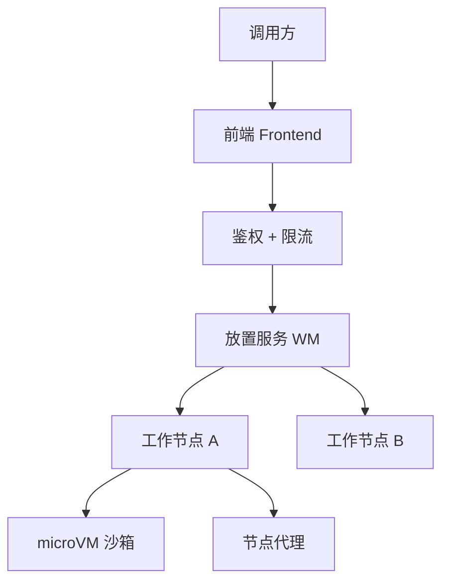
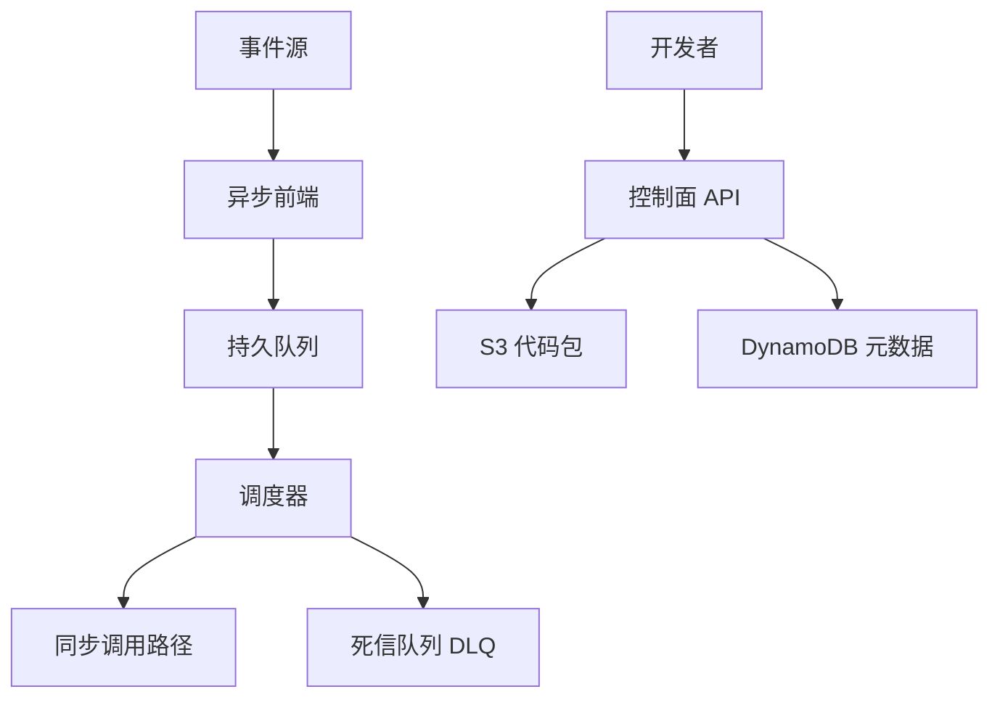
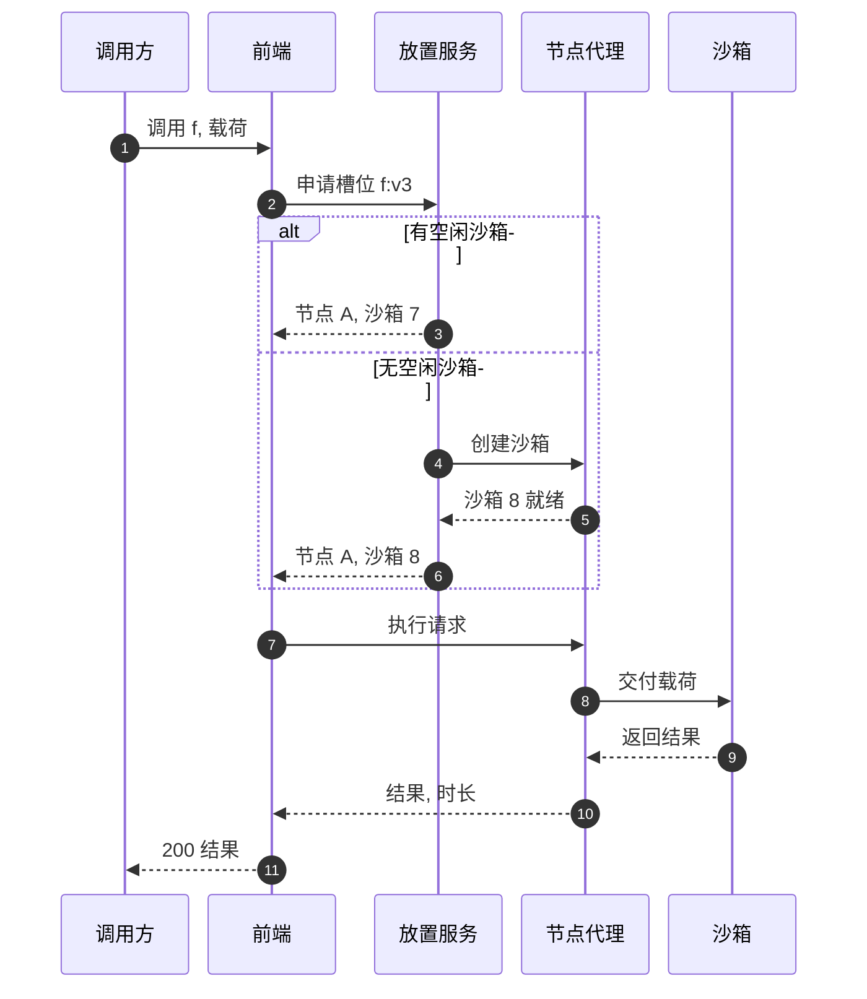
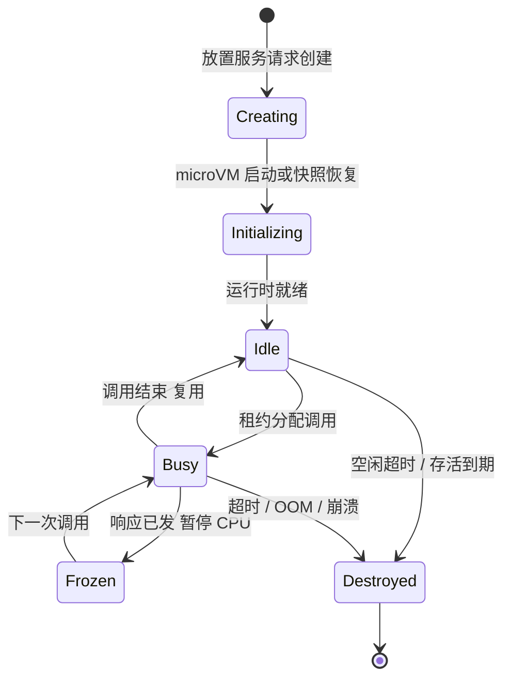
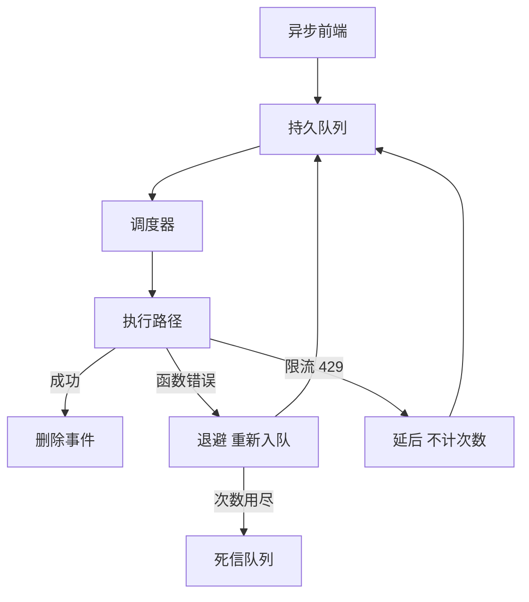

# SD16 Lambda 式代码执行（Serverless Code Execution）（low priority）

## 题目

函数即服务（Function as a Service）让开发者上传一段代码，不用管服务器：有请求来就跑，没请求就不占资源，按运行时间和内存计费。使用者是两类人：写函数的开发者，和把函数接到事件源（HTTP、队列、对象存储事件）上的业务系统。难点有三个：每一次调用都要在别人的不可信代码里执行，租户之间必须强隔离；「启动一个干净的运行环境」很慢（几百毫秒到几秒），而调用延迟要求是几十毫秒，所以必须复用环境又不能泄露状态；流量毫无规律，函数 A 一秒内从 0 涨到 5 万并发，函数 B 常年一个并发，机器要在两者之间高效摆放。

题目：设计 AWS Lambda，重点讲工作节点（Worker Node）：代码在哪里、怎么执行；要支持同步调用和异步调用。

这道设计考的是「控制面（上传、配置）」和「数据面（每次调用怎么跑）」的分工，数据面里最值得画的是放置（placement）、沙箱复用和异步重试。面试时先把调用路径画出来，再把时间花在工作节点上。

## 澄清问题

开场两三分钟问下面八个问题，答案写在白板角落，每一条都会改动设计。

1. **规模：区域内峰值调用速率、典型时长、典型内存？** 决定工作节点数量和是否需要多级放置。假设峰值 100 万次调用/秒，平均 100 ms，平均内存 512 MB。
2. **同步调用的延迟目标？** 如果要求 p99 附加开销（平台自己的耗时，不含用户代码）小于 10 ms，路由必须走内存里的缓存，不能每次查库；如果允许 100 ms，可以多一跳放置服务。
3. **冷启动的容忍度？** 决定要不要预热池（warm pool）、快照恢复（snapshot restore）和预置并发（provisioned concurrency）。
4. **支持哪些语言和运行时，允许自带容器镜像吗？** 自带镜像意味着镜像拉取和解压要进入冷启动路径，需要缓存层。
5. **异步调用要什么语义？** 至少一次（at-least-once）、重试几次、失败后进死信队列（Dead-Letter Queue，DLQ）；是否保证顺序。假设至少一次、无序、最多重试两次。
6. **并发限制怎么管？** 账户级上限和函数级预留并发，决定谁在限流、限流返回什么。
7. **执行时长和载荷上限？** 假设最长 15 分钟，同步载荷 6 MB，异步载荷 256 KB。长任务意味着不能随便驱逐沙箱，载荷上限决定请求能不能走消息队列。
8. **多租户的威胁模型？** 恶意租户会尝试逃逸、侧信道、耗尽主机资源，决定隔离用微虚拟机（microVM）还是容器。假设完全不信任。

## 需求

**功能需求（按优先级）**

1. 创建、更新、发布函数版本（上传代码包或镜像，设置内存、超时、环境变量）。
2. 同步调用（Invoke，RequestResponse）：调用方等待结果，错误直接返回。
3. 异步调用（Invoke，Event）：立即返回 202，平台负责排队、重试、失败投递。
4. 自动扩缩容：按并发需求增加执行环境，空闲回收；支持函数级并发上限。
5. 日志和指标：每次调用的时长、内存峰值、错误。

**非功能需求**

| 维度 | 目标 | 说明 |
|---|---|---|
| 平台附加延迟 | 热调用 p99 小于 10 ms | 不含用户代码 |
| 冷启动 | p99 小于 500 ms（快照恢复可到 100 ms 以内） | 只发生在新环境 |
| 可用性 | 调用路径 99.99% | 控制面可以比数据面低一档 |
| 隔离 | 租户间零共享内核、零共享内存 | 违反就是安全事故 |
| 同步调用语义 | 至多一次由调用方重试保证；平台内部不重放 | 重放会让有副作用的函数执行两次 |
| 异步调用语义 | 至少一次，函数必须幂等 | 平台不能做到恰好一次 |
| 弹性 | 单函数每 10 秒新增 1,000 并发 | 超过则限流 |

**明确不做**：函数编排（Step Functions 的职责）、事件源映射（Kinesis、SQS 轮询）的细节、层（Layers）管理、计费账单的细节、边缘部署。

## 容量估算

先定会驱动设计的数字：**并发度 = 到达率 × 平均时长**（利特尔定律，Little's Law），它决定了要同时存在多少个沙箱，进而决定要多少台机器。

假设：峰值 100 万次/秒；平均 100 ms；平均内存 512 MB；其中 20% 是异步调用；1% 的调用需要冷启动；异步载荷平均 6 KB。

计算（公式和结果，已用脚本复算）：

- 并发沙箱数 = 1,000,000 × 0.1 = **100,000** 个同时在跑的执行环境。
- 内存总量 = 100,000 × 0.5 GB = **50 TB**。
- 每台工作节点可售内存按 256 GB 减去 32 GB 系统和管理开销 = 224 GB，可放 224 ÷ 0.5 = 448 个 512 MB 沙箱。需要 100,000 ÷ 448 ≈ **223 台**才能装下运行中的环境；留 30% 余量应对突发，按 223 ÷ 0.7 ≈ **319 台**。这里的数字比直觉小得多：峰值每秒一百万次调用，只需要几百台机器，因为每次调用只占 100 ms。
- 冷启动速率 = 1,000,000 × 1% = **10,000 次/秒**；若冷启动 150 ms，同一时刻有 10,000 × 0.15 = **1,500** 个沙箱在启动；若用快照恢复把冷启动降到 50 ms，则只有 **500** 个。
- 预热余量：要让 99% 的调用命中热环境，必须在需求之上多留空闲环境，假设 30%，即 100,000 × 1.3 = **130,000** 个环境存在。空闲环境占内存，是冷启动延迟用成本换来的。
- 异步流量 = 1,000,000 × 20% = **200,000 条/秒**，带宽 = 200,000 × 6 KB ≈ **1,172 MB/s**（约 1.2 GB/s）。若函数失败率 2%、最多重试 2 次，额外重试流量 = 200,000 × 2% × 2 = **8,000 条/秒**，只占 4%，所以重试不是容量问题，是退避和隔离问题。
- 积压缓冲：下游函数挂了 5 分钟，积压 = 200,000 × 300 = **6,000 万**条，存储 = 6,000 万 × 6 KB = **360 GB**。队列必须按这个量级设计，不能放内存。
- 单函数突发：每 10 秒新增 1,000 并发，涨到 100,000 并发需要 100,000 ÷ 1,000 × 10 = **1,000 秒**（约 17 分钟）。这是产品限制，不是物理限制：它限制了一个租户一次冲击能占走多少共享容量。
- 调用日量 = 1,000,000 × 86,400 = **864 亿次**（按全天峰值上界）。

**驱动设计的数字**：每秒 1 万次冷启动。每个冷启动都要创建一个隔离环境，所以「沙箱创建」是一条必须每秒完成上万次的流水线，而不是偶发操作。沙箱的创建速度、复用率、放置质量，是这道设计的核心。

## 核心实体与 API

**实体**（粗体为主键）

| 实体 | 关键字段 | 说明 |
|---|---|---|
| Function | **(account_id, name)**、运行时、内存、超时、预留并发 | 控制面数据 |
| Version | **(function_arn, version)**、代码包哈希、配置快照 | 不可变，调用总是指向某个版本或别名 |
| CodeArtifact | **sha256**、S3 位置、大小 | 内容寻址，按哈希去重 |
| Sandbox | **sandbox_id**、host_id、版本、状态、最后使用时间 | 数据面，只存在于内存和节点上 |
| Lease | **(function_arn, sandbox_id)**、过期时间 | 一次调用对沙箱的短租约 |
| AsyncEvent | **event_id**、function_arn、载荷引用、尝试次数、下次时间 | 异步队列里的一条记录 |

**API**

```
POST /functions                          {name, runtime, memory_mb, timeout_s, code_s3_uri}  -> 201 {arn}
POST /functions/{name}/versions          -> 201 {version}
POST /functions/{name}/invocations       X-Invocation-Type: RequestResponse | Event
     body = payload                      -> 200 {result, billed_ms}  |  202 (Event)  |  429 throttled  |  502 function_error
PUT  /functions/{name}/concurrency       {reserved: 500}   -> 200
PUT  /functions/{name}/async-config      {max_retries: 2, max_age_s: 21600, dlq_arn, on_failure_arn} -> 200
```

数据面内部接口（工作节点暴露，调用方是放置服务和前端）：

```
POST /host/invoke   {sandbox_id, request_id, payload}   -> {result, duration_ms, mem_used_mb}
POST /host/create   {version, code_sha256, memory_mb}    -> {sandbox_id}
```

同步调用的幂等：平台不替调用方重试，调用方自带请求 ID（`X-Request-Id`）用来在日志里关联；异步调用平台会重试，所以函数代码自己必须幂等，平台把 `event_id` 作为上下文传给函数，方便用它去重。

## 高层架构

把系统分成两层。**控制面**管函数的元数据和代码包，调用量小，可以慢；**数据面**管每一次调用，是上面算的百万次/秒，必须快。调用路径（同步）：



异步与控制面路径：



**流 1：同步调用。** 前端（Frontend）收到请求，校验签名和权限，检查账户与函数的并发额度；然后问放置服务（Worker Manager，下称 WM）要一个「可用槽位」：WM 在内存里维护「函数版本 → 有空闲沙箱的节点」的映射，命中就返回节点和沙箱，未命中就挑一台有富余内存的节点创建新沙箱（冷启动）；前端把载荷发到那台节点的节点代理（host agent），代理把载荷交给沙箱内的运行时 API，等结果，把结果原路返回，同时上报时长和内存用量。

**流 2：异步调用。** 前端对异步请求只做校验并把载荷写入持久队列，然后立刻返回 202；调度器从队列取出事件，走和同步调用同样的路径执行；成功就删除事件，失败按退避规则重新入队，超过次数或超过最大年龄就写入死信队列。同步和异步共用同一个执行路径，所以沙箱、放置、并发控制只实现一份。



图中编号对应的每一步：

1. 调用方发出调用请求，指明函数和版本别名，请求里带载荷。
2. 前端鉴权、限流之后，向放置服务（WM）申请一个能跑这个函数版本的槽位。
3. 命中：WM 记着这个版本在节点 A 上有一个空闲沙箱，直接返回，这是热路径，不涉及任何创建。
4. 未命中：WM 选一台内存有余的节点，让节点代理创建沙箱（冷启动）。
5. 节点代理创建沙箱，加载代码，初始化运行时。
6. WM 把新沙箱登记为「忙」，返回给前端。
7. 前端把执行请求发到那台节点的代理，不经过 WM，WM 不在载荷路径上。
8. 代理把载荷交给沙箱里的运行时接口。
9. 用户代码执行完，运行时返回结果。
10. 代理把结果和计量数据（时长、内存）回给前端，同时把沙箱标记为空闲，登记回 WM 的空闲表。
11. 前端回给调用方，同步调用到此结束。

## 深挖

### 沙箱：microVM、快照恢复与冷启动

问题：不可信代码必须被强隔离，但隔离越强，创建越慢。每秒 1 万次冷启动，意味着不能容忍秒级启动。同时，同一个沙箱会被同一函数连续复用，复用就意味着上一次调用的残留（内存、临时文件、全局变量）有可能影响下一次。

选项：

1. **每个租户一台虚拟机（VM）**：隔离最强，但启动要几秒、内存开销大（完整的内核加设备模型），一台机器放不了几百个。
2. **容器（namespace + cgroup）**：启动快（几十毫秒）、开销小，但所有租户共享宿主机内核，内核漏洞等于跨租户逃逸。对完全不信任的多租户代码，风险无法接受，除非再叠加 gVisor 这类用户态内核，代价是系统调用变慢。
3. **轻量级 microVM（Firecracker 一类）**：每个沙箱是一个极简虚拟机，只有必要的设备，内核独立；创建在 125 ms 量级，每个 microVM 内存开销约几 MB，一台机器可以放数百个。再加**快照恢复**：把「已经启动好运行时、加载好代码」的 microVM 内存状态存成快照，新沙箱从快照拉起，不重新跑初始化。

选择第 3 种。隔离的边界是硬件虚拟化，攻击面只剩虚拟机监控器（hypervisor）和少数模拟设备。冷启动拆成四段，各自优化：（1）**拉取代码**：代码包按哈希缓存在节点本地磁盘和区域内的块缓存，避免每次冷启动都读 S3；大镜像按块懒加载，只拉执行路径上需要的块。（2）**创建 microVM**：预先创建一批「空白」microVM 放在池里，冷启动时直接取出，省掉创建本身。（3）**运行时初始化**：用快照恢复跳过解释器启动和用户的全局初始化。（4）**用户初始化**：这部分是开发者代码，平台只能提供预置并发（提前把沙箱初始化好并保持）。

快照有一个必须说清的坑：从同一个快照拉起的多个沙箱，起点内存完全相同，包括随机数生成器的状态、已经建立的网络连接、已经生成的唯一 ID。必须在恢复后重新播种随机数、关闭继承来的连接、让运行时提供恢复钩子（restore hook）让用户重置状态。否则会出现两个沙箱生成相同的「随机」令牌。

复用的规则：一个沙箱**同一时刻只处理一个调用**（没有并发共享），而且**只服务同一个函数版本**，不跨函数、不跨租户复用，因为复用沙箱的残留是同一个租户自己的数据，风险可控。空闲一段时间（例如几分钟到几十分钟，带抖动）或存活时间到期（例如数小时）就销毁，避免内存泄漏的累积和长期存活的状态。



失败模式：沙箱创建风暴，一个流行函数的新版本发布后，所有旧沙箱失效，上万个冷启动同时发生，打爆节点的创建能力。对策是版本切换用渐进式（别名按权重切流量）、创建请求在 WM 处按函数合并和限速、节点上限制并发创建数。

### 放置与路由：把调用送到有热沙箱的节点

问题：100,000 个并发沙箱散在 300 多台节点上。一次调用到来时，要找到「这个函数版本的空闲沙箱」所在的节点，而且这件事要在个位数毫秒里完成。同时，放置还要装箱：不能把所有函数堆在几台节点上（热点），也不能每台节点都留一堆小沙箱（碎片）。

选项：

1. **随机选节点**：最简单，但命中热沙箱的概率等于该函数的沙箱占比，冷启动率高，且同一函数的沙箱散在各处，回收不整齐。
2. **前端本地缓存加一致性哈希**：按（函数、版本）做一致性哈希选节点，同一函数天然聚集在少数节点，命中率高。问题是热门函数会压垮自己的那几台节点，需要「一个函数最多散布到 K 台」的上限和溢出规则。
3. **集中放置服务（WM）+ 租约**：WM 在内存里维护每个函数版本的空闲沙箱表，前端每次调用向 WM 要一个租约（lease）；节点对沙箱状态有最终发言权，WM 的信息可能略旧，租约被拒时 WM 重新挑选。

选择第 3 种，并分片：WM 按函数哈希分片（每片服务一部分函数），每片有主备，空闲表是内存状态，宕机后由节点代理重新上报恢复。这样路由和放置的状态集中在一个决策者手里，装箱可以做得好：新沙箱挑「剩余内存最多、同函数已有沙箱较少」的节点，既分散热点又避免单节点承载同一函数的全部沙箱。**租约的细节**：租约带过期时间（略长于函数超时），节点崩溃时 WM 靠过期回收，不依赖显式释放；前端在调用结束时归还租约，缩短沙箱重新变成空闲的时间。

装箱的另一面是**容量的反压**：当一台节点的内存逼近上限，它向 WM 宣告「不再接受新沙箱」，WM 把它从候选集中拿掉。节点内部对低优先的空闲沙箱做回收（最久未使用优先），给新沙箱腾内存。

**并发限制放在哪**：并发是「正在执行的调用数」，在前端用分片计数器统计（每个前端实例本地配额加定期向中央计数器对账，允许小幅超出，换取不在每次调用上加一次远程调用）。函数级预留并发是硬上限（超出直接返回 429）；账户级并发是软上限，由多个函数共享。预留并发有成本：它从共享池中划走容量，所以 WM 要为预留并发保证有沙箱可建。

失败模式：WM 一个分片挂了，那一批函数的新调用拿不到槽位。对策是备机接管，接管期间前端可以用「最近一次缓存的节点列表」直接尝试，被节点拒绝再退回 WM；热沙箱仍然存在，所以影响主要是新建沙箱的延迟，而不是已有调用中断。

### 异步调用：持久队列、重试、死信与背压

问题：异步调用立刻返回 202，之后必须「至少一次」执行；函数可能抛错，也可能被限流（429），还可能压根起不来。平台既不能丢事件，又不能让一个失败的函数拖垮整条队列，更不能让一个租户的积压吃光共享资源。

选项：

1. **直接在前端内存里重试**：实现最简单，但前端重启就丢事件，不满足持久。
2. **每个函数一个队列**：隔离最好，但队列数量等于函数数量（百万级），管理成本高。
3. **共享的分片持久队列（SQS 式）+ 按函数的调度逻辑**：事件按（函数、哈希）分片写入多副本的持久存储，调度器拉取时遵守每个函数的并发上限和速率；失败后带延迟重新入队（可见性超时 visibility timeout 加退避）。

选择第 3 种。具体行为：（1）入队即持久：前端把载荷写入队列（载荷超过队列上限就放 S3，队列里存指针）后才返回 202。（2）执行失败（函数抛错或超时）：事件带着尝试次数回到队列，延迟按指数退避，例如第一次重试等 1 分钟，第二次等 2 分钟，并带抖动；（3）被限流（429）与函数错误区别对待：限流不消耗重试次数，只是延后，并且可以保留更久（例如最长 6 小时），因为这不是函数的错；（4）超过次数或超过最大年龄就进死信队列或调用失败目的地（on-failure destination），保留原始载荷、错误信息和尝试次数，方便人工或自动重放；（5）调度器对每个函数用令牌桶，速率不超过该函数当前可用并发，避免积压一次性冲进来把沙箱池吃光。

**至少一次的代价**：同一事件可能执行两次（调用成功但确认丢失、调度器重启）。所以平台把 `event_id` 传给函数，文档里明确要求函数幂等。平台不能承诺恰好一次，因为用户代码的副作用在平台之外，无法做到两阶段提交。



失败模式：一个函数持续失败，重试把队列塞满，挤占其他函数。对策是队列按函数分片到有限个「车道」，每条车道有速率上限；一个函数的积压只占自己的车道，其余车道不受影响（隔离坏邻居，bulkhead）。

### 隔离与多租户：资源、网络与侧信道

问题：沙箱之间不能互相看到，也不能互相拖垮。一个恶意函数会尝试耗尽 CPU、内存、磁盘、文件描述符，扫描内网，或者通过共享的缓存和 CPU 的时序差异猜别人的数据。

选项与选择：隔离分四层，各层成本不同，要说清「每层挡什么」。

- **计算隔离**：microVM 独立内核，挡内核级逃逸。CPU 份额按内存比例分配（内存越大，CPU 份额越大），用 cgroup 限制，挡「吃光 CPU」。内存硬上限，超出被杀（OOM），挡「吃光内存」。
- **文件与进程隔离**：沙箱内的根文件系统只读，只有一个很小的可写临时目录，大小有限；沙箱销毁时磁盘一并擦除，不会有残留。
- **网络隔离**：沙箱默认出站走租户自己的虚拟网络接口，不能访问平台内网和实例元数据服务；平台控制面接口只能经过节点代理，不能被用户代码直连。
- **侧信道**：同一物理核的超线程（SMT）可能泄露信息。对敏感场景，同一物理核的两个超线程只分给同一个租户，或者关闭 SMT；这是性能和安全的取舍，要点明。

凭证问题：函数需要访问其他服务的权限，不能把长期密钥放进环境。节点代理在沙箱启动时为其申请**短期凭证**（只绑定这个函数的执行角色，有效期数小时），写入运行时可读取的位置，到期自动轮换。这样沙箱被攻破，泄露的凭证也只有短暂窗口和最小权限。

失败模式：宿主机被攻破。microVM 逃逸的爆炸半径是这一台节点上所有租户，所以节点是无状态可抛弃的（没有长期凭证，没有持久数据），发现异常就整机下线重装；同一台节点同时服务的租户数量越少，爆炸半径越小，这也是「不同安全等级的租户分池」的理由。

### 工作节点队列与扩缩容：容量怎么跟上突发

问题：函数的负载有尖峰，有的 10 秒内涨一千倍。工作节点本身要买、要装、要启动，不可能临时凭空出现。平台需要一个缓冲，并且要说清楚谁来为尖峰买单。

选项：

1. **按峰值常备机器**：延迟最好，但空闲时成本巨大。
2. **纯按需加机器**：加一台节点要分钟级（启动、拉镜像、注册），尖峰时用户全部在等待。
3. **共享池加余量加按函数的突发限速**：平台保持整体 20–30% 的空闲余量（上面算的 319 台里有 96 台是余量），并限制单函数每 10 秒新增 1,000 并发；这样一个租户的尖峰最多只能吃掉可预期的一块，其余租户不受影响。同时用预测（按小时周期和历史）提前扩节点，对节点池自动伸缩的触发信号是「可分配内存占比」而不是 CPU。

选择第 3 种。要点是**多租户共享的容量不能被一个租户一次占光**，所以突发限速是产品层面的公平机制，不只是保护。要更低延迟的租户买预置并发：平台为其预创建好沙箱并保持，成本由租户承担，WM 把这些沙箱标记为不可驱逐。

节点生命周期：节点需要打补丁和更换，做法是「排空」(drain)：不再接受新沙箱，已有调用跑完或超时后下线，沙箱不迁移（沙箱本来就是可抛弃的）。这让节点滚动更新成为日常操作。

失败模式：节点崩溃。上面正在跑的同步调用丢失，前端检测到连接断开后返回 502 给调用方，由调用方决定重试；平台不自动重放同步调用，因为不知道副作用有没有发生。异步调用则靠队列的可见性超时自动重新入队，进入下一次尝试。

## Staff 视角：权衡、故障与演进

**10 倍规模会先坏什么。** 峰值从 100 万涨到 1,000 万次/秒，节点从 319 台到 3,000 多台，先坏的是三处：（1）WM 的内存空闲表与分片数，单个分片的更新速率成为瓶颈，需要更多分片和分层（区域级 WM 下面再分机架级）；（2）冷启动的代码拉取，块缓存命中率下降，源站（S3）的 GET 速率飙升，要加缓存层和预取；（3）异步队列的写入吞吐，要加分片。机器本身反而不是第一个瓶颈。

**每个组件挂了的影响面。**
- 前端实例挂：无状态，负载均衡摘除，影响仅在途请求。
- WM 分片挂：新建沙箱受阻，已有热沙箱和在途调用不受影响；备机接管，中间用前端缓存的节点列表顶一下。
- 工作节点挂：该节点上所有沙箱消失，在途同步调用失败，异步靠重试；影响面等于该节点承载的函数数，所以单函数的沙箱要分散在多台节点上。
- 异步队列挂：同步路径不受影响，异步 202 无法写入，前端对异步调用返回 5xx，由调用方重试；队列是多副本跨可用区的，单可用区故障不丢事件。
- 控制面（元数据库、S3）挂：已有函数继续运行，因为数据面缓存了版本配置和代码包；无法创建或更新函数。这是控制面与数据面解耦的价值，要刻意设计成数据面不依赖控制面的实时可用。

**多区域。** 函数按区域独立部署，每个区域有自己的完整数据面，不跨区域转发调用。代码包和配置从控制面复制到各区域。跨区域故障转移由调用方（或 DNS、全局负载均衡）完成，平台不替调用方做「这个区域坏了就去另一个区域执行」，因为函数可能访问区域内的数据，盲目转移会读到错误的数据。

**成本驱动。** 成本主要有三块：（1）空闲余量：30% 余量与预置并发是花钱买延迟，要用「利用率」指标持续调；（2）快照存储与块缓存：快照比沙箱本身大，要按函数热度淘汰；（3）异步队列的存储与请求数。计费按 1 ms 粒度乘内存，平台的毛利取决于装箱的密度：每台节点多塞一成沙箱，成本降一成，所以装箱算法值得投入。

**发布与迁移。** 节点操作系统、虚拟机监控器和运行时的升级通过排空节点滚动完成，每次只动一小批，用金丝雀监控错误率与冷启动时间。运行时（例如某个语言版本）的弃用要提前通知，旧版本沙箱在到期后拒绝创建。

**可观测性。** 指标：`cold_start_ratio`（目标低于 1%）、`placement_latency_p99`、`sandbox_create_p99`、`throttle_count` 按函数、`async_queue_age_max`（最老事件年龄）、`dlq_depth`、`node_memory_allocatable_ratio`。告警：冷启动比例突增、异步最老事件超过 10 分钟、可分配内存低于 15%。运行手册要写清：如何排空一个可用区、如何对某个租户限流、如何冻结某个函数。

## 面试官追问

1. **冷启动怎么降？** 分段治理：代码包本地缓存与块级懒加载，microVM 预创建，快照恢复跳过运行时初始化，用户侧的初始化靠预置并发。要说清楚快照恢复后必须重新播种随机数、关闭继承的连接。
2. **为什么不用容器而用 microVM？** 容器共享宿主内核，对完全不可信的多租户代码，一个内核漏洞就是跨租户逃逸。microVM 把边界放在硬件虚拟化上，代价是每个沙箱多几 MB 内存和稍长的创建时间，用快照和池化补回来。
3. **一个沙箱能同时处理多个请求吗？** 本设计不行，同一时刻只处理一个调用。好处是计费、内存上限、故障隔离都按单次调用算清；代价是并发高时沙箱数量多。允许单沙箱多并发会让一个请求的内存泄漏或崩溃影响其他请求，隔离语义变差，属于另一个产品选择。
4. **同步调用失败要不要自动重试？** 不要。平台不知道副作用有没有发生，自动重放会让有副作用的函数执行两次。同步重试交给调用方，调用方带自己的请求 ID；异步调用是平台承诺「至少一次」，所以函数必须幂等。
5. **并发限制怎么实现，会不会不准？** 前端每个实例持有本地配额，定期与中央计数器对账，允许短时间小幅超出，换来调用路径上不增加远程调用。函数级预留并发是硬上限，要求更准，所以对预留并发的函数缩短对账间隔。
6. **一个租户的突发会不会影响别人？** 会被三层挡住：单函数每 10 秒新增并发的上限，账户级并发上限，以及全局 20–30% 的余量。这三层把「一个租户最多能吃掉多少共享容量」变成一个可预期的数字。
7. **工作节点宕机了正在跑的调用怎么办？** 同步调用返回 502，调用方重试；异步事件通过队列的可见性超时重新入队。节点上没有需要保留的状态，所以恢复就是新建沙箱。
8. **怎么处理超长任务或大载荷？** 同步载荷有上限，超过的走对象存储，传指针；超长任务不适合函数模型，应拆成多步或交给编排服务；时长上限是为了让节点排空和回收有边界。
9. **怎么保证新代码发布后旧沙箱不再服务？** 沙箱绑定的是不可变版本，发布产生新版本；别名切换让新调用路由到新版本，旧版本沙箱因没有流量而空闲回收。强制失效时 WM 把旧版本的空闲表清空。
10. **如何测试这个系统？** 混沌测试：随机杀节点、杀 WM 分片，断言在途异步事件不丢；负载测试：函数并发从 0 突增，观察限速和冷启动比例；隔离测试：沙箱内尝试访问元数据服务、其他租户的文件和内网地址，必须全部被拒。

## 60 分钟怎么分配

| 分钟 | 做什么 | 白板内容 | 时间不够时 |
|---|---|---|---|
| 0–5 | 澄清问题，定假设 | 角落写规模、延迟、异步语义 | 只问规模、冷启动、异步语义三个 |
| 5–10 | 需求与容量估算 | 并发 = 到达率 × 时长，10 万沙箱、319 台、1 万次冷启动/秒 | 只写利特尔定律那一行 |
| 10–15 | 实体与 API | Invoke 的两种类型、状态码 | 压缩为 API 三行 |
| 15–25 | 高层架构与两条流 | 前端、WM、节点代理、沙箱的图和序列图 | 保留，不能砍 |
| 25–40 | 深挖一：沙箱与冷启动；深挖二：放置与路由 | 沙箱状态机、租约、装箱 | 必讲这两个 |
| 40–50 | 深挖三：异步重试与死信；隔离 | 异步流程图、四层隔离 | 只讲异步，隔离口述一句 |
| 50–55 | Staff 视角：故障面、多区域、成本 | 组件故障表 | 只讲控制面与数据面解耦 |
| 55–60 | 追问与总结 | 一句话收尾 | 总结一句 |

**45 分钟版**（前面有 10–15 分钟行为面试）：澄清 3 分钟，容量 3 分钟，API 2 分钟，架构 8 分钟，深挖两个（沙箱与冷启动、放置与路由）各 8 分钟，异步重试 5 分钟，故障与多区域 5 分钟，其余留给追问。隔离一节用一句话带过：「microVM 独立内核，短期凭证，出站网络受控」。

## 自测

1. 并发沙箱数怎么算，为什么它比「每秒调用数」更能决定机器数量？

<details><summary>答案</summary>

并发 = 到达率 × 平均时长。按假设 100 万次/秒 × 0.1 秒 = 10 万个同时在跑的沙箱，每个 512 MB，共 50 TB；每台可放 448 个，需要约 223 台，留 30% 余量约 319 台。机器占用的是「同时存在多少环境」，不是「一秒进来多少请求」，请求越短，需要的机器越少。

</details>

2. 为什么对不可信代码选 microVM 而不是容器，又怎样补回它的启动速度？

<details><summary>答案</summary>

容器共享宿主内核，内核漏洞会跨租户逃逸；microVM 每个沙箱有独立内核，边界在硬件虚拟化。启动慢的问题靠三招补：预创建空白 microVM 放池里，从快照恢复跳过运行时初始化，代码包在节点本地缓存并按块懒加载。快照恢复后要重新播种随机数并关闭继承的连接。

</details>

3. 同步调用失败平台为什么不自动重试，异步调用为什么可以？

<details><summary>答案</summary>

平台不知道用户代码的副作用有没有发生，同步自动重放可能让同一操作执行两次，所以重试交给持有请求 ID 的调用方。异步调用平台承诺至少一次，并在文档里要求函数幂等、把 event_id 交给函数去重；做不到恰好一次，因为副作用在平台之外。

</details>

4. 限流（429）与函数报错在异步重试里为什么要区别对待？

<details><summary>答案</summary>

限流是平台容量问题，不是函数的错，所以只延后、不消耗重试次数，且允许保留更长时间；函数报错才按退避消耗次数，用尽后进死信队列。混在一起会让一次突发限流把本来健康的事件错误地送进死信队列。

</details>

5. 一个租户的流量突发，凭什么不会拖垮其他租户？

<details><summary>答案</summary>

三层：单函数每 10 秒最多新增 1,000 并发，账户级并发上限，以及平台整体 20–30% 的空闲余量；异步队列再按函数分车道限速，积压只占自己的车道。这样一个租户最多吃掉的共享容量是个可预期的数字。

</details>

## 延伸阅读

- 相邻题解：[[solution-job-scheduler]]（延迟任务、重试、至少一次）、[[solution-online-judge]]（沙箱隔离与资源限制）、[[solution-message-queue]]（持久队列与可见性超时）、[[solution-rate-limiter]]（并发与速率限制）。
- 同批题单：[[sd-index]]。
- 论文：[Firecracker: Lightweight Virtualization for Serverless Applications（NSDI 2020）](https://www.usenix.org/conference/nsdi20/presentation/agache)
