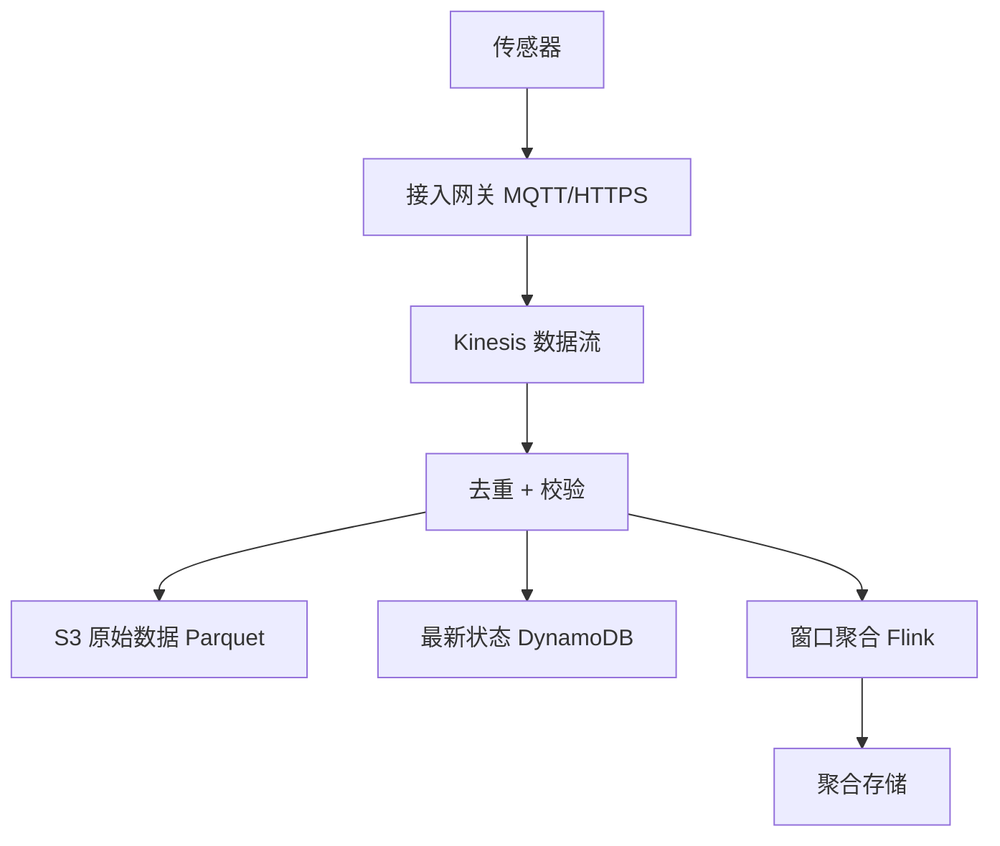
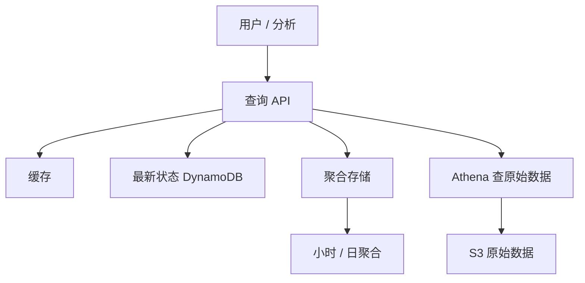
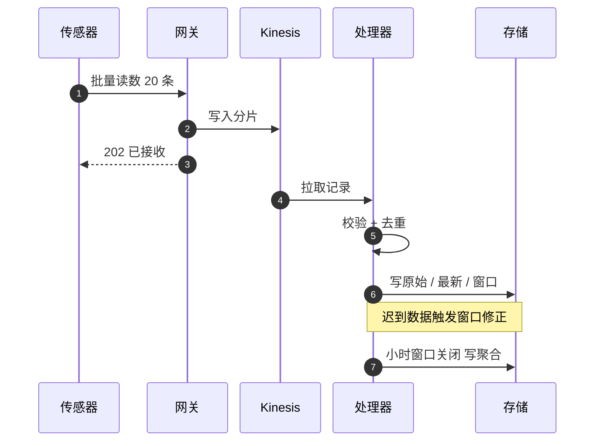

# SD17 传感器与天气数据平台（Sensor / Weather Platform）（low priority）

## 题目

传感器平台从大量地面设备（温度、湿度、气压、雨量）收集读数，实时展示当前状况，也能回答历史问题：某个城市昨天的小时平均温度、过去一年某片区域的趋势。使用者是三类：设备本身（只写，网络不稳）、看实时地图的用户和下游服务（读最新值）、做分析的人（读历史聚合）。难点有三个：写入是持续的小记录洪流，量不大但永不停歇，读写形态完全不同；同一份数据要同时服务「最新值」「按小时聚合」「按地理区域查询」三种查询，没有一种存储对三者都合适；设备会掉线、重发、时钟不准，数据会迟到、重复、乱序，聚合结果却必须正确。

题目：设计一个天气数据系统。每 10 平方公里放一个温度传感器，覆盖 1,000 万平方公里，系统要提供实时视图和历史视图，并计算每小时平均值。

另一种问法是「几千个传感器」或「智慧城市传感器算每小时平均」。规模小一两个数量级，设计的骨架不变，只是不需要分区流处理。下文以百万传感器为准，面试时按对方给的数字缩放。

## 澄清问题

开场用两三分钟问完下面八个问题，答案写在白板角落。

1. **传感器数量和上报频率？** 决定写入速率和是否要流处理分区。假设 1,000,000 个传感器，每分钟一条读数。
2. **实时的含义：读数到可见的延迟？** 如果要求 5 秒内可见，就需要流式路径；如果一分钟可以，批量微批也行。假设 10 秒内。
3. **历史视图要什么粒度、保留多久？** 原始读数保留多久，小时聚合保留多久；决定存储分层和降采样（downsampling）策略。假设原始 30 天，小时聚合 5 年，日聚合永久。
4. **「每小时平均」按谁的小时？** 事件时间（读数产生的时刻）还是到达时间；迟到数据要不要修正已发布的小时值。假设按事件时间，允许迟到 1 小时内修正。
5. **空间查询是什么形态？** 「某个点附近最近的传感器」「一个矩形区域的平均」「全国地图的当前热力图」，决定空间索引。
6. **设备通信方式和网络条件？** 蜂窝、LoRa、WiFi；是否有离线缓存、批量补传；协议是 MQTT 还是 HTTPS。
7. **数据质量要求？** 异常值（传感器故障报 999 度）是丢弃、标记还是修正；缺失的小时怎么展示。
8. **有没有告警需求？** 例如温度超过阈值，或传感器失联。决定是否要在流上做规则，以及传感器健康状态的存储。

## 需求

**功能需求（按优先级）**

1. 接收传感器读数（单条或批量），去重，持久化。
2. 实时视图：按区域返回最新读数，全国地图的当前温度。
3. 历史视图：按传感器或区域、时间范围查询，支持小时、日粒度。
4. 每小时平均值：每个传感器和每个空间格子的小时均值，迟到数据能修正。
5. 传感器健康：失联、读数异常的检测和告警。

**非功能需求**

| 维度 | 目标 | 说明 |
|---|---|---|
| 写入可见延迟 | 实时视图 p99 小于 10 s | 不是毫秒级，不需要强一致 |
| 写入持久性 | 已确认的读数零丢失 | 重发由设备端负责直到确认 |
| 读延迟 | 最新值查询 p99 小于 100 ms；地图 p99 小于 300 ms | 地图读预聚合结果 |
| 历史查询 | 一天范围 p99 小于 1 s；一年范围的小时聚合 p99 小于 3 s | 靠降采样而不是扫原始数据 |
| 可用性 | 写入路径 99.95%，读 99.9% | 设备会重发，所以写入可以短暂不可用 |
| 一致性 | 最终一致 | 迟到数据会修正已发布的小时值，查询结果带「是否最终」标记 |
| 去重 | 重发的读数不能重复计入均值 | 去重键是（传感器 ID，事件时间） |

**明确不做**：天气预测模型、卫星和雷达数据融合、设备固件升级与远程配置、计费、多语言界面。

## 容量估算

先定会驱动设计的数字：**每秒写入量很小，但时间累积后体量大，而且读的模式和写的模式不一样**。

假设：1,000,000 个传感器，每分钟一条，每条 100 字节（传感器 ID、时间戳、几个测量值、质量标志），峰值（断网恢复后补传、整点同步）按 3 倍。

计算（公式和结果，已用脚本复算）：

- 传感器数 = 覆盖面积 ÷ 单传感器面积 = 10,000,000 ÷ 10 = **1,000,000**。
- 写入速率 = 1,000,000 ÷ 60 = **约 16,667 条/秒**；峰值 3 倍 = **50,000 条/秒**；带宽 = 16,667 × 100 B ≈ **1.7 MB/s**。这个量对任何流系统都很小：Kinesis 每分片 1,000 条/秒，峰值只要 50,000 ÷ 1,000 = **50 个分片**，写入吞吐 5 MB/s。
- 若设备端把 20 条读数合成一个请求，请求速率 = 16,667 ÷ 20 = **约 833 请求/秒**。批量是降低连接和请求开销最便宜的手段。
- 原始数据：1,000,000 × 1,440 条/天 = **14.4 亿条/天**，× 100 B = **144 GB/天**，一年 = **52.6 TB**。原始数据保留 30 天 = 4,320 GB ≈ **4.3 TB**，列式压缩（按 8 倍估算）后约 **540 GB**。
- 小时聚合：1,000,000 × 24 = **2,400 万行/天**，每年 8.76 亿行，按每行 80 字节约 **701 GB/年**。日聚合每年 3.65 亿行，约 **29 GB/年**。
- 最新状态表：1,000,000 × 100 B = **100 MB**，可以整个放进内存。这是实时视图便宜的根本原因。
- 空间格子：用 geohash 4 位（约 39.1 × 19.5 km，约 762 km²）切分，1,000 万 km² ≈ **13,116 个格子**，每格约 76 个传感器；每年每格每小时一行的聚合 = 13,116 × 24 × 365 ≈ **1.15 亿行**，约 **9.2 GB**。全国地图一次返回 13,116 个格子，每格 16 字节，约 **210 KB**，完全可以缓存。
- 流处理窗口状态：每个传感器保留「当前小时」和「上一小时」两个窗口，每个约 40 字节，共 1,000,000 × 2 × 40 B = **80 MB**，小到可以放在内存里。
- 去重缓存：10 分钟窗口内的去重键数量 = 16,667 × 600 ≈ **1,000 万个**，每个 24 字节约 **240 MB**。
- 另一种频率：若每 10 秒一条，写入变成 **100,000 条/秒**，原始数据 864 GB/天、一年 315 TB。数量级是线性放大的，设计结构不变，但原始数据的保留期必须缩短。

**驱动设计的数字**：写入只有 1.7 MB/s，但一年 52.6 TB 的原始数据；而实时视图只需要 100 MB 的最新状态。所以结论是：**读写分离、按用途分存储**。热路径只维护小而新的状态，历史靠分层和降采样，不要试图用一个存储满足所有查询。

## 核心实体与 API

**实体**（粗体为主键）

| 实体 | 关键字段 | 说明 |
|---|---|---|
| Sensor | **sensor_id**、位置（经纬度）、geohash、型号、状态 | 元数据，变化很少 |
| Reading | **(sensor_id, event_ts)**、值、质量标志、到达时间 | 原始读数，只追加 |
| LatestState | **sensor_id**、最后读数、最后上报时间 | 实时视图的数据源 |
| HourlyAgg | **(sensor_id, hour)**、均值、最小、最大、条数、是否最终 | 小时聚合，可被迟到数据修正 |
| CellAgg | **(geohash, hour)**、均值、传感器数、条数 | 空间格子聚合，供地图 |
| SensorHealth | **sensor_id**、最后心跳、状态（正常/失联/异常） | 健康检测 |

**API**（设备写入带幂等性，读取是只读）

```
POST /v1/readings             {sensor_id, readings:[{ts, temp, humidity, q}]}   -> 202 {accepted, duplicates}
GET  /v1/sensors/{id}/latest                                                    -> {ts, temp, age_s}
GET  /v1/map?bbox=&zoom=                                                        -> [{geohash, temp, n}]
GET  /v1/sensors/{id}/series?from=&to=&grain=hour|day                           -> [{ts, avg, min, max, n, final}]
GET  /v1/areas/series?geohash=&from=&to=&grain=hour                             -> [{ts, avg, n_sensors, final}]
GET  /v1/sensors/{id}/health                                                    -> {status, last_seen}
```

写入的幂等键就是（`sensor_id`，`ts`）：同一传感器同一时刻只会有一条读数，重发得到 `duplicates` 计数，不会重复计入均值。设备端用单调递增的序号和本地磁盘缓冲：没收到 202 就一直重发，所以服务端必须能安全地接受重复。

## 高层架构

写入路径：



读取路径：



**流 1：写入。** 设备经接入网关（MQTT 或 HTTPS，网关负责设备认证）把读数批量送入 Kinesis 数据流，按 `sensor_id` 哈希分片，这样同一传感器的读数在同一分片内保序；处理器从流里读出，校验范围，用（传感器，事件时间）去重，然后同时写三处：原始数据追加到 S3（Parquet 列式，按日期和 geohash 前缀分区），最新状态写入 DynamoDB（条件更新，只接受比现有更新的时间戳），并送入窗口聚合算子。窗口按事件时间的小时对每个传感器和每个 geohash 格子计算均值、最小、最大、条数，结果写入聚合存储。

**流 2：读取。** 「某传感器当前温度」直接读 DynamoDB 的最新状态；「全国地图」读按格子预聚合的结果（缓存几秒）；「过去一年某区域的小时均值」读聚合存储，不碰原始数据；只有「原始读数明细」才通过 Athena 扫 S3 的分区。每种查询落在最适合它的存储上，由查询 API 根据时间范围和粒度路由。



图中编号对应的每一步：

1. 传感器把本地缓冲的最多 20 条读数合成一个请求发出，减少连接开销，也让断网恢复后的补传不会变成请求风暴。
2. 网关认证设备后，按传感器 ID 哈希把记录写入 Kinesis 的某个分片，同一传感器的数据在同一分片里保持顺序。
3. 记录进入流（多副本持久）之后，网关才返回 202。设备收到 202 就可以删除本地缓冲；没收到就重发，所以后面必须去重。
4. 处理器按分片顺序拉取记录。
5. 处理器检查数值范围、时间戳是否过于超前，并用（传感器 ID，事件时间）去重，重复的丢弃并计数。
6. 通过校验的读数写三处：S3 原始数据、DynamoDB 最新状态（条件更新，只接受更新的时间戳）、窗口聚合状态。
7. 迟到数据（事件时间属于已经关闭的小时）会让聚合算子重新计算那个窗口，并把「是否最终」标记保持为否。
8. 小时窗口在水位线（watermark）越过小时末尾加上允许迟到的时间之后关闭，把最终聚合写入存储，并把标记改为最终。

## 深挖

### 摄入：协议、批量与去重

问题：一百万台设备长期连接，网络质量差，会重发、断线重连、时钟漂移。如果每条读数一次 HTTPS 请求，连接和 TLS 握手的开销远大于数据本身；如果不去重，重发会让均值失真。

选项：

1. **每条读数一个 HTTPS 请求**：实现最简单，但 16,667 次/秒的请求开销大，设备电量也耗得快。
2. **MQTT 长连接（IoT Core 一类）**：一百万连接分摊到约 10 个网关（每个 10 万连接），设备用发布/订阅，保活消息很小，适合低功耗；服务端有设备注册、证书认证、规则引擎。代价是要管理长连接的容量，网关挂了会引发重连风暴。
3. **设备端批量 + HTTPS**：设备把读数攒起来每分钟或更久批量发送，请求降到约 833 次/秒。简单、易扩展，但实时性受批量窗口限制。

选择第 2 种为主、第 3 种为辅：在线设备用 MQTT 长连接和小批量（几条），低功耗设备用定时批量 HTTPS。网关只做认证、限速和写入 Kinesis，不做业务处理，这样网关层无状态可水平扩展。**去重**：写入幂等键是（`sensor_id`，`event_ts`），处理器用内存里的 10 分钟窗口去重缓存（约 1,000 万个键，240 MB）挡掉绝大多数重发，缓存之外的重发由存储层的幂等写入兜底（S3 追加后由后台作业按键压缩去重；DynamoDB 最新状态靠条件更新自然幂等）。聚合算子本身对重复不敏感的设计是存「求和和计数」而不是「当前均值」，并按键去重后再累加。

**时间戳**：设备时钟不可信。网关同时记录到达时间，处理器校验事件时间与到达时间的差：超前超过阈值（例如 5 分钟）就用到达时间替换并打标记；落后太多（例如超过 24 小时）进入「迟到处理」专用路径，不影响实时窗口。

失败模式：网关集群挂一台，十万设备同时重连。对策是设备端重连用带抖动的指数退避，网关对新连接限速，Kinesis 前面保留足够的写入余量（50 个分片的需求，配 100 个）。

### 时序存储：分层、降采样与保留

问题：一年 52.6 TB 的原始数据，查询却大多是「一个区域一年的小时均值」。如果所有查询都扫原始数据，成本和延迟都无法接受；如果只存聚合，就丢了排查问题需要的原始读数。

选项：

1. **全部放一个时序数据库（Timestream、InfluxDB 一类）**：查询方便，但百万级基数加长期保留，成本高，且数据库对「按时间窗口扫大量数据」不是最省钱的形态。
2. **只放 S3 + Athena**：成本最低，但查询是秒到分钟级，不能支撑实时视图和交互式图表。
3. **分层存储**：热层（近 30 天原始数据）放在列式时序存储或 S3 加缓存；温层放小时聚合；冷层放日聚合和对象存储中的原始数据归档；最新状态单独放在 DynamoDB。

选择第 3 种，各层按用途定粒度。**降采样（downsampling）的规则**：原始数据（1 分钟）保留 30 天；小时聚合保留 5 年（约 701 GB/年，可压缩）；日聚合永久保留（约 29 GB/年）。聚合存的不是单个均值，而是（总和、条数、最小、最大），这样才能继续向上合并：日均值 = 24 个小时聚合的总和之和 ÷ 条数之和，不是 24 个小时均值的平均（传感器缺了几条的小时，权重不同）。这一点是常见错误，要主动讲出来。

**数据布局**：S3 原始数据按「日期 / geohash 前缀」分区，Parquet 列式压缩，查询只扫相关分区，按 8 倍压缩，30 天热数据约 540 GB。小时聚合表按（geohash，小时）组织，一次区域查询读连续的行。**TTL 与生命周期**：S3 生命周期规则把超过 30 天的原始数据转入低频访问或归档层，而不是删除，因为重算聚合时可能需要。

失败模式：聚合算子有缺陷，写出了错误的小时均值。因为原始数据仍在，修复方式是重新计算（backfill）：从 S3 读出受影响的日期范围，用修复后的逻辑重新生成聚合，覆盖写入。这要求聚合写入是幂等覆盖而不是增量累加，所以窗口结果以（键，小时）为主键整体覆盖。

### 小时聚合：流式窗口、水位线与迟到数据

问题：小时均值要按事件时间，而数据会迟到、乱序。如果小时一结束就发布，迟到的读数会让结果永远偏差；如果等所有数据到齐，实时视图就没有意义。

选项：

1. **按到达时间（处理时间）划窗口**：最简单，结果立刻出，但数据迟到就被计入错误的小时，历史视图不准。
2. **按事件时间划窗口，固定等待**：窗口在小时末尾再等待固定时长（例如 5 分钟）后关闭，之后到达的数据丢弃。简单，但丢数据。
3. **按事件时间 + 水位线 + 允许迟到 + 修正**：水位线表示「事件时间早于这个点的数据基本都到了」，通常取各分片最大事件时间减去允许乱序时间；窗口在水位线越过小时末尾时先发布一个**初步结果**（标记 `final=false`）；之后允许迟到时间内（例如 1 小时）再有数据到达，就更新聚合并重新发布；超过允许迟到时间后，窗口状态清理，更晚的数据进入侧输出（side output）走离线修正。

选择第 3 种，用 Flink（或 Kinesis Data Analytics）实现。窗口状态是每个传感器每个小时一个「总和、条数、最小、最大」，约 80 MB 的量，放在内存加检查点（checkpoint）到 S3。发布方式是**覆盖写**：主键（传感器，小时），所以修正是幂等的，同一结果写两次不会变化。

几个必须说清的细节：（1）**空洞与短窗口**：某个传感器一小时只有 20 条而不是 60 条，均值仍然有效，但 `n` 要如实返回，查询方可以根据 `n` 判断是否可信；一条都没有的小时不写行，而不是写 0，否则会把「没数据」当成「零度」。（2）**空间格子聚合**：格子均值要用格子内所有传感器读数的总和和条数重新计算，而不是传感器均值的均值，两者在传感器数量不等时结果不同。（3）**迟到成本**：每次修正都要重新发布并让缓存失效，所以允许迟到时间越长，修正流量越大；1 小时是个平衡点。

失败模式：算子崩溃重启。从最近的检查点恢复状态，并重放自检查点以来的流记录，因为 Kinesis 保留 24 小时以上，所以可以重放；输出是按主键覆盖，重放不会重复计入。

### 空间查询：geohash 格子与热力图

问题：用户看的是地图：「这个矩形里现在多少度」「附近的传感器」「全国热力图」。如果每次都对一百万个点做范围扫描，延迟不可接受；而经纬度这种二维数据，关系型的 B 树索引一次只能高效利用一个维度。

选项：

1. **经纬度两列各建索引**：矩形查询要对两个范围取交集，数据量大时效率差。
2. **空间数据库（PostGIS 的 R 树、OpenSearch 的 geo 查询）**：功能完整，适合「最近的 K 个传感器」这类复杂查询，但对每分钟更新百万点的写入和全局热力图不是最省的。
3. **geohash 格子**：把二维坐标编码成字符串，前缀相同的点在空间上相邻，一个矩形可以拆成若干个前缀范围；**预先把格子聚合好**，地图查询只读格子行。

选择第 3 种用于地图和区域聚合，第 2 种（或第 3 种的邻域扩展）用于「最近的传感器」。geohash 4 位约 762 km²，全国约 13,116 个格子，每格约 76 个传感器；缩放级别越高，用越长的前缀（5 位约 24 km²，约 41.6 万个格子），只返回视野内的格子。**地图的数据流**：窗口聚合算子同时对（传感器，小时）和（geohash，当前时间片）计算，写入格子聚合；地图 API 读视野内的格子，缓存几秒；全国视图只要读约 13,116 行（约 210 KB），一个缓存键就能服务所有人。

**边界问题**：geohash 有个著名的缺陷，相邻的两个点可能前缀完全不同（跨过格子边界），所以「附近 K 个传感器」要同时查本格和相邻的 8 个格子，再按真实距离排序。格子的大小和传感器的密度要匹配：太大则格子均值掩盖了局部差异，太小则格子里传感器太少，均值噪声大。

失败模式：格子里传感器大量失联，格子均值只剩几个点，结果有偏。对策是返回 `n_sensors` 和 `n_expected`，低于阈值时地图用灰色显示「数据不足」，而不是给出一个看起来精确的数字。

### 传感器健康：失联、漂移与告警

问题：数据平台最容易被忽略的是「没数据」本身。传感器失联时，没有任何记录到达，所以不会触发任何基于记录的规则；传感器坏了持续报同一个值，也不会触发异常。

选项：

1. **只在记录到达时检查**：简单，但失联永远发现不了。
2. **定时扫描最新状态表**：每分钟扫一遍 100 MB 的最新状态表，找出最后上报时间落后超过 N 个周期的传感器，标记失联。表很小，扫描代价低。
3. **流上的会话窗口或定时器**：每个传感器一个超时定时器，每收到一条读数就重置，超时即发出失联事件。实时性好，状态量等于传感器数。

选择第 2 种为主：简单、可靠，失联判定阈值取 3 个上报周期（3 分钟），避免一次丢包就误报。**异常检测**用流上的规则：值超出物理范围（例如温度高于 70 度或低于零下 90 度）直接标记为异常并不计入聚合；连续多条读数完全相同（卡死）或与相邻传感器偏差过大（空间一致性检查，用同一 geohash 格子内的中位数对比）则标记为可疑。**告警的去重**：同一传感器的同一类告警在恢复前只发一次；大面积失联（例如一个基站故障让 5,000 台设备同时掉线，占 0.5%）要合并成一条「区域失联」告警，而不是 5,000 条，按 geohash 或网关归并。

失败模式：健康检查本身依赖最新状态表，表延迟会误报。对策是检查前先确认流处理的水位线是新鲜的，水位线落后时抑制失联告警，改发「平台延迟」告警。

## Staff 视角：权衡、故障与演进

**10 倍规模会先坏什么。** 传感器涨到一千万、或上报间隔缩到 10 秒，写入从 16,667 条/秒涨到 10 万到 100 万条/秒。先坏的是：（1）Kinesis 分片数和热点分片，按 `sensor_id` 哈希是均匀的，但整点同步上报会让峰值集中，需要设备端加随机抖动；（2）窗口聚合算子的状态与检查点大小，要按 geohash 前缀分区扩展并行度；（3）原始数据存储成本，一年 315 TB，原始数据保留期必须缩短，或在边缘网关先做 1 分钟的预聚合。

**每个组件挂了的影响面。**
- 接入网关挂：该网关的设备重连到其他网关；设备端本地缓冲保证数据不丢，代价是延迟。
- Kinesis 单分片问题：该分片的传感器写入延迟，网关对该分片返回 5xx，设备重发；其他分片不受影响。
- 处理器挂：从 Kinesis 检查点恢复，数据不丢，实时视图延迟增加。
- 聚合算子挂：小时聚合延迟发布，标记保持 `final=false`，修复后重放。
- 聚合存储挂：地图和历史视图降级为读缓存或返回较旧的数据，原始数据与最新状态不受影响。
- 最新状态表挂：实时视图不可用；这是最小的状态（100 MB），可以从流重建，所以恢复时间短。

**多区域。** 传感器天然有地理归属，所以按区域就近部署接入和流处理，每个区域独立计算本区域传感器的聚合；全局地图和跨区域查询由一个汇总层把各区域的格子聚合合并。区域之间只传输聚合（几百 KB），不传输原始数据。这样区域故障只影响该区域的传感器，全局视图显示该区域数据过期。

**成本驱动。** 主要是三项：（1）原始数据存储，一年 52.6 TB，靠列式压缩、生命周期和缩短热层保留控制；（2）Kinesis 分片与 Flink 算力，由峰值而非平均决定，设备端抖动能直接降低峰值；（3）查询：Athena 按扫描量计费，所以按日期和 geohash 前缀分区、列式存储、让大部分查询落在聚合层，是控制成本的关键。

**发布与迁移。** 聚合逻辑的改动用「影子计算」上线：新逻辑和旧逻辑并行计算一天，比较输出差异，一致后切换；已发布历史聚合的修正用 backfill，覆盖写入，不改变 API。传感器固件的时间戳格式变更由网关做兼容转换。

**可观测性。** 指标：`ingest_rate`、`dedupe_ratio`（重复率，常态约 2%）、`end_to_end_lag_p99`（事件时间到可见）、`watermark_lag`、`late_events_total`、`sensors_offline_ratio`、`window_correction_total`。告警：端到端延迟超过 30 秒、水位线落后超过 10 分钟、失联比例超过 1%、去重率突增。运行手册要写清：如何触发某个日期范围的 backfill、如何暂停告警、如何隔离一批异常传感器。

## 面试官追问

1. **为什么不把所有数据放一个时序数据库？** 因为查询形态不同：最新值要毫秒级、地图要预聚合、历史要降采样、明细要便宜地扫描。一个库要同时支撑，要么贵要么慢。分层让每种查询落在最合适的存储，代价是写入时要写多处，所以靠流处理器统一分发并保证幂等。
2. **迟到数据怎么处理？** 事件时间窗口加水位线，允许迟到 1 小时：窗口先发布初步结果，迟到数据到达时重算并覆盖写，`final` 标记在迟到窗口过后才变为真；更晚的数据走离线 backfill。查询结果带 `final` 标记让使用方知道可信度。
3. **日均值怎么由小时聚合算出来？** 存总和和条数，日均值 = 总和之和 ÷ 条数之和。不能对 24 个小时均值取平均，因为各小时条数不同，权重不同。
4. **怎么避免重发造成重复计数？** 幂等键是（传感器，事件时间）；处理器用 10 分钟的内存去重缓存，缓存之外靠存储层幂等写入（条件更新、按主键覆盖）；聚合以覆盖写为准，重放不会累加。
5. **传感器时钟不准怎么办？** 同时记录事件时间和到达时间；事件时间超前太多用到达时间替换并打标记；落后太多走迟到路径。网关可以在连接建立时下发时间同步。
6. **「附近的传感器」和热力图用同一个索引吗？** 热力图用预聚合的 geohash 格子；最近邻查询用格子加相邻 8 格再按距离排序，或交给空间索引。两者查询形态不同，不强求一个结构。
7. **如何知道一个传感器坏了？** 定时扫描最新状态表找失联（3 个周期无心跳），流上规则找超范围、卡死和与邻居偏差过大，大面积失联合并为区域告警，并在水位线落后时抑制失联告警以免误报。
8. **规模缩到几千个传感器怎么简化？** 去掉 Kinesis 和 Flink：设备直接写入一个队列，一个定时作业每小时从关系型数据库或时序库里用 SQL 计算均值，最新状态一张表即可。保留的只有幂等写入和事件时间语义。
9. **如何做回填（backfill）？** 从 S3 原始数据按日期范围重放，用同一套聚合逻辑重新计算，覆盖写入聚合存储，因为主键是（键，小时），所以可以重复执行。重放期间用单独的资源，避免影响实时路径。
10. **怎么测试聚合是否正确？** 用已知数据集做回放测试：构造乱序、重复、迟到、缺失的读数，断言聚合等于离线批处理的结果；线上则用批流对账作业，每天比较流式小时聚合与 Athena 从原始数据算出的值，差异非零就告警。

## 60 分钟怎么分配

| 分钟 | 做什么 | 白板内容 | 时间不够时 |
|---|---|---|---|
| 0–5 | 澄清问题，定假设 | 角落写传感器数、频率、实时含义、保留期 | 只问规模、实时含义、保留期三个 |
| 5–10 | 需求与容量估算 | 16,667 条/秒、144 GB/天、最新状态 100 MB | 只写 1.7 MB/s 与 52.6 TB/年这两个 |
| 10–15 | 实体与 API | Reading 的主键、写入与三种读取 | 压缩为 API 四行 |
| 15–25 | 高层架构与两条路径 | 写入路径和读取路径两张图、序列图 | 保留，不能砍 |
| 25–40 | 深挖一：窗口聚合与迟到；深挖二：分层存储与降采样 | 水位线示意、聚合存总和与条数 | 必讲这两个 |
| 40–50 | 深挖三：摄入与去重；空间查询 | MQTT 加批量、geohash 格子 | 只讲去重，空间口述 |
| 50–55 | Staff 视角：故障面、区域化、成本 | 组件故障表 | 只讲区域化与成本 |
| 55–60 | 追问与总结 | 一句话收尾 | 总结一句 |

**45 分钟版**（前面有 10–15 分钟行为面试）：澄清 3 分钟，容量 3 分钟，API 2 分钟，架构 8 分钟，深挖两个（窗口聚合、分层存储）各 8 分钟，去重与空间查询 5 分钟，故障与成本 5 分钟，其余留给追问。健康检测一节用一句话带过：「定时扫描最新状态表找失联，大面积失联合并告警」。

## 自测

1. 为什么说这个系统读写要分离，最新状态表为什么便宜？

<details><summary>答案</summary>

写入只有约 1.7 MB/s，但原始数据一年 52.6 TB；实时视图需要的只是每个传感器最后一条读数，1,000,000 × 100 B = 100 MB，整个放进内存都行。所以最新状态单独存，历史靠降采样，两者不需要同一个存储。

</details>

2. 日均值为什么不能对 24 个小时均值取平均？

<details><summary>答案</summary>

各小时的读数条数不同（掉线、丢包），权重不同。聚合要存总和与条数，日均值 = 总和之和 ÷ 条数之和。空间格子的均值同理，要用格子内所有读数的总和和条数重新算，不是传感器均值的均值。

</details>

3. 迟到数据怎么既保证实时又保证准确？

<details><summary>答案</summary>

按事件时间划窗口，水位线越过小时末尾时发布初步结果（`final=false`），允许迟到时间内（1 小时）到达的数据触发重算并按主键覆盖写，过期后标记为最终；更晚的数据走离线 backfill。覆盖写使修正幂等，重放不会重复计入。

</details>

4. 为什么传感器失联不能靠记录到达来检测？

<details><summary>答案</summary>

失联时没有记录到达，基于记录的规则永远不会触发。要定时扫描最新状态表，找出最后上报时间落后超过 3 个周期的传感器；大面积失联合并成区域告警；水位线落后时抑制失联告警，避免把平台延迟误报成传感器故障。

</details>

5. geohash 格子做地图有什么好处，边界问题怎么解决？

<details><summary>答案</summary>

4 位 geohash 约 762 km²，全国约 13,116 个格子，预先聚合后全国地图只读约 13,116 行（约 210 KB），一个缓存键服务所有人。缺陷是相邻的点可能在不同前缀的格子里，所以最近邻查询要查本格加相邻 8 个格子，再按真实距离排序。

</details>

## 延伸阅读

- 相邻题解：[[solution-metrics-monitoring]]（时序写入、降采样、告警）、[[solution-ad-click-aggregation]]（窗口聚合、水位线、迟到数据）、[[solution-proximity]]（geohash 与空间查询）、[[solution-top-k]]（流上的聚合）。
- 同批题单：[[sd-index]]。
- 教程：[指标监控拆解](https://www.hellointerview.com/learn/system-design/problem-breakdowns/metrics-monitoring)、[Geohash 词条](https://en.wikipedia.org/wiki/Geohash)
