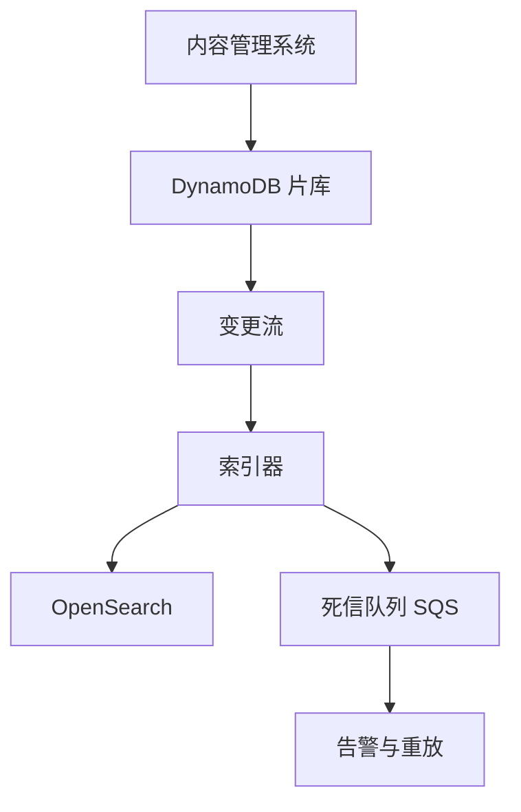
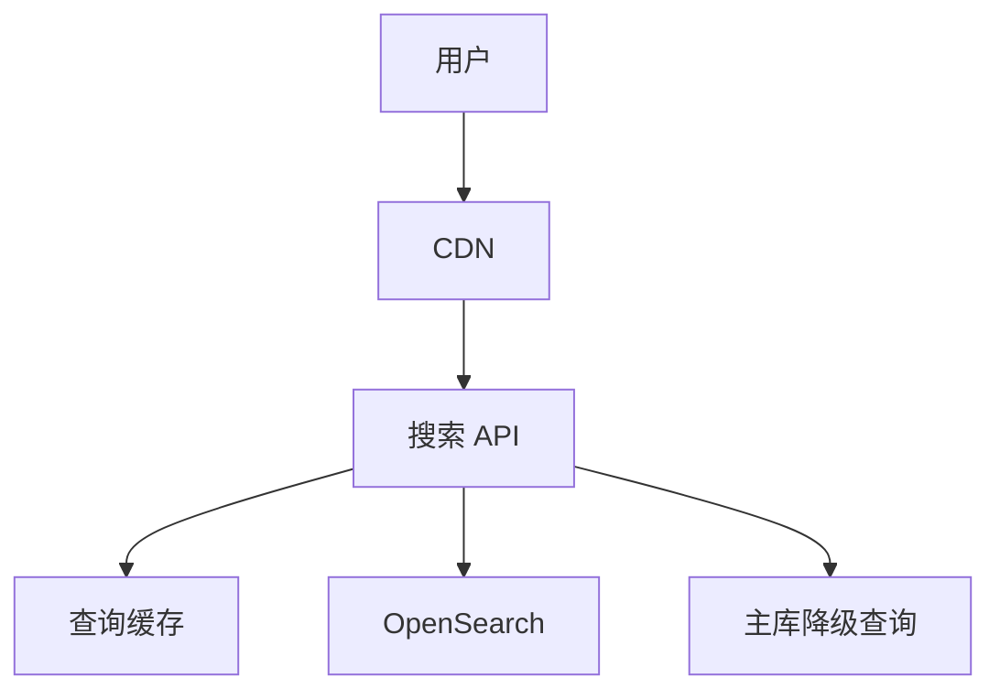
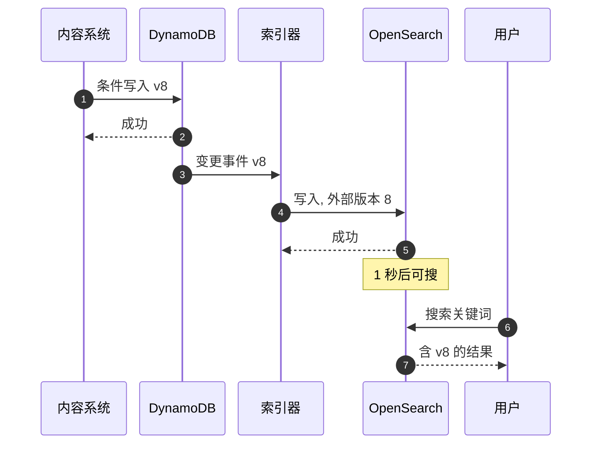
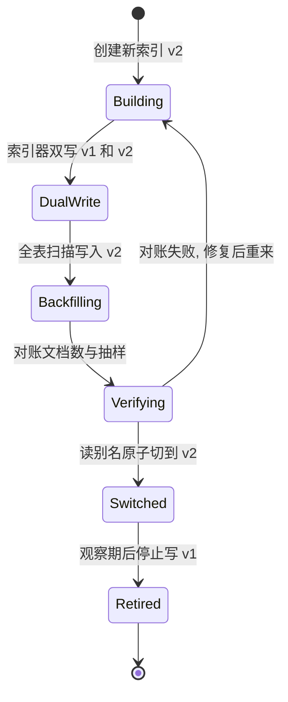

# SD18 影视目录搜索与 CDC（Catalog Search with CDC）（low priority）

## 题目

流媒体平台的片库有几百万个条目：电影、剧集、单集、演职人员。运营和内容系统每天在改它们：上架、下架、改标题、补演员表、调整各国的可播放范围。用户在搜索框里敲几个字，希望立刻看到相关的片子，而且刚上架的新片要在几秒内能搜到，下架的片子不能再出现。

难点在于两套存储的职责不同。片库的**事实来源**（source of truth）是一个键值或关系数据库，擅长按主键读写、保证事务；**搜索索引**是倒排索引（reverse index，记录「每个词出现在哪些文档里」），擅长分词、模糊匹配和相关度排序，但不适合当主库。要让两边一致，靠的是**变更数据捕获**（Change Data Capture，简称 CDC）：把主库每一次写入变成一条有序的变更事件，一个索引器（indexer）消费这些事件去更新索引。真正的难题不是「怎么搬数据」，而是搬的过程中事件重复、乱序、丢失、索引器宕机、需要整库重建时，索引还能不能最终等于主库。

题目：设计一个影视平台的目录搜索。片库在数据库里，搜索使用 OpenSearch 这类倒排索引，两者之间用 CDC 管道同步；要求支持关键词搜索、搜索联想，新上架内容在秒级可搜，并说明如何做全量重建和故障恢复。

下文的假设：200 万个条目（含单集和人物），每个条目约 3 KB 的可搜索字段；5,000 万日活用户，每人每天约 4 次搜索；面试时以面试官给的数字为准。

## 澄清问题

开场用三分钟问完下面的问题，答案写在白板角落，每一个都会改变设计。

1. **搜索的对象是什么？** 只搜片名，还是也搜演员、导演、简介、类型标签？字段越多，分词器（analyzer）和相关度调优越复杂；只搜片名可以用前缀索引解决大部分需求。
2. **多语言和多地区吗？** 同一部片在不同国家叫不同的名字，上架范围也不同。答案决定文档里是带一个 `regions` 数组，还是每个国家一份文档，也决定每种语言要不要独立的分词器。
3. **新鲜度要求多严？** 上架后几秒可搜，还是几分钟？下架后必须多快消失（法律下架通常要求比上架更严）？这决定管道各段的时间预算。
4. **谁是事实来源，写入的频率和形态如何？** 是 DynamoDB、Aurora 还是内容管理系统？写入是少量人工编辑，还是有批量导入？假设主库是 DynamoDB，平均每天 2% 的条目变更。
5. **排序只看文本相关度，还是要混入热度、个性化？** 热度会频繁变化，如果每次变化都走 CDC 写索引，写放大很大；这会推动「热度走另一条路」的设计。
6. **搜索联想（autocomplete）要不要？** 联想的请求量是搜索的数倍（每敲一个字符一次），要单独算容量。
7. **索引丢了怎么办？** 能否容忍几分钟到几小时的重建时间，重建期间搜索是降级还是不可用？这决定是否必须做别名切换的零停机重建。
8. **一致性期望？** 允许「搜得到、点进去已下架」吗？通常允许（详情页再校验一次），但不允许「已下架长期还搜得到」。

## 需求

**功能需求（按优先级）**

1. 关键词搜索：按标题、别名、演员、简介匹配，按相关度排序，支持分页和按类型、地区、年份过滤。
2. 搜索联想：输入前缀返回候选片名。
3. 目录变更同步：新增、修改、下架，在目标时间内反映到搜索结果。
4. 全量重建：改变索引结构（例如换分词器）时，零停机地重建并切换。
5. 运维：能看到同步延迟，能重放某一段变更，能对账。

**非功能需求**

| 维度 | 目标 | 说明 |
|---|---|---|
| 搜索延迟 | p99 小于 200 ms | 含网络，命中缓存时小于 50 ms |
| 联想延迟 | p99 小于 80 ms | 敲字时的体感阈值 |
| 新鲜度（上架） | p99 小于 10 s | 从主库提交到可搜 |
| 新鲜度（下架） | p99 小于 10 s | 同样的路径，不单独走快车道，但监控单独告警 |
| 可用性 | 搜索 99.95% | 索引不可用时降级为按标题前缀的主库查询 |
| 一致性 | 最终一致 | 索引永远可以由主库重建出来 |
| 持久性 | 索引不要求持久 | 主库才是账本，索引丢了可以重建 |

**明确不做**：个性化排序和推荐（只说明它是搜索结果后面的一个重排序层）、播放和计费、内容审核流程本身、广告。

## 容量估算

先看数据量，会发现一个反直觉的结论：**索引很小，规模来自查询量而不是数据量**。

假设：200 万个条目，每条约 3 KB；5,000 万日活，每人每天 4 次搜索，每次搜索平均输入 6 个字符触发联想；峰值是日均的 4 倍。

- 原始数据 = 2,000,000 × 3 KB = **6 GB**。倒排索引加上正排存储，膨胀系数取 2.5 倍，索引约 **15 GB**。
- 搜索平均 QPS = 50,000,000 × 4 ÷ 86,400 = **约 2,315**；峰值 × 4 = **约 9,259 QPS**。
- 联想峰值 = 50,000,000 × 4 × 6 ÷ 86,400 × 4 = **约 55,556 QPS**，是搜索的 6 倍，但每个请求很轻，而且前缀的重复率极高。
- 缓存：搜索查询词呈长尾分布，假设热门查询缓存命中 60%，落到索引的搜索 = 9,259 × 40% = **约 3,704 QPS**；联想命中 70%，落到索引的 = 55,556 × 30% = **约 16,667 QPS**。
- 副本数：假设一份分片副本承接 800 QPS（含布尔过滤和相关度计算），3,704 ÷ 800 = 4.6，向上取整 **5 份**，再按三个可用区（AZ）取 6 份（每区 2 份）。联想用单独的小索引，不挤占主索引。
- 分片数：15 GB 的索引放进 2 个主分片，每个约 **7.5 GB**（单分片适合 10 到 50 GB，太小反而浪费，所以 2 个足够）。分片数不为容量而选，为并行度和重建灵活性而选。
- 写入：2% 日变更 = 2,000,000 × 2% = **40,000 条/天**，平均 **0.46 条/秒**。这个写入量小到可以忽略，所以**写入吞吐不是难点，正确性才是**。
- 热度：如果把热度作为索引字段，每 15 分钟刷新一次全部条目，写入 = 2,000,000 ÷ 900 = **约 2,222 条/秒**，比业务变更高出近 5,000 倍。这就是不能让热度走 CDC 的原因（深挖里展开）。
- 全量重建：单个批量写入 500 条，索引速率取 5,000 条/秒，200 万条要 2,000,000 ÷ 5,000 = **400 秒**，约 6.7 分钟；片库扩大 10 倍（2,000 万条）约 **67 分钟**。
- 新鲜度时间预算：主库提交到流可见约 1 秒；索引器攒批约 2 秒；批量写入完成约 1 秒；索引刷新（refresh，把新写入变成可搜）默认 1 秒。合计 1 + 2 + 1 + 1 = **5 秒**，留一倍余量刚好是 10 秒的目标。
- 索引器停机 1 小时后的积压 = 0.46 × 3,600 = **约 1,667 条**，追平只要几秒。所以单纯的「索引器挂了」不危险，危险的是挂得比流的保留期（24 小时）更久，或者挂着的同时出现了漏处理的事件。

**驱动设计的数字**：写入只有 0.46 条/秒，搜索峰值却是 9,259 QPS。写路径追求正确和可重放，读路径追求缓存和副本；两者分开设计，不要互相拖累。

## 核心实体与 API

**实体**（粗体为主键）

| 实体 | 关键字段 | 说明 |
|---|---|---|
| Title | **title_id**、类型、标题多语言、简介、演职人员、`version`、`deleted` | 主库里的条目，`version` 每次写入单调递增 |
| Availability | **(title_id, region)**、开始时间、结束时间 | 各地区的上架窗口 |
| SearchDoc | **doc_id = title_id**、分词字段、`regions`、`popularity_bucket` | 索引里的文档，由 Title 派生 |
| ChangeEvent | **(title_id, version)**、操作类型、新旧镜像 | CDC 流里的一条记录 |
| IndexCheckpoint | **index_name**、已处理的序号、时间 | 用于监控延迟和重放 |

关键点：`version` 由主库的**条件写入**产生（`SET version = version + 1`，条件是读到的旧版本号），而不是靠时钟。它是后面所有幂等和防乱序的基础。

**API**

```
GET  /v1/search?q=&region=&type=&year=&cursor=&limit=20
     -> {items:[{title_id, name, poster, score}], next_cursor}
GET  /v1/suggest?prefix=&region=&limit=8       -> {suggestions:[{title_id, name}]}

PUT  /internal/titles/{title_id}               If-Match: <version>
     {fields...}                               -> 200 {version} | 409 version_conflict
DELETE /internal/titles/{title_id}             If-Match: <version>   -> 200 {version}   -- 软删除，保留墓碑

POST /internal/index/reindex      {target_index, mapping_version}   -> 202 {job_id}
POST /internal/index/replay       {from_ts, to_ts}                  -> 202 {job_id}
GET  /internal/index/lag                                         -> {seconds, backlog}
```

分页用游标（cursor）而不是页码：深翻页时 `from + size` 会让每个分片多取很多文档，成本线性增长。搜索结果是 `title_id` 加少量展示字段，详情页再回主库取完整内容，因此「搜到但已下架」时，详情页会拒绝并返回 404。

## 高层架构

写路径（目录变更到索引）：



读路径（用户搜索）：



**流 1：目录变更。** 内容管理系统用条件写入把条目写进 DynamoDB，主库给出新 `version`；DynamoDB Streams 按条目的主键把变更按顺序送给索引器（同一个条目的变更落在同一个分片，保证顺序）；索引器把一批事件合并成一次批量请求，每个文档带上外部版本号（external version）写入 OpenSearch；写不进去的毒药消息（格式错误、映射冲突）进死信队列，告警并保留重放。

**流 2：搜索。** 请求先经过 CDN 和查询缓存（对热门查询串，缓存几十秒），未命中则搜索 API 查询 OpenSearch：对标题多字段做加权匹配，过滤地区和上架窗口，再按相关度排序。索引集群不可用时，API 降级为对主库按标题前缀的查询，功能残缺但不全站失败。



图中编号对应的每一步：

1. 内容系统对条目做条件写入，条件是「当前版本仍是 v7」，防止两个编辑者互相覆盖。
2. 主库提交成功，版本变为 v8。这是唯一的真相点：之后无论管道怎么出问题，都能从主库重建。
3. 变更流把这条记录按条目顺序交给索引器，同一个条目的 v8 一定在 v7 之后到达。
4. 索引器写入 OpenSearch，并带上外部版本号 8：索引只在 8 大于已有版本时才接受，所以重复投递或旧事件迟到都被拒绝而不是覆盖。
5. OpenSearch 确认写入，此时文档在内存缓冲里，还不可搜。
6. 索引刷新（默认每 1 秒）之后，文档才对搜索可见。
7. 用户发起搜索。
8. 结果里包含 v8 的内容。

## 深挖

### 事件如何有序、幂等地变成索引更新

问题：CDC 管道至少一次（at-least-once）投递：索引器处理到一半崩溃，重启后同一批事件会再来一遍；批处理失败后切分重试，也会改变处理的先后次序；不同分片之间没有全局顺序。如果索引器简单地「收到什么就写什么」，一个迟到的旧事件会把新内容覆盖回去，下架的片子可能因为一次重放而复活。

选项：

1. **只靠有序流，不加版本**：DynamoDB Streams 保证同一个条目的变更有序，看起来够用。但一旦发生重放、跨分片重试、人工回灌，顺序保证就不再成立。脆弱。
2. **索引器先读索引里的版本再决定写不写**：读加写不是原子的，两个并发的索引器实例会互相踩。
3. **外部版本号（external versioning）**：把主库的 `version` 当作文档版本传给 OpenSearch，OpenSearch 在**写入时原子地比较**，版本不大于现有的就拒绝（返回 409）。这样索引器无状态，重复、乱序、并发都安全。

选第 3 种，并说明代价：外部版本号要求用 `index` 和 `delete` 操作，写入整个文档，不能用局部更新（update）操作，所以每次变更要把完整文档（3 KB 左右）重新组装一次；条目的字段分散在多个表（标题、演职人员、上架窗口）时，索引器要在处理事件时回读主库组装完整文档，此时回读的结果可能比事件更新，这没有问题：版本号取回读到的那一个，且写入是幂等的。组装用的版本号必须来自同一次读取（用单条目事务读，或把所有子表的变化汇总到条目级的 `version`），否则会出现「标题是 v8、演员表是 v7 却标成 v8」的拼接文档。

删除的处理：下架用**软删除**（`deleted=true` 加新版本号）在主库里保留一条墓碑记录，索引器收到后对索引执行 `delete` 并带外部版本号。OpenSearch 会把已删文档的版本号保留一小段时间（参数 `index.gc_deletes`，默认 60 秒），期间旧版本的写入仍被拒绝；超过这个窗口后，墓碑被回收，一个超过 60 秒才迟到的旧版本事件就有可能让已删文档复活。对策有两层：把迟到事件的上限控制在窗口内（死信队列里的事件重放前先对主库校验版本），以及定期对账作业（见 Staff 视角）把「索引里有但主库已删」的文档清掉。

失败模式：主库的 `version` 回退（人工修数据把版本改小）。规则是版本只能前进，修数据也要写一个更大的版本；重建索引时用 `reindex` 目标索引的新版本空间，不受旧墓碑影响。

### 全量重建：别名切换与不丢更新的回填

问题：换分词器、加字段、改分片数，都需要用新的映射（mapping）重建整个索引，而重建期间主库还在写。如果「先扫描主库再灌进新索引」，扫描开始后发生的变更就丢了；如果直接在线改旧索引，搜索会中断。

选项：

1. **停写重建**：简单，但片库每秒都有编辑，停写不可接受。
2. **扫描完成后再追增量**：扫描结束的时间点难以界定，容易出现空档。
3. **先订阅、再扫描、最后切换别名**：这是解法。步骤是：（a）创建新索引 `catalog-v2`，应用新映射；（b）让索引器**同时**写旧索引和新索引（双写），此刻新索引开始接收增量；（c）对主库做一次全表扫描，把每个条目以其当前 `version` 写入新索引；（d）扫描完成并对账通过后，用一次原子的 `_aliases` 操作把读别名 `catalog-read` 从 v1 指向 v2；（e）观察一段时间，关闭对旧索引的双写，保留旧索引几天作回滚。

为什么这个顺序不丢更新：双写先于扫描开始，扫描期间发生的变更同时进了增量写入；而扫描读到的条目可能比增量写入的更旧，也可能更新，外部版本号让两者无论谁先谁后，最终都是较大的版本获胜。别名切换是原子的，搜索 API 只认别名，切换瞬间不会有半新半旧的结果。写别名 `catalog-write` 在切换前指向旧索引，由索引器同时直接写两个物理索引名，不依赖别名。



失败模式：回填期间集群压力过大，影响线上搜索。对策是回填限速（控制每秒批量请求数，扫描用主库的并行扫描加退避，避免打满读容量）、重建时临时把新索引的 `refresh_interval` 调大（比如 30 秒）并把副本数设为 0，扫描完成后再恢复，这样 200 万条的重建在 400 秒左右，而且对线上读影响很小。

### 索引器故障、毒药消息与新鲜度

问题：索引器是整条管道里最容易出故障的一环：OpenSearch 过载返回 429；某条数据触发映射冲突（例如字段类型不符）；索引器代码有缺陷导致一批事件反复失败，堵住分片，后面的事件全部延迟。

选项：

1. **失败就无限重试**：一条毒药消息会卡死整个分片，新鲜度退化为无穷。
2. **失败就丢弃**：索引与主库静默分叉，没有人知道。
3. **有限重试 + 二分定位 + 死信队列**：批处理失败后，把批次对半切分重试，定位到具体失败的那条；该条重试有限次后写入死信队列（附带原因），分片继续前进；死信队列有告警和重放工具。

选第 3 种。事件源映射的配置要点：批大小取 100 到 500、最大攒批等待 2 秒（与时间预算对应）、失败时二分批次、设置最大重试次数和事件最大年龄，超过的送死信队列。对 OpenSearch 的 429，要用带抖动的指数退避并降低并行度，而不是加大重试，否则会雪崩。

新鲜度怎么测：每条事件带上主库提交时间戳，写入索引成功后记录「提交到可搜」的延迟直方图，告警看 p99 超过 10 秒；再加一条**金丝雀**：每分钟往一个测试条目写入一个随机标题，用搜索 API 查询到它所需的时间，覆盖整条链路（含刷新延迟）。流的保留期是 24 小时，所以「流年龄」也要告警：最老未处理事件超过 12 小时就要人工介入，因为再久就会丢事件。

失败模式：索引器停了超过 24 小时，流里的事件被回收，索引与主库出现不可追的差距。对策是不依赖流保留期做补救：触发一次全量重建（走上一节的流程），或按时间范围的对账作业对主库的 `last_modified` 索引做增量扫描。这也是为什么把「索引可由主库重建」作为设计前提：流是加速手段，不是真相。

### 相关度、联想与热度：不要把易变数据塞进 CDC

问题：搜索质量决定产品价值，但相关度字段里最易变的是热度（观看量）。如果热度进了文档，每次刷新都是对整个索引的重写。

做法：文本相关度由索引负责：标题字段建多个子字段（标准分词用于全文匹配，`keyword` 用于精确匹配和排序，边缘 n-gram 用于联想），查询用 `multi_match` 加字段权重（标题权重高于简介），支持别名和同义词，开启拼写容错（模糊度自动）。语言相关的分词器按地区配置。**热度**不走 CDC：热度存在另一个存储（缓存或 DynamoDB），搜索 API 取回前 100 个文本候选后在内存里重排序，或者按每小时一次的批量任务把热度分桶（`popularity_bucket`，十个等级）写进文档，桶的变化少，写入量按「跨桶的条目数」计，而不是全量。分桶的代价是排序粒度变粗，换来写入下降两到三个数量级。

上架窗口同样不走 CDC：条目的 `regions` 数组只表示「这个地区被授权」，起止时间用范围过滤在查询时判断，避免「午夜整点上架」需要一个定时任务批量改索引。个性化是搜索结果后面的另一个重排序服务，不进入索引。

失败模式：同义词或分词器配置错误让全部查询召回骤降。每个映射版本上线前，用一组固定的黄金查询集（比如两百个高频查询）比较新旧索引的前 10 个结果重合度，低于阈值就不切别名；切换后用搜索点击率和零结果率的突变做告警。

## Staff 视角：权衡、故障与演进

**10 倍规模会先坏什么。** 片库扩大 10 倍到 2,000 万条（索引 150 GB），写入仍然不是问题（4.6 条/秒），先坏的是：（1）全量重建时间从 6.7 分钟变成 67 分钟，期间双写占用的集群容量翻倍，要在低峰重建并预留 2 倍的磁盘；（2）分片数要从 2 增加到 5 到 6 个，而主分片数建好后不能改，只能靠重建，这也是重建流程必须是日常工具而不是应急脚本的原因；（3）联想的 QPS 随用户数线性增长，联想索引要独立扩容。

**每个组件挂了的影响面。**
- 变更流或索引器挂：搜索不受影响，新内容不可搜；影响随积压时间线性增长；24 小时内可无损追平。
- OpenSearch 集群部分节点挂：副本接管，有 AZ 冗余则无感；整个集群不可用时降级到主库前缀查询，功能残缺，但片库页面和播放不受影响。
- 主库不可用：整个内容后台挂；搜索仍可读索引，只是不再更新。
- 死信队列堆积：说明有数据质量问题，不会影响整体延迟，但每条都是一个「索引与主库不一致」的潜在缺陷，要有每日清零的责任人。

**多区域。** 片库在多个区域时，建议每个区域各自维护一个索引，每个区域的索引器消费本区域的主库副本流（DynamoDB 全局表每个区域都有自己的流）。全局表的写冲突按最后写入者胜，会造成两个区域的 `version` 不一致，所以所有的条目写入都经过同一个「主区域」，其他区域只读，版本号只在主区域产生。这样所有区域的索引都收敛到同一个版本序列。

**成本驱动。** 主要在 OpenSearch 的数据节点和副本数，其次是联想的峰值容量。索引本身只有 15 GB，用小而多的节点比大节点更划算（便于丢一个节点而影响小）。用缓存吸收 60% 的搜索和 70% 的联想，能让副本数从 12 份降到 5 份左右（9,259 ÷ 800 = 11.6）。冷数据（下架很久的条目）可以从主索引移到归档索引，但片库规模下收益有限。

**对账与可运营性。** 每天夜里的对账作业：对主库的 `last_modified` 做增量扫描，对比索引里的版本，发现缺失或落后就重写，发现索引里有但主库已删的就删除，结果指标是「修复条数」。这个数字应该接近 0，任何持续非零都说明管道有缺陷。指标：提交到可搜的延迟 p99、流年龄、死信队列深度、批量写入 429 比率、零结果率、对账修复条数。运行手册包括：如何暂停索引器、如何按时间范围重放、如何切换别名回滚。

**迁移与发布。** 映射变更必走 v1 到 v2 的别名流程；索引器代码发布用金丝雀（先让一个流分片用新版本）；回滚靠保留旧索引几天。

## 面试官追问

1. **为什么不让应用直接同时写数据库和索引？** 双写不是原子的：写完数据库、写索引前进程崩溃，两边就分叉，而且没有任何地方记录这件事。让数据库的变更日志成为唯一的出口，索引器只是它的一个消费者，才能重放、对账、重建。
2. **用 Streams 还是自己做发件箱（outbox）？** 主库是 DynamoDB 时 Streams 是现成的，保留期 24 小时、按条目有序。关系型库用发件箱表或读取预写日志（Debezium 这类工具），好处是事件结构自己控制，代价是多一张表和一个清理作业。
3. **事件乱序了怎么办？** 外部版本号让写入对顺序不敏感：较小的版本被索引拒绝。所以索引器不需要保序，只要至少一次投递就够了。
4. **如何保证下架的片子不再出现？** 软删除加版本号，索引器对索引执行带版本的删除；搜索 API 还对结果按 `deleted` 和上架窗口做一次过滤；详情页回主库校验。再加每日对账清除遗漏。
5. **索引器落后了多久才算事故？** 以延迟 p99 超过 10 秒告警，超过 1 分钟升级；超过 12 小时说明可能追不上，要考虑直接重建。预算内的延迟不是故障。
6. **怎么做零停机重建？** 双写新旧索引、全表扫描回填、对账、原子切换读别名、保留旧索引回滚。关键在于先双写后扫描，且依赖外部版本号让谁先到都正确。
7. **为什么热度不放进索引？** 热度更新率是业务变更的数千倍，写放大严重。放在外部存储，搜索时重排序候选集，或者分桶降低写入。
8. **搜索联想怎么做？** 单独的小索引，用边缘 n-gram 或补全建议器（completion suggester），请求量高但很轻，缓存前缀；联想结果允许比搜索更旧。
9. **如何评估相关度改动？** 固定的黄金查询集比较前 10 个结果的重合度，上线后看点击率和零结果率，并保留一键回滚到旧索引的别名。
10. **索引整个丢了呢？** 从主库全表扫描重建，约 7 分钟（200 万条），期间读走降级路径；因为索引不是真相，所以不需要备份，这是它能用小集群的前提。

## 60 分钟怎么分配

| 分钟 | 做什么 | 白板内容 | 时间不够时 |
|---|---|---|---|
| 0–5 | 澄清问题，定假设 | 搜索对象、新鲜度、主库类型 | 只问新鲜度和事实来源 |
| 5–10 | 需求与容量估算 | 写 0.46 条/秒对搜索 9,259 QPS、5 秒预算 | 只写这两个对比的数字 |
| 10–15 | 实体与 API | `version` 字段、搜索与联想接口 | 压缩成三行接口 |
| 15–25 | 高层架构 | 写路径、读路径、序列图 | 保留，不能砍 |
| 25–38 | 深挖：外部版本号；别名重建 | 版本比较、双写再扫描、状态图 | 必讲这两个 |
| 38–48 | 深挖：索引器故障、新鲜度；相关度与热度 | 二分重试、死信队列、金丝雀、热度分桶 | 只讲故障，相关度口述 |
| 48–55 | Staff 视角 | 影响面、对账、多区域 | 只讲影响面与对账 |
| 55–60 | 追问与总结 | 「索引可由主库重建」 | 总结一句 |

**45 分钟版**（前面有行为面试）：澄清 3 分钟，容量 3 分钟，API 2 分钟，架构 7 分钟，外部版本号 7 分钟，别名重建 7 分钟，索引器故障 5 分钟，对账与降级 5 分钟，余下留给追问。

## 自测

1. 为什么索引器可以不保序，仍然得到正确的索引？

<details><summary>答案</summary>

因为每个文档都带主库产生的单调版本号，写入 OpenSearch 时用外部版本号，由索引原子地比较：版本不大于已有的就拒绝。重复、乱序、并发实例的写入都只会保留最大版本，所以只需要至少一次投递。

</details>

2. 为什么全量重建要「先双写、再扫描」，顺序反过来会怎样？

<details><summary>答案</summary>

先扫描后双写，扫描开始到双写开始之间的变更没有进入新索引，也不在扫描结果里，被永久漏掉。先双写，扫描期间的变更已经进入新索引，扫描读到更旧的条目会被版本号拒绝，读到更新的则覆盖，最终都是最大版本获胜。

</details>

3. 为什么不能让热度走 CDC，而要分桶或搜索时重排序？

<details><summary>答案</summary>

按 15 分钟刷新，200 万条要每秒约 2,222 次写入，是业务变更 0.46 条/秒的数千倍，写放大会拖垮索引。分桶把写入降到只有跨桶的条目，搜索时重排序则完全不写索引。

</details>

4. 索引器停了 30 小时会发生什么，怎么恢复？

<details><summary>答案</summary>

流的保留期是 24 小时，最早 6 小时的事件已被回收，无法追平。恢复办法是不依赖流：做一次全量重建（200 万条约 7 分钟），或按 `last_modified` 对主库做增量扫描。因此要对流年龄告警，在 12 小时时就介入。

</details>

5. 下架的条目为什么可能在 60 秒之后复活，怎么防？

<details><summary>答案</summary>

已删文档的墓碑版本在索引里只保留 `index.gc_deletes` 指定的时间（默认 60 秒），之后一个更旧版本的迟到事件会被接受。防法是：重放前对主库校验版本、迟到上限控制在窗口内、再加每日对账清除主库已删而索引仍有的文档。

</details>

## 延伸阅读

- 相邻题解：[[solution-search-engine]]（倒排索引、分片与相关度）、[[solution-notification-system]]（事件驱动与重试、死信队列）。
- 同批题单：[[sd08-cdc-replication-pipeline]]（CDC 管道的通用设计）、[[sd10-managed-db-control-plane]]、[[sd-index]]。
- 文档：[DynamoDB Streams](https://docs.aws.amazon.com/amazondynamodb/latest/developerguide/Streams.html)、[OpenSearch 索引别名](https://opensearch.org/docs/latest/api-reference/index-apis/alias/)
