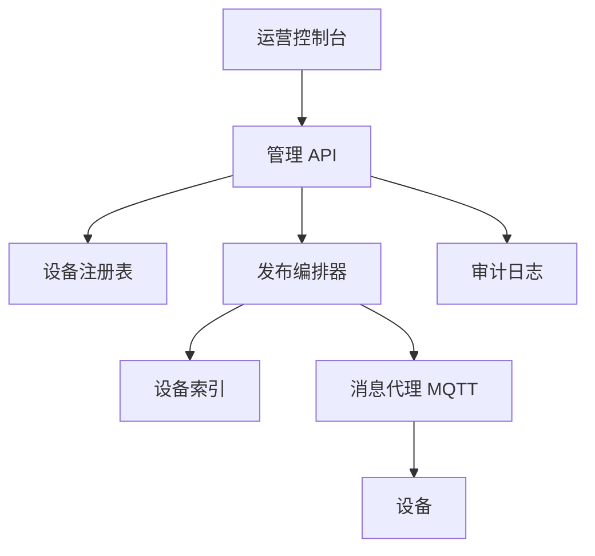
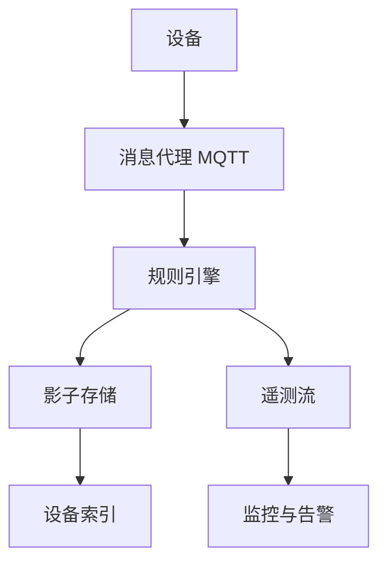
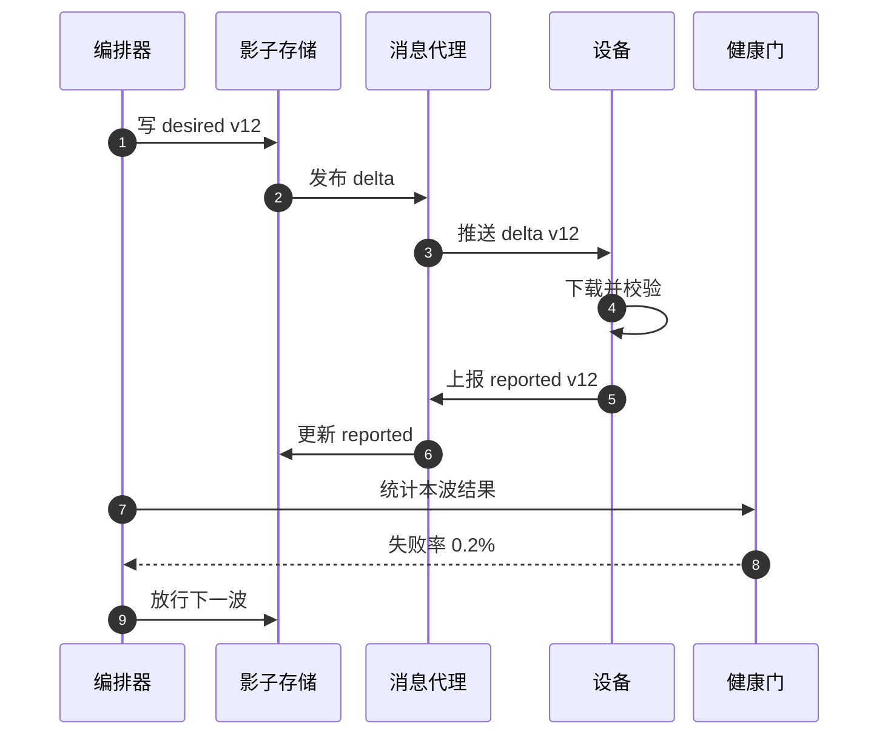
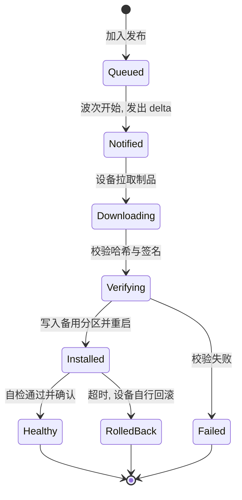

# SD19 设备管理平台（Device Fleet Management）（low priority）

## 题目

设备管理平台替运营团队管理一批分散在各地的联网设备，例如门锁读卡器、摄像头、网关、传感器盒子。设备数量是几千台，将来可能到几十万台。运营人员要做的事有四类：知道每台设备是谁、现在是什么状态；给设备下发配置和固件更新；给某台设备发一条命令（重启、取日志、锁定）；按条件查询一批设备（比如「固件版本低于 2.3 且在线的所有网关」）。

难点集中在三处。第一，设备不是服务器：它们会断网、断电、被拔掉，命令发出去时设备可能离线好几天，所以平台要表达的不是「执行这条命令」而是「设备应该达到的状态」。第二，更新有风险：一个坏固件推给全部设备，就会同时让几千台设备变砖，所以发布必须分批、有健康检查、能自动停下。第三，这个平台是安全产品：每台设备要有不可伪造的身份，一台被攻破的设备不能影响其他设备，更新包必须能验证来源。

题目：设计一个设备管理系统，管理几千台设备：设备注册、期望状态与上报状态同步、分批配置与固件发布、给离线设备投递命令、设备身份与证书、按条件查询设备群。

下文的假设：5 万台设备（比「几千台」留出 10 倍余量），每台每分钟上报一次约 1 KB 的遥测；固件包 40 MB；面试时以面试官给的数字为准。

## 澄清问题

开场用三分钟问完下面的问题，每个答案写在白板角落。

1. **设备有多少，增长多快，什么网络？** 几千台和几十万台的架构差异在连接层和发布速率：几千台一个托管消息代理就够，几十万台要考虑重连风暴和分区。假设 5 万台，蜂窝或 Wi-Fi，网络不稳定。
2. **设备是长连接在线，还是定时醒来？** 电池设备大部分时间睡眠，只能「设备主动拉取」，不能「平台推送」。这决定命令投递是推还是拉。假设设备保持长连接，但可能掉线数小时到数天。
3. **要下发的内容有哪几类？** 配置（几 KB 的 JSON）、固件（几十 MB 的二进制）、一次性命令。三类的大小、风险和确认方式都不同。
4. **更新失败的代价是什么？** 设备能否回滚（双分区 A/B 更新）？变砖要不要现场处理？答案决定健康门槛和发布速度。
5. **设备如何获得身份？** 出厂预置证书，还是首次上线时由平台签发？预置证书的泄露面更小，现场签发更灵活。答案决定注册流程。
6. **谁能给设备发命令，需要审批和审计吗？** 安全产品通常要求操作留痕、高危命令双人批准。
7. **查询的维度和实时性？** 按型号、固件版本、在线状态、地区、标签；允许几秒的延迟还是要强一致。答案决定是否要单独的查询索引。
8. **多租户吗？** 一个平台服务多个客户时，隔离是第一约束，会影响证书颁发机构、数据分区和限流的设计。假设单租户，多租户在 Staff 视角里讨论。

## 需求

**功能需求（按优先级）**

1. 设备注册与身份：每台设备有唯一身份，能建立加密连接，能被吊销。
2. 状态同步：平台保存每台设备的期望状态与上报状态，差异（delta）自动推送。
3. 分批发布：配置和固件按波次推出，每波有健康检查，失败自动暂停或回滚。
4. 命令投递：对在线设备立即投递，对离线设备保留到上线或过期。
5. 设备查询：按属性和状态筛选设备群，作为发布的目标。
6. 遥测与告警：设备上报的健康指标进入监控，失联告警。

**非功能需求**

| 维度 | 目标 | 说明 |
|---|---|---|
| 在线设备的命令延迟 | p99 小于 2 s | 长连接推送 |
| 状态收敛 | 在线设备 p99 小于 10 s | 期望状态变更到设备确认 |
| 发布吞吐 | 全队列 5 万台在 1 小时内完成 | 取决于分批策略，不追求更快 |
| 可用性 | 控制面 99.9%，设备连接层 99.95% | 控制面短暂不可用不影响设备已有配置运行 |
| 一致性 | 单设备的状态最终一致、有版本；发布计数强一致 | 谁收到了哪个版本必须准确 |
| 安全 | 双向 TLS（mTLS），固件签名，最小权限 | 一台设备被攻破不影响其他设备 |
| 持久性 | 期望状态与审计日志不丢 | 上报状态可以由设备重新上报 |

**明确不做**：设备端固件本身的开发、设备硬件的安全启动设计（只说平台与设备的契约）、流媒体或视频传输、计费。

## 容量估算

先看连接和消息量，会发现平台的压力很小；**真正驱动设计的是发布的带宽和风险，而不是消息吞吐**。

- 遥测：5 万台 ÷ 60 秒 = **约 833 条/秒**，每条 1 KB，即约 0.83 MB/秒、**72 GB/天**。
- 状态上报：假设每台每 10 分钟因状态变化上报一次，50,000 ÷ 600 = **约 83 条/秒**。
- 连接：5 万条长连接，空闲时只有心跳。重连风暴是主要峰值：区域断网恢复后，如果设备在 60 秒内重新连接，50,000 ÷ 60 = **约 833 次/秒**；设备扩到 50 万台则是 **约 8,333 次/秒**，要在设备端加抖动退避，在服务端限流。
- 注册表：每台约 2 KB，5 万台 × 2 KB = **100 MB**；影子（shadow）文档按 4 KB 算 = **200 MB**。整个目录放得进一个 DynamoDB 表，也放得进内存。
- 固件下发：40 MB × 50,000 = **2 TB**。如果全队列同时下载，源站会被打穿。设下载并发上限 500，每台下载速率 20 Mbps，聚合 500 × 20 = **10 Gbps**；单台下载 40 MB ÷ 20 Mbps = **16 秒**（40 × 8 = 320 Mb）。
- 分批：取四个波次 1%、5%、25%、剩余，设备数 **500、2,500、12,500、34,500**；并发 500 时各波的下载耗时是 16 秒、80 秒、400 秒、1,104 秒，合计 **1,600 秒，约 27 分钟**，加上每波的观察期，整个发布在 1 小时内完成。
- 离线命令：假设同一时刻 10% 的设备离线，即 5,000 台，每台最多排队 50 条命令，队列共 5,000 × 50 = **250,000 条**，量很小，难点在语义（过期、顺序、去重），不在容量。
- 证书：有效期 1 年，在 80% 即第 292 天开始续期。如果设备分散在全年出厂，每天续期 50,000 ÷ 365 = **约 137 台**；如果同一批 5 万台在同一天出厂，续期会集中在同一天，需要对续期时间加随机抖动。

**驱动设计的数字**：2 TB 的固件流量加上「一次坏发布影响全部 5 万台」。吞吐不是问题，所以把预算花在分批、健康门和自动停止上。

## 核心实体与 API

**实体**（粗体为主键）

| 实体 | 关键字段 | 说明 |
|---|---|---|
| Device | **device_id**、型号、证书指纹、状态（`active` / `quarantined` / `retired`）、标签 | 注册表，几乎只读 |
| Shadow | **device_id**、desired、reported、`version`、更新时间 | 期望与上报，各有独立的版本 |
| Rollout | **rollout_id**、目标选择器、制品、波次计划、健康门、状态 | 一次发布 |
| RolloutItem | **(rollout_id, device_id)**、状态、尝试次数、错误码 | 每台设备在一次发布中的进度 |
| Command | **(device_id, command_id)**、类型、参数、过期时间、状态 | 对离线设备排队的命令 |
| Artifact | **artifact_id**、哈希、大小、签名、版本 | 固件或配置包，不可变 |
| AuditEvent | **event_id**、操作人、对象、动作、时间 | 只追加 |

**API**

```
POST /v1/devices                     {model, csr}               -> 201 {device_id, certificate}
GET  /v1/devices?query=<filter>&cursor=                         -> [{device_id, model, fw, online}]
PUT  /v1/devices/{id}/shadow/desired    If-Match: <ver>  {...}  -> 200 {version}
GET  /v1/devices/{id}/shadow                                    -> {desired, reported, delta, version}

POST /v1/rollouts   Idempotency-Key: <uuid>
     {selector, artifact_id, waves:[1%,5%,25%,100%], gate:{max_fail:"1%", soak:"30m"}}
                                                                -> 201 {rollout_id}
POST /v1/rollouts/{id}/pause | resume | abort                   -> 200
POST /v1/devices/{id}/commands  Idempotency-Key: <uuid>
     {type:"reboot", ttl:"24h"}                                 -> 202 {command_id}
```

设备端协议走 MQTT（轻量的发布订阅协议，适合不稳定网络）：设备订阅 `devices/{id}/shadow/delta` 和 `devices/{id}/commands`，发布 `devices/{id}/shadow/reported` 和 `devices/{id}/telemetry`。主题里包含设备编号，授权策略用「只允许访问与自己证书同名的主题」，所以设备 A 不能订阅设备 B 的主题。所有写命令带幂等键；设备端对命令也用 `command_id` 去重，因为投递是至少一次。

## 高层架构

控制面（运营下发）：



数据面（设备上报）：



**流 1：下发。** 运营在控制台选定目标设备群和制品；管理 API 记录期望状态（版本加一），发布编排器按波次挑选设备、签发预签名的下载地址、通过消息代理通知设备；设备下载、校验签名、更新、上报新状态。编排器根据上报结果判断这一波是否健康，健康才进入下一波。

**流 2：上报。** 设备把状态和遥测发到消息代理；规则引擎把状态写入影子存储，更新设备索引，遥测进入流和监控；设备失联由消息代理的断线事件触发在线状态更新。



图中编号对应的每一步：

1. 编排器把本波设备的期望状态写成新版本（v12，指向新固件），写入带版本号的条件更新。
2. 影子存储计算出期望与上报的差异（delta），交给消息代理发布。
3. 在线设备收到 delta；离线设备下次连上时会再收到，因为 delta 是状态而不是一次性消息。
4. 设备自己下载固件，校验哈希和签名，通过后写入备用分区并重启；校验失败就拒绝并上报错误。
5. 设备上报 `reported` 为 v12，表示已达成。
6. 规则引擎把上报写回影子，期望与上报一致后 delta 消失。
7. 编排器等观察期结束后统计这一波的结果。
8. 健康门计算失败率，例如 0.2%。
9. 低于阈值才放行下一波；超过阈值则暂停发布并告警。

## 深挖

### 期望状态与上报状态：把命令变成状态

问题：设备经常离线。如果平台的接口是「现在把配置推给设备」，设备离线时这条推送就丢了或失败了，平台要自己记住谁没收到、什么时候重试，状态散落在各处。反过来，设备重连后怎么知道该做什么，平台怎么知道设备已经做完。

选项：

1. **直接推送命令，失败重试**：简单，但平台要为每台设备维护重试状态；设备重启后丢失上下文；并且两次推送乱序会让设备停在旧配置。
2. **设备定期轮询平台拉配置**：对电池设备合适，延迟高，平台要承受轮询的读压力（5 万台每分钟一次就是 833 次/秒）。
3. **影子模型（shadow）**：平台为每台设备保存一个文档，含期望状态（desired）和上报状态（reported），各自带版本号；平台只改 desired，设备只改 reported；两者的差异就是 delta，设备一旦上线就拉取 delta 并收敛。

选第 3 种，因为它把「重试」和「顺序」问题变成「收敛」问题：设备永远朝最新的 desired 前进，中间错过的版本无所谓。版本号保证两件事：平台并发修改 desired 时用条件写入（`If-Match`）防止互相覆盖；设备上报时带上它基于哪个 desired 版本，平台丢弃过期的上报。代价是：影子只适合小而声明式的状态（几 KB），大文件（固件）不能放进影子，影子里只放制品的引用、哈希与签名；一次性动作（重启、取日志）也不适合建模成状态，否则「重启」会变成一个永远不收敛的期望，要走命令通道（见后）。

失败模式：期望状态被两个系统同时改写（发布编排器与人工运维）。规则是 desired 按字段分命名空间，编排器只写 `desired.firmware`，运维只写 `desired.config`，并且所有写入记审计日志；冲突时条件写入失败，调用方重读重试。另一个失败模式是设备时钟或固件缺陷导致 reported 一直不更新：平台用「期望已发出但 N 分钟没收敛」作为一种独立告警，而不是依赖设备自报。

### 分批发布、健康门与自动回滚

问题：5 万台设备同时拿到一个有缺陷的固件，就同时坏掉。需要的是：先在小范围验证，用客观指标决定是否扩大，出问题自动停下，而且停下的判定要在样本量足够小的时候仍然可靠。

选项：

1. **一次性全量推送**：最快，爆炸半径是 100%。
2. **固定速率的滚动发布**：每分钟推 N 台，比全量好，但没有「波次内观察」，到发现问题时可能已推出数千台。
3. **波次 + 观察期 + 健康门**：1%、5%、25%、全量四波，每波之后等一个观察期（soak，例如 30 分钟），按失败率和关键健康指标判断，通过才放行；任何波次内都有自动中止条件。

选第 3 种。样本量决定门的灵敏度：第一波 500 台。如果 500 台里一台都不失败，按「三法则」（rule of three）失败率的 95% 上界约 3 ÷ 500 = **0.6%**；如果第一波只取 100 台，同样零失败，上界是 **3%**，信息量不够。设基线失败率 0.2%（500 台中约 1 台因为网络等原因失败）：当失败 5 台及以上时，在基线下出现的概率只有 **0.36%**（二项分布计算），可以认定新版本有问题。所以第一波的规则可以写成「失败数达到 5 台即中止」，既不会因 1 到 2 台随机失败误停，又能在真有问题时及时拦住。波次越大，同样的失败率阈值越灵敏，所以波次间隔应增大观察期。

健康门不能只看「更新是否成功」，还要看更新后的运行指标：设备在新版本下是否还能在 5 分钟内重新连上、心跳是否稳定、关键业务指标（例如读卡成功率）是否下降。设备端采用 A/B 双分区：新固件写入备用分区，启动后做自检，若在限定时间内没有向平台确认「健康」，设备自行回滚到旧分区。这一点是整个回滚的基础：平台的自动回滚只能改变期望状态，设备端的自动回滚才能救起已经起不来的设备。



失败模式：门本身误判。对策是同时设置绝对数（至少 N 台失败）和比例两种条件，并允许运营在门触发暂停后人工放行；发布状态机本身要幂等、可恢复，编排器重启后从 RolloutItem 表继续而不是重新开始；整条发布有一个「全局熔断开关」，运维一键暂停所有进行中的发布。

### 给离线设备投递命令

问题：「重启设备 X」「取设备 Y 的日志」是一次性动作，没有「收敛」的概念，但设备可能离线。消息代理对离线设备保留消息的时间有限（以 AWS IoT 为例，持久会话默认的保留时间约 1 小时），所以不能把「设备离线时能收到」寄托在代理上。同时，命令投递是至少一次，设备可能重复收到同一条命令，重启这类命令重复执行有害。

选项：

1. **只发即时消息，离线就失败**：简单诚实，但运营要自己重发，没有闭环。
2. **依赖代理的离线消息**：保留期短、不可查询、不可撤销。
3. **平台自己维护命令表**：每条命令是一行，含过期时间和状态（`pending` → `sent` → `acked` / `expired`）；设备上线时（连接事件触发）平台把该设备的未过期命令按创建顺序投递；设备执行后上报结果，平台标记完成。

选第 3 种。关键语义有四点。其一是**过期**：每条命令必须带 TTL，过期就不再投递，避免「一周前的重启」在设备上线时被执行。其二是**去重**：命令带 `command_id`，设备端记录最近执行过的 ID，重复投递直接返回上次结果。其三是**顺序**：同一设备的命令按创建顺序串行投递，上一条确认后才发下一条，必要的话命令之间可声明依赖；对相互独立的命令则允许并行。其四是**撤销**：命令状态在 `pending` 时运营可以撤销，已 `sent` 的不能撤销，只能再发一条反向命令，不假装能撤回。5,000 台离线设备、每台 50 条命令也只有 25 万行，一个按 `device_id` 分区的 DynamoDB 表，加上 `expires_at` 的 TTL 删除作为清理（TTL 删除是惰性的，所以过期判断必须在投递时比较时间，不能依赖删除）。

高危命令（擦除数据、吊销证书）需要双人批准：命令先进入 `awaiting_approval`，由另一个具有批准权限的人确认后才进入 `pending`，两个动作各写审计日志。

失败模式：设备上线时瞬间被数十条积压命令淹没。对策是限制每次上线时的投递速率，并让命令合并（连续多个「设置配置」命令只保留最后一条）。

### 设备身份、证书生命周期与被攻破设备的隔离

问题：身份是安全产品的地基。设备要在没有人输入密码的情况下向平台证明自己；一台被物理拿走、拆解出密钥的设备不能让攻击者冒充其他设备；证书会过期，也可能需要提前作废。

选项：

1. **全设备共享一个密钥**：最简单，也最危险：拆一台就等于拿到整个队列。
2. **每台设备独立的 X.509 证书，出厂预置**：私钥在设备的安全芯片里生成，永不出芯片；平台只保存证书指纹。成本是出厂流程复杂。
3. **出厂预置一张「认领证书」（claim certificate），首次上线时用它向平台换取设备专属证书**：生产更灵活，但认领证书一旦泄露，攻击者可以批量注册假设备，所以认领证书的权限只够做注册，并且对注册设置速率限制和白名单（出厂序列号必须在平台预先登记）。

选第 2 种为首选，条件不具备时用第 3 种并加上述约束。无论哪种，策略都遵循最小权限：设备的策略只允许连接时使用与证书一致的客户端标识、订阅和发布自己的主题（主题里引用设备名变量），不能列举其他设备、不能写其他主题。

证书生命周期：有效期 1 年，在有效期 80% 时设备主动续期，续期时间加随机抖动，避免同批设备在同一天集中请求；续期请求本身用旧证书做双向认证；如果设备错过了续期窗口，证书过期后可以走带人工审批的重新认领流程。**吊销**：设备被报失或被判定被攻破，平台把设备状态置为 `quarantined`，同时在代理的授权层把该证书加入拒绝列表，几秒内生效；已存在的连接被主动断开。吊销列表要做成设备级的状态检查，而不是等待证书自然过期，因为 1 年的有效期对被盗设备太长。

固件的信任链：制品用平台的签名密钥签名，设备出厂时只预置公钥，设备下载后本地验签，拒绝未签名或签名不符的制品，即使下载地址被劫持也无法安装恶意固件。签名密钥放在硬件安全模块（HSM）里，发布流水线只能申请签名、不能导出密钥，签名操作写审计日志。

失败模式：平台的签名密钥泄露，是最坏情形。对策是设备端预置多把公钥并支持轮换（新密钥由旧密钥签发的清单授权），并保留「撤销某把公钥」的更新路径。被攻破设备的横向影响用最小权限策略限制在它自己的主题内。

## Staff 视角：权衡、故障与演进

**10 倍规模会先坏什么。** 设备从 5 万涨到 50 万：（1）重连风暴从 833 次/秒涨到 8,333 次/秒，需要设备端抖动退避、服务端连接限流，以及按区域分散代理；（2）固件下载聚合带宽如果不限速会压垮源站，下载要走 CDN 并按波次限流；（3）设备索引的更新量涨 10 倍，查询索引要从共享表拆成独立的搜索服务；（4）发布编排器逐设备处理的实现要改成按分片批处理，否则一次 50 万台的发布编排本身就要数小时。

**每个组件挂了的影响面。**
- 管理 API 或编排器挂：设备照常运行已有配置，只是不能下发新内容；这是控制面与数据面分离的收益，要把「控制面挂不影响设备运行」写进设计原则。
- 消息代理挂：设备无法上报也收不到 delta，设备端本地缓存遥测并按退避重连；影子保存最后已知状态，恢复后收敛。
- 影子存储挂：期望状态不可写，发布暂停；已达成的设备不受影响。
- 设备索引挂：查询不可用，发布不能选目标但已选好的波次继续；用注册表的全表扫描作为小规模降级。
- 签名服务挂：不能产生新制品，已签名的制品照常下发。

**多区域与多租户。** 设备就近连接区域内的代理，注册表按设备归属区域分片；每台设备只属于一个主区域，故障时由运维手动迁移到备用区域（设备需要知道备用端点）。多租户时每个租户独立的证书颁发机构（CA）和主题前缀，租户间的配额和限流分开，一个租户的重连风暴不能影响其他租户。

**成本驱动。** 消息数（5 万台 × 每分钟一条遥测 = 约 7,200 万条/天）和固件流量（一次全队列更新 2 TB）是成本主项，其余很小。降低成本的办法是遥测在设备端聚合后批量上报、固件包用差分更新（只传变化部分，通常小一个数量级）、下载走 CDN。

**可运营性。** 指标：在线率、期望与上报不收敛的设备数、各波健康门的失败率、重连速率、证书 30 天内到期的数量、命令的过期比例。告警：发布失败率触线自动中止、批量失联（某个区域或某个型号一次性掉线超过 5%）、证书续期失败率。运行手册包括暂停所有发布的开关、隔离一台设备的步骤、轮换签名密钥的步骤。

**迁移与演进。** 现有设备如果没有影子语义，可以先用一个适配层把旧的推送协议映射成 desired；新旧固件在发布过程中并存时，影子文档的结构变化要向后兼容（只加字段不改含义）。

## 面试官追问

1. **设备离线很久后上线，怎么处理积压？** 期望状态直接以最新的 desired 为准，错过的中间版本不需要补；命令表里过期的丢弃，未过期的按序投递并限速。
2. **怎么防止一个坏固件变砖全部设备？** 四个机制叠加：分波次、健康门（含绝对数和比例）、设备端 A/B 分区自动回滚、全局熔断开关。第一波 500 台、失败达到 5 台即中止。
3. **健康门怎么设阈值？** 先估基线失败率，再用二项分布算出基线下的概率，选一个在基线下很少触发的失败数。样本量太小时只能给出宽的置信上界，所以第一波要有足够数量（500 台零失败的上界约 0.6%）。
4. **一台设备被拆出了密钥怎么办？** 每台设备独立证书，最小权限策略让它只能访问自己的主题；发现后置为 `quarantined`、加入拒绝列表、断开连接。影响面是一台设备的数据，而不是整个队列。
5. **为什么命令不能直接建模成状态？** 重启是一次性动作，建成状态会形成永远不收敛的期望，设备每次读到都会重启。命令需要独立的生命周期：过期、去重、确认。
6. **固件包怎么保证没被篡改？** 平台用 HSM 里的私钥签名，设备预置公钥，下载后本地验签再安装；下载地址是否可信不再重要。
7. **重连风暴怎么防？** 设备端指数退避加抖动；服务端对新连接限速，优先放行已认证的老设备；分区域的代理容量留出余量。
8. **查询设备群的实时性？** 设备索引由影子变更异步更新，延迟几秒；发布选目标时先快照一次索引结果并记入 RolloutItem，后续不再受索引变化影响。
9. **怎么做证书续期而不中断？** 在 80% 有效期时用旧证书认证后申请新证书，新旧证书重叠一段时间；续期时间加抖动。
10. **怎么证明发布完成了？** 以 `reported` 的版本和 RolloutItem 状态为准，统计达成数；长期不收敛的设备单独列表处理，而不是无限等待。

## 60 分钟怎么分配

| 分钟 | 做什么 | 白板内容 | 时间不够时 |
|---|---|---|---|
| 0–5 | 澄清问题，定假设 | 设备数、在线方式、更新风险 | 只问规模、是否长连接、能否回滚 |
| 5–10 | 需求与容量 | 833 条/秒、2 TB、四个波次 | 只写 2 TB 和波次 |
| 10–15 | 实体与 API | Device、Shadow、Rollout、主题授权 | 压缩成影子与发布两张表 |
| 15–25 | 高层架构 | 控制面、数据面、序列图 | 保留，不能砍 |
| 25–38 | 深挖：影子；分批发布与健康门 | delta、版本号、波次、5/500 门 | 必讲这两个 |
| 38–48 | 深挖：离线命令；设备身份 | 命令表状态、证书与吊销、固件签名 | 身份必讲，命令口述 |
| 48–55 | Staff 视角 | 影响面、重连风暴、多租户 | 只讲影响面 |
| 55–60 | 追问与总结 | 「设备永远朝最新期望收敛」 | 总结一句 |

**45 分钟版**（前面有行为面试）：澄清 3 分钟，容量 3 分钟，API 3 分钟，架构 7 分钟，影子 6 分钟，分批发布 8 分钟，身份与签名 6 分钟，余下留给追问；离线命令用一句话带过：「命令是带 TTL 的表项，设备上线时按序投递并去重」。

## 自测

1. 为什么用影子（期望与上报）而不是直接给设备推命令？

<details><summary>答案</summary>

设备经常离线，推命令会丢，平台要为每台设备维护重试和顺序。影子把问题变成收敛：平台只改 desired，设备上线后拉取 delta 并朝最新版本前进，中间错过的版本无所谓，不需要重试或保序。

</details>

2. 第一波为什么取 500 台，而不是 100 台？

<details><summary>答案</summary>

零失败时失败率的 95% 上界约为 3 除以样本数：500 台是 0.6%，100 台是 3%，后者无法证明新版本安全。500 台下基线 0.2%（约 1 台失败），出现 5 台及以上的概率只有约 0.36%，所以「失败 5 台即中止」既不误停又灵敏。

</details>

3. 平台的自动回滚为什么不够，还需要设备端 A/B 分区？

<details><summary>答案</summary>

平台的回滚只能改期望状态，让设备装回旧版本；但新固件如果起不来，设备根本收不到这个状态。A/B 分区让设备在新分区启动后自检，超时未确认就自己切回旧分区，这才救得了已经无法联网的设备。

</details>

4. 离线设备的命令为什么不依赖消息代理的离线消息？

<details><summary>答案</summary>

代理对离线设备保留消息的时间有限（以 AWS IoT 为例约 1 小时），不可查询也不可撤销。平台自己的命令表可以设置 TTL、记录状态、撤销未发送的命令，并在设备上线时按序投递；设备端用 `command_id` 去重，应对至少一次投递。

</details>

5. 证书被盗后，为什么不能只等它过期？

<details><summary>答案</summary>

证书有效期 1 年，被盗设备能冒充 1 年。平台把设备置为 `quarantined` 并把证书加入拒绝列表，几秒内生效，同时断开现有连接；最小权限策略还把一台被攻破设备的影响限制在它自己的主题内。

</details>

## 延伸阅读

- 相邻题解：[[solution-notification-system]]（推送、重试、去重）、[[solution-metrics-monitoring]]（遥测与告警）。
- 同批题单：[[sd10-managed-db-control-plane]]（控制面与数据面分离、分波次发布）、[[sd-index]]。
- 文档：[AWS IoT Device Shadow](https://docs.aws.amazon.com/iot/latest/developerguide/iot-device-shadows.html)、[AWS IoT Jobs 发布配置](https://docs.aws.amazon.com/iot/latest/developerguide/jobs.html)
