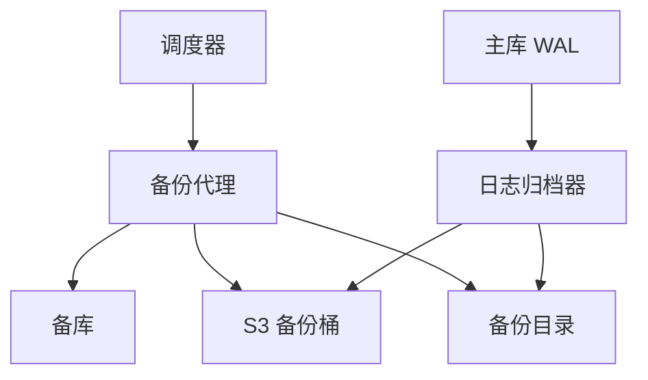
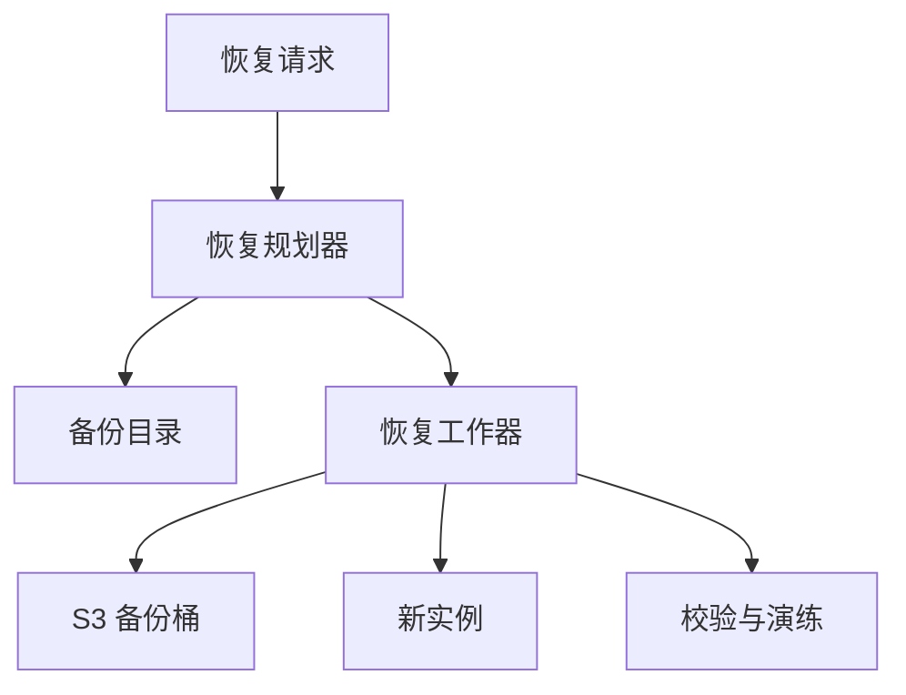
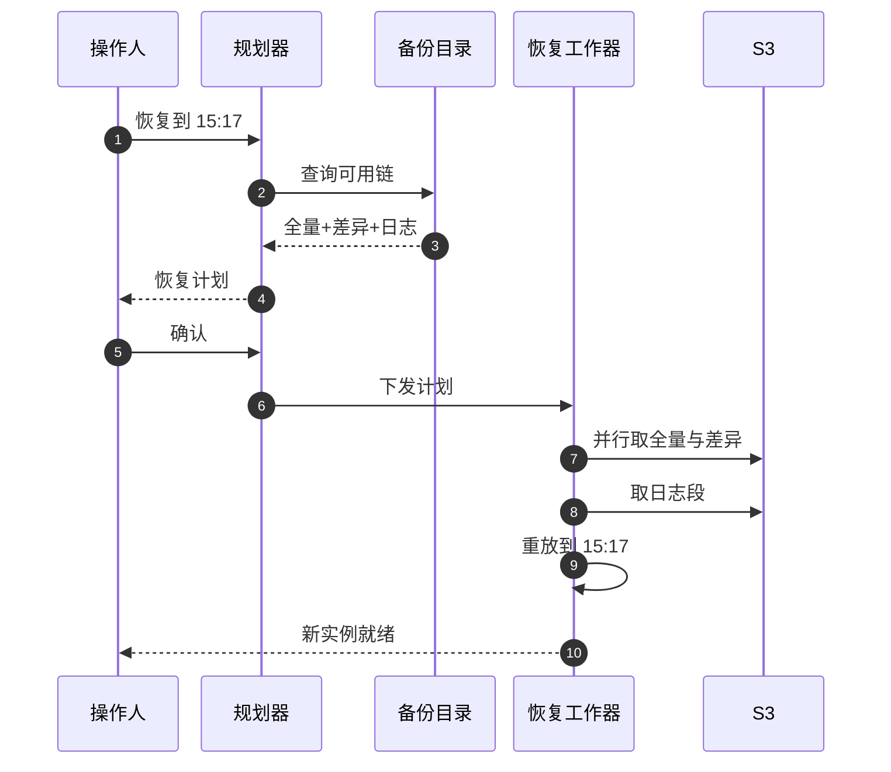

# SD20 数据库备份系统（Backup: full / diff / log）（low priority）

## 题目

数据库备份系统替一批数据库保留「可以回到过去」的能力。丢数据的原因不只是磁盘坏了：更常见的是有人误删了一张表、一次有缺陷的发布把数据改坏了、勒索软件加密了数据。主从复制救不了这些，因为复制会把错误同步到副本。备份才能回答「把数据库恢复到昨天下午 3 点 17 分的样子」。

备份有三种。**全量备份**（full）复制整个数据库，恢复最简单，但最大最慢。**差异备份**（differential，简称 diff）只复制自上一次全量以来改过的数据块，恢复需要全量加最新一份差异。**日志备份**（log）持续归档数据库的预写日志（WAL，记录每一次修改的顺序日志），把它重放到任意时刻，就是**按时间点恢复**（Point-In-Time Recovery，简称 PITR）。三种合在一起：全量给出起点，差异缩短重放的路程，日志决定能精确到哪一秒。

题目：设计一个数据库备份系统，支持全量、差异、日志三种备份；说明备份的调度、存储与保留、备份本身的一致性、恢复的流程、如何验证备份真的能用，并计算恢复点目标（RPO，最多丢多少数据）和恢复时间目标（RTO，多久能恢复）。

下文的假设：系统管理 1,000 个数据库，其中最大的一个是 4 TB，每天约 3% 的数据块被修改，预写日志产生速率 2 MB/s；面试时以面试官给的数字为准。

## 澄清问题

开场用三分钟问完下面的问题，每个答案都会改变设计。

1. **RPO 和 RTO 各是多少？** RPO 决定日志归档的频率（分钟级还是秒级），RTO 决定全量与差异的节奏，因为恢复耗时主要在复制和重放。假设 RPO 小于 1 分钟，RTO 小于 4 小时。
2. **数据库是什么引擎？** 关系型数据库（PostgreSQL、MySQL）都有预写日志，能做 PITR；有些引擎只有快照没有日志。假设是有预写日志的关系型数据库，系统对引擎做适配层。
3. **库有多大，变化多快？** 变化率决定差异备份的体积增长曲线，进而决定全量多久做一次。
4. **保留多久，要不要不可篡改？** 保留 30 天的时间点恢复还是一年的归档；防勒索要求备份存储不可被业务账号删除。
5. **备份对线上有多大影响？** 备份能否在备库上做，主库的读写性能允许占用多少带宽。
6. **恢复是整库还是单表？** 整库恢复由物理备份完成；单表恢复要先恢复到临时实例再导出，会增加时间。
7. **跨区域灾备要求？** 区域整体不可用时能否在另一个区域恢复。
8. **谁来触发恢复，要审批吗？** 恢复会覆盖或新建实例，权限和审计都要明确。

## 需求

**功能需求（按优先级）**

1. 按策略自动做全量、差异、日志三类备份。
2. 恢复到任意保留期内的时间点（PITR），恢复到新实例，不覆盖原库。
3. 保留策略自动执行：到期删除，但不能删除仍被依赖的备份。
4. 备份验证：定期自动做恢复演练，证明备份可用。
5. 可观测与告警：备份失败、日志断档、恢复耗时越界。

**非功能需求**

| 维度 | 目标 | 说明 |
|---|---|---|
| RPO | 小于 60 秒 | 日志归档间隔 |
| RTO | 4 TB 的库小于 4 小时 | 最坏情形：全量、最老的差异、一整天日志 |
| 持久性 | 备份对象 11 个 9 | S3 的对象持久性，外加跨区域副本 |
| 备份可用性 | 99.9% | 备份系统挂了不影响线上，只影响新备份 |
| 对线上影响 | 主库读写延迟变化小于 5% | 备份从备库读，限速 |
| 安全 | 加密、不可变、最小权限 | 业务账号不能删除备份 |
| 成本 | 保留 35 天的存储尽量低 | 靠差异备份与压缩 |

**明确不做**：数据库本身的高可用与故障切换、应用层的逻辑导出（只说明它和物理备份的差别）、备份数据的分析查询。

## 容量估算

数字用 4 TB 的最大库作例子，其余库按比例缩放。假设压缩比 2.5:1，每天 3% 的数据块被修改（不同天修改的块有重叠），预写日志速率 2 MB/s，恢复读取吞吐 800 MB/s，日志重放速率 30 MB/s（重放是主要瓶颈，具体值取决于引擎，面试时说明是假设）。

**日志体积。**
- 每天日志 = 2 MB/s × 86,400 = **172.8 GB**，占库大小的 172.8 ÷ 4,096 = **4.2%**。
- 每个日志段（segment）16 MB，装满只要 16 ÷ 2 = **8 秒**；每天 172,800 ÷ 16 = **10,800 个**对象。所以归档不应一个段一个对象地等，应当按时间切：每 60 秒一个对象，约 120 MB。

**差异备份的体积。** 差异是自上次全量起所有被改过的块的并集。每天独立地改 3% 的块，第 k 天的差异占比是 1 − 0.97^k：

- 第 1 天 3.0%（123 GB），第 3 天 8.7%（358 GB），第 6 天 16.7%（**684 GB**）。
- 压缩后一周 6 份差异合计约 **982 GB**。

**一套（一周）的存储。**
- 全量压缩后 4,096 ÷ 2.5 = **1,638 GB**。
- 一周日志压缩后 172.8 × 7 ÷ 2.5 = **484 GB**。
- 全量 + 差异 + 日志 = 1,638 + 982 + 484 = **3,104 GB**。
- 保留 30 天的时间点恢复，需要覆盖到 30 天前的那一份全量，也就是需要 5 套（35 天）：3,104 × 5 = **15,522 GB（约 15.2 TB）**；按 S3 标准存储每 GB 每月 0.023 美元的假设，约 **357 美元/月**。
- 对比「每天一个全量」：35 份全量 1,638 × 35 = 57,344 GB，加日志 2,419 GB，共约 **59.8 TB**，是前者的 **3.9 倍**。这就是引入差异和日志的经济理由。

**备份窗口。**
- 全量读取速度 400 MB/s（限速，不吃满主库）：4,096 × 1,024 ÷ 400 = 10,486 秒，约 **2.9 小时**。这期间产生的日志 = 10,486 × 2 MB/s ≈ **21 GB**，这部分日志是这份全量**能被恢复的必要条件**（见一致性一节）。
- 第 6 天的差异约 684 GB，684 × 1,024 ÷ 400 ≈ 1,751 秒，约 **0.49 小时**。

**RPO 与 RTO。**
- 日志每 60 秒归档一次，最坏丢 60 秒的数据 = 2 MB/s × 60 = **120 MB**；每 5 分钟归档则最坏丢 **600 MB**。RPO 的上界就是归档间隔加上传延迟。
- RTO 最坏情形（刚好在第 6 天的差异之后、下一次差异之前，需要重放最多 24 小时的日志）：恢复全量 4,194,304 MB ÷ 800 = 5,243 秒（**87 分钟**）；叠加第 6 天差异 684 GB ÷ 800 MB/s ≈ **15 分钟**；重放 172.8 GB ÷ 30 MB/s = 5,760 秒（**96 分钟**）；合计约 **3.3 小时**，满足 4 小时。
- 没有差异备份的对比：全量之后要重放 6 天日志 = 1,036.8 GB ÷ 30 MB/s = 34,560 秒（**9.6 小时**），加全量恢复 87 分钟，合计 **约 11.1 小时**。差异备份把最坏 RTO 从 11.1 小时降到 3.3 小时，这是它存在的全部理由。

**车队规模。** 1,000 个库，平均 500 GB，总计约 488 TB。全量错开在一周内完成，平均吞吐 = 1,000 × 500 GB ÷ 7 ÷ 86,400 ≈ **0.83 GB/s（约 6.6 Gbps）**。所以调度器的核心工作是错峰，而不是单库的速度。

**驱动设计的数字**：重放日志的 96 分钟和全量恢复的 87 分钟占了 RTO 的 85% 以上。设计的重点是：缩短日志重放的长度（差异备份）、让恢复读取并行（多流）、让备份链永不断档。

## 核心实体与 API

**实体**（粗体为主键）

| 实体 | 关键字段 | 说明 |
|---|---|---|
| Database | **db_id**、引擎、大小、策略 id、所在区域 | 被保护的库 |
| Policy | **policy_id**、全量周期、差异周期、日志间隔、保留天数 | 每个库一个 |
| Backup | **backup_id**、db_id、类型（`full` / `diff` / `log`）、`base_id`、起止 LSN、大小、校验和、状态 | 备份目录（catalog）的核心行 |
| LogSegment | **(db_id, start_lsn)**、end_lsn、对象键、校验和 | 日志按 LSN（日志序列号）连续排列 |
| RestoreJob | **job_id**、目标时间点、选定的链、状态、耗时 | 一次恢复 |
| VerifyRun | **run_id**、backup_id、结果、恢复耗时 | 恢复演练 |

LSN（Log Sequence Number）是日志中的位置，单调递增。**每份备份记录它覆盖的 LSN 区间**，恢复算法就是在这些区间上拼出一条不断档的链。

**API**

```
PUT  /v1/databases/{db_id}/policy      {full:"weekly", diff:"daily", log_interval:"60s", retention:"35d"}
POST /v1/databases/{db_id}/backups     Idempotency-Key: <uuid>   {type:"full"}     -> 202 {backup_id}
GET  /v1/databases/{db_id}/restore-points?from=&to=           -> [{earliest, latest, gaps[]}]
POST /v1/restores     Idempotency-Key: <uuid>
     {db_id, target_time, target_instance}                    -> 202 {job_id, plan:{full, diff, logs[]}}
GET  /v1/restores/{job_id}                                    -> {state, progress, eta}
POST /v1/backups/{backup_id}/verify                           -> 202 {run_id}
```

恢复请求先返回**恢复计划**（用到哪份全量、哪份差异、哪些日志段），让操作人确认；恢复总是创建新实例，由操作人决定是否切换流量。

## 高层架构

备份路径：



恢复路径：



**流 1：备份。** 调度器按策略为每个库发出备份任务（错峰），备份代理在**备库**上读取数据，上传到 S3 的备份桶，并把备份的类型、依赖的基准、起止 LSN 和校验和写入备份目录。日志归档器独立持续运行：把主库产生的预写日志每 60 秒（或装满一个段）压缩上传，并在目录中登记 LSN 区间；确认上传成功后，才允许主库回收这段日志。

**流 2：恢复。** 恢复规划器根据目标时间点，在目录里选出一条链：目标时间点之前最近的全量，该全量之后最新的差异，以及从差异结束 LSN 到目标时间点的所有日志段；校验链连续后交给恢复工作器，工作器并行下载、校验、写入新实例，再重放日志到目标时间点，最后交给校验模块做一致性检查。



图中编号对应的每一步：

1. 操作人指定要恢复到的时间点，例如昨天 15:17。
2. 规划器去备份目录查在这个时间点之前有哪些备份。
3. 目录返回一条候选链：周日的全量、周二的差异、以及周二差异之后到 15:17 的日志段。
4. 规划器把计划展示给操作人：用到哪些备份、预计耗时（按 87 + 15 + 重放时长估算）。
5. 操作人确认，防止在错误的时间点上浪费几小时。
6. 规划器把计划交给恢复工作器。
7. 工作器多流并行从 S3 下载全量和差异，边下载边校验校验和；全量先写入，再用差异覆盖其中改过的块。
8. 工作器按 LSN 顺序取日志段，检查是否有断档。
9. 在新实例上重放日志，直到指定的时间点停止。
10. 新实例就绪，操作人验证数据后决定是否切流量。

## 深挖

### 备份链与恢复算法：全量、差异、日志如何拼出一个时间点

问题：恢复到任意时间点 T，需要从三类备份里选出正确的一组。选错一份、漏掉一个日志段，恢复要么失败，要么悄悄得到错误的数据。

选项：

1. **只做全量**：恢复最简单，但存储是差异方案的 3.9 倍，而且只能恢复到全量的时刻，RPO 等于全量间隔。
2. **全量 + 增量链（incremental）**：每天只存相对前一天的变化，存储最省（一周增量压缩后约 295 GB，对比差异的 982 GB，每周少 687 GB），但恢复要依赖整条链（最多 6 份），中间任何一份损坏，后面的都不可用。
3. **全量 + 差异 + 日志**：差异只依赖全量，恢复最多用 3 类对象：1 份全量、1 份差异、一段连续日志。链短，故障面小。

选第 3 种，用存储换恢复的简单和可靠；增量链可以作为存储吃紧时的优化，条件是增加链完整性校验。

恢复算法：给定目标时间点 T，（1）在目录中找最近的、结束时间不晚于 T 的**成功**全量 F；（2）找依赖 F 的、结束时间不晚于 T 的最新差异 D（若没有则只用 F）；（3）从起点 LSN（D 的结束 LSN，或 F 的结束 LSN）开始，列出日志段，直到覆盖 T 所对应的 LSN；（4）校验日志段的 LSN 区间首尾相接，没有空洞；（5）若有空洞，规划器不应放弃，而应尝试回退到更早的差异或全量，看哪条链连续，并明确告知「最晚可恢复到的时间点」。时间点到 LSN 的映射由日志里的提交时间戳完成，所以日志归档必须保留事务提交的时间戳。

失败模式：**日志断档**。某个日志段上传失败或被误删，之后的 PITR 全部失效，而且直到恢复时才发现。对策有三层：目录里为每个库实时计算「连续可恢复窗口」并暴露为指标，窗口缩短就告警；日志段上传带校验和，失败重试；后台持续检查 LSN 区间是否相接，并在每次差异备份完成时做一次「链完整性检查」。

### 备份本身的一致性：为什么全量必须配日志

问题：全量备份要读 2.9 小时，期间数据库一直在写。从头读到尾的结果，是一个不同时间点拼起来的**不一致**的镜像：前面的块是 00:00 的内容，后面的块是 02:50 的内容，直接拿来启动会损坏。

选项：

1. **停写或停库做备份**：一致，但不可接受。
2. **存储层快照**（storage snapshot，例如卷级的写时复制快照）：瞬间固定一个时间点，崩溃一致（crash-consistent），相当于「库在那一刻突然断电」，启动时靠自身的崩溃恢复重放日志即可。快照的创建是秒级的，但数据复制到备份桶仍然要几个小时，期间快照要保留，并且在写时复制下，主库的写会有额外开销。
3. **物理热备份（hot backup）+ 日志**：备份开始前记下起点 LSN（并触发一次检查点），备份结束后再记终点 LSN；备份文件本身不一致，但**只要重放从起点 LSN 到终点 LSN 之间的全部日志**，就能修复成一致状态。这是大多数引擎的原生方式。

选 2 或 3，依引擎而定；要点是一样的：**一份全量备份的有效性依赖它覆盖期间的日志**。4 TB 全量的 2.9 小时内产生约 21 GB 日志，这 21 GB 必须和全量一起保存，否则全量就是一堆无法使用的数据。所以备份目录里把「起点 LSN 到终点 LSN」作为全量的必需依赖，状态只有在所需的日志都已归档之后才从 `running` 变为 `complete`，规划器只会选择 `complete` 的备份。

对线上的影响：备份代理读**备库**而不是主库；主库只额外承担日志归档（顺序读最近的日志，很轻）。限速到 400 MB/s，约为存储带宽的一部分，并避开业务高峰（备份开始和结束时间段在调度器里与业务低谷对齐）。差异备份靠块级变更跟踪（changed block tracking，记录哪些块自上次备份后被改过）或按页的 LSN 比较，只读被改的块，避免全盘扫描。

失败模式：归档命令失败时，主库为了不丢日志会一直保留，磁盘逐渐被撑满，最终主库自己停机。这是备份系统反过来拖垮线上的经典事故。按 2 MB/s 算，一块 500 GB 的日志盘约 500 × 1,000 ÷ 2 ÷ 3,600 ≈ **69 小时**后写满。对策：对「主库上未归档日志的积压量」设告警（积压超过 1 小时就升级），归档器与主库同机但独立进程并有看门狗，实在不行也有「放弃归档、保证主库」的熔断开关，同时明确告知这会造成 PITR 断档，需要立刻补一个全量。

### 存储布局、保留与防勒索

问题：备份的对象数量大（每个库每天上万个日志段若不合并）、保留规则复杂（35 天时间点恢复，但不能删仍被依赖的全量），还要防止业务账号被攻破后连备份一起删。

布局：对象键按 `db_id/type/日期/序号` 组织，日志按 `db_id/log/起始 LSN` 命名，使 LSN 区间可由键名直接得到，不依赖目录就能重建索引（目录丢失时可从桶里重建，这是灾难恢复的保险）。日志按 60 秒合并成约 120 MB 的对象，每天约 1,440 个，而不是 10,800 个 16 MB 的小对象，减少请求数。启用 S3 的服务端加密，密钥由 KMS 管理，每个库使用独立的数据密钥，限定谁能解密。

保留：规则是**依赖优先**。一份全量只有在它之后的所有差异和日志都过了保留期、且没有更新的全量覆盖其可恢复窗口时才能删。保留期是按时间点恢复窗口计算的：要保证「过去 30 天内的任意时间点可恢复」，就必须保留 30 天前最近的一份全量及其之后的一切，所以实际保留 35 天（5 套）而不是 30 天。生命周期规则：日志和差异保存在标准存储，超过 7 天的全量转入低频访问存储，最终到期删除；到期删除由备份系统的清理作业执行，而不是只靠 S3 生命周期，因为生命周期不懂得依赖关系，会把仍被依赖的全量删掉。

防勒索与不可篡改：备份桶启用对象锁（Object Lock）的合规模式或保留模式，到期之前连管理员也不能删除；备份写入使用独立的 AWS 账号，业务账号只有「写入、不可删除」的权限；跨区域复制到第二个区域的另一个账号。复制 15.5 TB 的一套，在 1 Gbps 的带宽下约 1.5 天，所以跨区域复制要做成持续的增量复制，而不是出事后一次性复制。

失败模式：保留作业有缺陷，错删了仍被依赖的全量，直到恢复时才发现。对策是删除前由目录做依赖检查并执行「先标记后删除」（软删除，延迟 7 天物理删除），并让规划器在每次清理后重新计算各库的可恢复窗口，窗口缩短就阻止并告警。

### 验证：没有演练过的备份等于没有备份

问题：备份文件存在不等于能恢复。常见的失败有：日志断档、校验和一致但内容在备份时已经损坏、恢复流程依赖的某个密钥或配置已经变了、实际恢复时间远超 RTO。

做法：（1）**写入时校验**：每个对象上传后做校验和比对；（2）**链检查**：每天检查每个库的日志 LSN 连续；（3）**恢复演练**：每晚随机抽样一定比例的库，从最新的链自动恢复到临时实例，重放日志到某个随机时间点，运行引擎的一致性检查和一组业务查询（比如核对关键表的行数和校验和），记录耗时并与 RTO 比较，然后销毁实例。1,000 个库每晚抽 2%（20 个），一周覆盖 14% 的车队，加上按库大小分层抽样，确保大库、旧引擎版本都能被抽到；每个库至少每季度完整演练一次。演练结果是一等公民指标：`restore_success_rate`、`restore_duration_p99`、`rto_headroom`。

恢复耗时随库增长而增长，所以演练里记录的耗时用于**提前预警**：当某库的预估 RTO 超过目标的 80% 时，自动建议提高差异频率或增加恢复并行度。

失败模式：演练使用的环境与真实灾难不同（演练在同一区域，真实灾难在另一区域）。对策：每季度在第二个区域做一次完整演练，使用跨区域的副本，并验证密钥在该区域可用。

## Staff 视角：权衡、故障与演进

**10 倍规模会先坏什么。** 库的数量或大小增长 10 倍：（1）调度器的错峰：车队吞吐会从 6.6 Gbps 涨到 66 Gbps，备份窗口需要拉长到全周并按优先级排队；（2）备份目录的写入量，日志段登记每库每分钟一行，1,000 个库每天 144 万行，涨 10 倍到 1,440 万行/天，目录需要分区；（3）恢复的并行度，40 TB 的库全量恢复在 800 MB/s 下需要 14.6 小时，已经超出 RTO，必须引入存储层快照恢复、更多并行流或增量应用的预热副本（warm standby），这是架构要变化的信号，而不是调参。

**每个组件挂了的影响面。**
- 调度器挂：新备份停止，已有备份和日志归档不受影响；每个库有「距上次成功全量的时间」指标，超过 8 天告警。
- 日志归档器挂：**最危险**，因为 RPO 会随时间扩大，同时主库日志堆积。它必须有最高的可用性要求，部署成与数据库同机的独立进程，并有积压告警。
- 备份目录挂：恢复规划不可用，但数据都在 S3；目录可以由 S3 的键名与对象元数据重建，因此目录不是单点持久状态。
- S3 区域故障：新的备份写入失败，主库日志堆积压力出现，需要切换到第二个区域的桶；恢复则用跨区域副本。
- 备库挂：备份代理失去数据源，退到另一个备库，或短时间读主库（限速）。

**多区域。** 备份桶首选与数据库同区域（降低写入延迟和成本），再持续复制到另一个区域的独立账号。区域整体不可用时，在第二个区域用副本恢复，RPO 增加复制延迟（日志对象通常在几分钟内复制完成），这一点要和业务明确说清楚，而不是承诺 60 秒。

**成本驱动。** 存储（15.2 TB，约 357 美元/月）远小于请求和数据传输：S3 的请求数（日志段合并后每库每天约 1,440 个对象）、跨区域复制流量、恢复演练使用的临时实例。演练的成本需要纳入预算：每晚 20 个库的恢复，按平均 500 GB、800 MB/s 约 10.7 分钟加重放，是可控的。把保留期从 35 天缩短到 14 天，存储会减半多，但失去了对误操作较晚发现的保护，要由业务决定。

**迁移与发布。** 引擎适配层的改动（例如升级备份工具的版本）按库分批灰度，先用演练库验证；备份格式一旦变化，必须保证新版本能读旧格式的备份，否则历史备份变成孤儿。

**可运营性。** 指标：每库的连续可恢复窗口、未归档日志的积压、距上次成功全量的时间、`rto_headroom`、演练成功率、备份失败率。告警：日志断档（P1）、积压超过 1 小时、演练失败、可恢复窗口低于策略保留期。运行手册：如何暂停某个库的归档（并立即补全量）、如何在目录丢失时从桶里重建、如何批准一次覆盖式恢复。

## 面试官追问

1. **为什么需要差异备份，直接多做几次全量不行吗？** 全量存储和读取成本高：35 天的每日全量约 59.8 TB，是方案的 3.9 倍。差异让最坏 RTO 从约 11.1 小时降到约 3.3 小时，同时存储只有 15.2 TB。
2. **差异和增量怎么选？** 差异只依赖全量，恢复链最多 3 类对象，故障面小；增量更省存储（每周少约 687 GB）但链长，中间一份损坏会影响后面所有。大多数场景选差异，存储吃紧再用增量并加链检查。
3. **RPO 怎么保证？** 日志每 60 秒归档，最坏丢 120 MB（60 秒）；上传失败时用重试和积压告警；要做到接近零，需要同步复制到另一个节点，但那是高可用的范畴，不能替代备份。
4. **全量备份期间的写入会让备份失效吗？** 不会，只要保存起点到终点 LSN 的日志并在恢复时重放。约 21 GB 的日志是这份全量可恢复的必要部分，目录只有在这些日志都归档后才把全量标记为完成。
5. **怎么发现某个日志段丢了？** 目录按 LSN 区间校验首尾相接，持续计算连续可恢复窗口并暴露为指标；每次差异完成后做链完整性检查；规划器遇到断档时回退到更早的链并告知最晚可恢复点。
6. **如何防止勒索软件把备份也加密或删除？** 备份写入独立账号，业务账号只有写入权限；桶启用对象锁，保留期内谁都不能删；跨区域跨账号复制一份。
7. **RTO 怎么压缩？** 主要时间在全量恢复和日志重放：提高并行度、提高差异频率缩短重放、保持一个预热的恢复副本持续重放日志，把 RTO 变成切换时间。
8. **单表误删怎么恢复？** 先用 PITR 恢复到误删之前的时间点，建一个临时实例，把那张表导出再导回线上；不要覆盖整个生产库。这比整库回滚代价小得多。
9. **你怎么知道备份能用？** 每晚抽样自动恢复演练，运行一致性检查和业务查询，统计耗时和成功率；没有被演练过的备份只能算「存在」。
10. **备份对线上有什么影响，怎么控制？** 从备库读，限速到 400 MB/s，错开高峰；日志归档只读最近的日志，开销小；用未归档日志积压的告警防止归档故障反过来撑满主库磁盘。

## 60 分钟怎么分配

| 分钟 | 做什么 | 白板内容 | 时间不够时 |
|---|---|---|---|
| 0–5 | 澄清问题，定假设 | RPO、RTO、库大小、保留期 | 只问 RPO 与 RTO |
| 5–12 | 需求与容量估算 | 日志 172.8 GB/天、差异曲线、RTO 3.3 小时对 11.1 小时 | 只写 RTO 对比 |
| 12–15 | 实体与 API | Backup 行的 LSN 区间、恢复计划 | 压缩成备份目录一张表 |
| 15–25 | 高层架构 | 备份路径、恢复路径、PITR 序列图 | 保留，不能砍 |
| 25–38 | 深挖：恢复链算法；全量为什么配日志 | LSN 区间拼接、起止 LSN、日志断档 | 必讲这两个 |
| 38–48 | 深挖：存储与保留；验证 | 依赖优先的删除、对象锁、恢复演练 | 只讲验证，存储口述 |
| 48–55 | Staff 视角 | 归档器故障、磁盘写满、多区域 | 只讲归档器与积压 |
| 55–60 | 追问与总结 | 「没演练过的备份不算备份」 | 总结一句 |

**45 分钟版**（前面有行为面试）：澄清 3 分钟，容量 5 分钟（RPO 和 RTO 的计算必须写），API 2 分钟，架构 7 分钟，恢复链 7 分钟，一致性 6 分钟，验证 5 分钟，余下留给追问；存储与防勒索用一句话带过：「对象锁加独立账号加跨区域复制」。

## 自测

1. 差异备份把最坏 RTO 从多少降到多少，为什么？

<details><summary>答案</summary>

按假设，没有差异时要在全量之后重放最多 6 天日志：1,036.8 GB ÷ 30 MB/s ≈ 9.6 小时，加全量恢复 87 分钟，约 11.1 小时。有差异时只需全量加最新差异（约 15 分钟）再重放最多 24 小时日志（约 96 分钟），合计约 3.3 小时。差异把需要重放的日志从 6 天缩短到 1 天。

</details>

2. 为什么一份全量备份必须和它覆盖期间的日志一起保存？

<details><summary>答案</summary>

全量要读 2.9 小时，期间数据库持续写入，读到的是不同时间点拼起来的不一致镜像。重放起点到终点 LSN 之间的日志（约 21 GB）才能把它修复成一致状态。所以目录只有在这些日志都归档后才把全量标记为完成。

</details>

3. 日志归档器失败时，为什么比备份任务失败更危险？

<details><summary>答案</summary>

备份任务失败只是少一份备份；归档器失败会让 RPO 随时间扩大，更严重的是主库为了不丢日志而保留，磁盘逐渐被写满（按 2 MB/s 和 500 GB 的日志盘约 69 小时），最终主库停机，备份系统拖垮了线上。所以要对未归档积压设告警，并有熔断开关。

</details>

4. 为什么保留 30 天的时间点恢复，却要保存 35 天的数据？

<details><summary>答案</summary>

要能恢复到 30 天前的任意时间点，就必须保留 30 天前最近的那一份全量及其后的所有差异和日志。全量每周一次，所以最老的全量可能早于 30 天前最多 7 天，实际要保留 5 套，也就是 35 天。

</details>

5. 如何证明备份真的可用，而不是只存在？

<details><summary>答案</summary>

写入时做校验和比对；每天检查日志 LSN 连续；每晚抽样自动恢复到临时实例，重放到随机时间点，运行一致性检查和业务查询，记录耗时并与 RTO 比较。还要每季度在第二个区域做一次完整演练，验证密钥和跨区域副本。

</details>

## 延伸阅读

- 相邻题解：[[solution-object-storage]]（对象存储、分片与持久性）、[[solution-notification-system]]（失败告警与重试）。
- 同批题单：[[sd08-cdc-replication-pipeline]]（日志流与复制）、[[sd10-managed-db-control-plane]]（托管数据库的控制面）、[[sd-index]]。
- 文档：[PostgreSQL 连续归档与时间点恢复](https://www.postgresql.org/docs/current/continuous-archiving.html)、[Amazon S3 对象锁](https://docs.aws.amazon.com/AmazonS3/latest/userguide/object-lock.html)
