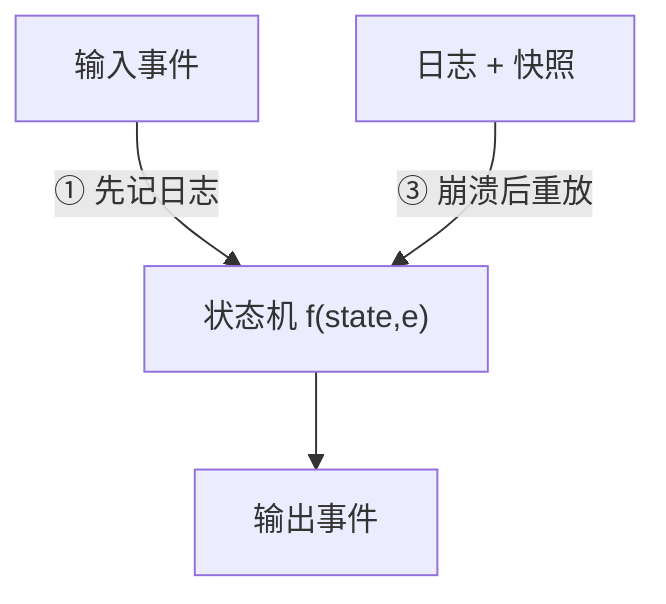

# 交易公司的系统设计轮：怎么跑、和大厂有什么不同

> 适用题：sd01 无用代码分析 · sd02 未来时刻任务调度器 · sd03 低延迟电子交易系统。
> 标准：**一律按 senior 门槛**。术语第一次出现写「中文（English）」，数字都带推导，**假设值**一律标「假设」。
> 真面试以面试官给的约束为准——**先问清约束本身就是加分项**。

---

## 0. 一页结论

1. 这家公司的 Java 岗在**研究平台 + 分布式存储 + 计算集群 + 监控**，不在交易热路径上（热路径是 C++）。所以 sd01 / sd02 是「基础设施味」的设计题（批处理、持久化、调度），sd03 才是「热路径味」。**两种味道都要准备，开场第一件事是判断面前的题是哪一种。**
2. 交易公司的设计轮考的不是「怎么水平扩展到十亿用户」，而是：**把问题的单机性能算清楚；决定性（determinism）；出错时怎么停；崩溃后怎么靠日志重建状态**。
3. 最能拉开差距的动作：**开口先要数字**（延迟预算多少 µs？峰值多少 msg/s？丢一条行情的后果？），再用数字**否决**不合适的方案（「Kafka 放进热路径？它的 p99 就比我们整个预算大」）。
4. 每个方案回答三个问题：**状态在哪里（谁是 source of truth）**、**崩溃后怎么恢复**、**怎么知道它真的做到了（测量）**。
5. Java 在这里不是借口：主动讲 GC / 分配率 / JIT 预热 / 对象布局 / 堆外内存 / 单写者，也诚实说 Java 的下限在哪（§5.4）。

---

## 1. 和大厂系统设计轮的区别

左列是在大厂准备过的默认假设，右列是在这里要换成的假设。

| 维度 | 大厂（FAANG 式） | 交易公司（Headlands 式） | 面试里怎么体现 |
|---|---|---|---|
| **延迟的单位** | ms；p99 < 100–500 ms 算好 | **µs**（tick-to-trade 几 µs 到几十 µs）；基础设施侧（研究平台）是秒–分钟，但**尾延迟的意识**一样 | 先把预算写成一条流水线，每段几 µs（§4） |
| **扩展方向** | 水平扩展是默认答案 | **先把单机榨干**：一个核心、一个线程、热路径零分配，常比一百台机器更快。扩展靠**按品种分片、各自独立（shared nothing）** | 估算「一台机器够不够」；够就别分布式（sd02 的 3×10⁸ 任务只有约 20 GB，一台放得下） |
| **一致性** | 最终一致、读写分离、缓存 | **全序（total order）+ 决定性**：同样的输入序列得到逐位相同的输出，崩溃后可重放、事后可复盘、研究可回测 | 写成「输入日志 + 纯状态机」（§5.2） |
| **失败时的姿态** | 优雅降级、返回缓存数据 | **fail closed**：拿不准就停（熔断 kill switch、缺参考价就拒单、行情有缺口就不交易）。错单是真金白银，停摆只是错过机会 | 每个组件说「它坏了会怎样 → 系统停到安全状态」 |
| **可用性** | 99.99%，多 AZ | 交易时段（几小时）内的**连续正确性**比全年可用率重要；故障转移秒级，且**不能双活写（split brain）** | 讲清谁有权发单、怎么防两台同时发 |
| **数据规模** | PB 级，吞吐是主要矛盾 | 单日 GB–TB，**但速率有尖峰**（开盘、新闻、做市商大量撤单）；每条消息预算**纳秒–微秒** | 估算「每条消息多少周期、多少次缓存未命中」（§3.4） |
| **瓶颈在哪** | 网络 / 数据库 / 缓存命中率 | **内核（系统调用、中断、调度）、缓存未命中、GC 停顿、锁竞争、网络栈** | 点名「机械同情（mechanical sympathy）」：按硬件的工作方式写软件 |
| **状态** | 放数据库，服务无状态 | **状态在内存里**（订单簿、仓位），日志是持久化手段，不是数据库 | 「崩溃 → 读快照 + 重放日志 → 追到最新」 |
| **正确性证明** | 压测 + 灰度 | **回放**生产数据、模拟交易所、故障注入、线缆上打点测量 | 主动说测试怎么做（§6） |
| **面试官看什么** | 看你画框、懂 trade-off | 看你**算数**，看你懂**一层层往下**（JVM、OS、CPU、网卡） | 每一层说一句具体的东西，不空谈 |

**一个容易踩的坑**：把交易系统答成大厂「实时流处理」——Kafka → Flink → Redis。每一跳 ms 级，整条链路比预算大三个数量级。除非题目明确是**离线 / 准实时**的侧链路（研究、监控、对账、落盘），不要把消息队列放到热路径上。

---

## 2. 一轮设计面试的节奏（45–60 分钟）

| 分钟 | 做什么 | 产出（写在白板 / 文档上） |
|---|---|---|
| 0–5 | **澄清**：热路径题还是平台题？功能边界？SLO 数字？丢了/错了的后果？ | 3–5 条需求 + **3 个关键数字**（峰值速率、延迟预算、数据量）+ 明确的**非目标** |
| 5–10 | **估算**（§3）：一台机器够吗？瓶颈是什么？ | 一张小表：量 → 推导 → 结论 |
| 10–15 | **接口与数据模型**：事件有哪几类？ID 怎么编？谁是 source of truth？ | 事件列表（sealed 类型就是它的代码形态）、关键状态机 |
| 15–35 | **主设计**：一张框图；沿着一条消息走一遍；标出线程和队列；写延迟预算 | 图 + 一条消息的旅程 |
| 35–50 | **深挖**：面试官选一个点钻（崩溃恢复？GC？时钟？重复投递？）。每个点准备「三层回答」：是什么 → 为什么 → 怎么验证 | 口述 + 白板小图 |
| 50–60 | **收尾**：trade-off、已知弱点、有更多时间会做什么、怎么监控 | 3 条「我会盯的指标」 |

**节奏规则**：

* 每 10 分钟停一次问「这个方向可以吗？」——面试官是将来的同事，互动本身被评分。
* 画图前先说**不变量**：「无论怎么崩，我保证：订单不会发两次 / 任务不会提前触发 / 仓位 = 成交之和。」
* 主动**攻击自己的设计**：「这里有个弱点：…；如果出现它，我会…」。senior 的标志是先于面试官发现问题。

---

## 3. 估算：从零开始

估算的目的不是算准，而是**排除方案、找到瓶颈**。

### 3.1 单位与换算（先背下来）

```text
时间   1 s = 1,000 ms = 1,000,000 µs = 1,000,000,000 ns
       1 ms = 1,000 µs      1 µs = 1,000 ns
频率   3 GHz 的 CPU：1 个周期 ≈ 0.33 ns；1 µs ≈ 3,000 周期；100 ns ≈ 300 周期
容量   2^10 = 1,024 ≈ 10^3（KB）  2^20 ≈ 10^6（MB）  2^30 ≈ 10^9（GB）  2^40 ≈ 10^12（TB）
速率   1 Gbps = 125 MB/s     10 Gbps = 1.25 GB/s     25 Gbps ≈ 3.1 GB/s
一天   86,400 s ≈ 10^5 s；  一个美股交易日（常规时段 6.5 小时）= 23,400 s ≈ 2.3×10^4 s
一年   250 个交易日；一年 ≈ 3×10^7 s
```

### 3.2 延迟阶梯（量级）

| 操作 | 量级 | 周期（3 GHz） | 对设计的含义 |
|---|---|---|---|
| L1 缓存命中 | ~1 ns | ~4 | 免费 |
| L2 命中 | ~4 ns | ~12 | 几乎免费 |
| L3 命中 | ~10–40 ns | ~30–120 | 共享，被邻居干扰 |
| 主存（DRAM）一次未命中 | ~60–100 ns | ~200–300 | **热路径的货币单位：缓存未命中**。1 µs 预算 ≈ 十次未命中 |
| 另一个核心写过的缓存行（跨核传递） | ~50–100 ns | | 线程之间交接一条消息至少这个价 |
| 系统调用（空） | ~0.1–1 µs，有安全缓解措施时更高 | | 热路径不进内核 |
| 上下文切换 | ~1–5 µs（含缓存冷却的后续代价更大） | | 热线程不睡眠、不被抢占 |
| 内核 TCP/UDP 单跳（收或发） | 几 µs 到十几 µs | | 内核旁路（kernel bypass）要省的就是它 |
| 内核旁路收发 | ~1 µs 或更低 | | |
| 同机房网络往返（RTT） | ~50–500 µs（普通）；同机架/直连更低 | | 复制日志到另一台机器的价格 |
| NVMe 一次 fsync | 数十 µs 到 ms，不稳定 | | 热路径不 fsync，或做 group commit |
| 光在光纤里 | **~5 µs / km**（约 200,000 km/s，真空光速的 2/3） | | 物理距离就是延迟；这就是 co-location |
| 微波（近似真空） | ~3.4 µs / km | | 芝加哥–纽约约 1,150 km：微波 ~4 ms，光纤 ~7 ms |

用法示例：「写日志到本地 NVMe 并 fsync，数十 µs 起步；我的预算只有 10 µs，所以热路径只做内存追加，持久化放在另一个线程，并靠复制 + 重放保证安全。」

### 3.3 带宽与包速率

以太网最小帧 64 字节 + 前导码 8 + 帧间隙 12 = **84 字节在线上**。

```text
10 Gbps 线速，最小帧：  10×10^9 / (84×8) = 14.88 百万包/秒（Mpps）
一个 64B 包的"序列化时间"：84×8 bit / 10 Gbps = 67 ns
一个 1500B 包（线上 1538B）：1538×8 / 10 Gbps = 1.23 µs ；在 1 Gbps 上 = 12.3 µs
```

两个结论：(1) 小包把包速率顶满而不是带宽；(2) 序列化时间本身就是延迟——这就是交易公司在乎「cut-through 交换机」（边收边转，不等整帧）和 10G/25G 网卡的原因。

**行情消息大小**：交易所二进制行情协议的单条增量消息一般几十字节，如 Nasdaq ITCH 5.0 的 Add Order 约 36 字节；多条消息被打包进一个 UDP 数据报（MoldUDP64 类协议）。

### 3.4 把速率翻译成「每条消息的预算」——最重要的一步

* 行情峰值 1,000,000 msg/s（假设：一个热门 feed 的突发）：
  * 每条消息平均 1 µs = 3,000 个周期 = 约 10 次缓存未命中。
  * 如果同一线程还要做策略 + 风控 + 编码，每个环节只剩零点几 µs。
* 行情峰值 10,000,000 msg/s（假设：期权类 feed 的突发）：
  * 每条 100 ns = 300 周期 = 只够约 1 次缓存未命中。
  * 结论：解码 + 簿更新必须是「只读几个缓存行」的程序；不可能分配对象、不可能哈希字符串。

**设计不是「吞吐能不能做到」，而是「每条消息只能碰几个缓存行」**。订单簿放进连续数组、`long` 定点价格、禁止对象分配，都从这里推出。

对比（Little 定律，L = λ·W）：

* 订单 100,000 /s，每单在系统内停留 100 µs：同时在途订单数 = 10^5 × 10^-4 = 10，一个线程足够，根本不需要并发。
* 大厂服务：10^5 QPS × 100 ms = 10^4 个并发请求，需要线程池 / 多机。

### 3.5 存储与日志（journal）的估算

* 入站日志：1M msg/s × 48 B（含序号、硬件时间戳、头）= 48 MB/s。
  * 6.5 小时（2.3×10^4 s）满负荷 ≈ 1.1 TB（峰值 ≠ 平均；真实平均通常低一个数量级，假设峰均比 10:1，约 110 GB/天）。
  * 所以：日志是 append-only 的顺序写，按时间切段，压缩后归档给研究；热路径只写内存 / mmap 文件。
* 状态大小：
  * 10^5 个活跃订单 × 64 B = 6.4 MB，放得进 L2/L3。
  * 10^4 个品种 × 每个订单簿 1 MB = 10 GB，放不进 L3；只有「热门品种」的簿热。

### 3.6 内存分配率与 GC（Java 专有的估算）

* 每条消息产生 100 B 垃圾 × 1M msg/s = 100 MB/s 分配率。
* 年轻代 1 GB：每 10 s 一次 minor GC。
* Parallel/G1 的 minor GC 停顿：几 ms 到几十 ms（取决于存活对象），超出 10 µs 预算 3 个数量级。
* 结论：稳态下分配率必须 ≈ 0（对象复用 / 预分配 / 堆外），而不是「调好 GC」。
* ZGC 把停顿压到亚毫秒（通常 < 1 ms）、Shenandoah 通常在 0–10 ms，但仍有读屏障、并发线程抢缓存/CPU；对 µs 级热路径仍不够。

### 3.7 估算的写法（交给面试官看的格式）

| 量 | 假设 / 推导 | 结论 |
|---|---|---|
| 峰值行情速率 | 1M msg/s（假设，问面试官） | 每条 ≤ 1 µs ≈ 10 次 miss |
| 订单速率 | 10^4 /s 峰值 | 在途 ≈ 1，单线程足够 |
| 日志写入 | 48 MB/s | 顺序追加，NVMe 轻松；不 fsync 于热路径 |
| 状态大小 | 活跃单 10^5 × 64 B | 6.4 MB，缓存友好 |

---

## 4. 延迟预算（latency budget）：把一个 µs 数字拆成流水线

量级参考：较慢的软件系统「收到行情 → 发出订单」约 30 µs；交易所包间隔约 10–1,000 µs；撮合响应约 100 µs–5 ms。下面是**示例预算**（假设值，演示怎么拆）：

tick-to-trade 目标（软件部分）：p99 ≤ 10 µs

| 环节 | 预算 | 谁负责 |
|---|---|---|
| 线缆 → 网卡接收（硬件时间戳） | ~0.5 µs | 网卡/交换机 |
| 内核旁路轮询取包 + A/B 仲裁 + 序号检查 | ~0.5 µs | feed handler |
| 解码（flyweight，不拷贝）+ 更新订单簿 | ~0.5 µs | book builder |
| 策略计算 | ~3 µs | strategy |
| 风控（O(1) 数组查表，5–8 项检查） | ~0.3 µs | risk gate |
| 编码 + 写网卡（旁路发送） | ~0.7 µs | gateway |
| 线程交接（每个 SPSC 环 ~0.1 µs × 2–3） | ~0.3 µs | handoff |
| **合计** | **~6 µs** | 留 4 µs 给「抖动」（jitter） |

**预算的使用规则**：

1. 每一段**有人认领**（线程 / 组件）、有**测量点**（硬件时间戳或单调时钟）。
2. 报**分位数**，不是平均：p50 / p99 / p99.99 / max。交易看尾部——一次 2 ms 的 GC 停顿里，行情继续跑，你的报价已经陈旧。陈旧报价会被更快的对手吃掉，这叫逆向选择（adverse selection）：成交的恰好都是对你不利的单。
3. **抖动来源清单**（可逐条念）：GC 停顿 / safepoint；JIT 反优化（deopt）与编译线程；缺页（page fault）、透明大页压缩（THP compaction）；中断、`irqbalance`；同核心超线程（SMT）兄弟；NUMA 远端内存；CPU 降频 / C-state 唤醒；其他进程抢占；日志/监控线程争用缓存；Nagle / 延迟确认；虚拟化环境下 `System.nanoTime()` 变慢。
4. 测量要避免**协调遗漏**（coordinated omission）：压测器在被测系统卡住时停止发送，就把最差的延迟藏起来了。用固定速率的发送器 + 记录「应该发出」的时间；用 HdrHistogram 一类的直方图。
5. 把 OS 配置当作设计的一部分：`isolcpus`/`nohz_full` 隔离核心、线程绑核（`taskset`）、关闭 `irqbalance` 把中断引到别的核、`performance` 调频策略、大页（hugepages）、NUMA 就近分配、关闭 swap。

---

## 5. 工具箱：交易系统设计里反复出现的原语

### 5.1 单写者原则（single-writer principle）

**一个可变状态只由一个线程写**。不需要锁、不需要 CAS，只需要「写完发布、读之前获取」的内存序（release/acquire）。这是 mechanical sympathy 的核心。落地：

* 每个品种分片 = 一个线程 = 一份订单簿 + 一份策略状态；线程之间只靠 SPSC 环（单生产者单消费者环形队列）交换不可变的消息。
* 跨线程共享的少量数据（熔断开关、参考价）：单写者 + 其他线程只读（`volatile` / `VarHandle.getAcquire`）。

### 5.2 事件溯源 + 决定性状态机 + 日志重放（event sourcing / replay）



* 输入事件：行情、回报、命令、时钟滴答。
* ① 先分配序号 + 时间戳，追加到日志（journal），再交给状态机。
* 状态机是纯函数 `f(state, e)`。② 决定性：不读墙上时钟、无随机数、无遍历顺序依赖。
* 输出事件：订单、日志、指标。
* ③ 崩溃后：读最近快照 + 重放日志尾部，状态与崩溃前逐位相同。

好处一次拿到四样：崩溃恢复、事后复盘、回测（同一份代码跑历史行情）、主备一致（备机重放同一份日志）。也是生产对账 / 模拟的底层逻辑。

**破坏决定性的东西**（要能列）：读墙上时钟（`System.currentTimeMillis`）、`HashMap` 遍历顺序（用有序结构或数组）、浮点运算顺序不同（用定点整数）、多线程竞争、依赖线程调度的并发、`Random` 无种子、GC/内存地址（`identityHashCode`）。

### 5.3 日志与持久化：先想清楚「谁是 source of truth」

* **交易所自己的撮合引擎**：输入必须先进（复制的）日志，再被处理——否则崩溃会丢一条已改变簿的事件。
* **我们作为交易所的客户**：订单的最终真相在**交易所**。我们的日志主要用于重放 / 复盘 / 重建策略状态；崩溃恢复时靠**与交易所对账**（查未完成订单、drop copy、会话序号补发）补上日志没来得及记的部分。因此热路径不必等 fsync。
* 持久化的层次：进程崩溃（`kill -9`）→ 数据在 `mmap` 的页缓存里还在，不需要 fsync；机器掉电 → 需要 fsync 或复制到另一台机器；机房级故障 → 跨机房复制（延迟太大，不进热路径）。
* 概念对应物（不要求背 API）：Chronicle Queue（基于内存映射文件的堆外持久化队列）、Aeron（可靠 UDP / IPC 传输，Aeron Archive 做录制与重放，Aeron Cluster 在其上做 Raft 复制状态机）、LMAX Disruptor（环形缓冲区 + 序号 + 单写者；单线程业务处理器每秒可处理约 600 万订单）。

### 5.4 Java 在热路径上的纪律（mechanical sympathy for Java）

| 问题 | 做法 | 为什么 |
|---|---|---|
| GC 停顿 | 稳态**零分配**：对象池 / 预分配数组 / flyweight 视图 / 基本类型集合；必要时 ZGC 或「一天只分配一次，夜里重启」+ 超大堆 + `-Xms=-Xmx` + `AlwaysPreTouch` | 停顿 ∝ 存活对象或分配率；根治方法是分配率 ≈ 0 |
| 对象头与指针追逐 | 数据放进 `long[]` / 连续数组 / 堆外；用整数下标代替引用；SoA（数组结构，每个字段一个数组） | 一次 DRAM 未命中 ~80 ns |
| 堆外内存 | `MemorySegment`（FFM）/ `ByteBuffer.allocateDirect`；定长记录；用 `VarHandle` 做原子读写 | 不受 GC 管，可映射文件、可跨进程共享 |
| 锁与线程交接 | 单写者 + SPSC 环；`setRelease/getAcquire`；忙等用 `Thread.onSpinWait()` | 锁 = 内核介入 + 缓存行弹跳 |
| JIT 预热与反优化 | 开盘前用合成 / 回放流量跑到编译稳定；热路径**调用点保持单态**（别让同一个调用点见到很多实现类）；避免在热方法里抛异常 | 第一次冷执行比稳态慢 10–100 倍；类型假设失败会 deopt 回解释器 |
| safepoint | 避免热路径里无 safepoint 的长计数循环、避免大数组拷贝 | 任何 safepoint 操作都会停住所有线程 |
| 字符串与装箱 | 品种用 `int` id；价格用 `long` 定点；禁止 `String`、`Long` 装箱、`stream`、捕获型 lambda | 每一个都是分配或间接寻址 |
| 定时 / 时钟 | 业务时间用单调、可注入的时钟（回放时用事件里的时间戳）；测延迟用 `System.nanoTime()` | 决定性 + 不受 NTP 回拨影响 |
| 线程亲和 | 用 OS 绑核（`taskset`）或库；一个热线程独占一个物理核（避开 SMT 兄弟） | 避免被调度、缓存保持热 |
| 虚拟线程 | **不要**用在热路径；用在 I/O 密集的外围（对账、批处理、重连管理线程） | 虚拟线程解决的是「很多阻塞等待」，不是「最低延迟」 |

**诚实的下限**：规范写出来的 Java 热路径可以做到个位数到几十 µs 的 tick-to-trade；要进入亚微秒，通常是 C++ / FPGA 的领地。所以很多公司把 Java 用在**研究平台、风控监控、编排、对账**这些「慢侧」，热路径用 C++。面试里承认这一点比硬吹 Java 无所不能更可信。

### 5.5 网络：内核旁路、组播、重连

* **内核旁路（kernel bypass）**：绕过内核协议栈，应用直接从网卡的环形队列读写（DPDK 轮询模式驱动；Solarflare OpenOnload / ef_vi 一类的用户态栈）。省的是系统调用、中断、内核到用户的拷贝、调度唤醒。代价：独占核心 100% 忙等、需要特殊网卡和驱动、调试困难、Java 要借 JNI/FFM 或使用对 socket 透明的用户态栈。
* **市场数据组播（market-data multicast）**：交易所用 UDP 组播把行情同时发给所有订阅者（一份数据，网络复制），不可靠，靠**序号 + 缺口检测 + A/B 双路冗余 + 快照/重传通道**保证完整。
* **订单入口**：TCP 会话（FIX 或交易所专有二进制协议），带会话序号、心跳、断线重发；常见安全网：**断线即撤（cancel-on-disconnect）**。
* **co-location**：服务器放进交易所机房，物理距离几十米，往返几微秒；交叉连接（cross-connect）线缆长度也被当作公平性的一部分。

### 5.6 风控：交易前检查（pre-trade risk check）

每一个要发出的订单必经的闸门：单笔数量 / 名义金额上限、价格带（胖手指）、最坏情况仓位（含未完成订单）、未完成订单数、下单速率、自成交预防、熔断开关。要点：**O(1)**（数组查表，增量维护聚合量）、**fail closed**、**独立于策略代码**（策略出 bug 不能绕过它）。美国有监管要求（SEC Rule 15c3-5「市场准入规则」要求市场准入者对订单设置预交易风险控制）。

### 5.7 对账（reconciliation）

* 实时：独立的 **drop copy** 会话，交易所把我们所有成交副本发到另一条通道，与内部订单状态机比对。
* 日终：与清算 / 经纪商的头寸和成交对账。
* 发现差异（break）→ 先停该品种或该策略（fail closed），再查原因。

---

## 6. 好答案与坏答案的外观

| 坏（weak） | 好（strong） |
|---|---|
| 开口画 Kafka + Redis + 微服务 | 开口问 SLO 与速率，并说"热路径单机单线程" |
| "加机器就行" | "先算一台够不够；不够按品种分片，shared nothing" |
| "用锁保护订单簿" | "单写者；跨线程只传不可变消息" |
| "GC 调好就行" | "稳态分配率为 0；停顿的根因是分配，不是收集器" |
| "宕机就切备机" | "谁有权发单？怎么避免双发？备机状态怎么保持一致？" |
| 只讲 happy path | 每个组件讲失败模式和停到安全状态的办法 |
| 说"性能很好" | 说"我会在这里测：p99.99，线缆上打点，固定速率发包避免协调遗漏" |
| 把 Java 说成无所不能 / 或一味回避 Java | 说清楚 Java 能做到什么、做不到什么，以及用什么纪律 |

**自己攻击自己**的句式：「这个设计的弱点是 X。如果 X 发生，影响是 Y，我用 Z 限制它；我会用指标 M 监控它。」

---

## 7. 练习方式

1. 每道题先**不看模范答案**，计时 45 分钟，对着空白纸走完 §2 的节奏；写下 3 个关键数字和不变量。
2. 对照 `model_answer.md`，用 `rubric.md` 自评；漏掉的点补进你的「三层回答」（是什么 → 为什么 → 怎么验证）。
3. 把 `followups.md` 逐条口述一遍（每条 60–90 秒），录音听自己是否有「数字」和「失败模式」。

## 8. 自测（口头 2 分钟一题）

1. 一条行情流峰值 5×10⁶ msg/s，3 GHz 单核，每条消息平均有多少周期？这对数据结构选择意味着什么？
2. 为什么 Kafka 不该出现在 tick-to-trade 路径上？它应该出现在哪？
3. 一个决定性状态机有哪五类常见的非决定性来源？
4. 进程被 `kill -9`、机器掉电、机房断网，三种故障下 `mmap` 日志分别还剩什么？
5. 100 MB/s 的堆分配率意味着什么？为什么「换更好的 GC」不是完整答案？
6. 光纤里 1 km 要多少 µs？co-location 把往返从 7 ms 降到多少数量级？
