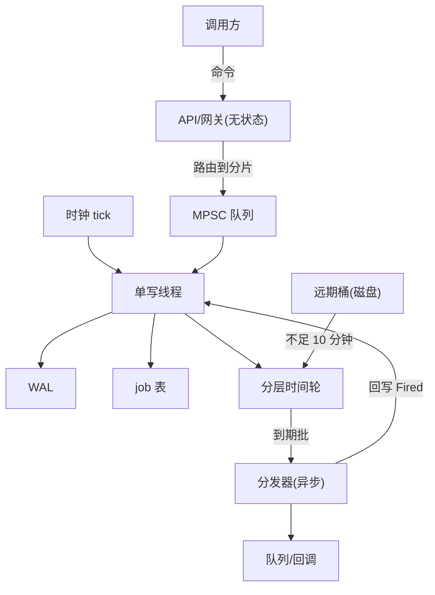
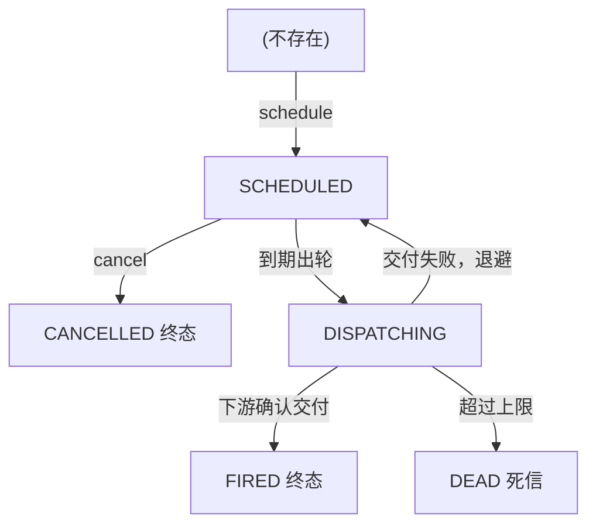
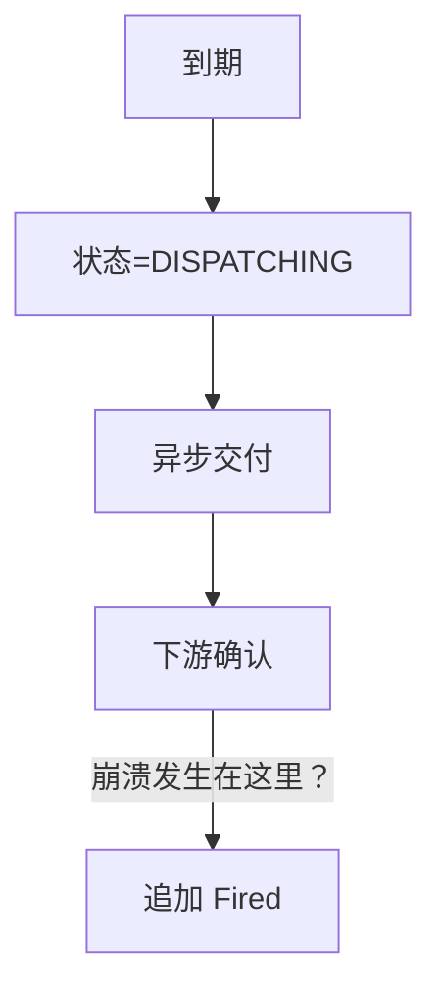
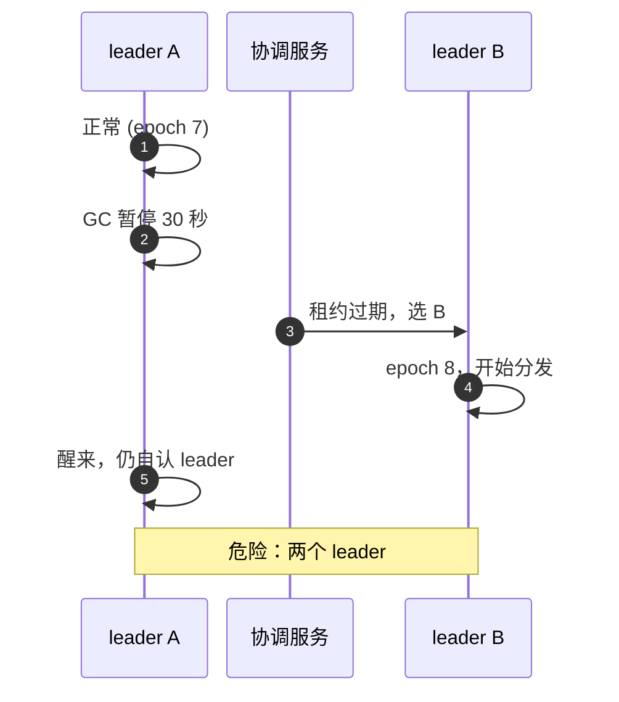

# sd02 · 参考答案：未来时刻任务调度器（senior 深度）

> 读者设定：会写 Java，但分布式日志、时间轮、租约与 fencing 要从头讲。数字全部带推导；**假设值**标明。交易公司版的取向：先算单机，状态在内存，日志是真相，决定性可重放。

---

## 0. 三个层次的回答

**30 秒版**：每个分片有**一个**单写者（leader）：写前日志（WAL）是真相，内存里一个**分层时间轮**管近期到期的任务，远期的任务放在按时间分桶的磁盘段里、临近时再装载进时间轮。到点就把任务**至少一次**地交给下游（带任务 id 作幂等键），交付成功后再写 `Fired` 记录。崩溃了就「快照 + 重放日志」恢复；主备靠复制日志，fencing token 防脑裂。有界延迟 = 时间轮 tick + 突发时的分发容量 + 故障切换时间，三项都要量化。

**5 分钟版**：上面 + 估算（3×10⁸ 个任务只有约 12 GB 元数据，一台机器放得下——分片是为了吞吐的隔离和故障半径，不是为了容量）+ 与「轮询数据库」方案的比较 + 状态机与取消竞态。

**完整版**：下面所有章节。

---

## 1. 澄清、SLO 与不变量

采用的假设（面试时说出来并让面试官改）：

| 项 | 取值 |
|---|---|
| 触发 | 调度器把「到点事件」可靠地交给下游（发布到队列 / 回调）；执行与业务重试在下游 |
| Δ（有界延迟） | 正常：p99.9 ≤ 1 s；**单节点故障期间**：≤ 10 s（两档 SLO） |
| 提前 | 不允许 |
| 语义 | 至少一次 + 幂等键；不承诺 exactly-once（§8 解释） |
| 规模 | 创建 10⁸/天，未触发积压 3×10⁸，最远 1 年（假设） |
| 取消 | 支持；已被领取（claimed）后取消返回「太晚」 |

**不变量**：设计的每一步都回头对照这五条。

* **I1 持久**：`schedule` 返回成功 ⟹ 任务记录已在 ≥2 份持久化副本中。
* **I2 不早**：任务触发时刻 ≥ `fireAt`（以校准后的服务端时钟衡量）。
* **I3 有界迟**：无故障时 触发时刻 − `fireAt` ≤ Δ（p99.9）；故障时有第二档上界。
* **I4 不丢**：已确认、未取消的任务最终必被触发（即使因故障迟到）。
* **I5 重复语义**：同一任务可能被「交付」多次，但带同一个幂等键，下游去重；调度器自己不对同一任务创建两个活动的触发记录。

---

## 2. 估算

```text
创建速率   10^8 / 86,400 s ≈ 1,157 /s 平均
峰值       ×6（到期时刻聚集在整点/整分，创建也有高峰）≈ 6,944 /s  
积压       3×10^8（平均每个任务提前 3 天提交：10^8/天 × 3 天）
```

| 量 | 推导 | 结果 | 结论 |
|---|---|---|---|
| 行存储 | 3×10⁸ × 256 B（元数据 + 约 200 B 负载引用/内联） | **≈ 77 GB** | 磁盘，一台机器的 NVMe 也放得下 |
| 内存索引条目 | id 8 B + fireAt 8 B + 负载偏移 8 B + 状态/标志 4 B + 链表前后 8 B ≈ 36–40 B；3×10⁸ × 40 B | **≈ 12 GB** | 一台 64 GB 机器放得下**全部**活动任务的索引 |
| 近期窗口 | 未来 10 分钟内到期：平均 1,157×600 ≈ 6.9×10⁵ 个；峰值 ×6 ≈ 4.2×10⁶ 个；× 40 B | **28 MB / 167 MB** | 时间轮只装近期窗口，小得可以忽略 |
| 写日志速率 | 每个任务 3 条记录（Scheduled / Fired / 归档或 Cancelled）× 1,157 ≈ 3.5k 条/s；峰值 ≈ 2.1 万条/s；每条约 100 B | **≈ 0.35 – 2 MB/s** | 顺序追加，轻松；用 group commit（§6.2）即可 |
| 整点突发 | 假设每天有 5% 的任务设在整点：5×10⁶ / 24 个整点 ≈ **2.08×10⁵ 个同时到期** | 要求 Δ = 1 s ⟹ 分发能力 ≥ 2.1×10⁵ /s；负载约 200 B ⟹ 41 MB/s | 平均 1,157/s，**峰值是平均的 180 倍**。这是整个设计里最关键的数字 |
| 快照/恢复 | 12 GB 快照；读 2 GB/s | **≈ 6 s** 加载 + 重放尾部日志 | 故障切换的下界；热备（follower 持续重放）可以降到近乎 0 |

**从估算得到的设计结论**（先讲结论，再讲方案）：

1. **容量不是问题，可用性与突发才是**：一台机器放得下全部元数据。所以分片的理由是**故障半径、分发吞吐的隔离**，而不是存不下。
2. **近期窗口很小**：时间轮只管未来十几分钟；远期放磁盘。
3. **整点突发是 SLO 杀手**：平均速率会误导人。必须有（a）足够的分发能力，或（b）让调用方给出容忍窗口（`notBefore = t`，`notAfter = t + slack`），调度器在窗口内摊平（smear）。
4. **有界延迟是一个预算**：tick + 队列 + 分发 + 故障切换（§9）。

---

## 3. 先看最朴素的方案：轮询数据库

```text
 schedule: INSERT INTO jobs(id, fire_at, state='SCHEDULED', payload, ...)
 worker loop (每 p 秒):
     SELECT id FROM jobs
      WHERE state='SCHEDULED' AND fire_at <= now()
      ORDER BY fire_at LIMIT k
      FOR UPDATE SKIP LOCKED;            -- 多个 worker 并发取，互不阻塞、不重复领取
     对每个 job：交付；UPDATE state='FIRED'
```

* **优点**：简单；持久化与事务白给；`SKIP LOCKED` 让多个 worker 并发消费同一个索引范围而不双取（Quartz 的 JDBC JobStore、很多公司的第一版都这样）。
* **缺点（逐条有数字）**：
  1. **延迟下界 = 轮询周期 p**：要 Δ = 1 s，p 至多几百 ms，每个分片每秒几次扫描。
  2. **热点索引范围**：所有 worker 都读 `(state, fire_at)` 索引的同一个"当前时刻"附近区域；同时有 1,157/s 的随机时间插入。B-tree 的叶页竞争；大量"已触发"行需要删除/归档，索引膨胀。
  3. **突发**：整点 2×10⁵ 个同时到期，`LIMIT k` 的批量领取要几十个来回；每个 `UPDATE` 一次事务，DB 成为分发瓶颈。
  4. **没有精度**：想要毫秒级就得更高频率轮询，数据库负载线性上升。
  5. **故障切换**依赖数据库本身的 HA，延迟不可控。
* **什么时候这是对的答案**：Δ 是分钟级、规模 < 10⁷、团队已有成熟数据库。面试里要先说这个方案和它的适用范围，再说为什么这里要更进一步——这显示判断力。

---

## 4. 推荐设计：每个分片一个单写者 + WAL + 分层时间轮

### 4.1 总图



* API / 网关（无状态）：`schedule` / `cancel` / `get`；校验、幂等（客户端 job id）、路由 shard = `hash(jobId) % N`。
* 分片 s：一个 leader + 2 个 follower。
* 单写线程依次做两件事：① 追加到 WAL（group commit，复制到 follower）；② 修改内存状态（job 表 + 时间轮）。
* job 表（open addressing：id → slot）：`long[] fireAt`、`int[] state`、`int[] next/prev`、`long[] payloadOff`。
* 分层时间轮（近期 ≤ 10 分钟）：L0 10 ms × 256，L1 2.56 s × 64，……溢出到更高层。
* 远期桶：磁盘上按小时分段的有序文件；距离到期 < 10 分钟时装载进时间轮。
* 分发器：异步，限速、按租户公平；把到期批交给队列/回调，再到下游。成功后回写单写线程：追加 `Fired(jobId, epoch)` 记录。
* 快照（每 N 分钟，或日志段滚动时）+ WAL ⇒ 崩溃恢复 / follower 追赶。

### 4.2 状态机



* 到期：单写线程把它移出时间轮。
* 交付失败、退避重试：回到时间轮，`nextAttemptAt = now + backoff(attempt)`。
* 超过重试上限：进入 DEAD（死信），告警。

* **重试 = 再调度**：失败重试复用同一个时间轮——不需要第二套机制。
* **取消竞态**：`cancel` 与"到期出轮"都由**同一个单写线程**串行处理，所以不存在数据竞争，只有**业务竞态**：若 cancel 先到 → CANCELLED，任务从轮中摘除（O(1)，job 表记录了它在哪个 slot 的哪个链表）；若到期先发生 → 任务已是 DISPATCHING，cancel 返回 `TOO_LATE`。这种"以串行顺序定义语义"的做法，在单写者设计里是免费的。

### 4.3 日志记录（决定性状态机）

| 记录 | 备注 |
|---|---|
| `Scheduled(jobId, fireAt, payloadRef, tenant, epoch)` | |
| `Cancelled(jobId)` | |
| `Dispatched(jobId, attempt, epoch)` | 不是必须；见 §7 崩溃窗口讨论 |
| `Fired(jobId, epoch)` | 下游确认交付后写 |
| `Retry(jobId, attempt, nextAt)` | |
| `Dead(jobId)` | |

状态机是这些记录的**纯函数**：`f(state, record) → state'`。重放同一份日志得到相同状态（事件溯源的标准套路）。注意：**"现在是几点"不是状态机的输入**，而是单独的 `Tick(now)` 命令，它也可以被记录或在测试里被注入（§11）。

### 4.4 分层时间轮（hierarchical timing wheel）

**问题**：用优先队列（二叉堆，`java.util.concurrent.DelayQueue`、`ScheduledThreadPoolExecutor` 内部就是堆）管理定时器：插入 / 删除 O(log n)。10⁶ 级定时器时每个操作约 20 次比较、随机访存，而且 JDK 的实现每个定时器是一个对象 → GC 压力。

**时间轮**（Varghese & Lauck, 1987）：把时间切成 tick，用一个环形数组，每个槽（slot）挂一条链表，放"在这个 tick 到期的定时器"。

```text
 tick pointer
 +---+---+---+---+---+---+---+---+
 | 0 | 1 | 2 | 3 | 4 | 5 | 6 | 7 |
 +---+---+---+---+---+---+---+---+
   v       v
  J7     J3->J9
```

* 插入：slot = `(fireTick) mod wheelSize`，O(1)。
* 到期：指针扫过一个槽，整条链表一次性取出，O(到期数)。
* 删除（取消）：双向链表摘除，O(1)。

一层轮覆盖的时间范围 = tick × 槽数。要覆盖到一年，就要**分层**：低层转一圈，高层前进一格，高层槽里的定时器"降级"（cascade）到低层重新插入。

这个调度器的参数（tick = 10 ms）：

```text
L0  10 ms × 256 槽  覆盖 2.56 s
L1  2.56 s × 64     覆盖 163.84 s  (≈2.7 分钟)
L2  163.84 s × 64   覆盖 10,486 s  (≈2.9 小时)
L3  10,486 s × 64   覆盖 671,089 s (≈7.8 天)
L4  671,089 s × 64  覆盖 4.29×10^7 s (≈497 天)  ≥ 最远 1 年
```

* 每个定时器最多被"降级" 4 次（层数−1）→ 均摊 O(1)。总槽数仅 256 + 4×64 = 512 个链表头，**内存小得可以忽略**。
* 但近期窗口模型更省：我们只让时间轮装"未来 ≤10 分钟"的任务（约 28 MB–167 MB），更远的放在磁盘桶里，临近时批量装载。这样时间轮只需 L0–L2 三层，且重启恢复时只需装载近期窗口。
* **Kafka 的实现技巧**（值得一提）：不让线程每 tick 醒一次，而是把"非空的槽"放进一个 `DelayQueue`，线程在 `DelayQueue.poll(timeoutMs, …)`（带超时的 poll）上睡到下一个非空槽到期。稀疏时省 CPU。我们的 tick = 10 ms，100 次/秒空转的成本可以忽略，但若 tick 取 1 ms 就值得这样做。
* **精度**：任务实际在其 tick 的开始被取出——最多晚 1 tick（10 ms）。要保证"不早"，把 tick 号向上取整：`fireTick = ceil(fireAt / tickMs)`。

### 4.5 Java 实现要点（零分配、结构体数组）

```java
// 每个任务不是一个对象，而是第 i 号槽位：几个并行数组（SoA）。3×10^8 个对象会把 GC 压垮；
// 12 GB 的数组（或堆外 MemorySegment）则只是一块内存，GC 不扫描 long[]/int[] 的内容。
final class JobTable {
    final long[] fireAtMs;      // 触发时刻（UTC epoch ms）
    final int[]  state;         // SCHEDULED / DISPATCHING / FIRED / CANCELLED / DEAD
    final int[]  nextInSlot;    // 时间轮槽内双向链表，-1 表示空
    final int[]  prevInSlot;
    final long[] payloadOff;    // 指向磁盘/堆外的负载位置
    int freeHead;               // 空闲槽位链表，分配/释放都是 O(1)，没有 new
    // id → slot：开放寻址的 long→int 哈希表（原语集合，避免 HashMap<Long,Integer> 的装箱）
}
```

* **单写线程**拥有所有这些数组，其他线程只通过 MPSC 队列提交命令（JCTools 的 `MpscArrayQueue` 一类，或 Disruptor）——单写者原则，不需要锁。
* **时间源**：推进时间轮用 `System.nanoTime()`（单调，不受 NTP 回拨影响）；与 `fireAt` 的比较用校准后的墙上时钟（`System.currentTimeMillis()` 加上离线测得的偏移）。睡眠到**绝对**截止时间：`LockSupport.parkNanos(deadline - now)`，每次循环用截止时间推算下一个，而不是 `Thread.sleep(10)` 累积漂移。
* **JDK 内置结构的位置**：`ScheduledThreadPoolExecutor` 适合进程内几万以内的定时器；这里的量级和持久化需求不适合。

---

## 5. 远期任务：分层存储

* 远期桶（磁盘）：按「小时」分段的有序文件，段内按 fireAt 排序；段由日志 compaction 生成。
* 段的例子：`2026-10-16T09`、`2026-10-16T10`、`2026-10-16T11` ……，每段 ≈ 1157 × 3600 ≈ 4.2×10^6 条（平均）。
* 装载器：每分钟检查，把「落入未来 10 分钟窗口」的任务批量读入时间轮。

* 创建一个远期任务：追加 WAL → 放进"远期索引"（内存里只保留 id→段位置，或让 `JobTable` 的 `state=FAR` 的条目只占那 40 B）。
* 为什么按小时分段而不是一个大 B-tree：任务的生命周期是"插入 → 等待 → 一次性读出 → 删除"。按时间分段后，**删除 = 丢掉整个文件**（一次 `unlink`），避免 B-tree 的页分裂和碎片，也避免 LSM 的墓碑堆积和 compaction 写放大。取消的任务用内存里的位图标记，装载时跳过，段在"完全过期"后整体删除。
* 若是通用 KV 存储做后端（DynamoDB / Cassandra 一类）：分区键 = (shard, 时间桶)，排序键 = (fireAt, jobId)，这就是同一个设计的"托管版本"；热点问题通过"时间桶内再哈希子分区"解决。

---

## 6. 持久化与复制

### 6.1 写路径（为什么 "返回成功 ⟹ 持久"）

1. 路由到分片 leader。
2. 单写线程把 `Scheduled` 记录追加到 WAL 缓冲。
3. group commit：一个刷盘周期内的所有记录一起 fsync，并并行发送给 2 个 follower。
4. 收到 ≥ 1 个 follower 的持久化确认（「2 份副本」），回复调用方成功。
5. 之后才修改内存（job 表 + 时间轮）。

* 为什么先日志后内存：若先改内存、日志落盘前崩溃，调用方没收到成功、内存也丢了——是安全的；反过来**已经回复成功但日志没落盘**才是危险的。我们的顺序保证"回复成功 ⟹ 日志在 ≥2 处"。
* **group commit**：单次 fsync 在 NVMe 上的耗时从几十 µs 到 ms 不等（取决于设备）。2 万条/s 的峰值若每条一次 fsync 会压垮设备，所以把"上一次 fsync 期间到达的所有记录"凑成一批再刷——吞吐随负载自适应，延迟只增加一个 fsync 周期。
* 复制：leader→follower 顺序流式复制日志（概念上与 Raft 的 AppendEntries 同构）；多数派（3 副本取 2）确认即提交。选 Raft/ZooKeeper 之类的外部组件管理**选主与成员**，而数据路径用自己的日志流以获得吞吐。（Aeron Cluster 就是 Raft + 复制状态机的 Java 实现，概念对应。）

### 6.2 快照与恢复

* 每隔 N 分钟（或日志段滚动时）对内存状态做一致性快照（单写线程在 tick 间隙写出"当前日志位置 + 全部活动任务"），之后旧日志段可删除。
* 恢复 = 读最新快照 → 重放其后的日志 → 拿到与崩溃前相同的状态。
* **热备**：follower 持续重放日志，状态始终近乎最新，故障切换不需要从快照冷启动（见 §9）。

### 6.3 "至少一次"从哪来：崩溃窗口



以上都由单写线程完成。

* 在 "交付成功" 与 "Fired 写入日志" 之间崩溃：恢复后日志里没有 Fired，任务仍是 SCHEDULED/DISPATCHING，所以**会再交付一次**。这就是 at-least-once。
* 反过来如果先写 `Fired` 再交付：崩溃会**丢**触发——违反 I4。所以顺序必须是"交付成功后再记 Fired"。
* 因此下游必须用 `jobId`（+ attempt 无关）去重：幂等键。见 §8。

---

## 7. 故障切换、租约与 fencing



1. leader A（epoch 7）正常工作。
2. A 发生 30 s 的 GC / 虚拟机暂停。
3. 协调服务：租约过期，选出 B，epoch 8。
4. leader B（epoch 8）开始分发、写日志。
5. A 醒来，仍以为自己是 leader，继续分发 / 写日志。**危险**：此时有两个「leader」。

对策（叠加使用）：

1. **epoch（fencing token）**：每次选主 epoch+1；日志写入、对下游的交付都带 epoch；follower 与下游**拒绝旧 epoch**。A 醒来的第一次写就被拒绝。
2. **租约检查用单调时钟**：leader 在每次分发前检查"我的租约（用 `System.nanoTime()` 计时）是否仍有效"，并把 leader 租约时长设得**短于** follower 认为的租约时长（留出时钟漂移余量）。
3. **幂等下游**：即使两个 leader 短暂都发了，同一个 `jobId` 在下游只生效一次。fencing 减少重复，幂等保证正确——**两道防线**。
4. **Δ 预算**：故障切换时间 = 失败检测（租约/心跳超时，例如 3–5 s）+ 选主（< 1 s）+ 热备追赶（≈0）。所以第二档 SLO 取 10 s，且 **宕机期间到期的任务在恢复后立刻补发**（按 fireAt 升序，最迟的先不管，最早的先发）。

---

## 8. 为什么不承诺 exactly-once

* 精确一次 = 至少一次交付 + 接收方去重。调度器能做到的是"至少一次 + 稳定的幂等键"；"接收方是否真的做了去重"不在它的控制范围内。
* 若下游是同一个数据库：可以把"写入业务结果"与"记录已处理 jobId"放在一个事务里（outbox/inbox 模式），这时才能说"效果上恰好一次"。
* 在面试里说清楚这句话是 senior 信号：「**交付**可以重复，**效果**要靠幂等键去重。」

---

## 9. 有界延迟：预算与突发

```text
延迟(job) = 等待到 tick（≤10 ms） + 出轮到分发器入队（<5 ms）
          + 分发排队（容量不足时！）  + 下游发布 p99（~20 ms）
          [+ 故障切换 ≤ 10 s，仅故障期间]
```

**突发分析**（§2 的 2.08×10⁵ 同时到期）：

| 方案 | 做法 | 结果 |
|---|---|---|
| 提供足够的分发能力 | 分发器批量发布到队列（批量 1,000 条/批、多分区并行）；2.1×10⁵/s × 200 B ≈ 41 MB/s，对一个队列集群很轻；单分片内按租户并行 | 满足 Δ=1 s，成本是峰值容量 |
| 摊平（smear） | API 允许 `notAfter = fireAt + slack`；调度器把窗口内的到期点按任务 id 哈希均匀打散，或在装载进时间轮时加入确定性抖动 `jitter = hash(jobId) % slack` | 峰值 = 平均 × （1 / slack 秒） 被压平；需要调用方同意 |
| 公平 + 优先级 | 到期的任务按 (tenant, fireAt) 进入多个队列；每个租户有速率配额；老任务（lateness 大）优先（EDF：最早截止优先） | 一个租户的突发不会拖慢其他租户的"准时" |
| 背压 | 若分发能力暂时不足，积压 → 指标 `dispatch_lag` 告警；不要丢弃，也不要无限放大内存 | 可观测 |

**关键判断**：Δ 是**承诺**，所以必须有**容量规划**——"最大同时到期数 / Δ ≤ 分发容量"。把这个不等式写出来。

---

## 10. 时钟与时区

* **fireAt 是 UTC 瞬时点**（epoch 毫秒）。"明天上午 9:00（纽约）"在**提交时**由 API 层按时区库解析成瞬时点；时区规则（夏令时）之后可能被更新，所以对远期任务要保存原始意图（本地时间 + 时区 id），在装载进时间轮前**再解析一次**。
* 服务端时钟误差 ε：NTP 在局域网理想条件下可优于 1 ms，公网通常在几十毫秒以内。要保证"不早"，触发条件用 `now_calibrated − ε_max ≥ fireAt`；ε_max 取监控到的偏移上界。ε ≪ Δ（几十 ms vs 1 s），所以代价可忽略。
* **偏移监控**：节点周期性与时间源比较；偏移 > 阈值 → leader 主动让位（自我 fencing）并告警，避免用错误的时钟早发。
* **单调 vs 墙上**：推进时间轮只用 `nanoTime`；墙上时钟只用来比较 fireAt。墙上时钟被向后调整时，**不让时间轮倒退**，而是暂停推进直到墙上时间追上。
* 调用方时钟与服务端时钟不同：提交时若 `fireAt ≤ now`，立即触发并在响应里标明"已过期，立即触发"。

---

## 11. 如何测试（确定性）

* **虚拟时钟**：把时钟注入单写线程（`LongSupplier clock`），测试里手动 `advance(ms)`。时间轮 + 状态机是纯函数，因此测试毫秒级且无 `sleep`。
* **属性测试**：随机生成 (schedule, cancel, advance) 序列，断言：① 没有任务在 fireAt 之前触发；② 每个未取消任务恰好被触发一次（无故障时）；③ 触发延迟 ≤ tick。
* **崩溃重放测试**：在序列的随机点"崩溃"（丢掉内存状态），用快照 + 日志恢复，继续执行；最终触发集合必须与不崩溃的参考执行相同（至少一次下为超集且包含全部，去重后相等）。
* **故障注入**：leader 暂停（模拟 GC 停顿）后继续写——验证 fencing 拒绝；磁盘满；follower 落后。
* **时间轮对照测试**：与一个朴素的"排序 map"实现做差分测试。

---

## 12. 观测

| 指标 | 为什么 | 告警 |
|---|---|---|
| `lateness = actualFire − fireAt` 的直方图（p50/p99/p99.9/max），按租户 | 直接度量 SLO | p99.9 > Δ/2 |
| 到期未分发积压数 / 年龄最大值 | 突发或下游慢的早期信号 | 年龄 > Δ |
| WAL 提交延迟、复制滞后（follower lag） | 写路径与热备健康 | 滞后 > 1 s |
| 时间轮大小、装载器滞后 | 近期窗口是否准备好 | 装载滞后 > 窗口/2 |
| 时钟偏移 | 防止早发 | > ε_max/2 |
| epoch 变化、fencing 拒绝次数 | 选主抖动 | 任何拒绝 |
| 死信数量 | 下游长期失败 | > 0 |

---

## 13. 与其他选型的比较（一句话版）

| 选型 | 适用 | 为什么不选它作主方案 |
|---|---|---|
| 数据库轮询（`SKIP LOCKED`） | Δ 为分钟级、规模小 | §3 |
| Redis ZSET（score = fireAt，`ZRANGEBYSCORE` + 原子领取） | 中等规模、可接受缓存级持久性 | 持久性/复制语义弱于要求 I1；要自己处理领取丢失 |
| 消息队列的延迟投递（如 SQS delay、RabbitMQ 延迟插件） | 延迟范围受限（例如分钟级）的场景 | 许多实现有最大延迟上限，且不允许取消/查询 |
| `ScheduledThreadPoolExecutor` | 进程内、数量小 | 不持久、对象多 |
| Quartz / 工作流引擎 | 业务级调度、较低速率 | 吞吐与延迟精度不够 |

---

## 14. 结尾总结（最后一分钟）

「估算说明 3×10⁸ 个任务的索引只有约 12 GB，所以分片是为了故障半径和分发隔离，不是容量。每个分片单写者：WAL 为真相，近期窗口的分层时间轮 O(1) 插入/取消，远期放按小时分段的磁盘桶。写路径先日志后内存，回复成功时日志已有两份；交付成功后再记 Fired，所以是至少一次，下游靠 jobId 去重。故障切换靠租约 + epoch fencing + 热备。有界延迟是预算：tick + 分发 + 故障切换，突发要用容量不等式或摊平来保证。用虚拟时钟做确定性测试，用 lateness 直方图做观测。」

## 延伸阅读

时间轮：Varghese & Lauck 的 SOSP 1987 论文；Kafka 的 `TimingWheel` / `SystemTimer`；《DDIA》第 3、8、9 章（存储引擎、时钟与 fencing token、共识）。
