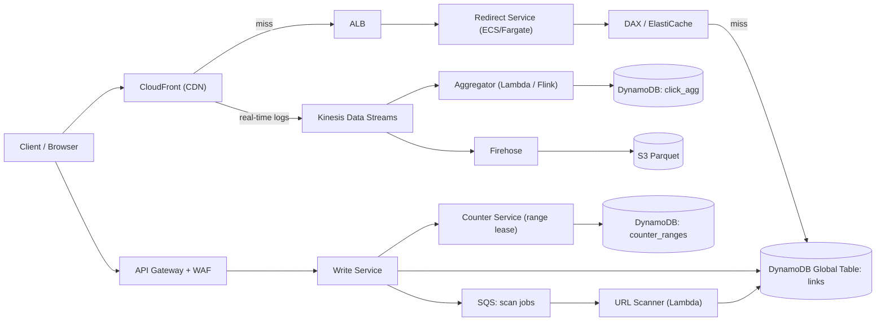
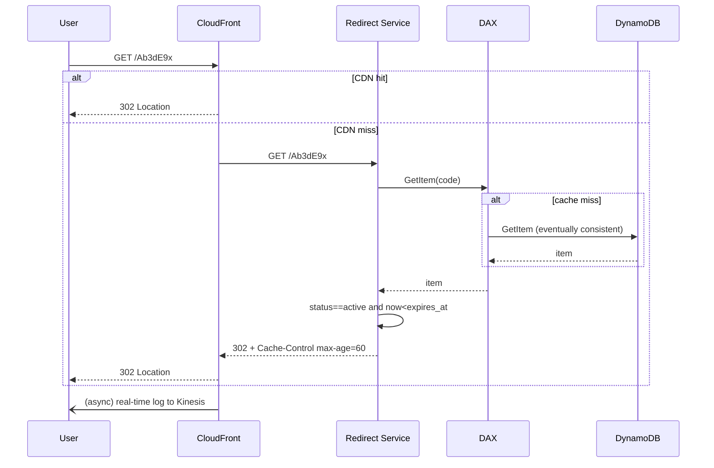
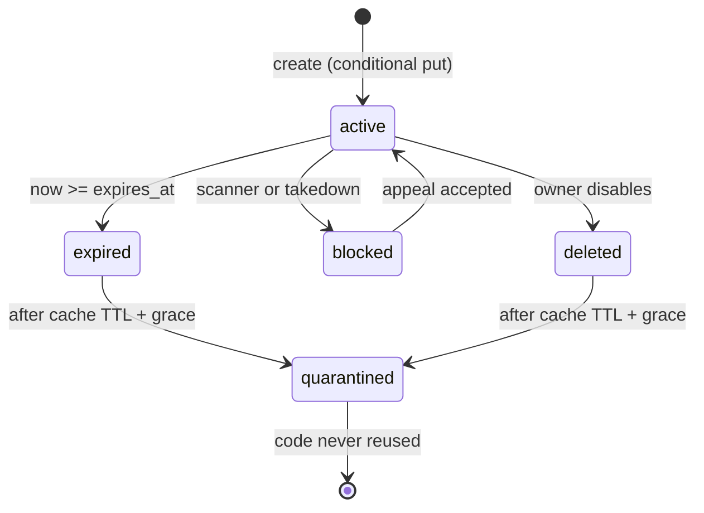

# SD01 短链接服务（URL Shortener）

## 题目与来源

> 来源：一亩三分地（1point3acres）帖 1193105，2026-10-14 发布，SDE II，2026-10-02 现场四轮，摘要为「task and course scheduling, URL shortener design, and Amazon Locker LLD」，楼主 2026-10-15 回复「都是 dry run，不用跑。System Design 连图都没画」：https://www.1point3acres.com/bbs/thread-1193105-1-1.html ；Hello Interview 社区题库 Amazon 条目 12 条（2022-09 至 2026-09，最近一条 2026-09-01 senior，美国）：https://www.hellointerview.com/community/questions?company=Amazon ；Hello Interview 题解《Bitly》：https://www.hellointerview.com/learn/system-design/problem-breakdowns/bitly

- 1p3a 1193105：题目只有名字「URL shortener design」，正文被隐藏；置信度 **高（仅题名）**。「连图都没画」说明这一轮很可能被压成了口头讨论，所以本篇的「45 分钟版」要能不用白板讲完。
- Hello Interview 2025-09-20 mid、EMEA：「Asked at Amazon. Exact same question. But I didn't had much time, since some portion of the interview was LP.」置信度 **中**。
- **（重建）**：具体追问（是否要求自定义别名、是否要求点击分析、流量数字）没有任何一条报告给出，下面的需求与数字是按 Amazon 的出法重建的，面试时以面试官当场给的为准。

## 澄清问题

面试官通常只说一句「设计一个 TinyURL」。下面六个问题每个都会改设计，开场用两分钟问完，并把答案写在白板角落。

1. **规模是多少：每月新建多少条、每月跳转多少次？** 决定要不要缓存层、要不要 CDN、数据库是不是必须分区。本篇假设每月新建 1 亿条、每月跳转 100 亿次（读写比 100:1）。如果面试官说「每天一百万次跳转」，那一台 Postgres 加一个 Redis 就够，要主动说出来并把深挖时间让给别的点。
2. **要不要自定义别名（custom alias）？** 要的话，别名与生成码共用一个命名空间，必须在写路径上做原子的「不存在才写」，并且要防止别名与以后生成的码撞车。
3. **要不要过期（expiration）和主动删除？** 要的话，需要在读路径检查过期（存储层的过期清理有延迟）、需要缓存失效手段，也要决定过期的码能不能被重新分配。
4. **要不要点击分析（analytics）？** 这是 301 还是 302、点击是否要被源站看到的分水岭。要分析且要精确，就不能让 CDN 或浏览器吃掉请求；只要近似，可以用边缘日志异步统计。
5. **读路径的一致性要求：创建后立刻点开能不能 404？** 一般答案是「创建者必须立刻能点开」，所以创建路径要读自己写的数据，而全球其他区域可以有秒级复制延迟。
6. **是否多区域、是否要求区域故障时仍能跳转？** Amazon 的面试官几乎一定会问。答案决定是 DynamoDB 全局表（Global Tables）还是单区域加跨区域备份。
7. **滥用与合规：钓鱼、恶意软件、DMCA 下架要多快生效？** 决定缓存 TTL 的上限和是否需要主动清除（invalidation）。
8. **长 URL 的上限与内容：2 KB？带不带用户信息？** 决定存储项大小、是否需要对 URL 做规范化与脱敏。

## 需求

**功能需求（按优先级）**

1. 提交长 URL，返回短 URL；同一用户在同一参数下重复提交应当幂等（返回同一条或明确新建）。
2. 访问短 URL 重定向到长 URL。这是全系统的核心承诺。
3. 可选自定义别名。
4. 可选过期时间，以及创建者主动停用。
5. 点击统计（近似、分钟级），列为可选，放在深挖之后。

**非功能需求**

| 维度 | 目标 | 说明 |
|---|---|---|
| 重定向延迟 | p99 小于 50 ms（源站内部），端到端 p99 小于 100 ms | 缓存命中为主 |
| 重定向可用性 | 99.99%（年停机约 52.6 分钟） | 产品的唯一承诺，宁可返回旧映射也不要返回 5xx |
| 创建可用性 | 99.9% | 失败可由客户端用同一个幂等键重试 |
| 创建后可读 | 创建者读自己的写（read-your-write）；其他区域最终一致，复制延迟目标小于 1 秒 | 区别对待两类读者 |
| 持久性 | 映射一旦确认就不能丢，11 个 9 级别，靠托管存储多副本 | 丢一条映射等于一个已经发出去的链接永远失效 |
| 唯一性 | 一个短码永远只对应一个长 URL | 违反即是事故 |

**明确不做**：用户账户体系与团队空间、链接内容的同步安全扫描（只做创建时异步入队）、A/B 链接变体、批量导入。

## 容量估算

先声明：以下是假设，用来推出设计，不是 Bitly 的真实流量。

- 新建：1 亿条/月 ÷（30×86400 秒）= **38.6/s 平均**，按 10 倍峰值取 **约 386/s**。
- 跳转：100 亿次/月 ÷（30×86400）= **3,858/s 平均**，按 10 倍峰值取 **约 38,580/s**。日均 3.33 亿次。
- 读写比：100 亿 ÷ 1 亿 = **100:1**。
- 存储：保留 5 年：1 亿 × 12 × 5 = **60 亿条**；每条按 500 B（长 URL 平均约 200 B，加上码、时间戳、状态、所有者、版本）= **3.0 TB**，三副本约 9 TB。结论：一张表放得下，但单机不行，必须分区的存储。
- 码长：62^6 = 568 亿，62^7 = 3.52 万亿。60 亿条放进 6 位空间的占用率是 10.6%，对于哈希截断方案意味着每次插入的碰撞概率约 10.6%，不可接受；放进 7 位空间则是 0.17%。**7 位**足够，且以每月 1 亿条的速度，7 位空间要 2,934 年才用完。
- 带宽：一次重定向响应约 500 B（头加位置）×38,580/s = **19.3 MB/s，约 154 Mbps**。这个数字很小，所以带宽不是约束，请求数才是（CDN 与负载均衡按请求计费）。
- 缓存：把最热的 2,000 万条放内存，每条 300 B，需要 **6 GB**，一个小规格的 ElastiCache 或 DAX 节点组就够。
- 缓存命中率 95% 时，到达数据库的读是 38,580 × 5% = **约 1,929/s**；即使缓存全部失效，数据库也要扛 38,580/s，这个数字决定了「缓存全冷」是一个需要设计的故障场景，而不是理论上的。
- 计数器批量：每个写节点一次领 1,000 个编号，峰值 386 写/s 对应每秒只需 **0.39 次**取号请求，取号服务几乎没有负载。

**驱动设计的那个数字**：38,580/s 的峰值读，加上读写 100:1。写路径几乎不需要设计规模，真正的难点是（a）永不碰撞的编号，（b）把绝大多数读挡在数据库之外，（c）一个爆款链接的单键热点。

## 核心实体与 API

**实体**

| 实体 | 键 | 主要属性 |
|---|---|---|
| Link | 分区键 `code`（7 位 base62，或自定义别名） | `long_url`、`owner_id`、`created_at`、`expires_at`、`status`（active / blocked / expired / deleted）、`version`、`idempotency_key` |
| Owner | `owner_id` | 配额、API key 哈希 |
| ClickAgg | `code` + `minute_bucket` | `count`，来自异步管道，不在重定向热路径里写 |
| CounterRange | 区域 + 分片号 | `next_start`，只由取号服务写 |

Link 表的全局二级索引（GSI）：分区键 `owner_id`、排序键 `created_at`，用于「列出我的链接」。存储层的 TTL 只在过期后异步删除（AWS 文档：通常在过期后几天内才删），因此读路径必须自己比较 `expires_at`。

**API**

```
POST /v1/links
Headers: Idempotency-Key: <uuid>      # 重试安全
Body: { "long_url": "...", "custom_alias": "optional", "expires_at": "optional ISO-8601" }
201 -> { "short_url": "https://sho.rt/Ab3dE9x", "code": "Ab3dE9x", "expires_at": null }
409 -> 别名已被占用
422 -> URL 不合法或命中黑名单

GET /{code}
302 Found, Location: <long_url>, Cache-Control: public, max-age=60
404 -> 不存在；410 -> 已过期或已停用；451 -> 因法律原因下架

DELETE /v1/links/{code}            # 停用，状态置为 deleted，不真正删行
GET /v1/links/{code}/stats?from=&to=
```

幂等键的做法：`POST` 在 DynamoDB 里用一次 `TransactWriteItems`，同时写 Link 行和一行 `idem#<owner>#<key>`（带 24 小时 TTL）并指向这个 `code`；重复请求读到幂等行直接返回原结果。

## 高层架构



**创建流**：客户端经 WAF 与限流到写服务；写服务校验 URL（协议白名单、长度、黑名单），向取号服务要一个编号，经过可逆置换（见深挖一）编成 7 位码，用 `attribute_not_exists(code)` 的条件写入 Link；自定义别名走同一条条件写入，只是码来自用户。写成功后把「扫描任务」放入 SQS，扫描器异步判定恶意，命中则把 `status` 置为 blocked 并触发 CDN 清除。

**跳转流**：浏览器请求打到 CloudFront，命中就直接返回 302；未命中到重定向服务，先查进程内小缓存，再查 DAX，最后才查 DynamoDB（最终一致读，半价）。查到的映射带着剩余过期时间回写缓存；找不到则写一条短 TTL 的负缓存（negative cache）防止扫描攻击打穿。分析数据不在这条路径上写任何东西，而是来自 CDN 的实时日志。



## 深挖

### 一、编号方案：计数器加可逆置换 vs 哈希截断 vs 纯随机

问题：60 亿条、7 位、全局唯一、多区域多节点同时写，还不能让对手枚举出别人的链接。

选项与成本：

- **哈希长 URL 再截断到 7 位**：无状态、同一 URL 得到同一码（天然去重）。但 7 位 base62 只有约 41.7 比特，60 亿条时每次插入的碰撞概率是 6e9 ÷ 3.52e12 = 0.17%，意味着每 590 次写就有一次要重试；重试要换盐重算，且「同一 URL 同一码」的好处在加盐后消失。更糟的是它把两个用户提交同一个 URL 绑成了同一条记录，一个人删除或设置过期会影响另一个人。
- **纯随机 7 位**：和哈希截断一样的碰撞率，条件写失败就重抽，代价是写入放大 0.17%，实现最简单；缺点是没有「分区号」之类的结构可利用。
- **计数器加 base62**：不碰撞，但连续编号可被枚举（猜出相邻链接），并且需要一个全局计数器。

**选择**：区域前缀加按段租约的计数器，再做可逆置换。码的第一位是区域（62 个区域足够），后六位是该区域计数器（范围 0 到 62^6−1，即每个区域 568 亿个编号，按每月 1 亿条要用 568 年）。每个写节点向取号服务租一段（例如 1,000 个）编号；取号服务对 DynamoDB 里本区域的计数器项做一次原子的 `UpdateItem ADD 1000`，返回起点。峰值每秒只有 0.39 次取号。编号在编成字符前过一个以密钥为参数的置换（对 62^6 取模的乘法加异或，或四轮 Feistel 网络），保证相邻编号看起来无关，并且是双射，因而不引入碰撞。

与 Hello Interview 的差异（对照 Hello Interview《Bitly》）：它用中心化的 Redis 计数器，批量领号，并建议各区域用不相交的号段；我们沿用「批量领号、不相交号段」这个要点，但把计数器放在 DynamoDB 而不是 Redis，因为 Redis 复制是异步的，主节点宕机时可能回退计数而重复发号，而 DynamoDB 的原子更新在多可用区同步复制；同时补上它没有展开的「可逆置换防枚举」。

故障模式：（a）写节点崩溃，租到的号段没用完，丢掉即可，不需要连续（空洞无害，62^6 很宽裕）；（b）取号服务不可用，写节点用完本地号段后创建失败，所以号段要大到够撑 5 分钟（386/s × 300 s ≈ 11.6 万，除以节点数），并且把 DynamoDB 条件写入作为最后一道唯一性保证；（c）置换密钥泄露，攻击者可以枚举，因此密钥放在 KMS 或 Secrets Manager，并支持轮换版本（版本号编进状态，不改变已发出的码）。

### 二、自定义别名：并发创建与多区域冲突

别名是用户选的字符串，和生成码共用 `code` 这一个键。两件事会出错。

第一，**别名与未来生成码撞车**。解法是划出两个互不相交的空间：生成码恒为 7 位且只含 base62 字符，别名要求长度不少于 8 位或必须含连字符，创建时校验。这样不需要为每次生成再去查别名表。

第二，**两个区域同时创建同一个别名**。DynamoDB 全局表默认是多区域最终一致（MREC），冲突按「最后写入者胜」（last writer wins）解决，两个区域各自的条件写入都会成功，复制过来后一方的写入被另一方覆盖，两个用户都收到了 201，但只有一个人的链接是活的——这是静默的数据丢失。选项：

| 方案 | 做法 | 代价 |
|---|---|---|
| 单写者路由 | 别名按 `hash(alias) mod 区域数` 路由到固定的归属区域写入 | 跨区域写延迟增加 50 到 150 ms，该区域故障时别名创建不可用（读不受影响） |
| 多区域强一致全局表（MRSC） | 写入同步到多数区域 | 写延迟是跨区域往返，需要至少三个区域，且区域数受限 |
| 事后冲突检测 | 复制后比对，后到者改名通知用户 | 用户体验差，不适合 |

**选择**：别名创建走单写者路由（别名是低频操作，可接受多花一次跨区域往返），生成码因区域前缀不相交无需协调。故障模式是归属区域宕机：此时返回 503 并让客户端稍后重试，而不是退化成冲突风险；已存在的别名读取不受影响。

### 三、读路径：缓存分层与爆款链接的单键热点

问题：38,580/s 的峰值读里，真正危险的是一个链接占了绝大多数流量，例如被推送给几千万用户的链接，瞬时可达每秒几十万次。DynamoDB 单个分区的吞吐有上限（量级为每秒数千次读），一个热键能把一个分区打满，而加分区并不会让同一个键变快。

分层：

1. **CDN（CloudFront）**：302 带 `Cache-Control: public, max-age=60`。热门链接在每个边缘位置每分钟最多回源一次，把该链接的回源压到每分钟「边缘数」量级。
2. **进程内 LRU**：重定向服务实例内存里缓存最热的几千条，TTL 几秒，吃掉 CDN 回源的突发。
3. **DAX / ElastiCache**：6 GB 的共享热集；DAX 对相同键的并发未命中合并成一次回源（请求合并），防止缓存击穿。
4. **DynamoDB**：最终一致读。

**301 与 302**（对照 Hello Interview《Bitly》，它倾向 302 以保留对重定向的控制与统计）：我们同意用 302，但补充一个它没强调的点——302 并不意味着不能缓存；带 `max-age` 的 302 照样被 CDN 缓存，所以真正的旋钮是 `max-age`。设成 60 秒，意味着下架（takedown）或改址最多延迟 60 秒生效，且紧急下架可以调用 CloudFront 的清除接口。301 的问题是浏览器缓存不可控，一旦发出去，用户手里就留了一份你再也收不回来的映射，这与「过期」「下架」「改址」三个需求都矛盾。

故障模式：（a）缓存全冷（例如发布失误清空了 DAX），38,580/s 全部落到数据库，需要预热脚本和按键限速的回源保护；（b）负缓存被投毒（攻击者批量请求不存在的码）：负缓存 TTL 要短（例如 30 秒），WAF 上对单 IP 的 404 速率限流；（c）刚创建的码在负缓存里被缓存为 404，创建成功后要主动写入缓存，覆盖负缓存项。



### 四、过期、下架与码的复用

过期不是「删行」：DynamoDB 的 TTL 删除是后台异步的，延迟可达数十小时，所以读路径必须比较 `expires_at`，TTL 只负责回收空间。更重要的是**不复用已过期的码**：复用意味着旧链接被分享出去的地方（邮件、PDF、二维码）会突然跳到别人的页面，这是安全问题而不只是体验问题。我们的计数器永不回绕（568 年），所以根本没有复用的必要；自定义别名则做 90 天的隔离期。

选项是「物理删除」「墓碑加状态」「软删除保留」。我们选墓碑加状态：行保留，`status` 置为 deleted 或 expired，长 URL 字段清空（满足删除要求），这样 410 能区别于 404，让用户知道链接曾经存在。

### 五、点击分析：别让一次创建背上一百次写

问题：每次跳转都写一行计数，写入就从 386/s 涨到 38,580/s，并且 CDN 命中的请求根本到不了源站，源站日志是不完整的。

选项：（a）重定向服务同步写计数，延迟和可用性都被拖累，否决；（b）重定向服务异步发 Kinesis 事件，CDN 命中的请求仍然看不到；（c）**用 CloudFront 实时日志**，所有请求（含边缘命中）都在日志里，按 `code` 作分区键进入 Kinesis Data Streams，聚合器每分钟汇总写入 `click_agg`，原始日志经 Firehose 落 S3 的 Parquet，供 Athena 离线分析。

热键问题再次出现：爆款链接的分区键 `code` 会让 Kinesis 的一个分片过热，所以聚合在 Lambda 内先做本地预聚合，写入时 `code` 加上随机后缀（`code#0..15`）分散，读取时合并 16 个子计数。故障模式：聚合器落后只影响统计新鲜度，不影响跳转；因此统计管道的告警等级低于重定向路径。

## Staff 视角：权衡、故障与演进

**十倍流量时第一个坏的是什么**：不是数据库，而是（a）CDN 与负载均衡的请求计费，每月 100 亿请求变成 1,000 亿后成本线性上升，成本才是十倍时的第一个约束，应当在高命中率的前提下把 `max-age` 提高到几分钟，换取下架延迟变长，这是一个需要和产品方谈的权衡；（b）单个热键，这个靠 CDN 和请求合并解决，不靠加分区；（c）Kinesis 分片数，按 `code` 分区会被爆款链接压垮，所以要有前面说的子键分散。

**各组件故障的爆炸半径**

| 组件 | 故障时的影响 | 缓解 |
|---|---|---|
| CloudFront | 大面积边缘故障时流量直达源站 | 源站按「CDN 全失效」做过压测，DNS 层有直连 ALB 的备用记录 |
| 重定向服务 | 缓存命中的跳转不受影响，未命中的失败 | 多可用区、自动扩缩，跨区域主动—主动 |
| DAX / 缓存 | 读压力回落到 DynamoDB | 预热、按键限速回源 |
| DynamoDB 单区域 | 区域内读写失败 | 全局表，另一区域继续服务 |
| 取号服务 | 新建在本地号段用尽后失败，跳转无影响 | 大号段加条件写兜底 |
| 扫描器 | 恶意链接多存活一段时间 | 队列积压告警，创建时同步查已知黑名单做第一道 |
| 统计管道 | 统计变旧，跳转无影响 | 独立告警、降级为只写 S3 |

**多区域**：重定向走主动—主动，全球延迟路由（latency-based routing）到最近区域，读本地的全局表副本。复制延迟小于 1 秒的假设意味着刚创建的链接在远端区域可能 404 一秒：对创建者我们在创建响应里直接带上完整 URL，且重定向服务遇到本地 404 时对「创建不久的码」回源到归属区域做一次读（读后修复），把这个窗口对用户隐藏。区域整体故障时，路由层把流量切到其他区域，因为数据是全量复制，没有数据迁移步骤；唯一降级是别名创建暂不可用。

**成本驱动**：（1）CDN 与 ALB 请求量（与跳转次数成正比）；（2）DynamoDB 写（386/s，量很小）与读（缓存后约 1,929/s）；（3）Kinesis 与 Firehose 的数据摄入（与跳转次数成正比，是分析功能的真实成本，所以分析要做成可开关的、按 owner 计费的功能）；（4）全局表的复制写，每条写在每个副本区域再算一次。存储本身（3 TB）几乎不是成本。

**发布与迁移**：重定向服务用金丝雀（one-box）发布，监控 5xx 与 p99 后分批放量；置换密钥和别名规则的变更带版本号。从旧系统迁移时，旧码空间保持只读映射，新码走新空间，网关按码长和前缀分流，不做大规模数据重写。

**可观测性**：指标——重定向 p50/p99/p99.9、缓存命中率（CDN、DAX 分开）、404 比例（突增意味着扫描或负缓存问题）、取号延迟、条件写冲突率（预期趋近 0，非零就是编号方案有 bug）、复制延迟、扫描队列深度。告警——重定向可用性低于 99.99% 的燃烧率告警、404 比例突增、复制延迟超过 5 秒、缓存命中率骤降。运行手册至少三份：缓存全冷、热键、紧急下架（清除 CDN 加置 blocked）。

## 面试官追问

1. **如果面试官要求 100% 不碰撞、且没有中心计数器呢？** 用区域前缀加每节点预取号段，这没有跨节点协调；或者用雪花式 ID（时间加机器号加序号）取 64 位再编成 11 位 base62，代价是码变长。我们的方案用 7 位，是因为计数器的集中点只在取号服务，负载是每秒不到一次。
2. **同一个长 URL 提交两次，该返回同一个码吗？** 看产品。去重意味着要有 `hash(long_url)` 的二级索引，且删除与过期语义会耦合。默认不全局去重，只对「同一 owner 同一幂等键」去重；如果要去重，在 owner 范围内做，不跨用户。
3. **怎么防止短链被用来传播钓鱼？** 创建时同步查本地黑名单和已知恶意域名，异步入队做深度扫描；命中则置 blocked 并清除 CDN；对跳转到被拦截目标的请求展示警告页（interstitial）而不是直接 302。对新账号和高频创建者提高审查等级。
4. **CDN 缓存了 60 秒，用户改址了怎么办？** 改址是创建者主动操作，更新行并调用 CDN 清除接口，其余边缘最多 60 秒内收敛。如果业务要求改址立即生效，则把 `max-age` 降到 0 并接受回源增加，或者对该码走带版本的路径。
5. **DynamoDB 的单分区热点怎么处理？** 先问是读热点还是写热点。读热点：CDN、进程内缓存、DAX 的请求合并，比加分区有效，因为同一个键只落在一个分区。写热点（点击计数）：给键加随机后缀分散，读时合并。
6. **要精确的点击数怎么办？** 精确意味着不能让 CDN 吞掉请求，也就是 302 不缓存或用边缘函数（Lambda@Edge / CloudFront Functions）在每次请求时打点，代价是延迟和成本都显著上升；我们会先问「精确」的业务含义，通常「去重后的独立访客」比「原始点击」更有价值，而后者本来就是近似的。
7. **全局表的冲突解决为什么不是问题？** 生成码因区域前缀不相交永不冲突；别名走单写者路由；更新同一条记录（改址）的冲突概率极低，可接受最后写入者胜，但要在行上带 `version` 并用条件更新防止同区域内的丢失更新。
8. **数据库选 SQL 行不行？** 行。60 亿条、500 B 的量，分片后的 Aurora 也能做，只是要自己管分片和跨区域复制；DynamoDB 的优势是单键读写的延迟可预期、全局表和 TTL 是托管的。选哪个取决于团队，关键是说清分区键是 `code`，所有访问都是单键点查。

## 与 Hello Interview 及本库的对照

Hello Interview 的《Bitly》（Evan King，2026-02 更新，难度标「easy」，面向偏初级的读者）的骨架是：需求（创建、可选别名、可选过期、跳转）→ 非功能（唯一性、延迟小于 100 ms、99.99% 可用、10 亿条与 1 亿日活）→ 实体与 API → 单体到拆分的高层设计 → 深挖「短码如何生成并保证唯一」「如何扩展读」。它在编号上比较了长 URL 前缀、哈希截断、计数器加 base62 三种，最终推荐 Redis 计数器批量领号；在读扩展上依次给出索引、内存缓存、CDN 与边缘。

- **一致之处**：骨架、读写 100:1 的判断、302 优先、批量领号加不相交号段、缓存与 CDN 分层。
- **不同之处**：（1）计数器放 DynamoDB 而不是 Redis，理由是异步复制下回退计数的风险，Amazon 面试官更爱听托管服务的保证；（2）补上它没展开的可逆置换防枚举；（3）补上多区域下别名的静默冲突，这是它的单区域叙述里碰不到的问题；（4）把分析放回 CDN 实时日志而不是源站，因为 CDN 命中的请求源站看不到；（5）把下架延迟明确写成 `max-age` 的函数。它的页面把 staff 期待写在评语里（要求看穿教科书方案并讨论真实的生产问题），本篇的「Staff 视角」一节就是在回答那一条。
- **本库通用题解**：[[solution-url-shortener]] 覆盖了短码生成三选一、NoSQL 分区键、读路径缓存与热键、分析管道、301/302 与别名并发；这里不重复，只写 Amazon 的追问方式与 AWS 组件的落点。限流细节见 [[solution-rate-limiter]]。题单总览见 [[sd-index]]。

## 60 分钟怎么分配

| 分钟 | 做什么 | 时间不够时 |
|---|---|---|
| 0–5 | 澄清（规模、别名、过期、分析、多区域），写下非功能数字 | 只问规模和别名两项，其余自己声明假设 |
| 5–10 | 估算：38.6 写/s、3,858 读/s（峰值 38,580）、60 亿条、3 TB、7 位码，说出「读写 100:1 驱动缓存」 | 只讲 QPS 与码长两个数字 |
| 10–15 | 实体与 API（幂等键、302、状态码） | 口述，不写字段 |
| 15–25 | 画高层图：CDN、重定向服务、DAX、DynamoDB；写路径与取号服务；走一遍两条流 | 这一步不能省，是图的最低要求 |
| 25–40 | 深挖：编号方案（必讲）、读路径热点（必讲），再按面试官兴趣选别名冲突或分析 | 只做编号与热点两个 |
| 40–50 | 故障与多区域：爆炸半径表、复制延迟、成本驱动 | 只讲「CDN 失效、缓存全冷、区域故障」三个 |
| 50–60 | 追问与总结，主动说出最弱的一环（别名跨区域） | 一句话收束 |

**45 分钟版（先花 10–15 分钟答 LP 的情形）**：5 分钟澄清加估算合并；10 分钟画图与走流程；15 分钟只深挖两点（编号、热点）；5 分钟故障与多区域；剩余当追问缓冲。如果像 1p3a 那位楼主一样「连图都没画」，则全程口述：用三句话讲清「CDN → 缓存 → DynamoDB 单键点查，写路径用租约计数器加置换」，然后直接进入深挖，用数字（38,580/s、95% 命中后 1,929/s、0.17% 碰撞）代替图来证明你有结构。

## 自测

1. 60 亿条映射为什么选 7 位而不是 6 位？
2. 为什么把计数器放在 DynamoDB 里，而不用 Redis？
3. 302 带 `max-age=60` 的含义是什么？下架最坏多久生效？
4. 两个区域同时创建同一个别名会发生什么？怎么避免？
5. 为什么点击统计不能在重定向服务里同步写？

<details>
<summary>答案</summary>

1. 6 位空间是 62^6 = 568 亿，60 亿条的占用率约 10.6%，哈希截断或随机方案下每次插入有约 10% 的碰撞概率；7 位是 3.52 万亿，占用 0.17%。对计数器方案，6 位也够用，但没有余量给区域前缀，所以取 7 位。
2. Redis 主从复制是异步的，主节点故障转移后可能丢掉最近的自增，导致重复发号；DynamoDB 的原子更新在多可用区同步复制，不会回退。无论哪种，最终都要靠 Link 表上的条件写入兜底唯一性。
3. 浏览器和 CDN 可以把这条 302 缓存 60 秒，期间不回源。下架或改址最坏延迟 60 秒，紧急情况调用 CDN 清除接口缩短。
4. 默认全局表是最后写入者胜，两个区域都成功，复制后一方被覆盖，两个用户都得到 201 却只有一个有效。避免：别名按哈希路由到固定归属区域单点写，或使用多区域强一致模式。
5. 同步写会把写入从 386/s 放大到 38,580/s，拖慢延迟与可用性，而且 CDN 命中的请求根本到不了源站。正确做法是用 CDN 实时日志进入 Kinesis 异步聚合。

</details>
