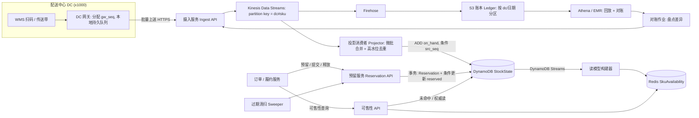
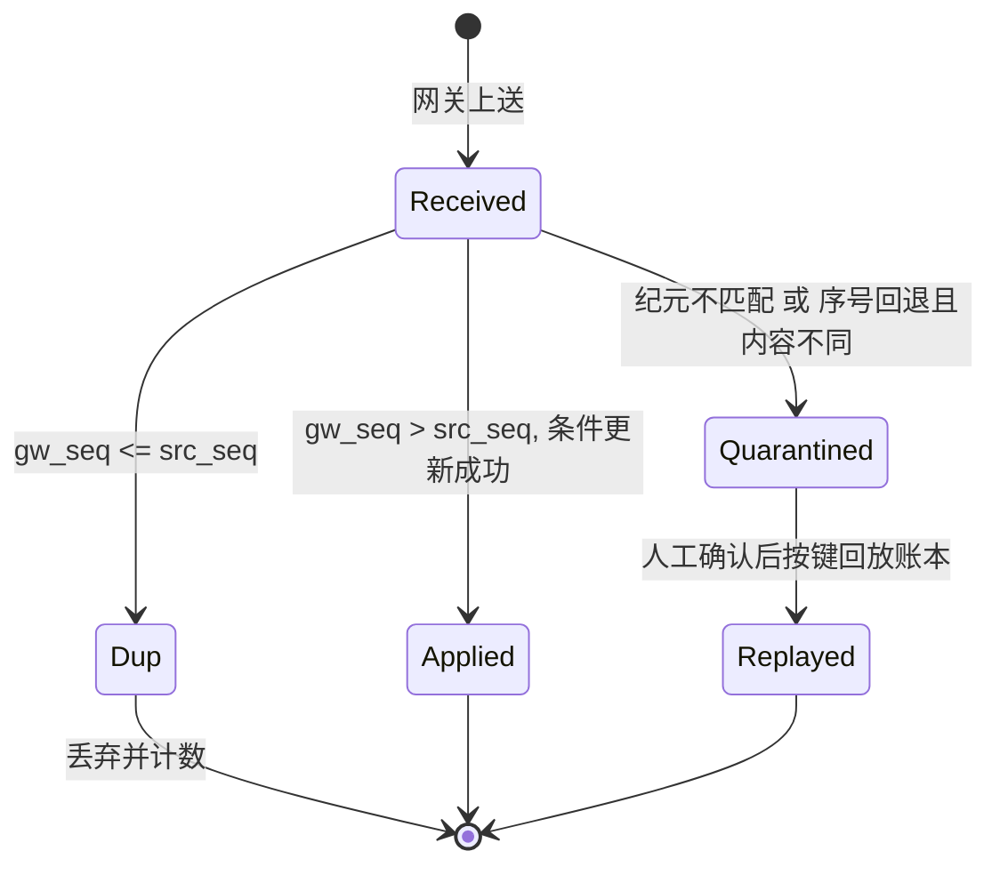

# SD03 配送中心库存状态服务（Distribution Center Stock State）

## 题目与来源

> 来源：一亩三分地（1point3acres）面经题库条目 `distribution-center-stock-state-service`，onsite system design，2026-09-18 报告，1 个来源，正文被锁；题库标签为 distributed-systems、data-modeling、ingestion、sharding、idempotency。相关旧报告：Hello Interview 社区 `warehouse-inventory-architecture`（2025-03）、1p3a 题库 `perishable-goods-tracking-system`（电面，2026-06-24）、`fulfillment-center-inventory-transfer`（onsite 编程，2026-07-22）。对照页面：https://www.hellointerview.com/learn/system-design/problem-breakdowns/gopuff 、https://www.hellointerview.com/learn/system-design/problem-breakdowns/flash-sale 、https://www.hellointerview.com/learn/system-design/deep-dives/change-data-capture 、https://www.hellointerview.com/community/questions?company=Amazon 。

- 报告原文（题库行名，2026-09-18，级别未公开，置信度：题名与标签为中，其余为低）：「distribution center stock state service」。
- **（重建）**：题干正文看不到。下面的题面由标签推出：「很多配送中心（DC）持续产生库存事件，要有一个服务接收这些事件，并能回答『某个 SKU 在某个 DC 现在有多少、能卖多少、哪里能发货』」。事件类型（收货、上架、拣货、调拨、盘点调整）、规模数字、一致性要求都是我们自己设定的，面试时第一件事就是和面试官确认。

这类题的真正考点不是「建一张 inventory 表」，而是三件事：(1) 事件进来是至少一次（at-least-once）、可能乱序、可能重复，怎样让状态仍然正确；(2) 物理库存（on-hand）和可承诺库存（available-to-promise，ATP）是两种性质完全不同的数；(3) 状态必须能被重建、能被对账。对 Chi 来说这几乎就是支付账务：事件即分录，库存状态即余额，预留即授权冻结（authorization hold），盘点即对账（reconciliation）。开场时说出这个类比，既展示框架，也让面试官知道你会用已有经验迁移。

## 澄清问题

1. **规模：多少个 DC、每个 DC 多少 SKU、事件率多少？** 决定分片键和是否需要分层存储。假设 1,000 个 DC、平均每个 DC 持有 30 万个 SKU、每个 DC 平均 60 事件/秒、峰值按 4 倍算。如果只有 50 个 DC，单个 Aurora 就够，整套事件流水线都是过度设计。
2. **「当前状态」要多新？** 对网站展示的「有货/无货」可以容忍几秒；对下单预留必须是权威读。这个答案决定读模型（read model）和权威状态是否分开。
3. **事件由谁产生、是否带顺序信息？** WMS（仓库管理系统）扫码枪、传送带、收货口是否经过 DC 本地网关，网关能否给每个事件打一个单调递增的序号。能，则去重可以几乎免费；不能，就要回到事件 ID 去重。
4. **盘点（cycle count）是怎么进来的？** 是「绝对值断言」（这个库位现在数出来是 40），不是增量。它和增量事件混在一起时怎么定「当时」的余额，是整道题最容易被忽略的点。
5. **预留（reservation）归谁管？** 订单服务在本系统里预留，还是由本系统只给出数字、订单服务自己管？这决定本系统是纯投影（projection）还是也有写入的权威。我们假设本系统同时拥有 on-hand 的投影和 reserved 的权威。
6. **库存可以为负吗？** 现实里拣货扫码可能先于收货扫码，on-hand 短暂为负是事实，不是 bug。如果面试官要求「不许为负」，就要说明那会让物理事实被系统拒绝，只能挂起事件而不是丢弃。
7. **跨区域：DC 分布在哪些区域，查询是否跨区域？** 决定读模型是否用全局表（global tables），以及单 DC 的权威状态是否固定归属一个区域。
8. **保质期、批次、状态（良品/冻结/破损）要不要建模？** 易腐品（perishable）把「一个 SKU 一个数」变成「一个 SKU 多个批次」，状态键要加批次维度。先问清楚，默认不做，但说明键怎么扩。

## 需求

**功能（按优先级）**

1. **接收库存事件**：来自各 DC 的收货、上架、拣货、调拨出/入、报废、盘点调整，幂等、可乱序重复。
2. **查询状态**：按 (DC, SKU) 取 on-hand、reserved、in-transit、ATP；按 SKU 取各 DC 的可售量。
3. **预留与释放**：订单为某 DC 的某 SKU 预留数量，带幂等键和有效期；成交后转为扣减，超时自动释放。
4. **对账**：用盘点结果和事件账本比对，产生可审计的调整记录。
5. **回放与重建**：任何一个 (DC, SKU) 的状态可从账本重算。

**非功能（带数字）**

| 维度 | 目标 |
|---|---|
| 事件摄入端到端延迟 | p99 < 5 秒（事件发出到状态可读） |
| 权威读（单 DC、单 SKU） | p99 < 20 毫秒 |
| 可售性读（按 SKU 看多个 DC） | p99 < 50 毫秒，数据新鲜度 < 10 秒 |
| 预留写 | p99 < 50 毫秒，强一致、不超卖 |
| 可用性 | 读 99.99%，摄入 99.9%（DC 本地缓冲，摄入短暂不可用不丢数据） |
| 耐久性 | 事件账本不丢（11 个 9，S3 级别）；状态可由账本重建 |
| 一致性 | 单 (DC, SKU) 内强一致；跨 DC 的汇总最终一致 |

**明确不做**：订单与支付流程、DC 内部库位级（bin-level）拣货路径优化、需求预测与补货、承运商与路由、商品目录。库位级数据只讲键怎么扩展。

## 容量估算

先定假设，再由公式出结果。假设：1,000 个 DC；每个 DC 平均持有 300,000 个 SKU；每个 DC 平均 60 事件/秒，峰值是平均的 4 倍；每个事件 250 字节（含事件 ID、DC、SKU、类型、数量、序号、时间戳、来源）；每个状态行 200 字节。

| 量 | 公式 | 结果 |
|---|---|---|
| 平均事件率 | 1,000 × 60 | 60,000 事件/秒 |
| 峰值事件率 | 60,000 × 4 | 240,000 事件/秒 |
| 每日事件数 | 60,000 × 86,400 | 5.184 × 10⁹ |
| 摄入带宽（平均 / 峰值） | 60,000 × 250 B；240,000 × 250 B | 15 MB/s；60 MB/s |
| 每日原始账本 | 5.184 × 10⁹ × 250 B | 约 1.30 TB/天 |
| 每年账本（原始 / 5 倍压缩） | 1.296 TB × 365；再除以 5 | 约 473 TB；约 95 TB |
| 状态行数 | 1,000 × 300,000 | 3 × 10⁸ 行 |
| 状态总量 | 3 × 10⁸ × 200 B | 60 GB |
| Kinesis 分片（按记录数，每片 1,000 条/秒写入） | 240,000 / 1,000 | 240 个分片 |
| 每个 (DC, SKU) 键每日平均事件 | 5.184 × 10⁹ / 3 × 10⁸ | 约 17 条 |

**驱动设计的那个数**有三个，要分开说：

1. **状态只有 60 GB，账本一年上百 TB。** 状态小到可以全量放在内存级存储里，难点完全在写入速率（峰值 24 万事件/秒）和重放能力，不在容量。所以账本放 S3（便宜、可重放），状态放 DynamoDB，两者职责分开。
2. **把账本放进 DynamoDB 事务来换取去重，代价高得离谱。** 每个事件一次事务写（账本行加状态行，事务按双倍计费）峰值是 24 万 × 2 = 48 万写请求单位/秒；按按需价格每百万次写 1.25 美元估算，每天 5.184 × 10⁹ × 2 × 1.25 / 10⁶ ≈ 12,960 美元。这就是「每个事件一次事务」方案被淘汰的数字依据。
3. **合并写（coalescing）。** 一个 (DC, SKU) 键平均每天只有约 17 个事件，但热门 SKU 在一秒内可能有十几个。消费者按 200 毫秒微批合并同键增量，假设平均合并比 5:1，则峰值状态写入降到 240,000 / 5 = 48,000 次/秒（平均 12,000 次/秒）。按 DynamoDB 预置容量每写容量单位每小时 0.00065 美元估算，峰值预置约 48,000 × 0.00065 = 31.2 美元/小时，约 749 美元/天，比事务方案低一个数量级以上（价格是假设，面试时说「量级」即可）。

读侧：假设峰值 100,000 次/秒的可售性查询，缓存命中率 95%，则落到 DynamoDB 的是 5,000 次/秒，每次批量读最多 20 个候选 DC 的键，最终一致读每项 0.5 读容量单位，约 50,000 读容量单位/秒。

热点：某个 SKU 的事件跨 1,000 个 DC 平均摊开，单 SKU 占总量 0.1% 时全局约 240 事件/秒；落在单个 DC 内最热的 SKU 若占该 DC 峰值事件的 5%，则为 240 × 5% = 12 事件/秒。也就是说 (DC, SKU) 键本身不热，真正会热的是「按 SKU 聚合」的读模型（一个 SKU 的所有 DC 汇到一个条目）和秒杀式预留（见深挖三）。

## 核心实体与 API

**实体与键**

| 实体 | 键 | 主要字段 |
|---|---|---|
| `StockEvent`（账本，S3 为准） | `dc_id#sku_id`、`gw_seq`（DC 网关序号） | `event_id`、`type`（RECEIVE / PUTAWAY / PICK / TRANSFER_OUT / TRANSFER_IN / SCRAP / COUNT）、`qty`、`event_time`、`source`、`ref`（转运单、盘点单） |
| `StockState`（DynamoDB，权威投影） | PK=`dc_id#sku_id` | `on_hand`、`reserved`、`in_transit`、`safety`、`src_seq`（已应用的最高网关序号）、`version`、`updated_at` |
| `Reservation` | PK=`reservation_id`（调用方生成的幂等键） | `dc_id`、`sku_id`、`qty`、`status`（HELD / COMMITTED / RELEASED / EXPIRED）、`expires_at` |
| `SkuAvailability`（读模型，Redis / DAX） | PK=`sku_id#region_bucket` | `{dc_id: atp_bucket}`、`as_of_seq` |
| `CountAdjustment` | PK=`dc_id#sku_id`，SK=`count_id` | `counted`、`ledger_balance`、`variance`、`reason`、`reviewed_by` |

ATP 的定义：`atp = on_hand - reserved - safety`，下限取 0。`in_transit` 不计入 ATP，等 TRANSFER_IN 到货再转入 on_hand。

**API**

```
POST /v1/dcs/{dc}/events:batch          # DC 网关上送，最多 500 条
  body: { gateway_id, events: [{event_id, gw_seq, sku, type, qty, event_time, ref}] }
  resp: { accepted_through_seq }        # 水位线，网关据此清理本地待发队列

GET  /v1/dcs/{dc}/skus/{sku}/state      # 权威读，强一致
  resp: { on_hand, reserved, in_transit, atp, as_of_seq }

GET  /v1/skus/{sku}/availability?near={zone}&qty={n}   # 读模型，可能稍旧
  resp: { candidates: [{dc, atp_bucket, est_ship_hours}], as_of }

POST /v1/reservations                    # Idempotency-Key: <reservation_id>
  body: { dc, sku, qty, ttl_seconds }
  resp: 201 { reservation_id, status: HELD, expires_at } | 409 { reason: INSUFFICIENT } | 200 (重复请求原样返回)

POST /v1/reservations/{id}:commit        # 订单支付成功，HELD → COMMITTED，同时 on_hand 随后由 PICK 事件扣减
POST /v1/reservations/{id}:release       # 显式释放
POST /v1/dcs/{dc}/counts                 # 盘点结果，作为 COUNT 事件进入同一条有序流
```

写操作的幂等：事件靠 `(dc, gw_seq)`，预留靠 `reservation_id`。重试时服务端返回第一次的结果，不重复生效。事件上送返回的是「已接收的水位线」，而不是逐条确认，网关可以批量重发而不担心重复。

## 高层架构



**流程一：事件摄入。** DC 内的 WMS 动作先写进网关的本地持久队列，网关给每个事件分配一个 DC 内单调递增的 `gw_seq`，按批上送。摄入服务做校验、鉴权后写 Kinesis，分区键用 `dc#sku`，于是同一个 (DC, SKU) 的事件落在同一分片内、保持上送顺序。Firehose 把同一条流落到 S3 作为账本，投影消费者另行读流，把同键的增量在 200 毫秒窗口内合并，再用一次条件更新写进 DynamoDB。账本和状态来自同一条流，所以状态永远可以从账本重算。

**流程二：下单预留与可售性查询。** 订单服务先用区域加 SKU 查读模型，得到候选 DC 和大致可售量；选定 DC 后调预留服务，预留服务在一次事务里写 `Reservation` 记录并对 `StockState` 做条件更新。读模型旧了只会导致预留失败后换一个 DC 重试，而权威状态永远在预留这一步判断，所以读模型的陈旧不会引起超卖。

```mermaid
sequenceDiagram
    participant GW as DC 网关
    participant ING as 摄入服务
    participant K as Kinesis
    participant P as 投影消费者
    participant S as DynamoDB StockState
    participant R as 预留服务
    participant O as 订单服务
    GW->>ING: events batch (gw_seq 101..160)
    ING->>K: PutRecords (pk = dc#sku)
    ING-->>GW: accepted_through_seq = 160
    K->>P: 同键记录 (按序)
    P->>P: 200ms 微批, 同键增量求和
    P->>S: UpdateItem ADD on_hand, SET src_seq, 条件 src_seq < 新序号
    O->>R: POST reservations (Idempotency-Key = r-9)
    R->>S: Transact: Put Reservation 若不存在; Update reserved, 条件 on_hand - reserved - safety >= qty
    S-->>R: 成功 / 条件失败
    R-->>O: 201 HELD / 409 INSUFFICIENT
```

## 深挖

### 一、幂等摄入与乱序：事件 ID 去重集，还是按键高水位

**问题。** 网关重传、Kinesis 消费者崩溃后从检查点回退、网络分区后批量补发，都会让同一事件到达多次。增量事件（PICK 减 3）重复一次，库存就错 3，而且没人会发现。

**方案。**

- **A. 事件 ID 去重集。** 每个事件写一条以 `event_id` 为键的去重记录（带 TTL），与状态更新放同一事务。优点是对来源没有任何要求，乱序也能处理。缺点：前面算过，按事件事务写要付约 12,960 美元/天，而且去重记录要保留得比最长重放窗口还久。
- **B. 按键高水位（high-water mark）。** DC 网关给事件分配 DC 内单调递增的 `gw_seq`，并保证同一键的事件按序上送（本地队列顺序发，失败重试时不越过队首）。状态行存 `src_seq`，应用事件时条件为「事件序号大于 src_seq」。重复事件序号不大于水位，被条件挡掉，几乎零额外成本。代价是要求来源有序、且序号由单一写者分配。
- **C. 版本号乐观并发。** 状态行带 `version`，消费者读后写，冲突重试。无需来源配合，但每个事件一次读加一次条件写，热点键上冲突重试放大。

**选择。** B 为主。DC 网关本来就是各 DC 里 WMS 动作的单一出口，加一个计数器很便宜；Kinesis 同分区键保序，消费者崩溃回退只会重放序号不大于水位的事件，被条件挡掉。微批合并时，同键一批事件的序号取最大值，一次条件更新写入增量之和与新水位。A 保留为「来源不可信」的兜底：对第三方卖家仓、不能改网关的 DC，在摄入层加 `event_id` 去重。

**失败模式。** (1) 网关重启后序号回退或重置：状态行拒绝所有「旧」序号的新事件，库存冻结不更新。防护：网关用「纪元（epoch）加序号」做复合水位，换纪元必须登记，水位比较先比纪元；摄入服务发现序号小于水位且不是重复内容（`event_id` 不同）时报警并转入隔离流。(2) 乱序越过水位被丢：因为增量可交换，丢弃等于丢数据，所以必须依赖来源有序这个前提，并让摄入服务监控「间隔内出现更小序号」的计数。(3) 副本延迟导致的重复读，不影响写路径。出现上述任一异常时，修复手段是从 S3 账本回放该键。



### 二、事件溯源账本 vs 可变计数器，以及盘点（COUNT）这种绝对值事件

**问题。** 只存一个可变的 `on_hand` 计数器最简单，但它没有历史：错了不知道哪一步错，也无法对账。只存事件、每次读都求和，读又太慢。

**方案。**

- **纯可变计数器。** 写快、读快，但无审计、无法重建。出了偏差只能人工改数。
- **纯事件溯源（event sourcing），读时折叠。** 完全可审计，但热键的折叠成本随事件数增长，需要快照。
- **账本加投影（CQRS）：** 账本是权威历史，状态行是可丢弃可重建的投影，投影里保存足以做校验的水位。

**选择。** 账本加投影，这是账务系统的标准形态，也是 Chi 的主场：账本对应分录，状态行对应余额，水位对应「已过账到哪条分录」。每个键保持一个重建基线：每天对每个键在 S3 写一次快照（余额加水位），重建时从最近快照往后回放，成本是一天的事件而不是全部历史。

**盘点是绝对值断言，不是增量。** 盘点员数出库位里有 40 件，但这个数对应的是盘点冻结那一刻的真实库存，而不是系统处理到盘点事件时的余额。做法：盘点事件 `COUNT` 走和增量完全相同的有序流（同键、同分区），携带盘点冻结时网关的序号。投影消费者处理到这条事件时，前面所有该键的事件都已应用，此时 `on_hand` 恰好就是「账面余额」。于是 `variance = counted - on_hand`，消费者生成一条 `ADJUST` 记录写进账本，把 `on_hand` 校正为 `counted`，并把差异写入 `CountAdjustment`。差异超过阈值（例如超过 2% 或超过 10 件）就进人工复核队列，而不是静默修正。

**失败模式。** (1) 盘点期间库位没冻结，仍有拣货：盘点值与账面差异是真实在途动作造成的假差异。防护：盘点流程要求冻结库位，网关在冻结期间给事件打标记，投影对带冻结标记的区间延后算差异。(2) 盘点事件在某个队列里晚到：它按网关序号排在流里，晚到只会晚处理，不会改变折叠结果，但此前的读会短暂看到旧数。(3) 投影代码有 bug：这是该架构的最大优势，修好代码后从快照加账本重算，对比差异后切换，而不是人工改库存。

### 三、预留 vs 在手：ATP 的权威、事务和热点

**问题。** 订单要的是「能不能给我留 2 件」，答案不能依赖会陈旧的读模型；同时 on-hand 又由 DC 的物理事件驱动，系统不能拒绝物理事实。两者写同一个条目，谁也不能阻塞谁。

**方案。**

- **同一行，原子条件更新。** `reserved` 与 `on_hand` 同行。预留用条件更新：`reserved = reserved + :q`，条件 `on_hand - reserved - safety >= :q`。投影的 `ADD on_hand` 是无条件且可交换的，两者在 DynamoDB 里串行化在同一分区上，天然不冲突。预留记录和状态更新放同一事务（`TransactWriteItems`），预留记录用 `reservation_id` 做 `attribute_not_exists` 条件，幂等就是免费的。
- **两行，预留单独存。** 避免与投影抢同一行，但 ATP 检查跨两行，要事务，成本和复杂度都上升。
- **预分配令牌池。** 秒杀类热点：把某个 (DC, SKU) 的可售量预拆成 N 个子桶，预留随机选桶，某个桶空了再换桶。这是 [[solution-flash-sale]] 展开过的做法，这里只在热点时启用。

**选择。** 默认同一行条件更新。单键写上限约 1,000 写容量单位/秒；前面算过最热的 (DC, SKU) 事件率只有 12 事件/秒，微批后更低，余量约两个数量级。只有秒杀式的预留流量（假设 50,000 次/秒打在一个 SKU 上，对应 50 个 DC 平摊也要每键 1,000 次/秒，正好顶到单键上限）才启用子桶：把 `reserved` 拆成 N 个子行，读时求和，预留时挑余量大的子行。

**预留过期。** 订单没付款就要释放。DynamoDB TTL 删除可能延迟数小时到两天，不能用于正确性。做法：预留记录写 `expires_at`，另有一个按时间桶（每分钟）建立的二级索引，清扫器（Sweeper）每分钟捞出到期的 HELD 预留，调用 `release`（同样条件幂等）。同时用 SQS 延迟队列或 Step Functions 的定时器做主动释放，清扫器只是兜底。

**失败模式。** (1) 预留提交了但订单服务崩溃：HELD 记录会自然过期，库存不会永远被占，代价是短暂「假缺货」。(2) 提交预留后又出现 PICK 事件：`commit` 只把状态改为 COMMITTED，`reserved` 在 PICK 事件到达时同步冲减，这里需要事件携带 `ref=reservation_id`，否则会双重扣减（既减 on_hand 又仍占着 reserved）。(3) 盘点调整让 on_hand 小于 reserved：ATP 变成负数、取 0，已有预留保持，履约时会发现拣不到货，走缺货补偿，不是静默取消。

### 四、读模型：这个 SKU 哪里能发货

**问题。** 订单页和搜索页要「这个 SKU，离这个邮编近的哪些 DC 有货」，每秒十万次，不能每次都查权威状态。

**方案。**

- **直接批量读权威表。** 区域到候选 DC 的映射预先算好（一个邮编区对应 5 到 20 个 DC），`BatchGetItem` 一次读完。简单，但 10 万次/秒乘以每次 20 个键，读成本太高。
- **按 SKU 建汇总条目。** 一个 SKU 一行，里面是各 DC 的 ATP。查询一次读一行。但热门 SKU 的所有 DC 事件都去更新同一行，240 事件/秒的写，且这一行会很大。
- **按 (SKU, 区域桶) 汇总加 ATP 分档。** 每个 SKU 按区域桶（例如 20 个）分行；ATP 量化为档位（0、1–5、6–20、20+），只有档位变化才更新读模型，写放大大幅下降。读模型放 Redis，由 DynamoDB Streams 的消费者构建。

**选择。** 第三种。分档是关键的产品决定：网站只需要「有货/少量/无货」，不需要精确数；档位不变时跳过写。这样读模型的写入量远低于状态写入量。读模型带 `as_of_seq`，查询方知道它多旧。

**失败模式。** 读模型落后：偏高时预留失败后换 DC 重试；偏低时丢单。这个不对称决定了偏差方向，应偏保守的地方是展示，不是预留。读模型整体丢失可以由状态表全量重建（60 GB，扫一遍是分钟级到小时级的作业），所以它是缓存，不是权威。

## Staff 视角：权衡、故障与演进

**10 倍规模先坏什么。** 先坏的是 Kinesis 分片数和 DynamoDB 热分区的运维成本，不是容量：峰值 240 万事件/秒需要 2,400 个分片（按每片 1,000 条/秒），分片管理和消费者再均衡会成为负担。此时把摄入层按 DC 分组切成多个独立的流（每组 100 个 DC 一条流，十条流），既缩小爆炸半径，也让单条流的重分片可控。第二个先坏的是读模型的写放大，分档和 SKU 区域桶是缓解手段。

**各组件失败的爆炸半径。**

| 组件 | 失败时 | 影响范围 | 缓解 |
|---|---|---|---|
| DC 网关 | 无法上送 | 单个 DC 状态变旧 | 本地持久队列可缓冲数小时；恢复后按序补发 |
| 摄入服务 | 不可用 | 全部 DC 的新鲜度 | 多可用区、网关重试；水位线保证补发不重复 |
| Kinesis 分片 | 热分片或限流 | 该分片上的键 | 分区键含 SKU 已均匀；监控写入限流，必要时拆分分片 |
| 投影消费者 | 崩溃或落后 | 状态陈旧 | 高水位幂等，回退重放安全；落后量作为告警 |
| DynamoDB | 区域故障 | 该区域 DC 的权威读写 | 状态可按账本在另一个区域重建；见下面多区域 |
| 读模型 Redis | 丢失 | 可售性查询变慢，转读状态表 | 状态表兜底，限流保护；重建作业 |

**多区域。** 每个 DC 的权威状态归属一个区域（通常是离 DC 最近的区域），跨区域只复制读模型（DynamoDB 全局表或 Redis 复制），不做多主写入，避免两个区域同时给同一个 (DC, SKU) 预留。区域故障时，另一个区域通过账本在 S3（跨区域复制）上重建该区域的状态，重建期间该区域 DC 的预留降级为「按读模型加保守安全库存」模式，这是明确的可用性对一致性的让步，要在运行手册里写清楚。

**成本驱动。** 前面的数字已经给出：账本放 S3、状态用微批后的条件更新，是把每日成本从约 12,960 美元压到约 749 美元的决定；其余是 Kinesis 分片小时费和 S3 存储（一年压缩后约 95 TB）。生命周期策略：账本 90 天后转 S3 低频或归档层，保留每日快照以便重建。

**迁移与发布。** 从旧的「每个 DC 一套库存表」迁移：先影子摄入（旧系统继续做权威，新系统并行消费同一事件，对比 on_hand），差异率降到可接受后，按 DC 逐个切换权威读，最后切预留。切换单位是 DC，不是 SKU，回滚也按 DC。

**可观测与运行手册。** 指标：摄入延迟分位（事件时间到状态可读）、投影落后量（秒与条数）、重复率（被水位挡掉的比例，突然升高说明网关重传风暴）、隔离流入量、预留成功率与 409 率、读模型 `as_of` 年龄、每日对账差异总量与分布。告警：任一 DC 超过 60 秒没有新事件（可能是网关挂了而不是仓库没动静，需要网关心跳区分）、隔离流非零、对账差异单日环比陡增。运行手册要有：单键回放（给 DC 和 SKU，从最近快照回放并输出差异）、整个 DC 重放、读模型重建、纪元登记。

## 面试官追问

1. **事件乱序到达怎么办？** 增量事件可交换，所以顺序对最终余额无影响；但我们的高水位去重要求同键有序，所以顺序由网关与 Kinesis 同键保序保证。真正对顺序敏感的是盘点（绝对值），它走同一条有序流。若来源无法保序，退回事件 ID 去重集，并接受更高成本。
2. **同一个事件被处理了两次，怎么保证不双扣？** 状态行条件为「事件序号大于水位」，重复事件被条件挡住；检查点回退也是同理。这个保证写在状态行上，而不是靠消费者不崩溃。
3. **怎么防超卖？** 超卖只在预留这一步判断，用单行条件更新，条件包含 on_hand、reserved 和安全库存。读模型陈旧不会引起超卖，只会引起预留失败。on_hand 本身由物理事件驱动，不可能「超卖」，只会出现账面为负，被标记并对账。
4. **热点 SKU 怎么办？** 先分清热点在哪：(DC, SKU) 键本身不热（最热约 12 事件/秒）；热的是按 SKU 汇总的读模型与秒杀式预留。读模型用区域桶加分档；秒杀预留用子桶预分配，细节见 [[solution-flash-sale]]。
5. **DC 断网几小时怎么办？** 网关本地持久队列缓冲，恢复后按序补发，水位线保证不重复。期间该 DC 的状态变旧，读模型带 `as_of`，订单侧对超过阈值的 DC 降权。若断网期间订单仍需向该 DC 预留，预留服务照常，因为 reserved 由我们权威管理，只是 on_hand 可能偏高，履约时以实际为准。
6. **怎么对账？** 每日对账作业比较盘点结果与账本余额，生成 `CountAdjustment`；另一层是水位健康检查，对每个 DC 比较网关端总序号与摄入服务已接受水位，两端不一致说明有事件丢失。跨系统层面，把 S3 账本回放出的每日余额与 WMS 自己的库存日结对比。
7. **库存可以为负吗？** 可以，它是物理事实的反映（先拣货后扫收货），标记为异常并计入对账指标，不拒绝事件。ATP 取下限 0，所以对外不会出现负的可售量。
8. **转运（调拨）怎么建模？** 拆成两条事件：源 DC 的 TRANSFER_OUT 把量从 on_hand 转到 `in_transit`，目的 DC 的 TRANSFER_IN 到货才进 on_hand，两条共享转运单 `ref`。对账可以按转运单检查两端是否配平，长时间悬挂的在途量报警。
9. **为什么不用 Aurora 或单个 Postgres？** 60 GB 状态用关系库毫无压力，若规模只有几十个 DC，我会直接用它。这里的前提是 24 万事件/秒峰值与 1,000 个 DC 分片，水平扩展和单键低延迟条件更新更适合 DynamoDB；账本放 S3 是因为重放而非随机读。
10. **怎么处理易腐品、批次？** 状态键扩成 `dc#sku#lot`，ATP 按先到期先出（FEFO）排序汇总；到期批次自动转入隔离状态，不计入 ATP。事件加上批次字段，其余机制不变。

## 与 Hello Interview 及本库的对照

**Hello Interview 怎么做。** 它的《Gopuff》题（本地配送服务）是同一类问题的入门版：需求是按地点汇总附近多个 DC 的库存并让下单不重复占用，骨架是需求、实体（区分商品与库存实例）、接口、高层、深挖。它的强项是：把下单放进单个 Postgres 事务里原子地检查库存、写订单和更新库存；读侧用只读副本、分区和缓存扩展；还讨论了按行驶时间而非直线距离选 DC。（对照 Hello Interview《Gopuff》）秒杀页（《Flash Sale》）则覆盖单热点库存的预留与排队，（对照 Hello Interview《Flash Sale》）。变更数据捕获（CDC）深挖页讲的是日志式捕获与 outbox（对照 Hello Interview《Change Data Capture》）。

**一致的地方。** 强一致只放在「占用库存」这一步；读侧用缓存或副本换速度；用 outbox 或日志而不是双写；热点要先量化再拆。

**不同的地方。** (1) 它面对的是「下单」，我们面对的是「摄入」：DC 的物理事件才是库存的来源，事件的幂等、有序和重放是主要问题，它没有展开。(2) 它把库存当成单库里的状态，我们把状态当成账本的投影，所以有重建、对账和盘点这一层。(3) 它的方案里读副本延迟被当作不需要精确的小事；我们明确区分「物理在手」与「可承诺」，并用方向不对称解释哪种陈旧可以接受。(4) 在选择上我们更强调成本：把账本放进事务的代价用数字写出来了。

**本库的通用部分。** 电商核心流程里的库存预占、saga 与 outbox 见 [[solution-e-commerce]]；单热点的原子递减、令牌池和超卖/漏卖见 [[solution-flash-sale]]。本篇只写 DC 摄入与库存状态的增量，不重复这两篇。

## 60 分钟怎么分配

| 分钟 | 做什么 | 时间不够时 |
|---|---|---|
| 0–5 | 复述题目；问澄清问题 1、2、3、5；定下规模假设 | 只问规模与来源有序性 |
| 5–10 | 功能与非功能；点明「在手 vs 可承诺」 | 合并成一句话 |
| 10–15 | 容量估算：事件率、状态 60 GB 对账本一年上百 TB、一个关键数 | 只算事件率和状态量 |
| 15–20 | 实体、键、三个核心 API（事件批量、权威读、预留） | 只画实体与键 |
| 20–30 | 画高层图，走摄入和预留两条流程 | 保留此项，不能砍 |
| 30–45 | 深挖一（幂等摄入）、深挖二（账本与盘点）；深挖三简述 | 深挖四放进追问 |
| 45–55 | Staff 视角：爆炸半径、多区域、成本、对账 | 只讲爆炸半径与多区域 |
| 55–60 | 总结与追问 | — |

**45 分钟版本：** 澄清与需求压到 8 分钟，估算 4 分钟，API 3 分钟，高层图 8 分钟，深挖一和深挖三各 8 分钟（盘点作为深挖一的一段），Staff 视角 4 分钟，其余留给追问。亚马逊的轮次常把前 10 到 15 分钟给行为面试，所以优先保证高层图、幂等摄入和预留的原子条件更新这三块，其余在追问里补。

## 自测

1. 为什么增量事件的重复比乱序更危险？高水位去重依赖什么前提？
<details>
<summary>答案</summary>
增量事件可交换，乱序不影响最终余额；重复则会让余额多算或少算而无法察觉。高水位去重依赖「同一键的事件由单一写者按序分配序号并有序上送」，一旦来源重置序号或乱序，就会误丢事件，所以需要纪元和隔离流作为保护。
</details>

2. 把账本放进 DynamoDB 事务的方案大约多少钱，为什么放弃？
<details>
<summary>答案</summary>
峰值 24 万事件/秒，每个事件一次事务（按双倍计费）约 48 万写请求单位/秒；按每百万次写 1.25 美元估算，每天 5.184×10⁹×2×1.25/10⁶ 约 12,960 美元。放弃它，改成账本放 S3、状态用高水位去重加微批合并，成本约降一个数量级以上。
</details>

3. 盘点结果为什么不能直接覆盖 on_hand？应该怎样处理？
<details>
<summary>答案</summary>
盘点值对应冻结那一刻的库存，期间还有其他事件在途，直接覆盖会抹掉已发生但未处理的增量。正确做法是让盘点事件走同一条有序流，处理到它时前面事件都已应用，此时账面余额才可比；差异写成 ADJUST 并进入复核。
</details>

4. 读模型陈旧偏高与偏低，分别造成什么后果？据此该偏向哪一边？
<details>
<summary>答案</summary>
偏高：预留失败后换 DC 重试，是代价较低的体验问题；偏低：把有货的商品显示为缺货，丢单。所以读模型应偏向宁可高估的一侧并由预留这一步裁决，同时用分档减少抖动。
</details>

5. 预留过期为什么不能依赖 DynamoDB TTL？
<details>
<summary>答案</summary>
TTL 删除是后台异步的，可能延迟到数小时甚至两天，不能用于需要及时释放库存的逻辑。应使用 `expires_at` 加按时间桶的索引清扫器，并用延迟队列或定时器主动释放，清扫器作兜底。
</details>
