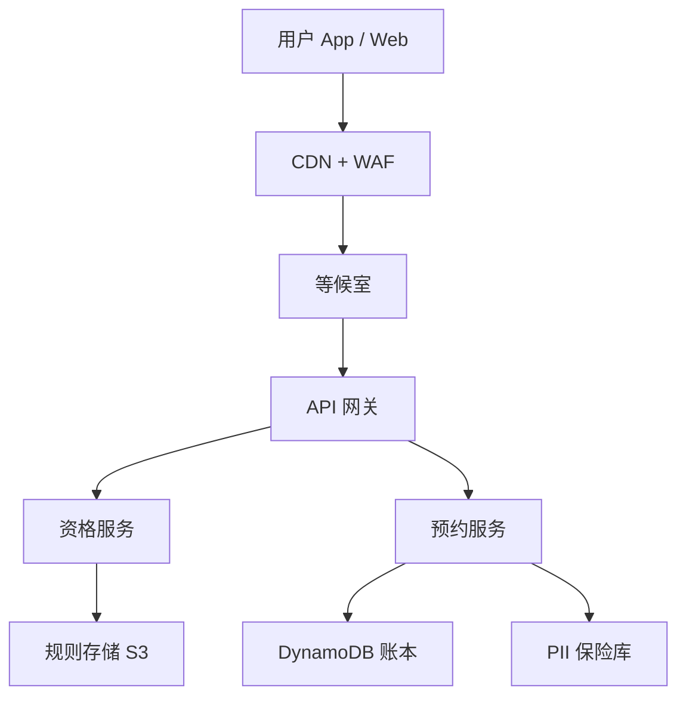
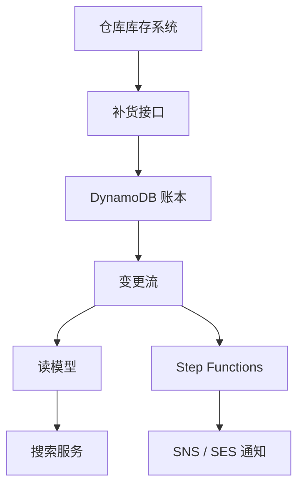
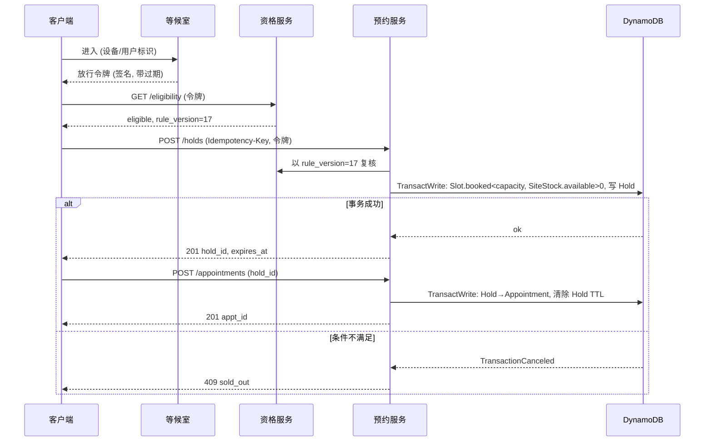
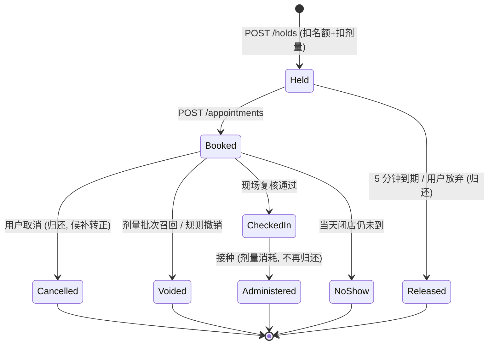

# SD05 疫苗资格与预约（Vaccine Eligibility & Booking）

## 题目

疫苗预约系统让符合资格的人按地点和日期订一个接种时段。使用者是三类人：想打疫苗的居民、管理资格政策的卫生部门运营人员、在接种点现场核对身份的工作人员。难点有三个：疫苗剂量和接种位是两层互相制约的库存，补货会在预约进行中改变容量；资格规则是政策，每周都可能变，而且已经订好的预约要不要重新判定，需要明确的语义；开放新人群的那一刻，申请的人远多于剂量，系统要在公平的前提下把流量压到数据库吃得下的速度。

题目：设计一个疫苗分发系统，管理动态补货的库存和可配置的资格规则，让符合资格的用户按地点和日期预约接种。

它和订票（Ticketmaster）一样是抢有限库存，但不能照搬：订票的座位是唯一的对象，这里稀缺的是剂量而不是时段，资格还会随政策变化。题面没有给规模，下文的假设是：一个州级项目，500 个接种点，一次开放新一批人群，有二针和加强针；面试时以面试官给的数字为准。

## 澄清问题

开场用两三分钟问完下面八个问题。每一个都会改变设计，答案写在白板角落。

1. **规模：覆盖多大人口、有多少接种点、一天开多少个号？** 决定是否需要等候室（waiting room）、数据库要不要分区。假设 500 个接种点，每点 8 小时、12 个接种位、每 15 分钟一个时段，并且一次开放未来 14 天的号。
2. **资格规则谁来改、多久改一次、改完要多快生效？** 如果是卫生部门的运营人员每周改，规则必须是数据而不是代码；如果要求「改规则后一分钟内全国生效」，就要有版本化和推送机制。
3. **资格规则看哪些属性？** 年龄、基础疾病、职业、邮编、上一剂的日期与间隔。属性是用户自报还是经过核验的，决定要不要接入身份提供方（identity provider）以及要不要在接种当天复核。
4. **是否有第二剂、加强针？** 有的话，一次预约其实是「一对预约」，第二剂的时段要在第一剂确认时一起占位，而且剂型必须一致（同一厂牌）。
5. **库存的真相来源（source of truth）在哪里？** 剂量是由州仓库的库存系统管理，还是本系统自己记账？答案决定我们是读取方还是账本。假设本系统持有「可预约剂量」的账本，仓库系统通过补货事件向我们注入数量。
6. **开放日的峰值有多大，要不要公平性？** 如果 200 万人在同一分钟抢 30 万剂，是先到先得、随机抽签还是按优先级分批，是产品决策，也是技术决策。
7. **取消、爽约、剂量报废如何处理？** 取消要把号和剂量放回，爽约的剂量在当天闭店前可以放给候补，冷链故障可能让一整批剂量作废，这会让已有预约失效。
8. **合规：个人健康信息（PHI/PII）怎么存、谁能看？** 决定敏感字段是否拆到独立的存储，以及审计日志、保留期和删除权。

## 需求

**功能需求（按优先级）**

1. 按地点和日期搜索有空位的时段，只展示对当前用户「有资格」的结果。
2. 预约：占位、确认、改约、取消；一个人不能重复持有同一剂次的有效预约。
3. 资格规则可配置：运营人员发布新规则版本，不需要发版；系统在预约时校验，在接种当天（check-in）再复核。
4. 补货：新到的剂量批次（lot）进入账本，并按站点分配，已发布的时段容量随之增加。
5. 通知：确认、提醒、取消和候补转正（可选，放在深挖之后）。

**非功能需求**

| 维度 | 目标 | 说明 |
|---|---|---|
| 搜索延迟 | p99 小于 300 ms | 可以略微过期（几秒），读路径与写路径分离 |
| 预约写延迟 | p99 小于 800 ms | 含资格校验、占位、落账 |
| 可用性 | 预约路径 99.95%，搜索 99.99% | 开放日不能整站挂；挂了就退化成排队而不是报错 |
| 一致性：时段容量与剂量 | 强一致，**绝不超卖** | 一个人到了现场没有剂量是严重事故，比「显示没号」严重得多 |
| 一致性：搜索结果 | 最终一致（秒级） | 搜到但订不上可以接受，订上了但搜不到不可以 |
| 持久性 | 预约记录零丢失 | 确认过的预约是对用户的承诺 |
| 隐私 | 健康信息加密、最小暴露、可审计 | 时段表和库存表里不存姓名 |

**明确不做**：疫苗接种后的随访与不良反应上报、冷链物流本身、保险与计费、第三方证件核验的细节（只讲接口）、多语言。

## 容量估算

先定一个会驱动设计的数字：**剂量远比接种位少**。

假设（来自上面的澄清问题，面试时按对方说的改）：

- 500 个接种点，每点每天 8 小时，12 个接种位，每个位每小时 4 人（15 分钟一个时段）。
- 一次开放未来 14 天的号。
- 开放日有 200 万新符合资格的人，在开放后 10 分钟内涌入；每个人平均发 5 个请求（登录、规则检查、搜索两次、预约）；其中 30% 真的会尝试预约。
- 首批补货 30 万剂。

计算（公式和结果）：

- 每天接种位容量 = 500 × 8 × 12 × 4 = **192,000** 个名额；14 天 = **2,688,000** 个名额。
- 单个站点一天的时段名额数 = 12 × 8 × 4 = 384，所以一个「站点-日」是 32 个 15 分钟时段，每个时段容量 12。
- 搜索峰值：200 万人 ÷ 600 秒 = **约 3,333 人/秒**入场，× 5 个请求 = **约 16,667 请求/秒**。其中大部分是读，可以由缓存和只读副本承接。
- 预约尝试：200 万 × 30% = **60 万次**，10 分钟内均匀到达 = **1,000 次/秒**。
- 剂量约束：30 万剂 ÷ 每天 19.2 万名额 = 1.56 天的接种容量，14 天名额的 11.2%。申请人数 ÷ 剂量 = 200 万 ÷ 30 万 = **6.7 : 1**。结论：接种位有余、剂量不足，**真正的稀缺资源是剂量，时段只是剂量的投递方式**。
- 存储：名额表 268.8 万行 × 约 200 字节 = 约 **538 MB**；预约表 30 万条 × 约 1 KB = 约 **300 MB**。这是一个很小的数据集，难点完全在并发正确性，不在容量。
- 等候室的放行速率：数据库安全写入速率假设 2,000 次/秒（DynamoDB 按需模式在多分区下可以更高，但热点分区的单分区上限约每秒 1,000 次写入），60 万次尝试需要 600,000 ÷ 2,000 = **300 秒**才能排空。放行速率就是限流值，不是越高越好。

**驱动设计的那个数字**：6.7 : 1 的超额申请，加上热门站点在 10 分钟内被集中冲击。它意味着绝大多数请求注定失败，所以失败必须便宜、快、公平（读路径先拒绝，不要等写路径冲突才发现没了）。

## 核心实体与 API

**实体**（粗体为主键）

| 实体 | 关键字段 | 说明 |
|---|---|---|
| Program | **program_id**、产品（厂牌）、剂次数、两剂最小间隔 | 一个疫苗项目 |
| RuleSet | **(program_id, version)**、规则 JSON、生效时间、发布人 | 不可变，只能追加新版本 |
| Site | **site_id**、地址、地理哈希、接种位数、营业时间 | 数据量小，几乎只读 |
| DoseLot | **lot_id**、产品、数量、有效期、分配站点 | 补货批次，是账本的源头 |
| SiteStock | **(site_id, product)**、available、reserved、version | 站点级可预约剂量计数 |
| Slot | **(site_id, start_time)**、capacity、booked、holds | 15 分钟一个时段 |
| Appointment | **appt_id**、person_id、slot、dose_no、rule_version、状态 | 状态机见深挖 |
| Person | **person_id**、联系方式、出生日期、核验属性 | 敏感信息，单独存储（见 PII 一节） |

**API**（写请求都带幂等键）

```
GET  /v1/eligibility?program=covid-26            -> {eligible, reasons[], rule_version}
GET  /v1/slots?program=&geo=&date=&limit=        -> [{site_id, start, remaining_hint}]
POST /v1/holds            Idempotency-Key: <uuid>
     {program, site_id, start, dose_no}          -> 201 {hold_id, expires_at}  | 409 sold_out | 403 not_eligible
POST /v1/appointments     Idempotency-Key: <uuid>
     {hold_id}                                   -> 201 {appt_id, rule_version}
DELETE /v1/appointments/{appt_id}                -> 204（把号和剂量放回）
POST /v1/admin/rulesets   {program, rules, effective_at}   -> 201 {version}
POST /v1/admin/lots       {lot_id, product, qty, allocations[]}  -> 202
POST /v1/checkins         {appt_id, site_id}     -> {eligible_now, dose_lot}  -- 现场复核
```

占位（hold）和确认（appointment）分成两步：用户在表单上填联系方式的几分钟里，名额要被保留，但保留不能永久。幂等键（Idempotency-Key）以用户 ID 加键值落在同一张表里，重放同一请求返回第一次的结果，这样移动网络下的重试不会双占。

## 高层架构

预约路径：



补货与搜索路径：



**流 1：搜索并预约。** 用户进入后先被等候室按放行速率发令牌；资格服务读当前生效的规则版本，结合用户属性判断是否有资格，并把 `rule_version` 返回给前端；搜索服务查读模型，返回有空位的站点和时段（`remaining_hint` 只是提示）；用户选定后预约服务发起占位，在一次事务里同时扣时段容量和站点剂量，写入带过期时间的占位；用户提交后确认，占位变成预约，事件进入 EventBridge，由 Step Functions 发确认通知和提醒。

**流 2：补货。** 仓库系统调用补货接口，提交批次和分配方案；账本在一个事务里增加 `SiteStock.available`，并在需要时放出更多时段；DynamoDB Streams 把变化推到读模型，搜索页上才出现新号。补货永远是「增加」，减少（报废、召回）走专门的路径，见深挖。



## 深挖

### 资格规则引擎：版本化、数据驱动、两次求值

问题：资格规则是政策，政策每周甚至每天变（先开放 75 岁以上，再开放 65 岁以上，再加某些职业）。如果规则写在代码里，每次变更都是一次发版，开放日前夜的发版风险最高。同时，规则变了，已经订好的预约怎么办？

选项：

1. **规则写在代码里**：最快实现，但每次变更要发版，运营无法自助，也无法审计「某个人在某一刻为什么被判定有资格」。
2. **规则存在数据库行里，服务每次读**：运营可改，但每次请求都读库，开放日读放大；而且改规则不是原子的，半新半旧的规则会同时存在。
3. **不可变版本化规则文档 + 本地缓存 + 版本号随结果返回**：规则是一个小的 JSON 抽象语法树（AST），例如 `{"all":[{"attr":"age","op":">=","value":65},{"any":[{"attr":"condition","op":"in","value":["diabetes","copd"]}]}]}`。每次发布产生新版本，写入 S3 并通过 AppConfig 逐步下发；服务进程缓存当前版本，判定结果带上 `rule_version`。

选择第 3 种，并做两次求值：**预约时（booking-time）**用当前版本判断能不能订，把 `rule_version` 写进预约；**接种当天（check-in）**再复核一次，因为用户属性可能变化（刚确诊了某种基础疾病不会让人失去资格，但「上一剂日期」「接种间隔」这类时间相关属性会）。两次求值的语义不同：预约时是「入口门」，允许规则更宽松的政策在预约后生效（用户不需要重订）；现场复核则只检查「是否被禁忌」和「第二剂间隔是否满足」这类硬约束，不会因为政策收窄就把已经订好的人赶走，除非卫生部门明确标记该版本为「撤销」。

实现要点：规则求值是纯函数（用户属性 + 规则版本 → 结果 + 原因列表），所以可以单元测试，可以在发布前对一份匿名样本回放，预估「这次改动会让多少人变得有资格」，这是运营能自助的前提。属性分两类：**可核验属性**（出生日期来自身份提供方）和**自报属性**（职业、基础疾病）。自报属性可以用于「预约资格」，但要在现场复核时提示核对证明材料，并在结果里标记 `attested=true`。

失败模式：缓存了旧版本，导致「刚开放的人群被拒绝」。对策是版本号放进每次响应，客户端发现服务端版本更新时强制刷新；AppConfig 用金丝雀逐步发布并设置自动回滚的告警（拒绝率突变）。另一个失败模式是规则表达式写错造成「人人都有资格」，所以发布前必须过回放检查，并设置资格通过率的上限告警。

### 两层库存：时段容量与剂量，用一次事务同时扣

问题：每一次成功预约要同时满足两个独立约束：目标时段还有名额（`booked < capacity`）；该站点该产品的剂量还有余量（`available > 0`）。任何一个先扣另一个后扣都会留下半成品状态：扣了名额没扣到剂量，名额被白占；扣了剂量没扣到名额，剂量被白占。而且这两个数据在不同的行，甚至不同的分区。

选项：

1. **只管名额，剂量靠人工对账**：实现简单，但剂量不足时会出现「有号没药」，在现场才发现，不可接受。
2. **关系型数据库（Aurora PostgreSQL）一个事务里两条 UPDATE，行锁**：语义清晰，写 `UPDATE slot SET booked=booked+1 WHERE ... AND booked<capacity` 与 `UPDATE site_stock SET available=available-1 WHERE ... AND available>0`，任一不满足就回滚。热点是同一站点的 `site_stock` 行，所有对该站点的预约串行化；单行每秒几百次更新是可行的，但再高就会排队。
3. **DynamoDB `TransactWriteItems`**：在同一事务里对 Slot 和 SiteStock 各做一个带条件的更新（ConditionExpression），再 Put 一条 Hold，全部成功或全部失败。事务提供可串行化的隔离，代价是消耗双倍的写容量单位，且同一分区键的热点仍受单分区约 1,000 次写入/秒的上限限制。

选择第 3 种，因为多区域扩展、没有连接池瓶颈、条件表达式天然是「不超卖」的原子判断；规模小的话选第 2 种同样正确，要说清楚。**热点处理**：热门站点的 `SiteStock` 会成为单行热点。做法是把一个站点的剂量拆成 N 个子计数（`SiteStock#0..N-1`），每次预约随机选一个子计数扣减，扣不到时再试另一个；N 个子计数的总和是总量。这样热点分散到 N 个分区，代价是「最后几剂」时要多试几个子计数，并在余量低于阈值时合并回单计数，避免几个子计数各剩 1 剂而用户看到「已售罄」。

占位的过期：Hold 有 5 分钟过期时间。DynamoDB 的 TTL 删除是惰性的（可能延迟数小时到两天），所以 **不能依赖 TTL 删除来归还名额**。做法：Hold 记录自己的 `expires_at`；任何事务在判断名额时，不把已过期的 Hold 算作占用（容量判断读的是 `booked` 计数，所以要有一个归还动作）；归还由 Step Functions 在创建 Hold 时启动一个 5 分钟的 Wait 状态，到期后用条件更新「若 Hold 仍未确认，则 `booked -= 1`、`available += 1`」，同时有一个兜底的定时扫描（每分钟按 `expires_at` 的 GSI 查询）补漏。归还操作本身必须幂等（用 Hold 的状态做条件），否则双重归还会让计数虚高，等价于超卖。



失败模式：事务因为冲突被取消，客户端重试风暴。对策是服务端对 `TransactionCanceledException` 做带抖动的指数退避，且对「条件失败」（名额没了）和「事务冲突」（并发竞争）区别对待：前者直接返回 409，后者才重试，避免对已经售罄的时段无意义地重试。

### 开放日的流量整形：等候室、公平性与读路径先拒绝

问题：6.7 : 1 的超额申请，意味着大多数请求注定失败。如果让它们全部打到写路径，数据库会被无意义的条件失败压垮。同时，「谁先抢到」直接影响公平：抢号机器人和网络快的人会占尽优势，而疫苗是公共品，社会难以接受。

选项：

1. **直接放行，靠自动扩缩容**：写路径的瓶颈在分区热点，扩容无效。
2. **先到先得的等候室（FIFO）**：实现简单，但开放前几秒进来的人排最前，等于奖励网速和脚本。
3. **随机化窗口 + 令牌放行**：在开放后的 N 分钟窗口内到达的所有人视为同时到达，随机排序，然后按固定速率放行；每个令牌是服务端签名、带过期时间、绑定用户的 JWT。

选择第 3 种，放行速率取数据库的安全写入速率（假设 2,000 次/秒，排空 60 万次尝试要 300 秒）。等候室用 SQS FIFO 或自建的有序集合实现，核心是令牌桶：每秒向桶中放 2,000 个令牌，持有令牌的请求才能到达预约服务。**读路径先拒绝**：站点和时段的「已满」状态由读模型维护，当某个站点-日在读模型里是满的，前端直接灰掉、搜索不返回，用户根本发不出针对它的写请求；写路径冲突因此只出现在「刚好最后一个名额」这种窄窗口里。

公平性补充：同一个人（按身份而不是设备）同一时间只持有一个有效 Hold，防止一人占多个；每个令牌绑定用户，转让无效；对明显自动化的流量（WAF 的行为评分）降优先级。资格分批（先开放高优先级人群）是产品层的另一个旋钮，可以用「令牌桶按资格层级分桶」实现，高优先级桶先放行。

失败模式：等候室本身成为单点。对策是等候室用无状态的边缘函数加 DynamoDB 或 ElastiCache 的计数，令牌自带签名所以验证是本地的，不需要回查；等候室不可用时降级为「全体统一的固定窗口随机放行」而不是放开所有人。

### 补货改变容量：增加容易，减少要有政策

问题：「动态补货」意味着剂量批次会在预约进行中到达，也可能撤回。增加容量看起来无害，但如果搜索读模型更新晚了几秒，用户会反复刷新；减少容量（冷链故障、召回）则可能让已经确认的预约变成无药可打。

选项与选择：

- **增加**：补货事务把 `SiteStock.available` 加上批次分配量，并按站点的接种位数放出更多时段（时段容量是物理接种位的约束，剂量是另一层约束，两者不能互相推导，所以放出时段由一个调度任务按未来 14 天的排班决定，而不是由剂量数量算出来）。补货接口必须幂等（`lot_id` 作为键），否则仓库系统重试会让剂量翻倍，造成超卖。
- **减少（报废、召回）**：规则是「**永不把 available 减到低于 reserved**」。减少量先吃掉未预约的 available；不够的部分，才进入「失效预约」流程：把受影响的预约按预约时间倒序（最晚订的先受影响）标记 `Voided`，同时触发 Step Functions：优先在同站点同产品里改约，找不到则通知并优先放进下一批候补。这个顺序是政策，不是技术，要在面试里点明让产品决定，我们提供机制。
- **两剂次**：第一剂预约确认时，同时占位第二剂的时段与剂量（用同一个事务，或一个 Saga 加补偿）。取消第一剂必须同时释放第二剂。剂型一致用 `product` 字段作为两条占位的共同约束。

失败模式：补货事件重复或乱序。账本靠 `lot_id` 去重、靠批次版本防止旧事件覆盖新事件；每日对账作业把「账本总量 + 已接种 + 报废」与仓库系统的出库数核对，不一致则告警，而不是自动修复（账本涉及公共健康的责任）。这一点与支付账本是同一个思路：先写不可变流水（lot 事件、预约事件），计数是流水的物化视图。

### 个人健康信息（PII/PHI）：最小暴露与可审计

问题：预约系统天然持有姓名、出生日期、联系方式、基础疾病和接种记录，属于最敏感的一类数据。热路径（时段、剂量）不需要知道任何一个人的姓名，泄露面应该被压到最小。

选项与选择：**把 Person 拆到独立的保险库**（Aurora PostgreSQL，列级加密，KMS 管理密钥），预约表只存 `person_id`（不透明的随机 ID）；搜索读模型只存站点和时段，永不含个人数据；日志里不写任何个人字段（用结构化日志加字段白名单）；管理员访问个人数据必须通过带原因的工单式授权并写审计日志（CloudTrail 与应用审计两层）。通知服务只拿到「向这个联系方式发这个模板」的指令，模板里不含诊断信息。保留期到期后，个人数据删除，但预约流水保留去标识化的汇总，用于公共健康统计。

失败模式：`rule_version` 与基础疾病属性一起落库会让「我的预约」页面成为间接泄露渠道（从预约的类型猜出疾病）。所以预约详情只显示站点和时间，资格原因只在用户自己的会话里显示一次。

## Staff 视角：权衡、故障与演进

**10 倍规模会先坏什么。** 峰值从 1,000 次预约尝试/秒涨到 10,000 次/秒时，先坏的不是存储而是三处：（1）热点站点的 `SiteStock`，需要把子计数的个数 N 从 4 提到 16 以上；（2）等候室的放行速率成为产品问题，排空 600 万次尝试要 50 分钟，需要产品接受「分日分批开放」；（3）读模型的同步延迟，DynamoDB Streams 到 OpenSearch 的管道在峰值时会落后几十秒，用户看到的 `remaining_hint` 过期。解决方向是分批开放（把 14 天拆成多次发布）和按站点分批放号，把冲击削平。

**每个组件挂了的影响面。**
- 等候室挂：降级为随机固定窗口放行，搜索保持可用；这是最重要的降级路径，要演练。
- 资格服务挂：用本地缓存的最后已知规则版本继续判定（标记 `degraded`），降级时的偏向要事先定好：误拒绝的代价是用户被挡在门外、重试加剧拥塞，误放行的代价只是现场复核时再拒绝一次，所以降级时宁可放行预约，由现场复核兜底。这一取舍必须写成运行手册，而不是现场讨论。
- 预约服务或 DynamoDB 区域故障：预约路径不可用，搜索只读。多区域方案见下。
- Step Functions 挂：占位归还延迟，由兜底扫描补偿；名额暂时偏少，但不会超卖。这是把「不超卖」放在「不少卖」之上的体现。
- 读模型挂：回退为对 DynamoDB 做站点范围的 Query，慢但正确。

**多区域。** 疫苗预约是区域性业务（一个州），所以首选**单区域主、跨区域备**：DynamoDB 全局表（Global Tables）把账本复制到第二个区域，但全局表是最后写入者胜（last-writer-wins）的多主复制，对「计数不超卖」不安全——两个区域同时扣最后一个名额都会成功。所以账本只在一个区域写，另一个区域是只读副本和灾备，故障切换由运维手动触发并接受数秒到数十秒的复制延迟下的少量名额不确定（切换后先冻结预约一小段时间，对账后再放开）。要真正做到双活，需要按站点把写入固定到一个区域（站点归属区域），跨区域的用户路由到站点所属的区域。

**成本驱动。** 数据集很小（几百 MB），成本主要在峰值：DynamoDB 按需模式的写容量（事务消耗双倍）、API Gateway 与 WAF 的请求数、CloudFront 出口流量、Step Functions 的状态转换（每个 Hold 一个 5 分钟 Wait 工作流，一次开放日 60 万个工作流，按标准工作流计价会很贵，应改用 Express 工作流或用 DynamoDB TTL 加定时扫描代替）。平时低流量，开放日前预热容量。

**迁移与发布。** 规则变更用金丝雀（AppConfig 的 1% → 10% → 100%）；新批次开放日前做一次全链路压测（用合成用户，不碰真实 PII）；发布窗口避开开放日前 24 小时。

**可观测性。** 业务指标比技术指标重要：`oversold_total`（必须恒为 0，任何非零都是 P1）、`hold_expired_total`、`eligibility_reject_rate`、`soldout_409_rate`、`waiting_room_queue_depth`、`ledger_reconcile_diff`。告警：账本差异非零、资格通过率突变超过 3 倍标准差、占位归还延迟超过 10 分钟。运行手册要写清楚：冻结预约的开关在哪里、谁有权按下。

## 面试官追问

1. **你怎么保证不超卖？** 名额和剂量的扣减放在同一个 DynamoDB 事务里，用条件表达式判断，失败即整体不生效；归还操作幂等且只依赖占位自身的状态；每日对账账本与仓库出库数，`oversold_total` 恒为 0 作为告警。
2. **为什么不用 Redis 分布式锁来占位？** 锁加 TTL 在租约过期、网络分区时会出现两个持有者；账本本身需要持久和事务，所以锁最多是一层性能优化，真正的正确性仍要落在数据库的条件写入上（订票类设计常见的锁方案，在这里只作为可选的削峰手段）。
3. **用户先搜到号，点预约时被拒怎么办？** 这是预期行为。读模型是最终一致的，所以 `remaining_hint` 只是提示；409 响应里带上同站点其他有空位的时段，减少用户重新搜索的次数。
4. **规则变了，已经订好的人怎么处理？** 预约保存 `rule_version`；默认政策是已确认的预约在现场复核时只检查硬性禁忌和间隔，不因政策收窄而取消；只有被明确标记撤销的版本才触发批量失效与重新通知。
5. **如何防止黄牛和机器人？** 令牌绑定已核验身份，一人一个有效占位；WAF 行为评分降权；等候室随机化消除速度优势；异常行为（同一设备大量不同身份）进入人工复核队列。
6. **两剂次怎么处理？** 第一剂确认时一并占位第二剂，用同一事务或 Saga（补偿为释放）；间隔由规则引擎校验；剂型强制一致；第一剂取消时释放第二剂。
7. **库存调减但已有预约怎么办？** 永不把可用量减到低于已预留量；多出的部分走失效流程，按订单时间倒序失效，先尝试同站点改约，再通知，并让产品确定优先级。
8. **如果流量比预期高 10 倍？** 先削峰：分批开放、放行速率不变、等候室排队时间变长并如实展示预计等待；扩 `SiteStock` 子计数；读模型走缓存。写路径的扩展不是第一选择，因为稀缺资源是剂量，不是吞吐。
9. **怎么做跨区域？** 单区域写，跨区域只读和灾备；双活按站点归属区域分片；全局表的最后写入者胜不适用于计数类账本。
10. **怎么测试这个系统？** 并发测试：N 个线程抢最后 K 个名额，断言成功数恰好为 K；故障注入：事务中途杀进程、重放同一幂等键、补货事件重复；规则回放：用匿名样本比较新旧版本的通过率。

## 60 分钟怎么分配

| 分钟 | 做什么 | 白板内容 | 时间不够时 |
|---|---|---|---|
| 0–5 | 澄清问题，定假设 | 角落写规模、两剂次、规则谁改 | 只问规模、规则、剂量真相来源三个 |
| 5–10 | 需求与容量估算 | 192,000 个名额/天、6.7 : 1、1,000 次/秒 | 只写 6.7 : 1 这一个驱动数字 |
| 10–15 | 实体与 API | 实体表、holds/appointments 两步、幂等键 | 压缩为 API 四行 |
| 15–25 | 高层架构与两条流 | 流程图、搜索与预约的序列图 | 保留，不能砍 |
| 25–40 | 深挖一：两层库存事务与占位归还；深挖二：规则引擎 | 事务伪代码、状态机、规则 JSON | 必讲这两个 |
| 40–50 | 深挖三：开放日整形与公平；补货与召回 | 等候室令牌桶、减少量政策 | 只讲等候室，补货口述 |
| 50–55 | Staff 视角：故障、多区域、成本 | 降级表、全局表陷阱 | 只讲降级与多区域 |
| 55–60 | 追问与总结 | `oversold_total` 恒为 0 | 总结一句 |

**45 分钟版**（前面有 10–15 分钟行为面试）：澄清 3 分钟，容量 3 分钟，API 3 分钟，架构 8 分钟，深挖两个（库存事务、规则引擎）各 8 分钟，开放日整形 5 分钟，降级与多区域 5 分钟，剩下留给追问。PII 一节只用一句话带过：「个人数据拆到独立保险库，热路径不含姓名」。

## 自测

1. 为什么说这个系统的稀缺资源是剂量而不是时段，它如何改变设计？

<details><summary>答案</summary>

按假设，每天有 192,000 个接种位名额，而首批只有 30 万剂，申请人数 200 万，超额比 6.7 : 1。时段只是投递方式。设计上必须让剂量与名额在同一事务里扣减，让读路径提前拒绝已无剂量的站点，热点计数要拆成子计数，而不是只做座位图式的单行锁。

</details>

2. DynamoDB 的 TTL 为什么不能用来归还过期占位的名额？

<details><summary>答案</summary>

TTL 删除是惰性的，可能延迟数小时到两天，期间名额一直被占着，等于少卖。归还要靠 Step Functions 的定时器加按 `expires_at` 的兜底扫描，并且归还动作要用占位状态做条件，保证幂等，否则双重归还会让计数虚高而超卖。

</details>

3. 为什么全局表（Global Tables）不能让两个区域同时写预约账本？

<details><summary>答案</summary>

全局表是多主、最后写入者胜，没有跨区域的条件检查。两个区域可以各自成功地扣最后一个名额，复制后冲突被「最后写入者胜」吞掉，实际已经超卖。所以账本只在一个区域写，或按站点归属区域分片，使每个站点的写入只发生在一个区域。

</details>

4. 规则版本为什么要写进预约，并且做预约时和现场两次求值？

<details><summary>答案</summary>

写进预约是为了审计：知道这个人当时凭哪个版本被判定有资格。两次求值语义不同：预约时是入口门，使用当前版本；现场复核只检查硬性禁忌与间隔，避免政策收窄就把已订好的人拒之门外。这样规则可以每周变，而不会引发大规模取消。

</details>

5. 开放日为什么用随机化窗口而不是先到先得，放行速率怎么定？

<details><summary>答案</summary>

先到先得奖励网速和脚本，而疫苗是公共品。把窗口内到达的所有人视为同时到达并随机排序，才是公平的。放行速率取数据库的安全写入速率，按假设 60 万次尝试、2,000 次/秒，需要 300 秒排空；速率是限流值，不是越高越好。

</details>

## 来源与延伸阅读

> 来源：Hello Interview 社区题库 Amazon 条目，2026-09-10，senior：https://www.hellointerview.com/community/questions?company=Amazon ；对照的 Hello Interview 题解《Ticketmaster》：https://www.hellointerview.com/learn/system-design/problem-breakdowns/ticketmaster ；《Dealing with Contention》：https://www.hellointerview.com/learn/system-design/patterns/dealing-with-contention

- 被报告的题面（一句）：「a vaccine distribution system that manages dynamic inventory replenishment and configurable eligibility rules, allowing eligible users to book vaccine appointments by location and date」，2026-09-10，senior，置信度 **中**；没有候选人笔记，只有这一句。
- **（重建）**：每日预约量、站点数、规则复杂度、是否有二针、是否对接真实身份核验，报告里都没有。正文的数字和范围按「州级疫苗项目开放新一批人群」重建。

**Hello Interview《Ticketmaster》的做法（转述）**：骨架是需求、实体、API、高层设计，再在深挖里处理订票过程中保留座位、极热门活动的虚拟排队和搜索。保留座位的主方案是带 TTL 的分布式锁，虚拟等候队列是热门活动的扩展；评论区有不少读者主张用数据库的乐观并发控制代替锁。《Dealing with Contention》一页系统比较了悲观锁、乐观并发、分布式锁和队列几种争用处理方式。

**一致的地方**：先保证不双订，再谈体验；热门事件需要排队整形；读写分离。

**不同的地方**：

1. 正文不把分布式锁当作正确性的来源。库存在持久账本里，锁只会增加一个不可信的故障面；正确性来自数据库事务里的条件写入，占位的过期由工作流和对账保证，不由锁的 TTL 保证。
2. 订票的座位是唯一对象，一个座位一个人；疫苗是两层库存（时段加剂量），稀缺的是剂量，所以「读路径先拒绝」和剂量子计数成为主要设计，而不是座位图。
3. 资格规则引擎在订票里不存在，它是疫苗场景新增的主线：版本化、两次求值、可回放；Hello Interview 的这两页没有覆盖。
4. 公平性在这里是硬需求（公共品），所以用随机化窗口代替先到先得；订票的虚拟队列默认先到先得。

**本库**：通用的座位状态机、虚拟队列和 saga 在 [[solution-ticket-booking]]；按房型-夜的计数行与多晚预订的原子性在 [[solution-hotel-reservation]]，两层库存的写法与它的「区间行 vs 计数行」选择同构，可以对照阅读。
