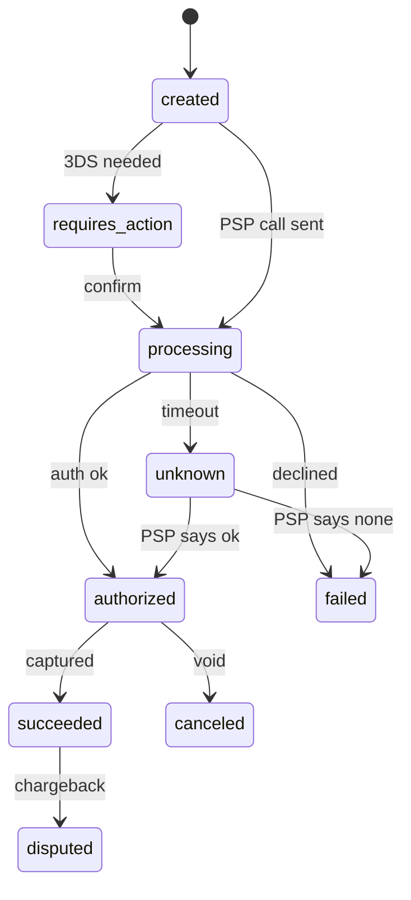
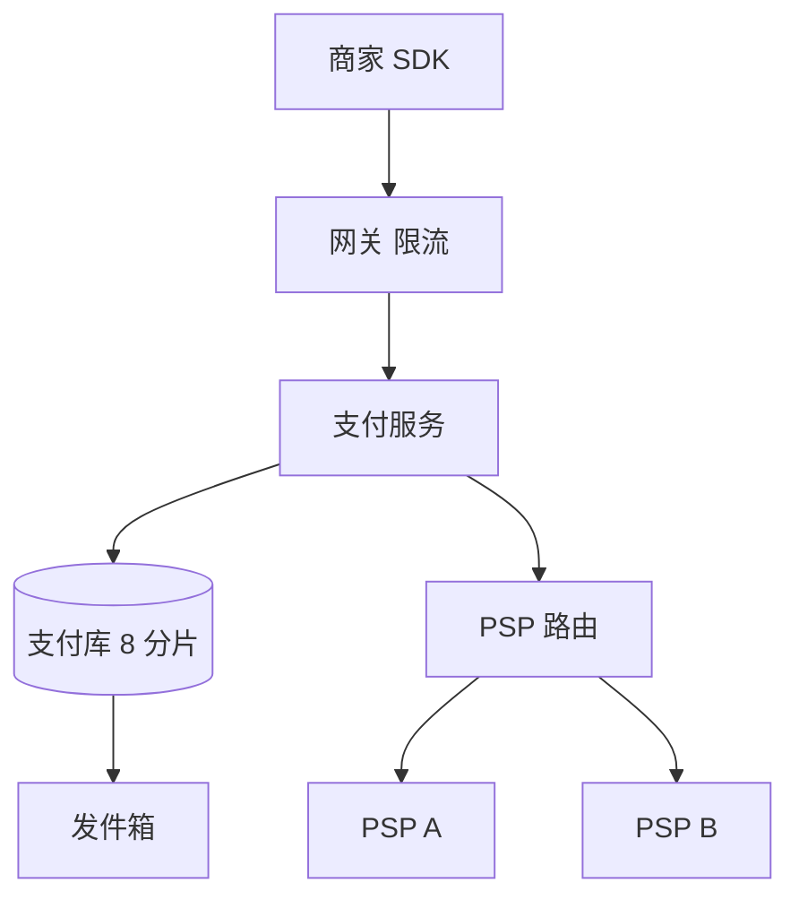
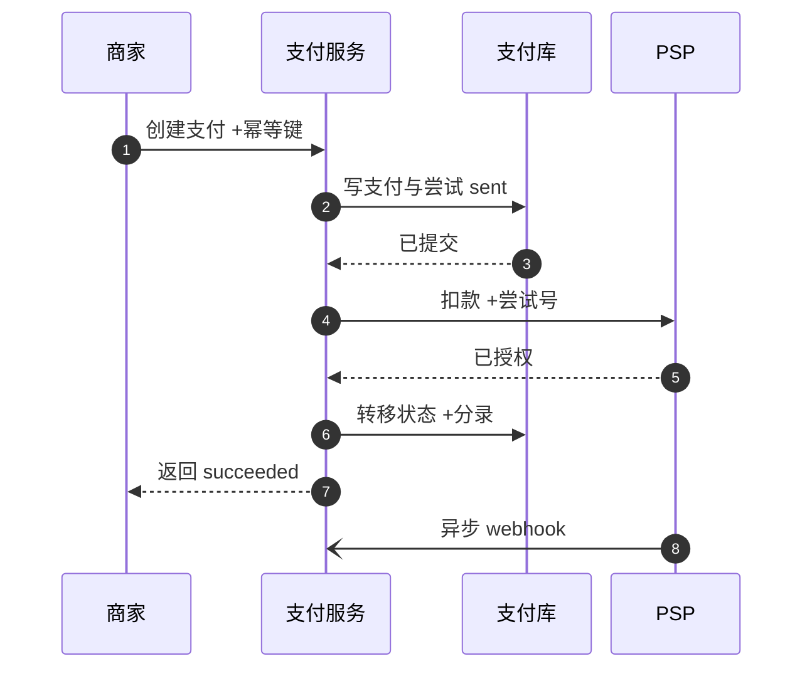
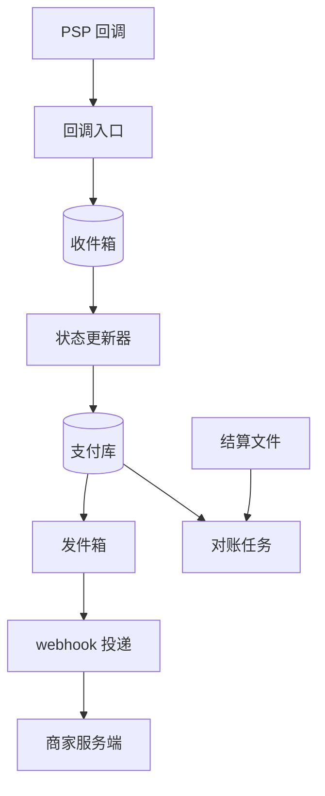

# SD01 支付系统（Payment System）

## 题目

支付系统帮商家向付款人收钱。商家用 SDK 或 REST 接口创建一笔支付，付款人填卡或选钱包，平台向外部的支付服务商（PSP，Payment Service Provider：真正连接银行和卡组织的第三方，例如 Stripe、Adyen）发起授权，PSP 再去问发卡行。钱不是当场到账的：授权成功只代表发卡行冻结了额度，真正的资金要过一两天才通过结算文件（settlement）到平台的银行户头，平台再把扣掉手续费的部分打给商家（payout）。系统对商家的承诺只有两句：付款人永远不会被重复扣款；订单永远不会在没收到钱的情况下被标成已支付。

难点不在流量：每天一千万笔，峰值每秒一千多笔，一个分片的关系库就扛得住。难点在于所有外部调用都会超时、重复、乱序、丢失，而你的账必须每一分钱都对得上。三个具体的坑：调用 PSP 之后进程崩溃，你不知道钱扣了没有；PSP 的 webhook（回调通知）会重发、乱序甚至根本不来；一笔支付悬在「处理中」一个小时，用户在界面上看到什么、系统怎么收敛。

面试官通常只说一两句：设计一个类似 Stripe 的支付系统，覆盖结账、扣款、确认。然后他会盯住其中一条流程连问四五个问题，常见的是：幂等键怎么保证不重复扣款；状态机和账本怎么设计；异步结算和 webhook 丢了怎么办；对账；卖家打款后账本怎么变；两家 PSP 之间怎么路由、一家变差时怎么切换；支付挂起一小时怎么办；全额和部分退款怎么不破坏对账。HM 轮可能只有 30 分钟，要先把主线讲完再展开。下面的数字是练习用的假设，面试时以面试官当场给的数字为准。

## 澄清问题

开场用三分钟问下面八个问题，把答案写在白板角落。每个问题都会改变设计。

1. **我们是谁：是被商家集成的支付平台（像 Stripe），还是接入某个 PSP 的商家？** 前者要自己持有账本、结算和打款；后者主要是订单与支付状态同步。下面按前者设计，并说明哪些部分在后者里可以省略。
2. **规模：每天多少笔，峰值倍数多少？** 决定要不要分片、PSP 调用要开多少连接。假设每天 1,000 万笔，大促峰值 10 倍。
3. **支付方式：只有银行卡，还是包括钱包、银行转账？** 卡授权几秒内出结果；银行转账可能几天，状态机必须能容纳「长时间处理中」。假设以银行卡为主，状态机预留异步方式。
4. **范围：只收款，还是包括退款、打款、拒付（dispute）、多币种？** 退款和打款会改变账本的科目设计，所以开场就要知道。假设包含退款和打款，拒付只在状态机里留位置。
5. **一致性底线是什么？** 把「不重复扣款、不无款标已付」写成硬性约束，再问是否允许「用户已扣款但订单暂时显示处理中」。答案通常是允许：宁可晚一点确认，也不能错。
6. **卡号会不会经过我们的服务器？** 决定合规范围（PCI DSS，支付卡行业数据安全标准）。标准答案是不碰：前端用 PSP 托管的输入框或 SDK 换成令牌（token），我们只存令牌。
7. **一家 PSP 还是多家？** 多家意味着路由、故障切换，也意味着令牌可移植性和对账要按 PSP 分开。
8. **延迟与可用性目标，以及用户在「处理中」时界面该怎么表现？** 决定超时时间和状态文案。

## 需求

**功能需求（按优先级）**

1. 创建支付并确认扣款：带幂等键，重试安全；支持需要额外验证（如 3-D Secure，银行弹出的二次验证）的流程。
2. 支付状态可查，状态变化通过 webhook 通知商家；商家漏收时可以主动查询。
3. 账本：每次资金变化都有不可改的双边分录，随时能回答「这笔钱现在在哪个账户」。
4. 对账：每天与 PSP 的结算文件逐笔核对，差异进入处理队列。
5. 退款：全额与部分，可多次，总额不超过原支付。
6. 商家打款：按周期把可用余额打给商家，状态可追踪。
7. 多 PSP 路由与故障切换（放在深挖之后）。

**非功能需求**

| 维度 | 目标 | 说明 |
|---|---|---|
| 正确性 | 重复扣款为 0；无款标已付为 0 | 这是产品承诺，所有取舍让位于它 |
| 创建与确认可用性 | 99.99%（年停机约 52.6 分钟） | PSP 故障时降级为切换或排队，不是返回错误 |
| 自身处理延迟 | p99 小于 200 ms（不含 PSP 耗时） | PSP 耗时由 PSP 决定，设 3 秒超时 |
| 持久性 | 已确认的状态与分录零丢失 | 主库同步复制到另一个可用区（RPO 为 0） |
| webhook 投递 | 状态变化后 5 秒内首次投递（p99），失败重试约 3 天 | 至少一次，不保证顺序 |
| 对账 | 次日早晨前完成；差异率小于十万分之一 | 差异必须全部有归因 |
| 审计 | 分录与状态变更保留 7 年，只增不改 | 监管与拒付举证需要 |

**明确不做**：自建卡组织连接与清算、风控模型本身（只留调用点）、税务计算、多商户分账规则引擎。

## 容量估算

下面是假设，用来推出设计，不是任何真实产品的流量。

- 支付：1,000 万笔/天 ÷ 86,400 秒 = **115.7/s 平均**，按 10 倍峰值取 **约 1,157/s**。
- PSP 在途连接：峰值 1,157/s × 3 秒超时 = **约 3,472 条并发连接**（最坏情形，按超时时间算而不是平均耗时）。结论：连接池要按 PSP 分开隔离（bulkhead，舱壁隔离），一家变慢不能耗光所有线程。
- 每笔支付的行写入：支付 1、幂等 1、尝试 1.1、状态转移 3、分录 3、发件箱 2，合计约 10 行。峰值 1,157 × 10 = **约 11,574 行写入/秒**。单个主库勉强够，但要留余量和做故障切换，所以按支付 ID 哈希分 **8 个分片**，每片约 1,447 行/秒。
- 存储：支付行约 1 KB，1,000 万 × 1 KB = **10 GB/天，3.65 TB/年**，每片约 0.46 TB/年。
- 账本：每笔成功支付 3 行分录；3% 的支付被退款，每次退款也是 3 行：1,000 万 × 3 + 30 万 × 3 = **3,090 万行/天**，平均 358/s，峰值 **3,576/s**。每行约 120 B，**3.7 GB/天，1.35 TB/年，保留 7 年约 9.5 TB**。
- 入站 webhook：每笔 2 个事件（已授权、已结算相关）= 2,000 万/天，平均 231/s，峰值 **约 2,315/s**。收件箱要能扛这个写入量，并且处理必须异步。
- 出站 webhook：每笔 2 个，加 20% 重试 = 2,400 万次/天，峰值约 2,778/s。
- 幂等键：保留 24 小时，每条约 600 B，1,000 万 × 600 B = **6 GB**，放在支付库同一分片里，不需要单独的缓存集群。
- 对账文件：1,000 万行 × 150 B = **1.5 GB/天**，一次排序归并就能匹配完，不需要大数据平台。
- 悬挂支付：假设 0.5% 的支付会进入「结果未知」，即 **5 万笔/天，0.58/s**；每笔轮询约 6 次，共 30 万次查询/天，量很小。
- 热点账户：平台手续费收入账户每笔支付都要入账，峰值 1,157/s 落在同一行。同一行被事务串行更新，若每次持锁 2 毫秒，上限只有 1 ÷ 0.002 = **500/s**，低于峰值，这是账本设计里必须单独处理的点（见深挖二）。

**驱动设计的那个数字**不是 QPS，而是故障概率乘以规模：0.5% 的未知结果、十万分之一的对账差异，在每天一千万笔下就是每天 5 万笔要自动收敛、100 笔要人工看。系统的价值在于把这两类自动化到可以放心。

## API

```yaml
POST /v1/payments
Headers: Idempotency-Key: <uuid>
Body: { "order_id": "o_88", "amount": 10000, "currency": "USD",
        "payment_method_token": "tok_xxx", "return_url": "..." }
201 -> { "id": "p_1", "status": "processing | requires_action | succeeded | failed" }
402 -> 发卡行拒绝（带拒绝码类别）
409 -> 同一幂等键的请求仍在处理中，带 Retry-After
422 -> 同一幂等键但请求内容不同

POST /v1/payments/{id}/confirm       # 完成额外验证后继续
POST /v1/payments/{id}/cancel        # 只对未捕获的授权有效
GET  /v1/payments/{id}

POST /v1/payments/{id}/refunds
Headers: Idempotency-Key: <uuid>
Body: { "amount": 3000, "reason": "requested_by_customer" }
201 -> { "id": "r_1", "status": "pending | succeeded | failed" }
422 -> 退款总额会超过已捕获金额

GET  /v1/balance                     # 商家的待结算与可打款余额
POST /webhooks/psp/{psp}             # 入站：PSP 回调，验签后只落库
```

金额一律是整数的最小货币单位（minor unit）：美元 10.00 存 1000，日元 1000 存 1000，科威特第纳尔 1.000 存 1000；币种自带小数位数，分录里不出现浮点数。商家收到的 webhook 形如 `{id, type: "payment.succeeded", created, data: {payment_id}}`，签名放在请求头，时间戳参与签名以防重放。

幂等键的约定：同一商家下同一个键，请求内容相同就返回第一次的结果（包括失败结果），内容不同返回 422，并发的第二个请求返回 409。键保留 24 小时。商家没传键时，服务端用 `order_id` 派生一个，保证同一订单同一时刻最多一笔活跃支付。

## 数据模型

| 实体 | 键 | 关键字段 |
|---|---|---|
| Payment | `payment_id`（分片键） | `merchant_id`、`order_id`、`amount`、`currency`、`state`、`version`、`captured_amount`、`refunded_amount` |
| Attempt | `attempt_id` | `payment_id`、`psp`、`state`（sent / succeeded / failed / unknown）、`psp_reference`、`sent_at`；部分唯一索引：同一支付最多一个活跃尝试 |
| IdempotencyKey | `(merchant_id, key)` | `request_hash`、`status`、`response`、`payment_id`、`locked_until`；与 Payment 同库同事务 |
| Account | `account_id` | 类型（asset / liability / revenue / expense）、`currency`、`owner`（如 `merchant_payable:M`、`psp_receivable:A`、`fee_revenue`） |
| Journal | `journal_id` | `payment_id` 或 `refund_id`、`kind`、`created_at`；全部分录之和为 0 |
| LedgerLine | `(journal_id, line_no)` | `account_id`、`amount`（有符号整数）、`currency`；只增不改 |
| Refund | `refund_id` | `payment_id`、`amount`、`state`、`psp_reference`，有自己的幂等键 |
| PspEventInbox | `(psp, psp_event_id)` | `raw_body`、`received_at`、`processed_at` |
| Outbox | `outbox_id` | 要发出的 webhook 或消息，与状态变更同事务写入 |
| Payout | `payout_id` | `merchant_id`、`amount`、`state`、`bank_reference`、周期 |

状态变更和分录写在同一个数据库事务里，所以「状态已成功但分录没写」这种不一致不可能出现。凡是要通知别人的事件，都先写进同一事务里的发件箱（outbox），再由独立进程投递，这样「已提交却没通知」和「已通知却回滚」都不会发生。

付款状态机：



## 高层设计

系统分成两条路径：同步的扣款路径，和异步的收敛路径（回调、投递、对账）。拆开画是因为前者要快、要对用户负责，后者要稳、要对账负责，故障时影响的范围也完全不同。

**扣款路径**



商家请求经网关做鉴权和限流后到支付服务。支付服务先在一个事务里写 Payment、Attempt（状态 sent）和幂等键，提交后才去调 PSP（数据库事务里绝不跨网络调用）。PSP 路由按成本、成功率和健康状态选一家，调用时带上由 `attempt_id` 派生的 PSP 幂等键。拿到结果后，在一个事务里完成状态转移、写分录、写发件箱。



图中编号对应的每一步：

1. 商家带幂等键创建支付。服务端用键先占位，重复请求在这一步就被识别。
2. 在一个事务里写入支付、尝试（状态 sent）和幂等行。尝试行先于 PSP 调用落盘，是为了崩溃后有据可查：看到 sent 就知道「可能已经发出去了」。
3. 数据库同步复制到另一个可用区后才确认提交，保证已确认的数据不丢。
4. 调用 PSP，PSP 幂等键就是尝试号。同一次尝试无论发多少遍，PSP 只执行一次。
5. PSP 返回授权结果。超时则不是失败，而是进入 unknown（见深挖四）。
6. 在一个事务里完成状态从 processing 到 authorized/succeeded 的条件更新、三行分录和发件箱写入。条件更新带版本号，旧状态不匹配就不会写。
7. 把结果返回商家。如果这一步之前进程崩溃，商家会用同一个幂等键重试，直接拿到已保存的结果。
8. PSP 之后还会发异步 webhook，作为第二条确认通道；它可能重复、乱序或缺失，所以不能当唯一依据。

**异步收敛路径**



回调入口只做三件事：验签、把原文写入收件箱（`(psp, psp_event_id)` 唯一，重复事件直接丢弃）、返回 200，整个过程几十毫秒。状态更新器异步消费收件箱，不信任事件内容，而是回 PSP 查询该笔支付的当前状态再决定转移。发件箱里的事件由投递服务带签名发给商家，失败按退避重试。对账任务每天读 PSP 的结算文件，与账本逐笔比对。

## 深挖

### 一、幂等：商家重试、进程崩溃、PSP 重复调用，三层各自怎么做

问题：用户连点两次、商家网络重试、我们的服务在调完 PSP 后崩溃，每一种都可能导致重复扣款。「恰好一次」在跨网络的两端之间做不到，能做到的是**至少一次加幂等**：允许重复发送，但保证重复的效果等于一次。

**第一层：商家到我们。** 幂等表主键 `(merchant_id, key)`，和 Payment 在同一个事务里插入。流程：先 `INSERT ... ON CONFLICT DO NOTHING`；插入成功就继续创建支付；冲突则读已有行：请求内容的哈希不同就返回 422；已完成就原样返回保存的响应；仍在处理中则返回 409 并带 Retry-After；处理中但 `locked_until` 已过（上一个处理者崩溃）则由恢复流程接手。键和支付行同事务提交，所以不存在「键在、支付不在」的状态。

**第二层：我们到 PSP。** 每次尝试有自己的 `attempt_id`，作为 PSP 的幂等键。这里最容易犯的错有两个。其一是每次重试都生成新键，等于没有幂等；其二是对用户换了一张卡的重新支付复用旧键，PSP 会返回旧结果。规则是：同一次尝试（同卡同金额）的所有重发用同一个键；用户换卡、重新发起，是新尝试，新键。

**第三层：崩溃窗口。** 尝试行在调用 PSP 之前就以 sent 状态提交。恢复进程扫描超过 30 秒仍是 sent 的尝试，用同一个 PSP 幂等键重新请求（或按商户参考号查询），PSP 返回的是原来的结果，不会再扣一次。四个崩溃点逐一过：

| 崩溃发生在 | 此刻的真实情况 | 收敛方式 |
|---|---|---|
| 事务提交之前 | 什么都没发生 | 商家用同一个键重试，正常创建 |
| 提交之后、调 PSP 之前 | 尝试是 sent，PSP 从没见过 | 恢复进程重发，PSP 第一次执行 |
| PSP 已扣款、结果未记录 | 钱可能已冻结 | 恢复进程用同一键重发，拿回原结果 |
| 已记录成功、未回复商家 | 一切正确，只是商家不知道 | 商家重试，读到保存的响应 |

被否决的方案：（a）不带键、重试前先查一遍，查和发之间有竞态；（b）用分布式锁防并发，锁租约过期后仍会出现两个处理者，锁解决不了跨进程崩溃；（c）依赖消息队列的「恰好一次」，它只保证队列内部，管不到 PSP 那一端。键保留 24 小时，之后同一个键视为新请求，这个时间要比商家最长的重试窗口长。

### 二、状态机加账本：状态怎么转移、钱怎么记、热点账户怎么办

问题：状态表示「现在是什么」，账本回答「钱是怎么到这儿的」。只存状态和余额，出了差错无从审计；只存事件，每次查询都要重放。折中做法是两者并存：账本是真相，状态和余额是它的投影，并且在同一个事务里写。

**状态转移**用条件更新，把旧状态和版本写进 `WHERE`：`UPDATE payments SET state='succeeded', version=version+1 WHERE id=? AND state IN ('processing','authorized') AND version=?`。影响行数为 0 就说明别人已经改过，当前处理者重新读取再决定。迟到的 webhook 想把已成功的支付改回「处理中」，条件不满足，被自然挡住。状态只前进，终态（succeeded、failed、canceled）不回退，退款和拒付是另外的实体与子状态。

**账本**用复式记账（double-entry）：每笔业务是一个 Journal，下面若干行分录，同一币种下所有行金额之和为 0；分录只增不改，错了用冲销分录（reversing entry）更正，不去修改历史。以 100.00 美元的支付为例，平台收 2.9% 加 30 美分，PSP 收平台 2.5% 加 20 美分（金额均为最小单位）：

| 时点 | 借 | 贷 |
|---|---|---|
| 支付成功 | `psp_receivable:A` 10,000 | `merchant_payable:M` 9,680；`fee_revenue` 320 |
| PSP 结算到账 | `bank` 9,730；`psp_fee_expense` 270 | `psp_receivable:A` 10,000 |
| 商家打款 | `merchant_payable:M` 9,680 | `payout_in_transit` 9,680 |
| 银行确认 | `payout_in_transit` 9,680 | `bank` 9,680 |

手续费 10,000 × 2.9% + 30 = 320，商家净额 9,680；PSP 费用 10,000 × 2.5% + 20 = 270，平台毛利 320 − 270 = 50。对账时只看一个不变量：`psp_receivable:A` 在结算文件匹配完之后应当归零。

**热点账户。** `fee_revenue` 每笔都入账，峰值 1,157/s 落在同一行；行锁串行化后，若每次持锁 2 毫秒，吞吐上限 500/s，低于峰值。选项：（a）把余额放在分录之外，不在写路径更新，只追加分录行，余额由定时汇总得到：余额 = 上次快照 + 快照之后的分录之和，快照每分钟一次；（b）把热点账户拆成 16 个子账户，写入时随机选一个，读取时求和；（c）单线程队列串行写。选 (a)：写路径永远只有插入，没有行锁竞争；需要精确余额的操作（比如打款前的可用余额检查）用「快照加增量」在读时计算。商家账户 `merchant_payable:M` 同理，最大的商家占 5% 流量也有 58/s，没问题，但打款检查必须读到最新值，所以对它用的是带版本的余额行加分录，两者在同一事务里更新。

**退款。** 退款是独立实体，有自己的幂等键和状态机（pending、succeeded、failed），引用原支付。并发的两次退款不能合计超过已捕获金额，用一条条件更新强制：`UPDATE payments SET refunded_amount = refunded_amount + :x WHERE id=? AND refunded_amount + :x <= captured_amount`，影响行数为 0 就返回 422。账本上退款是一个新 Journal：借 `merchant_payable:M`，贷 `psp_receivable:A`。手续费是否退回是产品政策，若退回，再加一对分录：借 `fee_revenue`，贷 `merchant_payable:M`。对账时，退款在 PSP 文件里是单独的一行（类型为 refund，有自己的参考号），不会和原支付混淆，这就是它「不破坏对账」的原因：不修改原支付，只追加。退款失败（比如卡已销户）时，状态变 failed，分录用冲销撤掉，改走银行转账之类的替代路径。

### 三、异步结算与 webhook：它们是提示，不是真相

问题：PSP 的回调至少一次、可能乱序、可能丢；我们发给商家的回调也一样。

**入站（PSP 到我们）：**

1. 验签：HMAC 覆盖「时间戳加原文」，时间戳超过 5 分钟拒绝，防重放。
2. 原文先落库到收件箱，`(psp, psp_event_id)` 唯一，然后立刻返回 200。处理放到队列后面，因为回调入口只要慢了，PSP 就会重发，雪上加霜。
3. **回查而不是信任**（fetch-on-notify）：状态更新器收到事件后，调 PSP 接口读该笔支付的当前状态，再按状态机的单调规则转移。这样乱序和重复都无害：不管收到什么，最后读到的都是最新状态。
4. **兜底轮询**：webhook 可能彻底丢失，所以另有定时任务扫描停在 processing/authorized 超过阈值的支付，直接去 PSP 查。webhook 只是让大多数支付更快收敛，不是收敛的唯一依据。

**出站（我们到商家）：** 发件箱事务写入，再由投递服务读取，带签名和事件 ID（商家用事件 ID 去重）。失败按 1 分钟、5 分钟、30 分钟、2 小时、6 小时、12 小时、之后每天一次的间隔重试，总计约 3 天，仍失败则进死信队列并通知商家。顺序不保证，所以事件里带 `created` 时间和资源版本，文档告诉商家：收到事件后以查询接口为准。每个商家单独一个队列加熔断：商家端点宕机一小时，若它每秒 100 个事件，就积压 360,000 条、约 360 MB，必须只堵它自己，不能拖慢别的商家；恢复时要加抖动（jitter）分散重试，避免恢复瞬间被自己的重试淹没。

被否决的方案：同步等待 PSP 回调再返回商家（连接占用，PSP 慢就全慢）；webhook 按严格顺序投递（一条失败卡住后面所有，吞吐掉到最慢商家的水平）。

### 四、支付悬挂一小时：unknown 不是 failed，对账兜底

问题：调用 PSP 超时了（3 秒），不知道钱扣没扣。原因可能是 PSP 慢、网络断、3-D Secure 没完成、银行系统延迟。**核心原则：超时是 unknown，不是 failed。**把它当失败并让用户重付，就是重复扣款的来源。

系统侧：

1. 尝试状态置为 unknown，支付仍是 processing，订单保持「待支付」，库存或座位的锁定时间延长（只对 processing 状态延长，上限比如 2 小时）。
2. 按退避轮询 PSP（用 `attempt_id` 作为商户参考号查询）：30 秒、2 分钟、10 分钟、30 分钟、1 小时、6 小时、24 小时。每笔约 6 次，0.5% 的悬挂率下是 30 万次查询/天。
3. PSP 说成功就走正常成功路径（状态转移加分录加通知）；PSP 说没有这笔，并且已超过 PSP 幂等窗口，才置为 failed，释放订单。
4. **迟到的成功**：订单已超时取消、之后才收到成功。此时钱真的扣了，按产品政策二选一：库存还在就恢复订单；否则自动全额退款。无论哪种，账本都按事实记，不改历史。
5. 授权有有效期（银行卡一般几天到一周多，视卡组织与发卡行而定），到期未捕获必须主动作废（void），否则用户的额度被冻结却没有订单。

用户侧：界面显示「付款处理中，请勿重复支付」，禁用再次支付按钮或明确提示可能重复；邮件或推送在结果出来时通知；订单页提供「刷新状态」，这个按钮触发一次即时的 PSP 查询而不是读缓存。

**对账是最后一道网。** 前面所有机制都可能有漏洞，对账是用独立数据源兜底。三方比对：我们的账本、PSP 的交易报告与结算文件、银行流水。每天读取 PSP 文件（约 1,000 万行、1.5 GB），按 `psp_reference` 排序后与我们的尝试表归并，分类处理：

| 类型 | 含义 | 处理 |
|---|---|---|
| 两边一致 | 金额、币种、类型一致 | 标记已核对，对应 `psp_receivable` 分录清零 |
| PSP 有、我们没有或失败 | 钱扣了但订单没成 | 补建支付或自动退款，并告警 |
| 我们成功、PSP 没有 | 误标已付 | 冻结发货，调查，必要时冲销 |
| 金额不一致 | 汇率、部分捕获、费用 | 以 PSP 为准，写调整分录 |
| 一单两笔 | 重复扣款 | 退多余的一笔 |
| 时间差 | 跨日截止时间不同 | 放入下一日再比 |

差异率目标小于十万分之一，即每天 1,000 万笔下约 100 笔进人工队列，其余自动处理；每条差异带账龄，超过 3 天升级。更正一律用调整分录，不修改旧行。

### 五、两家 PSP：路由、切换，以及切换时怎么不双扣

问题：一家 PSP 变慢或故障时，把流量切到另一家；同时避免「A 其实已经扣了，B 又扣一次」。

**路由。** 按成本、按卡种和国家的历史授权成功率、实时健康度综合选择。健康度用熔断器：1 分钟内至少 50 个请求且错误率超过 5% 就打开，之后半开，放 1% 的探测流量。

**切换规则**取决于失败的类型，这是这一节的重点：

| 失败类型 | 能否切到 B | 理由 |
|---|---|---|
| 连接被拒、DNS 或 TLS 失败（请求没到达 A） | 能 | A 从未见过这笔请求 |
| A 返回明确的 5xx（A 声明未处理） | 能 | A 明确没有执行 |
| 超时、连接中途断开 | **不能，先查 A** | 结果未知，A 可能已扣款 |
| 发卡行拒绝（余额不足等） | 不能 | 换 PSP 不会改变发卡行的决定，还会惹恼用户 |
| 风控拒绝 | 不能 | 同上 |

超时的情形：先向 A 查询或作废（void）该尝试；确认 A 没有活跃授权之后才能向 B 发起。实现上用数据库强制：Attempt 表上建部分唯一索引，同一个 `payment_id` 在 sent、unknown、authorized 状态下最多一行，这样两个并发的路径不可能同时持有两个活跃尝试。

两家 PSP 各自有自己的尝试号、自己的参考号和自己的对账文件；账本里 `psp_receivable:A` 与 `psp_receivable:B` 分开，各自与各自的结算文件核对。

代价：令牌不可移植。在 A 处换来的卡令牌，B 不认。选项：（a）自建令牌库，范围扩大到更高的合规级别，成本高；（b）使用卡组织的网络令牌（network token）或 PSP 间可迁移的令牌服务；（c）只对新输入的卡片做 B 路由，已绑定的卡仍走 A。多数团队从 (c) 开始，规模上去再做 (a) 或 (b)。

## 故障与边界

| 组件 | 故障时的影响 | 缓解 |
|---|---|---|
| 单个 PSP 变慢 | 连接被占满，所有支付变慢 | 每个 PSP 独立连接池与线程池；熔断；只在安全类型的失败上切换 |
| 支付库分片主库故障 | 该分片支付失败 | 同步副本自动接管；网关对该分片的创建请求快速失败并让商家带原键重试 |
| 回调入口宕机 | PSP 重发，若超过 PSP 的重发期则丢 | 入口无状态多副本；兜底轮询覆盖丢失 |
| 状态更新器积压 | 支付确认变慢 | 按 `payment_id` 分区并行；积压深度告警；webhook 只是加速器，轮询兜底 |
| 发件箱投递积压 | 商家晚收到通知 | 按商家分队列；商家可主动查询 |
| 账本汇总任务落后 | 余额读到旧快照 | 读时加上快照之后的增量；打款前强制刷新 |
| 对账任务失败 | 差异晚发现 | 重跑幂等；当日未完成则告警，T+1 前人工介入 |
| 重复 webhook、乱序 webhook | 状态被错误回退 | 收件箱去重；状态单调；回查 |
| 时钟漂移 | 签名时间窗误判、窗口边界错误 | 使用同步的时间源；验签容忍度设 5 分钟 |

**打款（payout）。** 可用余额不等于应付余额：只有已经被 PSP 结算并完成对账的资金才可打款，再扣留一定比例作为风险储备。打款是独立实体，有自己的状态机（created、submitted、paid、failed、returned）和幂等键，同一周期同一商家只会生成一笔。提交到银行后账本先挪到 `payout_in_transit`，银行确认才冲到 `bank`。银行退回（账户关闭、号码错误）要冲销并标记商家账户异常。商家余额为负（退款超过收入）时，从未来的收入中抵扣，或暂停打款并催缴。

**安全与合规。** 卡号不经过我们的服务器；令牌加密存储；webhook 与 API 请求签名；密钥放密钥管理服务并定期轮换；所有分录与状态变更写审计日志，保留 7 年；管理员对账本没有「修改」权限，只有「追加调整」。

## 面试官追问

1. **用户双击「支付」按钮会怎样？** 前端用同一个幂等键，服务端第二个请求要么返回 409（第一个还在处理），要么返回第一次的结果。商家没传键时，用 `order_id` 派生，保证同一订单同一时刻只有一笔活跃支付。
2. **为什么不对 PSP 和我们的数据库做分布式事务？** PSP 不参与我们的事务协议。可行的是 saga：先落意图（sent），再调用，再落结果；失败时靠幂等重试或补偿（作废、退款）收敛。
3. **能做到恰好一次吗？** 不能。可以做到「至少一次投递加幂等处理」，使效果等于恰好一次。出站 webhook 里的事件 ID 就是让商家去重用的。
4. **调 PSP 超时了，钱扣了没有？怎么办？** 不知道。状态置为 unknown，不重试扣款；用同一个 PSP 幂等键重发或按商户参考号查询，PSP 返回原结果。确认之前订单不能释放，用户界面显示处理中。
5. **webhook 丢了怎么办？乱序了呢？** 丢了靠兜底轮询和对账；乱序靠状态单调加回查。webhook 只是通知「去看一眼」，真相是 PSP 当前的状态。
6. **部分退款和全额退款怎么不破坏对账？** 退款是独立实体，追加分录，不修改原支付；总额用条件更新保证不超过已捕获金额；PSP 文件里退款是单独一行，匹配到退款参考号。
7. **两个并发的部分退款，合计超过原金额怎么办？** 条件更新 `refunded_amount + :x <= captured_amount`，后一个影响行数为 0，返回 422。再加退款自身的幂等键，防止重试被当成第二次退款。
8. **一笔支付悬在处理中一个小时，用户看到什么？** 「付款处理中，请勿重复支付」，不显示失败；后台按退避查 PSP；结果出来时推送；订单锁定时间只对 processing 状态延长；迟到的成功按政策恢复订单或自动退款。
9. **A 超时后切到 B，怎么保证不双扣？** 先查询或作废 A 的尝试，确认没有活跃授权后才向 B 发；数据库部分唯一索引保证同一支付同时只有一个活跃尝试。明确的发卡行拒绝不切换。
10. **卖家打款之后账本怎么变？** 打款先从 `merchant_payable` 转到 `payout_in_transit`，银行确认后冲到 `bank`；退回则冲销；只有已对账的结算资金可打款，并扣留风险储备。
11. **多币种和舍入怎么处理？** 金额用整数最小单位，币种带小数位数；汇率在授权时锁定并记入分录；手续费按比例计算时统一一次舍入，规则写进分录说明，避免多处舍入累积误差。
12. **为什么账本只增不改？** 可审计、可追溯、可重放；错误通过冲销更正；监管与拒付举证需要完整历史。余额是投影，丢了可以从分录重建。

## 评分要点

一个 senior 的回答必须覆盖：

- 开场就把「不重复扣款、不无款标已付」写成硬约束，并且声明不碰卡号。
- 估算后得出结论：规模不难，难在失败处理；热点账户的 500/s 对 1,157/s 这个具体矛盾。
- 幂等分三层：商家到我们（键加请求哈希）、我们到 PSP（尝试号做键）、崩溃窗口（sent 先于调用，恢复进程用同键重发）。
- 状态机是条件更新、只前进；账本是复式、整数、只增不改，和状态在同一事务；热点账户用追加加快照。
- webhook 是提示不是真相：验签、收件箱去重、回查、兜底轮询、出站发件箱加退避加按商家隔离。
- 超时是 unknown：不重试扣款、不当失败；悬挂一小时的用户界面与后台收敛；迟到成功的处理；授权到期作废。
- 对账是独立数据源的三方比对，分类处理差异，用调整分录更正。
- 双 PSP：按失败类型决定能否切换，超时先查再切，部分唯一索引兜底，令牌可移植性的代价。
- 退款与打款：退款总额的条件更新、独立实体；打款只动已对账的资金。
- 主动说出自己设计里最弱的一环（令牌不可移植，或 unknown 状态的人工兜底量）。

时间不够时（30 分钟）：5 分钟澄清加硬约束，5 分钟画两条路径，剩下 20 分钟只讲幂等的三层和 unknown 加对账，退款与双 PSP 各用一分钟口述规则。

## 延伸阅读

- 通用题解：[[solution-payment-system]]、[[solution-digital-wallet]]、[[solution-notification-system]]。
- 同批题单：[[tiktok-sd-index]]；资金入账与结算的另一面见 [[sd02-live-gift-coin-settlement]]。
