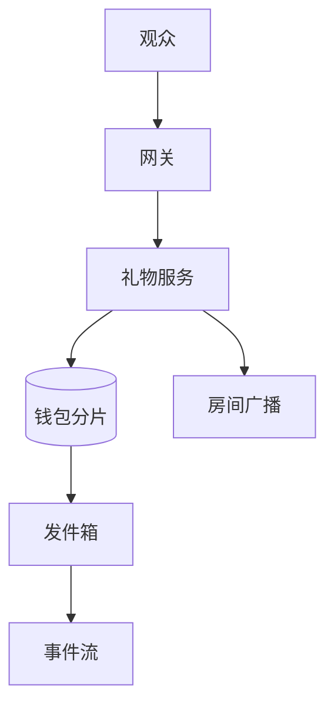
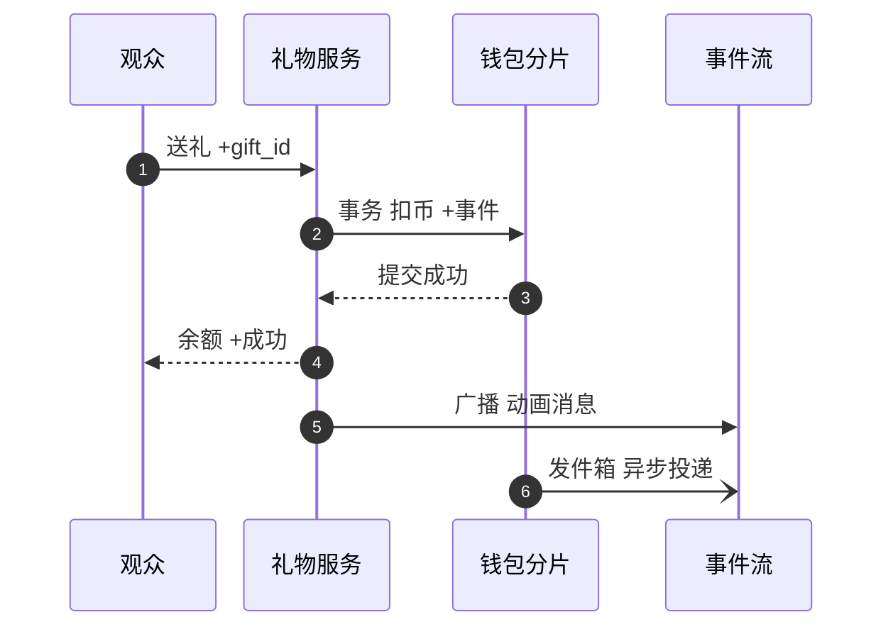
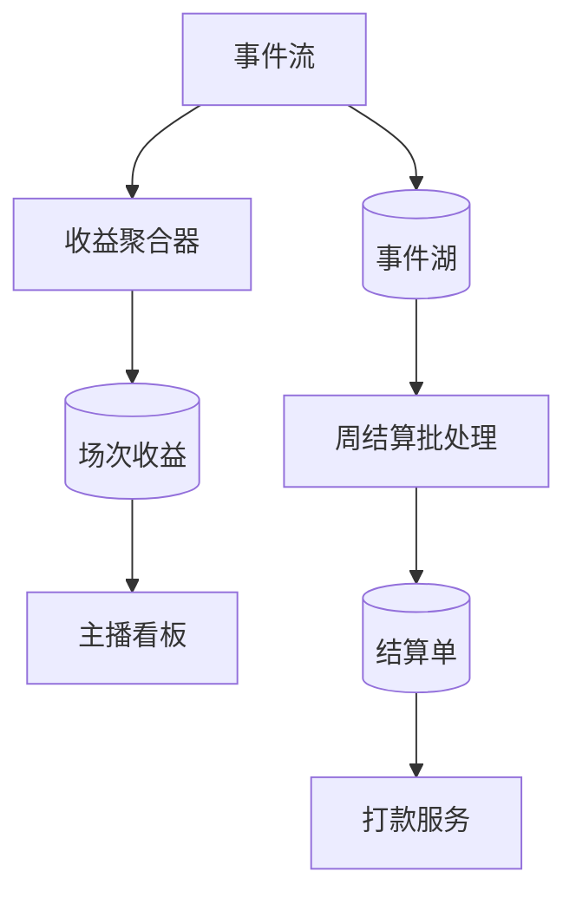

# SD02 直播礼物与金币结算（Live Gift and Coin Settlement）（low priority）

## 题目

直播间里，观众先用真钱买金币（coin，预付的虚拟货币），再用金币给主播送礼物（gift，一种标了金币价格的虚拟道具）。主播收到的不是金币，而是按分成比例换算出来的收益点数（下文叫 diamonds）；每周一次，平台把主播当周的收益折成现金打给他。这条链子上有三个角色：花钱的观众、赚钱的主播、居中记账的平台，观众和主播可以在地球的任意两端。

难点有三个，而且彼此牵制。第一，扣币必须精确且只扣一次：用户网络差、点了两下、客户端重试，都不能多扣，也不能让余额变负。第二，热点：一场万人的 PK 直播，一秒钟可以有几千份礼物涌向同一个主播，而同一行数据被加几千次是数据库最不擅长的事。第三，钱的口径：每场收益要精确到最小单位，每周结算要能解释每一分钱，所以实时看到的数字和最终结算的数字之间必须有一套可对账的关系。

面试官通常的说法是：设计一个全球分布、高度精确的金币追踪与结算系统，处理来自世界各地的实时虚拟礼物，保证幂等，给出每场直播的精确主播收益，并支持可靠的每周结算。你需要把「实时展示」和「钱的真相」分开讲清楚。下面的数字是练习用的假设，面试时以面试官当场给的数字为准。

## 澄清问题

开场用三分钟问完下面八个问题，把答案写在白板角落。每个问题都会改变设计。

1. **规模是多少：每天多少份礼物、峰值多少、最热的房间每秒多少？** 决定钱包要不要分片，以及主播侧的写入怎么摊开。下面假设每天 2 亿份礼物、峰值 10 倍、最热房间每秒 5,000 份。
2. **金币充值在范围内吗？** 充值涉及应用商店或支付渠道，本身是 [[sd01-payment-system]] 那类问题。这里把它当成黑盒，只关心「收到渠道通知后恰好入账一次」。
3. **送礼时扣币要多快、多严格？** 通常是：同步扣币、绝不为负、延迟几十到两百毫秒；主播侧的收益显示可以晚几秒。这条决定了「强一致的只有钱包，其余最终一致」。
4. **观众和主播会在不同的区域吗？数据要留在本地吗？** 会，也要。这决定钱包按用户的归属区域（home region）存放，礼物事件跨区域异步传递。
5. **「每场收益」怎么定义？** 一场是开播到关播；被撤销的礼物算不算；展示给主播看的数字是近似还是精确。这决定要不要在实时流之外保留一条可重算的真相路径。
6. **结算周期、币种和分成：每周几点截止？分成比例会不会中途调整？有没有最低打款额和税？** 这决定事件里要不要固化分成比例，以及晚到的事件放进哪个周期。
7. **充值被退款或盗刷时怎么办？** 应用商店会在币已经花掉之后发来退款通知，余额可能变负。这决定钱包要不要允许负债状态，以及主播收益要不要有保留期。
8. **礼物有连击吗？价格会变吗？** 连击决定一次点击对应一个还是多个事件；价格变动要求事件里带价格版本。

## 需求

**功能需求（按优先级）**

1. 送礼扣币：带客户端生成的 `gift_id`，重试安全，余额不足明确拒绝。
2. 金币充值入账：渠道通知重复、乱序都只入账一次。
3. 主播收益累计：每场直播的收益，实时展示，结束后精确。
4. 每周结算：按周期汇总主播收益，生成不可变的结算单，并交给打款。
5. 撤销与退款：充值退款、礼物撤销都通过追加冲销来处理，不改历史。
6. 对账与审计：任何时点都能证明金币总量守恒。
7. 房间内实时礼物榜与动画（近似，放最后）。

**非功能需求**

| 维度 | 目标 | 说明 |
|---|---|---|
| 扣币正确性 | 同一个 `gift_id` 至多扣一次；余额永不为负 | 产品承诺，不为延迟让步 |
| 送礼延迟 | p99 小于 200 ms | 钱包在用户归属区域，同区域几毫秒，跨区域一次往返约 100–200 ms |
| 送礼可用性 | 99.99% | 钱包不可用时失败关闭（fail closed）：拒绝送礼，不放行 |
| 持久性 | 已确认的扣币与事件零丢失 | 钱包主库同步复制到另一个可用区 |
| 主播收益展示 | 几秒内可见，允许误差 | 展示是估计值，不是结算依据 |
| 结算精确度 | 每个整数单位都能追溯到具体事件 | 汇总值等于事件之和，差异为 0 |
| 结算周期 | 每周一次，截止后 24 小时内出结算单 | 晚到事件进下一周期的调整项 |
| 保留 | 事件与分录保留 7 年 | 财务与监管 |

**明确不做**：礼物特效与动画本身、推荐与排序、风控模型（只留调用点）、税务计算细节、应用商店的收据校验实现。

## 容量估算

下面是假设，用来推出设计，不是任何真实产品的流量。

- 礼物：2 亿份/天 ÷ 86,400 秒 = **2,315/s 平均**，按 10 倍峰值取 **约 23,148/s**。
- 每份礼物的写入：礼物事件 1、钱包余额 1、币的流水 1、发件箱 1，合计 4 行。峰值 23,148 × 4 = **约 92,593 行写入/秒**。分 **32 个钱包分片**，每片约 2,894 行/秒，单片 MySQL 或 Postgres 轻松承受。
- 事件存储：每条约 200 B，2 亿 × 200 B = **40 GB/天，14.6 TB/年**。
- 热点房间：50 万观众里 1% 在同一秒送礼，就是 **5,000 份/秒落在一个主播身上**。如果每份都去更新主播余额那一行，行锁串行后若每次持锁 2 毫秒，上限 500/s，只有需求的十分之一。
- 主播侧拆分：把一场的收益拆成 16 个子计数器，每个约 312 次/秒，已经在可承受范围内；再加 1 秒的本地预聚合，每个子计数器每秒只写一次。
- 跨区域流量：23,148/s × 200 B = **4.6 MB/s，约 37 Mbps**，完全不是约束，所以事件跨区域异步复制即可，没必要为它牺牲钱包的单点写入。
- 房间广播：天真的做法是每份礼物通知全部观众：5,000/s × 50 万 = **25 亿条/秒**，不可能。合并成每秒约 10 条房间消息后是 10 × 50 万 = **500 万条/秒**，仍然很大，要由边缘推送层分摊，这也是为什么展示路径必须与钱的路径分开：展示可以丢、可以合并，钱不行。
- 充值：假设每天 500 万次，平均 58/s，峰值约 579/s，量很小。
- 周结算：一周 **14 亿条**事件 × 200 B = **280 GB**。集群聚合读取吞吐按 2 GB/s 算，扫描只要 **140 秒**；500 万位主播的结算单 × 300 B = **1.5 GB**。结论：结算不需要实时系统，一个夜间批处理就够，难点在口径而不在算力。
- 场次：每天 200 万场，每周 1,400 万行场次收益，约 2.8 GB。

**驱动设计的那个数字**是 5,000/s 对 500/s：写入主播余额这件事如果放在送礼的同步路径上，系统在最热的那一秒会被自己拖垮。所以送礼路径上只有观众的钱包，主播的收益是事件异步汇总出来的。

## API

```yaml
POST /v1/gifts
Headers: Authorization: <user token>
Body: { "gift_id": "<client uuid>", "room_id": "r_1", "gift_type": "rose", "count": 1 }
200: { "gift_id": "...", "coins_charged": 7, "balance": 1303 }
402: 余额不足，余额不变
409: 同一个 gift_id 内容不同
410: 房间已关闭

POST /v1/coins/topups/notify          # 渠道通知入口，服务端校验收据
Body: { "platform": "apple", "transaction_id": "t_88", "user_id": "u_1", "coins": 700 }
200: 已入账或此前已入账，两种返回一致

GET  /v1/rooms/{room_id}/earnings     # 展示用，近似
GET  /v1/creators/{id}/statements?period=2026-W42   # 结算单，不可变
POST /internal/settlement/{period}/run # 内部，幂等
```

`gift_id` 由客户端在点击时生成并随重试复用。连击里每一次点击是独立的 `gift_id`，或者一次连击带 `combo_id` 加序号，服务端按序号去重。价格由服务端按当时的价格版本决定，客户端传来的价格一概忽略。

## 数据模型

| 实体 | 键 | 关键字段 |
|---|---|---|
| Wallet | `user_id`（分片键） | `coins`、`version`、`home_region`、`status` |
| CoinLedger | `(user_id, seq)` | `delta`、`reason`（topup / gift / refund / adjust）、`ref_id`；只增不改 |
| TopUp | `(platform, transaction_id)` | `user_id`、`coins`、`state`；唯一键就是去重 |
| GiftEvent | `gift_id`（主键） | `sender`、`creator`、`session_id`、`gift_type`、`price_version`、`coins`、`share_bps`、`share_micro`、`event_time`、`status`（valid / reversed） |
| Outbox | `outbox_id` | 与 GiftEvent 同事务写入，待投递到事件流 |
| SessionEarnings | `(session_id, shard)` | `share_micro`；展示用计数器，分 16 个子行 |
| SettlementPeriod | `period_id` | 起止时间、`state`（open / frozen / closed） |
| Statement | `(creator_id, period_id)` | 汇总、调整项、税、净额，生成后不可变 |
| Payout | `payout_id` | 与结算单一对一，状态机同 [[sd01-payment-system]] |

两处设计值得先说清。第一，事件里固化了 `share_bps`（分成比例，万分之一为单位）和 `share_micro`（这份礼物给主播的份额，单位是万分之一金币），之后分成比例怎么改都不影响历史。第二，金额全是整数：7 个金币、35% 分成，`share_micro` = 7 × 3,500 = **24,500**，即 2.45 个金币当量。如果每份礼物各自向下取整成整数 diamonds，每份会损失 0.45，占 18.4%，一周 14 亿份就是系统性的误差；所以按单位 `micro` 存，只在结算时对汇总值取整一次。

每份礼物的记账（单位：micro）：借 `user_coin_liability` 70,000；贷 `creator_earnings_payable` 24,500；贷 `platform_gift_revenue` 45,500。三行之和为 0，币是平台的预付负债，花出去的那一刻才变成收入。

## 高层设计

分成两条路径：送礼的同步路径（只碰观众的钱包），以及收益的异步路径（事件汇总、展示、结算）。

**送礼路径**



观众请求经网关到礼物服务。礼物服务校验房间正在直播、取当前价格版本，然后向观众归属区域的钱包分片发起一个事务：写礼物事件、条件扣币、写币流水、写发件箱。事务提交后礼物服务通知房间广播层播放动画；发件箱由独立进程投递到事件流。



图中编号对应的每一步：

1. 观众点击送礼，客户端生成 `gift_id`，网络不好时重试复用同一个。客户端可以先乐观地播放动画，失败再撤销。
2. 礼物服务把请求交给观众归属区域的钱包分片，在一个事务里做四件事：插入 GiftEvent（`gift_id` 唯一，重复则读出原结果）、`UPDATE wallet SET coins = coins - :price WHERE user_id = ? AND coins >= :price`、写币流水、写发件箱。
3. 影响行数为 0 表示余额不足，事务回滚，没有任何副作用。
4. 返回成功与最新余额。客户端此刻才认为这次送礼确定生效。
5. 房间动画走独立的广播通道，尽力而为（best effort），丢了不影响钱。
6. 发件箱进程把事件投递到事件流，至少一次。

**收益与结算路径**



聚合器做 1 秒的本地预聚合，再写入分片计数器，供房间内和主播看板展示。事件流同时落到事件湖（对象存储上的列存文件）。周结算批处理从事件湖读取该周期的全部有效事件，按主播汇总，生成结算单，交给打款服务。展示用的计数器和结算用的批处理是两条独立的路径，批处理才是真相，计数器只是它的实时近似。

## 深挖

### 一、恰好一次入账：幂等键、条件扣币、至少一次传递

问题：充值通知会重复、乱序；送礼会重试；事件流是至少一次。要让每个效果恰好发生一次，办法是**每个入口一个去重键，每个出口一个幂等消费**。

**充值。** 去重键是 `(platform, transaction_id)`。服务端先向渠道校验收据，然后在一个事务里插入 TopUp（主键冲突就说明已处理过）、增加余额、写币流水。渠道的重复通知、乱序通知都落在同一个主键上，只入账一次。退款通知到达时写一条负的冲销流水；币已经花掉时余额变负，钱包进入负债状态，禁止继续送礼，充值后抵扣。

**送礼。** `gift_id` 是主键。同一个 `gift_id` 再来，事务里的插入冲突，直接返回第一次保存的结果。扣币用条件更新而不是先查后改：`WHERE coins >= :price` 把「余额检查」和「扣减」合成一条原子语句，并发的两次送礼不会同时看到旧余额。

**下游。** 发件箱到事件流是至少一次，消费者要幂等。聚合器的做法是**按 `gift_id` 去重**（分区内保留近期的 `gift_id` 集合），并且展示计数器本来就允许微小误差；真正的结算由批处理从事件湖重算，那里用 `gift_id` 做去重，所以流里的重复不会进入账。

被否决的方案：（a）端到端的 Kafka 事务，它只覆盖 Kafka 内部，钱包那一端的数据库不在其中；（b）钱包和主播账户做两阶段提交，把可用性耦合起来，并且主播账户成了热点，不可接受；（c）扣币后直接更新主播余额再发消息，崩溃时两边对不上。

崩溃点：钱包事务提交前崩溃，什么都没发生，客户端重试；提交后、回复前崩溃，客户端重试时读到已保存的结果；发件箱投递前崩溃，进程重启后继续投递，下游靠去重吸收重复。

### 二、全球钱包：归属区域单点写入，为什么不做多主

问题：用户遍布全球，钱包要有「不为负」这个全局约束。

| 方案 | 做法 | 为什么选或否决 |
|---|---|---|
| 多主复制加合并 | 各区域都能改余额，事后合并（如计数型 CRDT） | 合并只保证最终收敛，不能保证任何时刻不为负，两个区域可以同时花光同一笔余额，**否决** |
| 全球强一致数据库 | 每次扣币做跨区域的共识提交 | 每次送礼多一次跨区域往返，p99 轻松破 200 ms，**否决** |
| 区域额度切片 | 把余额预先切给各区域，各自在额度内扣 | 额度用完要回源协调，实现复杂，退款与回收额度的规则繁多，**暂不选** |
| **归属区域单点写入** | 每个用户的钱包有唯一的归属区域，所有扣币都路由到那里 | 同区域几毫秒，跨区域一次往返；约束靠单点的条件更新保证，**选择** |

选择归属区域单点写入。大多数送礼发生在用户自己的区域，跨区域的只是出差或跨区观看的少数用户，多出的 100–200 ms 可以接受。主播所在区域不必同步参与：礼物事件异步复制过去（37 Mbps）。数据驻留要求下，钱包留在本区域，跨区域流转的事件只带脱敏的用户标识。

区域整体故障时：**失败关闭**，该区域用户暂时不能送礼，因为无法确认余额。若要恢复服务，需要把异步复制的备份提升为主库，此时最近 RPO（恢复点目标，允许丢失的数据窗口）内的扣币可能丢失，相当于用户多得几份免费礼物。敞口有界：峰值每个钱包分片 723 份/秒 × RPO，若 RPO 是 5 秒，一个分片最多约 3,600 份礼物。晋升前必须先让旧主库与流量隔离（fencing），避免脑裂时双方都在扣币，晋升后用事件湖里的事件与钱包流水对账补记。

### 三、热点房间：主播侧一律不做同步更新

问题：5,000 份/秒去更新一个主播，是行锁的 10 倍。送礼的观众各自有钱包，分散在 32 个分片上，没有热点；热点只在主播这一侧。

选项：

- **同步更新主播余额**：上限 500/s，且把送礼路径的延迟绑在最热的一行上，**否决**。
- **Redis 对主播自增**：快，但 Redis 故障转移会丢最后一批自增，数字永远对不齐，**只能做展示**。
- **把主播收益拆成 16 个子计数器**：每个 312/s，可以承受，读取时求和。
- **只写事件，收益是事件的汇总**：送礼路径对主播零写入。

选择最后一种，再叠加子计数器做展示。事件流按 `gift_id` 的哈希分区，64 个分区下每个分区约 362 条/秒，分布均匀；绝不按主播分区，那样最热主播的 5,000/s 会压在一个分区上。聚合器内先做 1 秒的本地预聚合（5,000 条合成每个子计数器每秒一次写入），再写 `(session_id, shard)` 子行。因为求和满足交换律，事件乱序、重试顺序不同都不影响结果，所以不需要保序。

房间里的礼物动画是另一条路径：服务端把相邻的礼物合并成每秒约 10 条房间消息，边缘推送层分发，允许丢失和合并。这条路径坏了，用户看不到动画，但钱一分不差。

### 四、每场精确收益：实时是估计，批处理是真相

问题：主播要在直播时看到收益在涨（几秒内），同时要求场次结束后的数字一分不差。两个要求矛盾的地方在于：实时流里有重复、有迟到、有撤销。

**归属。** `session_id` 由礼物服务在扣币时按房间当前的场次盖章，客户端不能选，也不能事后改。这样一份礼物属于哪一场没有歧义。

**实时。** 流式聚合器按上面的方式写子计数器，主播看板读取求和。它是估计值，允许微小的偏差，页面上标明「预估」。

**真相。** 场次结束并过了水位线（watermark，等待晚到数据的时间，例如 30 分钟）之后，批处理从事件湖按 `session_id` 重算：去重（`gift_id`）、排除已撤销、累加 `share_micro`，写入最终场次收益并覆盖流式结果。同时比较两者：差异超过阈值就报警，说明流式路径有 bug 或丢事件。

**撤销。** 被撤销的礼物不删除，而是追加一条负数的冲销事件，或者把 `status` 置为 reversed 并记录原因。批处理按有效状态计算。

**取整。** 全程以 micro 整数累加，只在结算时对周期汇总值向下取整一次，取整的余数记入下一周期，这样不会因为每份礼物取整而漏掉主播的钱。

### 五、每周结算：切分、冻结、不可变结算单、对账不变量

问题：何时切分周期、迟到的事件怎么办、重跑会不会出两个结果。

1. **切分。** 周期按事件时间 `event_time`（UTC）切分，每个周期有版本化的汇率与分成表，周期开始时锁定。
2. **冻结。** 周期结束后等待水位线（例如 6 小时），覆盖区域故障转移和异步复制带来的迟到，之后该周期的状态置为 frozen。冻结之后才到达的、属于该周期的事件，不改这个周期，而是作为下一周期的「调整项」，带上原因。
3. **汇总。** 批处理按主播汇总有效事件的 `share_micro`，减去冲销，对汇总值取整一次，得到 diamonds，再按锁定的汇率折成现金。输出写到临时表，校验通过后原子切换，所以重跑得到完全相同的结果。
4. **结算单。** `(creator_id, period_id)` 唯一，生成后不可变。低于最低打款额的结转到下一周期。税与扣款作为单独行。结算单交给打款服务，后面是 [[sd01-payment-system]] 里的打款状态机，同一个键不会重复打款。
5. **对账不变量。** 每个周期在每个区域检查三条：（a）观众被扣的金币总数 = 主播份额 + 平台份额 + 已冲销部分；（b）币的总量守恒：累计充值 − 累计消费 − 退款 = 全部钱包余额之和；（c）结算单汇总 = 事件汇总，差异为 0。任何一条不成立，周期不进入打款，由财务和工程一起处理。
6. **异常检测。** 单个主播环比变化超过 50%、某区域占比突变，进入人工复核，因为刷礼物洗钱是真实的风险。

规模上这是一个夜间批处理：280 GB 的扫描在 2 GB/s 下需要 140 秒，主播结算单 1.5 GB。

## 故障与边界

| 组件 | 故障时的影响 | 缓解 |
|---|---|---|
| 钱包分片主库 | 该分片用户暂时不能送礼 | 同步副本自动接管；失败关闭，不放行 |
| 区域整体故障 | 该区域用户不能送礼 | 失败关闭；晋升前隔离旧主库；事件湖补记对账 |
| 发件箱投递停滞 | 主播收益展示变旧，结算不受影响 | 积压告警；批处理从钱包事件重放校验 |
| 事件流积压 | 展示变慢 | 展示可降级；钱不经过它 |
| 聚合器崩溃重启 | 展示计数器重复或缺失 | 去重；批处理覆盖 |
| 房间广播层故障 | 看不到动画 | 尽力而为；不影响扣币 |
| 渠道通知延迟或重复 | 币晚到账或重复通知 | 去重键；用户端可手动刷新 |
| 结算批处理失败 | 周期晚出结算单 | 重跑幂等；结果原子切换 |
| 汇率或分成表错误 | 整个周期金额不对 | 结算前由两人复核差异；结算单不可变，更正走下期调整项 |

**欺诈与退款。** 盗刷的充值被退款时，币可能已经变成礼物，主播已经计入收益。常见的做法是给主播收益设置保留期（例如 7 天），保留期内如果来源币被追回，对应收益被冲销；保留期之后的欠款由平台承担坏账或从主播未来收益里扣。这是产品与风控的取舍，要在面试里明确说出来，而不是回避。

**限速与滥用。** 同一用户每秒送礼次数设上限；新账号的充值和送礼额度设上限；异常集中的「甲送乙」关系对（刷礼物洗钱）进入风控。

## 面试官追问

1. **用户网络差，点了两次，会被扣两次吗？** 不会。每次点击带客户端生成的 `gift_id`，重试复用同一个；服务端 `gift_id` 主键唯一，第二次读出第一次的结果。
2. **余额并发扣减怎么防止变负？** 条件更新 `WHERE coins >= :price`，检查和扣减是一条语句，行锁保证串行；影响行数为 0 就拒绝。先查后改在并发下会同时看到旧值。
3. **为什么不用 Redis 记余额？** Redis 主从是异步复制，故障转移会丢最近的扣减，用户平白多出币。Redis 只适合缓存余额的读取，扣减必须落在有同步副本的关系库。
4. **一个主播一秒收到 5,000 份礼物，数据库扛得住吗？** 不在同步路径上更新主播。礼物只写事件，聚合器 1 秒预聚合后写 16 个子计数器；事件流按 `gift_id` 分区，避免热分区。
5. **展示的收益和最终结算对不上怎么办？** 展示是估计值并标明预估；场次结束后批处理重算并覆盖；差异超过阈值就报警排查流式路径。
6. **周期已经冻结，又来了一批迟到事件怎么办？** 不改已冻结的周期，作为下一周期的调整项，带原因，结算单上可见。
7. **应用商店在币花光之后发来退款通知？** 写负的冲销流水，余额可以为负，钱包冻结送礼；主播收益有保留期，期内被追回的币对应的收益被冲销，期外由平台承担坏账。
8. **某个区域宕机了？** 失败关闭，不放行送礼；恢复时晋升副本之前先隔离旧主库；丢失窗口内的扣币用事件湖补记；暴露的上限是每分片 723 份/秒乘以 RPO。
9. **分成比例中途改了，历史怎么办？** 事件里固化了 `share_bps` 和价格版本，历史不变；新比例只作用于之后的事件；周期的汇率在周期开始时锁定。
10. **每份礼物取整会有什么问题？** 7 个币 35% 分成是 2.45，向下取整 2，每份损失 0.45，占 18.4%，14 亿份会累积成系统性误差。用 micro 整数累加，只在汇总值上取整一次。
11. **怎么证明账没有错？** 三条不变量：观众扣币 = 主播份额 + 平台份额 + 冲销；币的总量守恒；结算单汇总 = 事件汇总。每个周期每个区域都检查，不成立就不打款。
12. **同一份礼物从两个区域同时到达怎么办？** 钱包只有一个归属区域，扣币路由到那里，`gift_id` 主键唯一，只有一个会成功。

## 评分要点

一个 senior 的回答必须覆盖：

- 先区分两个世界：同步的、强一致的只有观众钱包；主播收益与展示是异步汇总的事件视图。
- 估算后得出：5,000/s 对 500/s，所以主播侧不做同步更新；跨区域流量只有 37 Mbps，所以事件异步复制没压力。
- 幂等：`gift_id` 主键、充值的 `(platform, transaction_id)`、条件扣币、发件箱至少一次加消费者去重。
- 全球钱包：归属区域单点写入，并说出为什么多主和全球强一致不行；区域故障失败关闭以及晋升前隔离旧主库。
- 热点：事件流按 `gift_id` 分区而不是按主播；子计数器；1 秒预聚合；展示与钱的路径分离。
- 精度：整数 micro，固化分成比例，只取整一次；实时是估计，批处理从事件湖重算才是真相。
- 结算：事件时间切分、水位线冻结、迟到事件进调整项、结算单不可变、重跑幂等、三条对账不变量。
- 退款与欺诈：负余额、保留期、坏账归属，这些要说清楚是产品取舍。
- 主动说出自己设计里最弱的一环（区域故障后的丢失窗口，或保留期长度的取舍）。

时间不够时（30 分钟）：5 分钟澄清，5 分钟画两条路径，20 分钟讲幂等加热点加结算三件事，区域故障与欺诈各用一分钟口述规则。

## 延伸阅读

- 通用题解：[[solution-digital-wallet]]、[[solution-leaderboard]]、[[solution-ad-click-aggregation]]。
- 同批题单：[[tiktok-sd-index]]；支付与打款的细节见 [[sd01-payment-system]]。
