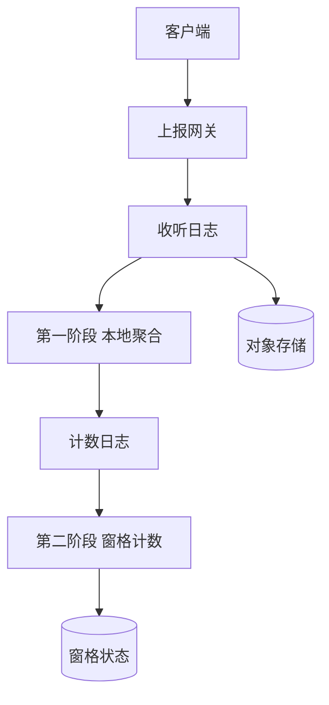
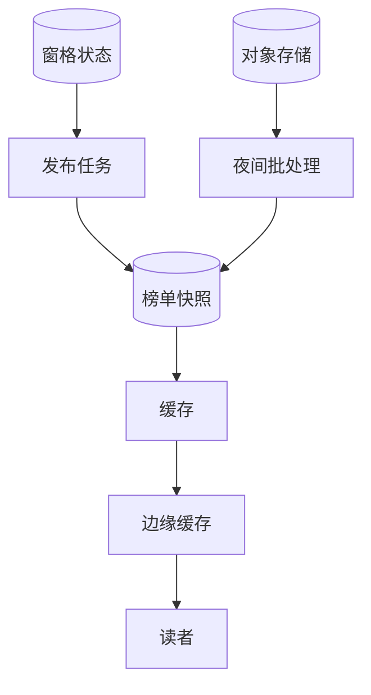
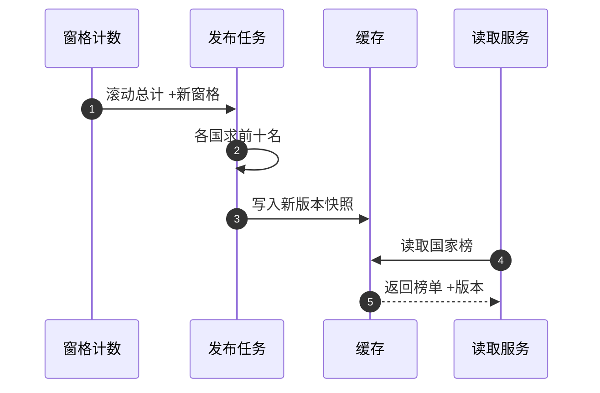

# SD03 热门榜单 Top-K（Top-K Trending）

## 题目

热门榜单系统回答一个简单的问题：此刻，某个国家最热门的十首歌是什么。用户每听一次歌，客户端就上报一条「收听事件」；系统把这些事件按国家、按时间窗口数一遍，每隔几分钟更新一次榜单，榜单页面被海量用户反复打开。同一个骨架也用来做「近一小时点赞最多的帖子」「全球和各地区的热门视频」。

写入和读取都是大流量，但它们对系统的要求完全不同：写入是不能丢、可以晚几分钟的计数流；读取是极高并发、内容几乎不变的小结果。真正的难点有四个：先问清楚榜单是要精确还是近似，因为答案会改变整个设计；窗口怎么滑，才不会让状态膨胀成窗口数的倍数；一首爆款歌会让某一个键的写入暴涨，怎么避免压垮一个分区；各国的榜单怎么合并成全球榜。

面试官通常给一两句话：设计各国热门歌曲榜，每秒大约 5 万次收听，每秒大约 5 万次读取，每个国家的前十名大约每 10 分钟刷新一次。他会先看你有没有先估算，有没有问清楚精确还是近似；不问这一点就直接开画，是常见的失分原因。下面的数字是练习用的假设，面试时以面试官当场给的数字为准。

## 澄清问题

开场用两分钟问完下面八个问题，把答案写在白板角落。每个问题都会改变设计。

1. **规模：每秒多少次收听、多少次读取？** 决定要不要分区流处理、读取要不要 CDN。下面假设写 5 万/s、读 5 万/s。
2. **榜单要精确还是近似？允许多大误差？** 这是整题最重要的一问。如果答案是「第十名和第十一名对调没关系」，那近似就合理；如果要「每一次收听都算数」，就走精确计数。后面会算出：在这个规模下，精确计数的代价很小。
3. **窗口是什么：最近 24 小时、最近 1 小时、还是自然日？** 滑动窗口和固定窗口的状态成本和实现完全不同。
4. **刷新频率：10 分钟一次，还是实时？** 决定是否需要把「增量更新」做到毫秒级。榜单的读者通常容忍分钟级。
5. **维度：按国家、按全球、还是还有流派等？** 维度越多，需要合并的计数越多。
6. **一次「收听」怎么算？** 播放满 30 秒才算？同一用户反复播放同一首算几次？这决定去重与防刷逻辑。
7. **榜单的 K 是多少，平局怎么办？** K=10 与 K=1000 的数据结构不同；平局要有确定的排序规则（例如按首次达到时间），否则榜单会抖动。
8. **一致性要求：两个用户短时间看到不同版本可以吗？** 通常可以：可用性优先，延迟小于 1 秒，结果可以略旧。

## 需求

**功能需求（按优先级）**

1. 上报收听事件，不丢，允许重复上报。
2. 查询某国家、某窗口（如最近 24 小时）的前 K 名及其计数。
3. 榜单定期刷新，每次刷新是一个带版本的完整快照。
4. 全球榜，由各国计数合并得到。
5. 趋势榜（涨得最快的）与普通榜并存。
6. 晚到事件、重复事件、刷量事件有明确的处理规则。

**非功能需求**

| 维度 | 目标 | 说明 |
|---|---|---|
| 写入吞吐 | 峰值 5 万事件/s，不丢 | 事件先进持久化的日志，后面的计算可以慢 |
| 读取延迟 | p99 小于 100 ms，结果来自缓存 | 读取不触发任何计算 |
| 读取可用性 | 99.99% | 宁可返回旧榜单，也不返回错误 |
| 榜单新鲜度 | 刷新周期 10 分钟，从事件发生到进入榜单小于 15 分钟 | 刷新周期加处理延迟 |
| 精度 | 按澄清结果：本设计默认精确计数，误差为 0 | 近似作为内存吃紧时的退路，见深挖一 |
| 一致性 | 最终一致 | 同一时刻不同读者可能看到相邻两个版本 |
| 恢复 | 处理器崩溃后几分钟内追上 | 靠检查点加日志重放 |

**明确不做**：个性化推荐榜、实时秒级榜单、歌曲元数据与封面的存储、版权与区域可用性过滤（只在发布结果时按列表过滤）。

## 容量估算

下面是假设，用来推出设计，不是任何真实产品的流量。

- 收听事件：5 万/s × 86,400 = **43.2 亿次/天**，每小时 **1.8 亿次**。
- 事件体积：每条约 100 B（用户、歌曲、国家、时间戳、设备），5 万 × 100 B = **5 MB/s，432 GB/天**，日志保留 7 天约 **3.0 TB**。体积小，一个中等规模的 Kafka 集群足够。
- 分区：按 64 个分区，每个分区 **约 781 条/s**，约 78 KB/s，远低于一个分区的上限，所以分区数是为了并行度与重放速度，不是为了吞吐。
- 精确计数的状态：假设每 10 分钟窗格（pane）里有 800 万个不同的（国家，歌曲）对，每个计数项约 16 B，一个窗格 **128 MB**；最近 24 小时共 144 个窗格，**18.4 GB**，平摊到 64 个分区，**每个分区约 288 MB**。全部放在流处理器的本地状态里毫无压力。作为对比，原始事件 24 小时是 69 GB。
- 滚动总计：假设 24 小时内共有 6,000 万个不同的（国家，歌曲）对，每对 16 B，**约 0.96 GB**。每 10 分钟扫一遍求前 K 名，按每秒扫 5,000 万项算只要 **1.2 秒**。
- 近似的结果，仅作对比：Count-Min Sketch（CMS，一种用固定内存估计频率的草图结构），取误差 ε = 万分之一、失败概率 δ = 1%，宽 ⌈e/ε⌉ = 27,183，深 ⌈ln(1/δ)⌉ = 5，每个 4 字节计数器，一个草图 **约 544 KB**。200 个国家 × 3 个窗口 = 600 个草图，共 **326 MB**，比精确的 18.4 GB 小 **约 56 倍**。代价是误差上界 ε × N：美国最近 1 小时 N = 4,500 万，误差最多 **4,500**。
- 读取：5 万/s，每份榜单约 2 KB，**100 MB/s，约 800 Mbps**。全部榜单加起来：200 国 × 3 窗口 × 2 KB = **1.2 MB**，整套结果小到每台 API 服务器都能放在内存里。
- 边缘缓存回源：假设 100 个边缘节点，600 份榜单，缓存 30 秒，回源 = 100 × 600 ÷ 30 = **2,000/s**；加一层区域汇聚缓存（10 个）后只有 **200/s**。
- 热点：假设美国占 25%，即 12,500 事件/s；一首爆款歌占其中 10%，即 **1,250/s**，一个分区轻松处理。放大 100 倍后是 **125,000/s**，才会压垮一个分区。所以热键处理在这个规模下是预防，在更大规模下是必需。

**驱动设计的那个数字**是 18.4 GB：精确计数的全部状态比一台机器的内存还小。这意味着「为了省内存而用近似算法」在这个规模下不成立；近似算法的价值在更大的键空间（逐用户、逐城市、逐分钟）或者内存受限的场景。真正需要设计的是窗口、分区和读取这三件事。

## API

```yaml
POST /v1/listens
Body: { "events": [ { "event_id": "e_1", "user_id": "u_1", "song_id": "s_1",
                       "country": "US", "ts": 1760000000 } ] }
202: 已接收（只代表写入日志，不代表已计入榜单）
429: 单用户或单设备超出速率

GET /v1/songs/top?region=US&window=24h&k=10
200: { "region": "US", "window": "24h", "version": 8123, "as_of": 1760000600,
       "items": [ { "rank": 1, "song_id": "s_9", "count": 1052311 } ] }
404: 不支持的区域或窗口
```

上报接口只返回「已接收」，因为后面的计数是异步的。客户端攒一批再发，减少请求数。读取接口返回榜单所属的版本和 `as_of` 时间，让调用者知道这份榜有多旧；如果后台任务失败，仍然返回上一个版本并带上旧的 `as_of`，而不是报错。

## 数据模型

| 实体 | 键 | 关键字段 |
|---|---|---|
| ListenEvent | `event_id` | `user_id`、`song_id`、`country`、`ts`；Kafka 日志里，不进数据库 |
| PaneCount | `(country, song_id, pane_start)` | `count`；流处理器的本地状态，窗格宽 10 分钟 |
| RunningTotal | `(country, song_id)` | 最近 24 小时所有窗格之和；每次刷新时加新窗格、减过期窗格 |
| TopKSnapshot | `(region, window)` | `version`、`as_of`、`items[(song_id, count)]`；约 2 KB，写入缓存与对象存储 |
| DailyExact | `(date, country, song_id)` | 夜间批处理从日志重算的精确日榜，用来校正流式结果 |

关键的设计点：计数按（国家，歌曲）划分，同一首歌在同一个国家的全部计数只在一个分区里。这一点让「每个分区各自求前 K，再合并」成为精确的做法，见深挖四。

## 高层设计

系统分成两条路径：把事件变成窗格计数的写入路径，以及把榜单变成小结果提供给读者的发布与读取路径。

**写入与聚合路径**



上报网关做校验和限速后写入收听日志（按用户均匀分区）。第一阶段在每个消费者实例里把 1 秒内的事件按（国家，歌曲）合并成部分计数，再写入计数日志；第二阶段按（国家，歌曲）分区，把部分计数累加进 10 分钟的窗格。同时原始日志落到对象存储，供夜间批处理使用。

**发布与读取路径**



发布任务每 10 分钟启动一次，读取滚动总计，每个分区求出各国前 K 名，合并成完整的榜单快照，带版本号写入缓存和对象存储。读者请求先经过边缘缓存，几乎都在缓存命中。夜间批处理从原始日志重算精确的日榜，并和流式结果对比。



图中编号对应的每一步：

1. 每 10 分钟，窗格计数把最新窗格加入滚动总计，同时减去滑出 24 小时之外的最老窗格，这是增量更新，不需要重新扫描全部窗格。
2. 发布任务扫描滚动总计，每个国家用一个大小为 K 的小顶堆求前 K 名，6,000 万项扫描约 1.2 秒。
3. 新快照整体写入缓存，带单调递增的版本号，旧版本在写入完成前一直保持可读。
4. 读取服务从缓存读取，不触发计算。
5. 返回榜单与版本；缓存里没有新版本时仍然返回旧版本，调用者看到旧的 `as_of`。

## 深挖

### 一、精确还是近似：先算代价，再选

问题：这是面试官最看重的一问，直接开画而不问精度会让整个设计含糊。

**先算精确的代价。** 上面的估算说明，窗格状态 18.4 GB，分到 64 个分区每个 288 MB，精确计数毫无难度。所以默认答案是精确，近似只是内存受限时的退路。

**近似的两种工具。**

- **Count-Min Sketch。** 一个 d 行 w 列的整数矩阵。每个元素用 d 个哈希函数各选一列加一；查询时取 d 个位置的最小值。它只会高估，不会低估；以至少 1 − δ 的概率，估计值不超过真实值加 ε × N（N 为插入总量）。参数 w = ⌈e/ε⌉、d = ⌈ln(1/δ)⌉。两个草图（相同的哈希函数）逐格相加，就得到合并后的草图，这个可合并性是它的第二个价值。局限：草图本身不能列出哪些键最大，需要另配一个候选堆：每次更新后，若估计值超过堆里最小的，就把这个键放进去。
- **Space-Saving。** 只维护 m 个计数器。来了新键且计数器满了，就替换当前最小的那个，新键的计数从被替换者的计数加一开始。保证：真实频率大于 N/m 的键一定在表里，且任何键的高估量不超过 N/m。它直接给出候选键与计数，天然是 top-K 的结构。

**误差到底影响什么？** 误差只影响榜单的边界。美国最近 24 小时 N = 10.8 亿，第十名大约占 1%，即 1,080 万；ε = 万分之一时误差最多 10.8 万，也就是第十名计数的 1%。第一名与第二名差距通常远大于这个值，不会对调；只有第十与第十一差距小于 1% 时才可能对调。同样的 ε，1 小时窗口误差 4,500，约是第十名 45 万的 1%。这个量化比说「大概准」有说服力。

**选择。** 默认精确计数加两阶段聚合；声明：如果键空间增长到精确状态放不下（例如逐用户逐歌曲、全历史累计），再换 Space-Saving 或 CMS 加候选堆，每个分区各自维护，合并时误差相加。被否决的方案：一开始就用草图，只能省掉本来就不大的内存，却引入误差和候选堆的复杂度。

### 二、窗口：滑动窗口不要用窗口数乘以事件数的做法

问题：「最近 24 小时，每 10 分钟刷新」是一个滑动（hopping）窗口。窗口宽 24 小时、步长 10 分钟，朴素实现里一个事件属于 24 × 60 ÷ 10 = **144 个窗口**，每个窗口各存一份计数，状态膨胀 144 倍。

| 窗口类型 | 含义 | 适用 |
|---|---|---|
| 滚动（tumbling） | 不重叠，如每天 0 点到 24 点 | 日榜、周榜，状态最小 |
| 滑动（hopping / sliding） | 宽度固定、步长小于宽度，相邻窗口重叠 | 「最近 24 小时」 |
| 会话 | 按活动间隔切分 | 不适用 |

**窗格法（panes）。** 把时间轴切成 10 分钟的窗格，每个事件只加到一个窗格，状态只存 144 个窗格。24 小时的结果是 144 个窗格之和。刷新时不重新求和，而是维护一个滚动总计：加上刚结束的窗格，减去刚滑出的窗格。这要求聚合可以做减法，计数可以，最大值不行（最大值要换成单调队列之类的结构）。结果：每个事件一次累加，每次刷新一次加一次减，不论窗口多宽。

**迟到与乱序。** 手机离线攒着事件、几分钟甚至几小时后才上报，是常态。处理方式分三层：（a）按**事件时间**（用户收听发生的时间）而不是处理时间归入窗格，因为计数满足交换律和结合律，晚到的事件只要把对应窗格加一即可，不需要排序；（b）设一个允许迟到的上限（例如 10 分钟，通过水位线 watermark 实现），窗格在水位线越过之后封闭，更晚的事件不再计入流式结果；（c）夜间批处理从日志重算精确的日榜，所有晚到事件在那里被纳入，用来修正「昨天的榜」和衡量流式结果的偏差。榜单是否包含 3 小时前才上报的收听，要在澄清时说明：趋势榜不需要，日榜需要。

**去重与防刷。** 至少一次的传递会产生重复：每个事件有 `event_id`，流处理器按它在最近 10 分钟内去重；超过这个范围的重复很少，且榜单本来容忍微小误差。同一用户对同一首歌的计数设上限（例如每小时最多计 N 次），并过滤异常设备，否则刷量会直接改榜。

### 三、分区与热键：两阶段聚合，把热点限制在实例个数以内

问题：键选错，一首爆款歌会让一个分区过载；键选对，仍然要说清楚数字。

**第一个选择：原始事件的分区键。** 用 `user_id`（或随机轮询），事件被均匀分到 64 个分区，不存在偏斜，因为用户数远多于分区数。如果按 `song_id` 分区，爆款歌的所有事件落在一个分区。

**第二个选择：计数的分区键。** 窗格计数需要「同一（国家，歌曲）的所有计数在一起」才能累加，因此第二阶段必须按（国家，歌曲）分区，这里热键就回来了。化解办法是**两阶段聚合**：第一阶段在每个消费者实例里把 1 秒内的事件合成部分计数；第二阶段收到的不再是原始事件，而是各实例的部分计数。64 个第一阶段实例，每个对同一个热键每秒最多发一条，第二阶段对任何一个键的输入上限就是 **64 条/s**，而不论该键的原始事件有多少。放大 100 倍后，爆款歌是 125,000 事件/s，经过第一阶段后仍然只有 64 条/s，约缩小了 1,950 倍。

**如果连部分计数的汇合也成为瓶颈**（实例数极大），可以给热键加盐：键变成（国家，歌曲，盐），盐取 0 到 7，第二阶段先在盐的粒度累加，发布时再把 8 个部分相加。这样写入摊开，读取时多合并 8 项。

**分区数。** 64 个分区下每个分区 781 事件/s，远没有到上限，选 64 是为了追赶积压时有足够的并行度，也为将来增长留余地。扩分区会改变按键分配的映射，要么在低峰期做并从检查点重新开始，要么一开始就多留一些。

### 四、从各国合并到全球：何时精确，何时不精确

问题：全球榜怎么得到？是把各国的前十名合并吗？

**不能直接合并各国的前十名。** 举例：歌曲 X 在三个国家都是第 11 名，各有 90 次，合计 270；歌曲 Y 只在一个国家排第 3，有 100 次。每个国家的前十名里都没有 X，合并后 Y 得 100，而 X 的真实全球计数 270 更高。局部前 K 的并集不等于全局前 K。

**键分区带来的好处。** 在一个国家内部，因为分区键是（国家，歌曲），同一首歌的计数全在一个分区，所以「每个分区求出本分区的前 K，再取并集的前 K」是**精确**的：全局前 K 的每个元素一定是它所在分区的前 K。

**全球榜的正确做法**是合并完整的计数而不是榜单：把各国的滚动总计按歌曲相加（6,000 万项，一次扫描约 1.2 秒）；用草图时直接相加草图，这是 CMS 可合并的价值；用 Space-Saving 时合并摘要，误差相加。全球榜单独作为一个维度发布，与国家榜同一批快照、同一个版本，避免读者在两个榜单之间看到不一致的时间点。

**趋势榜。** 「最热」永远是同一批头部歌曲；「趋势」看增长。用最近 1 小时的计数除以该歌曲的基线（例如前几天同一时段的平滑均值，分母加一个平滑项避免新歌被除以零），按比值排序，并设最小计数门槛过滤噪声。

### 五、读取与发布：快照、版本、旧榜单也比没有榜单好

问题：5 万读/s，800 Mbps。

榜单是预先算好的小结果：全部加起来 1.2 MB。读取路径上没有计算，只有三层缓存：边缘缓存（30 秒）、区域汇聚缓存、API 服务器的进程内存。回源只有 200 到 2,000/s，源头是快照存储。因为内容在 10 分钟内不变，缓存的失效时间设成 30 秒即可，不需要主动失效。

**发布是原子的。** 整份快照一起换，带单调递增的版本号，旧版本在新版本写完之前一直可读。读者不会看到「一半新一半旧」的榜单。

**失败时保持旧榜。** 发布任务失败，读取服务继续返回上一版本，`as_of` 如实暴露；告警条件是 `now − as_of` 超过 2 个刷新周期。这和「可用性优先于一致性」一致。

**一致性。** 不同读者在边缘缓存刷新的间隙里可能看到相邻两个版本，这是可以接受的最终一致，不需要强制同步。

## 故障与边界

| 组件 | 故障时的影响 | 缓解 |
|---|---|---|
| 上报网关 | 事件丢失 | 多可用区；客户端本地缓冲重试；事件带 `event_id` 容忍重复 |
| 收听日志（Kafka） | 写入失败 | 副本数 3；生产者确认全部副本；客户端重试 |
| 流处理器崩溃 | 窗格计数暂停 | 每分钟检查点加日志重放；288 MB 每分区，恢复以分钟计 |
| 计数重复（至少一次） | 轻微高估 | 事件 ID 去重；夜间批处理校正 |
| 发布任务失败 | 榜单变旧 | 保持上一版本；`as_of` 告警 |
| 缓存全冷 | 回源压力上升 | 快照只有 1.2 MB，直接预热；回源是对象存储读取，不是计算 |
| 热键 | 单分区过载 | 两阶段聚合；必要时加盐 |
| 数据倾斜到某国家 | 某个第二阶段分区变慢 | 监控每分区延迟；按国家加盐或拆分 |
| 时钟不准的客户端 | 事件时间错乱 | 服务端校正到服务器时间附近；超出范围的事件按到达时间处理 |

流式结果与夜间精确日榜每天比较一次，差异率和高估方向写入指标：长期偏高说明去重有漏，长期偏低说明迟到事件丢得太多。

## 面试官追问

1. **榜单必须精确吗？** 先问清楚。默认精确：状态 18.4 GB，平摊到 64 个分区每个 288 MB，代价很低。只有键空间爆炸时才换 CMS 加候选堆或 Space-Saving，并说明误差只影响榜单边界。
2. **CMS 的误差界怎么算？** 宽 w = ⌈e/ε⌉，深 d = ⌈ln(1/δ)⌉；以不小于 1 − δ 的概率，高估量不超过 ε × N。取 ε = 万分之一、δ = 1%，美国最近 1 小时 N = 4,500 万，误差最多 4,500，约占第十名计数的 1%。
3. **滑动窗口怎么避免状态膨胀？** 切成 10 分钟的窗格，每个事件只加到一个窗格，窗口 24 小时共 144 个窗格；刷新时用滚动总计，加新窗格、减旧窗格。
4. **事件晚到、乱序怎么处理？** 按事件时间归入窗格，计数可交换所以不需要排序；水位线设 10 分钟，之后封闭；更晚的由夜间批处理从日志重算。
5. **一首爆款歌把一个分区压垮怎么办？** 原始事件按用户均匀分区；计数用两阶段聚合，每个键的第二阶段输入上限等于第一阶段实例数（64 条/s），与原始流量无关。极端时加盐。
6. **全球榜能把各国前十名合并吗？** 不能。X 在三个国家各排第 11 名、合计 270，Y 只在一国排第 3、有 100，合并前十会漏掉 X。要合并完整计数（或可合并的草图）。
7. **为什么刷新周期是 10 分钟而不是实时？** 读者不需要，且每次刷新要扫 6,000 万项约 1.2 秒；周期越短，发布与缓存压力越大。要更快，就改成增量维护堆，而不是整体重算。
8. **5 万读/s 怎么扛？** 榜单整套 1.2 MB，读取不计算；边缘缓存 30 秒加区域汇聚，回源 200 到 2,000/s；快照原子替换，带版本。
9. **重复事件和刷量怎么处理？** 事件 ID 在 10 分钟内去重；单用户对单曲每小时计数设上限；异常设备过滤；夜间批处理对账。
10. **处理器崩溃后怎么恢复？** 从最近的检查点恢复状态，再从对应偏移重放日志；重放期间榜单保持旧版本；恢复耗时以状态 288 MB 的读取与重放量计，通常几分钟。
11. **「趋势」和「最热」有什么不同？** 最热是绝对计数，趋势是相对基线的增长，要有基线、平滑项与最小计数门槛，否则新歌因分母很小而被刷到榜首。
12. **榜单不一致怎么办：两个用户看到不同榜单？** 可以接受。每份榜单带版本和 `as_of`；一致性弱但可用性高；这类场景没有用户依赖「全球同一秒看到同一份榜」。

## 评分要点

一个 senior 的回答必须覆盖：

- 先估算：5 万事件/s、432 GB/天、18.4 GB 精确状态，得出「精确计数很便宜」这个结论。
- 先问精确还是近似，并说出近似的误差只落在榜单边界，用 ε × N 算给面试官看。
- 窗口：窗格法，滚动总计加一减一；事件时间、水位线、夜间批处理纠正迟到。
- 分区与热点：原始事件均匀分区，计数两阶段聚合；热键的第二阶段输入有上界；说出规模放大 100 倍时才真的需要。
- 合并：局部前 K 的并集不等于全局前 K，要合并完整计数；键分区使每国内部的合并精确；CMS 可相加。
- 读取：整套榜单 1.2 MB，三层缓存，原子快照，版本号，失败时保留旧榜。
- 可靠性：至少一次加去重；检查点；夜间批处理对账；`as_of` 告警。
- 趋势与最热的区别。
- 主动说出自己设计里最弱的一环（迟到事件超过水位线之后的流式偏差，或去重窗口之外的重复）。

时间不够时（30 分钟）：3 分钟估算并问精度，10 分钟画两条路径，剩下时间讲窗格、两阶段聚合和读取缓存，CMS 与趋势榜各用一分钟口述。

## 延伸阅读

- 通用题解：[[solution-top-k]]、[[solution-leaderboard]]、[[solution-ad-click-aggregation]]、[[solution-metrics-monitoring]]。
- 同批题单：[[tiktok-sd-index]]；同样靠窗口聚合的另一题见 [[sd08-metrics-aggregator]]。
