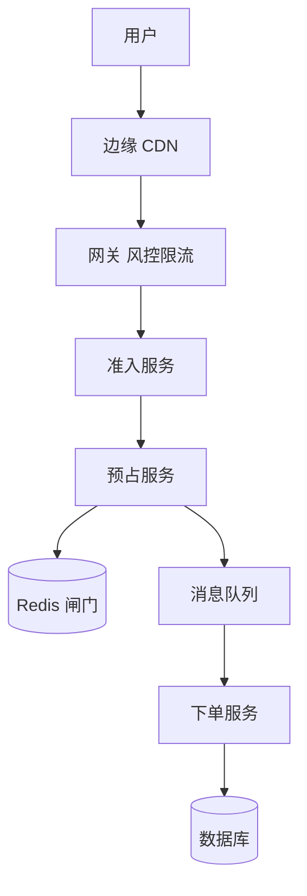
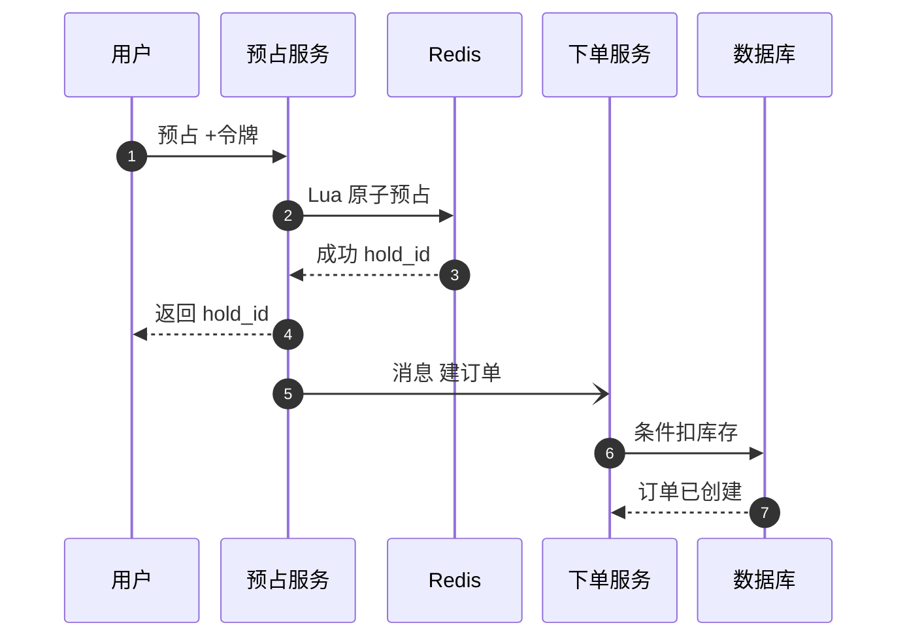
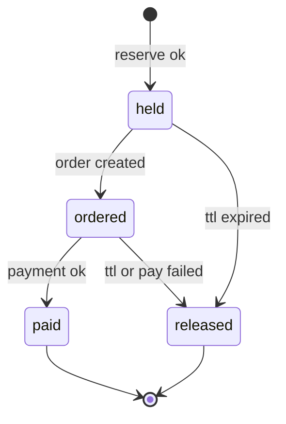

# SD04 秒杀与抢票（Flash Sale）

## 题目

秒杀是在一个固定的时刻开卖少量商品：1,000 张演唱会门票、几百台限量手机。开卖前几百万人守在页面前，倒计时归零的那一秒，请求量是平时的上千倍，而商品在几秒内就卖完。系统要同时做到四件事：扛住这一波突发流量而不崩；绝不超卖（卖出的数量不能超过库存）；每人限购一件；用户付款失败或超时后，库存要回到可售状态。

难点藏在数字里：几十万请求每秒，对应的是只有一千件的库存，也就是 99.9% 的请求注定失败。所以设计的主线不是「怎么处理这么多请求」，而是「怎么便宜地拒绝绝大多数请求，只让很少的请求碰到库存」。库存是单个热点，数据库的单行更新每秒只能做几百次，缓存的单个键也有上限。另外一个常见的坑是缓存和数据库的库存不一致：缓存说有货，数据库说没有；或者回补库存时补了两次。

面试官的提法常常有两层。第一层是流量浪涌：用负载均衡、队列或排队室（waiting room）、限流，不要让突发流量直接打到后端服务和数据库。第二层是库存：如何保证不超卖，缓存和数据库怎么配合，下单失败怎么回补。常见的变体是「10 个库存、1 万 QPS」或「10 万人抢 1,000 个座位」。下面的数字是练习用的假设，面试时以面试官当场给的数字为准。

## 澄清问题

开场用两分钟问完下面八个问题，把答案写在白板角落。每个问题都会改变设计。

1. **库存多大、几个商品、多少人抢？** 这决定了准入阀要放多少人，也决定库存要不要分桶。下面假设单个热门商品 1,000 件，100 万人在线，开抢后 10 秒内每人平均点 5 次。如果库存是 10 件，设计不变，只是准入的数量更小。
2. **限购吗，一人几件？** 一人一件意味着要有按用户去重的原子检查，不能只靠库存计数。
3. **公平性：先到先得，还是抽签？有没有优先级（例如长途乘客优先）？** 先到先得会奖励网络快的人和机器人；抽签更公平，也让准入可以做成无状态的。优先级要求准入分层。
4. **付款流程：占位保留多久？付款失败、超时之后怎么办？** 决定占位（hold）的生存时间和回补逻辑。假设占位 10 分钟，付款转化率 70%。
5. **卖的是可替换的数量，还是具体的座位？** 座位要按座位粒度加锁，并且一次占多个相邻座位；数量只是一个计数器。下面先按数量讲，座位放在追问。
6. **用户要立刻得到结果，还是可以排队等？** 排队页的体验决定准入是同步拒绝还是异步通知。
7. **秒杀系统出问题，能不能影响主站？** 几乎总是不能，这决定要做资源隔离（bulkhead，舱壁）。
8. **开售时间是否提前已知？** 已知，所以可以预热、提前扩容、预先加载页面，这是秒杀和普通突发流量最大的区别。

## 需求

**功能需求（按优先级）**

1. 开售时刻之前不能下单，之后可以；时间以服务端为准。
2. 下单预占库存：原子、不超卖、一人一件。
3. 预占成功后进入付款；付款成功转为订单，失败或超时则释放库存。
4. 用户能查到自己的状态：排队中、已抢到待付款、已售罄、已支付。
5. 防机器人、防刷。
6. 售罄后快速拒绝，不再消耗后端资源。

**非功能需求**

| 维度 | 目标 | 说明 |
|---|---|---|
| 超卖 | 0 | 数据库里 `sold <= total` 永远成立 |
| 一人限购 | 0 个违例 | 缓存中的去重加数据库唯一索引双重保证 |
| 流量隔离 | 秒杀故障不影响主站 | 独立集群与独立的数据库连接池 |
| 边缘吞吐 | 峰值约 50 万请求/s | 由 CDN 与网关承担，不进入核心 |
| 抢购结果延迟 | p99 小于 300 ms（预占接口） | 预占只涉及一次 Redis 脚本 |
| 售罄后拒绝 | 秒级内全网生效 | 售罄标志推送到边缘 |
| 一致性 | 库存强一致；展示最终一致 | 数据库是库存真相，缓存是闸门 |

**明确不做**：商品详情与评论、支付渠道本身（视为黑盒，状态通过回调进来，细节见 [[sd01-payment-system]]）、推荐、优惠券叠加。

## 容量估算

下面是假设，用来推出设计，不是任何真实产品的流量。

- 请求：100 万人 × 每人 5 次 = 500 万次，集中在 10 秒内，即 **50 万请求/s**。
- 带宽：每个请求约 500 B，响应约 1 KB，50 万 × 1.5 KB × 8 = **6 Gbps**。这不可能打进源站，必须在边缘消化。
- 直接打 Redis：一个实例对简单的 Lua 脚本大约能处理 5 万次/s（量级假设）。50 万 ÷ 5 万 = **10 倍**，所以必须先挡掉绝大多数请求。
- 直接打数据库的单行：对同一行 `UPDATE ... WHERE stock > 0`，若每次持锁 2 毫秒，上限 1 ÷ 0.002 = **500/s**。1,000 件库存在放开的流量下几秒内就卖完，但失败的请求会一起排队，把连接池耗尽。
- 占位需求：库存 1,000，付款转化率 70%，一次性最多要同时持有 1,000 ÷ 0.7 ≈ **1,429 个占位**，才能在付款失败后依然卖光。
- 准入量：放进 **2,000 人**（100 万人里的 0.2%），比需要的占位数多一点作为缓冲。这 2,000 个请求打到 Redis，按 2,000/s 算，**0.5 秒**就能把 1,000 件卖完。
- 排队页轮询：100 万人每 2 秒查一次状态 = **50 万次/s**，每次响应约 200 B，**100 MB/s**。这是一个所有人相同的小 JSON，缓存在 CDN，源站几乎为零。
- 占位过期：2,000 个占位在 10 分钟内过期，清扫任务的速率只有 2,000 ÷ 600 = **3.3/s**。
- 回补：付款转化率 70% 意味着 30% 的占位，即 **300 件**会回到可售状态，需要重新分配给还在等的人。
- 多商品变体：1,000 个商品各 1,000 件共 100 万件，下单峰值约 2 万单/s，每单约 1 KB，消息队列吞吐 **20 MB/s**，没有压力。

**驱动设计的那个数字**是 50 万 ÷ 2,000：99.6% 的请求不能走进库存路径。设计的核心是把「50 万请求/s」变成「2,000 次预占」，剩下的都是便宜的拒绝。

## API

```yaml
GET  /v1/sales/{sale_id}/status        # CDN 缓存 1 秒，所有人相同
200: { "state": "upcoming | open | sold_out", "server_time": 1760000000,
       "open_at": 1760000300 }

POST /v1/sales/{sale_id}/ticket        # 申请准入令牌，开售窗口内一人一次
200: { "admitted": true, "token": "<signed, expires in 10 min>" }
200: { "admitted": false }

POST /v1/sales/{sale_id}/reserve
Headers: X-Admission-Token: <token>, Idempotency-Key: <uuid>
200: { "hold_id": "h_1", "expires_at": 1760000900 }
409: 已经抢到过（一人限购）
410: 已售罄
429: 速率超限

POST /v1/orders                        # 用 hold_id 创建订单并去支付
GET  /v1/orders/{id}
```

状态接口对所有人返回同一份内容，所以能整个缓存在 CDN；真正有状态的只有 `reserve`。令牌是服务端签名的，包含用户、商品和过期时间，无法伪造；预占接口带幂等键，用户重复点击得到同一个 `hold_id`。

## 数据模型

| 实体 | 键 | 关键字段 |
|---|---|---|
| Sale | `sale_id` | `sku_id`、`open_at`、`total`、`per_user_limit`、`state` |
| Inventory（数据库） | `sku_id` | `total`、`sold`；约束 `sold <= total` |
| Stock（Redis） | `stock:{sku}` | 可售数量，闸门，不是真相 |
| Bought（Redis） | `bought:{sku}` | 已占位的用户集合，用于一人一件 |
| Holds（Redis） | `holds:{sku}` | 有序集合，成员 `hold_id:user`，分数是过期时间 |
| Hold（数据库） | `hold_id` | `user_id`、`sku_id`、`state`（held / ordered / paid / released）、`expires_at` |
| Order | `order_id` | `hold_id` 唯一、`(sku_id, user_id)` 唯一、`state`、`paid_at` |

两个唯一索引是最后的防线：`(sku_id, user_id)` 保证一人一件，`hold_id` 保证同一个占位只产生一张订单。缓存里出了任何差错，这两个索引都能挡住违例。

## 高层设计

系统分成两条路径：用户抢的路径（把 50 万请求逐层过滤成 2,000 次预占），以及占位的生命周期（付款、过期、回补）。

**抢购路径**



边缘 CDN 负责静态页面和状态 JSON，网关做登录校验、人机验证和速率限制，准入服务无状态地决定谁拿到令牌（见深挖一），只有拿到令牌的少数请求才到预占服务。预占服务在 Redis 里执行一个原子脚本：检查用户是否已抢过、检查库存、扣减、登记占位。成功就立刻返回 `hold_id`，同时把「建订单」消息放进队列，下单服务异步消费，最终在数据库里用条件更新确认库存。



图中编号对应的每一步：

1. 用户带令牌请求预占。令牌已过滤掉 99.6% 的请求，到这里只剩约 2,000 个。
2. 预占服务在 Redis 里执行一个脚本，脚本内的检查与扣减不可分割。
3. 脚本返回成功并登记了占位，记录过期时间。
4. 立刻返回 `hold_id`，用户进入付款页，响应时间只有一次 Redis 往返。
5. 建订单的消息放进队列（削峰），至少一次投递。
6. 下单服务在数据库里执行 `UPDATE inventory SET sold = sold + 1 WHERE sku_id = ? AND sold < total`，再插入订单，`hold_id` 和 `(sku_id, user_id)` 的唯一索引兜底。
7. 数据库确认后订单状态变为 ordered；条件更新影响行数为 0 就回滚并释放占位。

**占位的生命周期**



## 深挖

### 一、浪涌防护：逐层便宜地拒绝，准入做成无状态抽签

问题：50 万请求/s 要变成 2,000 次预占。每一层都只拒绝，不增加状态。

**逐层过滤。**

1. **客户端与 CDN。** 页面和脚本在开售前就预加载到边缘；倒计时用服务端时间校准；按钮在开售时刻之前不可点，并加入随机的几十毫秒抖动，避免所有请求在同一个毫秒到达。售罄之后，状态 JSON 变成 `sold_out`，客户端不再发请求。
2. **边缘与网关。** 必须登录且账号有实名或付款历史；人机验证（验证码或工作量证明）；单账号、单设备、单 IP 的速率限制。这一层挡住脚本和机器人。
3. **准入阀（waiting room）。** 只放进约 2,000 人，下一段详述。
4. **预占服务。** 现在每秒不超过几千次，Redis 轻松处理。
5. **数据库。** 只收到约 1,000 到 1,429 次真正要落库的预占。

**为什么准入做成无状态抽签。** 先到先得需要一个全局队列：100 万次入队即 10 秒内 10 万次/s 的写入，还要存 100 万条排队状态，并且奖励网络更快的人和机器人。无状态抽签：令牌的结果是 `H(密钥, user_id, sale_id)` 对 100 万取模后是否小于阈值（阈值 2,000，概率 0.2%）。每个用户一个确定的结果，不需要任何存储，重复请求得到同样答案，机器人换 IP 也没有用，因为按账号抽。代价是不是严格的先到先得，需要在产品上说明是「抽签」，并且防止一个人注册多个账号，也就是依赖账号侧的实名与风控。

**窗口后的补充。** 抽签只发生在开售后的前几秒。之后有占位过期或付款失败回补出来的库存（上面的 300 件），用另一种方式放人：已有令牌但没抢到的人可以重试（每令牌每秒一次，约 1,000 次/s，完全承受得住）；或者开一个先到先得的补充队列，数量小，用 Redis 即可。

**售罄的快速拒绝。** 库存归零的那一刻，预占服务把 `sold_out` 写入状态接口并推送到网关的本地内存，之后绝大多数请求在网关就被拒绝，不再进入 Redis。

被否决的方案：（a）只做限流，不分层，限流器本身要处理 50 万/s，且放行的是随机的一批请求，没有减少对库存的压力；（b）全部请求排队等一个单线程消费者，100 万个请求堆在队列里，延迟不可控，内存也撑不住；（c）只靠数据库，见深挖二。

### 二、不超卖：Redis 做闸门，数据库做真相

问题：库存是单个热点，必须同时做到原子、很快、不超卖、一人一件、崩溃后不丢。

| 方案 | 做法 | 评价 |
|---|---|---|
| 数据库行锁 | `UPDATE inventory SET stock = stock - 1 WHERE sku_id = ? AND stock > 0` | 正确，但单行上限约 500/s，等待的连接会耗尽连接池 |
| 只用 Redis | `DECR` 加去重 | 很快，但 Redis 故障转移会丢最近的扣减，没有持久真相，会超卖或少卖 |
| 单队列串行 | 每个商品一个队列，单消费者顺序判断 | 简单正确，延迟高，要另处理结果通知 |
| **Redis 闸门加数据库真相** | Redis 原子预占，数据库条件更新做最终确认 | 选择：快，并且数据库保证永不超卖 |

**Redis 脚本**（单线程执行，脚本内不会被其他命令打断）：

```lua
-- KEYS: stock, bought, holds    ARGV: user, hold_id, expire_ts
if redis.call('SISMEMBER', KEYS[2], ARGV[1]) == 1 then return 2 end
local s = tonumber(redis.call('GET', KEYS[1]))
if s == nil or s <= 0 then return 0 end
redis.call('DECR', KEYS[1])
redis.call('SADD', KEYS[2], ARGV[1])
redis.call('ZADD', KEYS[3], ARGV[3], ARGV[2] .. ':' .. ARGV[1])
return 1
```

返回 1 成功，2 已抢过，0 售罄。去重、扣减、登记占位在一次执行里完成，不存在「检查通过之后别人插进来」的空隙。

**数据库做最后一道。** 下单服务执行 `UPDATE inventory SET sold = sold + 1 WHERE sku_id = ? AND sold < total`，影响行数为 0 就拒绝并释放 Redis 里的占位；订单表上 `(sku_id, user_id)` 唯一。因此不变量 `sold <= total` 由数据库保证，与 Redis 的状态无关。

**Redis 出错的两种方向。**

- Redis 显示的库存比真实多（故障转移丢了扣减）：多放进几个人，他们收到预占成功，数据库拒绝，用户看到「已售罄」。体验不好，但绝不超卖。
- Redis 显示的库存比真实少（占位泄漏没有释放）：少卖。靠占位清扫任务和重建来修复：库存 = 总数 − 已售 − 当前有效占位数。

**热点与分桶。** 一个商品只有一个库存键，所有预占都打在同一个 Redis 实例。准入把预占压到每秒几千次，远低于 5 万次/s 的上限，所以单键就够。库存非常大时（比如 100 万件、预占 5 万次/s 以上），把库存拆成 16 个子键放在不同分片，用户按哈希路由到一个子键，空了就换相邻的一个；代价是尾部库存不均，最后几件会散落在各桶里，需要兜底合并。

### 三、占位的生命周期：回补必须幂等，过期不能依赖通知

问题：占位 10 分钟，付款失败或超时要还库存；还库存如果执行两次，库存就会虚增，接下来就会超出。

**状态机。** held（已占位）、ordered（已建单）、paid（已付款）、released（已释放）。每个转移是数据库里的一次比较并交换（CAS）：`UPDATE hold SET state = 'paid' WHERE hold_id = ? AND state IN ('held','ordered')`，影响行数决定谁赢。

**释放是幂等的。** 释放脚本先看占位是否还在：`if redis.call('ZREM', holds, member) == 1 then INCR stock; SREM bought user end`。只有 `ZREM` 真的删除了成员才会回补库存，所以重复释放、并发释放都只补一次。

**过期不依赖 Redis 的键过期通知。** 过期通知是尽力而为，可能丢。做法是有序集合 `holds:{sku}` 按过期时间排序，清扫任务每秒读取 `score <= now` 的成员，逐个执行上面的释放，同时把数据库里的占位置为 released。清扫速率只有 3.3/s，不是瓶颈。

**付款与过期的竞争。** 第 9 分 59 秒付款成功，第 10 分整清扫任务也在释放。两个转移都是对同一行的 CAS，只有一个能成功：付款先成功，占位就变成 paid，清扫的 CAS 影响行数为 0，什么也不做。清扫先成功，库存已经回补甚至被别人占了，迟到的付款回调发现占位已 released，此时钱已经收了：库存有就恢复订单，没有就自动退款（对账与退款细节同 [[sd01-payment-system]]）。

**双写问题。** 预占成功后要把「建订单」消息放进队列。Redis 写成功、队列写失败（或进程在两者之间崩溃），就出现有占位却没有订单消息。解法：占位本身就是意图记录。清扫任务发现创建超过 60 秒、数据库里还没有对应订单的占位，要么补发消息，要么直接释放。因为占位有过期时间，最坏的结果是库存被占用最多 10 分钟，然后回补，不会永久丢失。消费者按 `hold_id` 幂等，消息重复投递不会建两张订单。

**回补后的再分配。** 释放出的库存直接可被已有令牌的人重试抢到，没有额外的状态。

### 四、隔离、预热与降级：秒杀失败不能拖垮主站

问题：知道开售时间，但不知道流量的真实形状。

- **隔离。** 秒杀用独立的网关集群、独立的服务实例、独立的 Redis 和数据库连接池。就算全部打满，主站的下单、浏览、登录不受影响。这是舱壁模式：隔离是为了限制爆炸半径。
- **预热。** 开售前半小时扩容到目标容量（扩容比自动伸缩快，因为伸缩跟不上秒级浪涌）；预先把库存写进 Redis，预先建好数据库连接；对 CDN 预先加载静态资源；用压测流量演练过。
- **降级。** 浪涌期间关闭非核心功能：推荐、评论、积分、优惠券叠加；页面返回精简的静态版本；订单创建以外的写操作先排队。
- **熔断与限流。** 下游（订单服务、支付）变慢时，预占服务对新请求快速失败，返回「系统繁忙，请重试」，不让线程堆积。每个商品的预占速率设上限，防止一个爆款拖垮其他。
- **客户端行为。** 返回 429 时客户端带抖动的指数退避，不要立刻重试；否则一个失败请求会放大成十个。

## 故障与边界

| 组件 | 故障时的影响 | 缓解 |
|---|---|---|
| Redis 实例故障 | 预占不可用 | 失败关闭，展示「繁忙」；副本接管后用 `总数 − 已售 − 有效占位` 重建库存，再恢复放行 |
| Redis 主从切换丢扣减 | 多放人 | 数据库条件更新拒绝多余的；用户看到售罄 |
| 消息队列积压 | 订单创建变慢 | 占位 10 分钟内完成即可；积压告警；清扫任务补发 |
| 下单服务崩溃 | 占位没有订单 | 消费者幂等；清扫任务释放或补发 |
| 数据库故障 | 无法确认订单 | 占位保持在 Redis，恢复后继续；超时则释放 |
| 支付回调延迟 | 占位可能先过期 | 状态 CAS；迟到的成功走恢复或退款 |
| 准入令牌被滥用 | 同一令牌多次重放 | 令牌绑定用户与商品，预占幂等键；一人一件 |
| 机器人 | 大量虚假账号占位 | 实名、人机验证、设备指纹、限购；占位不付款自动释放 |
| 时钟偏差 | 开售时刻不一致 | 以服务端时间为准，客户端定期校准 |

**用户体验的边界。** 没抢到的用户立即看到明确的「未抽中」或「已售罄」，而不是转圈。抢到的用户看到倒计时的付款页。付款超时的用户收到通知并说明库存已释放。这些文案不是细节：用户在秒杀里最不能接受的是不知道结果。

## 面试官追问

1. **只有 10 件库存、1 万 QPS，怎么做？** 设计不变，准入数量缩到约 20 人。这时甚至可以只用数据库：准入后只有几十个请求，单行条件更新绰绰有余。要说清楚：先问库存量与准入量，再决定要不要引入 Redis。
2. **为什么不直接用数据库行锁扣库存？** 单行上限约 500/s，等待的连接会耗尽连接池，拖垮同库的其他业务。放在准入之后，行锁其实可用；放在没有准入的位置就不可用。
3. **Redis 宕机或主从切换丢了扣减怎么办？** 数据库条件更新是最终防线，不会超卖，最多是用户收到预占后又被告知售罄。恢复后用「总数 − 已售 − 有效占位」重建库存。
4. **怎么保证一人一件？** Redis 脚本里先查 `bought` 集合，数据库订单表 `(sku_id, user_id)` 唯一索引兜底；预占接口带幂等键，重复点击返回同一个 `hold_id`。
5. **付款超时，库存怎么还回去？回补会不会补两次？** 释放脚本只有 `ZREM` 真正删除成员才回补，重复释放不会重复回补；过期靠按分数排序的有序集合加清扫任务，不依赖过期通知。
6. **付款成功和占位过期同时发生怎么办？** 都是对同一行的 CAS，只有一个成功；付款迟到时钱已收，库存还在就恢复订单，否则自动退款。
7. **一个商品只有一个 Redis 键，会不会成为热点？** 准入后每秒只有几千次，低于单实例 5 万次/s 的上限；库存很大时拆成多个子键放到不同分片，用户哈希路由，空桶换相邻桶。
8. **抽签和先到先得，你选哪个？为什么？** 抽签无状态、不依赖网络快慢、不奖励机器人，实现便宜；代价是产品上需要说明规则，并依赖账号风控。先到先得更直观，但需要全局队列，且鼓励抢跑。
9. **选座场景（10 万人抢 1,000 个座位，长途乘客优先）怎么改？** 库存变成逐座位的占位：每个座位一个键，用 Lua 在一个区域内一次占多个相邻座位，要么全占要么全不占；优先级通过分层准入实现，先发优先档的令牌，再发普通档；座位图只读，来自缓存，占位才走脚本。
10. **消息队列积压了怎么办？** 预占已经完成并返回了 `hold_id`，积压只延迟建单；占位 10 分钟内有效；清扫任务补发丢失的消息；积压深度告警，消费者可水平扩展，按 `hold_id` 幂等。
11. **怎么保证秒杀系统挂了不影响主站？** 独立集群、独立 Redis 与数据库连接池；入口按秒杀域名或路径分流；超过阈值直接返回精简静态页。
12. **怎么验证这套设计？** 提前压测到 1.5 倍预期（75 万请求/s），包括 Redis 故障演练、消息队列积压演练、付款回调延迟演练；监控预占成功率、占位泄漏数、`sold` 与 Redis 库存之差。

## 评分要点

一个 senior 的回答必须覆盖：

- 先估算并说出主线：50 万请求/s 对 1,000 件库存，99.6% 的请求不能走进库存路径，设计就是逐层便宜地拒绝。
- 分层防线：CDN 与预加载、网关风控与限流、无状态准入（抽签）、预占服务、数据库；售罄标志推到边缘。
- 说清楚直接用数据库行锁（500/s）和直接打 Redis（10 倍超载）为什么都不行，准入之后为什么就行了。
- 不超卖的做法：Redis Lua 原子预占（去重加扣减加登记占位）做闸门；数据库条件更新和唯一索引做真相；解释 Redis 出错的两个方向。
- 占位生命周期：状态机用 CAS；释放幂等（`ZREM` 成功才回补）；过期用有序集合加清扫而不是过期通知；付款与过期竞争的处理；迟到成功的恢复或退款。
- 双写问题：占位本身就是意图记录，清扫任务补发或释放。
- 隔离、预热、降级、熔断，以及客户端的退避。
- 一人限购、机器人与公平性的取舍说清楚是产品选择。
- 主动说出自己设计里最弱的一环（抽签依赖账号风控，或 Redis 丢扣减后的用户体验）。

时间不够时（30 分钟）：3 分钟澄清并算出 50 万对 2,000，12 分钟画抢购路径并讲准入与 Lua 预占，10 分钟讲占位回补与 Redis 数据库一致性，5 分钟故障与隔离。

## 延伸阅读

- 通用题解：[[solution-flash-sale]]、[[solution-ticket-booking]]、[[solution-rate-limiter]]、[[solution-distributed-cache]]。
- 同批题单：[[tiktok-sd-index]]；付款与退款的细节见 [[sd01-payment-system]]。
