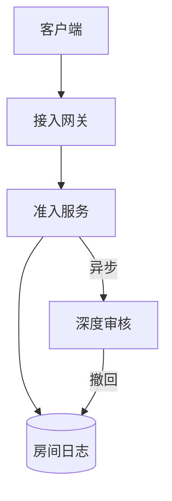
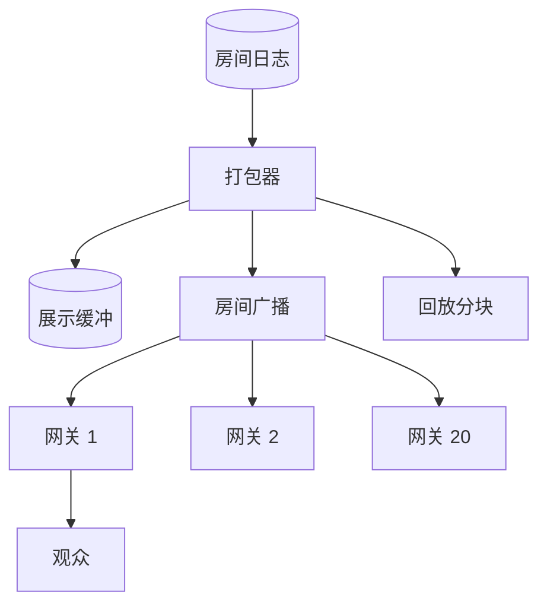
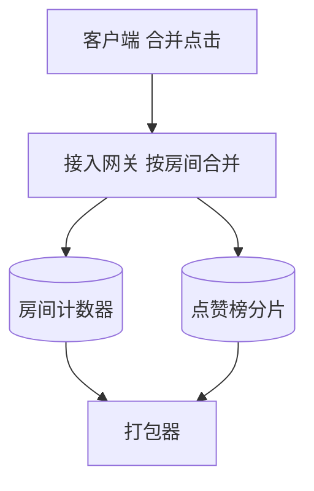
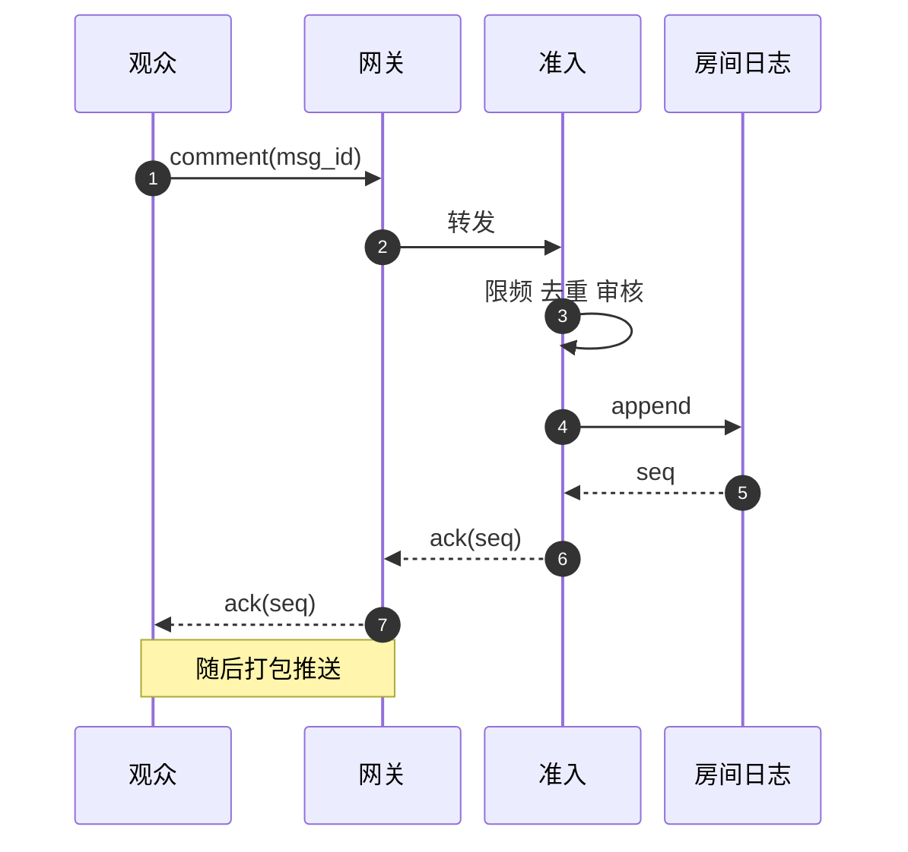
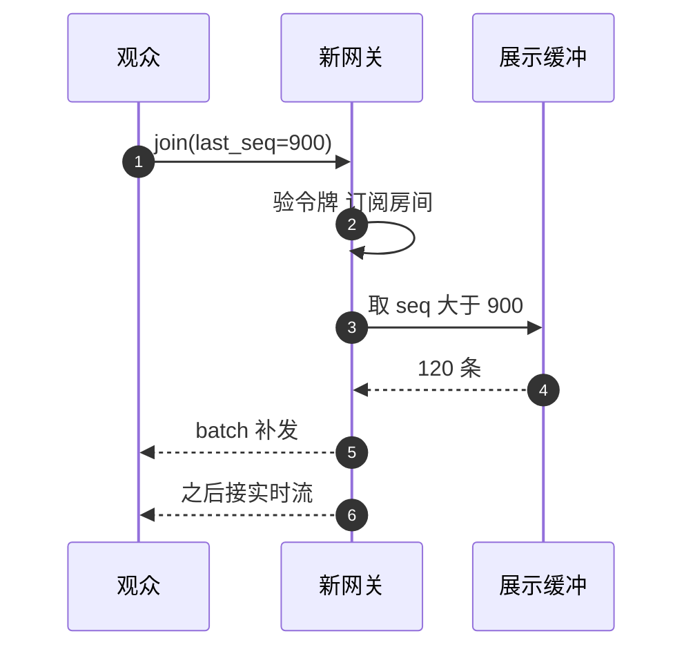

# SD05 直播间评论、点赞与弹幕（Live Comments, Likes and Danmaku）

## 题目

直播间里，观众发评论（comment），按屏幕上的爱心连点点赞（like），评论还会以弹幕（danmaku，从屏幕右边飘向左边的滚动文字）的形式盖在视频上。几十万人在同一个房间里同时发言时，每个人都要在一两秒内看到别人的发言，点赞数要跟着跳动，直播结束后回放视频时，评论还要出现在当初对应的画面上。这是一个「写入不大、读出爆炸」的系统：一条评论只写一次，却要送到一个房间里的所有观众。

难点有四个。第一，扇出（fan-out，一条消息变成给很多接收者的很多份拷贝）：一个百万人房间里每秒一万条评论，如果每条都送给每个人，就是每秒 100 亿次投递，任何机房都做不到，而且没有人读得完。第二，顺序：所有人看到的评论顺序要一致，回复要出现在被回复的评论之后。第三，点赞的写放大和热点：二十万次点击每秒打在同一个计数器上。第四，回放要把评论对齐到视频时间线，而不同观众看到的画面延迟不同，不能用「评论发出的墙钟时间」。面试官通常只说一句「设计直播间评论和点赞」，然后抓住一条流追问：扇出怎么做、顺序怎么保证、断线重连后怎么补、回放怎么同步。下面的规模数字是练习用的假设，面试时以面试官给的为准。

## 澄清问题

开场用两分钟问下面八个问题，每个都会改变设计。

1. **房间规模的分布和最大房间是多少？** 决定要不要分层扇出和采样。下文假设全平台同时在线 2,000 万观众、10 万个活跃房间，最大的一个房间 100 万观众、每秒 1 万条评论、每秒 20 万次点击。如果面试官说「房间最多 500 人」，一个 Redis 加一组 WebSocket 服务就够，这时要主动说出来，把时间让给别的点。
2. **每条评论必须送到每个观众吗？** 这是整题最大的分水岭。要全量送达，大房间无解；允许房间级采样，扇出成本就与评论速率无关。下文取「普通评论可以采样，礼物、系统消息、主播消息不能丢」。
3. **顺序要求是什么：全房间一致，还是只要每个用户自己的评论有序？** 全房间一致就需要每个房间一个排序点；只要每用户有序，则可以按用户分片，省去单点。
4. **点赞数要精确还是近似，要不要点赞排行？** 近似展示加延迟 2 秒，写路径可以大量合并；精确（比如和奖励挂钩）就要走事件日志。排行（榜前 100 名）会引入按用户的计数，写放大更严重。
5. **要不要回放，回放按什么时间线？** 直播结束后的回放、短视频上的弹幕都需要「评论 ↔ 视频位置」的对应，这决定评论要不要带流时间戳（stream timestamp，视频流自己的播放时间）。
6. **观众的画面延迟差多少？** 低延迟直播观众落后主播 1 到 3 秒，HLS（把视频切成小段下载的协议）观众落后 6 到 10 秒。差得越多，越不能拿到达时间对齐评论和画面。
7. **删除和禁言多快生效？** 违规评论要能撤回，已经推出去的消息也要从客户端消失，这决定流里要有「删除」事件，回放文件要能打补丁。
8. **观众分布在哪些区域，必须就近接入吗？** 决定要不要在边缘区域放接入网关，房间的排序点放在哪个区域，以及跨区域流量怎么控。

## 需求

**功能需求（按优先级）**

1. 观众进房后收到房间里实时的评论流，顺序一致；自己发的评论立刻看到。
2. 发送评论：有长度限制、频率限制和基础审核（敏感词、禁言、封号）。
3. 点赞：连点合并，房间总赞数实时跳动；可选的「本场点赞榜前 100 名」。
4. 断线重连后无缝续上，不重复、不乱序，丢了的普通评论允许缺口，礼物和系统事件不能缺。
5. 回放：按视频时间线取评论，支持拖动进度条（seek）。
6. 删除评论、禁言：已经推出的消息要撤回。

**非功能需求**

| 维度 | 目标 | 说明 |
|---|---|---|
| 端到端延迟 | 发出到其他观众屏幕 p99 小于 1.5 秒 | 观众读评论的节奏是秒级，不是毫秒级 |
| 发送者自己 | 本地立即显示，服务端确认后固定位置 | 延迟感为零，且被采样掉也不让发送者察觉 |
| 房间内顺序 | 所有观众看到同一顺序 | 回复才不会出现在原评论前面 |
| 可用性 | 99.95%，房间内评论流宁可降速也不能断 | 评论是锦上添花，不能拖累直播画面 |
| 点赞展示 | 近似，滞后不超过 2 秒 | 展示数不是账本 |
| 丢失容忍 | 普通评论可采样丢弃；礼物、系统消息零丢失 | 钱和公告走另一条通道 |
| 重连恢复 | 30 秒内断线可无缝续上 | 手机切网很常见 |

**明确不做**：礼物与虚拟币结算（见 [[sd02-live-gift-coin-settlement]]）、推荐与开播通知、评论的长期搜索与翻译。

## 估算

以下为假设，用来推出设计。

- 朴素扇出：1 万条/s × 100 万观众 = **100 亿次投递/s**，不可行。
- 房间级展示流：每个房间对所有观众发同一条流，限速 R = **10 条/s**（人眼读得动的上限）。一个百万人房间每秒 10 × 1,000,000 = **1,000 万次投递**，每条约 100 B，出口 **1 GB/s = 8 Gbps**。采样后保留比例 10 ÷ 10,000 = **0.1%**。
- 全平台：2,000 万观众 × 10 条/s × 100 B = **20 GB/s = 160 Gbps**。
- 网关：每台承载 5 万条长连接（每条约 20 KB 内存，共约 1 GB），百万人房间需要 100 万 ÷ 5 万 = **20 台**，全平台 2,000 万 ÷ 5 万 = **400 台**。每台网关出口 5 万 × 10 × 100 B = **50 MB/s = 400 Mbps**。
- 点赞广播：100 万观众每秒收 1 次约 40 B 的总数 = **40 MB/s = 320 Mbps**，比评论小一个数量级。
- 点赞写入：原始 **20 万次点击/s**；客户端 1 秒合并一次，网关再按房间合并，计数器每秒只收 **20 次写**（20 台网关各 1 次）。榜单：10 万个正在点击的用户，每 2 秒上报一次增量 = **5 万次增量/s**，分 8 个分片后每片 **6,250 次/s**。
- 评论总量：2,000 万观众平均每 300 秒发一条 = **约 6.7 万条/s**，按 3 倍取峰值 **20 万条/s**。每天 5.76 × 10^9 条 × 150 B = **864 GB/天**，压缩 3 倍约 **288 GB/天**，留 30 天约 **8.6 TB**。
- 进房风暴：名人开播，100 万人在 60 秒内涌入 = **约 1.67 万次进房/s**，摊到 20 台网关是每台约 833 次/s。
- 重连：一台网关故障，5 万个客户端带抖动在 10 秒内重连 = **5,000 次握手/s**。
- 恢复缓冲：展示流只有 10 条/s，保留 30 秒只有 **300 条**；如果保留的是原始流（1 万条/s），则要存 **30 万条、约 45 MB**。所以缓冲存展示流。
- 回放：10 秒一个分块 = 100 条 × 100 B = **10 KB**；两小时的直播只有 **720 个分块**。100 万回放观众每 10 秒取一块 = **10 万请求/s**，由 CDN 吃掉。

**驱动设计的数字**是「100 亿次投递/s 对比 1,000 万次投递/s」：差 1,000 倍，只靠一个决定（房间级限速和采样）就消掉。其余都是工程细节。

## API

长连接用 WebSocket（浏览器和手机都支持的双向长连接协议）。帧用二进制或 JSON，下面用 JSON 表示。

```
客户端 -> 服务端
join    {room, session_token, last_seq}            # 进房或重连续传
comment {room, msg_id, text, stream_ts}            # msg_id 由客户端生成，重试幂等
like    {room, count, window_ms}                   # 一个窗口内合并后的点击数
ping    {}

服务端 -> 客户端
batch   {room, items:[{seq, msg_id, user, text, stream_ts, kind}],
         likes_total, viewers, gap}                # 每 200 ms 一包
ack     {msg_id, seq}                              # 评论落盘后确认
delete  {seq}                                      # 撤回
closed  {room}
```

```
GET  /v1/rooms/{room}/comments?after_seq=&limit=50   # 评论面板，游标分页
GET  /v1/rooms/{room}/replay?from_ts=&to_ts=         # 回放分块，按流时间
POST /v1/rooms/{room}/comments                       # WebSocket 不可用时的兜底
```

分页用 `seq` 做游标（keyset，上一页最后一条的位置），不用 `LIMIT offset`：偏移量越大扫描越慢，而且新评论不断插入会让翻页重复或漏条。

## 数据模型

| 实体 | 键 | 主要属性 | 存放处 |
|---|---|---|---|
| Comment | `(room_id, seq)` | `msg_id`、`user_id`、`text`、`stream_ts`、`kind`、`status` | 房间日志，保留 30 天后进冷存储 |
| DisplayRing | `room_id` | 最近 30 秒的展示流（约 300 条） | 内存或 Redis Stream，丢了可重建 |
| ReplayChunk | `(room_id, chunk_idx)` | 10 秒流时间内的评论，按 `(stream_ts, seq)` 排序，压缩 | 对象存储，CDN 缓存 |
| LikeCounter | `room_id` | 房间总赞数 | 计数器，每秒落盘一次 |
| LikeRank | `room_id` | 用户到点赞数的有序集合，只需前 100 | Redis 有序集合（ZSET），8 个分片 |
| Session | 签名令牌 | `user_id`、`room`、过期时间 | 无状态，令牌里自带 |

`seq` 是房间日志的偏移量，每个房间独立递增，它同时是顺序、去重、游标和重连续传的依据。`msg_id` 是客户端生成的随机编号，用来识别重试。

## 高层设计

写路径和读路径分开画：写路径把评论变成有序的房间日志，读路径把日志压成展示流并扇出。

**写路径：评论进入房间日志**



**读路径：展示流扇出**



**点赞路径**



编号对应的流程：

1. 观众的客户端和某台接入网关建立 WebSocket，带着签名令牌和 `last_seq` 进房。网关向房间广播订阅这个房间（该网关上第一个观众进来时订阅，最后一个离开时退订）。
2. 观众发评论：客户端先在本地显示（待确认状态），再把 `{msg_id, text, stream_ts}` 发给网关。
3. 网关转给准入服务。准入服务按房间一致性哈希路由，所以同一个房间的评论总是到同一个节点。它做同步检查：频率限制、禁言、长度、敏感词，并用最近 60 秒的 `msg_id` 去重。检查要在 20 ms 内完成，慢的深度审核（机器学习、图文）异步做，命中则发撤回事件。
4. 通过后写入房间日志（一个房间一个分区），日志偏移量就是 `seq`。写入成功才给发送者回 `ack`。
5. 打包器是每个房间一个的消费者。它每 200 ms 从日志里取出这段时间的新评论，按优先级和公平配额选出要展示的，序列化成一包，写入展示缓冲，并发布到房间广播。
6. 每台订阅了该房间的网关收到这一包，原样写给本机上的所有该房间连接。一次序列化，写 5 万个连接。
7. 点赞：客户端 1 秒合并一次点击发给网关，网关按房间再合并，每秒向计数器加一次，向榜单分片上报用户增量。打包器每秒把总赞数和榜单变化放进展示包。
8. 打包器同时把展示流按 10 秒流时间切块，块关闭后写成不可变对象，供回放读取。



## 深挖

### 一、扇出：房间级展示流加两层广播

问题：1 万条/s 对 100 万人，朴素做法是 100 亿次投递/s。

选项：

- **观众轮询**：每个观众每秒问一次「有新评论吗」，100 万次请求/s 打在一个房间的状态上，延迟取决于轮询间隔，无法扩展。
- **每条评论推给每个观众**：成本与评论速率成正比，大房间在评论峰值时必然拖垮网关和出口带宽，且观众根本读不完。
- **房间级展示流**：限速 R = 10 条/s，所有观众看同一条流。

**选择**第三种。理由有三条。第一，成本与评论速率无关：不论房间里每秒 1,000 条还是 10 万条，出口都是 10 条/s × 观众数。第二，所有人看到的是同一条流，顺序天然一致，回放只要存这一条流。第三，同一包只序列化一次，网关对 5 万个连接写同样的字节。

选哪些评论进展示流，是产品决定，要说清楚规则：（a）礼物、系统消息、主播和房管的评论、置顶，走独立通道，永不被采样；（b）被评论的 @ 对象、主播关注的人、高等级用户，有保留名额；（c）其余的评论在每个 200 ms 窗口里按「每个用户最多一条」做公平抽样，防止一个刷屏的人占满名额；（d）只有到达速率超过 R 时才采样，小房间每条都展示。被采样掉的评论对发送者本人仍然可见（本地待确认状态，再用 `msg_id` 对账），这是有意隐藏丢弃的产品选择，代价是发送者以为大家都看到了。

广播分两层：打包器到网关是「每房间每网关一份」，百万人房间只有 20 份；网关到连接是本机循环写。打包器到网关用轻量的发布订阅，不用每台网关去消费日志：400 台网关、10 万个房间，每个组合一个消费者，分区和连接数都会爆炸。

### 二、顺序：每个房间一个排序点

问题：所有观众要看到同一顺序，而评论从几十台网关上同时进来。

选项：

| 方案 | 做法 | 问题 |
|---|---|---|
| 按客户端时间戳排 | 客户端打时间戳，展示时排序 | 手机时钟差几秒，还能伪造 |
| 按网关到达时间排 | 各网关打戳，合并 | 网关之间时钟有偏差，同毫秒内无法定序 |
| 单个排序点 | 一个房间一个日志分区，偏移量即序号 | 单写者，故障切换时短暂停顿 |
| 按用户哈希分片再合并 | 多个分区，按 `(时间, 分片号)` 归并 | 顺序只是近似，需要水位线 |

**选择**单个排序点。容量够：热点房间 1 万条/s × 150 B = 1.5 MB/s，一个分区能吃几十 MB/s，所以不需要分片。排序点的好处是序号同时解决了顺序、去重、游标和重连续传四件事。评论多到超过单分区能力时（例如每秒 10 万条以上），不要把房间日志拆分片，而是在准入服务就把超出的部分丢掉：展示流反正只有 10 条/s，多收的评论没有人看得到。

幂等分两层：准入服务用最近 60 秒的 `msg_id` 去重；准入节点切换后这份缓存会丢，所以客户端展示时也按 `msg_id` 去重，重复的评论即使拿到两个 `seq` 也只显示一条。日志分区的主节点故障由日志系统选主，偏移量在切换后继续单调递增，已经 ack 的评论不会丢（写入要求多数副本确认）。

### 三、点赞：把二十万次点击压成每秒二十次写

问题：20 万次点击/s 落在同一个房间计数器上。单个 Redis 键每秒处理约十万次命令，一个键扛不住，加分片也不会让同一个键更快。

做法分三层合并，每层把写入量降一个数量级：

1. **客户端**：点击只触发本地动画，每秒发一条 `like {count}`。
2. **网关**：同一个房间在本机的所有连接再合并，每秒对计数器做一次 `INCRBY`。百万人房间有 20 台网关，所以计数器每秒只有 **20 次写**，根本没有热键。只有网关数增长十倍以上，才需要把计数器拆成 16 个子计数器，读时求和。
3. **榜单**：网关按用户合并 2 秒内的增量，写入按 `user_id` 哈希分成 8 个分片的有序集合：5 万次增量/s，每片 6,250 次/s。榜单前 100 名用每片取前 100 再归并得到。有序集合里的成员数是活跃点赞用户数，量级几十万，每个约 70 B，一个房间几十 MB。

展示：打包器每秒读一次总数，放进展示包的 `likes_total`，客户端在两次数值之间做插值动画，所以看起来是连续跳动的。

精确性：网关进程崩溃最多丢这台网关最近 1 秒的点击，对展示数可以接受。如果点赞与奖励或结算挂钩，则不能这样做：改为每个用户的点击增量写进事件日志，从日志里计数，代价是写入量上升到 5 万条/s。先问清点赞是展示还是账本，再选。

### 四、回放：用流时间对齐，而不是墙钟时间

问题：直播结束后回放视频，评论要出现在发表时对应的画面上；拖动进度条也要立刻找到该时间附近的评论。

选项：

- **墙钟时间减去开播时间**：误差等于观众的画面延迟，低延迟观众落后 1 到 3 秒，HLS 观众落后 6 到 10 秒。同一句「刚才那个球进了」，不同观众发出的时刻相差多达 10 秒，回放时就和画面错位。
- **播放器上报的流时间**：评论带 `stream_ts`，即发评论那一刻播放器正在播的流内时间（来自编码端写进流里的时间戳）。误差只有输入时间，不受网络延迟影响。
- **服务端估计**：按连接类型猜延迟，不准。

**选择**流时间，服务端把 `stream_ts` 限制在「当前流头减 30 秒」到「流头」之间，超出范围的当作异常客户端，改为流头。

存储按流时间切块：`chunk_idx = floor(stream_ts / 10 秒)`。评论到达时的 `stream_ts` 可能比流头落后几秒，所以一个块在流头越过它之后再等 20 秒才封口，封口后是不可变的压缩对象，按 `(stream_ts, seq)` 排序。回放播放器读 `[playhead, playhead + 20 秒]` 的两个块做预取；拖动进度条就是算出新的块号取一次。两小时只有 720 个块，每块约 10 KB，100 万回放观众是 10 万请求/s，命中率接近 100%，全部由 CDN 回答。回放存的是当时展示流（观众当时看到的），完整的原始评论在冷存储，用于审核和申诉。

直播进行中也要对齐：观众的画面落后于发评论的人时，评论的 `stream_ts` 比自己的播放位置还靠后，客户端先把它放进缓冲，等播放位置追上再显示，最长缓冲 8 秒，约 80 条，超时直接显示。落后更少的观众则直接显示。这避免了剧透。

短视频上的弹幕是同一套存储，只是 `stream_ts` 换成视频位置、块不封口（用户可在几天后继续往里写），读取时每个块限制密度，按点赞数取前若干条。

### 五、断线重连与续传

问题：手机切换网络、网关发布、网关崩溃都会断线，几万个客户端会同时重连。

做法：

- 客户端保存收到的最大 `seq`。重连时带着 `last_seq` 发 `join`，到任何一台网关都行，令牌是签名的，新网关不需要共享会话状态。
- 网关从展示缓冲里取 `seq > last_seq` 的条目补发。缓冲里只存展示流，30 秒只有 300 条（存原始流则要 30 万条、约 45 MB），所以续传很便宜。缓冲已经覆盖不到时，发一个快照（最近 50 条、总赞数、礼物和系统事件）并标 `gap=true`。普通评论允许有缺口，礼物与系统事件走自己的序号，一条都不能缺，从它们的存储补。
- 重连风暴：客户端用带抖动的指数退避（基数 1 秒，上限 30 秒，随机取区间内任一值），5 万个客户端在 10 秒内重连是 5,000 次握手/s，网关可以承受；每台网关还设握手速率上限，超出返回 429 和重试时间。网关发布时先发 `goaway`，让客户端在 1 到 60 秒内随机重连，滚动发布。
- 心跳 10 秒一次，服务端 30 秒没有收到就关闭连接，客户端 30 秒没有收到数据包就主动重连，这样能发现手机上被运营商静默丢弃的连接。



## 故障与边界

| 组件 | 故障时的影响 | 缓解 |
|---|---|---|
| 接入网关崩溃 | 5 万观众断线 | 带抖动重连，展示缓冲续传，无会话状态 |
| 准入服务节点 | 该房间发言暂停几秒 | 一致性哈希重新分配，客户端按 `msg_id` 重试且端到端去重 |
| 房间日志分区主节点 | 写入停顿数秒 | 选主，偏移量连续，已 ack 的不丢 |
| 打包器 | 展示流暂停 | 备用实例从日志偏移量接手；同一条评论可能在切换处出现两次，客户端按 `seq` 去重 |
| 展示缓冲丢失 | 重连时无法补发 | 重建为最近 30 秒；返回 `gap=true` |
| 慢客户端 | 网关发送队列堆积 | 每连接队列上限 30 条，超过丢旧包并标 `gap`，30 秒不动则断开 |
| 评论暴涨 10 倍 | 准入压力 | 房间级准入速率上限，超出返回 429，发送者本地显示，服务端不入日志 |
| 撤回评论 | 已推出的需要消失 | 流里发 `delete {seq}`，回放块生成新版本并清除 CDN；日志里状态置为 removed |
| 主区域故障 | 房间排序点不可用 | 控制面把房间迁到其他区域，约 30 秒内恢复展示流，缓冲丢失按缺口处理 |
| 开播瞬间 | 1.67 万次进房/s | 网关预热，进房握手无状态，按网关限速并建议客户端抖动 |

**跨区域**：观众连最近的边缘网关，房间的排序点在房间的归属区域。边缘区域对每个房间只订阅一份展示流（10 条/s × 100 B = 1 KB/s），不是每个观众一份，所以跨区域流量可以忽略；代价是远处观众多 100 到 200 ms。

**边界**：空房间不占用打包器，最后一个观众离开后 60 秒回收；房间结束发 `closed`，缓冲保留 5 分钟供迟到的重连；在线人数用网关心跳汇总，是近似值，不进入账。

## 追问

1. **为什么用 WebSocket，不用 SSE 或长轮询？** 评论、点赞、心跳都要双向，WebSocket 一条连接解决。SSE（服务器单向推送的 HTTP 流）只有下行，上行还要另一条 HTTP 请求；长轮询每次都要重建请求，百万人房间的请求量不可接受。内网或受限网络下，SSE 加 POST 是合理的兜底。
2. **大部分评论被采样掉，用户会不会投诉？** 先问清「看不到」的代价：房间里 10 条/s 的流本来就读不完，被采样掉的内容不影响观众理解。对发送者的待确认状态让他自己总是看得到自己的评论；对主播，另给一个不限速的「主播控制台」面板，按分页读完整流。
3. **点赞数必须精确吗？网关崩溃丢多少？** 展示用途不必精确，最多丢该网关最近 1 秒的点击。若点赞影响奖励，就改成事件日志，每个用户的增量写日志再计数，并保留去重键。
4. **如果一个房间有 1,000 万观众怎么办？** 出口变成 80 Gbps，网关 200 台。超过某个门槛（比如 200 万连接）后，把展示流变成一个 CDN 缓存的 HTTP 对象：每秒一个小文件，超出长连接容量的观众每秒轮询一次，1,000 万请求/s 全部命中 CDN，源站只生成每秒一个文件。代价是延迟增加 1 到 2 秒，且没有上行，上行仍走普通 HTTP。
5. **回放时怎么保证评论不错位，拖动进度条怎么做？** 评论带流时间戳，块号等于流时间除以 10 秒，拖动就是算块号取对象；块封口后不可变，CDN 缓存命中。不用墙钟，因为不同观众的画面延迟相差几秒到十几秒。
6. **评论面板的翻页为什么用游标？** `LIMIT offset` 的代价随偏移量线性增长，而且新评论不停地插入，会使后一页与前一页重复或漏条；用 `seq` 做游标的查询是主键范围扫描，代价固定。
7. **热评和置顶怎么排？** 热评的分数通常用点赞和回复的对数加时间衰减，例如 `log10(2×赞 + 回复) + 发布时间权重`，每 5 秒为每个房间重算一次前 N 条并缓存，不要每次读取都算；置顶是主播或房管的显式动作，作为系统消息走不采样通道。
8. **刷屏和机器人怎么挡？** 准入服务做用户级频率限制（例如每秒 1 条）、新号限制、重复内容检测；严重的用影子封禁（shadow ban，只有本人能看到自己的评论）。深度审核是异步的，可参考 [[sd07-content-moderation]]。
9. **礼物为什么不走评论管道？** 礼物涉及钱，必须恰好一次、可对账、不可采样，所以走独立的、有账本的通道，只把「展示事件」放进展示流的不采样通道。
10. **跨区域观众怎么保证顺序一致？** 房间只有一个归属区域的排序点，所有区域看到的是同一条日志的同一序号；边缘区域转发而不是重新排序。
11. **怎么压测？** 回放真实的大房间发言曲线，按 2 倍到 10 倍放大；另外单独压测重连风暴（杀掉一台满载网关）和开播风暴（一分钟内 100 万次进房）。

## 评分要点

- 先估算，并且明确指出朴素扇出是 100 亿次投递/s，不可行，因此必须改变问题本身：房间级限速和采样，让成本与评论速率脱钩。
- 说清分层扇出：打包器按房间序列化一次，广播到网关（每房间每网关一份），网关本机循环写；说出网关台数和带宽。
- 顺序用单排序点（日志偏移量），能给出单分区够用的数字，并说明超过时在准入处丢弃而不是拆分。
- 点赞用三层合并把 20 万次/s 压成每秒 20 次写，说清热键为什么在这里不出现；区分展示数与账本。
- 回放用流时间而不是墙钟，说得出误差来源（画面延迟）；分块、封口、CDN 缓存、seek。
- 重连：`last_seq`、展示缓冲只存展示流、缺口策略（普通评论允许，礼物不允许）、抖动退避与握手限速。
- 主动讲出权衡：采样丢评论、发送者可见性、`seq` 去重加 `msg_id` 去重双层幂等。
- 能回答 10 倍规模：CDN 化的展示流。

## 延伸阅读

- 相邻题解：[[solution-live-comments]]（评论系统的通用扇出与存储）、[[solution-chat-messaging]]（聊天消息与送达语义）。
- 同批题单：[[tiktok-sd-index]]；礼物与结算：[[sd02-live-gift-coin-settlement]]；审核：[[sd07-content-moderation]]。
