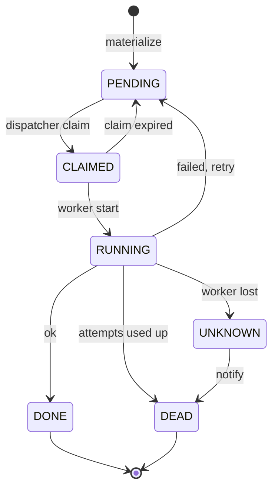
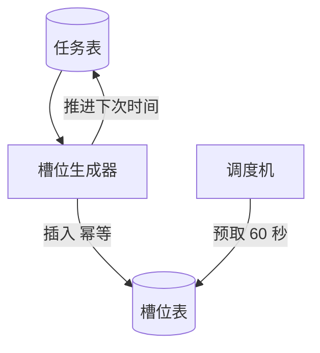
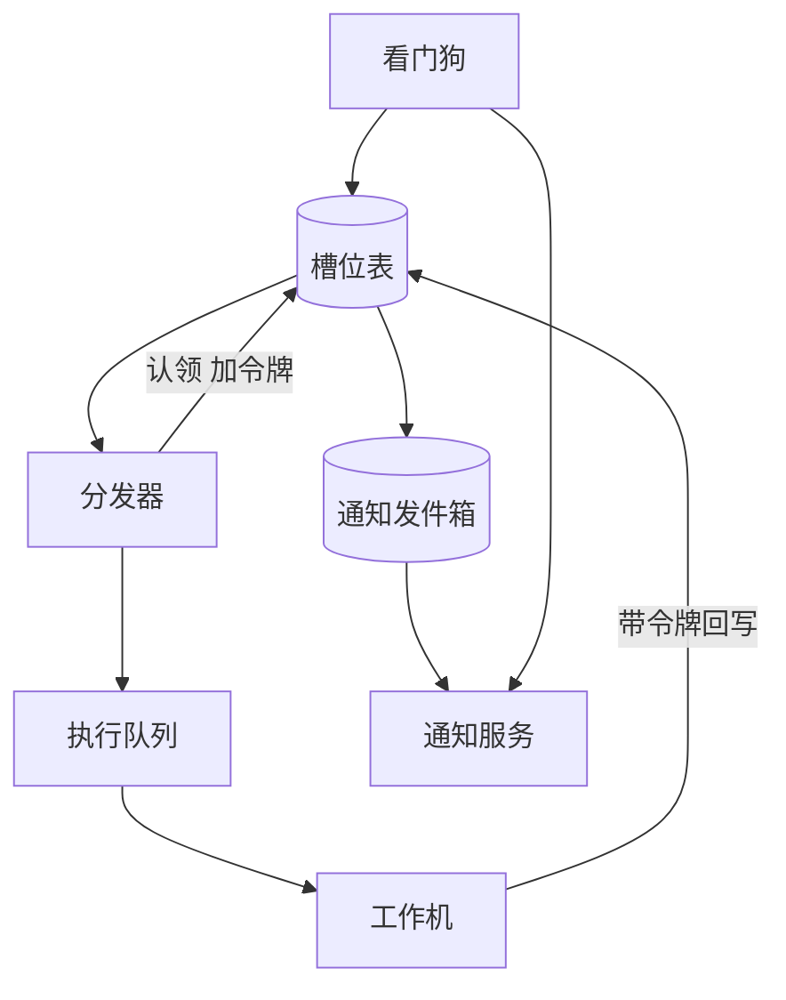
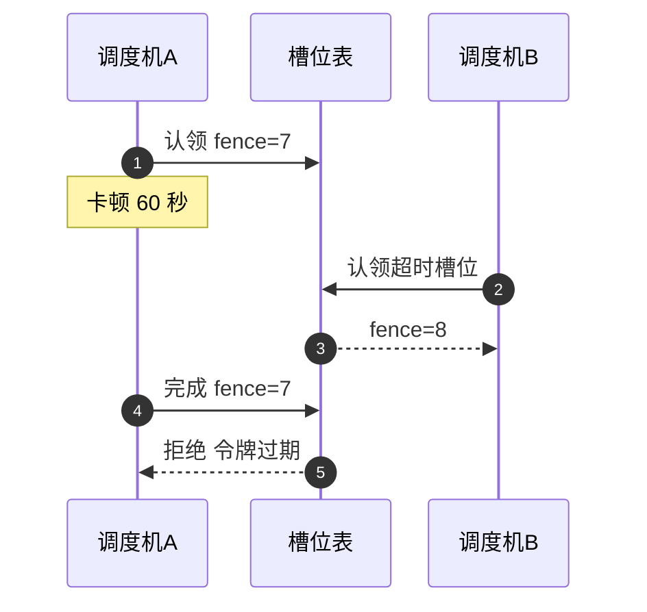

# SD06 分布式任务调度器（Distributed Job Scheduler）（low priority）

## 题目

任务调度器让用户登记「到了某个时间就去做某件事」：每天凌晨 2 点跑报表，每 5 分钟拉一次数据，某个时刻发一条延迟消息。系统保存任务的定义，到点就启动它（调用一个回调地址，或往消息队列里投一条消息），记录结果，失败时重试，彻底失败时通知负责人。任务数量以千万计，每秒要启动上万个，每个整分钟的边界上还有 5 到 10 倍的突发。

难点集中在「同一个任务的同一个触发时刻，最多只能启动一次」。调度器必然是多台机器，所有机器都看得到同一张到期任务表，同一时刻几十台机器会同时发现同一个任务到期；某台机器卡顿几十秒再醒来，还以为自己手里的任务没人动过；worker 在执行到一半时崩溃，你不知道副作用有没有发生；调度器整体停机两小时之后重启，积压的七千万个触发怎么补；而且「任务失败了要通知人」这件事本身，不能依赖那个出了故障的部分。面试官通常说一句「设计一个任务调度系统，每个任务每个触发时刻最多执行一次」，然后把时间花在这些失败场景上：租约（lease）与围栏令牌（fencing token）、补跑（backfill）、worker 崩溃、重试怎样与最多一次共存、故障时通知怎么发。下面的数字是练习用的假设，面试时以面试官给的为准。

## 澄清问题

开场用两分钟问下面八个问题，每个都会改变设计。

1. **调度器负责到哪一步：只负责「启动」，还是也托管执行？** 只负责启动（调用目标地址或投递消息，再收一个完成回执）是更窄也更常见的范围，调度器不需要沙箱和代码分发。下文取这个范围。
2. **规模：任务总数、每秒启动数、整点突发倍数？** 下文假设 3,600 万个任务定义，平均 1 万次启动/s，每个整分钟约一半的触发集中在前 5 秒，峰值 6 万次/s（6 倍）。决定数据库要分多少片、调度机要多少台。
3. **语义是「最多一次」还是「至少一次」？** 取决于任务本身是否幂等（重复做和做一次结果相同）。扣款这类任务宁可漏掉并报警，也不能重复；刷新缓存这类任务宁可重复也不能漏。这个选择是按任务配置的，不是全局的。
4. **启动延迟的目标是多少？** 下文取 p99 小于 1 秒（实际启动时间减去计划触发时间）。目标是分钟级和是秒级，调度器的扫描频率、预取方式完全不同。
5. **停机后漏掉的触发要不要补？** 三种策略：全部补跑（最多补若干次）、只补最近一次、全部跳过。不同任务不同，必须能配置。
6. **上一次还没跑完，下一个触发到了怎么办？** 允许并行、跳过、排队三种，需要在任务上声明。
7. **超时、重试次数和退避？** 重试和「最多一次」看起来矛盾，必须明确哪些失败可以重试。
8. **失败通知给谁、走什么渠道？部分系统宕机时通知还要不要发出？** 这决定通知链路是否要独立于调度链路。

## 需求

**功能需求（按优先级）**

1. 登记任务：cron 表达式（带时区）、固定间隔或一次性时间；可暂停、恢复、删除。
2. 到点启动：每个 `(job_id, fire_time)` 最多授权一次启动，启动延迟 p99 小于 1 秒。
3. 失败处理：超时、可配置的重试与退避、死信（dead letter，放弃重试后留下的失败记录）。
4. 停机补跑，按任务的 misfire（错过触发）策略。
5. 失败与错过的通知，不依赖调度主链路。
6. 运行历史查询和手动触发。

**非功能需求**

| 维度 | 目标 | 说明 |
|---|---|---|
| 启动延迟 | p99 小于 1 秒，整点突发下 p99 小于 5 秒 | 以计划时间为起点 |
| 唯一性 | 每个 `(job_id, fire_time)` 最多一个有效启动授权 | 违反即事故 |
| 持久性 | 已确认的任务定义和槽位不丢 | 数据库同步复制 |
| 可用性 | 99.99%，单机、单数据库分片故障不影响其他分片 | 用分片隔离爆炸半径 |
| 补跑速度 | 2 小时停机在 30 分钟内追平 | 补跑不得饿死新触发 |
| 通知 | 失败通知 99.9% 在 5 分钟内发出，且在调度器宕机时也能发 | 独立链路 |

**明确不做**：任务内的依赖编排（DAG）、任务代码的托管与沙箱、跨任务的资源配额计费。

## 估算

以下为假设，用来推出设计。

- 触发量：1 万次/s × 60 = **60 万次/分钟**。每个整分钟一半集中在 5 秒内：0.5 × 600,000 ÷ 5 = **6 万次/s 峰值**，是平均的 6 倍。
- 槽位：1 万 × 86,400 = **8.64 亿行/天**，每行约 200 B = **173 GB/天**；热存储保留 7 天约 **1.2 TB**，之后归档。
- 在途槽位（小林定律，在系统里的平均数量 = 到达速率 × 停留时间）：绝大多数任务是秒级的触发，平均 2 秒：平均 1 万 × 2 = **2 万个**，突发 6 万 × 2 = **12 万个**；再加 1% 的长任务（平均 300 秒）1 万 × 1% × 300 = **3 万个**。活跃表合计最多约 15 万行，所以活跃表可以很小，历史表另放。
- 数据库写：每个槽位至少 3 次写（生成、认领、完成），平均 3 万行/s，突发 3 × 6 万 = **18 万行/s**。批量写（每条语句 200 行）时每个分片能承受约 2 万行/s，需要 18 万 ÷ 2 万 = **9 个分片**，取 **16 个**留出故障和补跑余量。批量后语句数只有 6 万 ÷ 200 = **300 条/s**。
- 调度机：每台分发约 5,000 次/s，突发需要 6 万 ÷ 5,000 = **12 台**，取 16 台与分片一一对应。
- 工作机：每台并发 500 个调用，峰值并发 12 万 + 3 万 = 15 万，需要 15 万 ÷ 500 = **300 台**。若让每个槽位都单独续租，续租写入将是每秒 15 万 ÷ 10 = 1.5 万次；改成每台工作机一份租约，只有 300 ÷ 10 = **30 次/s**。
- 补跑：停机 2 小时 = 7,200 秒 × 1 万 = **7,200 万个**触发；补跑通道限速 5 万次/s，需要 72,000,000 ÷ 50,000 = 1,440 秒 = **24 分钟**，满足 30 分钟目标。
- 重试负载：5% 的触发失败、最多重试 3 次，额外 1 万 × 5% × 3 = **1,500 次/s**，相对主流量可忽略。
- 预取窗口：提前 60 秒把待触发槽位读入内存的时间轮（timing wheel，按时间分格的定时结构），60 万行 × 200 B = **120 MB**，一台调度机放得下。

**驱动设计的数字**是 6 万次/s 的整点突发和 9 个分片。唯一性不靠吞吐，靠主键和条件写入。

## API

```
POST /v1/jobs
Body: {
  "name": "daily-report",
  "schedule": {"cron": "0 2 * * *", "tz": "Asia/Singapore"},
  "target": {"type": "http", "url": "https://svc/run"},
  "policy": {"semantics": "at_most_once", "timeout_s": 60,
             "max_attempts": 3, "backoff_s": [5, 15, 60],
             "overlap": "skip", "misfire": "fire_latest"}
}
201 -> {"job_id": 7190423}

POST   /v1/jobs/{id}/pause | /resume
DELETE /v1/jobs/{id}
POST   /v1/jobs/{id}/runs        # 手动触发，需 Idempotency-Key
GET    /v1/jobs/{id}/runs?from=&to=&state=
```

调度器调用目标时带上身份，目标据此去重：

```
POST https://svc/run
X-Job-Id: 7190423
X-Fire-Time: 2026-10-25T02:00:00Z
X-Attempt: 1
X-Fence: 42
Idempotency-Key: 7190423:2026-10-25T02:00:00Z
```

目标返回 200 表示同步完成，202 表示已接受，之后调用回执接口：

```
POST /v1/runs/complete
Body: {"job_id": 7190423, "fire_time": "...", "attempt": 1,
       "fence": 42, "status": "ok|failed"}
409 -> 围栏令牌已过期，本次结果被丢弃
```

## 数据模型

| 实体 | 键 | 主要属性 |
|---|---|---|
| Job | `job_id`（按哈希分片） | `schedule`、`tz`、`target`、`policy`、`next_fire_time`、`version`、`status` |
| Slot（活跃） | `(job_id, fire_time)` | `state`、`attempt`、`fence`、`owner`、`claim_expiry`、`not_before`、`deadline`、`started_at` |
| SlotHistory | `(job_id, fire_time)` | 终态槽位的完整记录，按时间分区，7 天后归档 |
| Worker | `worker_id` | `epoch`、`lease_expiry`，每台工作机一行 |
| Outbox | `(job_id, fire_time, kind)` | 待发送的通知，与状态变更在同一事务中写入 |

槽位的主键就是唯一性约束：同一个 `(job_id, fire_time)` 只能插入一行。`fence` 是该槽位被授权的次数，每次认领加 1，是全局单调的围栏令牌。活跃表只保留非终态的行（最多约 15 万行），到期扫描走 `(分片, state, 到期时间)` 的索引，所以扫描代价与积压无关，只与到期量有关；终态行在同一个事务里搬到历史表。

状态机：



## 高层设计

分两条流：生成槽位（控制面）和执行槽位（数据面）。

**生成槽位**



**执行槽位**



编号对应的流程：

1. 每个数据库分片由一台调度机持有分片租约（粗粒度，几十秒），租约保证平时只有一个调度机在这个分片上干活，减少冲突；真正的安全由第 4 步的条件写入保证，不依赖租约。
2. 槽位生成器扫描任务表中 `next_fire_time` 在未来 60 秒内的任务，在同一个事务里插入槽位 `(job_id, fire_time)` 并把 `next_fire_time` 推进到下一次（带 `version` 的条件更新）。插入遇到主键冲突就忽略，所以任何一台机器重复生成都是无害的。
3. 调度机把未来 60 秒的槽位读进内存的时间轮，每 100 ms 一个刻度。读取只是预取，不改变状态。
4. 到期的槽位由分发器批量认领：一条语句把 `PENDING` 且 `not_before` 已到的最多 200 行改成 `CLAIMED`，`fence = fence + 1`，写入 `owner` 和 30 秒的 `claim_expiry`。认领是条件写，所以两台调度机不可能同时认领到同一行。
5. 分发器把「槽位、尝试次数、围栏令牌」放进执行队列，不等待结果。
6. 工作机取到消息，先做一次条件更新：`CLAIMED` 且令牌匹配时才改成 `RUNNING`，同时记下 `worker_id` 和 `deadline`。更新失败说明令牌已经过期，直接丢弃，不执行。
7. 工作机调用目标，带上 `(job_id, fire_time, attempt, fence)`，完成后用同一个令牌条件更新为终态；失败则按策略回到 `PENDING` 并设置 `not_before`（退避）。
8. 终态为 `DEAD` 或 `UNKNOWN` 时，同一个事务里写一行发件箱。独立的看门狗另外扫描「应该完成而未完成」的槽位。



图中的步骤：

1. 调度机 A 认领槽位，拿到令牌 7，之后发生长时间垃圾回收或网络分区，卡住了 60 秒。
2. 30 秒的认领期过去，调度机 B 看到该槽位认领已过期，条件写入把它重新认领，令牌变成 8，B 继续执行。
3. A 醒来，以为自己还持有槽位，带着令牌 7 回写，数据库发现当前令牌是 8，拒绝。A 放弃，不再执行。

## 深挖

### 一、谁来决定「到期」，怎么保证每个触发只有一个槽位

问题：几十台调度机共享同一个任务表，不能让它们对同一个触发重复生成、重复认领。

选项：

| 方案 | 做法 | 问题 |
|---|---|---|
| 单个 leader 扫描全表 | 选主后只有主机器工作 | 6 万次/s 的突发全压在一台机器上，主切换时有空窗 |
| 所有机器各自扫描，靠分布式锁互斥 | 每个任务加一把锁再触发 | 锁服务成为瓶颈；锁过期后旧持有者仍可能工作 |
| 分片所有权加槽位条件写 | 每个分片一个租约持有者，槽位主键与条件更新兜底 | 实现稍复杂，但安全不依赖租约 |

**选择**第三种。分片租约只负责效率（平时只有一台在这个分片上扫描，避免无谓冲突）；安全由两个数据库约束保证：槽位的主键保证每个触发只存在一行，认领的条件更新保证每个槽位同一时刻只有一个有效授权。这样即使租约出了问题（两台机器同时以为自己是主），最坏结果是它们互相拿到 409，不会出现双重启动。

「到期」用数据库的时间，不用调度机的本地时钟：认领语句里写 `not_before <= NOW()`，由数据库判断，所以调度机之间的时钟偏差不会让某台机器提前认领。代价是认领的精度受数据库时钟限制，数据库本身是同步复制的一组，偏差在毫秒级，满足 1 秒的目标。

生成槽位时不要重复推进：`next_fire_time` 的更新带 `version`，同一事务里插入槽位；事务失败就整体回滚，下一轮重新扫描即可。这样任务被暂停、修改了 cron 表达式时，已有的槽位不受影响，新表达式从下一次生成起生效。

### 二、租约与围栏令牌：它保护什么，保护不了什么

问题：持有授权的机器可能卡顿、断网或崩溃，不能永远占着槽位，也不能让它醒来后继续做事。

做法：授权是带过期的，并且每次授权产生一个单调递增的令牌（fence）。有三层：

1. **分片租约**（几十秒，每分片一行）：效率手段。
2. **认领期** `claim_expiry`（30 秒）：槽位从 `CLAIMED` 到工作机把它改成 `RUNNING` 之间的上限。工作机没有及时启动（消息丢了、工作机挂了），认领过期后槽位回到 `PENDING`，令牌加 1 重新分发。
3. **工作机租约**：槽位进入 `RUNNING` 后，不用每个槽位单独续租，而是每台工作机一行租约（每 10 秒续一次，30 秒不续就视为失联），槽位记着 `worker_id`。15 万个在途槽位若逐个续租，就是 1.5 万次写/s；按工作机续租只有 30 次/s。另有槽位的 `deadline`（`started_at + timeout`），防止工作机活着但任务卡死。

令牌的作用是让**迟到的旧持有者无法写入状态**：所有回写都是 `WHERE fence = 我的令牌`。这保护的是调度器自己的状态。

它保护不了的是任务的外部副作用：A 已经把请求发给目标，目标开始执行，随后 A 被判定失联，B 用令牌 8 又发了一次——目标这边就收到两次。令牌只能告诉目标「令牌 8 比 7 新」，要靠目标检查：要么把令牌和 `Idempotency-Key` 一起交给目标，由目标拒绝旧令牌或重复键；要么由调度器声明这个任务是 `at_most_once`，在失联时不重发（见下一节）。面试时要主动讲出这条边界：调度器能保证的是「授权唯一」，不是「外部效果唯一」。

为什么不用 Redis 的 `SETNX` 加过期时间做锁：锁过期后旧持有者还在跑，而锁本身不给出单调令牌，下游无法区分新旧持有者。数据库的条件更新天然给出令牌，并且和槽位状态是同一次写入，原子的。

### 三、最多一次与重试如何共存

问题：一旦重试，同一个触发就可能被执行两次，这与最多一次矛盾。关键是区分「我确知它没有发生」和「我不知道发生了没有」。

按失败发生的位置分三类：

| 失败位置 | 是否知道副作用有没有发生 | 处理 |
|---|---|---|
| 启动前（槽位认领过期、消息丢了、工作机拒绝） | 确知没有发生 | 回到 `PENDING`，令牌加 1，直接重试，不消耗尝试次数 |
| 目标明确返回失败（4xx/5xx 带失败语义） | 目标说了没成功 | 按策略重试：`attempt + 1`，指数退避加抖动，到上限进 `DEAD` |
| 执行中失联（工作机崩溃、超时无响应） | 不知道 | 看任务声明的语义 |

对第三类，任务必须声明语义：

- **`at_most_once`**：不自动重试。槽位置为 `UNKNOWN`，发通知，让人或补偿程序判断（先查目标侧有没有做过）。宁可少做，不重复做，适合扣款、发短信。
- **`at_least_once`**：自动重试，要求目标用 `Idempotency-Key = job_id:fire_time` 去重，重复的请求是无害的。适合刷新缓存、同步数据。

所以「重试」和「最多一次」不矛盾：重试发生在「确知未发生」或「声明幂等」的两类情形里。真正的 exactly-once 效果是「至少一次的投递 加 目标侧幂等」得到的，调度器只提供稳定的幂等键，不可能凭空保证目标的副作用。

重叠策略同样落在槽位上：`skip` 表示新触发到期时若同一任务有非终态槽位，新槽位直接置为 `SKIPPED` 并记录；`queue` 表示按 `fire_time` 顺序依次启动；`allow` 则不检查。

### 四、整点突发与补跑

问题：每个整分钟 6 万次/s，同时停机后要补 7,200 万个触发，不能让补跑饿死新触发。

做法：

- **预取加批量**：提前 60 秒把槽位读入时间轮，到点批量认领（200 行一条语句），数据库语句数从 6 万/s 降到 300/s。
- **分片并行**：16 个分片各一台调度机，每台约 3,750 次/s，低于每台 5,000 次/s 的上限；任务按 `job_id` 哈希均匀分布，所以整点的突发会均匀落在 16 个分片上，没有热分片。
- **分级通道**：槽位带优先级，分发器按通道配额取：新触发优先，补跑通道限速 5 万次/s 且最多占总能力的一部分，24 分钟追平 7,200 万个。按任务租户再做公平限速，防止一个租户一次提交 1,000 万个任务拖慢其他人。
- **错过触发（misfire）策略**在生成槽位时应用：停机恢复后，槽位生成器从 `next_fire_time` 追到当前，`fire_all` 生成全部（上限，例如最多 100 个），`fire_latest` 只生成最近一个，`skip` 一个都不生成并推进时间。大多数周期任务应该用 `fire_latest`，否则 2 小时停机对每分钟任务意味着一次补 120 个。
- **允许用户自己错开**：整点集中大多来自用户都写 `0 * * * *`。提供 `jitter_s` 参数，让调度器在窗口里按 `job_id` 哈希确定性地偏移，既不增加不确定性，也削掉突发。

### 五、失败通知：不依赖出故障的部分

问题：任务失败时要通知人；调度器、数据库分片、执行队列任何一部分宕机时，通知仍要送到。

三层互相独立：

1. **事务发件箱（transactional outbox）**：槽位变成 `DEAD`、`UNKNOWN` 或错过的同一个事务里，写一行发件箱。状态与通知要么一起存在，要么都不存在，所以不会出现「状态改了通知丢了」。通知服务从发件箱取，至少一次发送，用 `(job_id, fire_time, kind)` 去重。
2. **看门狗（watchdog）**：一个独立的小服务，用自己的数据库连接和通知通道，直接扫描「应该有结果而没有」的槽位：`deadline` 已过仍未终态、`PENDING` 已晚于计划时间超过阈值的。它不经过调度机和执行队列，所以调度机或队列整体挂了，它仍然发现问题并通知。
3. **死人开关（dead-man's switch）**：调度机集群每 10 秒向一个独立部署的外部监控发心跳，连续 3 次（30 秒）没有，外部监控直接呼叫值班，通道是短信或寻呼，不走自己的通知服务。这覆盖「整个系统都挂了，连看门狗也无法工作」的情形。

可观测性：启动延迟（实际启动减计划时间）的 p50/p99、`PENDING` 且已到期的槽位数（积压）、`UNKNOWN` 与 `DEAD` 的数量与新增速率、认领冲突率（条件写失败的比例，非零说明有重复调度尝试，持续偏高说明分片租约在抖动）、补跑通道的剩余量、发件箱延迟。启动延迟和积压是最先报警的两个指标。

## 故障与边界

| 场景 | 影响 | 处理 |
|---|---|---|
| 调度机崩溃 | 其分片的预取内存丢失 | 分片租约到期后另一台接手，从数据库重新预取；已认领的槽位按认领期自动归还 |
| 调度机卡顿后醒来 | 以为自己仍持有槽位 | 所有写带令牌，被拒绝即放弃 |
| 数据库分片主节点切换 | 该分片暂时不可写数秒 | 其他分片不受影响；切换后因主键和条件写，重试都是安全的 |
| 工作机崩溃 | 其上的 RUNNING 槽位失联 | 工作机租约过期后，按任务语义：幂等的重试，`at_most_once` 的置 `UNKNOWN` 并通知 |
| 执行队列积压 | 启动延迟上升 | 认领期到期会让槽位回 `PENDING`，所以消息丢失可自愈；积压告警早于延迟告警 |
| 目标服务变慢或不可用 | 重试放大流量 | 按目标做熔断（circuit breaker）与并发上限，避免重试风暴；超过上限直接 `DEAD` 并通知 |
| 时钟漂移 | 触发提早或推迟 | 到期判断用数据库时间；调度机只用时钟决定预取，不决定授权 |
| 夏令时与时区 | 某些本地时间不存在或出现两次 | 以带时区的 cron 库计算 UTC 触发时间；不存在的时刻顺延到之后，重复的时刻按 `once` 或 `twice` 策略选其一 |
| 任务被删除或修改 | 已生成未执行的槽位 | 删除时把未开始的槽位置为 `CANCELED`；修改只影响新生成的槽位 |
| 发件箱通道不可用 | 通知延迟 | 多通道降级（邮件、即时消息、短信），死人开关兜底 |

**边界**：单次触发内的目标超时要小于下一次触发的间隔，否则 `overlap: skip` 会让任务永远跳过，创建时应校验；一次性延迟任务和 cron 任务共用槽位表，只是没有 `next_fire_time` 推进；手动触发使用独立的 `fire_time`（带手动标记）和调用方给的幂等键，不与计划触发冲突。

## 追问

1. **为什么不用 Redis 分布式锁给每个任务加锁？** 锁过期之后，旧持有者可能仍在运行，而锁不提供单调令牌，下游无法拒绝旧持有者。数据库条件更新同时给出互斥和令牌，并且与槽位状态在同一次写入里。
2. **能做到 exactly-once 吗？** 调度器只能保证每个触发至多一个有效授权。外部效果的 exactly-once 靠「至少一次 加 目标侧用 `job_id:fire_time` 幂等」。如果目标不能幂等，就声明 `at_most_once`，失联时转人工。
3. **一台调度机在持有槽位期间卡住 60 秒，会发生什么？** 认领期 30 秒后另一台重新认领，令牌加 1；卡住的那台醒来后回写被拒绝，不会执行。但如果它在卡住之前已经把请求发给了目标，目标可能收到两次，所以令牌和幂等键要一起传下去。
4. **整分钟 10 万个任务同时到期，延迟怎么不爆？** 预取加批量认领把语句数降到每秒几百；16 个分片并行；队列和工作机按突发峰值配置；用户可以用 `jitter_s` 错开；超出能力的部分排队，用启动延迟告警而不是静默变慢。
5. **调度器停机 2 小时，恢复后会发生什么？** 槽位生成器按每个任务的 misfire 策略补生成，补跑走限速通道，7,200 万个触发 24 分钟追平，新触发优先。同时通知「错过了 N 个触发」，不要悄悄补。
6. **夏令时怎么处理？** 在任务的时区里计算触发时刻，转成 UTC 存储；春季不存在的本地时间顺延到之后第一个有效时刻，秋季重复的本地时间只触发一次（可配置）。
7. **怎么保证「失败通知」在数据库或队列挂了时仍能发？** 发件箱保证状态与通知原子；看门狗独立于调度链路，用自己的连接扫描并通知；外部死人开关在整个系统静默时直接呼叫值班。注意通知通道本身也要冗余。
8. **一个租户一次提交 1,000 万个任务怎么办？** 按租户配额和公平队列：创建任务数有上限，分发时按租户做加权公平调度（带令牌桶），防止它占满补跑和突发容量。
9. **为什么把槽位表拆成活跃表和历史表？** 活跃行最多约 15 万，表小，索引热，到期扫描与历史量无关；历史表每天增加 173 GB，只追加、按时间分区、到期归档，互不影响。
10. **任务之间有依赖怎么办？** 超出这里的范围；最小做法是父任务完成后在同一个事务里为下游任务生成一个槽位（`fire_time` 取父任务的 `fire_time`），仍然由槽位主键保证唯一。
11. **怎么证明系统确实没有重复启动？** 持续对账：每分钟对比「槽位表中令牌大于 1 且状态为 DONE 的行」和目标侧收到的幂等键数量；监控认领冲突率；做混沌测试，在持有槽位时随机冻结调度机进程，检查没有重复的 `(job_id, fire_time, attempt)` 被目标执行。

## 评分要点

- 先估算：6 万次/s 的突发、分片数、在途槽位数，并且指出活跃表可以很小。
- 说出「每个 `(job_id, fire_time)` 一个槽位」，唯一性来自主键和条件写，而不是靠谁先抢到锁。
- 区分三层：分片租约（效率）、认领期与工作机租约（活性）、围栏令牌（安全）；讲得出卡顿的旧持有者被拒绝的过程。
- 主动讲出令牌的边界：保护调度器状态，保护不了外部副作用，必须把令牌与幂等键传给目标。
- 重试与最多一次共存：按失败位置分类，`UNKNOWN` 状态，任务级语义声明。
- 补跑：misfire 策略、限速通道、24 分钟的数字、不饿死新触发。
- 失败通知的独立链路：发件箱、看门狗、死人开关。
- 可观测：启动延迟、积压、认领冲突率、`UNKNOWN` 与 `DEAD`。

## 延伸阅读

- 相邻题解：[[solution-job-scheduler]]（调度器的通用设计）、[[solution-notification-system]]（通知通道与去重）。
- 同批题单：[[tiktok-sd-index]]。
