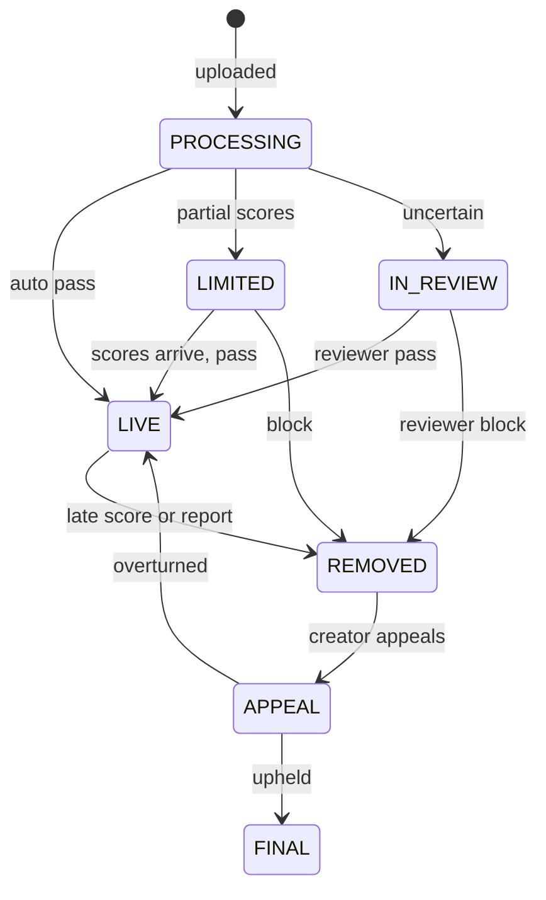
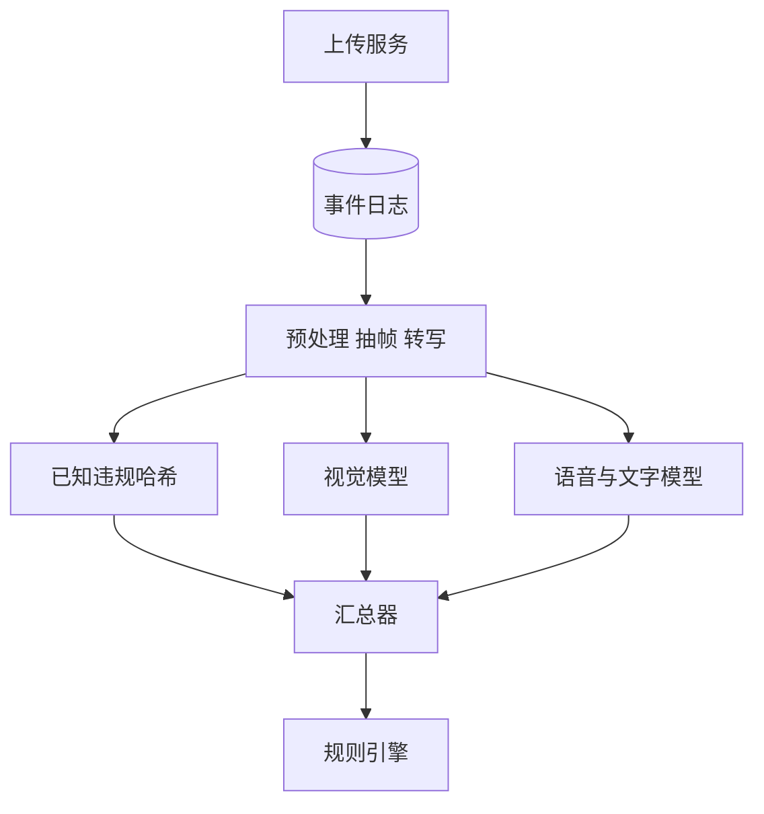
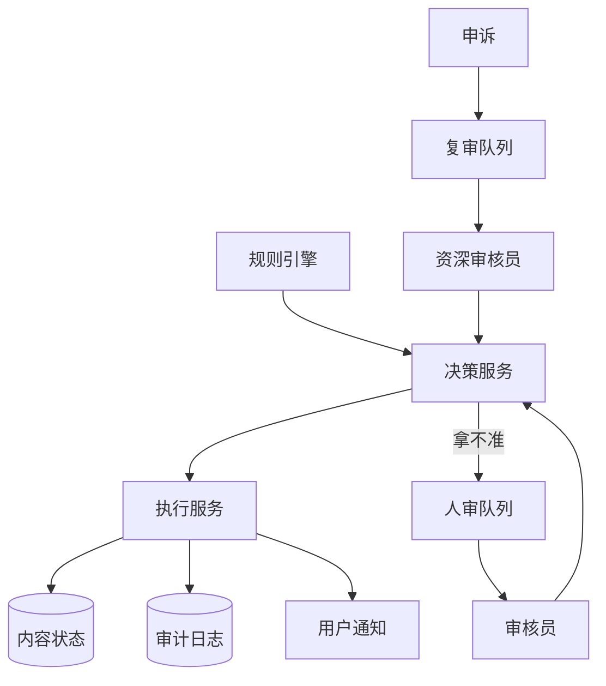

# SD07 内容审核系统（Content Moderation）（low priority）

## 题目

用户每天上传几千万条视频，平台要在它们被大量观看之前判断：能发布、限制传播、还是删除。判断由三种力量共同完成：机器学习模型给每条内容打分（色情、暴力、仇恨、未成年人安全等），规则引擎把分数、账号历史和地区法规合成一个处置，拿不准的内容交给人工审核员。被处罚的创作者可以申诉，复审可以推翻原决定。整套系统必须在近实时的时限内给出结论，并且留下可以向监管者和创作者解释的完整记录。

难点有五个。第一，近实时：一条 30 秒的视频要在十几秒内抽帧、转写语音、跑多个模型，任何一个模型变慢都不能卡住整条内容。第二，规则要在几分钟内上线而不重新发版，因为新的违规花样出现后，等一次发布周期就晚了。第三，处置必须幂等（重复执行和执行一次结果相同）：消息重投、两个决定先后到达，都不能让创作者被处罚两次或被错误地恢复。第四，人工是稀缺资源，要按严重度和预计影响排队，而不是先来先审。第五，每个决定都要有审计线索：当时用了哪个模型版本、各项分数、命中了哪条规则、谁做的决定。面试官通常说「设计一个视频审核系统」，然后追问：延迟预算在哪里、规则怎么热更新、模型超时了怎么办、两个决定冲突怎么办、数据能不能出区域。下面的数字是练习用的假设，面试时以面试官给的为准。

## 澄清问题

开场用两分钟问下面八个问题，每个都会改变设计。

1. **审核的对象是什么：上传的视频，还是也包括直播、评论、头像和简介？** 视频要异步抽帧和转写；评论是短文本，必须同步判断。下文以视频为主，评论作为同步的文本通道简述。
2. **规模：每天上传多少，峰值倍数多少？** 决定 GPU（图形处理器，跑模型的主要算力）和人工的数量。下文假设每天 2,000 万条视频，平均 30 秒，峰值是平均的 3 倍。
3. **「近实时」的时限是多少，结论出来之前内容对别人可见吗？** 先发后审（发布后很快审核）速度最快、误杀的影响最小，但违规内容会短暂出现；先审后发最安全，但创作者要等。通常按风险分层：新账号或有前科的账号先审后发，老账号先限量发布再审。下文取 p95 小于 30 秒，硬截止 60 秒。
4. **有哪些违规类别，有没有零容忍的类别？误杀和漏判哪个代价更大？** 儿童性剥削内容这类零容忍的类别，宁可误杀也不漏，并且要对已知违规内容做哈希匹配；其他类别要在精确率和召回率之间按类别取舍。
5. **规则和阈值要多快改？谁能改？** 要求「几分钟内上线、不重新发版」，就要把规则做成可版本化的配置，而不是代码。
6. **人工审核的规模、语种、区域和时限？** 决定队列分层、排班和容量。
7. **申诉：谁可以申诉，多快必须答复，能不能恢复？** 恢复意味着执行服务必须支持可逆操作，并且处罚要能撤销（比如违规记录）。
8. **审计保留多久，数据能不能出区域？** 决定审计存储的形态，以及流水线是否按区域部署。

## 需求

**功能需求（按优先级）**

1. 每条上传内容得到一个处置：通过、限制传播、删除、转人工。
2. 多个模型并行打分，汇总后经规则引擎得出决定；规则可在几分钟内更新并灰度。
3. 人工审核：任务队列、按严重度和影响排序、审核员认领与提交、质检抽样。
4. 幂等的处置执行：状态变更、通知、违规记录、从推荐和搜索中移除。
5. 申诉：创作者发起，由不同的审核员复审，可推翻并恢复。
6. 完整审计线索，可按内容、账号、规则版本查询。

**非功能需求**

| 维度 | 目标 | 说明 |
|---|---|---|
| 自动结论延迟 | p95 小于 30 秒，硬截止 60 秒 | 从上传完成算起 |
| 零容忍类别 | 已知违规哈希命中在 5 秒内处置 | 同步预检，先于模型 |
| 规则上线 | 保存到全量生效不超过 10 分钟 | 含灰度观察 |
| 处置幂等 | 同一个决定重复执行结果不变；违规记录不重复计 | 用决定编号去重 |
| 人审时限 | P0 小于 15 分钟，P1 小于 4 小时，P2 小于 24 小时 | 按严重度分层 |
| 申诉时限 | 48 小时内答复 | 由不同审核员复审 |
| 审计 | 每个决定完整可重放，保留 180 天，只追加 | 监管与申诉依赖 |
| 数据驻留 | 内容、分数、审计留在所属区域 | 配置与已知违规哈希可全球分发 |

**明确不做**：模型本身的训练与标注平台、内容推荐的排序、广告审核的商业策略。

## 估算

以下为假设，用来推出设计。

- 上传：2,000 万 ÷ 86,400 = **231 条/s 平均**，峰值 3 倍 = **694 条/s**。
- 抽帧：平均 30 秒、每秒抽 1 帧，峰值 694 × 30 = **2.08 万帧/s**。一个共享主干网络的多头视觉模型，每块 GPU 约 300 帧/s，需要 20,833 ÷ 300 = **约 70 块**。
- 语音：694 × 30 = **2.08 万秒音频/s**，语音识别每块 GPU 约 200 倍实时速度，需要 20,833 ÷ 200 = **约 104 块**。
- 合计约 174 块 GPU，留 40% 余量取 **约 243 块**。这是整个系统最贵的部分，所以要有降级策略。
- 文本通道：评论 20 万条/s，文本模型和词表匹配在 CPU 上，每台约 4,000 条/s，需要 **50 台**；必须同步，20 ms 内返回。
- 延迟预算（自动路径）：上传完成事件 1 秒 + 抽帧与转码 4 秒 + 模型打分 10 秒（每个模型的超时上限，并行）+ 汇总与规则 0.5 秒 + 执行与推送 2 秒 = **17.5 秒**，低于 30 秒的目标，留出排队余量。
- 人工：假设 1.5% 进入人审 = 2,000 万 × 1.5% = **30 万条/天**。每个审核员每天约 600 条（每条 30 秒，实际审核 5 小时），需要 300,000 ÷ 600 = **500 人·天**，三班倒后每班约 167 人。
- 处罚与申诉：1% 被处罚 = **20 万条/天**；5% 申诉 = **1 万条/天**；资深审核员每天 400 条，需要 10,000 ÷ 400 = **25 人**。
- 审计：每个内容约 3 KB（模型版本、各项分数、命中规则、动作）× 2,000 万 = **60 GB/天**，保留 180 天 = **10.8 TB**。小到可以全部放进只追加存储。
- 规则回测：用 24 小时的特征日志（2,000 万条）重放新规则，每秒 10 万条决策，只需 20,000,000 ÷ 100,000 = **200 秒**，所以每次改规则都可以先回测。
- 突发：流量突然到 3 倍峰值 = 2,083 条/s，容量 972 条/s（含余量），多出 1,111 条/s，10 分钟积压 **66.7 万条**，富余能力 278 条/s，要 **40 分钟**才能消化。所以必须有降级和优先级，不能指望排队等。

**驱动设计的数字**是 243 块 GPU 的成本（逼出降级策略）和 17.5 秒的延迟预算（逼出并行打分加截止时间），而不是存储或网络。

## API

内容服务发出的事件（异步，不是同步调用）：

```
event content.uploaded
  {content_id, owner_id, region, media_uri, duration_s,
   account_risk, source: 上传、直播或编辑}
```

创作者与审核员的接口：

```
GET  /v1/content/{id}/status
200 -> {"state": "LIMITED", "reason_code": "V12",
        "appealable": true, "decision_id": "..."}

POST /v1/content/{id}/appeals        # Idempotency-Key 必填
Body: {"decision_id": "...", "reason": "text"}
201 -> {"appeal_id": "...", "sla_hours": 48}
409 -> 该决定已申诉过

POST /review/tasks/claim?queue=violence&limit=1
POST /review/tasks/{task_id}/decision
Body: {"case_version": 7, "label": "violates", "action": "REMOVE",
       "reason_code": "V12", "note": "..."}
409 -> case_version 已变，任务被重新分配或已有更高权威的决定
```

规则管理接口：

```
PUT  /rules/sets/{set_id}/versions            # 新建不可变版本
POST /rules/versions/{v}/rollout
Body: {"mode": "shadow", "percent": 5, "regions": ["SG"]}
POST /rules/versions/{v}/rollback
```

## 数据模型

| 实体 | 键 | 主要属性 |
|---|---|---|
| Case | `content_id` | `state`、`risk_tier`、`deadline`、`enforced_version`、`enforced_authority`、`region` |
| ScoreRecord | `(content_id, model_id)` | `model_version`、各类别分数、最高分所在帧、`partial` |
| Decision | `decision_id`（由 `content_id`、权威等级、序号确定） | `authority`、`action`、`reason_code`、`rule_set_version`、`rules_fired`、`created_at` |
| ReviewTask | `task_id` | `case_id`、`queue`、`priority`、`lease_owner`、`lease_expiry`、`case_version` |
| Appeal | `appeal_id` | `decision_id`、`status`、`reviewer`、`outcome` |
| StrikeLedger | `decision_id`（唯一） | `account_id`、`kind`，唯一键保证同一个决定只计一次违规 |
| AuditEvent | `(content_id, event_seq)` | 类型、时间、行动者、模型版本与分数、规则版本、前一事件哈希；只追加 |
| RuleSetVersion | `(set_id, version)` | 规则内容，创建后不可变 |

`authority` 是决定的权威等级：自动（0）< 人工审核（1）< 申诉复审（2）< 政策管理员覆盖（3）。执行服务只接受 `(权威等级, 版本)` 比当前更大的决定，这一条规则解决了乱序和冲突。审计事件里带前一事件的哈希，形成哈希链，篡改会被发现。

内容的状态机：



## 高层设计

分打分链路和处置链路两张图。

**打分链路**



**处置与人审链路**



编号对应的流程：

1. 上传服务把原始文件存进对象存储，发出 `content.uploaded` 事件，内容状态为 `PROCESSING`。对高风险来源（新账号、有前科）内容保持不可见；其余内容在自动结论到达前，视为可限量发布。
2. 预处理服务按内容类型抽帧（每秒一帧）、提取音轨、做 OCR（识别画面中的文字），并先做一次已知违规内容的哈希匹配（感知哈希，对缩放和轻微编辑不敏感）。命中零容忍库的内容直接进入处置，不等模型。
3. 视觉模型、语音转写加文本模型等并行消费同一个事件，各自带超时。分数写入 `ScoreRecord`，同时通知汇总器。
4. 汇总器按 `content_id` 分区，保存「已到分数」的状态，并设两个定时器：软截止（20 秒）和硬截止（60 秒）。所有必需分数到齐，或到达软截止，就触发规则引擎。
5. 规则引擎读取当前生效的规则版本，输入是分数、账号信息（账龄、违规记录）、地区、内容预计影响，输出处置：通过、限制、删除、转人工，以及命中的规则列表。规则版本和命中规则会随决定一起保存。
6. 决策服务生成 `Decision`（带权威等级和版本），通过发件箱交给执行服务。拿不准的进入人审队列，由审核员提交一个新的决定，仍然走决策服务。
7. 执行服务按「权威等级、版本」比较，只接受更大的；对内容状态、推荐与搜索索引、用户通知、违规记录做幂等执行，每个动作都以 `decision_id` 去重。每一步写审计事件。
8. 创作者看到状态和原因码，可发起申诉；申诉生成新任务进入复审队列，由不同的、更资深的审核员处理，结论作为权威等级 2 的新决定回到第 6 步。

## 深挖

### 一、并行打分与截止时间：模型变慢时怎么办

问题：一条内容要等 4 到 5 个模型，任何一个变慢，整条内容就卡住；而硬件故障或发布期间，某个模型超时很常见。

选项：

- **串行打分**：每个模型的延迟累加，总延迟超出预算。
- **并行但必须全部到齐**：延迟取决于最慢的模型，一个模型挂掉所有内容都停住。
- **并行加截止时间加部分结果**：到软截止时，用已有的分数继续判断，记下缺失的模型，晚到的分数到达后重新评估。

**选择**第三种，并且让缺失的处理跟随风险分层，而不是一刀切：

| 内容的风险分层 | 软截止（20 秒）到了仍缺分数 | 硬截止（60 秒） |
|---|---|---|
| 高风险（新账号、前科、曾被举报） | 继续保持不可见，优先插入人审 | 缺关键模型的转人工，不放行 |
| 一般 | 用已有分数判断，若无高分则限量发布（`LIMITED`） | 仍缺则继续限量，持续补评估 |

这是故障时开放还是关闭（fail-open / fail-closed）的取舍：关闭更安全，但创作者体验差、积压大；开放体验好，但违规内容会短暂出现。按风险分层，让高风险走关闭、其余走限量开放，把代价集中在最需要的地方。

晚到的分数触发重新评估，产生更高版本的决定：若变成删除，则对已发布的内容做事后下架，并通知创作者。因为决定带版本且执行服务幂等，重新评估不会造成重复处罚。

### 二、规则引擎：几分钟上线，不重新发版

问题：新的违规花样出现时（例如一个新的挑战活动里的暴力动作），需要几分钟内调整阈值或新增规则；而错误的规则可能一瞬间误删几十万条内容。

设计：

- **规则是数据，不是代码。** 用受限的表达式描述条件，例如 `violence.score >= 0.92 AND region != "X" => REMOVE(reason=V12)`；`violence.score in [0.6, 0.92) => REVIEW(queue=violence, priority=high)`。规则按「全局基线加区域覆盖」分层：法规不同的区域叠加自己的规则，编译时合并。
- **版本不可变。** 每次修改产生新版本，决定里记录 `rule_set_version` 和 `rules_fired`，回溯和申诉都能还原当时依据什么判断。
- **热加载。** 规则引擎节点监听配置存储（推送或每 5 秒轮询），读到新版本后在内存中编译，原子切换指针；正在评估的请求用旧版本，不会出现半新半旧。
- **安全上线四步。** 先影子模式（评估但不执行，只记录与当前版本的差异）；再 1% 按 `content_id` 哈希灰度；再按区域；最后全量。每一步看拦截率、转人工率、预计的申诉率；若拦截率偏离基线超过预设倍数（例如 5 分钟内达到 3 倍），自动回滚。
- **回测。** 影子之前先用特征日志回放最近 24 小时的 2,000 万条决策，约 200 秒，直接看新旧版本的差异数量和受影响的内容样本，比上线后才发现便宜得多。要做到这一点，必须保留每条内容的特征（分数、账号信息），而不仅仅是最终动作。

规则与模型各管一段：模型负责「像不像」，规则负责「像到什么程度、对谁、在哪里要怎么处理」。需要调整处置而不是调整识别能力时，改规则；需要提升识别能力时，才重训模型。这样大多数紧急调整不需要动模型。

### 三、幂等执行、权威等级与审计线索

问题：同一个决定可能被重复投递；自动决定和人工决定可能先后到达甚至乱序；违规记录和通知如果重复执行，对创作者伤害很大。

做法：

1. **决定编号确定性生成**：`decision_id` 由 `(content_id, 权威等级, 序号)` 派生，同一个逻辑决定重投得到同一个编号。
2. **执行服务只接受更大者**：`Case` 上保存已执行的 `(权威等级, 版本)`，新决定比它大才执行，否则丢弃。这样：自动判定「通过」晚于人工判定「删除」到达，会被拒绝；申诉推翻（等级 2）能够覆盖人工（等级 1）；自动判定不能覆盖任何人工决定。
3. **每个动作都幂等**：设置状态是赋值（重复无害）；从推荐、搜索中移除是按 `(content_id, state_version)` 的幂等删除；通知按 `decision_id` 去重；违规记录写入 `StrikeLedger`，`decision_id` 是唯一键，重复写入被拒绝，所以不会重复计违规。恢复（申诉推翻）也是对应的补偿：删除对应的违规记录行，同样以 `decision_id` 为键。
4. **状态与副作用同事务**：决定写入与发件箱行在同一事务中，副作用由工作进程从发件箱取出并带键重试，崩溃在任意步骤之间都可以安全重来。

审计：每个关键步骤追加一个事件（已打分、已评估规则、已决定、已执行、已人审、已申诉），事件里写模型版本、分数、规则版本与命中规则、动作、行动者、原因码，并带上一个事件的哈希。存储只追加（对象存储的写后锁定，或只追加的表），不提供更新。180 天约 10.8 TB。审计回答的是三类问题：创作者问「为什么删我的视频」，监管问「这条规则在这个区域什么时候生效的」，以及内部问「某个模型版本上线后误杀率变了吗」。

### 四、人审队列与申诉：稀缺资源怎么用

问题：30 万条/天要审，但各条的紧迫度差别极大：一条疑似严重违规、已经有一万次观看的内容，比一条边缘的、没人看的内容急得多。

队列设计：

- **优先级 = 严重度权重 × 预计触达 × 等待时间系数。** 严重度由命中的规则决定；预计触达由账号粉丝数和早期的播放速度估计（刚发布 5 分钟的播放增速）；等待时间系数让低优先级内容也不会无限饥饿。
- **分层与时限**：P0（零容忍类别、直播中的严重违规）小于 15 分钟，全天候专人；P1 小于 4 小时；P2 小于 24 小时。按语种和区域分队列，让懂语言的审核员处理对应内容。
- **认领与租约**：审核员认领任务得到一个 10 分钟的租约，超时未提交则任务回到队列，避免一个人占着任务，也避免两人同时审同一条（与调度器的租约思路相同）。提交时带 `case_version`，如果期间自动重评估产生了更新的决定，提交被拒绝，审核员看到最新状态。
- **质检**：对自动通过的内容随机抽 0.1%（每天约 1.95 万条）交给审核员复核，用来估计漏判率；5% 的人审任务双盲重复分配，不一致的交给资深审核员裁决，用来衡量审核员之间的一致性。
- **审核员保护**：默认模糊化和静音，需要时才展开；限制连续审核极端内容的时长。这是产品要求，也是留住审核员的条件。

申诉：

- 处罚通知里带原因码和申诉入口；每个决定只能申诉一次（`409` 防重复），申诉期 30 天。
- 申诉任务发给**不同的、更资深的**审核员，不能是原审核员；时限 48 小时。
- 结果有两种：维持原判（终态）、推翻。推翻生成权威等级 2 的新决定，执行服务恢复内容、撤销违规记录、通知创作者并恢复触达；同时把这条内容作为难例反馈给模型训练。
- 「申诉被推翻的比例」按规则和模型版本统计，是衡量规则质量最直接的指标：某条规则上线后推翻率明显升高，说明它在误杀。

### 五、突发、降级与数据驻留

**突发**：流量到 3 倍峰值时，10 分钟积压 66.7 万条，容量只能以每秒 278 条的富余消化，要 40 分钟，超过自动结论 30 秒的时限太多。不能只靠排队，要有按顺序启用的降级阶梯：

1. 优先级通道：高风险和零容忍通道保留算力，低风险通道排队。
2. 降低抽帧率：低风险通道从每秒 1 帧降到每 2 秒 1 帧，视觉模型的负载减半。
3. 跳过次要模型：低风险内容暂不跑次要的、昂贵的模型，记 `partial`，稍后在空闲时补跑。
4. 限量发布：积压中的低风险内容按「限量发布」可见，等待分数。
5. 永远不丢内容：队列持久化，只是延迟；每一步降级都在审计里留痕，便于事后补审。

水平扩展 GPU 需要几分钟到十几分钟，所以降级阶梯负责撑住这段时间。

**数据驻留**：流水线按区域部署（例如欧盟、美国、东南亚各一套），内容、分数、人工任务、审计都留在所属区域；全球统一的只有模型版本、规则基线和已知违规内容的哈希（哈希不可还原内容，可以分发）；区域覆盖规则只在本区域生效。人审队列按区域和语种划分；某区域缺少某个语种的审核员时，是否允许跨区域审核取决于法规，设计上要把它作为可配置的策略，而不是写死。

## 故障与边界

| 场景 | 影响 | 处理 |
|---|---|---|
| 某个模型服务超时或挂掉 | 部分分数缺失 | 软截止后按风险分层处理，`partial` 标记，晚到后重评估 |
| 规则发布出错 | 误拦截或误放行激增 | 影子、灰度、自动回滚；决定带规则版本，可批量重放修复 |
| 决定重复投递 | 重复处罚 | `decision_id` 去重，`StrikeLedger` 唯一键，执行服务只接受更大者 |
| 自动与人工决定乱序 | 人工结论被覆盖 | 权威等级比较 |
| 审核员提交时内容已被重评估 | 基于过期信息的提交 | `case_version` 冲突，返回最新状态 |
| 审核员认领后失联 | 任务被占住 | 租约到期回队列 |
| 人审积压 | 违规内容存活更久 | P0 专人；积压时限制低风险内容的传播而不是放开 |
| 执行副作用部分失败（通知发了，索引没改） | 状态不一致 | 发件箱按键重试，全部幂等；对账作业检查状态与索引一致 |
| 审计写失败 | 无法解释决定 | 审计写入与决定同事务；失败则决定不生效，宁可延迟 |
| 区域整体故障 | 该区域审核暂停 | 本区域内容保持当前状态，不跨区域转移（驻留要求）；恢复后补评估 |

**边界**：被删除的内容仍要保留审计和必要的证据副本，直到保留期结束，与用户请求删除数据存在冲突，审计里保存哈希和决定记录，不保存原文件；直播的审核是持续的（每 2 秒抽帧加实时语音识别），命中严重违规时可以直接切断直播，这是同一条流水线的低延迟变体；编辑已发布的视频等于一次新上传，重新走全流程。

## 追问

1. **阈值怎么定？** 按类别和代价定，不是全局统一：零容忍类别把阈值压低，接受高误杀并交人审；一般类别取精确率和召回率的折中，用人审标注的验证集画曲线，选点时把一次误杀的代价（创作者流失、申诉处理成本）与一次漏判的代价（违规内容的传播）折算在一起。
2. **新模型怎么上线？** 先在影子模式并行跑，不影响决定，对比新旧分数分布和与人工标注的一致率；再对一小部分流量放量；最后全量。旧内容在新模型上线后，可用空闲算力回刷高风险部分。
3. **违规者改一下视频重传，怎么办？** 感知哈希（对缩放、水印、轻微剪辑不敏感）加近似最近邻检索（例如把 64 位哈希切成几段做局部敏感哈希），命中已确认违规的内容直接处置；对账号层面累计违规记录，抬高其后续内容的风险分层。
4. **直播怎么审核？** 持续抽帧（每 2 秒）加实时语音识别，延迟预算以秒计；严重违规可以自动切断；直播的结论越快越重要，所以直播通道独占一部分算力，不与上传通道竞争。
5. **评论和文本呢？** 走同步通道：词表匹配加小模型，20 ms 内返回，把握很高的违规直接拦截，灰色的放行但记录并异步复核，命中后可撤回，参考 [[sd05-live-comments-likes]]。
6. **怎么知道系统整体好不好？** 抽检估计自动通过的漏判率；申诉被推翻的比例估计误杀率；人审的一致率；自动结论延迟的 p95；各规则的触发量与推翻率；这些按规则版本、模型版本、地区拆开看。
7. **删除数据的法律要求和审计保留冲突怎么办？** 审计只保存决定记录和内容的哈希，不保存原文件；到保留期后清除；用户请求删除时，内容立即删除，审计里只保留不可还原的哈希和决定。
8. **自动决定和人工决定冲突怎么处理？** 权威等级比较：人工高于自动，申诉复审高于人工；自动只能在没有任何人工决定时生效，晚到的自动重评估不能覆盖人工结论。
9. **规则引擎出错一瞬间误删了几十万条怎么办？** 灰度和自动回滚把爆炸半径限制在 1% 之内；决定里有规则版本，可以查出所有受影响的内容，用补偿决定（权威等级相同、更高版本）批量恢复，并通知创作者。
10. **多语言和文化差异怎么处理？** 模型分数相同，规则按区域覆盖，人审按语种分队列；文化相关的类别（如仇恨符号）由本地政策团队维护区域规则，全局基线只管共识的类别。
11. **审核员本身的错误怎么控制？** 双盲重复分配、资深复核、按审核员的一致率与申诉被推翻率评估，并把难例回流训练与培训。

## 评分要点

- 先问清先发后审还是先审后发，按风险分层，并说清故障时开放与关闭的取舍。
- 估算出 GPU 规模和 17.5 秒的延迟预算，指出成本在算力，因此需要并行加截止时间加降级。
- 并行打分、软硬截止、部分结果、晚到重评估。
- 规则作为版本化数据：热加载、影子、灰度、自动回滚、用特征日志回测；说明规则与模型各管什么。
- 幂等执行：确定性的决定编号、权威等级比较、违规记录的唯一键、发件箱；能说清自动与人工乱序到达时发生什么。
- 审计线索：模型版本、分数、规则版本、命中规则、行动者；只追加加哈希链。
- 人审：按严重度、预计触达和等待时间排序；租约；质检；申诉由不同的审核员复审、可恢复、推翻率作为质量指标。
- 突发降级阶梯与数据驻留；不丢内容。

## 延伸阅读

- 相邻题解：[[solution-notification-system]]（通知的去重与重试）。
- 同批题单：[[tiktok-sd-index]]；评论系统见 [[sd05-live-comments-likes]]。
