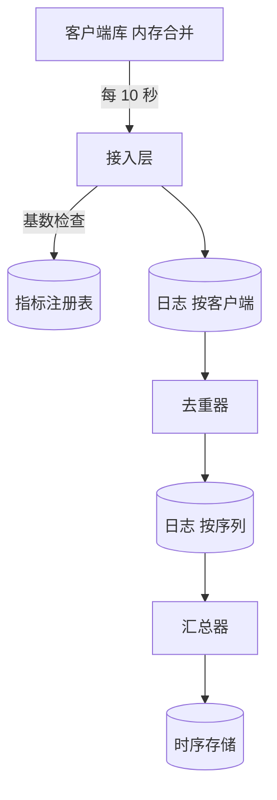
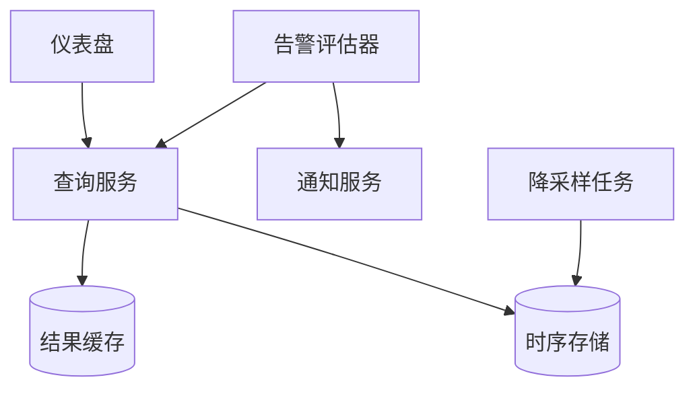
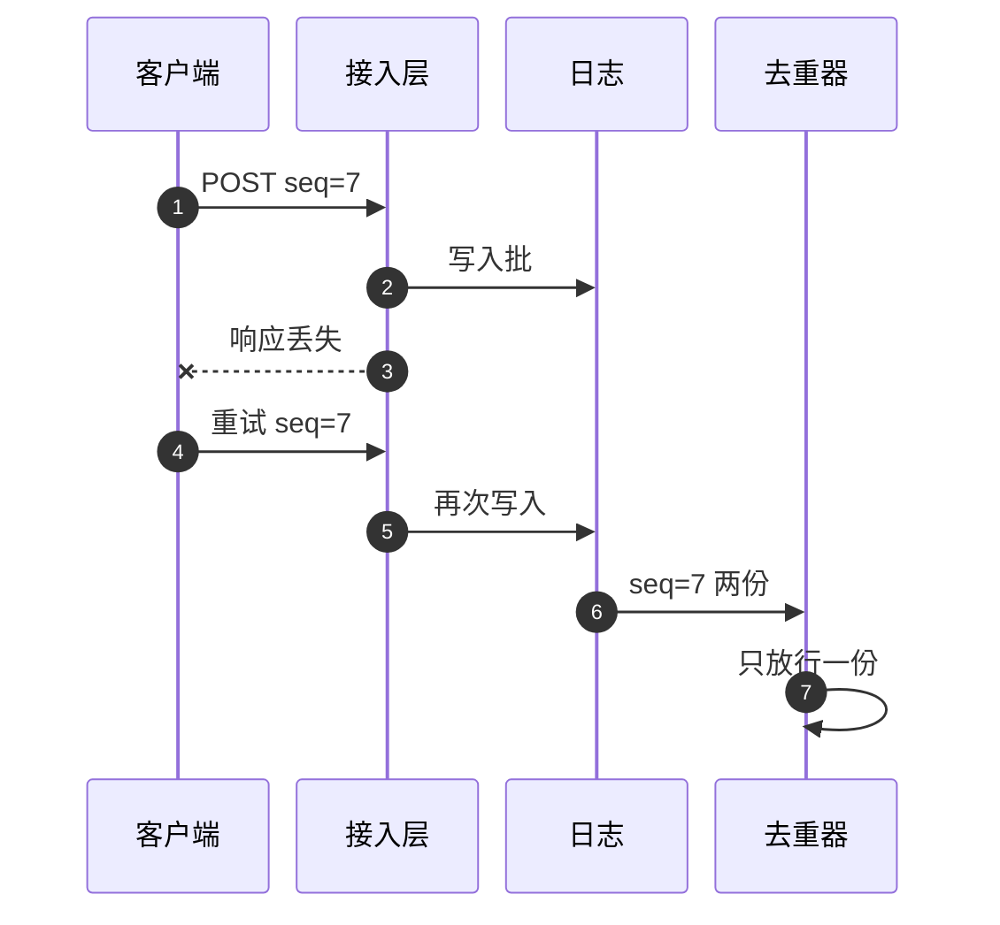

# SD08 指标聚合服务（Metrics Aggregator）

## 题目

工程师在自己的服务里调用客户端库，记下「这个接口被请求了一次」「这次请求出错了」「这次耗时 120 ms」。指标聚合服务把全公司成千上万个进程的这些数字收上来，按时间桶（time bucket，比如每 10 秒一格）汇总，让人可以按指标名、标签（tag，例如接口名、状态码）和时间范围查询，画成仪表盘，并在数值越线时触发告警。

难点不在存储，而在入口。全公司每秒有几亿次计数递增，不可能一次一条地发出去；客户端库必须先在内存里合并再批量上报。一旦批量上报，就会遇到网络重试：请求超时了，服务端其实已经收下，客户端再发一遍，计数就多算了一倍，而计数器的错误不会自己消失。再往后是三个规模问题：某个指标的数据全部落到同一个键上（热键，hot key），标签组合无限增长撑爆存储（基数，cardinality），以及晚到的数据怎么并入已经展示过的时间桶。面试官通常说「设计一个指标聚合器」，然后追问：客户端库里做什么、重试和重复怎么保证计数不多不少、热键怎么办、基数怎么控制、数据多久能看到。下面的规模数字是练习用的假设，面试时以面试官给的为准。

## 澄清问题

开场用两分钟问下面八个问题，每个都会改变设计。

1. **指标类型有哪些：只有计数器（counter），还是也有当前值（gauge）和延迟分布（histogram）？** 计数相加即可合并；延迟的百分位不能由平均数推出，要用能合并的分位数草图（sketch）。下文以计数器为主，在深挖三里扩展到直方图。
2. **规模：多少个进程、每个进程每秒多少次递增、活跃序列（series，一个指标名加一组固定的标签取值）有多少？** 下文假设 5 万个进程，每个每秒 5,000 次递增，全局 500 万个活跃序列。
3. **数据多久必须可见，告警多久必须触发？** 下文取 p99 小于 30 秒可见，从事件到告警通知小于 90 秒。这个数字决定客户端刷新间隔和聚合窗口的上限。
4. **查询的粒度、范围和保留期？** 下文取最细 10 秒，保留 24 小时；1 分钟粒度保留 30 天；1 小时粒度保留 395 天。
5. **计数要精确还是近似？** 计数器要精确（重复上报不能多算）；百分位允许 1% 的相对误差。这个区分决定了去重要做到什么程度。
6. **标签由谁定义，有没有用户编号、请求编号这样的高基数标签？** 没有治理就一定会有人这样用。决定基数上限和超限的处理方式。
7. **告警有多少条规则，多久评估一次，数据缺失算不算异常？** 决定查询服务的压力，以及告警读取哪一层存储。
8. **客户端崩溃时丢多少数据可以接受，是否多租户？** 内存聚合意味着崩溃会丢最近一个刷新周期的数据；多租户意味着需要配额和隔离。

## 需求

**功能需求（按优先级）**

1. 客户端库：在进程内累加计数，定时批量上报，不阻塞业务线程。
2. 接收上报，在重试和重复下保持计数正确。
3. 按时间桶汇总；按指标、标签过滤、分组、时间范围和步长查询。
4. 降采样与保留：10 秒、1 分钟、1 小时三档。
5. 基数治理：每个指标的序列数有预算，超限不拖垮系统。
6. 告警：用户配置规则（表达式、窗口、阈值、持续时间、通知方式）。

**非功能需求**

| 维度 | 目标 | 说明 |
|---|---|---|
| 可见延迟 | p99 小于 30 秒 | 事件发生到查询得到 |
| 计数正确性 | 重试与重复下不多算；崩溃最多丢 1 个刷新周期 | 计数器精确 |
| 写入可用性 | 99.95%，局部故障时客户端缓冲后重试 | 指标系统不能拖累业务 |
| 查询延迟 | 仪表盘 p99 小于 1 秒 | 靠分档和缓存 |
| 晚到数据 | 5 分钟内的迟到并入原时间桶 | 超过的进入修正路径 |
| 基数 | 每个指标默认 1 万个序列预算 | 超出归入溢出序列，总数仍正确 |
| 百分位 | 相对误差 1% | 可合并的草图 |

**明确不做**：日志和链路追踪的采集、指标的长期冷归档、客户端自动埋点。

## 估算

以下为假设，用来推出设计。

- 原始事件：5 万进程 × 5,000 次/s = **2.5 亿次/s**，不可能逐条上报。
- 客户端合并：每进程 400 个活跃序列，每 10 秒刷新一次，每次上报 400 个点。全局 50,000 × 400 ÷ 10 = **200 万点/s**。合并倍数 5,000 × 10 ÷ 400 = **125 倍**。
- 上报流量：每个点约 60 B，200 万 × 60 B = **120 MB/s**；请求数 50,000 ÷ 10 = **5,000 批/s**，每批 400 × 60 B = **24 KB**。
- 去重状态：每批一个键（约 40 B），保留 10 分钟 = 5,000 × 600 = **300 万个键 ≈ 120 MB**，小到可以放内存。
- 存储序列：去掉进程实例这类标签后，全局活跃序列 **500 万**。写入存储的行数 5,000,000 ÷ 10 = **50 万行/s**，比 200 万点/s 再降 4 倍。
- 存储容量（每点约 10 B，压缩后）：10 秒档 24 小时 = 5,000,000 × 8,640 × 10 B = **432 GB**；1 分钟档 30 天 = 5,000,000 × 43,200 × 10 B = **2.16 TB**；1 小时档 395 天 = 5,000,000 × 9,480 × 10 B = **474 GB**。
- 热键：最热的序列是所有进程都上报的那个，每 10 秒每进程一个点：50,000 ÷ 10 = **5,000 点/s**，一个日志分区轻松承受。
- 基数估计：一个 HyperLogLog（用很少内存估计不重复元素个数的草图）取 2^14 个寄存器，约 **12 KB**，标准误差 1.04 ÷ √16,384 = **0.81%**；10 万个指标各一个 = 1.2 GB。
- 百分位草图：相对误差 1%，覆盖 1 ms 到 60 秒，桶数 ln(60,000) ÷ ln(1.01 ÷ 0.99) ≈ **551 个**，稀疏存储，实际每个点只占几十个桶。
- 延迟预算：客户端刷新最多等 10 秒 + 网络 0.5 秒 + 日志 0.5 秒 + 聚合微批 5 秒 + 存储可见 2 秒 + 查询缓存 1 秒 = **19 秒**，低于 30 秒的目标。
- 查询压力：20 万条告警规则每 60 秒评估一次 = **3,333 次/s**；2 万人在看仪表盘，每人 12 个面板，30 秒刷新一次 = **8,000 次/s**。
- 哈希冲突：序列编号取 64 位哈希，500 万个序列的碰撞概率约 (5×10^6)² ÷ 2^65 ≈ **6.8×10^-7**，可接受，并在字典里存全标签校验。

**驱动设计的数字**是 125 倍的客户端合并（把 2.5 亿次/s 降到 200 万点/s），以及每批一个键、总共约 120 MB 的去重状态（让重试可以放心发生）。热键在这个规模下并不危险，原因是客户端合并给每个键设了上限，下面会说明。

## API

客户端库（业务代码里只看到这几行）：

```
counter = metrics.counter("api.requests", tags=["route", "status"])
counter.inc(route="/feed", status="200")          # 只做内存里的原子加
hist = metrics.histogram("api.latency_ms", tags=["route"])
hist.observe(120, route="/feed")
```

上报接口：

```
POST /v1/ingest
Body: {
  "client_id": "feed-api-7f3a", "boot_id": 1729761201, "seq": 4182,
  "bucket_start_ms": 1729761600000, "interval_ms": 10000,
  "points": [
    {"m": "api.requests", "tags": {"route": "/feed", "status": "200"}, "count": 131},
    {"m": "api.latency_ms", "tags": {"route": "/feed"}, "sketch": {"n": 131, "bins": {"412": 9, "413": 31}}}
  ]
}
202 -> {"accepted": 400, "dropped": [{"m": "...", "reason": "cardinality"}]}
429 -> {"retry_after_ms": 2000}
```

`(client_id, boot_id, seq)` 唯一标识一批，是去重的键；`boot_id` 在进程每次启动时变化，`seq` 从 0 递增。

查询与告警：

```
GET /v1/query?metric=api.requests&filter=route:/feed
    &group_by=status&from=...&to=...&step=60s&agg=sum
200 -> {"series": [{"tags": {"status": "200"}, "points": [[ts, value], ...]}]}

POST /v1/alerts
Body: {"expr": "sum(rate(api.requests{status=5xx}[5m])) > 50",
       "for_s": 120, "no_data": "alert", "notify": ["oncall-feed"]}
```

## 数据模型

| 实体 | 键 | 主要属性 |
|---|---|---|
| MetricDef | `name` | 类型、允许的标签键、各标签取值上限、序列预算、负责人 |
| Series | `series_id`（64 位哈希） | 指标名、完整标签集，字典存储 |
| Point | `(series_id, tier, bucket_start)` | `count`、`sum`、`min`、`max`、`sketch`；按加法合并 |
| DedupeState | `(client_id, boot_id)` | 最近 10 分钟已见的 `seq` 集合，随日志偏移量一起检查点 |
| AlertRule | `rule_id` | 表达式、窗口、阈值、持续时间、缺数据策略、通知方式 |
| AlertState | `rule_id` | `ok / pending / firing`、开始时间、上次通知键 |

`Point` 的合并是可交换、可结合的加法（计数相加，最小取小，最大取大，草图逐桶相加），这一点是整个设计的关键：任何顺序、任何分批到达的数据都得到同样的结果，所以晚到数据只是「再加一次」，不需要关闭窗口的概念。平均值不单独存，存 `sum` 和 `count`，读时相除。

## 高层设计

分写路径和读路径。

**写路径**



**读路径与告警**



编号对应的流程：

1. 业务线程调用 `inc` 只做一次内存里的原子加，不访问网络。库里按 `(指标, 标签集)` 保存计数，每 10 秒（对齐到墙钟的 10 秒边界）取出并清零，打成一批，带上 `client_id`、`boot_id`、递增的 `seq`。第一次刷新加上随机偏移，避免 5 万个进程在同一时刻上报。
2. 接入层校验请求，对每个点做基数检查：该指标的序列数是否在预算内；超限的点归入溢出序列。通过后把整批写入日志（按 `client_id` 分区），写入被多数副本确认才返回 202。
3. 去重器按 `client_id` 消费，检查 `(boot_id, seq)` 是否已经见过；见过就丢弃，没见过就记下并向下游输出。记录状态和消费位置一起做原子检查点，保证崩溃后不会既漏掉又重复。
4. 去重器把批拆成点，按 `series_id` 重新分区写入第二个日志。
5. 汇总器按 `series_id` 消费，在 5 秒的微批内把同一个 `(series_id, bucket_start)` 的点相加，向存储做一次加法写入（同一行的多次写入由存储合并）。
6. 降采样任务在时间桶超过迟到上限之后，把 10 秒档合并到 1 分钟档，再合并到 1 小时档。
7. 读：查询服务按步长选择档位，先查结果缓存，未命中再查存储；告警评估器每 60 秒执行规则，读最近一小时的 1 分钟档。

重试和去重的过程：



图中的步骤：

1. 客户端发送第 7 批。
2. 接入层把它写进日志，写入成功。
3. 回应在网络上丢了，客户端超时，不知道服务端是否收到。
4. 客户端用同样的 `seq=7` 重试，这是客户端保证「至少一次」的基础。
5. 接入层不查重，直接再写一次，所以日志里有两份。
6. 去重器依次读到两份 `seq=7`。
7. 去重器只放行第一份，丢弃第二份，下游的计数没有多算。

## 深挖

### 一、客户端预聚合与刷新协议：增量还是累计

问题：2.5 亿次/s 的递增不能逐条发送；而在进程内合并后，每次上报要选择发「这个周期增加了多少」还是「从启动到现在累计多少」。

| 方案 | 上报内容 | 重试与丢失 | 服务端状态 | 问题 |
|---|---|---|---|---|
| 增量（delta） | 本周期内的增加量 | 重复必须去重，丢了就永久少算 | 只需短期去重状态 | 需要序号和去重 |
| 累计（cumulative） | 自启动以来的总数 | 重复无害（覆盖写），丢一次由下一次补上 | 每个 `(序列, 进程)` 一个最近值，5 万 × 400 = 2,000 万项 | 进程重启使计数回落，要检测；存储里每个进程一条序列 |

**选择**增量加序号去重。理由：累计方式让每个进程在存储里各占一条序列，实例标签直接把序列数放大 10 倍以上（2,000 万对 500 万），基数成本远高于去重的状态；而且增量可以直接相加合并，百分位草图也只能以增量方式合并。增量的代价是服务端必须做去重，下一节专门讲。

客户端细节：

- 热路径：内存里按线程分条累加（条带化的计数器），刷新时再求和，避免所有线程争用同一个原子变量。每秒 5,000 次递增，开销可以忽略。
- 刷新对齐到 10 秒墙钟边界，`bucket_start` 就是边界时间，这样所有进程的同一批点落在同一个时间桶。
- 本地重试缓冲有上限（最近 6 批，约 1 分钟），满了丢最旧的，并计入自身的 `dropped_batches` 指标。指标系统不能因为服务端不可用而撑爆业务进程的内存。
- 进程正常退出时在关闭钩子里再刷新一次，崩溃则最多丢 10 秒的数据。

### 二、重试与重复：把「至少一次」变成「不多不少」

问题：重试是客户端保证不丢数据的唯一手段，但每次重试都可能是一次重复。计数器重复就多算，而且无法察觉。

做法是：客户端至少一次，服务端去重，二者结合得到有效一次（effectively-once）。

去重放在哪里，有几个选项：

- **接入层先用 Redis 的 `SETNX` 占键，再写日志**：占键后崩溃，批永远丢了；先写日志再占键，崩溃后重试会重复。两步无法原子，否决。
- **存储端按 `(序列, 桶, 客户端)` 覆盖写**：天然幂等，但存储行数变成 5 万倍，否决。
- **日志之后的有状态去重器**：消费者状态（见过的 `seq`）和消费位置一起做检查点，要么都生效要么都不生效，这是日志加检查点能提供的恰好一次处理。**选择**这种。

实现要点：

1. 日志按 `client_id` 分区，同一个客户端的批进入同一个去重器实例，状态不需要跨节点共享。
2. 状态不能只存「最大 `seq`」：重试可能让第 5 批在第 6 批之后到达，只比较最大值会误丢第 5 批。所以每个 `(client_id, boot_id)` 保存最近 10 分钟的 `seq` 集合（位图）。
3. 三个时间必须满足不等式：客户端重试上限（约 1 分钟）小于接受迟到数据的上限（5 分钟）小于去重窗口（10 分钟）。去重窗口过期之后，更老的重复批不会再被识别，所以接入层直接拒绝 `bucket_start` 比当前早 5 分钟以上的批（返回 `too_late`，客户端丢弃并计入自身指标）。
4. 批的 202 在日志多数副本确认后返回；去重器之前的任何环节失败，客户端都会重试，所以不会丢。
5. 下游汇总器按加法合并，经过去重器之后输入已经没有重复，所以汇总器不必再处理重复。

检查：持续对账——对一小批测试客户端，客户端自己记录的发送总和，对比服务端汇总的总和，差异必须是 0；去重器丢弃的批数是一个指标，持续偏高说明网络质量或接入层有问题。

### 三、时间桶、迟到数据与降采样

问题：事件发生的时间和到达的时间不同；时间桶要怎样定义，晚到的数据怎么处理，历史数据怎么变粗。

- **用事件时间，而不是到达时间。** 点的时间桶由客户端给出的 `bucket_start` 决定（对齐 10 秒）。接入层用服务器时钟校验：桶结束时间比服务器当前时间晚超过 1 分钟（客户端时钟快了），就改写成服务器时间所在的桶并计入「时钟偏移」指标；早超过 5 分钟则拒绝为 `too_late`，响应里带上 `server_time`，客户端连续收到三次就按服务器时间校正自己的偏移量。普通服务器的时钟偏差在毫秒级，手机端则不可靠，所以手机端数据一律使用到达时间。
- **不关闭窗口。** 因为 `Point` 是可交换的加法，晚到的数据直接再加到对应行；没有「窗口结束」的概念，也就没有「迟到数据被丢弃」的问题。代价是已经展示过的数字在 5 分钟内可能略微变大，所以告警评估要避开最近的不完整时间桶：评估区间是 `[now - 窗口 - 20 秒, now - 20 秒]`。
- **降采样**：时间桶超过 5 分钟迟到上限后，降采样任务把 10 秒档合并为 1 分钟档，再合并为 1 小时档。计数相加，最小取小，最大取大，平均存为 `sum` 与 `count`。
- **百分位**：不能对百分位取平均（各机器的 p99 平均不是全局 p99）。上报的是直方图草图（桶号到计数），能逐桶相加；查询时在合并后的草图上求分位数。相对误差 1% 时 551 个桶覆盖 1 ms 到 60 秒。
- **选档位**：查询的步长大于等于 1 小时用 1 小时档，大于等于 1 分钟用 1 分钟档，否则用 10 秒档，这样查询的扫描量与时间范围无关地保持在几百个点。

### 四、热键与分区

热键出现在哪里要先问清，因为不同位置的答案不同。

1. **接入与第一个日志**按 `client_id` 分区，均匀，没有热键。
2. **按序列分区的汇总器**：最热的序列是所有进程都上报的那个，因为每个进程每 10 秒才发一个点，所以最大速率 = 进程数 ÷ 刷新间隔 = 50,000 ÷ 10 = **5,000 点/s**，一个分区能处理几万点/s，不需要特殊处理。这是客户端预聚合带来的上限：热键的速率被「进程数除以刷新间隔」封顶，而不是被请求速率封顶。
3. 什么时候需要加盐：刷新间隔缩到 1 秒（5 万点/s）或进程数涨 10 倍。此时做两级聚合：先按 `(series_id, hash(client_id) mod 8)` 分区求部分和（每片 625 点/s），再按 `series_id` 合并 8 个部分和。代价是多一次重新分区和约一个微批的延迟。
4. **存储的热行**：同一个 `(series_id, bucket_start)` 一个时间桶内被所有微批写入，汇总器在微批内先合并，所以每个微批对同一行只写一次，把几千次写合成 2 次。
5. **读侧的热键**：8,000 次/s 的仪表盘查询里，大量是同一个面板。结果缓存的键是「查询加按步长对齐的时间范围」，有效期等于步长，并合并同键并发请求（请求合并），避免缓存失效瞬间全部打到存储。

### 五、基数：标签组合是真正的成本

问题：一个序列是「指标名 + 一组固定的标签取值」，每出现一个新的取值组合就是一个新序列。有人把用户编号当标签，序列数就从几万变成几亿，存储、内存、查询全部崩溃。

治理分四层：

1. **指标注册表**：每个指标登记名称、类型、允许的标签键、每个标签的取值上限，以及序列预算（默认 1 万）。未登记的标签键直接丢弃。
2. **客户端库**：每个指标在本进程最多 1,000 个序列；超出的点归入 `__overflow__` 序列，同时计入自身的 `cardinality_overflow` 指标。归入溢出序列而不是丢弃，是为了让总数保持正确，只丢失了细分。
3. **服务端准入**：每个指标维护一个 HyperLogLog（12 KB，误差 0.81%）估计序列数；到达预算后，新序列同样归入溢出序列，并告警给指标负责人。
4. **成本归属**：按团队统计序列数，让高基数的代价有人负责。实例类标签（pod、主机）默认在汇总时丢弃，除非指标登记时明确保留；这就是 2,000 万个原始序列压到 500 万的来源。

拒绝和溢出的取舍：拒绝新序列会让整个指标的数据缺失，且排查困难；溢出保住总数、保护存储，代价是被归入溢出的那部分标签维度不可用。选溢出，并且让告警规则可以对总数继续工作。

## 故障与边界

| 场景 | 影响 | 处理 |
|---|---|---|
| 接入层不可用 | 客户端上报失败 | 客户端本地缓冲 6 批后丢旧的并计数；接入层多可用区部署，返回 429 时按 `retry_after` 退避 |
| 响应丢失导致重试 | 批重复 | 去重器按 `(client_id, boot_id, seq)` 去重 |
| 去重器崩溃 | 状态回到上一个检查点 | 状态和位置一起检查点，重放的批被识别为已见 |
| 汇总器落后 | 数据可见延迟增大 | 按序列扩展分区；延迟超过预算时告警；回放追赶 |
| 存储写入变慢 | 日志积压 | 日志是缓冲区；保留期按小时计，足够恢复 |
| 客户端崩溃 | 丢最近 10 秒 | 接受；关闭钩子处理正常退出 |
| 客户端时钟错误 | 点落到错误的桶 | 偏快的改写到服务器时间桶，偏慢的拒绝并让客户端按 `server_time` 校正，计入偏移指标 |
| 基数突发 | 新序列暴增 | 溢出序列、告警、注册表限制 |
| 告警评估器落后 | 告警变迟 | 规则按哈希分片，评估器无状态可扩展；`for` 状态存在状态表 |
| 数据整体中断（所有客户端都没数据） | 告警全部沉默 | `no_data` 策略；对「上报量本身」设置独立的外部告警 |

**边界**：新建指标的前几个周期，序列字典尚无条目，接入层要先写字典再放行；计数器在客户端的值是 64 位整数，溢出后回零要在刷新时按差值处理，不能依赖累计值；多租户时按租户限制序列数和上报速率，防止一个租户拖垮其他租户。

**告警评估**：每条规则每 60 秒执行一次，读取 1 分钟档的最近若干个桶；状态 `pending` 持续超过 `for_s` 才转为 `firing`；通知以 `(rule_id, 开始时间)` 为键去重，同一次触发不重复通知；缺数据是一个独立的显式策略，默认当作异常，因为沉默往往就是故障本身。

## 追问

1. **为什么不让每个进程直接把事件发到日志，由流处理做聚合？** 2.5 亿事件/s 的带宽和日志写入成本都不可接受，且 125 倍的合并几乎免费（进程内存里做）。客户端合并也给热键设了上限。代价是崩溃时丢最近 10 秒，对指标可以接受。
2. **去重状态太大怎么办？** 键是 `(client_id, boot_id)`，值是最近 10 分钟的 `seq` 集合：300 万个键约 120 MB；窗口按迟到上限加余量确定，进程重启产生新的 `boot_id` 旧状态到期自动清除。
3. **如果要求恰好一次的端到端呢？** 在上面基础上，从日志到存储也要事务：汇总器的输出写入和消费位置在同一个检查点中提交，存储的写入以 `(series_id, bucket_start, 微批编号)` 做幂等，重放的微批覆盖而不是重复相加。
4. **为什么用 HyperLogLog 估计基数，而不是精确计数？** 精确计数每个序列都要存，500 万项以上；预算判断只需要约 1% 的误差，12 KB 一个指标就够了。
5. **百分位为什么不能取平均？** 各机器的 p99 平均不是全局 p99，样本量不同的机器权重也不同。上报能合并的直方图草图，在合并后的草图上求分位数。
6. **仪表盘上的数字过一会儿变了，是 bug 吗？** 不是：5 分钟内的晚到数据会并入已经展示的桶。告警评估避开最近 20 秒的未完成桶，面板可以对最近 2 个桶加虚线标记。
7. **一个租户突然上报 100 倍的序列怎么办？** 注册表预算、客户端和服务端两层溢出、租户级速率限制；溢出序列保住总数，限流返回 429 让客户端退避。
8. **查询慢怎么办？** 按步长选档位（查询扫描量封顶）；结果缓存加请求合并；告警走最近一小时的内存缓存层；超大范围查询异步化。
9. **怎么发现指标系统自己坏了？** 用另一套独立的、尽量简单的监控检测它：上报批量、各阶段延迟、去重丢弃率、溢出序列数。指标系统不能只靠自己监控自己。
10. **滚动发布期间的客户端怎么办？** 协议带版本号，接入层同时接受新旧；去重键包含 `boot_id`，不同版本的进程互不影响。
11. **与 Prometheus 拉取模型相比？** 拉取方便发现和控制频率，但需要服务发现，且短命进程（批处理任务、函数）来不及被拉到；推送模型对短命进程友好，代价是需要自己处理去重和基数。

## 评分要点

- 先估算，指出 2.5 亿次/s 不能逐条发送，客户端合并 125 倍后降到 200 万点/s；给出请求数、去重状态、存储三档的数字。
- 客户端协议：内存合并、对齐的刷新边界、`(client_id, boot_id, seq)`、有上限的本地缓冲；说清增量与累计的取舍。
- 重试与重复：至少一次加服务端去重；说出为什么不能先 `SETNX` 再写日志；去重状态与消费位置一起检查点；乱序时用集合而不是最大值；三个时间窗口的不等式。
- 时间桶与迟到：事件时间、时钟校验、加法合并所以不需要关窗口、告警避开未完成桶；降采样三档与保留期；百分位用能合并的草图。
- 热键：先问热在哪里，算出热键速率被「进程数除以刷新间隔」封顶，说清何时需要加盐、读侧如何缓存与合并。
- 基数：注册表、客户端与服务端的溢出序列、HyperLogLog、成本归属；说明溢出与拒绝的取舍。
- 延迟预算加起来小于 30 秒；告警对缺数据的处理。

## 延伸阅读

- 相邻题解：[[solution-metrics-monitoring]]（监控系统的采集、告警与仪表盘）、[[solution-ad-click-aggregation]]（流式聚合与去重）。
- 云厂商视角的托管指标服务见 [[sd11-metrics-timeseries-store]]。
- 同批题单：[[tiktok-sd-index]]。
