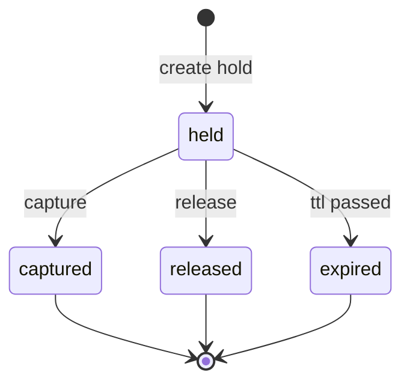
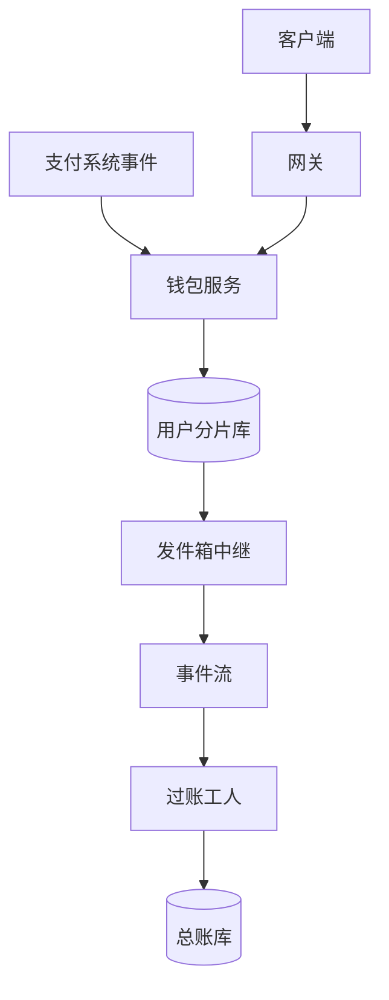
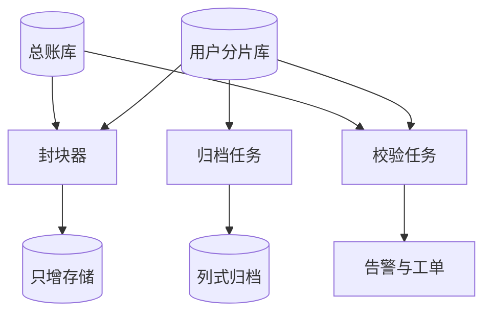

# SD09 金币钱包与复式账本（Coin Wallet and Double-Entry Ledger）

## 题目

用户用真钱买金币（coin，平台发行的预付虚拟货币），再用金币给主播送礼物、买付费直播的入场券、开盲盒。钱包（wallet）是用户看到的那个余额；账本（ledger）是平台内部的记账本，把每一次金币的增减写成成对的借贷分录（double-entry：同一笔业务至少两行，一行借、一行贷，金额之和为 0）。金币是平台欠用户的预付负债，花出去的那一刻才变成平台的收入，所以这个系统既是产品功能，又是财务报表的源头。

难点有三个，而且互相牵制。第一，恰好一次：应用商店的购买通知会重发，客户端会重试，消息队列至少投递一次，但每一次充值只能入账一次，每一份礼物只能扣一次，余额永远不能为负。第二，热点账户：全平台的「礼物收入」账户每笔礼物都要入账，每秒几万次，数据库对同一行的并发更新是最不擅长的事。第三，可证明：审计和财务要问「这个用户的 7 个金币去了哪里」「全平台发行的金币总数等不等于所有账户之和」，你要能当场给出答案，而且账本不能被悄悄改过。

面试官通常只说一句：设计 TikTok 的金币钱包，支持充值、送礼、余额冻结，保证不重复入账、可以审计。然后盯住一条流程连问：重复通知怎么办、崩溃在哪一步、热点账户怎么扛、怎么证明账是对的。直播送礼的整体结算见 [[sd02-live-gift-coin-settlement]]，这里专门把钱包和账本这一层讲透。下面的数字是练习用的假设，面试时以面试官当场给的数字为准。

## 澄清问题

开场用三分钟问完下面八个问题，把答案写在白板角落。每个问题都会改变设计。

1. **规模是多少：每天多少份礼物、多少次充值、多少次冻结？** 决定钱包要分几个分片，以及哪些账户是热点。下面假设每天 2 亿份礼物、500 万次充值、2000 万次冻结，峰值按 10 倍。
2. **金币有哪些来源？** 应用商店内购（Apple、Google）、银行卡与本地支付（走 [[sd01-payment-system]]）、礼品卡、活动赠送。来源不同，去重键不同，退款通知的形态也不同；赠送的币没有真钱对应，会计科目也不同。
3. **用户之间能转币吗？** 能转就有跨分片的两条腿，要用事件加幂等入账；不能转（多数虚拟币的做法）就只有「用户到平台」「平台到主播」两个方向，设计简单得多。下面按不能转设计，转币放在追问里。
4. **哪些场景需要冻结（hold，先预留额度，之后确认或释放）？** 付费直播入场、盲盒开奖前、礼物连击、订阅续费。冻结影响余额的定义：可用余额等于余额减去冻结额。
5. **一致性底线是什么？** 把「余额永不为负」「同一笔业务只入账一次」写成硬约束；再问展示余额能不能晚几秒。通常的答案是：扣币强一致，展示可以最终一致。
6. **充值退款发生在币已经花掉之后怎么办？** 应用商店会在几天甚至几周后发来退款通知。这决定账户是否允许出现负债，以及已经分给主播的那部分怎么追回。
7. **审计与合规：保留多久，谁来查，要不要防篡改的证明？** 财务和监管通常要求保留 7 年、可追溯到每一笔，并能证明历史没有被改。这直接决定账本是只增不改，还要有封存机制。
8. **多区域与数据驻留？** 钱包按用户的归属区域存放，所有扣币路由到那里（理由见 [[sd02-live-gift-coin-settlement]] 深挖二）。这里沿用，不再展开。

## 需求

**功能需求（按优先级）**

1. 充值入账：来源通知重复、乱序、延迟几天，都只入账一次。
2. 扣币：送礼等消费，带客户端生成的业务键，重试安全，余额不足明确拒绝。
3. 冻结、确认、释放：冻结后可用余额立即减少；确认时可以只确认一部分；超时自动释放。
4. 查询：余额（总额、冻结额、可用额）、流水分页、任意时点的账户余额。
5. 冲销与调整：充值退款、礼物撤销、客服补偿，一律追加冲销分录或调整分录，不改历史。
6. 审计与对账：任意时刻可以证明借贷平衡、金币总量守恒、钱包余额等于流水之和。
7. 每日余额快照与月结（放在最后）。

**非功能需求**

| 维度 | 目标 | 说明 |
|---|---|---|
| 入账正确性 | 同一业务键至多入账一次；余额永不为负 | 产品承诺，不为延迟让步 |
| 扣币延迟 | p99 小于 100 ms（归属区域内） | 同区域一次分片库事务 |
| 扣币可用性 | 99.99%（年停机约 52.6 分钟） | 账本不可用时失败关闭（fail closed）：拒绝消费，不放行 |
| 持久性 | 已确认的分录零丢失 | 分片主库同步复制到另一个可用区（RPO 为 0） |
| 账本守恒 | 每个币种内借贷之和恒为 0 | 违反即事故，自动告警 |
| 审计 | 分录保留 7 年，只增不改，可证明未被篡改 | 财务与监管 |
| 余额读取 | 展示余额可晚 2 秒；钱的路径读主库 | 两类读者区别对待 |

**明确不做**：用户之间转币（放追问）、收入确认的完整会计规则（只说明在哪里挂钩）、主播结算与打款（见 [[sd10-creator-payouts]]）、与外部对账的匹配引擎（见 [[sd11-reconciliation-system]]）。

## 容量估算

下面是假设，用来推出设计，不是任何真实产品的流量。

- 礼物：2 亿份/天 ÷ 86,400 秒 = **2,315/s 平均**，按 10 倍峰值取 **约 23,148/s**。
- 分片：32 个钱包分片，每片峰值 23,148 ÷ 32 = **723 份/s**。
- 同步事务的行数：每份礼物写钱包行 1、礼物事件 1、分录 2（用户一行、清算账户一行）、发件箱 1，共 5 行。峰值 23,148 × 5 = **约 115,741 行/s**，每片 **3,617 行/s**，单个 MySQL 或 Postgres 主库承受得住。
- 充值：500 万次/天，平均 58/s，峰值 **579/s**，每片 18/s。每次充值写 5 行分录（美元一侧 3 行，金币一侧 2 行，见深挖二）。
- 冻结：2000 万次/天，平均 231/s，峰值 **2,315/s**。冻结有效期 10 分钟，峰值时在途冻结最多 2,315 × 600 = **约 139 万条**，一张索引表放得下。
- 分录总量：同步腿 2 亿 × 2 = 4 亿行，充值 500 万 × 5 = 2,500 万，确认的冻结（80% 被确认）1,600 万 × 2 = 3,200 万，主播侧异步腿最多 2 亿行，平台侧净额分录 32 个分片 × 86,400 秒 × 2 = 553 万行。合计 **约 6.6 亿行/天**。
- 存储：每行约 100 B，**66 GB/天**。在线保留 90 天约 **6.0 TB**，每片约 186 GB；保留 7 年的原始量约 **169 TB**，列式压缩按五分之一估计约 34 TB，所以老数据要归档到对象存储。
- 钱包行：3 亿个钱包 × 100 B = **30 GB**，分片后每片不到 1 GB。可见钱包本身很小，大的是账本。
- 充值去重表：500 万/天 × 365 × 7 年 × 80 B ≈ **1.0 TB**，这张表永久保留，不能像请求幂等键那样 24 小时过期（见深挖一）。
- 热点：单行在事务里被更新，若每次持锁 2 毫秒，上限只有 1 ÷ 0.002 = **500 次/s**。每片的清算账户峰值 723 次/s，已经超过；如果把全平台只放一个收入账户，是 23,148 次/s，差 46 倍。
- 封块：每片每分钟封一个块，32 × 1,440 = **46,080 个块/天**，量很小。
- 校验：3 亿个钱包用一周校验一遍，每天 4,286 万个，约 **496 个/s**，后台任务就够。

**驱动设计的那个数字**是 723/s 对 500/s：热点账户的余额不能在同步路径上被更新。所以同步路径只做三件事：条件扣用户自己的钱包行、插入分录、写发件箱；全部系统账户的余额都由追加的分录推出来。

## API

```
POST /v1/wallets/{user_id}/credits        # 内部：由支付系统或商店通知调用
Body: { "source": "apple", "source_txn_id": "...", "coins": 1000, "money": {"amount": 1000, "currency": "USD"} }
200 -> { "journal_id": "...", "balance": 1000, "duplicate": false }
200 -> { ..., "duplicate": true }          # 重复通知，返回第一次的结果

POST /v1/wallets/{user_id}/debits
Body: { "spend_id": "client-uuid", "coins": 7, "reason": "gift", "ref": "gift:123" }
200 -> { "journal_id": "...", "balance": 993 }
402 -> 余额不足（可用额小于 7）
409 -> 同一个 spend_id 请求内容不一致

POST /v1/holds                              # 冻结
Body: { "hold_id": "client-uuid", "user_id": "...", "coins": 100, "ttl_s": 600, "ref": "ticket:55" }
POST /v1/holds/{hold_id}/capture            # Body: { "coins": 80 }，余下的 20 自动释放
POST /v1/holds/{hold_id}/release

GET  /v1/wallets/{user_id}                  # { balance, held, available, as_of_seq }
GET  /v1/wallets/{user_id}/entries?after=   # 流水分页
POST /v1/adjustments                        # 人工调整：reason_code、maker、checker 必填
GET  /v1/accounts/{account_id}/balance?as_of=
```

所有写接口都带业务键（`source_txn_id`、`spend_id`、`hold_id`），键加请求内容的哈希一起保存：同键同内容返回第一次的结果，同键不同内容返回 409。余额接口返回 `as_of_seq`（流水序号），调用方据此知道读到了哪一刻。

## 数据模型

| 实体 | 键 | 关键字段 |
|---|---|---|
| Wallet | `user_id`（分片键） | `balance`、`held`、`version`、`status`、`home_region`；可用额 = `balance` − `held` |
| Hold | `hold_id` | `user_id`、`coins`、`state`（held / captured / released / expired）、`expires_at`、`captured_coins`；`(state, expires_at)` 上建索引供清扫 |
| Account | `account_id` | `type`（asset / liability / revenue / expense / contra）、`currency`（USD、COIN 等）、`shard`、`owner`；系统账户每个分片一份，如 `gift_clearing@07` |
| Journal | `journal_id` | `group_id`（跨币种的同一业务）、`kind`（topup / spend / capture / reversal / adjust）、`business_key`、`reverses_id`、`created_at`；`business_key` 唯一 |
| LedgerLine | `(journal_id, line_no)` | `account_id`、`direction`（借 / 贷）、`amount`（正整数最小单位）、`currency`、`seq`（账户内序号）；只增不改 |
| TopUp | `(source, source_txn_id)` | `user_id`、`coins`、`journal_id`、`state`；主键就是去重 |
| GiftEvent | `gift_id` | 发送者、主播、场次、价格版本、`share_bps`、`share_micro`；子账（subledger）的明细 |
| Outbox | `outbox_id` | 与业务同事务写入，待投递 |
| Seal | `(shard, minute)` | 该分钟分录的根哈希、上一个块的哈希、对象存储位置 |

三处设计值得先说清。第一，Wallet 的余额是账本的投影（projection）：它为了做条件扣减而放在同一个分片库、同一个事务里，但真相是 LedgerLine；两者之差由校验任务持续检查。第二，金额一律是正整数加方向，币种不同的分录不能混在一个守恒集合里，金币是一个独立的币种，用 micro 单位（万分之一金币，沿用 [[sd02-live-gift-coin-settlement]]）。第三，系统账户每个分片一份：一次业务的所有分录都落在同一个分片，用一个本地事务写完，不需要两阶段提交。

冻结的状态机：



冻结只改钱包的 `held` 列，不写分录：它没有改变谁拥有这笔钱，只是限制了用法。确认时才写一条消费分录。

## 高层设计

系统分成同步的写路径、异步的过账路径和旁路的审计路径。拆开画是因为它们的一致性要求完全不同：写路径要强一致，过账可以晚几秒，审计可以晚几小时但不能缺。

**写路径与过账路径**



**审计路径**



一次礼物消费的步骤：

1. 客户端带着 `spend_id` 调用网关，网关按用户的归属区域路由到钱包服务。
2. 钱包服务在用户所在分片开一个本地事务：先插入 Journal（`business_key` 唯一，冲突说明已处理过，直接返回第一次的结果）。
3. 条件扣减：`UPDATE wallet SET balance = balance - :p WHERE user_id = ? AND balance - held >= :p`。影响行数为 0 就回滚并返回 402。
4. 插入两行分录：借用户的 `user_coin`，贷本分片的 `gift_clearing`。再插入礼物事件和发件箱。提交。
5. 发件箱中继把事件投递到事件流（至少一次）。
6. 过账工人按一秒的窗口把同一分片的礼物净额合并，写总账：借 `gift_clearing`，贷 `platform_coin_revenue` 和各主播的 `creator_share_coin`。窗口里每个账户只写一行，所以平台侧热点账户每秒每片只有一次写入。
7. 审计路径的封块器每分钟把各片的分录打包封存，校验任务在后台持续核对三条守恒（见深挖五）。

充值入账走同样的写路径，只是入口是支付系统的事件或商店的通知，详见深挖一。

## 深挖

### 一、恰好一次入账：去重键、同事务、永久保留

问题：商店通知会重发，会乱序，甚至在购买几天后才到；支付系统的事件也是至少一次投递。要让每次充值恰好入账一次，办法是**每个入口一个永久去重键，所有副作用放进同一个本地事务**。

**去重键。** 充值的键是 `(source, source_txn_id)`，例如 Apple 的交易号。TopUp 表以它为主键，Journal 的 `journal_id` 由同一个键确定性地生成（对键做命名空间哈希得到 UUID），所以两个服务实例同时处理同一条通知，也会产生同一个主键，数据库的唯一约束只放行一个。

**同事务。** 校验收据通过后，在用户所在分片开一个事务，一次性写完五样东西：TopUp 行、Journal 与它的分录、钱包余额加币、发件箱事件。任何一样失败整个事务回滚。「余额已加但没有分录」或「有分录但没有去重记录」这种半成品不可能出现。

**为什么不能用 24 小时过期的幂等键。** 请求级幂等键（商家重试用的那种）可以过期，因为重试发生在几秒到几小时之内。商店的通知不同：退款和补发通知可以晚到数周，重放攻击也可能发生在很久以后。所以充值去重表永久保留，500 万/天 × 7 年约 1.0 TB，分片后每片 32 GB，这个代价很小。

**崩溃点。**

| 崩溃发生在 | 现象 | 收敛方式 |
|---|---|---|
| 校验收据时 | 还没有任何写入 | 商店重发通知 |
| 事务提交前 | 事务回滚，什么都没发生 | 同上 |
| 提交后、回 200 前 | 已入账，商店认为失败 | 重发时主键冲突，返回第一次的结果，`duplicate: true` |
| 发件箱投递前 | 钱包已有币，下游还不知道 | 中继进程重启后继续投递，下游按事件键去重 |
| 支付系统的成功事件丢了 | 用户付了钱但没收到币 | 每日两侧对账：成功的购买必须恰好对应一条 TopUp，缺的自动补入账，多的告警 |

最后一行是真正的兜底：入账是否正确，不能只靠事件不丢，要有一个独立的计数核对。

**被否决的方案。** （a）先查再写（先 `SELECT` 有没有处理过）：两个并发请求同时看到「没有」，都去入账，必须靠唯一约束兜底，那就不如直接把唯一约束当主路径。（b）用分布式事务让支付系统与钱包同时提交：支付系统不在钱包的事务域里，两阶段提交把两边的可用性绑在一起。（c）用 Redis 做去重：Redis 的主从复制是异步的，故障切换后可能丢掉最近的键，导致重复入账。

**退款通知。** 退款到达时追加冲销：先看币还在不在钱包里。币还在，直接扣回；币已经花掉，钱包余额变负，钱包进入负债状态，禁止消费，下次充值先抵扣。已经分给主播的那部分，只要主播还没提现，就从主播的待结算余额里追回（见 [[sd10-creator-payouts]]）；已经提现的，由平台记坏账费用，这是业务决定，不是技术问题。

### 二、复式账本的建模：币种内守恒、发行账户、清算账户

问题：只记「余额变了多少」的单边流水，无法验证系统整体对不对：少记一边没人发现。复式记账用「借贷相等」把每次业务变成自检的：每笔业务的所有分录，在每个币种内，借方合计等于贷方合计。

**金币是一个独立的币种。** 用户花 10 美元买了 1,000 个金币，这件事涉及两个币种，各自守恒：

美元一侧（单位：美分）：

| 借 | 贷 |
|---|---|
| `store_receivable:apple` 700 | `deferred_coin_revenue` 1,000 |
| `store_fee_expense` 300 | |

金币一侧（单位：micro，1,000 个金币 = 10,000,000 micro）：

| 借 | 贷 |
|---|---|
| `coin_issuance` 10,000,000 | `user_coin:U` 10,000,000 |

美元一侧：应收商店 700（商店扣了 30% 渠道费），渠道费 300，合计借 1,000，贷方是预收款（用户付了钱，币还没花，所以是负债而不是收入）1,000。金币一侧：`coin_issuance` 是发行账户，借方余额累积的就是平台发行过的金币总数；用户的 `user_coin` 是平台欠用户的币，贷方余额。这两个 Journal 共用一个 `group_id`，在同一个事务里写。

**一次送礼（7 个金币 = 70,000 micro，主播分成 35%）。**

同步腿（在用户的分片事务里）：

| 借 | 贷 |
|---|---|
| `user_coin:U` 70,000 | `gift_clearing@07` 70,000 |

异步腿（过账工人写）：

| 借 | 贷 |
|---|---|
| `gift_clearing@07` 70,000 | `creator_share_coin:C` 24,500 |
| | `platform_coin_revenue@07` 45,500 |

24,500 = 70,000 × 35%，45,500 = 70,000 − 24,500，所以异步腿借贷各 70,000。**清算账户**（clearing account）的作用是让同步腿自己平衡：用户的币离开了，进入一个「在途」账户，等异步腿再分配给主播和平台。清算账户的余额应当总是接近 0，不为 0 的部分就是还没过账的积压，所以它同时是一个现成的积压指标。

**为什么每个分片一份系统账户。** 如果 `gift_clearing` 全平台只有一个，同步腿就要跨分片写，需要分布式事务。改成每片一份（`gift_clearing@00` 到 `@31`），每次业务的所有分录都在本片，一个本地事务写完；报表要全局数字时，对 32 个账户求和。代价是系统账户多了 32 倍，对账时要按片汇总，换来的是写路径不需要任何跨片协调。

**收入确认。** 美元一侧的预收款在币被花掉时转为收入，这件事挂在异步腿上做：借 `deferred_coin_revenue`，贷收入账户，按币的平均成本折算。它只影响美元一侧，不影响金币的守恒，所以财务规则变了也不用动同步路径。

**守恒的检查。** 每个币种、每个时刻：全部借方之和等于全部贷方之和。再加一条金币总量的恒等式：`coin_issuance` 的借方余额 = 所有金币账户（用户、清算、主播待结算、平台收入）的贷方余额之和。第一条抓记账错误，第二条抓凭空多出来或消失的币。

### 三、余额与冻结：可用额、确认、释放、超时

问题：付费直播入场、盲盒、连击都是「先确定能付，之后才真正付」。直接扣掉再退，会让用户看到余额抖动，并产生大量冲销分录；什么都不预留，则确认时可能发现余额已经被花光。

**做法。** 钱包行有 `balance` 和 `held` 两列，可用额 = `balance` − `held`。

- 冻结：`UPDATE wallet SET held = held + :c WHERE user_id = ? AND balance - held >= :c`，同事务插入 Hold 行（`hold_id` 主键）。同一个 `hold_id` 重试，主键冲突，返回第一次的结果。
- 确认：`UPDATE hold SET state='captured', captured_coins=:x WHERE hold_id=? AND state='held'`，影响行数为 1 才继续；同事务 `UPDATE wallet SET balance = balance - :x, held = held - :c`，并写一条消费分录。冻结 100 个、确认 80 个，则 `held` 减 100、`balance` 减 80，剩下 20 自动回到可用额。冻结已经保证了钱够，所以确认不会因余额不足失败。
- 释放：`state` 从 `held` 变 `released`，`held` 减去冻结额，不写分录。
- 超时：清扫任务扫 `(state, expires_at)` 索引，把到期的 `held` 置为 `expired` 并回收额度。三个终态都用同一个条件 `WHERE state='held'`，所以确认和超时同时发生时只有一个成功，另一个影响行数为 0。

**冻结要不要写分录？**

| 方案 | 做法 | 为什么选或否决 |
|---|---|---|
| 只改钱包的 `held` 列 | 冻结不写分录，确认才写 | 冻结没有改变谁拥有币，量大（峰值 2,315/s）且 20% 最终不被确认，不值得每次写两行；**选择** |
| 冻结转到 `user_coin_held` 账户 | 冻结写一对分录，释放再写一对冲销 | 历史完整，但分录量翻倍，大部分是来回抵消的噪声，**否决** |

选第一个的代价是：任意时点的冻结额要靠 Hold 表（状态变更同样只增不改）而不是分录来还原，所以恒等式里加一条：钱包的 `held` 等于该用户所有 `held` 状态冻结额之和，由校验任务检查。

**为什么超时释放必须有。** 客户端崩溃、用户关掉 App，都会留下永远不被确认的冻结。10 分钟的有效期把「余额被无限期锁住」的损失限制在 10 分钟内。峰值在途的冻结最多约 139 万条，清扫任务每秒处理几千条就够。

**被否决的方案。** 把冻结放在 Redis 里：延迟低，但冻结额和钱包余额不在同一个事务里，Redis 丢了数据就会出现「钱包显示可用，实际已被冻结」，而钱的路径不能容忍这种不一致。

### 四、热点账户：不更新余额，只追加分录

问题：平台收入、清算、发行账户每笔业务都要入账。每片 723 次/s 写同一行，行锁串行化后每次持锁 2 毫秒，上限 500 次/s，已经被压垮。

选项：

| 方案 | 做法 | 代价 |
|---|---|---|
| 直接更新余额行 | `UPDATE account SET balance = balance + x` | 锁竞争，上限 500/s，**否决** |
| 拆成 N 个子账户 | 写时随机选一个，读时求和 | 把每个子账户的压力降到 723 ÷ 16 = 45/s，但读余额要读 16 行，账户数乘以 16，且精确余额仍需读时求和 |
| 追加分录加快照 | 同步路径只 `INSERT` 分录，不碰余额列；余额 = 上一个快照 + 快照之后的分录之和，快照每分钟生成一次 | 读余额要多一步求和；**选择** |
| 过账前净额合并 | 过账工人把一秒内同一账户的多行合并成一行 | 平台侧每片每秒 1 行，原始明细留在子账（GiftEvent）里；**与上一条组合使用** |

**选择**：同步路径只插入，用户钱包行以外不更新任何余额；平台侧账户再靠一秒净额合并，把每片 723 行/s 压到 1 行/s，全部 32 片合计每天 553 万行分录（即 32 × 86,400 × 2）。原始的每份礼物明细在 GiftEvent 里，总账里的净额分录引用它所覆盖的事件范围，所以总账行少，却仍可逐笔追溯，这就是子账与总账的分层。

**读余额。** 展示用的余额读快照加增量，允许晚几秒。需要精确余额的操作（比如打款前检查可用额）：先读最新快照，再对快照之后的分录求和，因为分录按账户内序号追加，增量最多一分钟的量。

**热主播的钱包也是热点吗？** 在这个设计里，主播侧不在送礼的同步路径上，主播的待结算余额由过账工人按一秒净额写入，每个主播每秒至多一行，所以同样不是热点。

### 五、审计：守恒不变量、封块、可重建

问题：财务问「怎么证明账是对的」，监管问「怎么证明历史没被改」。靠人看是不可能的，要靠机制。

**不变量，持续检查。**

| 编号 | 不变量 | 抓什么 |
|---|---|---|
| I1 | 每个币种内，每个 Journal 借方合计等于贷方合计 | 记账错误 |
| I2 | 钱包 `balance` 等于该用户 `user_coin` 账户的流水之和 | 投影与真相不一致 |
| I3 | `coin_issuance` 借方余额等于所有金币账户贷方余额之和 | 凭空多出或消失的币 |
| I4 | 钱包 `held` 等于该用户所有 `held` 状态冻结额之和 | 冻结泄漏 |
| I5 | 每条成功的购买恰好对应一条 TopUp | 漏入账、重复入账 |

I1 在写入时就由应用层检查，I3 到 I5 每天核对；I2 用一周滚动校验全部 3 亿个钱包，每天 4,286 万个，约 496 个/s，后台任务就够。差异不自动修改，而是产生工单，更正通过追加调整分录完成。

**只增不改。** 数据库账号对账本表只有 `INSERT` 和 `SELECT` 权限，没有 `UPDATE` 和 `DELETE`。错误用冲销分录更正：新的 Journal，`reverses_id` 指向原来的，借贷方向相反。人工调整需要制单人和复核人（maker-checker）两个不同的人，并必须带原因码。

**封块防篡改。** 数据库权限防不住有最高权限的人。办法是封块：封块器每分钟对每片刚写入的分录按顺序计算哈希，汇成一个块，块里包含上一个块的哈希，形成链，再写进只能追加的对象存储（开启保留锁定，写入后到期前不能改）。之后任何人改动历史分录，重新计算的哈希就和已封存的对不上。每天 46,080 个块，量很小。把哈希链放在异步的封块器里，而不是写入时更新，是为了不让所有写入串行化到同一个「上一个哈希」上。

**可重建。** 钱包余额和快照都是投影，丢了或怀疑错了，可以从分录重放重建。每天的重放校验是 I2 的另一种形式。

**归档。** 在线保留 90 天（约 6.0 TB），更早的分录按月转成列式文件放对象存储，约 34 TB 覆盖 7 年；查询老账走归档，延迟高但可审计。

## 故障与边界

| 组件 | 故障时的影响 | 缓解 |
|---|---|---|
| 单个钱包分片主库故障 | 该片用户不能消费或充值 | 同步副本自动接管；网关失败关闭，客户端带原键重试 |
| 区域整体故障 | 该区域用户不能消费 | 失败关闭；异步备份提升前先隔离旧主库（fencing），晋升后用事件流与钱包流水对账补记（做法同 [[sd02-live-gift-coin-settlement]] 深挖二） |
| 发件箱中继停了 | 下游和总账变旧，钱包本身正确 | 积压深度告警；清算账户余额同时是积压指标 |
| 过账工人落后 | 平台与主播的余额变旧 | 重放幂等：过账按事件键去重，批号唯一 |
| 重复通知、乱序通知 | 重复入账的风险 | 永久去重键加同事务；退款通知先到时先记下来，等购买到达时抵消 |
| 清扫任务停了 | 冻结额一直不释放 | 清扫是幂等的；积压告警；超过两倍有效期的冻结直接告警 |
| 校验任务发现 I2 不一致 | 钱包余额与流水不符 | 以流水为准重建余额；冻结该用户；工单追查原因 |
| 封块器故障 | 防篡改证明出现空洞 | 缺失的分钟补封；连续缺失告警 |
| 时钟漂移 | 分钟边界的分录归属错误 | 按分录的序号而不是时间排序封块；时间只用于展示 |

**边界。** 余额为 0 时的并发消费：条件更新保证两个请求不会同时成功。负余额：只有退款路径能把余额打成负，消费路径的条件更新永不允许；负余额的钱包进入负债状态并禁止消费。赠送的币（没有真钱对应）：金币一侧同样发行，美元一侧借促销费用、贷预收款为 0，所以这类币的退款路径不同，币的来源要作为分录属性保留。

## 面试官追问

1. **为什么不直接在钱包里存一个余额列，再加一张流水表？** 可以，但真相放哪里很关键。余额列加流水两者各自可以被改而不被发现。设计里流水（分录）是真相，余额是投影，两者在同事务里写，并有持续校验；流水还是对账、审计、重建的唯一依据。
2. **复式记账对一个钱包到底有什么用？** 借贷相等让每笔业务自检：少记一边，立刻不平衡。再加上清算账户和发行账户，能证明金币总量守恒。单边流水做不到这一点。
3. **同一个用户同时送两份礼物，余额只够一份？** 条件更新 `balance - held >= :p` 是原子的，一个成功，另一个影响行数为 0，返回 402。同一个用户的写入只落在他自己的一行上，每秒最多几十次，不是热点。
4. **热点账户怎么扛？** 先算数字：每片 723/s 对 500/s。同步路径不更新任何系统账户余额，只插入分录；平台侧靠一秒净额合并降到每片每秒 1 行；读余额用快照加增量。
5. **充值退款在币已经花掉之后到达怎么办？** 写冲销分录，钱包余额变负，钱包进入负债状态，禁止消费，下次充值先抵扣；主播待结算余额里还没提现的部分追回，已提现的由平台承担并记坏账。
6. **用户之间转币怎么做？** 两条腿在两个分片：先在转出方分片做一个本地事务（借转出方、贷一个转账在途账户，业务键唯一），事件投递到转入方分片，再做一个幂等的入账事务。中间状态可见且有界，任何一步失败都可以用同一个业务键重放。不用分布式事务。
7. **怎么证明账没被人改过？** 权限上账本表只增；分录每分钟封块，哈希成链，写进只能追加的对象存储；校验任务重算哈希比对。有最高权限的人能改库，但改不了已封存的哈希。
8. **钱包余额放缓存里读行不行？** 展示可以，允许晚 2 秒；钱的路径（扣币、冻结、打款检查）必须读分片主库。缓存里的余额带 `as_of_seq`，客户端据此判断是否过期。
9. **主库故障转移后丢了几秒的数据怎么办？** 同步副本的 RPO 为 0，不丢。跨区域异步备份才可能丢；晋升前先隔离旧主库，晋升后用事件流里的礼物事件和钱包流水核对，缺失的补记，多出的冲销。
10. **价格不同的币（不同区域、不同促销价买的）花出去时收入怎么算？** 金币一侧不区分，收入确认挂在异步腿上，美元一侧按钱包的平均成本折算，或者按先进先出的批次。这是会计政策，不应该让同步路径知道。
11. **要把现有的「只有余额列」的老系统迁移过来？** 先为每个钱包生成一条期初余额的分录（来源标明是迁移），双写一段时间，每天比对新账本推出的余额和老余额，差异清零后再切换读路径，最后下线老列。
12. **一个分片放不下了，要扩到 64 片？** 钱包按 `user_id` 一致性哈希，扩分片时迁移用户的行和分录，系统账户在新分片上新建；迁移过程中该用户只读，用 `seq` 保证分录连续。因为系统账户本来就按片存放，不涉及任何全局账户的拆分。

## 评分要点

一个 senior 的回答必须覆盖：

- 开场把「恰好一次入账、余额永不为负、可审计」写成硬约束，并问清币的来源、能否转币、退款时机。
- 估算后得出结论：规模不难，热点账户的 723/s 对 500/s 才是矛盾；账本一年量级的存储要分级。
- 恰好一次：永久去重键加同事务，确定性的 `journal_id`，崩溃点逐个说明，以及独立的两侧计数核对作为兜底。
- 复式账本：金币是独立币种，各自守恒；发行账户、清算账户的作用；系统账户按片存放使每次业务是本地事务；给出一个带数字的分录例子（70,000 = 24,500 + 45,500）。
- 冻结：可用额的定义，三种终态用同一个条件更新互斥，超时释放，以及为什么不写分录（和替代方案的取舍）。
- 热点账户：同步路径只追加，快照加增量读余额，净额合并，子账与总账的分层。
- 审计：几条不变量、只增不改的权限、封块哈希链、可重建、归档分级。
- 退款后余额为负、转币、迁移等追问有成型的答案。
- 主动说出自己设计里最弱的一环（冻结只改钱包列所以任意时点的冻结额要靠 Hold 表还原，或系统账户按片存放后全局报表要汇总）。

时间不够时（30 分钟）：5 分钟澄清加硬约束，5 分钟画写路径，剩下 20 分钟讲恰好一次入账和热点账户，复式分录与审计各用两分钟口述规则。

## 延伸阅读

- 通用题解：[[solution-digital-wallet]]、[[solution-payment-system]]。
- 同批题单：[[tiktok-sd-index]]；整体结算见 [[sd02-live-gift-coin-settlement]]，上游支付见 [[sd01-payment-system]]，下游打款见 [[sd10-creator-payouts]]，外部对账见 [[sd11-reconciliation-system]]。
- 幂等与事务的口述版：[[tiktok-idempotency-transactions]]。
