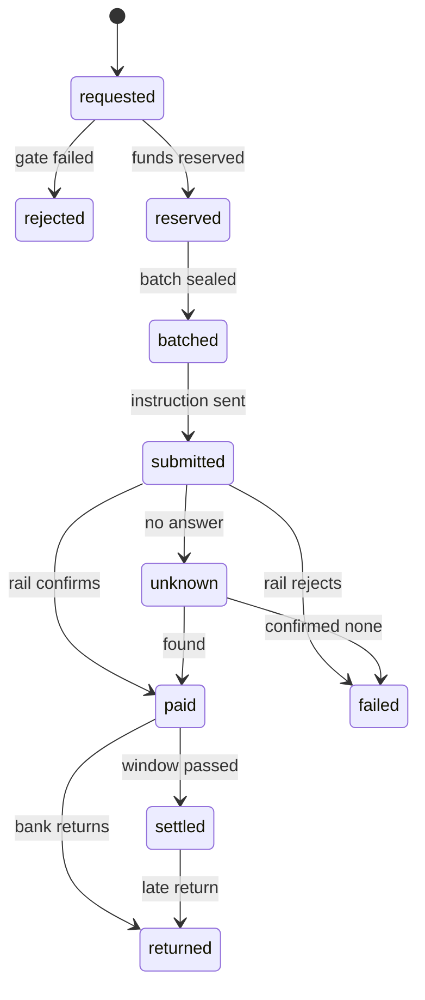
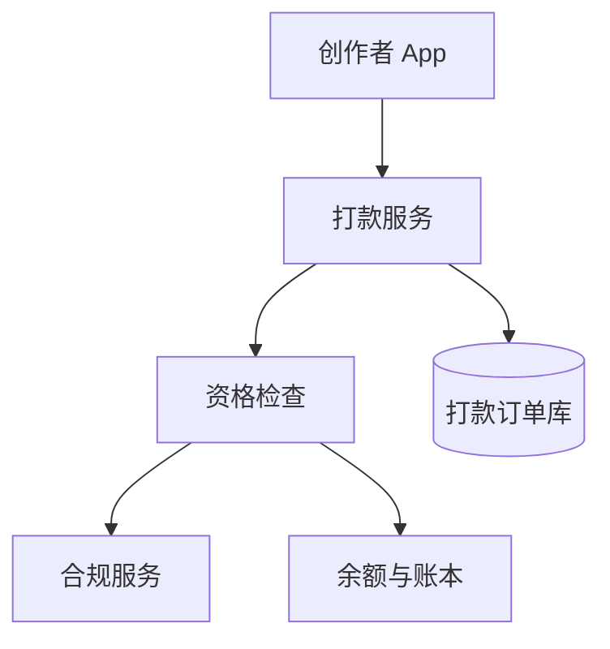
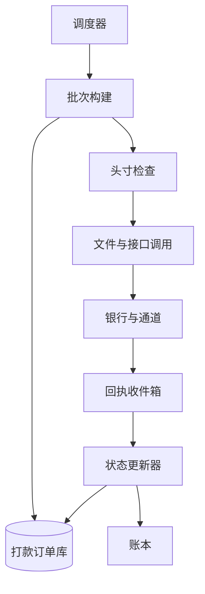

# SD10 创作者与卖家打款（Creator and Seller Payouts）

## 题目

创作者靠礼物、广告分成赚钱，卖家靠 TikTok Shop 的订单赚钱。这些钱在平台的账本里只是一个数字：平台欠收款人多少钱。打款（payout，也叫 disbursement）就是把这个数字变成收款人银行账户里真正的钱。一笔钱要经过四个阶段：先是收入余额，再是可提现余额（过了风险窗口、合规齐全），然后变成一张打款单（payout order），最后经过某条支付通道（rail，例如美国的 ACH、欧洲的 SEPA、巴西的 PIX、PayPal 之类的钱包）到达银行。

难点有四个。第一，绝不重复付：钱一旦发出，重复打出去的那一份很难追回，所以每一个环节崩溃、重试、重发都不能多付。第二，不能付给不该付的人：没有完成身份验证（KYC）、命中制裁名单、银行账户刚被人改过的收款人，钱要留在原地。第三，结果不是立刻知道的：银行可能几秒确认，也可能一两天才发回执，更糟的是钱「付成功」几天之后又被退回。第四，量：每周一次的创作者结算是几百万笔，要在几小时内跑完，还要能中途失败后重跑而不重复。

面试官通常只说一句：设计创作者和卖家的打款系统。然后盯住一条流程：余额怎么变成可提现、打款单怎么保证只付一次、KYC 不通过怎么办、为什么要批量、银行几天后退回怎么办。下面的数字是练习用的假设，面试时以面试官当场给的数字为准。

## 澄清问题

开场用三分钟问完下面八个问题，把答案写在白板角落。每个问题都会改变设计。

1. **收款人有哪几类，规模和节奏是什么？** 创作者按周结算、卖家按天、还有随时点击提现的。节奏决定要不要批处理、批处理的窗口多大。下面假设 500 万创作者每周一次，每天 80 万笔卖家打款，另有每天 30 万次主动提现。
2. **余额什么时候变成可提现？** 创作者收益有冻结期（礼物可能被撤销，应用商店退款可能很晚到）；卖家要等订单送达加退货期。这决定余额要分层，以及每笔收入要带「可释放时间」。
3. **提现是自动的还是用户触发的，有没有最低额？** 最低额由通道手续费决定（见估算）；自动打款要求同一周期同一收款人只生成一单。
4. **覆盖哪些国家、币种和通道？** 每个国家可用的通道、到账速度、手续费、限额都不同；币种不同要做外汇换算，这会引入汇率风险和舍入。
5. **KYC、税务、制裁由谁把关，没通过的钱怎么办？** 决定合规检查放在哪几个时点，以及被拦下的钱留在哪个账户里。
6. **失败和退回的政策？** 银行退回后钱回到哪里，要不要自动重付，收款人账户有问题时怎么通知。
7. **谁给打款账户预存资金？** 平台自己的银行账户余额必须覆盖当批总额，否则整批会被拒；这决定要不要在批处理前做头寸检查（treasury）。
8. **一致性底线是什么？** 把「同一笔钱最多付一次」「付出去的钱不超过可提现余额」写成硬约束，再问是否允许打款晚几小时。通常的答案是允许：宁可晚，不可错。

## 需求

**功能需求（按优先级）**

1. 余额分层：待释放、可提现、已预留、在途，任何时点都能解释每一分钱在哪一层。
2. 创建打款单：自动周期打款和主动提现两种入口，带幂等键，重试安全。
3. 资格检查：KYC、税务资料、制裁筛查、风险冻结、最低额、收款方式是否已验证。
4. 批量构建与提交：按通道、币种、分片切批，检查头寸，生成文件或调用接口。
5. 状态追踪：收款人能看到每张打款单的状态，并收到已付、失败、退回的通知。
6. 失败与退回处理：钱回到哪一层，收款方式怎么标记，是否生成新的打款单。
7. 收款方式管理：添加银行账户、验证账户名、冷却期、停用。
8. 与对账对接：每张打款单都能在银行流水里找到对应的一笔（见 [[sd11-reconciliation-system]]）。

**非功能需求**

| 维度 | 目标 | 说明 |
|---|---|---|
| 正确性 | 重复付款为 0；付给未通过合规的收款人为 0 | 产品承诺，所有取舍让位于它 |
| 批量吞吐 | 500 万笔在 2 小时内跑完 | 约 694 笔/s，中途失败可重跑 |
| 持久性 | 已确认的状态与分录零丢失 | 订单库同步复制，RPO 为 0 |
| 状态可见 | 状态变化后 1 分钟内对收款人可见 | 通道回执本身可能晚几小时，这一条只约束我们自己 |
| 可用性 | 创建打款单 99.9%，提交通道有降级 | 通道故障时排队或换通道，不丢单 |
| 审计 | 每次状态变化、每次合规决定都留痕，保留 7 年 | 监管与争议举证 |
| 对账 | 每张打款单与银行流水一一对应，差异次日可见 | 见 [[sd11-reconciliation-system]] |

**明确不做**：KYC 供应商本身的实现、税务申报表的生成、银行账户的实时验证协议细节、收入如何产生（见 [[sd02-live-gift-coin-settlement]]）。

## 容量估算

下面是假设，用来推出设计，不是任何真实产品的流量。

- 创作者：500 万人/周，平均每人 40 美元，合计 **2 亿美元/周**。
- 卖家：80 万笔/天，平均 150 美元，合计 **1.2 亿美元/天**。
- 主动提现：30 万次/天，平均 3.5/s，按 10 倍峰值约 **35/s**，量很小。
- 一周总单量：500 万 + 80 万 × 7 + 30 万 × 7 = **1,270 万张**，日均 181 万张。创作者结算日当天是 500 万 + 80 万 + 30 万 = **610 万张**。
- 订单存储：每张约 400 B，一周 1,270 万 × 400 B = **5.1 GB**，一张表放得下，不需要分布式存储，分片是为了写入并行。
- 周结算吞吐：500 万笔在 2 小时内：5,000,000 ÷ 7,200 = **约 694 笔/s**。每个文件放 1 万笔：500 万 ÷ 1 万 = **500 个文件**。500 个文件平均每个 14 秒处理，通道侧的并发提交就够。
- 状态事件：每张订单约 6 次状态变化，创作者这一次就是 500 万 × 6 = **3,000 万个事件**，量不大。
- 手续费：本地转账每笔约 0.25 美元（假设）。40 美元的打款占 0.25 ÷ 40 = 0.62%；10 美元占 2.5%；5 美元占 5%。所以最低提现额定在 10 美元。跨境电汇每笔约 15 美元（假设），40 美元的打款占 37.5%，根本不可行，跨境要走本地通道或聚合商。
- 退回：1.5% 的打款会在几天后被退回：500 万 × 1.5% = **7.5 万张/周**，合计约 300 万美元，平均每天 1.5 万张。
- 结果未知：0.3% 的提交没有拿到明确回执：500 万 × 0.3% = **1.5 万笔**要人工或自动查询收敛。
- KYC 拦截：3% 的创作者在结算日时没有通过：500 万 × 3% = **15 万人**，钱留在可提现余额里，不丢。
- 跨币种：40% 的创作者收到本地币，即 200 万笔。如果每笔单独换汇是 200 万次；按币种对净额合并，30 个币种对就是 **30 次**。
- 汇率暴露：锁定汇率到资金实际换出之间若汇率变动 0.3%，对 8,000 万美元（40% 的 2 亿）就是 **24 万美元**。
- 头寸：周结算日，打款账户要先有约 **2 亿美元**；卖家每天约 1.2 亿美元。

**驱动设计的那个数字**不是 694 笔/s，而是 2 亿美元：一次批量里，每 0.01% 的重复就是 500 笔、2 万美元；整批被重复提交就是 2 亿美元。吞吐用批处理解决，真正要花功夫的是让每一张订单、每一个文件都不可能被付两次，并且整个批次可以安全重跑。

## API

```
GET  /v1/payees/{id}/balance
200 -> { "pending": ..., "available": ..., "reserved": ..., "in_transit": ..., "currency": "USD" }

POST /v1/payees/{id}/payment-methods     # 添加收款方式（账号只传令牌或由通道金库保管）
Body: { "rail": "ach", "country": "US", "token": "...", "holder_name": "..." }
202 -> { "method_id": "...", "state": "verifying", "usable_after": "2026-10-27T00:00:00Z" }

POST /v1/payouts                          # 主动提现
Headers: Idempotency-Key: <uuid>
Body: { "payee_id": "...", "amount": 12500, "currency": "USD", "method_id": "..." }
202 -> { "payout_id": "...", "state": "reserved" }
422 -> { "reason": "kyc_required 等原因码" }
409 -> 同一个键请求内容不一致

GET  /v1/payouts/{id}                     # 状态、通道参考号、预计到账
POST /v1/payouts/{id}/cancel              # 只在尚未进入批次时允许

POST /internal/payout-batches             # 内部：批次由 (周期, 通道, 币种, 分片) 唯一确定，重复调用返回同一批
POST /internal/payees/{id}/holds          # 运营：合规或风险冻结，必须带原因码
```

自动周期打款的 `payout_id` 不由调用方给，而是由 `(payee_id, cycle_id)` 确定性生成。批处理作业重跑多少遍，同一个收款人同一个周期都只会得到同一个 `payout_id`，插入时主键冲突就被吸收。

## 数据模型

| 实体 | 键 | 关键字段 |
|---|---|---|
| Payee | `payee_id` | `type`（creator / seller）、`country`、`kyc_status`、`tax_status`、`sanctions_status`、`risk_tier`；个人身份信息放在独立的金库，这里只存状态和引用 |
| PaymentMethod | `method_id` | `payee_id`、`rail`、`country`、`currency`、`token_ref`、`holder_name_match`、`state`（verifying / active / invalid / removed）、`usable_after`、`version` |
| EarningLot | `lot_id` | `payee_id`、`amount`、`source`、`release_at`、`state`（pending / released / clawed_back）；一笔收入一个批次，释放和追回都按批次 |
| LedgerLine | `(journal_id, line_no)` | 与 [[sd09-wallet-ledger]] 同一种分录，账户有 `payee_pending`、`payee_available`、`payee_reserved`、`payout_in_transit` 等 |
| PayoutOrder | `payout_id` | `payee_id`、`method_id` 与 `method_version`（预留时的快照）、`amount`、`currency`、`payout_currency`、`fx_rate_id`、`state`、`batch_id`、`rail`、`version`、`supersedes_id` |
| PayoutBatch | `batch_id` | `batch_key`（唯一）、`rail`、`currency`、`state`（building / sealed / funded / sent / acked / closed）、`file_hash`、`item_count`、`total_amount` |
| Instruction | `instruction_id` | `payout_id`、`attempt_no`、`batch_id`、`payload`（发出去的原文）、`state`（prepared / sent / acked / rejected）、`rail_reference`；`instruction_id` 就是发给通道的端到端参考号 |
| RailEventInbox | `(rail, event_id)` | 回执、拒绝、退回的原文与处理时间 |
| ComplianceHold | `hold_id` | `payee_id`、`reason`、`created_by`、`released_at` |

三处设计值得先说清。第一，打款单创建的同一个事务里完成资金预留（从可提现挪到已预留），所以一张订单不可能没有资金，同一笔资金也不可能支撑两张订单。第二，`Instruction.payload` 保存发出去的原文，恢复时重发的是同一份内容、同一批参考号，而不是重新生成一份。第三，打款单引用的是收款方式的快照（`method_id` 加 `version`），预留之后收款人再改银行卡，不会影响已经预留的订单，但会触发重新验证（见深挖三）。

打款单的状态机：



`failed` 回到可提现；`returned` 先进入暂挂账户；`settled` 表示这条通道的退回窗口已经过去，是最终状态。

## 高层设计

系统分成两条路径：下单路径（同步，处理单张订单的资格和预留）和批处理路径（异步，处理批量构建、提交和回执）。拆开画是因为一条要快、要对收款人即时响应，另一条要稳、要能重跑，吞吐和故障形态完全不同。

**下单路径**



**批处理与回执路径**



下单路径的步骤：

1. 创作者点击提现，或者周结算作业为每个有余额的收款人调用打款服务；调用方带幂等键，自动打款用 `(payee_id, cycle_id)` 派生。
2. 资格检查：读收款人的 KYC、税务、制裁状态和冻结，检查收款方式已验证且过了冷却期，金额不低于最低额。任何一项不满足就返回 422 加原因码，余额保持不动。
3. 在一个事务里：插入打款单（主键冲突说明重复请求，直接返回第一次的结果）；条件挪动余额 `available → reserved`（`WHERE available >= :amount`），同事务写分录。
4. 返回 202 和订单状态；通知收款人「已受理，预计到账时间」。

批处理路径的步骤：

5. 调度器在窗口开始时，按 `(cycle_id, rail, currency, shard)` 派生批次键，批次构建器用条件更新把对应的 `reserved` 订单认领为 `batched`，封存批次，此后批次内容不再变化。
6. 头寸检查：批次总额与打款账户的可用余额比较，不够就让批次停在 `sealed`，等待资金划入。
7. 生成文件或接口请求，先把 `Instruction` 连同原文落库（状态 `prepared`），再发送，发送后标记 `sent`；订单状态改为 `submitted`。
8. 银行或通道的回执写入收件箱（去重键 `(rail, event_id)`），状态更新器据此把订单改为 `paid` 或 `failed`，并同事务写分录。
9. 迟到的退回同样走收件箱，把 `paid` 改为 `returned`（深挖五）。
10. 每张订单都能在银行流水里找到对应的一笔，由对账系统核对（[[sd11-reconciliation-system]]）。

## 深挖

### 一、余额分层：从收入余额到可提现

问题：收入可能被撤销。礼物可能被判定为刷单，应用商店的退款可能几周后才到，卖家的订单可能被退货。如果收入一入账就能提现，撤销发生时钱已经出了门，只能向收款人追讨。

**做法。** 把一个收款人的钱分成四层，每层是一个账户：

| 层 | 账户 | 含义 |
|---|---|---|
| 待释放 | `payee_pending:P` | 已赚到但还在风险窗口内，不能提现；窗口到期自动释放 |
| 可提现 | `payee_available:P` | 窗口已过、没有冻结，可以发起提现 |
| 已预留 | `payee_reserved:P` | 已经被一张打款单占用，在批处理或通道中 |
| 在途 | `payout_in_transit:通道` | 已发给通道，等待确认 |

每笔收入入账时带一个 `release_at`：创作者的礼物收益在冻结期后释放，卖家的订单收入在「送达加退货期」后释放。释放作业按 `release_at` 扫描 EarningLot，把到期的批次从待释放挪到可提现。以一张 125.00 美元（12,500 美分）的打款为例，账本是这样移动的：

| 步骤 | 借 | 贷 |
|---|---|---|
| 释放 | `payee_pending:P` 12,500 | `payee_available:P` 12,500 |
| 预留（下单） | `payee_available:P` 12,500 | `payee_reserved:P` 12,500 |
| 提交 | `payee_reserved:P` 12,500 | `payout_in_transit` 12,500 |
| 通道确认执行 | `payout_in_transit` 12,500 | `bank:payout_usd` 12,500 |
| 通道费用（平台承担） | `payout_fee_expense` 25 | `bank:payout_usd` 25 |

从 `pending` 追回：撤销发生时，优先从还没释放的批次里扣，因为那些钱还没有离开平台的控制；扣完仍不够，再扣可提现。如果两者都不够，收款人余额为负，进入欠款状态：后续收入先抵扣，并暂停提现。这条顺序的理由是尽量不让撤销变成对收款人的追讨。

**最低提现额。** 低于最低额的余额留在可提现里，不触发打款。最低额由手续费推出：手续费 0.25 美元，10 美元的打款手续费占 2.5%，5 美元就占 5%，所以定在 10 美元。收款人可以等攒够再提。

**为什么用批次（lot）而不是一个余额数。** 撤销要追溯到具体哪一笔收入，风险窗口也是每笔各自的。只存一个总数，就无法回答「这个 40 美元里有多少已经过了窗口」。

### 二、永不重复打款：六层防线

问题：打款单创建、批处理、提交、回执的每一步都可能崩溃、重试、被重复调用，而重复发出的钱很难收回。防线不能只有一层，每一层挡一类失败。

| 层 | 机制 | 挡住什么 |
|---|---|---|
| 1 | `payout_id` 唯一；自动打款由 `(payee_id, cycle_id)` 派生 | 作业重跑、调用方重试 |
| 2 | 创建订单与预留资金在同一个事务，条件 `available >= :amount` | 同一笔钱支撑两张订单；两次点击各生成一张订单 |
| 3 | 状态只前进的条件更新：`UPDATE ... SET state='submitted' WHERE state='batched' AND batch_id=?` | 两个工人同时处理同一张订单，只有一个赢 |
| 4 | 发给通道的参考号 `instruction_id = payout_id + attempt_no` 固定不变 | 通道支持幂等的，重复请求返回第一次的结果；银行文件靠文件号与报文号去重 |
| 5 | 发送前先落库 `payload`，恢复时重发原文，不重新生成 | 崩溃在落库与发送之间、发送与记录之间 |
| 6 | 事后核对：银行流水里每个端到端参考号至多一条借记，每张订单恰好一条 | 前五层都失效时，及时发现并启动召回 |

**崩溃点。**

| 崩溃发生在 | 现象 | 收敛方式 |
|---|---|---|
| 预留之后、认领进批次之前 | 订单是 `reserved` | 下一次批次构建会认领，什么都不丢 |
| `prepared` 落库后、发送前 | 通道没见到这条指令 | 恢复进程重发同一份 `payload` 与同一参考号 |
| 已发送、记录 `sent` 之前 | 通道可能已经处理 | 恢复进程仍重发原文；通道按参考号去重，银行文件按报文号拒绝重复 |
| 发出后超时，没有回执 | 不知道结果 | 状态置为 `unknown`，**不重发新参考号**，先查询（见下） |
| 回执处理到一半 | 状态已改、分录没写 | 状态与分录同一个事务，不会出现 |

**`unknown` 怎么收敛。** 先按参考号向通道查询。通道说已执行就标 `paid`，说没有这条且通道已确认当天不会再处理，才标 `failed` 并把资金从 `reserved` 退回可提现。没有查询接口的通道（只有银行流水文件），就等下一份流水，在里面找这个参考号对应的借记，由对账系统（[[sd11-reconciliation-system]]）裁决。把 `unknown` 标成 `failed` 并释放资金，是最容易造成重复打款的一步：原指令其实成功了，又为同一个余额建了新订单。所以必须有权威证据才能转 `failed`，新订单要带 `supersedes_id` 指向旧订单，让核对时能把两张订单看作同一笔钱。

**哪些失败可以安全重试。**

| 失败类型 | 能否换参考号重发 | 理由 |
|---|---|---|
| 连接被拒、校验失败（通道没有接受） | 能 | 通道没见到这条指令 |
| 通道明确返回「未处理」的错误 | 能，用新的 `attempt_no` | 通道声明没有执行 |
| 超时、连接中途断开 | 不能，先查询 | 结果未知，可能已执行 |
| 已收到确认 | 绝不 | 已经付了 |
| 银行拒绝整份文件（格式错误） | 能，换新文件号，订单保持原样 | 银行确认未处理任何一笔 |

**被否决的方案。** （a）先发送、再写库：崩溃后不知道发过没有，只能靠猜。（b）只靠通道的幂等：不是每条通道都支持，银行文件根本没有接口幂等，只有文件号去重。（c）失败就换一个新参考号立刻重试：是前面说的重复打款的主要来源。

### 三、KYC 与合规门：三次检查，失败留在原地

问题：打款是平台把钱送出门的最后一步，一旦出门，付错了人或付给了被制裁的对象，就是合规事故，不是技术问题。而且资格会变：创作者三天前通过了验证，今天可能被判定为风险账户，名字可能在昨晚更新的制裁名单上。

**三个检查点。**

| 检查点 | 检查什么 | 失败时 |
|---|---|---|
| 下单时 | KYC 已通过且未过期、税务资料齐全、没有冻结、收款方式已验证、金额不低于最低额 | 返回 422 加原因码，余额不动 |
| 封存批次时 | 重新读一次状态，因为从下单到封存可能隔了几小时到几天 | 订单从 `reserved` 退回，资金回到可提现，标记 `blocked_compliance` |
| 提交前 | 对收款人姓名、收款银行所在国用最新的制裁名单再筛一次 | 同上，并通知合规团队 |

**为什么要检查三次。** 状态在下单和发出之间会变，只在入口检查一次，会放过「入口之后被拦下」的人。后两次检查很便宜（按批读状态与名单），代价远小于一次违规打款。

**被拦下的钱怎么办。** 留在 `payee_available`，不销毁、不转走；运营看到原因码后联系收款人补材料。KYC 一直不通过的账户，余额按政策长期挂账，不能被平台挪用。这条要讲清：资金的所有权没变，只是暂时不能出去。

**分级放开。** 未验证的收款人可以累积收益，但提现有累计额度限制（例如累计 600 美元以内可免完整验证）；超过就必须完成验证。额度的口径放在合规服务里，打款服务只看「允许 / 不允许」和原因码。

**税务代扣。** 有的国家要求按比例代扣所得税：借 `payee_available`，贷 `tax_withheld_payable`，代扣的钱后续由财务缴给税务机关；收款人收到的是扣税后的金额，年度汇总数据留给申报使用。

**合规服务不可用时。** 失败关闭（fail closed）：新的打款不放行，订单留在 `reserved` 等待，周结算日整体晚几小时。放行一笔没检查过的打款，风险远大于晚到。

**收款方式是风险入口。** 账户被盗的典型手法是先改银行卡，再提现。所以新添加或修改的收款方式有冷却期（例如 72 小时）才能用于打款，修改时通知原来的联系方式；预留时保存收款方式的快照，预留之后如果方式又被改，订单在提交前重新验证，不一致就拦下人工看。

### 四、批处理：批次是什么、怎么重跑、头寸、通道、汇率

问题：为什么不是每张订单立刻发出？因为银行有截止时间和文件格式，每笔收费，要预存资金，跨币种要合并换汇。批处理把这些成本摊薄，但引入了「批次中途失败」的新问题。

**批次的定义。** 批次键是 `(cycle_id, rail, currency, shard)`，在 PayoutBatch 上唯一。构建器用条件更新认领订单，每个批次最多 1 万笔（银行文件的上限量级），500 万笔就是 500 个批次。批次封存之后内容固定：同一个批次键再调用，返回同一个批次，而不是新建一个。这样构建作业中途崩溃、重启、被运维手动重跑，都不会产生内容重叠的两个批次。

**重跑的三条规则。**

1. 批次构建重跑：从订单状态出发，只认领仍是 `reserved` 的订单，已经 `batched` 的不碰。
2. 批次发送重跑：从 `Instruction` 状态出发，`prepared` 的按原文重发，`sent` 的先查询。
3. 批次回执重跑：收件箱按 `(rail, event_id)` 去重，同一份回执处理多少遍效果相同。

**头寸检查。** 平台打款账户的余额必须覆盖批次总额，否则银行会拒绝整份文件。封存之后、发送之前读余额（或由财务系统提供的可用额度），不够就让批次停在 `sealed`，等资金划入后继续。多个批次抢同一份资金时，按优先级排序：先付到账速度承诺最快的通道，再付小额批次。周结算日需要约 2 亿美元，所以要提前一天通知财务调拨，这是流程要求，也是监控项。

**通道选择。** 每个收款方式有国家和币种，对应可用的通道。选择规则：满足到账承诺和限额的前提下选最便宜的通道，并配一条备选通道。几个例子（速度和费用是量级，不是报价）：美国用 ACH，成本低但要一两天；欧洲用 SEPA；英国和巴西有秒级到账的本地实时通道；其他国家走本地银行转账或钱包。国际电汇每笔 15 美元，40 美元的打款占 37.5%，只有大额才合适。路由到哪家通道、通道故障时如何切换，与收单侧的 [[sd12-payment-routing]] 是同一类问题，区别是打款的切换必须遵守深挖二的重试规则。

**汇率。** 收款人余额是美元，要付欧元。每个 `(批次, 币种对)` 只在批次封存时取一次汇率，记入 `fx_rate_id`，订单的本币金额由它确定。财务把整批需要的欧元一次性换出，30 个币种对就是 30 次换汇，而不是 200 万次。账本上经过 `fx_position` 账户。舍入：12,345 美分 × 0.9137 = 11,279.63 欧分，付给收款人向下取整的 11,279 欧分（112.79 欧元），零头 0.63 欧分记入舍入账户，规则固定，每笔最多差一个最小单位，不会多付。汇率风险：从锁定到换汇完成之间，汇率每变 0.3%，对 8,000 万美元就是 24 万美元，由平台承担，所以锁定要靠近换汇时刻，并在批次上记录。

### 五、退回与迟到的失败：「已付」不是终点

问题：银行转账的「已付」只是通道接受了并发出，真正的成败要过几天才知道。账户已关闭、户名不符、收款行拒收，都会在之后以退回（return）的形式回来。美国 ACH 的多数退回在一两个工作日内到达，未授权类的退回可以晚到数十天；SEPA 也有几个工作日的退回窗口（时间是量级，以各通道规则为准）。如果「已付」就是终态，退回的钱就悬在半空。

**做法。** 状态里分两步：`paid`（通道说已执行）和 `settled`（该通道的退回窗口已过，是最终状态）。退回事件走和其他回执一样的收件箱，去重键 `(rail, return_id)`，用条件更新把 `paid` 或 `settled` 改为 `returned`。同事务写分录：借银行账户，贷 `payee_returned_suspense:P`（暂挂账户），而不是直接放回可提现。暂挂的理由是：如果直接放回可提现，收款人下一次提现还会发往同一个有问题的账户。

**按退回原因处理。**

| 原因 | 处理 |
|---|---|
| 账户不存在、已关闭、号码错误 | 收款方式标 `invalid`，通知收款人更新；验证新账户后，钱从暂挂回到可提现，生成**新的**打款单，`supersedes_id` 指向原来的 |
| 户名不符 | 同上，并要求重新验证户名 |
| 收款行因合规拒收 | 暂挂转冻结，合规团队处理 |
| 未授权类退回（晚到） | 视为风险事件：冻结收款人，调查是否账户被盗 |

**不自动重发到原账户。** 退回的原因几乎都和账户有关，原样重发只会再被退回一次并多付一次手续费。要重付，必须有新的、已验证的收款方式，并生成新的订单。

**规模与监控。** 1.5% 的退回率即每周 7.5 万张，每天 1.5 万张，需要 95% 以上靠通知加自助更新处理，不进人工队列。按通道、国家、银行统计退回率，超过阈值（例如 3%）自动暂停该通道的新批次，查明原因。

**与重复打款的关系。** 退回处理里最危险的是：用户已收到钱（来自一次被认为失败的指令），平台又重付一次。所以每一次重付都必须指向被取代的订单，核对时对 `supersedes` 链上所有订单的借记求和，应当恰好等于一笔。

## 故障与边界

| 组件 | 故障时的影响 | 缓解 |
|---|---|---|
| 打款订单库分片主库 | 该片的下单和状态更新暂停 | 同步副本自动接管；周结算作业可重跑，主键冲突吸收重复 |
| 批次构建中途崩溃 | 部分订单已认领 | 重跑只认领 `reserved`，批次键唯一，返回同一批 |
| 通道整体不可用 | 批次发不出去 | 按重试规则等待或切到备选通道；不丢单，收款人看到「处理中」 |
| 银行拒绝整份文件 | 整批未处理 | 确认拒绝回执后换新文件号重发，订单不变 |
| 银行部分接受 | 一部分订单被拒 | 按订单逐条处理回执，被拒的退回可提现并通知 |
| 头寸不足 | 批次停在 `sealed` | 财务补充资金后继续；按优先级先付高价值通道 |
| 合规服务不可用 | 无法验证资格 | 失败关闭，订单留在 `reserved`，整体晚几小时 |
| 回执重复、乱序 | 状态被错误回退 | 收件箱去重；状态单调；`failed` 不能直接覆盖已 `paid` |
| 汇率服务过期 | 本币金额不对 | 汇率带有效期，过期不使用；批次封存时校验 |
| 收款人在预留后改银行卡 | 可能打到攻击者的账户 | 订单用快照，提交前比对版本，不一致则拦下并复核 |
| 时区与截止时间 | 周期边界上的收入归属错误 | 周期用 UTC 的闭开区间，释放按 `release_at` 的绝对时间 |

## 面试官追问

1. **为什么提现要先预留，而不是直接扣余额？** 预留把「资金占用」和「真正离开」分成两步：订单创建时钱不能再被别的订单用；如果后来被合规拦下、被通道拒绝，只需把预留退回，不需要冲销一笔已经执行的扣款。分录上每一步都在账户之间挪动，可追溯。
2. **用户连点两次提现会怎样？** 同一个幂等键，第二次返回第一次的结果。两个不同的键，第二次因为条件更新 `available >= :amount` 影响行数为 0，返回 422。两层防线分别挡重试和重复请求。
3. **调银行接口超时了，钱发了没有？** 不知道。状态置为 `unknown`，不换参考号重发；先按参考号查询通道；没有查询接口就等流水，由对账裁决。只有拿到权威证据才能转 `failed` 并释放资金。
4. **整个周结算作业跑到一半崩溃了，怎么办？** 批次键唯一，订单状态单调，作业重跑只认领 `reserved` 的订单，已发送的批次不重发，只对 `sent` 的批次查询回执。这就是批次必须可重跑的原因，重跑不需要人工清理。
5. **银行账户被人盗用改了卡号，怎么防？** 新方式有冷却期，修改时通知原联系方式，订单用预留时的方式快照，提交前比对版本。出现异常的收款人在批次封存时就被拦下。
6. **收款人的余额被撤销到负数怎么办？** 先从待释放批次里扣，再扣可提现，仍为负就进入欠款状态：暂停提现，后续收入先抵扣。已经打出去的钱不主动追回，除非是欺诈，才走召回流程。
7. **跨币种的汇率风险谁承担？** 平台承担，从锁定到实际换汇之间的波动。做法是按批次、按币种对只锁一次汇率，尽量靠近换汇，批次上记录汇率编号，舍入固定向下取整并记入舍入账户。
8. **打款后很久才收到退回呢？** `paid` 之后还有 `settled` 这一步，窗口之内的退回正常处理；窗口之外的晚到退回仍允许从 `settled` 转 `returned`，视为风险事件，冻结收款人调查。
9. **怎么证明没有多付？** 每张订单的参考号在银行流水里至多一条借记；对账系统把订单与流水逐条匹配，对 `supersedes` 链求和应当只有一笔；发现重复就启动召回并冻结收款人。
10. **500 万笔怎么在 2 小时内跑完？** 694 笔/s，按分片并行构建批次，每批 1 万笔、共 500 个文件，通道并发提交。瓶颈通常是通道的速率限制和银行的文件窗口，而不是数据库，所以提前一天预构建批次并预检资格，结算日只做发送。
11. **税务代扣在哪里发生？** 在预留之前计算，分录把代扣部分挪到 `tax_withheld_payable`，打款金额是扣税后的数。税率与规则由独立的服务提供，打款服务只执行结果并留痕。
12. **最低提现额为什么是 10 美元？** 因为手续费固定约 0.25 美元：10 美元占 2.5%，5 美元占 5%。把门槛设在手续费占比可接受的位置，低于的余额继续累积，不是技术限制，是成本决策。

## 评分要点

一个 senior 的回答必须覆盖：

- 开场把「同一笔钱最多付一次」「不付给未通过合规的人」写成硬约束，并问清收款人类型、通道、币种、提现节奏。
- 估算后得出结论：吞吐（694 笔/s）不难，难在单笔金额（2 亿美元一批、0.01% 重复就是 2 万美元）和失败收敛。
- 余额分层：待释放、可提现、已预留、在途，按批次带释放时间；追回的顺序；最低额由手续费推出。
- 永不重复打款：六层防线逐层说明挡什么，崩溃点逐个收敛，`unknown` 绝不是 `failed`，只有权威证据才能释放资金，新订单带 `supersedes_id`。
- 合规门：三次检查，失败留在原地，失败关闭，收款方式的冷却期与快照。
- 批处理：批次键唯一、封存后不可变、三层重跑规则；头寸；通道选择与费用；汇率按批次锁一次并明确舍入。
- 退回：`paid` 与 `settled` 的区别，暂挂账户，按原因处理，不自动重发到原账户。
- 与对账的闭环：每张订单对应一条银行借记。
- 主动说出自己设计里最弱的一环（没有查询接口的通道只能靠流水裁决 `unknown`，延迟较长；或汇率锁定到换汇之间的风险由平台承担）。

时间不够时（30 分钟）：5 分钟澄清加硬约束，5 分钟画两条路径，剩下 20 分钟讲余额分层和「永不重复」的六层防线，合规、批处理、退回各用一两分钟口述规则。

## 延伸阅读

- 通用题解：[[solution-payment-system]]、[[solution-digital-wallet]]。
- 同批题单：[[tiktok-sd-index]]；上游收入与结算见 [[sd02-live-gift-coin-settlement]]，账本分录的写法见 [[sd09-wallet-ledger]]，打款与银行流水的核对见 [[sd11-reconciliation-system]]，通道路由见 [[sd12-payment-routing]]，支付侧打款的简版见 [[sd01-payment-system]]。
