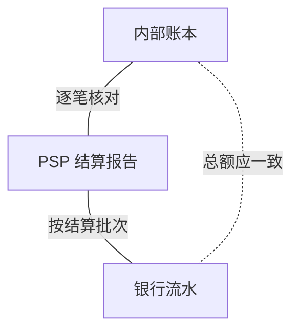
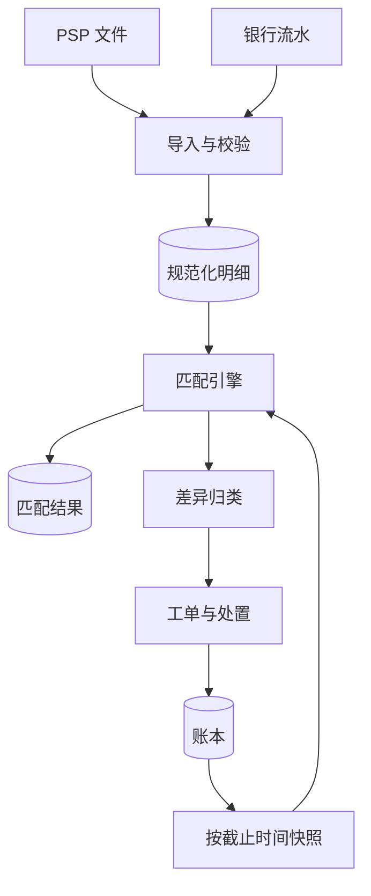
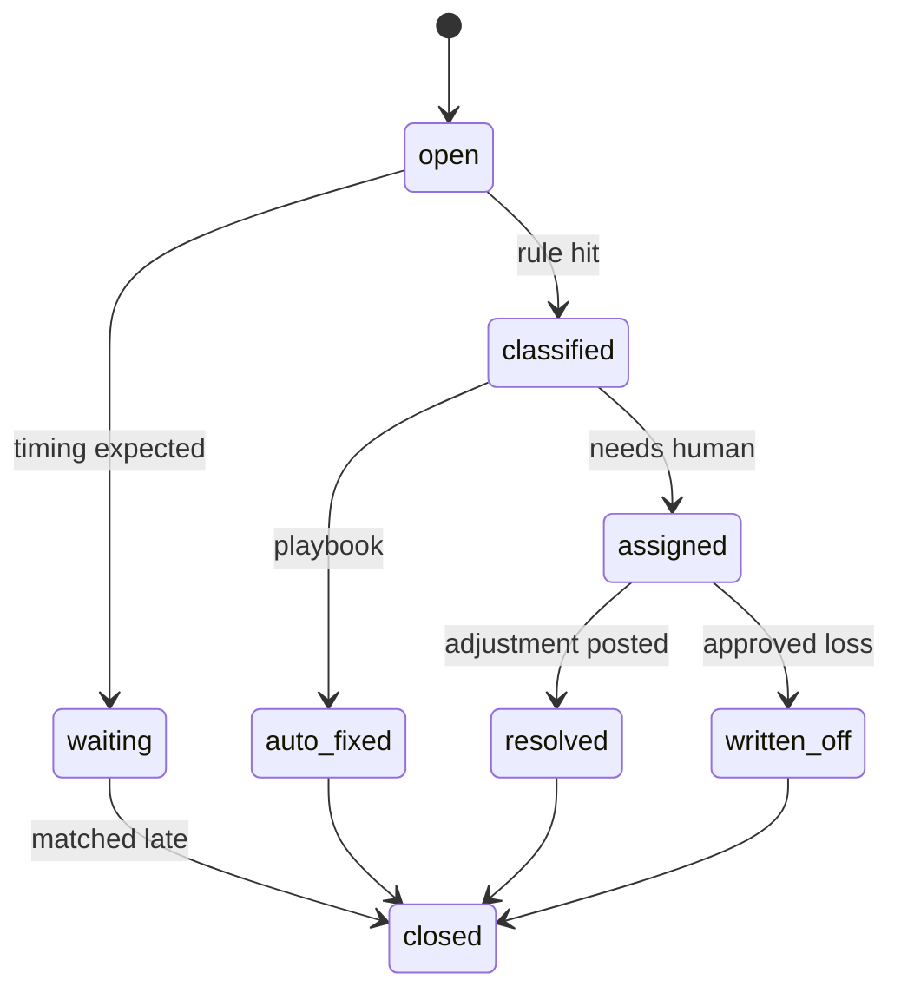

# SD11 三方对账系统（Three-Way Reconciliation System）

## 题目

对账（reconciliation）是把同一批交易在不同账本里的记录拿出来逐笔核对，找出对不上的地方。支付平台至少有三本账：自己的内部账本（账本上记着发生了什么）、支付服务商（PSP）发来的结算报告（对方说它处理了什么、应该付给我们多少）、银行流水（真正到账的钱）。三方对账就是让这三份记录互相印证：内部账本和 PSP 报告逐笔核对，PSP 报告和银行流水按结算批次核对，从而推出内部账本和银行现金是否一致，差在哪里。

难点有四个。第一，口径不齐：三方的单位、币种、时区、截止时间、参考号、手续费口径各不相同，直接比较会产生大量假差异。第二，粒度不齐：内部和 PSP 是一笔一笔，银行却是一天一条汇总入账，一条入账对应成千上万笔交易，还扣了手续费、退款、保证金。第三，差异不是错误的同义词：有的是时间差（明天就对上），有的是真漏记，有的是对方多扣了钱，要分类处理，而且每天几千条，必须自动化到只剩少数需要人看。第四，时限：财务按 T+1（交易日后一天）要求出结果，月末还要结账，文件到得晚、到得不齐，也要在时限内给出可信的结论。

面试官通常只说一句：设计一个对账系统，对内部账本、PSP 报告和银行流水。然后盯住几个点：怎么匹配、一对多怎么办、差异怎么处理、文件迟到怎么办、怎么保证 T+1。下面的数字是练习用的假设，面试时以面试官当场给的数字为准。

## 澄清问题

开场用三分钟问完下面八个问题，把答案写在白板角落。每个问题都会改变设计。

1. **规模是多少：每天多少笔交易、有几家 PSP、几个币种、几个银行账户？** 决定要不要分布式计算，以及怎么分区。下面假设每天 3,000 万笔收款，8 家 PSP，15 个结算币种，40 个银行账户。
2. **对账的范围包括哪些交易类型？** 收款、退款、拒付、打款、手续费、保证金、外汇换算。类型越多，匹配规则和账户越多。下面包含全部。
3. **PSP 报告是什么形态：有没有每笔交易的唯一参考号，是文件还是接口，几点到？** 没有唯一参考号只能靠多字段组合匹配；到得晚决定 T+1 能否达成。
4. **银行流水是汇总的还是明细的？** 通常收款侧是一条汇总入账，要靠 PSP 的结算批次号搭桥；打款侧可能是逐笔或按文件。
5. **对账的结果用来做什么？** 只是财务报表，还是会拦住打款、触发退款、冻结商户。如果会拦住资金流（例如卖家的钱必须等对账完成才可提现），对账就是控制，不是报表，可用性要求更高。
6. **差异怎么处置，谁能改账？** 决定处置动作是追加调整分录，还是人工改动；原则上账本只增不改，调整需要制单加复核。
7. **时限是多少：T+1 几点，月末有没有特殊要求？** 决定调度、文件缺失的告警，以及哪些差异必须当天处理。
8. **多币种怎么办：以交易币种、结算币种还是记账币种比较？** 决定匹配时的汇率与容差，以及汇兑差异放在哪个科目。

## 需求

**功能需求（按优先级）**

1. 导入 PSP 报告和银行流水，幂等，能发现缺失、重复、被更正的文件。
2. 把每个来源规范化成统一格式：整数最小单位、UTC 时间、统一的交易类型和参考号。
3. 内部账本对 PSP 报告逐笔匹配；PSP 结算批次对银行流水匹配；输出三方的汇总一致性。
4. 差异分类、归因、自动处置，剩下的进入工单，带账龄和负责人。
5. 处置动作是追加的调整分录，留痕并可追溯到原差异。
6. 报告：匹配率（按笔数、按金额）、未匹配金额、账龄分布、各 PSP 完成情况。
7. 对账状态对外开放：打款等下游能查询「某个 PSP 某天是否已对账」。

**非功能需求**

| 维度 | 目标 | 说明 |
|---|---|---|
| 时限 | T+1 当天中午（UTC 12:00）前，所有已到文件的 PSP 完成匹配；18:00 前差异归类完毕 | 迟到的文件单独计，不拖累其他 PSP |
| 匹配率 | 按笔数 99.95% 以上自动匹配；最终未解释差异 0.02% 以内 | 另报告按金额的匹配率 |
| 正确性 | 不把不同的两笔错配；每个文件行至多匹配一次 | 错配比漏配更危险，因为它掩盖真差异 |
| 幂等 | 同一个文件导入多次、同一天重跑多次，结果相同 | 匹配结果是派生数据，可重算 |
| 可追溯 | 每个匹配、每个处置都记录规则和版本、操作者 | 审计 |
| 保留 | 匹配结果与差异保留 7 年 | 财务与监管 |

**明确不做**：PSP 内部清算的实现、总账的财务报表生成、拒付的举证流程。

## 容量估算

下面是假设，用来推出设计，不是任何真实产品的流量。

- 每天的对账项：收款 3,000 万 + 退款（3%）90 万 + 拒付（0.1%）3 万 + 打款约 180 万 = **3,273 万项**。
- PSP 报告行数：收款、退款、拒付 = 3,093 万行。每行约 250 B，**7.7 GB/天**，一次顺序扫描 8 秒左右（按 1 GB/s）。
- 匹配用的内存：3,273 万项 × 120 B（键、金额、币种、时间）= **3.9 GB**，一台大内存机器的哈希连接就放得下。
- 分区：按 PSP、币种、业务日分区：8 × 15 = **120 个分区**，每个平均 272,750 行。每个分区独立匹配，可并行，也可单独重跑。
- 银行流水：每天约 1,000 行。收款侧每个 PSP 每个币种一天一条汇总入账，最多 8 × 15 = 120 条，其余是打款文件的借记、手续费、换汇。这个量用人眼都看得过来，难点不在量而在如何把一条汇总拆成明细。
- 匹配漏斗：第一轮精确键匹配 99.80%，未匹配 3,273 万 × 0.2% = **65,460 项**；第二到四轮（备用键、容差、分组）把匹配率提高到 99.95%，剩 **16,365 项**。
- 差异的构成：其中 60% 是时间差（对方明天会到），即 9,819 项等待；其余 40% 即 **6,546 项**是真差异，占总量的 0.02%。
- 人工量：真差异里 90% 有自动处置剧本，10% 需要人，即 **655 项/天**；每个分析员每天处理 40 项，需要约 **16.4 人**。如果自动处置率提高到 95%，只剩 327 项，约 8.2 人，所以自动化率每提高 5 个百分点就是减半人力。
- 结果存储：匹配与差异记录每项约 100 B，3,273 万 × 100 B × 365 = **1.19 TB/年**，7 年约 **8.4 TB**，普通的列式存储。
- 爆炸半径：如果某家份额 15% 的 PSP 回调中断一小时，按峰值每秒 3,472 笔估计，最多 3,472 × 15% × 3,600 = **187 万项**同时变成「PSP 有、账本没有」，这一类差异必须聚合成一个案例，而不是 187 万条工单。

**驱动设计的那个数字**是 0.02% 和 187 万：量本身很小（几 GB），不需要大数据平台；难点是把 6,546 个真差异压到几百个人工项，以及一次上游故障不能把工单系统淹没。所以设计的重心在分类、聚合和自动处置，而不是匹配算法的吞吐。

## API

对账系统主要是内部服务和运营工具，没有面向用户的接口。

```
POST /v1/recon/files                       # 文件到达通知或上传
Body: { "source": "psp_a", "account": "usd_main", "business_date": "2026-10-23", "file_ref": "..." }
202 -> { "file_id": "...", "state": "received" }       # 相同内容重复提交返回同一个 file_id

POST /v1/recon/runs                        # 触发一次对账运行
Body: { "business_date": "2026-10-23", "source": "psp_a", "cutoff": "2026-10-24T00:00:00Z" }
202 -> { "run_id": "..." }                 # 同一 (日期, 来源, 截止点) 幂等

GET  /v1/recon/status?source=psp_a&date=2026-10-23
200 -> { "state": "complete", "match_rate": 0.9996, "open_breaks": 41, "completed_at": "..." }

GET  /v1/recon/breaks?type=&status=&age_gt=&source=
POST /v1/recon/breaks/{id}/resolve         # Body: { "action": "adjust", "template": "psp_fee_true_up", "reason": "..." }
POST /v1/recon/matches/{id}/unmatch        # 人工拆除错误匹配，必须带原因
```

`status` 接口是给下游用的：打款服务查询「这个 PSP 这一天是否已对账完成」，作为卖家资金可提现的条件之一（见 [[sd10-creator-payouts]]）。

## 数据模型

| 实体 | 键 | 关键字段 |
|---|---|---|
| SourceFile | `file_id` | `source`、`account`、`business_date`、`file_hash`、`row_count`、`control_total`、`state`（received / validated / loaded / failed / superseded）、`supersedes_id`；`(source, account, business_date, file_hash)` 唯一 |
| ExternalLine | `line_id` | `file_id`、`type`（capture / refund / chargeback / fee / payout / reserve / adjustment）、`psp_reference`、`merchant_reference`、`amount`（整数）、`currency`、`fee`、`value_date`、`batch_ref` |
| InternalItem | `item_id` | `journal_id`、`kind`、`payment_id` 或 `refund_id` 或 `payout_id`、`expected_source`、`expected_reference`、`amount`、`currency`、`booked_at` |
| SettlementBatch | `batch_ref` | `source`、`currency`、`gross`、`fees`、`refunds`、`reserve`、`net`、`expected_value_date` |
| BankLine | `bank_line_id` | `account`、`amount`、`currency`、`value_date`、`bank_reference`、`narrative` |
| Run | `run_id` | `business_date`、`source`、`cutoff`、`state`、`stats` |
| Match | `match_id` | `run_id`、`rule_id`、`rule_version`、`state`（auto / proposed / manual / reversed） |
| MatchLeg | `(match_id, leg_no)` | `side`（internal / external / bank）、`ref_id`、`allocated_amount`；支持一对多、多对一 |
| Break | `break_id` | `case_id`、`type`、`side`、`amount`、`currency`、`first_seen`、`state`、`owner`、`due_at`、`resolution`、`adjustment_journal_id` |
| Case | `case_id` | `cluster_key`、`break_count`、`total_amount`、`severity` |

三处设计值得先说清。第一，匹配结果是派生数据：它由输入文件和账本快照加上规则版本唯一确定，可以随时删除重算；人工做出的匹配单独存储（`state = manual`），重算时保留并优先。第二，匹配用 MatchLeg 表达，一条银行入账可以对应一个结算批次，一个批次对应许多明细，每条腿记录分配的金额，这样一对多和多对一不需要特殊处理。第三，处置动作产生的调整分录通过 `adjustment_journal_id` 指回差异，账本里的每一条调整都能追溯到它为什么存在。

## 高层设计

对账不是一个实时系统，而是一条每天跑的流水线，核心是三件事：把输入规范化、把两边对上、把没对上的分类处置。先看三方之间的关系：



内部账本和 PSP 报告逐笔核对，证明每笔交易两边都有、金额一致。PSP 报告和银行流水按结算批次核对，证明 PSP 说要付的钱真的到了。两个核对叠加起来，才能说内部账本上的应收（`psp_receivable`）真的变成了银行里的现金。只做账本对银行是不行的，因为银行只有汇总，差异无从定位；只做账本对 PSP 也不行，因为它发现不了「PSP 报告说付了，但钱没到」。

**流水线**



一次 T+1 对账的步骤：

1. 文件到达（接口拉取或 SFTP 投放）。导入服务按文件哈希去重，核对行数和控制总额（文件尾部的记录数与金额合计），不符就标 `failed` 并告警，不进入匹配。
2. 规范化：金额转整数最小单位，时间转 UTC，类型映射到统一枚举，参考号去掉前后空格和前导零，得到统一格式的 ExternalLine。
3. 账本快照：取业务日截止点之前入账的 InternalItem。截止点要与 PSP 的业务日边界一致（见深挖四），之后入账的算下一天。
4. 匹配引擎按分区运行多轮规则（深挖二），每轮只处理上一轮没匹配上的，输出 Match 和未匹配项。
5. 未匹配项进入差异归类：先判断是否时间差（进入等待），再按规则分类，能自动处置的生成调整分录，其余成为工单，同一根因的聚合成案例（深挖三）。
6. PSP 报告的结算批次与银行流水匹配（深挖五），完成现金层的核对。
7. 发布对账状态，下游据此放行；指标与报告更新。
8. 处置产生的调整分录写回账本，次日的快照会包含它们，自然收敛。

## 深挖

### 一、三方模型与规范化：口径不齐，比较之前先统一

问题：直接比较三方会产生一堆假差异。内部账本记的是创建支付时的时间和金额，PSP 记的是它处理时的时间和结算币种的金额，银行记的是入账日。

**三份记录各自证明什么。**

| 记录 | 它证明什么 | 它不能证明什么 |
|---|---|---|
| 内部账本 | 账本上记着发生了什么、欠谁多少 | 对方是否同意，钱是否到了 |
| PSP 结算报告 | 对方承认处理了哪些交易，应付我们多少 | 钱是否真的到账 |
| 银行流水 | 钱实际入账了多少 | 为什么是这个金额，由哪些交易组成 |

**规范化清单。** 对账之前统一这几项，否则匹配率会白白损失：

| 项 | 做法 |
|---|---|
| 金额 | 一律整数最小单位；币种带小数位数（日元 0 位，美元 2 位，科威特第纳尔 3 位）；文件里的小数字符串用精确解析，不用浮点数 |
| 符号 | 退款、拒付、手续费在不同 PSP 的文件里符号约定不同，统一成「对我们现金的影响」的正负 |
| 时间 | 全部转 UTC，同时保留原始时间和时区；业务日以 PSP 的截止点为准 |
| 参考号 | 去空格、统一大小写、去前导零；保留原样的一份用于回查 |
| 类型 | 映射到统一枚举：收款、退款、拒付、手续费、保证金、调整 |

**文件导入的幂等。** 文件以 `(source, account, business_date, file_hash)` 唯一。同一份文件重复到达，不重复导入；同一业务日 PSP 发来更正文件（哈希不同），新文件标记 `supersedes_id` 指向旧的，旧文件的匹配结果作废并重算，而不是叠加。文件缺失：根据每个来源的预期到达日历，到点没到就告警，不要等到有人问才发现。

**为什么要按截止点取账本快照。** 如果用「当前账本」去比较昨天的 PSP 文件，今天新入账的交易会被误认为 PSP 漏报。固定快照点，保证重跑结果可复现。

### 二、匹配引擎：分层规则，一次一轮，每行只匹配一次

问题：怎么匹配既快又不错配。关键思路是从最严格的规则开始，每一轮只处理上一轮没匹配上的，逐步放宽，并记录每个匹配用了哪条规则。

| 轮次 | 规则 | 说明 |
|---|---|---|
| 1 | 精确键：`psp_reference` 加类型加币种加金额全部相等 | 命中约 99.80% |
| 2 | 备用键：`merchant_reference` 加金额加币种加业务日前后一天 | 抓参考号被改写、重发的情形 |
| 3 | 容差：金额相差不超过一个最小单位（汇率换算的舍入），或手续费列有已知口径差异 | 容差本身是配置，每次使用都记录 |
| 4 | 分组：多对一或一对多，靠 `batch_ref` 或原交易号搭桥（分次请款对应一笔授权） | 不靠猜测组合 |
| 5 | 剩余 | 进入差异归类 |

跑完前四轮，未匹配从 65,460 降到 16,365，匹配率 99.95%。

**每行只匹配一次。** 匹配是消耗式的：一条 PSP 行匹配了一个内部项，就从候选集中拿走。PSP 文件里同一条交易出现两次，第二条找不到可匹配对象，成为「重复」差异，而不是和另一个内部项错配。

**不要做子集和匹配。** 银行一条入账等于几万笔明细之和，如果没有批次号，想靠「找出哪些交易加起来等于这个数」是 NP 难问题，而且会有多个解，错配风险极高。正确做法是靠 PSP 结算报告中的批次号（或结算总表），先把 PSP 明细按批次汇总，再拿汇总额去匹配银行入账；批次内部的明细已经在逐笔核对里匹配过了。

**自动接受和建议匹配。** 第 1 到 3 轮的结果可以自动接受；第 4 轮分组匹配里金额差异较大或候选多于一个的，标 `proposed`，需要确认才生效。宁可让人看一眼，也不要自动错配。

**怎么跑。** 按 `(PSP, 币种, 业务日)` 分区，共 120 个，每个约 27 万行，在内存里做哈希连接，一个分区几秒。分区之间无依赖，可以并行，单个分区失败只重跑它自己。重跑是替换而不是追加：先写入新的 `run_id` 结果，完成后原子切换为当前结果，旧结果保留用于审计。人工匹配在重算时保留并优先。

**对账系统自己的正确性。** 每次运行输出守恒检查：已匹配项加未匹配项等于输入项（左右两边各自成立）；输入文件的控制总额等于规范化后各行金额之和；这些不满足就整次运行失败，不发布结果。每月抽取 0.1% 的已匹配项人工复核，估计错配率。

### 三、差异分类与工作流：自动处置多数，案例聚合，账龄升级

问题：每天剩下 6,546 个真差异，不能一个个手工处理。要先分类，对已知类型有处置剧本，再把同一根因聚合。

**分类。** 以下比例是假设，按 6,546 项估算：

| 类型 | 含义 | 占比 | 约数量 | 典型处置 |
|---|---|---|---|---|
| 账本缺失 | PSP 有，我们没有 | 20% | 1,309 | 多半是回调丢了：向 PSP 查询状态，补入账（走正常的入账流程，不是直接改账） |
| PSP 缺失 | 我们有，PSP 没有 | 12.5% | 818 | 我们可能标了已付但没有真正扣到款，风险最高，转人工并检查订单是否需要撤销 |
| 金额或手续费不符 | 两边都有但金额不同 | 30% | 1,964 | 手续费口径差异按剧本追加手续费调整；本金差异转人工 |
| 重复 | 同一笔出现两次 | 7.5% | 491 | 判断是哪一侧重复，冲销多出的一笔或要求 PSP 更正 |
| 状态不符 | 如我们记退款、PSP 记拒付 | 17.5% | 1,146 | 核对原交易的事件序列，更正状态或补入账 |
| 汇率或舍入 | 换算后差一两个最小单位 | 12.5% | 818 | 超出容差的记入汇兑差异科目，批量核销 |

另有 9,819 项时间差（占漏斗里未匹配的 60%），不算差异，进入等待队列，下一天对方文件到了自动匹配，超过窗口（比如 3 天）仍未到才转为真差异。

**处置只追加，不修改。** 每个处置动作是一个调整分录模板（例如手续费调整：借 `psp_fee_expense`，贷 `psp_receivable`），带原因码，由差异记录指回。小额自动执行；超过阈值的调整需要制单加复核（maker-checker）；核销（write-off）需要更高权限，并有单笔与月度上限。

**案例聚合。** 工单按根因聚合，而不是按行。聚合键由类型、来源、业务日、错误特征（例如「账本缺失、psp_a、同一小时、事件类型 captured」）组成。回调中断一小时造成的 187 万项差异，聚成 1 个案例，处置动作是一次性的：向 PSP 批量查询，补入账，案例下的差异随之关闭。分析员处理的是案例，不是行。

**自动化率是主要杠杆。** 655 项/天的人工量对应约 16.4 个分析员；自动处置率从 90% 提到 95%，人工量减半到 327 项，约 8.2 人。每个新出现的差异类型，如果反复出现，应该变成新的剧本，这是对账团队的日常工作。

**状态与账龄。**



每个差异有 `due_at`，按账龄分档（1 天、3 天、7 天、30 天），超过档位自动升级给更高一级负责人。超过 7 天的差异不允许没有负责人。账龄分布本身是核心指标：它显示的是积压，而不只是当天新增。

**根因反馈。** 每个类型的趋势要回流给上游：账本缺失增多，说明回调接收或轮询出了问题；重复增多，说明有重试没有幂等。对账是整个支付系统的体检，发现的问题应当在上游被修掉，而不是年复一年在对账里补。

### 四、T+1 时限：文件迟到、部分完成、截止点

问题：财务要求 T+1 出结果，但 PSP 的文件何时到并不由我们控制，有的 06:00，有的 10:00，有的偶尔不来，有的发来后又发更正。

**时间线（假设）。**

| 时间（UTC，T+1 日） | 动作 |
|---|---|
| 06:00 到 10:00 | 各 PSP 文件陆续到达；到达即导入校验，不等所有文件 |
| 每个文件到达后 | 立即运行该 PSP 的匹配，PSP 之间互不等待 |
| 12:00 | 目标：已到文件的 PSP 全部匹配完成，发布状态 |
| 12:00 到 18:00 | 差异归类、自动处置、案例聚合；工单分派 |
| 18:00 | 目标：所有差异已归类并有负责人 |
| 次日 | 迟到的文件到达后补跑；时间差自动转正 |

**各 PSP 独立完成。** 对账状态按 `(source, business_date)` 发布。一家 PSP 的文件迟到，只影响它自己，其他 PSP 照常完成。下游用 `status` 接口查具体哪家哪一天，而不是等待「全部完成」。

**文件到达校验。** 控制总额与行数核对，防止被截断的文件被当成完整文件处理；另外校验文件里的业务日是否符合预期，防止重复发了前一天的文件。

**截止点。** 这是 T+1 里最容易出错的一点。PSP 的业务日按它自己的时区或 UTC 切分，我们的账本按用户所在区域或系统时间入账。取快照时，用与 PSP 相同的截止点；在截止点前后一两个小时入账的交易，如果在对方文件里落在另一天，会形成大批时间差。规则：优先用 PSP 文件里的处理时间（而不是我们的创建时间）作为交易归属的业务日，并让匹配的第二轮容许前后一天。

**更正文件与重跑。** PSP 偶尔会重发更正的报告。新文件 `supersedes` 旧文件，受影响的分区重算，处置过的差异如果重算后消失，自动关闭并记录；如果重算后出现新差异，按普通流程处理。重跑必须幂等，这是匹配结果是派生数据的好处。

**指标。** 完成时间（每个 PSP 每天几点完成）、匹配率（笔数和金额两个口径）、未匹配金额（折算成同一币种）、账龄分布、自动处置率、文件迟到次数。告警：预期文件没到、完成晚于 12:00、匹配率低于 99.9%、账龄超过 7 天的差异数量。月末结账时的要求更严格：所有差异必须有结论，核销需要批准。

**对账完成度作为放行条件。** 卖家资金从待释放变可提现，前提之一是对应的 PSP 结算已对账。所以对账延迟会直接延迟打款：一个 12:00 才完成的 PSP，当天的打款批次就要等到之后。这是为什么对账系统是控制，而不是报表。

### 五、现金层：一条银行入账如何拆成明细

问题：银行一天只有一条入账，金额是 PSP 扣掉各种项目之后付的净额。要证明这个数字是对的，需要把 PSP 结算批次的构成展开，逐项核对。

**期望现金的计算。** 以某家 PSP 当天一个币种的结算批次为例（单位：美分）：

| 项 | 金额 | 说明 |
|---|---|---|
| 收款总额 | 12,000,000 | 12,000 笔，平均 10 美元 |
| 退款 | −360,000 | 3% |
| 拒付 | −15,000 | |
| 手续费 | −276,000 | 12,000 × (10 美元 × 1.8% + 0.05 美元) = 12,000 × 0.23 美元 |
| 滚动保证金 | −600,000 | 收款的 5% 被 PSP 暂扣，约定天数后释放 |
| 期望到账 | **10,749,000** | 即 107,490.00 美元 |

核对两件事：第一，PSP 报告中的批次头 `net` 必须等于这个计算结果（PSP 自洽）；第二，银行流水里这个币种这一天的入账必须等于 `net`（PSP 守信）。如果银行显示 107,440.00 美元，差 50.00 美元，先看 PSP 报告中有没有一行「手续费调整」（假设有，金额 −50.00，我们的期望值没有计入），则这是手续费口径差异，归类为金额或手续费不符，按剧本追加调整分录。

**账本上的收敛。** 销售时借 `psp_receivable` 12,000,000；退款贷 `psp_receivable` 360,000；拒付贷 `psp_receivable` 15,000。结算到账时：

| 借 | 贷 |
|---|---|
| `bank` 10,749,000 | `psp_receivable` 11,625,000 |
| `psp_fee_expense` 276,000 | |
| `psp_reserve_held` 600,000 | |

借方 10,749,000 + 276,000 + 600,000 = 11,625,000，等于贷方；`psp_receivable` 在匹配完成后余额为 0。**这是整个对账最简单的检验：每个 PSP、每个币种的应收账户，在对账完成之后应当清零，余下的数字就是还没解释的差异。**

**常见的现金层问题。**

| 情形 | 处理 |
|---|---|
| 一条银行入账包含多天的批次（周末、节假日） | 银行入账与多个批次的合计匹配，按 `value_date` 分配 |
| PSP 以多个币种结算，部分币种被 PSP 换汇 | 按结算币种分别对账；PSP 换汇的差异记汇兑差异科目 |
| 保证金到期释放 | 单独一行类型 `reserve`，对应 `psp_reserve_held` 的减少 |
| 银行扣了入账手续费 | 银行流水里的单独一行，记银行手续费，不能让它干扰批次匹配 |
| PSP 多付或少付 | 先确认是否是批次内项目的差异，确认后向 PSP 追索或调整 |

**打款侧同理。** 打款的银行借记（逐笔或按文件）对应打款单的端到端参考号，匹配规则是同一个参考号至多一条借记（见 [[sd10-creator-payouts]]）。重复借记在这里被发现。

## 故障与边界

| 组件 | 故障时的影响 | 缓解 |
|---|---|---|
| PSP 文件缺失或迟到 | 该 PSP 的对账状态未完成 | 预期到达日历加告警；其他 PSP 照常完成；下游查具体的 PSP 状态 |
| 文件被截断或损坏 | 大量假的「账本有、PSP 没有」 | 控制总额与行数校验，不符则拒绝进入匹配 |
| PSP 重发更正文件 | 旧结果失效 | `supersedes` 关系，受影响分区重算，已处置的差异重新评估 |
| 账本快照点选错 | 大批时间差 | 快照截止点与 PSP 业务日对齐；匹配第二轮容许前后一天 |
| 匹配引擎 bug 造成大量错配 | 掩盖真差异 | 运行守恒检查；每月抽样复核；规则变更先在影子运行里比较结果 |
| 上游故障造成百万级差异 | 工单系统被淹没 | 案例聚合；对同一根因一次性处置 |
| 对账任务失败 | 状态不发布，下游被拦 | 分区独立重跑，幂等；失败告警；超时升级人工 |
| 调整分录发错 | 账本被错误调整 | 只追加，错了再追加冲销；大额调整需要制单加复核 |
| 时钟与时区 | 业务日归属错误 | 全部转 UTC；归属日以 PSP 的处理时间为准 |
| 汇率口径不一致 | 外币交易差异大量出现 | 容差规则；超出容差记汇兑差异科目，批量核销 |

**边界。** 跨日退款：退款发生在原交易的次日甚至几个月后，匹配键用退款自己的参考号，不能与原交易混淆。部分请款与多次退款：一笔授权对应多个请款，靠原交易号分组。零金额与负金额：确认符号约定后统一处理。孤儿行：文件里有行没有任何内部对应，长期不匹配的需要升级给 PSP 对接人。

## 面试官追问

1. **为什么要三方而不是两方？** 账本对 PSP 报告证明交易两边一致，但无法证明钱到了；银行流水是唯一能证明现金的记录，却只有汇总。把 PSP 的结算批次作为桥梁，才能把「每笔交易」和「银行入账」连起来，缺一方都有盲区。
2. **PSP 文件里没有唯一参考号怎么办？** 用多字段组合键：商户参考号、金额、币种、时间窗口，并在匹配规则里限制候选集足够小；对仍有多个候选的情形标 `proposed` 交给人确认。同时要求 PSP 在文件中增加唯一参考号，这是合同层面的修复。
3. **一条银行入账对应一个批次里几万笔交易，怎么匹配？** 不去凑数。PSP 明细已经逐笔匹配过账本了，PSP 明细按批次汇总得到批次净额，再用批次净额匹配银行入账，一对一就够了。没有批次号的 PSP，用结算日期加币种加金额匹配，并要求 PSP 提供结算汇总表。
4. **差异怎么更正，可以直接改账吗？** 不可以。账本只增不改，更正通过追加调整分录完成，分录指回差异，带原因码和操作者；超过阈值的需要制单加复核。这样账本的历史永远完整，审计能还原每次更正的理由。
5. **PSP 的文件晚到了或发来更正，T+1 怎么保证？** 各 PSP 独立完成，一家晚到不拖累其他家；对账状态按 PSP 和日期发布；晚到的文件到达后补跑；更正文件通过 `supersedes` 重算受影响的分区。T+1 的承诺要写成「已到文件的 PSP 在中午前完成」，而不是「所有」。
6. **时区或截止点差一天会怎样？** 大批交易同时成为时间差：每个 PSP 一天凌晨前后几个小时的交易会同时「账本有、PSP 没有」，再在次日同时对上。表现为每天固定的一批等待项。办法是业务日以 PSP 的处理时间为准，匹配第二轮容许前后一天，并监控时间差的比例，比例突增说明截止点配错。
7. **对账系统自己有 bug 怎么办？** 守恒检查：已匹配加未匹配等于输入，控制总额等于规范化后的和；规则变更先影子运行，对比旧规则的结果；每月抽样复核已匹配项估计错配率；匹配结果是派生数据，修了 bug 之后可以全部重算。
8. **规模涨十倍呢？** 3.3 亿项/天，约 77 GB，仍然是顺序扫描加哈希连接，增加分区数并行即可，不需要换架构。真正随规模增长的是人工量：差异按比例增加，所以自动处置率和案例聚合决定成败。
9. **汇率和舍入造成的小差异怎么处理？** 规范化时保留原始币种金额和结算币种金额；匹配时对换算金额容许一个最小单位的误差；超出容差的记入汇兑差异科目，批量核销，设置单笔和月度上限；汇率来源和取值时间写入分录说明。
10. **对账和打款是什么关系？** 对账状态是打款的前置条件之一：卖家的待释放资金，只有对应的 PSP 结算已对账完成才能变为可提现。对账失败或延迟，打款会被拦下，所以对账的时限和可用性是资金流的一部分。
11. **怎么度量对账做得好不好？** 匹配率分笔数和金额两个口径（大额更容易出问题）；未匹配金额；账龄分布；自动处置率；每个 PSP 的完成时间；错配率抽样。只看笔数匹配率会掩盖少数大额差异。
12. **有没有可能做实时对账？** 可以做早期检测：授权和回调事件进来时，立即与内部状态核对，发现账本缺失和重复。但权威结果仍然是 T+1：实时事件是提示，不是真相，PSP 的结算报告才是对方承认的记录。实时检测的价值是让问题在当天而不是第二天被发现。

## 评分要点

一个 senior 的回答必须覆盖：

- 开场说明三方各自证明什么、不能证明什么，并问清规模、PSP 报告形态、对账结果是否会拦住资金流。
- 估算后得出结论：量只有几 GB，不需要大数据平台，难点是 0.02% 的真差异和上游故障时的百万级差异。
- 规范化：整数最小单位、符号约定、UTC、业务日归属、文件幂等、控制总额、更正文件。
- 匹配：分层规则从严到松，每行只匹配一次，靠批次号而不是子集和，自动接受与建议匹配，分区并行，重算是替换。
- 差异：分类表、时间差等待、处置只追加、制单加复核、案例聚合、自动化率的杠杆、账龄升级、根因回流上游。
- T+1：各 PSP 独立完成、到达日历与告警、截止点对齐、更正文件、指标。
- 现金层：期望到账的计算（收款减退款拒付手续费保证金）、应收账户清零作为检验。
- 与打款、账本的关系：对账状态放行资金，调整分录写回账本。
- 主动说出自己设计里最弱的一环（没有批次号的 PSP 只能靠金额日期匹配；或自动处置剧本的覆盖率决定了人力）。

时间不够时（30 分钟）：5 分钟澄清加说明三方的作用，5 分钟画流水线，剩下 20 分钟讲匹配分层与差异分类处置，T+1 与现金层各用两分钟口述。

## 延伸阅读

- 通用题解：[[solution-payment-system]]、[[solution-digital-wallet]]。
- 同批题单：[[tiktok-sd-index]]；对账在支付里的位置见 [[sd01-payment-system]] 深挖四，账本分录的写法见 [[sd09-wallet-ledger]]，打款的核对见 [[sd10-creator-payouts]]，多 PSP 的对账口径见 [[sd12-payment-routing]]。
