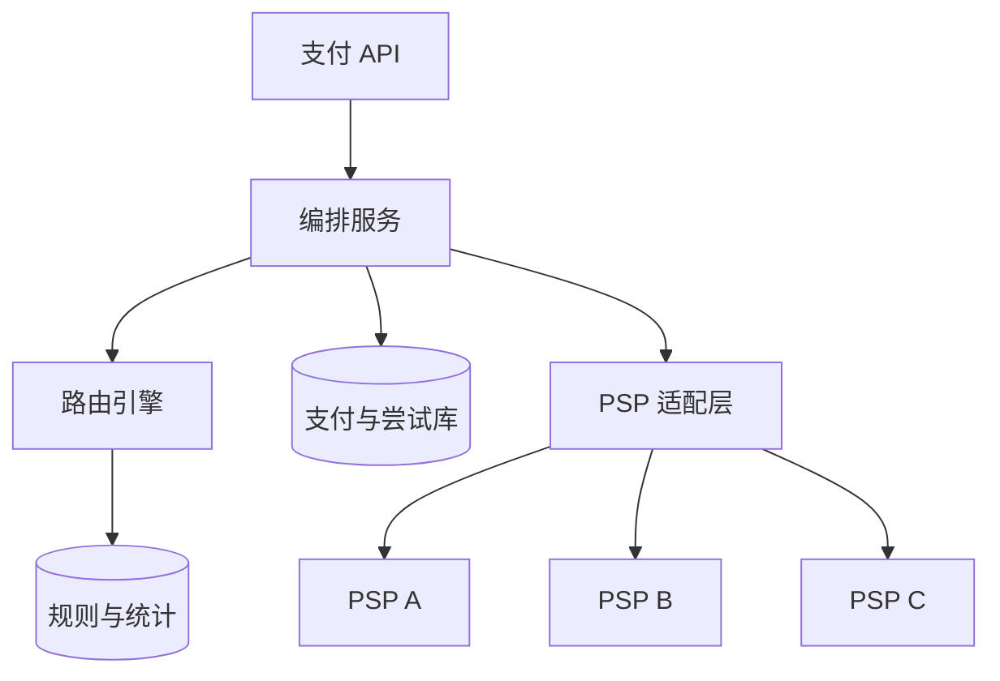
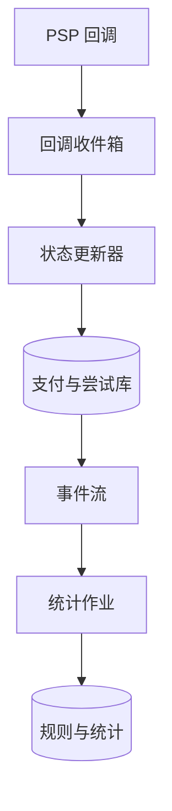
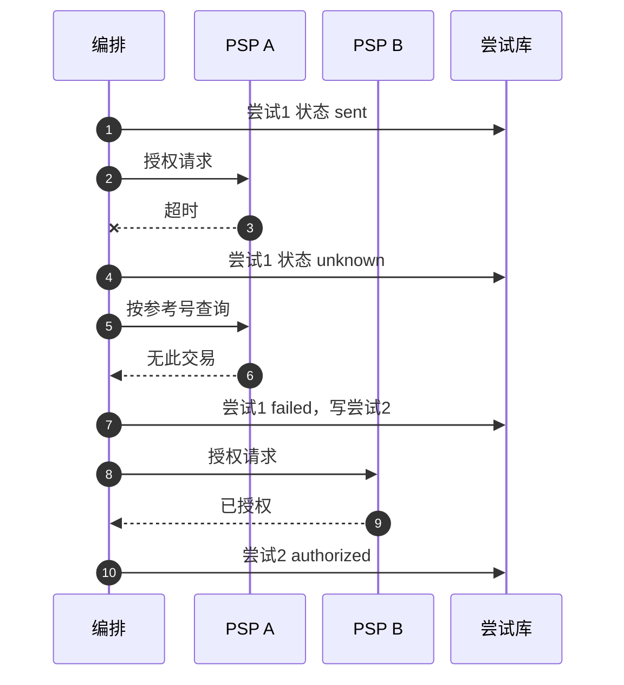

# SD12 多 PSP 支付编排与智能路由（Payment Orchestration and Smart Routing）

## 题目

一个全球化的平台不会只接一家支付服务商（PSP，Payment Service Provider：替你连接银行和卡组织的第三方）。不同国家有不同的本地支付方式，不同的 PSP 在不同发卡行那里的授权成功率（auth rate）不同，费率不同，也会各自出故障。支付编排（payment orchestration）就是在平台和这些 PSP 之间放一层：对每一笔支付，决定走哪家 PSP、用什么支付方式、失败后怎么办，并且让上游看到的是一套统一的接口。

难点有四个。第一，决策要快且可解释：每秒几千笔，决策必须在十毫秒量级完成，而且事后能回答「这笔为什么走了 B 不走 A」。第二，授权率和成本互相牵制，数据又稀疏：授权率高 1 个百分点的价值远大于省几个基点的费用，但要估计出这 1 个百分点，每个对比组要上万笔样本。第三，切换不能双扣：A 超时了，钱可能已经扣了，直接换 B 重发就是重复扣款。第四，支付方式和令牌（token）不是通用的：在 A 那里保存的卡令牌，B 不认，本地支付方式只有特定的 PSP 支持。

面试官通常只说一句：设计一个多 PSP 的支付路由系统。然后盯住几点：按什么路由、授权率怎么衡量、一家挂了怎么切、怎么保证不双扣、保存的卡怎么跨 PSP 使用。支付系统本身的幂等、状态机和账本见 [[sd01-payment-system]]，这里专门把编排和路由讲透。下面的数字是练习用的假设，面试时以面试官当场给的数字为准。

## 澄清问题

开场用三分钟问完下面八个问题，把答案写在白板角落。每个问题都会改变设计。

1. **规模是多少：每天多少笔，多少家 PSP，覆盖多少国家和币种？** 决定路由表的大小和是否需要分区域部署。下面假设每天 3,000 万笔，8 家 PSP，100 个国家，30 个币种，峰值 10 倍。
2. **支付方式只有银行卡，还是包括钱包和本地方式？** 巴西的 PIX、印度的 UPI、荷兰的 iDEAL 这类方式要跳转或扫码，结果异步到达，只能由特定 PSP 处理；这改变了候选集和状态机。
3. **路由要优化什么，权重如何？** 授权率、成本、到账速度、合规要求哪个优先。通常是合规硬约束优先，其次授权率，再是成本。
4. **平台是商户本人（卖币、订阅、广告充值），还是帮卖家收款的市场？** 前者结算到平台自己的账户，后者涉及分账，对账和退款的口径不同。下面以前者为主。
5. **失败后允许自动换 PSP 重试吗？对用户可见的副作用是什么？** 软拒绝（发卡行暂时拒绝）重试可以提高授权率，但每次尝试都有费用，也可能在持卡人账单上留下多个冻结。
6. **已保存的卡和订阅怎么处理？** 保存的卡在 A 那里的令牌不能给 B 用；订阅续费是商户发起的交易，换 PSP 时要带上首次交易的参考号。这决定令牌方案。
7. **路由规则谁改、多久改一次、能不能不发版？** 业务运营每天可能调整；规则变更和代码变更一样危险，需要审核、灰度和回滚。
8. **一致性底线与延迟预算？** 把「不重复扣款」「结果未知不当失败」写成硬约束；路由决策本身 p99 小于 10 毫秒，整体用户可见的截止时间约 8 秒。

## 需求

**功能需求（按优先级）**

1. 创建支付并路由：带幂等键；对每笔支付给出排序的候选 PSP 列表，按顺序尝试。
2. PSP 适配层：统一的授权、请款、作废、退款、查询接口，统一的状态和拒绝类别。
3. 路由规则与评分：合规与合同硬规则，成本、授权率、币种、健康度的评分。
4. 失败切换与级联重试：只在安全的失败类型上切换；结果未知先查询。
5. 支付方式管理：保存、令牌、过期更新、删除；结账时按国家、币种、金额给出可用方式列表。
6. 实验与影子运行：新规则先模拟、再灰度、可回滚；保留一小部分流量做探索。
7. 路由决策审计：每次尝试记录候选、分数、规则版本、选择原因。
8. 为对账提供信息：每次尝试的 PSP、参考号、币种、金额（见 [[sd11-reconciliation-system]]）。

**非功能需求**

| 维度 | 目标 | 说明 |
|---|---|---|
| 正确性 | 重复扣款为 0；结果未知的支付不被当成失败 | 产品承诺，所有取舍让位于它 |
| 路由决策延迟 | p99 小于 10 毫秒 | 热路径上不发远程调用，规则与统计在内存里 |
| 编排自身开销 | p99 小于 200 毫秒（不含 PSP 耗时） | 同 [[sd01-payment-system]] |
| 可用性 | 99.99%；单家 PSP 完全故障时仍能完成支付 | 靠备选 PSP 和熔断，不靠 PSP 自己 |
| 规则变更 | 分阶段放量（1% 到 10% 到 100%），1 分钟内可回滚 | 配置错误的爆炸半径等同于代码 bug |
| 可解释 | 每次尝试都能回答为什么选它 | 审计与问题排查 |
| 对账 | 每次尝试的参考号与对账文件对得上 | T+1 |

**明确不做**：卡组织连接与清算本身、欺诈模型的内部实现（只留调用点）、PSP 合同谈判、税务。

## 容量估算

下面是假设，用来推出设计，不是任何真实产品的流量。

- 支付：3,000 万笔/天 ÷ 86,400 秒 = **347/s 平均**，按 10 倍峰值取 **约 3,472/s**。
- PSP 在途连接：3,472/s × 3 秒超时 = **约 10,417 条并发**，最坏情形。结论：连接池按 PSP 隔离（舱壁，bulkhead），一家变慢不能拖垮其他家。
- 尝试次数：平均每笔 1.1 次，即 3,300 万次尝试/天；决策日志每次约 500 B，**16.5 GB/天**，放进事件流再落列式存储。
- 交易额：平均每笔 12 美元，3,000 万笔 = **3.6 亿美元/天**。授权率每提高 1 个百分点，多成交 3.6 亿 × 1% = **360 万美元/天**；费率每降低 10 个基点（0.1%），省 3.6 亿 × 0.1% = **36 万美元/天**。前者是后者的 10 倍，所以路由目标里授权率的权重高于成本。
- 费率对比：PSP A 收 2.2% 加 0.10 美元，PSP B 收 1.9% 加 0.20 美元。10 美元的交易，A 收 0.32 美元，B 收 0.39 美元；100 美元，A 收 2.30 美元，B 收 2.10 美元。授权率相同时，临界金额是 (0.20 − 0.10) ÷ (0.022 − 0.019) = **33.33 美元**：小额走 A，大额走 B。
- 授权率差异的价值：如果 B 的授权率比 A 高 1 个百分点（0.91 对 0.90），按「成交得到金额、扣除 PSP 费用」计算期望净额：10 美元时 A 为 0.90 × 9.68 = 8.712，B 为 0.91 × 9.61 = 8.745，B 胜；临界金额降到 **7.35 美元**，高于它的交易都应走 B。授权率的 1 个百分点盖过了费率差。
- 样本量：要在 95% 置信、80% 把握下分辨 1 个百分点的授权率差异（基准 90.5%），每组需要 2 × (1.96 + 0.84)² × 0.905 × 0.095 ÷ 0.01² ≈ **13,481 笔**。一个每天只有 1,000 笔的统计单元要 13.5 天才能得出结论，所以统计单元不能太细。
- 统计单元：卡组织 5 × 国家 100 × 币种 30 × PSP 8 × 金额段 4 = **48 万个单元**，每个 40 B，共 **19.2 MB**，常驻内存。多数单元样本不足，要用分层回退（深挖二）。
- BIN 表（卡号前缀对应的发卡行信息）：40 万个区间 × 64 B = **25.6 MB**，每个路由实例常驻内存。
- 超时：0.5% 的调用超时，即 **15 万笔/天**结果未知。如果其中 30% 实际上 PSP 已经处理（假设），盲目切换到 B 就会产生 **4.5 万笔/天**重复扣款。这个数字是不能盲切的理由。
- 软拒绝重试：12% 的尝试被拒绝，其中 40% 是软拒绝（发卡行暂时性原因），共 30M × 12% × 40% = **144 万笔/天**；假设换 PSP 重试成功 15%，授权率提高 12% × 40% × 15% = **0.72 个百分点**，对应多成交 3.6 亿 × 0.72% = **259 万美元/天**。代价是多发 144 万次授权，每次约 0.05 美元，共 **7.2 万美元/天**，收益是成本的 36 倍。
- 探索流量：留 5% 的流量用于探索，最坏情形下被探索的 PSP 授权率低 1 个百分点，损失 3.6 亿 × 5% × 1% = **18 万美元/天**，是为持续学习付的保费。
- 熔断：一家份额 15% 的 PSP，峰值 3,472 × 15% = **521/s**；若每 5 秒评估一次熔断，完全故障的最坏情形下约有 521 × 5 = **2,604 笔**在熔断前受影响。
- 本地收单：假设 15% 的交易是跨境卡交易，改用本地收单若省 1% 费用，节省 3.6 亿 × 15% × 1% = **54 万美元/天**。
- 令牌映射：5 亿个已保存支付方式 × 每个 2 家 PSP 的令牌 × 100 B = **100 GB**，按支付方式 ID 分片。
- 回放模拟：把一天 3,000 万笔决策用新规则重放，每秒 5 万笔，需要 **600 秒**，所以规则上线前可以用昨天的流量试一遍。

**驱动设计的那个数字**是 36 万对 360 万，加上 4.5 万：授权率比成本值钱 10 倍，所以路由要围绕授权率设计、用实验去估计它；而 15 万笔超时里藏着 4.5 万笔会被盲切放大的重复扣款，所以切换规则比路由算法更重要。

## API

```
POST /v1/payments
Headers: Idempotency-Key: <uuid>
Body: { "amount": 1000, "currency": "USD", "country": "BR",
        "payment_method_id": "pm_..." , "customer_id": "...", "order_id": "..." }
200 -> { "payment_id": "...", "state": "authorized" }
202 -> { "payment_id": "...", "state": "processing" }          # 结果未知或异步方式，稍后查询
200 -> { "payment_id": "...", "state": "requires_action", "next_action": {...} }   # 3DS 或跳转

GET  /v1/payments/{id}                  # 内部视图含 attempts: [{psp, state, decline_category}]
GET  /v1/checkout/methods?country=BR&currency=BRL&amount=1000&customer=...
200 -> { "methods": [ {"type": "pix", "rank": 1}, {"type": "card", "rank": 2} ] }

POST /v1/payment-methods                # 由 PSP 托管输入框换取令牌后登记
DELETE /v1/payment-methods/{id}         # 删除，同时在各 PSP 处撤销令牌

PUT  /v1/routing/rules/{version}        # 草稿；校验通过才可模拟
POST /v1/routing/rules/{version}/simulate   # Body: { "date": "2026-10-23" }
POST /v1/routing/rules/{version}/activate   # Body: { "rollout_percent": 5 }
POST /v1/routing/rules/{version}/rollback
GET  /v1/routing/decisions/{payment_id}     # 解释：候选、分数、规则版本、原因码
```

`payment_method_id` 是平台自己的标识，与具体 PSP 无关。同一个 `Idempotency-Key` 加相同内容返回同一个支付；内容不同返回 409。

## 数据模型

| 实体 | 键 | 关键字段 |
|---|---|---|
| Payment | `payment_id`（分片键） | `merchant_id`、`order_id`、`amount`、`currency`、`country`、`method_type`、`state`、`version` |
| Attempt | `attempt_id` | `payment_id`、`seq`、`psp`、`state`（sent / authorized / declined / unknown / voided）、`decline_category`、`psp_reference`、`rule_version`；部分唯一索引：同一支付在 sent、unknown、authorized 状态下至多一行 |
| RouteDecision | `(payment_id, seq)` | 候选列表、每个候选的分数与成本估计、被过滤的原因、`rule_version`、是否探索 |
| PspProfile | `psp` | 支持的支付方式、国家、币种、金额上下限、是否支持幂等键、是否支持作废、是否支持网络令牌、适配器版本 |
| CostModel | `(psp, method, region, version)` | 固定费、基点、跨境加价、外汇点差、是否为 IC++（交易所费加成本加）定价 |
| RoutingRule | `(rule_id, version)` | 条件、动作（过滤或加权）、优先级、状态（draft / shadow / active / retired）、放量比例 |
| AuthStat | `(cell_key, window)` | 尝试数、成功数、软拒绝数、超时数；cell_key 由卡组织、国家、币种、PSP、金额段组成 |
| PaymentMethod | `pm_id` | `owner`、`type`、`fingerprint`（卡号加盐哈希）、`exp`、`state`（active / expiring / expired / invalid / removed）、`network_token_ref`、`first_txn_ref` |
| PspToken | `(pm_id, psp)` | `token`、`state`、`created_at`、`last_used_at` |
| HealthWindow | `(psp, minute)` | 请求数、错误数、超时数、p99 |

状态变更和写 Attempt、写 RouteDecision 放在同一个事务里，凡是要通知别人的事件先写发件箱。Attempt 的部分唯一索引是切换不双扣的最后一道保险（深挖三）。

## 高层设计

**路由与下单路径**



**反馈路径**



一笔支付的步骤：

1. 商户或前端带着幂等键调用 `POST /v1/payments`。编排服务先在事务里写入 Payment（主键冲突说明重复请求，直接返回第一次的结果）。
2. 路由引擎在内存里完成：过滤不满足条件的 PSP，给剩下的打分，排序，得到最多三个候选，并记录 RouteDecision。
3. 编排服务写入 Attempt 1（状态 `sent`，包含 PSP 和幂等用的尝试号），然后通过适配层调用第一个候选，超时 3 秒。
4. PSP 返回结果。授权成功：Attempt 置为 `authorized`，Payment 前进，发件箱通知。
5. 明确的软拒绝或明确的「未处理」类失败：按切换规则（深挖三）写 Attempt 2，换下一个候选。
6. 超时或断连：Attempt 置为 `unknown`，不切换，先查询（见下面的时序图）。
7. 异步方式（跳转、扫码）：返回 `requires_action`，结果由回调写入收件箱，状态更新器按尝试号推进，兜底轮询覆盖丢失的回调。
8. 每次状态变化事件进入事件流，统计作业更新各单元的授权率、超时率和成本，下发到路由引擎的内存。

**超时后的切换**



时序图中每一步：1 先落库再调用，崩溃后恢复进程知道有一条未决的尝试；2 到 3 调用 A，超时没有回应；4 状态置为未知；5 到 6 用同一个尝试号向 A 查询，A 明确回答没有这笔交易；7 此时才把尝试 1 标为失败，同事务写尝试 2；8 到 10 才向 B 发起并记录结果。如果 A 回答「处理中」，就不切换，继续等待到截止时间，再转后台继续查询。

## 深挖

### 一、PSP 适配层：统一接口、统一拒绝类别

问题：每家 PSP 的接口都不同：同步还是异步，状态名、拒绝码、回调格式、幂等支持、退款语义各不相同。如果路由和重试规则直接依赖各家原始的码，规则数量会随 PSP 数乘以拒绝码数增长，换一家 PSP 就要改规则。

**做法。** 每家 PSP 一个适配器，实现同一组接口：授权、请款、作废、退款、按参考号查询、解析回调。适配器负责把各家的状态映射到内部统一的状态机，把原始拒绝码映射到**拒绝类别**（decline category）：

| 类别 | 含义 | 能否换 PSP 重试 |
|---|---|---|
| 已批准 | 授权成功 | 不需要 |
| 硬拒绝 | 卡被盗、卡号无效、账户关闭 | 不能，换谁都一样 |
| 软拒绝 | 发卡行暂时性拒绝（一般性拒绝、发卡行不可用） | 可以，换 PSP 或换时间可能成功 |
| 余额不足 | 额度或余额不够 | 不换 PSP，可提示用户换卡或稍后重试 |
| 风控拒绝 | 我们或 PSP 的欺诈规则拒绝 | 不能 |
| 需要验证 | 要求 3DS 或其他强认证 | 不是失败，进入验证流程 |
| 技术错误（未到达） | 连接被拒、校验失败 | 可以，PSP 没有处理 |
| 结果未知 | 超时、断连 | 不能，先查询 |

路由和重试规则只看类别，不看原始码。原始码保留在 Attempt 里，用于分析和对账。

**能力登记表。** PspProfile 登记每家 PSP 的能力：支持的方式、国家、币种、金额上下限，是否接受幂等键，是否能作废，是否支持网络令牌。过滤阶段直接用它判断候选资格，新增一家 PSP 主要是写一个适配器加一份登记，不改路由逻辑。

**幂等能力不齐。** 对支持幂等键的 PSP，把 `attempt_id` 作为幂等键，重发时对方返回第一次的结果；不支持的，用商户参考号加查询接口模拟：重发前先查有没有这个参考号的交易。适配器声明自己的能力，编排服务据此选择安全的重试方式。

**代价与取舍。** 统一接口是最小公倍数，会丢失某家 PSP 的特色功能；折中是接口里带一个 `extras` 字段透传 PSP 专有参数，只有少数调用方使用。适配器要有契约测试，用录制的 PSP 响应回放，PSP 悄悄改字段时能被发现；每家 PSP 独立的连接池、超时和熔断，一家变慢不影响其他家。

### 二、路由决策：先过滤，再评分，再选择

问题：给定一笔支付，如何选 PSP。决策分三步，每一步解决不同的约束。

**过滤（硬约束，不可商量）。** 去掉不满足条件的候选：

| 条件 | 例子 |
|---|---|
| 能力 | 不支持该支付方式、币种、国家、金额 |
| 合规 | 部分市场要求由本地持牌机构处理；数据驻留要求 |
| 健康 | 熔断器已打开 |
| 令牌 | 已保存的卡在这家 PSP 没有令牌（见深挖四） |
| 合同 | 某家的月度承诺量已用满或设了上限 |

如果过滤后只剩一个候选（比如巴西的 PIX 只有一家本地 PSP），就没有可选，也没有可切换的备份；这时降级路径是向用户提供另一种支付方式，而不是换 PSP。

**评分（软目标）。** 对剩下的每个候选估计期望净额：授权率乘以成交后扣除费用的金额。公式是 `p × (金额 − 费用)`，其中 `p` 是该候选在这类交易上的估计授权率，费用由 CostModel 按金额、方式、地区算出。例如 10 美元的交易，A 的 p 为 0.90、费用 0.32 美元，期望净额 8.712；B 的 p 为 0.91、费用 0.39 美元，期望净额 8.745，选 B。授权率差 1 个百分点，就把临界金额从 33.33 美元移到 7.35 美元（见估算）。这个公式在数量级上说明：授权率的权重大于费用，但它是简化模型，真实评分还要加到账速度、结算币种、合同量等项，权重放在配置里。

**估计授权率。** 难点在样本稀疏：48 万个单元，多数每天不到 1,000 笔，而分辨 1 个百分点需要 13,481 笔。做法是分层回退（hierarchical backoff）：单元样本够就用单元自己的授权率；不够就回退到更粗的一层，依次是（卡组织、国家、PSP）、（国家、PSP）、（PSP），并用贝叶斯收缩把稀疏单元拉向上一层的均值。统计用最近 7 天加指数衰减，让新近的变化权重更大，这样能较快发现某家 PSP 对某个发卡行突然变差。

**选择与探索。** 如果永远选估计最优的，劣势的候选得不到数据，估计永远不会更新。所以留 5% 流量做探索：用汤普森采样（Thompson sampling，按后验分布随机抽样来选）在候选间分配，估计越不确定的候选被探索得越多。探索的成本在最坏情形下是每天 18 万美元，是持续学习的保费。新接入的 PSP 或新国家，先走影子模式（只记录若走它会怎样，不真实发送），再用 1% 到 5% 灰度。

**输出。** 不是一个 PSP，而是排序的候选列表（至多三个）加每个候选的原因码，写入 RouteDecision。

**规则是数据，不是代码。** 规则与统计放在配置里，版本化，经过校验、模拟、灰度才生效。模拟：用昨天 3,000 万笔流量重放新规则，每秒 5 万笔需 600 秒，对比旧规则的候选分布、预计授权率和成本，再放量。放量用百分比，从 1% 到 10% 到 100%，监控授权率、超时率、延迟，指标恶化立即回滚（1 分钟内）。

**热路径上无远程调用。** BIN 表 25.6 MB、统计 19.2 MB 常驻内存，每分钟从统计作业刷新一次；路由引擎本身是进程内的函数，所以决策 p99 小于 10 毫秒。统计服务暂时不可用时，用上一份快照，快照过旧（超过 15 分钟）就退回到静态的默认优先级。

### 三、失败切换不双扣：先判定结果，才允许换

问题：A 返回了失败或超时之后，什么时候可以换 B。这是整个系统最危险的决定，因为错误的切换直接产生重复扣款。（切换规则的基础版本见 [[sd01-payment-system]] 深挖五，这里讲编排层的完整做法。）

**切换的前提是前一次尝试已经有定论。**

| 前一次尝试的结果 | 能否换下一个候选 | 理由 |
|---|---|---|
| 技术错误（连接被拒、校验失败，请求没到达） | 能 | PSP 没见过这笔请求 |
| PSP 明确声明未处理 | 能 | 对方明确没有执行 |
| 软拒绝 | 能 | 已有明确的拒绝，没有钱被冻结 |
| 硬拒绝、余额不足、风控拒绝 | 不能 | 换谁结果都一样，还会惹恼用户和发卡行 |
| 超时、断连 | **不能，先查询** | 结果未知，A 可能已经授权 |
| 查询返回「处理中」 | 不能，继续等或转后台 | 对方还没有定论 |
| 查询返回「无此交易」 | 能 | 对方确认没有这笔 |
| 查询返回「已授权」 | 不换，直接采用 A 的结果 | 钱已经冻结，再发 B 就是双扣 |

**为什么不能盲切。** 3,000 万笔里 0.5% 超时是 15 万笔；若其中 30% 其实 PSP 已处理，盲目切 B 就是每天 4.5 万笔重复授权。这些冻结要等授权到期才释放，用户会看到两笔，客服电话量和拒付都会上升。

**数据库强制。** Attempt 表上的部分唯一索引：同一个 `payment_id` 在 `sent`、`unknown`、`authorized` 状态下至多一行。写 Attempt 2 之前必须先把 Attempt 1 置为已定论的终态，否则插入冲突。这样即使两个并发进程、一个重试的消费者、一个人工操作同时想切换，数据库也只放行一个。

**PSP 侧幂等。** 对每次尝试使用固定的 `attempt_id` 作为 PSP 的幂等键或商户参考号。重发同一次尝试（不是切换到下一个候选）是安全的：支持幂等的 PSP 在去重窗口内返回第一次的结果。

**预算。** 整笔用户可见的截止时间约 8 秒；每次尝试超时 3 秒，所以最多两次：3 + 3 = 6 秒，留 2 秒给编排和落库。超过截止时间就把支付置为处理中，向用户展示「付款处理中」，后台继续查询，而不是再发起第三次尝试。

**不用对冲请求。** 读请求可以向两个副本同时发来降低尾延迟（对冲，hedging），但支付授权不行：两个请求都可能成功。唯一例外是幂等的查询调用（BIN 查询、状态查询）。

**软拒绝级联。** 对软拒绝换 PSP 重试，估计每天多成交 259 万美元，代价是 7.2 万美元的额外授权费。但要有限制：每笔至多一次级联；同一张卡短时间内的重试次数受发卡行的限制，过多会触发风控；级联成功率要用保留组（不级联的 5% 流量）持续衡量，别凭感觉假设 15%。

**熔断与降级。** 熔断器按 PSP 维护：一分钟窗口内至少 50 个请求，错误率超过 5% 就打开，半开时放 1% 的探测流量。熔断打开后，该 PSP 退出候选；所有候选都不可用时，对商户返回明确的可重试错误，对币类充值提供替代方式。运营有手动熄火开关：某家 PSP 出事故时一键摘除。

**被否决的方案。** 超时后立即重发给 B：双扣。超时后在 A 上重发而不换：可以，但必须用同一个尝试号，让 A 去重。同时发给 A 和 B 取先返回的：两个都可能成功。

### 四、支付方式管理与令牌：卡存在哪里，怎么跨 PSP

问题：用户保存了一张卡，之后用它付款、订阅续费。如果令牌只在 A 那里有效，A 故障时这张卡就无法走 B，路由的备份能力大打折扣。

**令牌方案对比。**

| 方案 | 做法 | 优点 | 缺点 |
|---|---|---|---|
| PSP 令牌 | 每家 PSP 保管卡，给我们一个只在它那里有效的令牌 | 简单，我们不碰卡号，合规范围小 | 令牌不可移植，被 PSP 绑定，换 PSP 要重新收集卡信息 |
| 自建金库 | 我们保管卡号，调用 PSP 时通过代理转发 | 完全自主，可发给任何 PSP | PCI DSS 最高级别的合规与安全成本，是一个独立的大系统 |
| 网络令牌 | 卡组织为卡发放的令牌，平台作为请求方持有 | 跨收单方可用，卡换新后自动更新，授权率通常更高 | 需要卡组织与发卡行支持，不是所有卡都有 |

多数平台的路径是：先用 PSP 令牌上线；规模上来后，对支持的卡引入网络令牌，使保存的卡不再绑死在某一家 PSP；自建金库留给确有必要的场景。

**映射表。** PaymentMethod 是平台自己的实体，与 PSP 无关；PspToken 记录它在各家 PSP 的令牌，状态独立。路由过滤时，如果候选 PSP 没有这张卡的令牌，就把它从候选里去掉，或在用户同意的情况下为它新建令牌。5 亿个支付方式 × 2 家 × 100 B = 100 GB，按 `pm_id` 分片，查询量就是支付量（3,472/s），不是瓶颈。

**订阅与商户发起的交易。** 用户在场的支付（customer-initiated）和商户自动发起的续费（merchant-initiated）是两类交易，卡组织对后者要求带上首次交易的参考号。切换 PSP 时必须把这个参考号一起带过去，否则续费授权率会明显下降。所以首次交易的参考号保存在 PaymentMethod 的 `first_txn_ref` 里，属于迁移的必选数据。

**生命周期。** 状态：`active`（可用）、`expiring`（即将过期，提前提醒或通过卡更新服务刷新）、`expired`、`invalid`（反复被硬拒绝）、`removed`。卡更新服务和网络令牌的生命周期通知自动刷新有效期和新卡号，减少因过期造成的失败。删除：用户删除时要在所有 PSP 处撤销令牌，平台只保留不可还原的指纹和账本引用，满足删除请求又不破坏历史记录。指纹是加盐的哈希，用来识别「同一张卡被多个账户使用」，也供风控使用。

**结账方式列表。** `GET /v1/checkout/methods` 是国家、币种、金额、设备、用户状态和 PSP 健康的纯函数：先用能力登记表过滤出可用方式，再按转化率和成本排序。结果按（国家、币种、金额段）缓存 60 秒；某家 PSP 熔断打开时，仅依赖它的方式立即从列表消失。

**异步方式。** PIX、UPI、银行跳转的结果通过回调异步到达，有有效期（二维码常是 30 分钟）。它们走同一套状态机：`requires_action` 到 `processing` 到终态；过期后用户再点要生成新的尝试而不是复活旧的，防止晚到的付款对不上订单。

### 五、币种与本地化：在哪里收、用什么币、在哪里结算

问题：同一笔交易涉及三个币种：持卡人看到的展示币种（presentment currency）、PSP 结算给我们的币种（settlement currency）、我们记账的基础币种。在哪里换汇、由谁换汇，直接影响成本、授权率和对账。

**本地收单。** 用持卡人所在国家的本地收单行、以本地币种处理，通常比跨境处理授权率更高（发卡行更信任本国的收单），费用更低（不收跨境加价）。按假设 15% 的交易是跨境，若省 1%，每天省 54 万美元。路由规则里「国家 + 币种」是最重要的维度之一：优先选在该国有本地收单能力和本币结算账户的 PSP。

**换汇发生在哪里。**

| 方案 | 做法 | 优点 | 缺点 |
|---|---|---|---|
| PSP 换汇 | PSP 收本币，换成结算币种后付给我们 | 简单，我们不持有外币头寸 | 点差由 PSP 定，通常较高，汇率不透明 |
| 多币种结算 | 在 PSP 处开本币结算账户，保留本币，由我们的财务按批发汇率换汇 | 成本低，可控 | 要管理多币种头寸和汇率风险 |

多数平台在小币种上用 PSP 换汇，在主要币种上用多币种结算。对账按结算币种分别核对（见 [[sd11-reconciliation-system]]）；账本记录交易币种金额、结算币种金额和使用的汇率，汇兑差异单独成科目。

**本地方式的候选集。** 有的本地支付方式只能经特定 PSP 处理，过滤之后候选只有一个，路由退化成一个查表。这类方式的可用性完全取决于那一家 PSP：所以健康监控要细到「PSP × 方式」，熔断打开时的降级是提示用户换用银行卡，而不是切换到不支持这种方式的 PSP。

**费用的来源。** 一笔交易的成本包括交换费（发卡行收，因卡种和地区而异）、卡组织费、PSP 加价、跨境加价和外汇点差。IC++ 定价把前三项分开列出，平台能看到每一项；混合定价（blended）则打包成一个统一费率。IC++ 对大平台更透明，路由引擎的成本模型也能据此对每个 BIN 精确估算，混合定价则只能用平均值。

## 故障与边界

| 组件 | 故障时的影响 | 缓解 |
|---|---|---|
| 单家 PSP 变慢或故障 | 连接占满，该家的支付失败或超时 | 独立连接池；熔断；备选候选；只在有定论的失败上切换 |
| 所有候选都不可用 | 无法完成支付 | 向商户返回可重试错误；充值类场景提供替代方式；运营熄火开关 |
| 路由配置错误 | 大量流量被送到错误的 PSP | 校验、昨日流量模拟、灰度放量、1 分钟回滚；放量期间监控授权率 |
| 统计服务不可用 | 授权率估计变旧 | 使用上一份快照；过旧则退回默认优先级 |
| 回调丢失或乱序 | 状态停在处理中 | 收件箱去重；状态单调；兜底轮询；对账 |
| 尝试库分片主库故障 | 该片支付创建失败 | 同步副本接管；网关快速失败并让商户带原键重试 |
| 令牌缺失 | 备选 PSP 不能用于这张卡 | 过滤时去掉；用户同意后新建令牌；网络令牌降低依赖 |
| PSP 悄悄改字段或拒绝码 | 类别映射错误，误判软硬拒绝 | 契约测试；拒绝类别分布的异常告警 |
| 重复回调、迟到的成功 | 状态被错误回退，或已切换后原 PSP 才成功 | 状态单调；迟到的成功按晚到成功处理：作废或退款，并告警 |
| 时钟漂移 | 去重窗口、统计窗口边界错 | 同步时间源；统计窗口用事件时间 |

**边界。** 部分授权（只批准部分金额）：作为单独的结果处理，不能当成功也不能当失败。多次尝试的费用：每次授权都产生费用，监控每笔平均尝试数（假设 1.1），突然升高说明某个 PSP 在大量软拒绝。同一张卡短时间多次失败：触发风控，停止级联。退款走原 PSP，因为只有原 PSP 有这笔交易，路由不能改变退款的去向。

## 面试官追问

1. **怎么衡量一家 PSP 的授权率？** 按可比的单元（卡组织、国家、币种、金额段）分层统计成功数除以尝试数，剔除硬拒绝和余额不足这类与 PSP 无关的拒绝，否则会把用户行为算到 PSP 头上。样本量不足的单元回退到上一层并收缩，用最近 7 天加衰减。
2. **只用规则行不行，为什么还要评分和实验？** 规则适合硬约束（合规、合同）；授权率会随发卡行、时间变化，规则会过期。评分加探索让系统持续学习，规则只负责约束评分的范围。规则变更也要走模拟和灰度。
3. **A 超时了，怎么保证切到 B 不双扣？** 超时是未知，不是失败：先用同一个尝试号向 A 查询；A 确认没有这笔才写下一次尝试并发给 B；数据库的部分唯一索引保证同时只有一个活跃尝试。A 说已授权就直接采用，A 说处理中就继续等。
4. **软拒绝换 PSP 重试值得吗？** 按假设，每天多成交 259 万美元，多花 7.2 万美元授权费。但要留保留组衡量真实的挽回率，限制每笔一次，对同一张卡的重试频率设上限，避免触发发卡行的风控。
5. **保存的卡怎么在多个 PSP 之间使用？** PSP 令牌不可移植；对支持的卡引入网络令牌，使保存的卡不再绑死在某一家；映射表记录每张卡在每家 PSP 的令牌；订阅续费要带首次交易的参考号。
6. **一家 PSP 全面宕机时会发生什么？** 熔断在一两个评估周期内打开，约 2,604 笔受影响（假设）；之后该家退出候选，流量按评分分到其余家；依赖它的本地支付方式从结账列表消失，提示换方式。超时造成的未知尝试逐个查询收敛。
7. **路由规则配错了怎么办？** 配置是版本化的数据：先校验，再用昨天的流量模拟，再 1% 灰度，监控授权率、超时率和延迟，恶化就在 1 分钟内回滚。每次决策都带规则版本，事后能圈出受影响的支付。
8. **怎么选择费用优先还是授权率优先？** 用价值量化：1 个百分点授权率是 360 万美元/天，10 个基点费用是 36 万美元/天，差 10 倍。所以默认授权率优先，只有两家授权率统计上无差异时才比较成本，并且受合同约束。
9. **新接入一家 PSP 怎么上线？** 先适配器和契约测试；能力登记；影子模式只记录不发送；1% 灰度，与基线对比授权率、延迟；逐步放量，同时对账文件要能对上，确认参考号和手续费口径都正确。
10. **为什么不用对冲请求降低延迟？** 授权不是幂等读，两个请求都可能成功，会双扣。对冲只适用于幂等的查询调用。
11. **多币种怎么处理？** 区分展示币种、结算币种、记账币种；优先选有本币结算账户的 PSP，避免不必要的换汇；账本记录交易币种金额、结算币种金额和汇率，汇兑差异单独成科目，对账按结算币种进行。
12. **路由系统怎么对账？** 每次尝试记录 PSP、参考号、规则版本和费用估计；对账时用 PSP 报告中的实际费用与成本模型的估计比较，差异大说明成本模型过期，要更新；重复或缺失的尝试在对账中被发现（见 [[sd11-reconciliation-system]]）。

## 评分要点

一个 senior 的回答必须覆盖：

- 开场把「不重复扣款」「结果未知不当失败」写成硬约束，并问清方式范围、商户身份、规则谁改、令牌现状。
- 估算后得出结论：授权率 1 个百分点（360 万美元/天）是 10 个基点费用（36 万美元/天）的 10 倍；统计单元要 13,481 笔样本，所以要分层回退。
- 适配层：统一接口和拒绝类别，规则只看类别；能力登记表；幂等能力不齐时的处理。
- 路由三步：过滤（硬约束）、评分（期望净额，带数字例子）、选择（探索加影子加灰度）；规则是版本化的数据；热路径无远程调用。
- 切换不双扣：按失败类型逐项说明能否切，超时先查询，数据库部分唯一索引，PSP 侧固定尝试号，8 秒预算，不用对冲请求；用 4.5 万笔/天说明盲切的代价。
- 支付方式与令牌：三种令牌方案的取舍，映射表，网络令牌，订阅的首次交易参考号，生命周期与删除，异步方式。
- 币种与本地化：展示、结算、记账三个币种；本地收单；换汇放在哪里。
- 审计与对账：RouteDecision 记录每次决策；尝试参考号与对账对齐。
- 主动说出自己设计里最弱的一环（授权率估计依赖稀疏样本，新单元长期靠回退；或网络令牌覆盖率有限，部分卡仍绑定在单一 PSP）。

时间不够时（30 分钟）：5 分钟澄清加硬约束，5 分钟画路由与反馈两条路径，剩下 20 分钟讲路由三步和切换不双扣，令牌、币种各用两分钟口述。

## 延伸阅读

- 通用题解：[[solution-payment-system]]、[[solution-digital-wallet]]。
- 同批题单：[[tiktok-sd-index]]；支付状态机与幂等见 [[sd01-payment-system]]，切换后的对账见 [[sd11-reconciliation-system]]，打款通道的选择见 [[sd10-creator-payouts]]，账本分录见 [[sd09-wallet-ledger]]。
