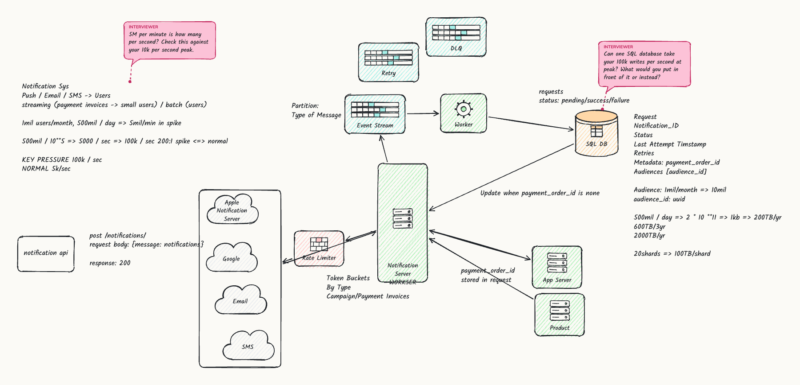
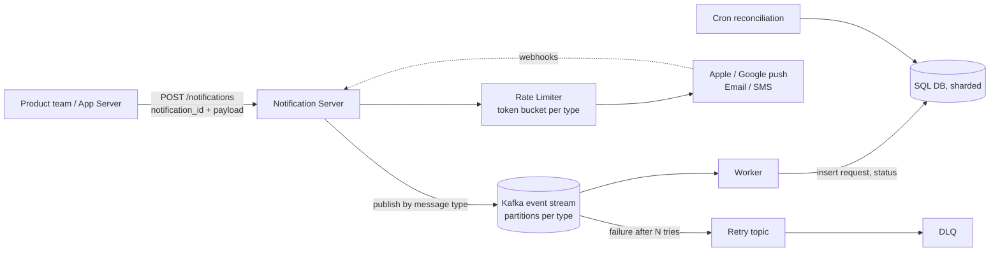

# Recap: Design a Notification System (senior mock interview)

Date: 2026-11-11 · Duration: 37 minutes of a 45 minute slot · Result: **Lean hire (senior)**

Files in this folder: `architecture-final.png` (the board at the end), `transcript.md` (raw, timestamped), `timeline.md` (per-minute activity), `session.json` (metadata and feedback), `board-final.json` (board elements).

## 1. Context

A mock system design interview: the candidate gets an open-ended product problem and has about 45 minutes to clarify it, estimate its size, design it on a whiteboard and defend it while an interviewer probes. The interviewer here was Claude, running through the `sysdesign-board` tool (a whiteboard in the browser plus voice).

**The problem.** A large consumer platform (think a payments company) wants one shared service that every product team calls to send notifications: mobile push, email and SMS. Two very different kinds of traffic share it: a single payment receipt that must arrive in seconds, and a marketing campaign that fans out to millions of users at once. The interviewer fixed these numbers: 100 million monthly active users, about 500 million notifications per day on average, and campaign spikes of about 5 million per minute.

**Terms used below.** *Idempotency*: sending the same request twice has the same effect as sending it once (here: one receipt, not two). *Fan-out*: one campaign request becomes millions of individual messages. *Rate limiter / token bucket*: a counter that lets only N requests per second through, refilled steadily. *Dead letter queue (DLQ)*: where messages go after repeated failure so they stop blocking others. *Kafka (event stream)*: a durable log that producers append to and consumers read at their own pace, which absorbs bursts.

## 2. What the candidate designed

**One request end to end, as described.** A product team calls `POST /notifications` with a client-generated `notification_id` and a message. The notification server acknowledges (HTTP 200) and the work continues asynchronously. The message goes onto Kafka, a worker records it in SQL with status `pending / success / failure`, and sending goes through a rate limiter in front of Apple, Google, the email provider and the SMS gateway. Providers report the outcome back through webhooks; a cron job reconciles anything still pending. Failures return to a retry topic and finally a DLQ. Payment receipts and campaigns use separate partitions and separate consumers, with separate token buckets so a campaign cannot starve receipts. Old rows are trimmed to metadata and moved to cold storage (Iceberg).

**Gap the interview exposed.** The candidate never stated precisely *when* the 200 is returned relative to durability (after the Kafka publish? after the SQL insert?). That sequence is the heart of the "what if the server crashes right after acknowledging" question and should be said out loud.

## 3. Timeline

Phase boundaries are from the interviewer's phase tracker; times are minutes into the session.

| Time | Phase | What happened |
|---|---|---|
| 00:00 to 07:00 | Requirements and estimation | Restated the problem, clarified "streaming" (low-latency single sends vs batch campaigns), asked for scale, then did the arithmetic (see section 4). |
| 07:00 to 16:00 | API and high-level | `POST /notifications` with an ID; ack-then-async; SQL for status; at 12:20 realized SQL cannot take the peak and added Kafka; at about 15:00 added the external providers and a rate limiter. |
| 16:00 to 33:00 | Deep dive | Retry topic and DLQ (18:35); partitions per type (19:50); reserved token buckets per type (21:00); idempotency (22:00 to 25:30, needed a hint); campaign fan-out and crash resume (26:00 to 32:00); webhooks plus reconciliation (32:26). |
| 33:00 to 37:00 | Wrap-up | Storage sizing, sharding, retention and Iceberg cold storage. |

Per-minute detail (words spoken, questions asked) is in `timeline.md`.

## 4. Numbers: what was said versus what is right

| Quantity | Candidate | Correct | Note |
|---|---|---|---|
| Average rate | about 5,000/s | 500M / 86,400 = about 5,800/s | Fine as an order of magnitude. |
| Spike rate | 10,000/s first, then 100,000/s | 5M / 60 = about 83,000/s | First answer was 8x too low; fixed after two nudges. |
| Spike to average | "20:1", later wrote "200:1" | about 14:1 (83k / 5.8k) | Board still says 200:1. |
| Rows per year | 2 x 10^10 first, then 2 x 10^11 | 500M x 365 = 1.8 x 10^11 | First answer 10x too low; corrected after a nudge. |
| Storage per year at 1 KB/row | 20 TB, then 200 TB | about 180 TB | Final figure is right. |
| Three years, with replicas | 600 TB, 2,000 TB | about 550 TB, about 1.6 PB with 3 copies | Close enough. |
| Per shard, 20 shards | 100 TB | about 27 TB per primary (2,000 TB includes replicas) | Mixes replicated and raw totals. |
| Users | board says "1mil users/month" | 100M MAU (given) | Off by 100x on the board; harmless to the design but sloppy. |

Pattern: the arithmetic was reliable only after a nudge, and most errors were powers of ten. Writing units on every line (per day, per minute, per second) catches this.

## 5. Where the interviewer had to step in

| Moment | Issue | Right answer |
|---|---|---|
| 04:30 and 06:30 | Peak per second computed from the wrong time base | 5M per minute is 83k per second. |
| 07:50 | Drew App Server straight to the user, skipping the notification system | The product team calls the notification service, which owns delivery. |
| 11:30 | One SQL database at 100k writes per second | Put a durable log (Kafka) in front, which the candidate then did. |
| 23:00 to 25:30 | Idempotency via locks, then "check if it exists" in the request path | A **unique constraint** on the notification ID (or payment order ID) makes the second insert fail atomically, with no lock and no extra lookup. Hint was given at 25:33. |
| 27:57 to 31:00 | "After a crash, what tells the fan-out job it already did the first four million?" | Not answered directly. Needed: a campaign job row with a cursor or per-chunk status, written in the same transaction as the chunk's messages, so a restart resumes from the cursor and the unique constraint absorbs any overlap. |
| 34:32 | Storage off by 10x | 180 TB per year. |

## 6. Feedback

Signal: **Lean hire (senior)**.

| Dimension | Score (3 = meets the bar) |
|---|---|
| Requirements | 3 |
| Estimation | 2 |
| High-level design | 4 |
| Deep dive | 3 |
| Trade-offs | 3 |
| Communication | 3 |

Strengths: the core architecture (fast ack, durable buffer, async workers, status in a database); disciplined failure handling (retry, DLQ, no head-of-line blocking); reserved quota per message type so receipts survive a campaign; unprompted retention and cold storage thinking; a readable board.

Improvements: sanity-check estimates with units; name the unique-constraint answer for idempotency immediately; make campaign fan-out resumable with an explicit checkpoint; ask about delivery guarantees, opt-outs and latency targets before designing; state the decision first, then the reason, instead of restating the question; raise sharding keys and retention before storage becomes the headline problem.

## 7. Practice list

1. **Unit-chain drill.** Take five systems with a per-day volume, and write per-second average, peak, bytes per year and replicas, with units on every line, in under three minutes each.
2. **Idempotent write.** Design `POST /payments` retried by the client: unique key, atomic insert-if-absent, what the second call returns, and what happens if the first call crashed mid-way.
3. **Resumable batch job.** Redo the ten-million-user campaign with a job table, a cursor, chunk status and a crash after chunk 4. Say which write is atomic with which.
4. **Ack semantics.** Write one sentence for each ordering: ack after Kafka publish, ack after SQL commit, ack after provider call. State what each loses on a crash.
5. **Requirements checklist.** Rehearse a 90-second opening: users, scale, latency targets, delivery guarantee (at-least-once vs exactly-once), opt-out and preferences, channels, retention.

## 8. Recording gaps

- This session ran before the recorder existed, so there are **no per-minute board screenshots, no board history and no audio**. Only the transcript, the final board and the feedback survive.
- The candidate's microphone audio is never recorded (the browser transcribes it and keeps no audio). Interviewer voice clips are recorded from now on.
- The transcript comes from browser speech recognition and contains mis-hearings (for example "one meeting users" for "one hundred million users"); it is kept raw in `transcript.md`.
